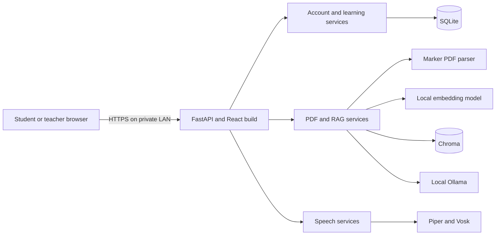

# Offline AI Learning architecture

The desktop runs FastAPI and all model processes. React is built to static files
and served by FastAPI from the same HTTPS origin in LAN mode. Student and teacher
devices use a browser; they do not need Ollama, Marker, embeddings, Piper, Vosk,
or an internet connection.

## Data flow

1. A PDF upload enters `app/api/documents.py` or the teacher material route.
   `document_service.py` enforces the 100 MB limit, stores the file, and passes
   PDFs to `marker_service.py`. Marker returns structured pages, sections,
   tables, equations, and image references. `chunking_service.py` keeps source
   page and section metadata with each bounded chunk.
2. `embedding_service.py` runs the local embedding model and
   `vector_store_service.py` writes vectors and metadata to Chroma. Search uses
   selected document IDs, then `retrieval_ranking_service.py` ranks results.
3. `rag_service.py` builds a prompt from retrieved excerpts and asks local
   Ollama. Answers include source references. Quiz and lesson generation use
   the same local model and document access checks where applicable.
4. `database.py` and SQLite migrations store users, revocable sessions,
   courses, enrollment, assigned quizzes, attempts, progress, knowledge
   profiles, flashcard reviews, and recommendations. Teacher routes check role
   and ownership; student routes check account and enrollment.
5. Browser speech capture encodes mono PCM WAV. The authenticated speech route
   uses local Piper for synthesis and Vosk for transcription. It does not send
   audio to a cloud service or calculate a pronunciation score.

## Storage and trust

| Path or service | Purpose |
| --- | --- |
| `backend/app/data/conversations.sqlite3` | Account, course, progress, and conversation records. |
| `backend/app/data/chroma/` | Local vector index. |
| `backend/app/data/documents/` | Uploaded source files and extracted images. |
| `backend/.models/` | Cached Marker, Piper, and Vosk models. |
| Local Hugging Face cache | Cached sentence-transformer embedding model. |
| `backend/.certs/` | Local CA and server keys for HTTPS LAN mode. |
| Local Ollama | Generative model and its local model cache. |

The LAN password gate protects the whole site. Student and teacher accounts
provide separate authorization inside it. General document chat is a shared
workspace for people who know the LAN password; teacher course materials have
additional route and enrollment checks. Use a private network and do not expose
port 8443 to the internet. The server uses one worker because its rate limits
are process local and its stores are shared.

## Running and verification

See [LAN deployment](backend/LAN_DEPLOYMENT.md) for installation, certificate
trust, firewall, backup, and restoration. See
[final validation](backend/FINAL_VALIDATION.md) for the test commands and the
remaining physical-device acceptance checks.
