# **PHYSICS**

**Grade 12**

**Government of Nepal**

**Ministry of Education, Science and Technology**

**Curriculum Development Centre**

**Sanothimi, Bhaktapur**

**Publisher: Government of Nepal Ministry of Education, Science and Technology Curriculum Development Centre Sanothimi, Bhaktapur © Curriculum Development Centre All rights reserved, no part of this publication may be reproduced, transmitted in any other forms or by any means without the written permission of the publisher. However, this does not prohibit making photocopies of its pages for teacher training or other nonprofit making purposes. First Edition: 2025**

**Send your comments and suggestions to:**

**Curriculum Development Centre**

**Phone: 01-6630-588, Fax: 01-6630-797**

**Email: info@moecdc.gov.np**

**Website: moecdc.gov.np**

**Preface**

The curriculum is the central guide that determines what is essential for teaching and learning.

A textbook is one of the main tools used to deliver the intent and the content of the curriculum.

Therefore, it should present relevant, practical, and useful knowledge and help develop skills

for the overall development of learners in accordance with curricular aims and objectives. This

textbook, **'Physics, Grade 12'**, has been prepared in line with the intent of the National

Curriculum Framework for School Education, 2076 and developed in accordance with

Secondary Level (Grade 11-12) Physics Curriculum, 2077.

This book has been developed by a team consisting of Mr. Bishnu Prasad Paudel, Mr. Bhagirath

Neupane, Mr. Arjun Sedhai, Mr. Purna Shreshta and Mr. Lav Dev Bhatta. Several people,

notably, the Director General Mr. Yubaraj Paudel and Dr. Kamal Prasad Acharya, Mr.

Umanath Lamsal, Mr. Keshar Bahadur Khulal, Mr. Heramba Raj Kandel, Ms. Mina Shrestha,

Mr. Purushottam Ghimire, Mr. Prakash Timsina, Mr. Deepak Kafle, Mr. Manoj Chaudhary,

and Mr. Devendra Rimal Neupane deserve special appreciation for their valuable contributions.

Efforts have been made to make the book activity oriented and interesting to the learners. All

the contents of each lesson in this book are equally important. However, teachers can adapt to

the contents and tasks according to the needs of their learners and classroom contexts. This

book can be used as a major resource for classroom teaching; however, it should not be

considered the only source of learning. The teachers are encouraged to explore additional

resources and use them to supplement the curricular contents as outlined in the curriculum. The

Curriculum Development Centre always welcomes constructive feedback and suggestions for

the continuous improvement of its publications.

2025 **Curriculum Development Centre**

Sanothimi, Bhaktapur

#### **Contents**

| Chapter | Topic                                      | Page<br>Number |
|---------|--------------------------------------------|----------------|
| 1.      | Rotational Dynamics and Oscillatory Motion | 1              |
| 2.      | Periodic Motion                            | 25             |
| 3.      | Fluid Mechaincs                            | 45             |
| 4.      | First Law of Thermodynamics                | 77             |
| 5.      | Second law of Thermodynamics               | 96             |
| 6.      | Wave Motion                                | 116            |
| 7.      | Mechanical Wave                            | 127            |
| 8.      | Waves in pipes and strings                 | 137            |
| 9.      | Acoustic Phenomenon                        | 152            |
| 10.     | Nature and Propagation of Light            | 175            |
| 11.     | Interference of Light                      | 186            |
| 12.     | DIFFRACTION                                | 202            |
| 13.     | Polarisation                               | 218            |
| 14.     | Electrical Circuits                        | 228            |
| 15.     | Thermoelectric Effect                      | 255            |
| 16.     | Magnetic Fields                            | 265            |
| 17.     | Magnetic Properties of Materials           | 302            |
| 18.     | Electromagnetic Induction                  | 313            |
| 19.     | Alternating current                        | 342            |
| 20.     | Electrons                                  | 367            |
| 21.     | Photons                                    | 385            |
| 22.     | Semiconductor Devices                      | 404            |
| 23.     | Quantization of energy                     | 420            |
| 24.     | Radioactivity &Nuclear reaction            | 456            |
| 25.     | Recent Trends in Physics                   | 477            |

## **Chapter 1**

## <span id="page-4-0"></span>**Rotational Dynamics and Oscillatory Motion**

#### **Isaac Newton (1643–1727) AD**

Isaac Newton, one of the most influential scientists in history, laid the foundation of classical physics with his formulation of the laws of motion and universal gravitation. His work unified the motion of objects on Earth and in the heavens, marking a turning point in scientific thought.

Newton made important contributions to rotational dynamics, introducing fundamental concepts such as torque, moment of inertia, and angular momentum. These ideas, rooted in his laws of motion, form the basis for understanding the behavior of rotating bodies.

Beyond mechanics, Newton also advanced the fields of optics and mathematics, co-developing calculus and exploring the nature of light and color. His scientific legacy continues to shape our understanding of the physical world.

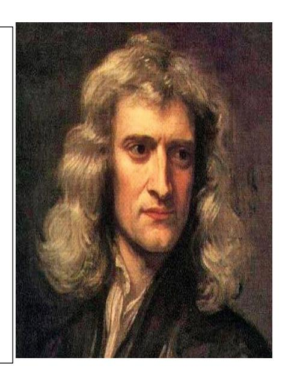

#### **1.1 Introduction**

From a spinning top to the rotating Earth, rotation is part of our daily experience. In physics, we study such motion using the concept of a *rigid body*—an ideal object that doesn't deform as it spins.

Rotational motion follows its own set of rules. Just like force causes linear motion, *torque* causes rotation. And just like mass resists motion, a rotating object resists change through its *moment of inertia*.

Rotation may seem simple but it reveals deep laws that govern how objects turn, balance, and store energy.

#### **Do You Know?**

- i) Why do skaters spin faster when they pull in their arms?
- ii) How do wheels help vehicles move more easily?
- iii) What keeps the Earth spinning day after day?

These questions take us into the world of *rigid body rotation*, where physics meets the graceful, powerful motion of spinning objects.

#### **Rigid Body**

A rigid body is an object that does not deform or change its shape when external forces or torques are applied. This means the distance between any two points within the body remains constant throughout its motion. In simpler terms, the positions of its constituent particles

relative to each other do not change. The study of how such bodies move under the influence of external forces and torques is known as *rigid body dynamics*. It plays a vital role in various fields, including the design of vehicles and mechanical systems, as well as in creating realistic animations in computer graphics.

*A rigid body is one in which the position of the constituent particles remain unchanged throughout the motion.*

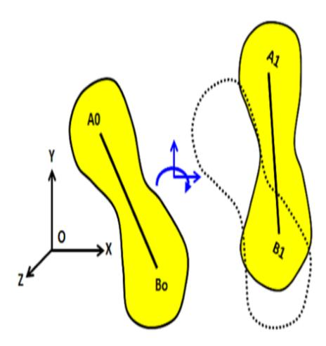

 *Fig 1.1: Rotation of a rigid body with unchanged position of constituent particles.*

The motion of a rigid body can be classified into *translatory* and *rotatory*. *Translatory motion* occurs when all points on the body move in parallel paths, resulting in straight-line movement, such as a car driving straight*. Rotatory motion* involves the body rotating around a fixed axis, with all points following circular paths around the axis, like a spinning wheel.

#### **1.2 Moment of Inertia**

In Newton's second law, mass links force and acceleration. This mass, called inertial mass, shows how much an object resists changes in its motion.

Similarly, in rotational motion, the *moment of inertia*, I, plays this role. It measures how hard it is to start or stop an object spinning around an axis. Unlike mass, moment of inertia depends on both the amount of mass and how far that mass is from the axis of rotation. The farther the mass is spread out, the larger the moment of inertia, and the harder it is to spin.

*For example, a solid wheel spins more easily than a ring of the same size and mass because the ring's mass is farther from the center. Likewise, it's easier to spin a bicycle wheel than a car wheel because the car wheel has more mass distributed farther from its axis, increasing its moment of inertia and resistance to spinning.*

In short, moment of inertia is the rotational equivalent of mass, representing an object's resistance to changes in its spinning motion.

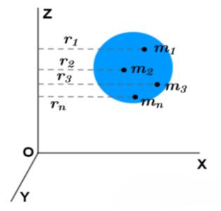

 *Fig 1.2: Calculation of Moment of Inertia* 

Moment of inertia, I is mathematically defined as the sum (or integral) of each mass element multiplied by the square of its distance from the axis of rotation.

In other words:

I=∑mir<sup>i</sup> 2

where m<sup>i</sup> is a small mass element r<sup>i</sup> is theType equation here. distance from the axis.

For a point mass at a distance R from the axis has a moment of inertia I=MR<sup>2</sup> , but for extended objects like discs, rods, or rings, the moment of inertia varies depending on their shape and mass distribution. Therefore, the farther the mass is from the axis, the greater the moment of inertia and the harder it is to rotate the object. *So, it's not simply the product of total mass and the square of the distance — the distribution of mass matters, and you sum or integrate over all mass elements.*

Let's *demonstrate how the distribution of mass affects the moment of inertia and rotational motion:*

#### **Activity 1.1**

*Materials Required:* A ramp, two discs (A convex lens and a concave lens) of equal mass and radius, a stop watch.

#### Method:

- (i) Take a ramp (an inclined plane) and place it on a flat surface so that a disk can roll down it easily. Make sure the ramp has a gentle incline.
- (ii) Take two discs of equal mass and radius but different mass distributions (e.g., one with mass concentrated near the center, a convex lens and the other with mass distributed towards the edge, a concave lens). Predict which disk will reach the bottom of the ramp first, based on their understanding of mass distribution and moment of inertia.
- (iii) Place both disks at the top of the ramp.
- (iv) Release them simultaneously and observe which disk reaches the bottom first.
- (v) Explain that the disk with mass concentrated near the center (the convex lens) has a smaller moment of inertia and thus accelerates faster down the ramp.
- (vi) The disk with mass distributed towards the edge (the concave lens) has a larger moment of inertia and takes longer to reach the bottom.
- (vii) Hence summarize that the distribution of mass affects the moment of inertia and the rotational motion of objects.
- (viii) Answer the following question:

*Guess why the disk with mass concentrated near the center has a smaller moment of inertia.*

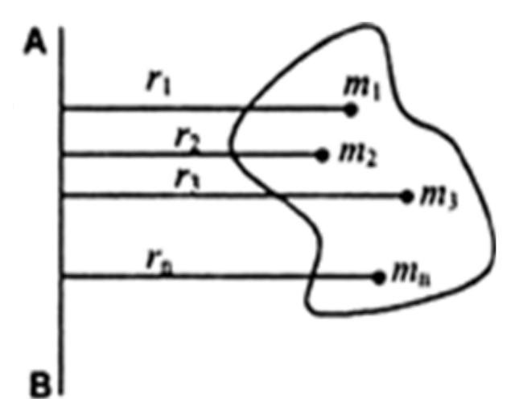

*Fig 1.3: Rotation of a rigid body*

The moment of inertia of a sphere depends on the axis of rotation. For a solid sphere, the moment of inertia about the diameter is different from the moment of inertia about the tangent to the sphere due to the different positions of the masses. The moment of inertia about the tangent is greater because the constituent masses are at a greater distance from the axis of rotation.

Our inner ear helps us keep our balance and sense of direction. If it's not working perfectly, or if we try to walk with our eyes closed, small differences in how our body is balanced can make us go off the track.

*In short, the moment of inertia influences how well we control our movements and stay balanced. Even tiny differences can make it hard to walk in a straight line.*

#### **1.2.1 Radius of Gyration**

Radius of gyration is a way to describe how the mass of an object is spread out around its axis of rotation.

Conceptually, it is the distance from the axis at which we can imagine the entire mass of the object to be concentrated, so that it would have the same moment of inertia as it does in reality.

In simple terms, it helps us understand how far the mass is, on average, from the axis when the object is rotating.

Mathematically the radius of gyration K is written as:

$$K = \sqrt{\frac{I}{M}}$$

where I is the moment of inertia and M is the total mass. This concept simplifies the analysis of rotational motion and helps understand the stability and strength of structures.

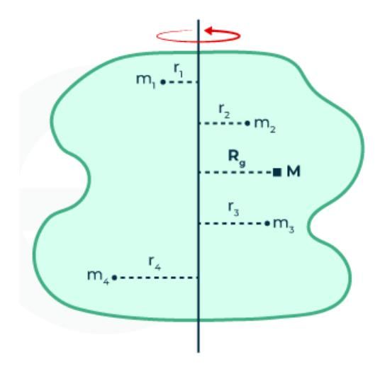

Fig 1.4: Radius of gyration

For a rigid body consisting of n particles is undergoing rotational motion about an axis AB. The particles are  $m_1, m_2, \ldots, m_n$  at the respective position  $r_1, r_2, \ldots, r_n$  from the axis of the rotation.

$$I = MK^2$$
 and  $K = \frac{(r_1^2 + r_2^2 + \dots + r_n^2)}{n}$ 

Hence  $K = \sqrt{\frac{(r_1^2 + r_2^2 + \dots + r_n^2)}{n}}$  is the radius of gyration and is the root mean square distance of all the particles of a body.

The radius of gyration is a scalar quantity that helps us visualize how mass is spread out in a rotating object and depends on the position and axis of rotation.

Let's do the activity 1.2 that follows to demonstrate how mass distribution affects the radius of gyration and its impact on rotational motion:

#### **Activity 1.2**

*Materials Required:* Two small masses, say coins, a long ruler and pivoting arrangement, a tape bundle, a stop watch. *Method:* 

(i) Attach the two small masses, say coins near the ends of a ruler and secure them with tape as in fig below:

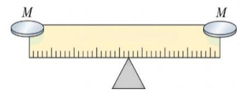

Fig 1.5

- (ii) Attach the two coins closer to the center to the other ruler and secure them with tape
- (iii) Place the rulers on the smooth surface with the pivot in the center, allowing them to rotate freely.
- (iv) Predict which ruler will spin more easily and why.
- (v) Spin each ruler by applying a small force at the end.
- (vi) Observe the ease of spinning and the time it takes for each ruler to come to rest.
- (vii) Record the times using the stopwatch it takes for each ruler to stop spinning and compare the results.
- (viii) The ruler with masses near the center has a smaller radius of gyration and spins more easily, while the ruler with masses near the ends has a larger radius of gyration and takes longer to spin and stop.
- (ix) Summarize that the radius of gyration affects how mass distribution influences rotational motion. The closer the mass is to the axis, the smaller the radius of gyration and the easier it is to rotate.

#### Predict the following:

- *(a) Why the ruler with masses near the center spin more easily and*
- *(b) How the results would change if the masses were heavier or lighter.*

This activity provides a hands-on way for students to visualize and understand the concept of the radius of gyration and its impact on rotational motion.

#### **1.3 Moment of Inertia of a Uniform Rod**

To calculate the moment of inertia of a uniform body, we consider a small mass dm of an infinitesimally small particle and the perpendicular distance r of the particle from the axis of rotation. We then integrate this over the entire body. i.e, I = ∫ dm r 2

#### 1.3.1 **Moment of Inertia of a Uniform rod about an axis passing through the Centre of Gravity:**

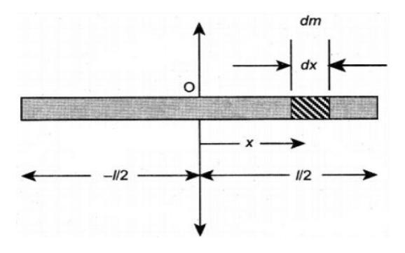

 *Fig 1.6: M.I of a thin uniform rod about an axis passing through CG*

Consider a uniform rod with mass M and length l. To find its moment of inertia about an axis through its center and perpendicular to its length, we start by setting the origin of our coordinate system at the rod's center. The rod lies along the x-axis. We consider an infinitesimally small mass element (dm) at a distance x from the origin. The moment of inertia (dI) of this tiny mass element about the axis is

$$dI = dm x^2. (1.1)$$

By integrating this expression over the entire length of the rod, we can calculate the total moment of inertia.

For the uniform rod, the mass per unit length of the rod is  $=\frac{M}{l}$ .

Therefore, the mass of the infinitesimally small length dx =  $\frac{M}{I}$  dx = dm.

As the mass is distributed on either side of the origin, the limits for integration are taken from -1/2 to +1/2.

Therefore, the moment of inertia (I) of the entire rod can be found as

$$I = \int_{-l/2}^{l/2} dm x^2 = \frac{M}{l} \int_{-l/2}^{l/2} x^2 dx = \frac{M}{l} \left[ \frac{x^3}{3} \right]^{1/2} - 1/2$$
(1.2)

If K be the radius of gyration, 
$$MK^2 = \frac{Ml^2}{12} \Rightarrow K = \frac{l}{2\sqrt{3}}$$
 (1.3)

## 1.4.2 Moment of Inertia of a uniform rod about an axis passing through its one end and perpendicular to its length:

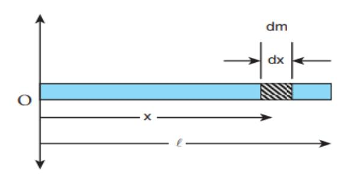

Fig 1.7: M.I of a thin uniform rod about an axis passing through one end.

Let us consider a uniform rod with mass M and length l. To find its moment of inertia about an axis through its one end and perpendicular to its length, we start by setting the origin of our coordinate system at the rod's end. The rod lies along the x-axis. We consider an infinitesimally small mass element (dm) at a distance x from the origin. The moment of inertia (dI) of this tiny mass element about the axis is

$$dI = dm x^2. (1.4)$$

By integrating this expression over the entire length of the rod, we can calculate the total moment of inertia.

For the uniform rod, the mass per unit length of the rod is  $=\frac{M}{I}$ .

Therefore, the mass of the infinitesimally small length  $dx = \frac{M}{I} dx = dm$ .

As the mass is distributed on one side of the origin, the limits for integration are taken from 0 to 1.

Therefore, the moment of inertia (I) of the entire rod can be found as

$$I = \int_0^l dm x^2 = \frac{M}{l} \int_0^l x^2 dx = \frac{M}{l} \left[ \frac{x^3}{3} \right]_0^l = \frac{Ml^2}{3}$$

$$\therefore I = \frac{Ml^2}{3}$$
(1.5)

If K be the radius of gyration, 
$$MK^2 = \frac{Ml^2}{3} \Rightarrow K = \frac{l}{\sqrt{3}}$$
 (1.6)

#### 1.5 Rotational Kinetic Energy of a Rigid Body

Consider a rigid body consisting of n particles is undergoing rotational motion about an axis XY. The particles are of masses  $m_1, m_2, \ldots, m_n$  at perpendicular distances  $r_1, r_2, \ldots, r_n$  from the axis of the rotation and moving with velocities  $v_1, v_2, \ldots, v_n$  respectively about the axis. The rotational kinetic energy  $KE_{rot}$  of a rigid body undergoing rotational motion is indeed the sum of the kinetic energies of all the particles that make up the body. Each particle contributes to the total kinetic energy due to its mass, velocity, and position relative to the axis of rotation.

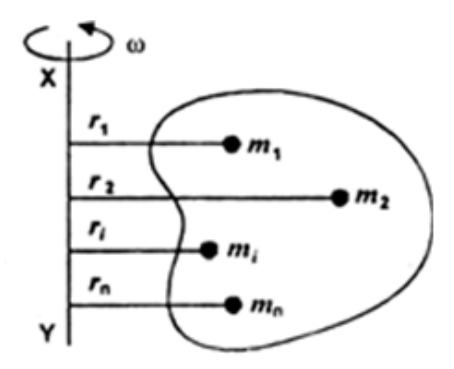

Fig 1.8:Rotational KE of a rigid body

For a single particle i with mass  $m_i$  at a distance  $r_i$  from the axis of rotation and moving with a tangential velocity  $v_i$ , the kinetic energy KE is given by:

$$KE_i = \frac{1}{2}m_i (\omega ri)^2 = \frac{1}{2}m_i r_i^2 \omega^2$$

The total rotational kinetic energy KE<sub>rot</sub> is then the sum of the kinetic energies of all n particles:

$$KE_{rot} = \sum_{i=1}^{n} \frac{1}{2} m_i r_i^2 \omega^2 = \frac{1}{2} \omega^2 \sum_{i=1}^{n} m_i r_i^2$$

This summation  $\sum_{i=1}^{n} \bar{m}_{i} r_{i}^{2}$  is known as the moment of inertia I of the body about the axis XY. Therefore, we can write:

$$KE_{rot} = \frac{1}{2}I \omega^2 \tag{1.7}$$

This confirms that the rotational kinetic energy of the body is indeed the sum of the kinetic energies of all the particles, taking into account their masses, positions, and velocities relative to the axis of rotation.

The greater the moment of inertia, the higher the kinetic energy (KE). As a result, more work is required to accelerate the body from rest.

If  $\omega = 1$ , I = 2KE i.e, M.I is twice the K.E

#### **Example**

- 1.1 A uniform rod of length 1.2 meters and mass 3 kg is rotating about an axis perpendicular to its length and passing through one of its ends.
  - (i) Calculate the moment of inertia of the rod about this axis.
  - (ii) If the rod is rotating with an angular velocity of 5 rad/s, determine the kinetic energy of the rod.

#### Solution:

Here, length, l = 1.3 m

Mass, 
$$m = 3 \text{ kg}$$

(i) Moment of inertia, I = ?

We have for the axis at the end of the rod and normal to the rod,

$$I = \frac{Ml^2}{3} = \frac{3 \times 1.3^2}{3}$$
$$= 1.44 \text{ kg-m}^2$$

(ii) Angular velocity,  $\omega = 5 \text{ rads}^{-1}$ 

Therefore, KE = 
$$\frac{1}{2}I \omega^2 = \frac{1}{2} \times 1.69 \times 5^2$$
  
= 18 J

Hence the moment of inertia of the rod is 1.44 kg·m<sup>2</sup>, and the kinetic energy of the rod is 18 J.

#### 1.2 Torque and Angular Acceleration of a Rigid Body

Consider a rigid body rotating about an axis XY with a uniform angular acceleration  $\alpha$ , under the action of a torque.

Let the body consists on n particles of masses  $m_1, m_2, \dots, m_n$  at perpendicular distance  $r_1, r_2, \dots, r_n$  from the axis as show in the fig 1.9 below:

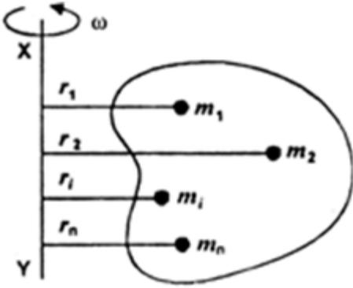

Fig 1.9: Rotation of a rigid body

As the body is rigid, angular acceleration  $\alpha$  of all the particles about the axis is the same. However, the linear acceleration of the particles varies due to their position relative to the axis of rotation. If  $a_1, a_2, \ldots, a_n$  be the respective linear acceleration of the particles, then

$$a_1 = r_1\alpha$$
,  $a_2 = r_2\alpha$ ,...and  $a_n = r_n\alpha$ 

Hence in general, force on an ith particle of mass  $m_i$  is  $F_i = m_i a_i = m_i r_i \alpha$ .

The moment of this force i.e, product of a force times the perpendicular distance from the point of rotation to the line of the force, is called the torque produced by the force, which is usually represented by  $\tau$  and  $\tau = F \times r$ 

Therefore, torque on the ith particle, 
$$\tau_i = F_i \times r_i = m_i r_i^2 \alpha$$
. (1.8)

$$\therefore \text{ Torque acting on the body, } \tau = \sum_{i=1}^{n} m_i r_i^2 \omega = I \alpha$$
 (1.9)

Hence 
$$\tau = I\alpha$$
 (1.10)

Equation 1.18 gives the relation between torque and the angular acceleration of a rigid body.

The equation relating torque  $(\tau)$  to angular acceleration  $(\alpha)$  for a rigid body is indeed a fundamental equation in rotational dynamics and is analogous to Newton's second law of motion.

*Note:* The gravitational torque on a body can be found by treating the body as a particle with all the mass M concentrated at the center of mass.

#### **Example**

- 1.2 A uniform **rod of** mass 2 kg and length 1.2 m is hinged at one end and is free to rotate in a vertical plane without friction. It is held horizontally and then released from rest.
- a) What is the torque acting on the rod about the hinge just after it is released?
- b) Calculate the angular acceleration of the rod at that instant.
- c) What is the linear acceleration of the free end of the rod immediately after release? Solution:

Here, Mass of rod, M=2 kg Length of rod, L=1.2 m Acceleration due to gravity, g=9.8 m/s<sup>2</sup> Moment of inertia of rod about one end:  $I = \frac{1}{3}ML^{2}$ 

#### (a) Torque about the hinge just after release

Torque due to weight acts at the center of mass, which is at  $\frac{L}{2}$  from the hinge.

$$\tau = Mg \cdot \frac{L}{2}$$

Substitute values:

$$\tau = 2 \times 9.8 \times \frac{1.2}{2} = 11.76 \text{ Nm}$$

#### b) Angular acceleration of the rod

Using the relation:

$$\tau = I\alpha \Rightarrow \alpha = \frac{\tau}{I}$$

To calculate moment of inertia, we use  $I = \frac{1}{3}ML^2 = \frac{1}{3} \times 2 \times 1.2^2 = 0.96 \text{ Kgm}^2$ 

Now 
$$\alpha = \frac{\tau}{I} = \frac{11.76}{0.96} = 12.25 \text{ rads}^{-2}$$

#### (c) Linear acceleration of the free end of the rod

The linear acceleration a at the end of the rod is related to angular acceleration  $\alpha$  by:  $a=\alpha \cdot L \Rightarrow a=12.25 \times 1.2=14.7$  ms<sup>-2</sup>.

1.3 The Earth has a radius of approximately 6371 km and completes one rotation every 24 hours. Calculate the tangential force needed to stop the Earth's rotation within 1 hour. (Mass of the Earth =  $5.97 \times 10^{24}$  kg)

Solution: Here.

Radius of Earth R=6371 km =  $6371 \times 10^{3}$  m

Rotational period T=24 hours=24×3600 s

Stopping time t<sub>stop</sub>=1 hour=3600 s

Mass of the Earth,  $M = 5.97 \times 10^{24} \text{ kg}$ 

$$\omega = \frac{2\pi}{T} = \frac{2\pi}{24 \times 3600} \approx 7.27 \times 10^{-5} \text{ rad/s}$$

Angular acceleration, 
$$\alpha = \frac{\omega_0 - \omega}{t_{stop}} = \frac{7.27 \times 10^{-5}}{3600} \text{ s} = 2.02 \times 10^{-8} \text{ rads}^{-2}$$
  
The tangential acceleration,  $a = R$ .  $\alpha = 6371 \times 10^3 \times 2.02 \times 10^{-8} = 0.1286 \text{ ms}^{-2}$   
Now tangential force,  $F = Ma = 5.97 \times 10^{24} \times 0.1286 = 7.68 \times 10^{23} \text{ N}$ 

1.3 A *string is wrapped around the rim of a wheel of moment of inertia 0.1kgm<sup>2</sup> and of radius 20cm. The wheel is free to and free to rotate about its axis and initially it is at rest. The string is now pulled by a force of 20N. What is the angular velocity of the string after 2sec.?*

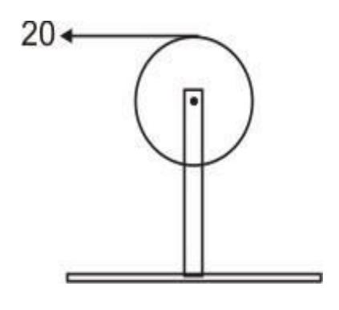

 *Fig 1.10*

Solution: We know that, 
$$\tau = F \times r \dots$$
 (1.11)  
Also,  $\tau = I \cdot \alpha$  (1.2)  
From equation (1) and (2)  

$$F \times r = I \times \alpha$$

$$20 \times 0.2 = 0.1 \times \alpha$$

$$\alpha = 40 \text{rads}^2$$

$$Again, \omega = \omega_0 + \alpha t$$
or,  $\omega = 0 + 40 \times 2$ 

$$\omega = 80 \text{rads}^{-1}$$
.

#### *Test yourself*

- *1.1 A uniform rod of mass 2.5 kg and length 1.2 m is hinged at one end and placed at an angle of 60° with the vertical in a vertical plane. It is then released from rest.*
- *a) What is the initial torque acting on the rod about the hinge due to gravity?*
- *b) Calculate the angular acceleration of the rod just after release.*
- *c) What is the initial linear acceleration of the free end of the rod?( Ans: a. 12.73 Nm, b. 10.61 rads-2 , c. 12.73 ms-2 )*

#### **1.3 Work and Power in Rotational Motion**

In rotational motion, work is done when a torque acts on a body and causes it to rotate through an angular displacement. This is similar to linear motion, where work is done when a force causes displacement.

#### **Work Done in Rotational Motion**

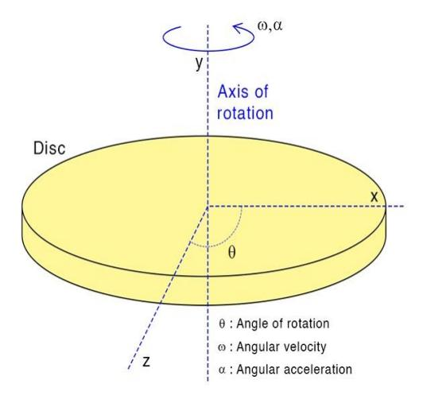

*Fig 1.11: Showing work done in rotational motion*

In rotational motion, work is done when a torque causes a body to rotate through an angular displacement. This concept is very similar to linear motion, where a force does work when it causes a displacement.

Just as force causes a linear displacement in translational motion, torque causes angular displacement in rotational motion.

When a torque is applied to a body and the body turns through an angle, energy is transferred — this is the work done in rotation.

W=τθ

Where:

W = work done,

τ = torque applied,

θ = angular displacement

This formula is valid only when torque and angular displacement act about the **same axis**. Energy Perspective:

In linear motion, work done by a force increases the kinetic energy of a moving body. Similarly, in rotational motion, work done by torque increases the rotational kinetic energy of the object.

If a rotating body starts from rest and spins up to a certain speed, the work done by the torque is stored as rotational kinetic energy:

$$W = \frac{1}{2}I \omega^2$$

This is a special case, showing how the energy input through torque results in rotational motion.

#### **Power in Rotational Motion**

In **linear motion**, power is the rate at which work is done by a force moving an object at velocity v

i.e. Power =force ×velocity

In **rotational motion**, power is the rate at which work is done by a torque rotating an object at angular velocity ω. So, in rotational motion,

Power, P = τω

The two formulas are **analogous** and are connected through the relationship between force & torque, and velocity & angular velocity.

#### *Example*

*1.3* An aircraft engine delivers a power of 200 kW to the propeller. The propeller rotates at a constant frequency of 1500 rpm. (a) Calculate the torque exerted by the engine on the propeller. (b) Determine the work done in one revolution of the propeller.

Solution: Here, power, 
$$P = 200 \text{ Kw} = 2 \times 10^5 \text{ W}$$
  
Frequency,  $f = 1500 \text{ rpm} = \frac{1500}{60} = 25 \text{ revs}^{-1}$   
 $\Rightarrow \omega = 2\pi f = 2\pi \times 25 = 50\pi \text{ rad s}^{-1}$ 

(a) Torque, 
$$\tau = ?$$
We have,  $P = \tau \omega$ 

$$\Rightarrow \tau = \frac{P}{\omega} = \frac{2 \times 10^5}{50\pi} = 1272.72 \text{ Nm}$$
(b) Work,  $W = ?$ 
We have,  $W = \tau \theta = \frac{2 \times 10^5}{50\pi} 2\pi = 8000 \text{ J}$ 

#### *Test yourself*

*1.2 An aircraft engine delivers a power of 300 hp to the propeller. The propeller rotates at a constant frequency of 1800 rpm.(a) Calculate the torque exerted by the engine on the propeller. (b) Determine the work done in one revolution of the propeller.(Ans:a.1186.8 Nm, b.7460 J)*

#### 1.1 **Angular Momentum, Conservation of Angular Momentum**

*Angular momentum* is the *moment of linear momentum* of a body about a point or axis, defined as the cross product L⃗= r⃗×p⃗, where r is the position vector and p⃗=mv⃗ is the linear momentum. It represents how far and how fast an object moves in a circular path. For a rotating rigid body, it is also given by L=Iω, where I is the moment of inertia and ω is the angular velocity. Angular momentum is a *vector quantity* with both magnitude and direction, the latter determined by the right-hand rule. It is the *rotational equivalent of linear momentum*, and in a closed system, it remains conserved unless acted upon by an external torque. In simple terms, the faster an object spins, the more massive it is, and the farther its mass is from the axis, the greater its angular momentum.

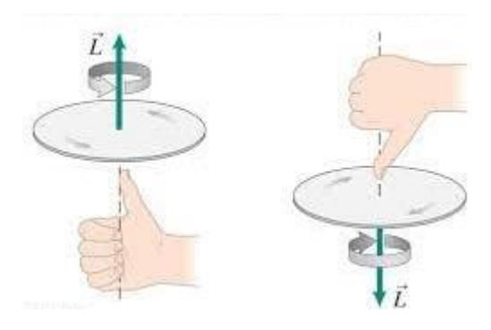

*Fig 1.12*

*Let's do the activity 1.3 and feel the effects of angular momentum.* 

#### **Activity 1.3**

*Materials Required:*

A Bicycle tire with a handle attached to the axle. A stable stand to hold the tire in place for spinning.

#### *Method:*

- (i) Secure the bicycle tire on the stand so that it can spin freely.
- (ii) Spin the bicycle tire as fast as possible.

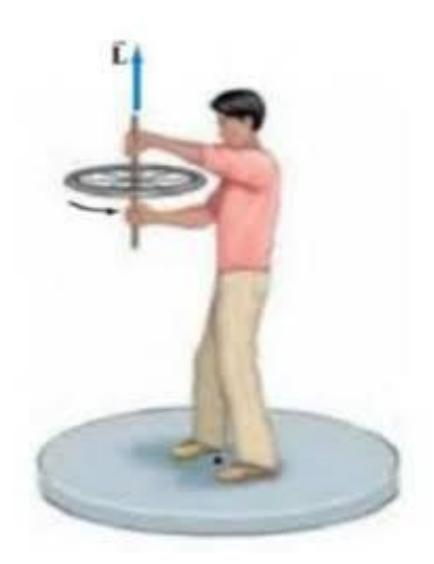

*Fig 1.13*

Observe the spinning tire and predict what will happen when its angle is changed.

- (iii) Take turns spinning the tire and carefully tilting it to different angles.
- (iv) As you tilt the tire, you will feel a force pushing in the opposite direction, trying to maintain angular momentum. During the time you made plane of the tire horizontal, the spinning of the tire makes you spin in the opposite direction to conserve the principle of angular momentum.

#### *Discussion:*

- (i) Explain the principle of angular momentum and how the force you felt is the tire's attempt to maintain its angular momentum.
- (ii) Relate this to other examples, such as a figure skater pulling in their arms to spin faster or a fidget spinner resisting changes in angle when spinning.
- (iii) Ask all your friends to share their experiences and observations.
- (iv) Discuss how this principle can be observed in everyday life and other scientific applications.

Conclusion: In this activity, we saw that a spinning tire resists changes in its direction. When we tried to tilt it, we felt a force in the opposite direction. This happened because the tire was trying to keep its spinning motion. This helped us understand the idea of angular momentum and how it is conserved.

#### **Conservation of Angular Momentum**

The conservation of angular momentum means that if no outside force (torque) is acting, the total angular momentum of a system stays the same.

For example, when a figure skater pulls in their arms, they spin faster. That's because their mass is closer to the axis, and to keep angular momentum constant, their speed increases. Torque is a measure of how much a force causes an object to rotate. It is also defined as the rate at which the angular momentum of the object changes with time. This means if a force acting at some distance from the axis of rotation makes the spinning speed or direction of an object change, that force creates a torque.

Mathematically, this is written as:

Torque = 
$$\frac{\text{Change in angular momentum}}{\text{Time taken}}$$
Or,  $\tau = \frac{dL}{dt}$ 

Just like force changes how an object moves in a straight line, torque changes how an object spins or rotates.

And 
$$\tau = \frac{d(I\omega)}{dt}$$

dt

If no torque is applied on a rotating body, = 0 ⇒ d(Iω) dt = 0

Or, 
$$I\omega = constant$$
  
Or,  $(I\omega)_o = (I\omega)_f$   
Or,  $I_1\omega_1 = I_2\omega_2 \Rightarrow I\omega = constant$ .

Hence, in the absence of the torque applied, total angular momentum remains conserved. It is the *principle of conservation of angular momentum.*

#### *Illustration:*

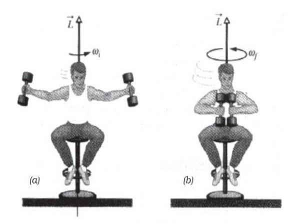

 *Fig 1.14*

- 1. Sit in a chair with weights in your hands, extended away from your body.
- 2. Have someone give you an initial spin.
- 3. Pull the weights towards your body to spin faster.
- 4. Extend the weights away from your body to slow down.

*By bringing your arms in, you reduce your moment of inertia and speed up. In an ideal system without external forces, you could continue adjusting your speed by moving your arms in and out resulting to a conservation of angular momentum.*

#### **Examples:**

The principle of conservation of angular momentum implies Iω = constant i.e, an increase in moment of inertia leads to decrease in rotation speed, ω and vice – versa.

(i) Imagine an ice skater spinning. When she pulls her arms in, she spins faster; when she extends them, she slows down. This happens because pulling her arms in reduces her moment of inertia ( I = mr<sup>2</sup> ), increasing her spin rate.

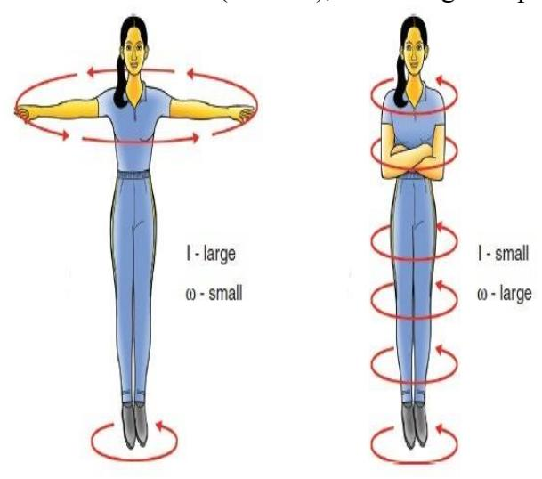

*Fig 1.15: Ice - Skater*

Conversely, extending her arms increases her moment of inertia, slowing her down. This illustrates the conservation of angular momentum, I1ω<sup>1</sup> = I2ω<sup>2</sup>

- (ii) When a planet like Earth moves around the Sun, its speed changes because of the conservation of angular momentum. When the planet comes closer to the Sun, the distance between them becomes smaller, which lowers its moment of inertia. To keep the angular momentum, the same, the planet must spin faster, so it moves quicker. When the planet moves farther away, its moment of inertia becomes larger, so its speed slows down. This idea is shown by the equation I1ω1=I2ω<sup>2</sup> which means the planet's angular momentum stays constant as it moves.
- (iii) In a tornado, air in the inner layer spins faster because it moves closer to the center. This is due to the conservation of angular momentum, similar to a skater spinning faster when pulling in their arms.
- (iv) Spokes in a bicycle wheel help reduce the moment of inertia by keeping most of the wheel's mass closer to the center. This makes it easier for the wheel to spin faster and with less effort. Without spokes, the mass would be spread out toward the rim, increasing the moment of inertia and making the wheel harder to spin. Spokes not only make the wheel lighter and easier to rotate, but also provide strength and stability for smooth and efficient movement.
- (v) When polar ice melts, water moves from the poles to the equator, increasing Earth's moment of inertia. To conserve angular momentum, Earth slows down its rotation, making the days slightly longer. This shows how the conservation of angular momentum affects Earth's rotation due to changes in mass distribution.
- (vi) When a diver jumps into the water, they pull their arms and legs in to spin faster (reducing moment of inertia) or extend them to slow down (increasing moment of inertia).


*Fig 1.16*

This helps them control their rotation, demonstrating the conservation of angular momentum.

#### Analogical relation between linear and angular kinematics:

| S.N | Linear Motion                                   | Angular Motion                                 |
|-----|-------------------------------------------------|------------------------------------------------|
| 1   | Linear displacement, s                          | Angular displacement, θ                        |
| 2   | Linear velocity, v                              | Angular velocity, ω                            |
| 3   | Linear acceleration, a                          | Angular acceleration, α                        |
| 4   | Inertial mass, m                                | Moment of inertia, I                           |
| 5   | Linear momentum, P= mv                          | Angular momentum, L= Iω                        |
| 6   | Force, F=ma                                     | Torque, $\tau = I\alpha$                       |
| 7   | Work done, W= F.s                               | Work done, $W = \tau \theta$                   |
| 8   | Translational KE= $\frac{1}{2}$ mv <sup>2</sup> | Rotational KE = $\frac{1}{2}$ I $\omega^2$     |
| 9   | Power = Fv                                      | Power = $, \tau \omega$                        |
| 10  | Equations of linear motion                      | Equations of angular                           |
|     | v = u + at                                      | motion                                         |
|     | $v^2 = u^2 + 2as$                               | $\omega = \omega_0 + \alpha t$                 |
|     | $S = ut + \frac{1}{2}at^2$                      | $\omega^2 = \omega_0^2 + 2\alpha\theta$        |
|     |                                                 | $\theta = \omega_0 t + \frac{1}{2} \alpha t^2$ |

#### **Project Work**

Project Title: Understanding Gyroscopic Motion and Stability

Objective: To experimentally measure gyroscopic effects, angular momentum, and stability using a spinning wheel or gyroscope.

#### Step 1: Measuring Angular Momentum ( $L = I\omega$ )

#### Materials Needed:

- i) A bicycle wheel or toy gyroscope
- ii) A rod or axle for suspension
- iii) Measuring tape
- iv) Weighing scale
- v) Stopwatch

#### *Procedure:*

- 1. Find the Moment of Inertia (I):
- i) Use a weighing scale to measure the mass m of the wheel.
- ii) Use a measuring tape to find the radius r of the wheel.

iii) For a solid disc (like a bicycle wheel), moment of inertia is:

$$I = \frac{1}{2} mr^2$$

- 2. Measure Angular Velocity (ω):
- i) Spin the wheel manually and count the number of rotations in 10 seconds.
- ii) Use a stopwatch to measure time precisely.
- iii) Calculate ω (angular velocity) using the formula:

#### $\omega = 2\pi \times \text{rotations/time}$

3. Calculate Angular Momentum (L):

$$I=I\times\omega$$

#### Step 2: Measuring Gyroscopic Stability

#### Procedure:

- i) Spin the wheel rapidly and suspend it using its axle.
- ii) Apply a sideways force and observe how the wheel resists tilting and instead moves in a circular motion (precession).
- iii) Vary the spin speed and note how increasing speed makes precession stronger and maintains stability.
- iv) Time how long the wheel remains upright before falling when spun at different speeds.
- v) Compare results: A fast-spinning wheel is significantly more stable than a slow-spinning one.

#### Results

- i) Record all measurements in a data table (mass, radius, rotations, time).
- ii) Compare the calculated angular momentum for different speeds.
- iii) Explain how gyroscopic effects apply to bicycles, drones, aircraft, and spacecraft using real-world examples.

#### Execute yourself

**Project 1** *Investigating the Moment of Inertia of Different Shapes Objective:* 

To study how the moment of inertia varies for objects of different shapes and mass distributions and verify theoretical predictions through experiments.

#### **Exercise**

- *1. A disk and a ring, both with the same mass and radius, are released from the top of an inclined plane at the same time. Which one will reach the bottom first?* a) Disk , b) Ring, c) Both will reach at the same time, d) It depends on the inclination angle.
- 2. Two bodies of masses m<sup>1</sup> amd m<sup>2</sup> move in a circles of radii r<sup>1</sup> and r2, respectively. What will be the ratio of their linear velocities v<sup>1</sup> and v<sup>2</sup> if they complete the circles in equal time?

a) <sup>m</sup><sup>1</sup> m2  b) <sup>r</sup><sup>1</sup> r2

c) 1 d) <sup>m</sup><sup>1</sup> m2 r1 r2

- 3**.** *A figure skater pulls in her arms during a spin. What happens to her moment of inertia and angular velocity?*
  - a) Moment of inertia decreases, angular velocity increases
  - b) Moment of inertia decreases, angular velocity decreases
  - c) Moment of inertia increases, angular velocity increases
  - d) Moment of inertia increases, angular velocity decreases
- 4. *Which one has the highest moment of inertia a ring, a solid sphere and a disc all of same mass and radius?*

a) Ring, b) Solid sphere,

c) Disc, d) Solid cylinder.

- 5. *Which factor does not affect the moment of inertia of a rotating body?*
  - a) Mass of the body
  - b) Distribution of mass around the axis
  - c) Shape of the body
  - d) Temperature of the body
- 6. *Why does a diver tuck in their body during a dive to increase their rotational speed?*

a) To increase moment of inertia, b) To decrease moment of inertia

c) To increase torque d) To decrease torque

- 7. *Two wheels of different radii and same masses are rolling without slipping on a horizontal surface. What happens to the rotational kinetic energy if their linear speeds are equal?*
  - a) Larger radius has more energy b) Smaller radius has more energy, c) Remains same d) The one with greater angular speed
- 8. *What are the components of the total kinetic energy of a solid cylinder rolling down an incline without slipping?*

a) Only translational b) Only rotational

c) Half translational, half rotational d) Two-thirds translational, one-third rotational

- 9. *What happens to the torque if the angle between r and F is 90*0*?* a) Torque is zero, b) Torque is maximum, c) Torque is minimum, d) Torque is constant
- 10. *Which one has the highest moment of inertia a ring, a solid sphere and a disc all of same mass and radius?*
  - a) Ring, b) Solid sphere, c) Disc, d) hollow sphere.
- 11. *Why does a gyroscope remain stable and resist changes in its orientation?*
  - a) Due to its moment of inertia, b) Due to its angular velocity
  - c) Due to conservation of angular momentum, d) Due to its mass distribution
- 12. *What happens to the angular momentum of a rotating object if the radius is halved and the mass is kept constant?*
  - a) It remains the same b) It is doubled c) It is halved d) It is quadrupled

- 13. *What is the angular velocity of a minute hand in rads-1 ?*
  - a) 60
- b) 180
  - c) 1800
- d) 360
- 14. While observing a gymnast performing a spin, one might wonder how she manages to control her rotational speed.
  - **a.** Define *moment of inertia* and explain how it depends on the *distribution of mass*.
  - **b.** State the *principle of conservation of angular momentum*. Explain why a gymnast spins faster when pulling in her arms.
  - **c.** During a dramatic stage performance, a dancer (mass 60 kg) begins spinning on a frictionless turntable with her arms outstretched. She is approximated as a rotating body with a moment of inertia of 5 kg·m² and an angular velocity of 2 rads -1 .

Suddenly, she pulls her arms in, decreasing her moment of inertia to 2 kg·m² in 0.5 seconds.

- **i)** What is her new angular velocity after pulling in her arms?
- **ii)** What is the change in her rotational kinetic energy?
- **iii)** What average torque would be required to achieve this change if it were done by an external force (hypothetical) (*Ans: a. 5 rads-1 , b. 15 J, c. 30 Nm*)
- 15. The motion of a wheel rolling down an incline without slipping combines rotation and translation.
  - **a.** Define rolling motion and explain the condition for pure rolling.
  - **b.** Derive the relation between linear velocity and angular velocity for a body undergoing pure rolling.
  - **c.** A uniform rod of length 1.2 m and mass 2.4 kg is placed on a smooth horizontal surface. A force of 12 N is applied perpendicularly at one end of the rod.
  - **i)** What is the torque produced about the center of mass of the rod?
  - **ii)** What is the angular acceleration of the rod about its center of mass?
  - **iii)** What is the linear acceleration of the center of mass?

( *Ans: a. 7.2 Nm, b. 25 rads-2 , c. 5 ms-2* )

- 16. A rigid body rotates about a fixed axis, and its distribution of mass affects its rotational inertia.
  - **a.** Define *radius of gyration*. How is it related to the *moment of inertia*?
  - **b.** Explain how moment of inertia varies for different geometrical bodies like a ring, disc, and sphere (mention any two with reasoning).
  - **c.** A uniform rod of mass 2 kg and length 1 m lies on a smooth inclined plane making 30° with the horizontal. The rod is hinged at its upper end to the incline and initially held parallel to the incline. It is then released and begins to rotate downwards.
  - **i)** Calculate the torque acting on the rod about the hinge just after it is released.
  - ii) Determine the angular acceleration of the rod at that instant. ( *Ans: a. 4.9 Nm, b. 3.75 rads-2* )
- 17. The torque required to rotate a rigid body plays a central role in its dynamics.
  - **i.** Define *torque* and give its SI unit. Write the vector formula and explain each term.
  - **ii.** State the relation between torque and angular acceleration. What is the rotational analogue of Newton's second law?
  - **iii.** A constant torque of 1000 N·m turns a wheel of moment of inertia 200 kgm<sup>2</sup> about an axis through its centre. Calculate its angular velocity after 3 sec*.( Ans: 15 rads-1 )*
- 18. A body is rotating with angular acceleration and constant torque.
  - **a.** Define *angular acceleration*. Write down the kinematic equations of rotational motion for constant angular acceleration.
  - **b.** Differentiate between *angular displacement, angular velocity*, and *angular acceleration.*
  - **c.** A disc starts from rest and accelerates uniformly to 20 rad/s in 5 seconds. Find (i) angular acceleration, and (ii) angle turned during this time. *.( Ans: 4 rads-2, , 50 rad)*
- 19. Suppose a flywheel is rotating about its center. Think that masses are symmetrically attached at different distances.
  - **a.** Define *center of mass*. How does its position affect the rotational stability?
  - **b.** Explain the concept of *rotational kinetic energy*. How is it different from translational kinetic energy?
  - **c.** Refer to the given figure:

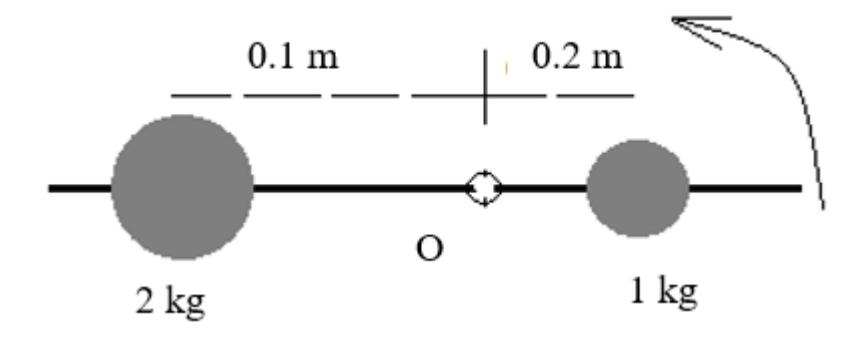

 *Fig 1.17*

Two masses of 1 kg and 2 kg are placed at 0.2 m and 0.1 m from the center of a massless rod. Find the total moment of inertia of the system about the center. (Ans: 0.06 kgm<sup>2</sup> )

- 19. Long rods rotating about different axes behave differently based on how the mass is spread.
- **a.** Why is moment of inertia considered the rotational analogue of mass?
- **b.** Derive the expression for the moment of inertia of a uniform rod about an axis through its center and perpendicular to its length.
- **c.** A rod of mass 5 kg and length 1 m rotates about its center. Calculate its moment of inertia and its rotational kinetic energy when spinning at 12 rads-1 .\ *.( Ans: 0.4167 kgm<sup>2</sup> , 30 J)*
- 20. In the figure aside, a uniform rod of length L and mass M is pivoted at its center and can rotate freely in a horizontal plane. Two small masses, m<sup>1</sup> and m<sup>2</sup> , are attached at equal distances from the center.

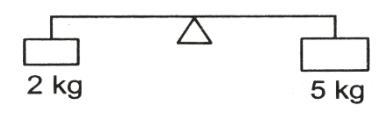

 *Fig 1.18*

*(Assume the figure shows a horizontal rod with equal masses at both ends, pivoted at the center.)*

- **a.** Write the expression for the total moment of inertia of the system about the central pivot. Mention each contributing term.
- **b.** How will the moment of inertia change if one mass is moved closer to the center? Justify your answer conceptually.
- **c.** Given:
  - Rod: mass M=3 kg, length L=1.2 , Point masses: m1=m2=1kg
  - Each point mass is at a distance 0.6 m from the center

Calculate the total moment of inertia of the system about the center. *.*

*(Ans: 1.08 kgm<sup>2</sup> )*

- 21. A figure skater demonstrates how angular momentum is conserved by changing her body position mid-spin.
  - **a.** Define *angular momentum* for a rotating body. State its SI unit.
  - **b.** State and explain the *principle of conservation of angular momentum*. Give one real-life example other than a skater.
  - **c.** A skater of moment of inertia 3 kg·m² spins at 4 rad/s. She pulls in her arms and reduces her moment of inertia to 1.5 kg·m². Find her new angular velocity. What does this tell us about angular momentum? *( Ans: 8 rads-1 .Angular momentum conserves during the processes)*
  - **b.** Derive the formula for *work done* by a torque in producing angular displacement.
  - **c.** A constant torque of 8 N·m is applied to a wheel. If it turns through an angle of 5 radians in 2 seconds, calculate the *work done* and average power delivered.( *Ans:40 J, 20 W*)

22. A ballet dancer performs a spin with arms extended, then pulls her arms in to spin faster.


- (a) Name and state the physical principle that explains why her angular velocity increases when she pulls her arms in.
- **(b)** Derive the relation between angular momentum and moment of inertia for a rotating body.
- (c) If the dancer's initial moment of inertia is 4 kgm<sup>2</sup> and angular velocity is 2rads<sup>-1</sup>, and she reduces her moment of inertia to 2 kgm<sup>2</sup>, calculate her new angular velocity.(

  Ans: 4 rads<sup>-1</sup>)
- 23. A uniform rod of length L and mass M is free to rotate about an axis perpendicular to its length and passing through its center. Two small masses m<sub>1</sub> and m<sub>2</sub> are attached at distances d<sub>1</sub> and d<sub>2</sub> respectively from the center of the rod.
  - **a.** Give the significance of moment of inertia in rotational motion.
  - **b.** Write the formula for the moment of inertia of the uniform rod about the given axis.
  - **c.** State the principle of conservation of angular momentum with a real-life example.
  - **d.** Calculate the total moment of inertia of the system (rod + masses) about the axis of rotation. If the system is released from rest and rotates under a constant torque  $\tau$ , find:
    - i. The angular acceleration  $\alpha$ .
    - ii. The angular velocity after rotating through an angle  $\theta$ .

Given:

$$\begin{array}{c} M{=}6~kg,~L{=}2~m~,~m_{l}{=}2~kg~at~d_{l}{=}0.5~m\\ m_{2}=3kg~at~d_{2}{=}0.8~m\\ \tau{=}12~N{\cdot}m,~\theta{=}\pi~rad\\ \text{(Take}~I_{rod}{=}\frac{1}{12}ML^{2}~~(5~marks)~\textit{(Ans: 4.42~kgm}^{2},~2.7~rads^{-2},~4.13~rads^{-1}) \end{array}$$

- 24. A figure skater of moment of inertia I spins at angular velocity  $\omega_1$  with her arms extended. She then pulls her arms in, reducing her moment of inertia to  $I_2$ .
  - a. Define angular momentum and state its SI unit.
  - **b.** State the principle of conservation of angular momentum.
  - c. Explain why the skater spins faster after pulling her arms inward.
  - **d.** Given  $I_1 = 5 \text{ kg} \cdot \text{m}^2$ ,  $\omega_1 = 2 \text{ rads}^{-1}$ , and  $I_2 = 2 \text{ kg} \cdot \text{m}^2$ , calculate:
    - i. The new angular velocity  $\omega_2$ .
  - ii. The change in rotational kinetic energy of the skater. (Take rotational kinetic energy  $K = \frac{1}{2}I\omega^2$  (Ans: 5 rads<sup>-1</sup>, 15 J)

## **Chapter 2 Periodic Motion**

#### <span id="page-28-0"></span>**Galileo Galilei (1564–1642)**

Galileo Galilei was an Italian physicist and one of the first scientists to study periodic motion through careful observation. While watching a swinging lamp in a cathedral, he discovered that the time of each swing remained nearly constant, even as the motion decreased. This observation led to the concept of isochronism in pendulums.

His work laid the foundation for the scientific understanding of periodic motion and inspired future developments in timekeeping and mechanics. Galileo's approach combined observation with reasoning, making him a key figure in the early study of oscillatory motion.


#### **2.1 Introduction**

Periodic motion is a motion that repeats itself at regular intervals. We see it in the swing of a pendulum, the ticking of a clock, or the vibrations of a guitar string. Such motions are simple yet powerful—they help us understand sound, waves, and even how time is measured. From the smallest particles to the motion of planets, periodic motion lies at the heart of many natural and man-made systems.

#### **Do You Know?**

- i) Why does a swinging pendulum always come back?
- ii) How do musical instruments create rhythm and tone?
- iii) Can motion repeat forever without stopping?

These questions lead us into the world of *periodic motion*—a key to understanding the rhythm of nature and technology.

#### **2.2 Simple Harmonic Motion**

Let us study motions such as a mass on a spring, a pendulum (for small angles), a vibrating tuning fork, and a swing, where the motion is periodic and the restoring force is proportional to the displacement. All of these are examples of *Simple Harmonic Motion.*

*The simple harmonic motion is a periodic motion in which restoring force is directly proportional to the displacement from the mean position and is always directed towards the mean position.*

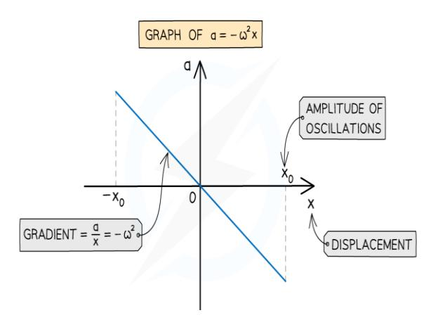

 *Fig 2.1: Acceleration - Displacement graph in SHM*

Hence SHM is motion where a= −ω<sup>2</sup> x, or equivalently F= − kx. From Newton's Second Law,

F = ma, so if we find that a system obeys F= −kx, we substitute and get:

ma= 
$$-kx \Rightarrow a = -\frac{k}{m}x$$
 which fits the form of SHM.

Hence Simple Harmonic Motion (SHM) is a type of oscillatory motion in which the acceleration of the object is directly proportional to its displacement from the mean position and is always directed towards the mean position (also called the equilibrium or center position).

#### **2.2.1 Equation and Terminologies of SHM**

Let a particle be undergoing simple harmonic motion (SHM). At time t=0, it is at position X, then moves to Y, then to X′, Y′, and finally returns to point X, completing a circular path of radius r with center at O.

The motion can be illustrated by a sine wave, with the corresponding points marked along the curve.

(i) *Displacement:* In Simple Harmonic Motion (SHM), displacement refers to the distance of the oscillating particle from its mean (equilibrium) position at any given time. The displacement varies with time and is given by: Y = rsinωt

Here,

y is the displacement at time t, r is the amplitude (maximum displacement), ω is the angular frequency, *Fig 2.2: Showing Displacement Equation in SHM* t is the time.

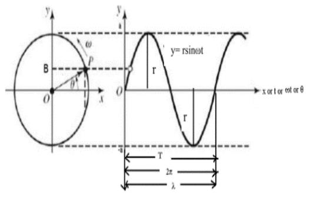

This equation shows that the displacement in SHM follows a sinusoidal pattern with respect to time.

*iii) Velocity:* 

$$v = \frac{dy}{dt} = r\omega\cos\omega t$$

$$= r\omega\sqrt{\cos^2\omega t}$$

$$= r\omega\sqrt{1 - \sin^2\omega t} = \omega\sqrt{r^2 - y^2}$$

Here some cases arise:

- -At mean position, y=0,  $v=r\omega=v_{max}$
- -At the extreme position,  $y=r \Rightarrow v=0=v_{min}$
- (iii) Acceleration:

$$a = \frac{dv}{dt} = \frac{d}{dt}r\cos\omega t = -r\omega\sin\omega t = -\omega^2 y.$$

Hence the acceleration is directly proportional to the displacement and is directed towards the mean position, called the centre.

Followings are the noticeable cases:

- At the mean position,  $y=0 \Rightarrow a=0$
- At the extreme position,  $y=r\Rightarrow a=-\omega^2 r=a_{max}$  i.e, the maximum value of the acceleration.
- *iv)* Amplitude: It's the maximum displacement from the mean position and is also called displacement amplitude.

From y =rsin $\omega$ t, y becomes maximum for sin $\omega$ t = 1  $\Rightarrow$  y<sub>max</sub> = r

v) *Period*: It's the time taken by the oscillating particle to make complete oscillation in SHM.

Here we have 
$$a = \omega^2 y \Rightarrow \omega = \sqrt{\frac{a}{y}}$$
 
$$Or, \frac{2\pi}{T} = -\sqrt{\frac{a}{y}} \Rightarrow T = 2\pi \sqrt{\frac{y}{a}}$$
 Therefore, period,  $T = 2\pi \sqrt{\frac{\text{displacement}}{\text{acceleration}}}$ 

vi) Frequency: Frequency refers to the number of cycles made in one second, and hence it is the reciprocal of the period.

i.e, 
$$f = \frac{1}{T} = \frac{1}{2\pi} \sqrt{\frac{\text{acceleration}}{\text{displacement}}}$$

(vi) *Phase*: Phase in SHM is the position and direction of an oscillating particle at any instant in its cycle. It determines the state of motion and is given by:

$$\theta = \omega t + \phi$$

where  $\theta$  is the phase,  $\omega$  is angular frequency, t is time, and  $\phi$  is the initial phase. It helps describe and compare different oscillations.

#### **Phase Difference**

Phase difference is the amount by which one wave lags behind or leads another wave of the same frequency. It is measured in degrees or radians. If two waves have a phase difference of 0 0 , they are *in-phase* and reinforce each other. If the phase difference is 180<sup>0</sup> they are *out of phase* and cancel each other. Phase difference is crucial in applications like interference patterns, AC circuits, and communication systems.

In phase and wave theory, *epoch* refers to the starting point of a wave at time t = 0. It shows where the wave begins in its cycle compared to a fixed reference.

In the wave equation y=rsin(ωt+ϕ), the term ϕ is the epoch. It determines if the wave starts at the origin (ϕ=0<sup>0</sup> ), its peak (ϕ=90<sup>0</sup> ), or another point. Understanding *epoch* is important for comparing and aligning waves in fields like communication and signal processing.

*Points to note: The phase of a particle continuously changes with time but the epoch or the initial phase remains the same.*

#### *Example:*

*Q*: A particle performs Simple Harmonic Motion (SHM) with a period of T= 2 seconds. The amplitude of the motion is 6 cm. At t = 0, the particle is at its maximum displacement (i.e., at amplitude) and moving towards the equilibrium position.

- **(a)** Find the angular frequency of the motion.
- **(b)** Calculate the velocity and acceleration of the particle when its displacement is 4 cm.
- **(c)** Determine the maximum speed and maximum acceleration of the particle.

#### *Solution:*

a) We know that the angular frequency ω is related to the period T by the formula:

$$\omega = \frac{2\pi}{T}$$

Given that T = 2 seconds, we can calculate ω:

$$\omega = \frac{2\pi}{T} = \pi \text{ rads}^{-1}$$

So, the angular frequency = π rads-1

(b) Calculate the velocity and acceleration when the displacement is y= 4 cm:

The displacement equation is given by:

y= rsinωt

The velocity v is the time derivative of displacement:

$$v = d/dt[rsin\omega t] = r\omega cos\omega t$$

The acceleration a is the time derivative of velocity:

$$A = d/dt[r\omega cos\omega t] = -r\omega^2 sin\omega t = -\omega^2 y$$

We now need to find the velocity and acceleration when the displacement is y= 4 cm. Given:

$$y = 4$$
 cm.

From the displacement equation y= rsinωt, we have:

$$4 = 6\sin\pi t$$

Solving for sinπt

$$\sin \pi t = \frac{2}{3}$$

Now we can use this to find the velocity and acceleration.

Velocity,  $v = r\omega \cos\omega t$ 

Now, we calculate the velocity:

$$v(t) = 6 \times \pi \times \frac{\sqrt{5}}{3} = 2\sqrt{5}\pi \text{ cm}$$

$$a = -r\omega^2 \sin \omega t$$

Substitute the known values:

$$a = -6 \times \pi^2 \times \frac{2}{3} = -4\pi^2 \text{ cms}^{-2}$$

#### (c) Determine the maximum speed and maximum acceleration:

Maximum speed occurs when  $sin\omega t=1$  i.e., when the particle is at the equilibrium position).

At that point:

 $V_{max} = r\omega = 6 \times \pi = 6\pi \text{ cms}^{-1}$ 

Maximum acceleration occurs when sin ωt=1

At that point:

$$a_{\text{max}} = r\omega^2 = 6 \times \pi^2 \text{ cms}^{-2}$$

#### **Test yourself**

Q: In what time after the motion begins, will a particle oscillating according to the equation  $y = 7.0 \sin 0.5 \pi t$  move from the mean position to maximum displacement? (y is in mm). (Ans: l s)

#### 2.3 Energy in SHM:

In Simple Harmonic Motion (SHM), the total mechanical energy is conserved and is the sum of kinetic energy (K.E.) and potential energy (P.E.). As the particle oscillates, energy continuously transforms between these two forms due to the action of the *restoring force*, which always acts to bring the particle back to its equilibrium position.

#### **Potential Energy**

When the particle of mass m moves away from the equilibrium position, work is done against the restoring force. This work is stored as elastic potential energy. Let y be the displacement and then the acceleration is written as

$$a=-\omega^2 y$$
 and hence the restoring force,  $f=ma=$  -  $m\omega^2 y=$  -  $ky$ 

Hence the restoring force in SHM is described by Hooke's Law

If the particle is displaced through a small increment dy against the restoring force, the small amount of work done, dw = -Fdx = kydy.

The work done to displace the particle from its mean position to a displacement y is hence written as

$$W = \int_0^y dw = k \int_0^y y dy = k \frac{y^2}{2} = \frac{1}{2} m\omega^2 y^2$$

#### **Kinetic Energy**

The KE of the particle executing SHM is written as

KE = 
$$\frac{1}{2}$$
mv<sup>2</sup> =  $\frac{1}{2}$ m ( $\omega \sqrt{r^2 - y^2}$ )  
=  $\frac{1}{2}$ m $\omega^2$  ( $r^2 - y^2$ )

Now the total energy of the particle in SHM,  $E = KE + PE = \frac{1}{2}m\omega^2(r^2 - y^2) + \frac{1}{2}m\omega^2y^2$ Or,  $= \frac{1}{2}m\omega^2r^2$ , Here  $\omega = \frac{2\pi}{T} = 2\pi f$ 

Here are some cases arised:

Case (i) For the particle at the mean position, y=0 and hence  $PE=\frac{1}{2}m\omega^2y^2=0$  and there is a maximum value of  $KE=\frac{1}{2}m\omega^2r^2$  and hence the total energy,  $E=KE_{max}$  Case (ii) For the particle at the extreme position, y=r and hence  $KE=\frac{1}{2}m\omega^2(r^2-y^2)=0$   $PE=\frac{1}{2}m\omega^2r^2$ 

Hence the total energy,  $E = PE_{max}$ 

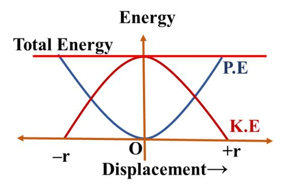

Fig 2. 3: Showing how KE and PE varies as a function of position in SHM

#### 2.4 Application of SHM

Simple Harmonic Motion (SHM) has many practical applications across different fields of science and engineering. Here we discuss Spring-Mass Systems vibrating in a vertical spring that is applied in suspension systems in vehicles to absorb shocks.

#### 2.4.1 Vertical motion of a spring – mass system:

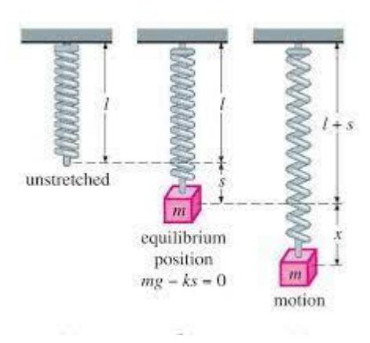

Fig 2.4: Showing vertical spring- mass system

A massless spring of length l is suspended from a fixed support with a mass m attached. The spring stretches by x due to the mass, following Hooke's law F=−kx.

For the equilibrium of the mass, the net force must be zero

i.e, 
$$F + mg = 0$$
  
Or,  $-kx + mg = 0$   
Or,  $mg = kx$  (2.1)

If the spring is further extended by y and then released, it oscillates vertically around its equilibrium position in Simple Harmonic Motion (SHM).The restoring force according to Hooke's law is written as

$$F' = -k(x + y)$$

Since the system oscillates, the net force = ma.

Or, F' + mg = ma  
Or, - k (x +y) + mg = ma  
Or, -kx - ky + mg = ma  
Or, -mg -ky +mg = ma  
Or, a = 
$$(-\frac{k}{m})$$
y  
Or, a =  $-\omega^2$ y,  $\omega = \sqrt{\frac{k}{m}}$  (2.2)

Here acceleration is directly proportional to the displacement y and is directed towards the mean position, called the centre. Hence the vertical motion of the spring- mass system is the SHM.

#### **Period**

Here 
$$T = \frac{2\pi}{\omega} = 2\pi \sqrt{\frac{m}{k}}$$
 (2.3)

*The period of the vertical spring – mass system hence is independent on acceleration due to gravity and depends only up on the mass of the spring and the spring constant.*

#### **2.5 Simple Pendulum**

*The first recorded study of the pendulum was by Galileo Galilei in the late 16th century. He observed a swinging lamp in a cathedral and noted that the period of a pendulum remains constant for small oscillations. This principle later inspired Christiaan Huygens to design the first pendulum clock in 1656, significantly improving time measurement accuracy.*

A simple pendulum consists of a small, heavy mass (called the bob) suspended from a fixed point by a light, inextensible string**.** The bob swings back and forth in a vertical plane under the influence of gravity. The motion of the simple pendulum is an example of simple harmonic motion (SHM) when the angle of oscillation is small.

The *point of suspension* is the fixed point from which the pendulum is hung. The *point of oscillation* is the centre of gravity of the bob where the bob swings back and forth. The *length of the pendulum* is the distance from the point of suspension to the *point of oscillation.*

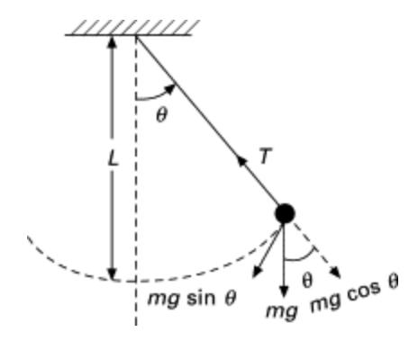

*Fig 2.5: Showing the motion of a simple pendulum*

The pendulum is based on ideal assumptions, such as no friction or air resistance, small-angle displacements (using the small-angle approximation), and a massless, inextensible string or rod that doesn't stretch.

Let the bob of the simple pendulum be pulled aside and then released. It will oscillate about the mean position. At any instant, let the bob be at point B with a displacement x from point A and an angle θ with the vertical OA. When a pendulum bob of mass m is displaced to an angle θ from the vertical, gravity pulls it downward with a force mg.

We break this gravitational force into two components:

Radial component: mgcosθ acts along the string, providing tension.

Tangential component: mgsinθ acts perpendicular to the string, responsible for the bob's motion.

The tangential component mgsinθ tries to bring the bob back to its equilibrium position. This is called the *restoring force.*

Since this force always acts in the opposite direction to the displacement, we include a *negative sign* to indicate this opposition and write:

$$F = -mgsin\theta$$

 F = ma and for small angles (θ in radians), sinθ ≈ θ, making the motion approximately simple harmonic:

$$ma = -mg\theta$$

$$Or, a = -g\theta = -g\frac{x}{l}$$

$$Or, a = -\frac{g}{l}x$$

$$\therefore a = -\omega^{2}x, \quad \omega^{2} = \frac{g}{l}$$

$$\Rightarrow a \propto -x$$

$$(2.3)$$

Hence acceleration is directly proportional to the displacement and is directed towards the centre called the mean position. This leads to the well-known formula for simple harmonic motion (SHM).

Also, 
$$T = \frac{2\pi}{\omega} = 2\pi \sqrt{\frac{l}{g}}$$
 (2.4)

It is the required expression for the period of the simple pendulum.

Squaring the Eq. (4.4), T<sup>2</sup> = 4 2 *l*. The equation is similar to y = mx + c with c = 0. Hence *l-T 2* plot is a straight line passing through the origin and has a slope 4 2 that determines the

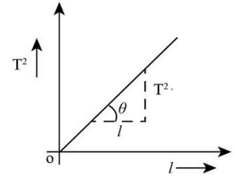

value of g *Fig 2.6*

#### **Second's Pendulum:**

It is the length of the pendulum for which period is 2 seconds.

We write, 
$$T = 2\pi \sqrt{\frac{l}{g}}$$

For T = 2 seconds, we get 
$$2 = 2\pi \sqrt{\frac{l}{9.8}} \implies l = 99.3$$
 cm

#### **Factors affecting the period:**

From the equation, T = 2√ , period of the simple pendulum has the following features:

- *(i) Length of the pendulum (l):* Longer pendulums have a longer period.
- *(ii) Acceleration due to gravity (g):* Weaker gravity increases the period.
- *(iii)* Mass of the bob and amplitude (for small oscillations) do not affect the period.

#### **Drawbacks of a Simple Pendulum:**

A simple pendulum is a theoretical model consisting of a point mass (bob) suspended from a weightless, inextensible string that swings under the influence of gravity. *Both the concept of point mass and the weightless string are impossible to have in a real practice* .In reality, it has several drawbacks:

- **(i)** The period formula T = 2√ is only accurate for small swings (less than 5°). For *larger angles*, the period increases, making the formula *inaccurate.*
- **(ii)** The period depends on gravitational acceleration (g), which varies with location (due to altitude, latitude, and geological factors), affecting accuracy.
- **(iii)** The length of the pendulum must stay constant. However, thermal expansion or stretching of the string can change the length, affecting the period.
- **(iv)** Air drag and pivot friction cause energy loss, which reduces the amplitude and eventually stops the motion over time.
- **(v)** The pendulum is sensitive to vibrations, wind, and other external forces, which can disrupt its motion and lead to inaccurate results.

**(vi)** Due to continuous energy loss from friction and air resistance, the pendulum slows down and eventually stops, making it unsuitable for long-term measurements.

#### **Activity 2.1:** *Study of Periodic Motion Using Everyday Examples* **Objectives**

- i) To understand the concept of periodic motion**.**
- ii) To observe and analyze real-life examples of periodic motion.
- iii) To calculate the period and frequency of different periodic systems.

#### **Theory**

Periodic motion is a type of motion that repeats itself at regular intervals of time. Many natural and man-made systems exhibit such motion. Examples include the swinging of a pendulum, vibrations of a tuning fork, motion of a swing, and the rotation of a fan.

#### **Materials Required**

- i) Stopwatch
- ii) Meter scale or measuring tape
- iii) A pendulum setup or swing
- iv) A vibrating object (e.g., plastic ruler, rubber band)
- v) Smartphone (optional, for stopwatch or video analysis)

#### Procedure

- 1. Select 2–3 examples of periodic motion from your surroundings (such as a pendulum, swing, or vibrating ruler).
- 2. Set each object into periodic motion.
- 3. Measure the time taken for 10 complete oscillations using a stopwatch.
- 4. Repeat the measurement 2–3 times for accuracy and take the average.
- 5. Calculate the period (T) using and the frequency as f = 1/T
- 6. Record your findings in a table.
- 7. (Optional) Observe how changes in factors like **length** (in a pendulum) or amplitude affect the period.

#### Observation Table

| S.N. | System Observed | Time for 10 Oscillations (s) | Period<br>(T) (s) | Frequency (f) (Hz) |
|------|-----------------|------------------------------|-------------------|--------------------|
| 1    | Simple pendulum |                              |                   |                    |
| 2    | Swing           |                              |                   |                    |
| 3    | Vibrating ruler |                              |                   |                    |

#### Conclusion

This project demonstrated that periodic motion repeats at regular intervals and can be observed in everyday systems. By measuring periods and calculating frequencies, we connected theoretical concepts with real-world observations and saw how factors like length affect motion.

#### **2.6 Angular Simple Harmonic Motion**

 Angular SHM refers to a type of oscillatory motion in which an object rotates around a fixed axis, experiencing a restoring torque that is directly proportional to its angular displacement from the equilibrium position. It is the rotational analog of linear simple harmonic motion (SHM).

**A** torsion pendulum is a classic example of angular SHM. It consists of a disk or rod suspended from a fixed point, and when twisted, it oscillates back and forth under the influence of the restoring torque.

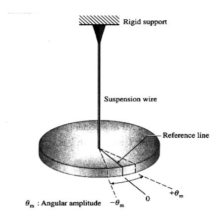

*Fig 2.7: Torsional pendulum, an example of angular SHM*

Fig.4.7 represents the torsional pendulum consisting of a horizontal disc suspended on a wire. The element of springiness or elasticity is associated with the twisting of the suspension wire, rather than the extension and compression of a spring, as we previously discussed. When the wire is twisted and then released, the object oscillates in angular simple harmonic motion.

Let the disc is rotated through an angle θ from its rest position and then released it. It will oscillate about this point in angular SHM. Hence rotating the disc through an angle θ in either direction introduces a restoring torque given by

$$\tau = -k\theta$$

where k is the torsional constant, and θ is the angular displacement.

As 
$$\tau = I\alpha$$
,  $I\alpha = -k\theta$   
Or,  $\alpha = \frac{k}{I}\theta$  (2.5)

The equation resembles with the equation a = - x in linear SHM. Hence the angular acceleration is directly proportional to the angular displacement and is directed towards the mean position. Hence the Eq (4.5) is the equation of angular SHM.

Here 
$$\omega = \sqrt{\frac{k}{I}}$$

Or,  $T = \frac{2\pi}{\omega} = 2\pi \sqrt{\frac{I}{K}}$ 

(2.6)

#### **4.6 Oscillatory Motion**

Oscillatory motion is when something moves back and forth around a central point, like a swinging pendulum or a bouncing spring. It happens in many systems and is measured by *amplitude* (how far it moves*), period* (time for one complete movement), and *frequency* (how often it moves back and forth).

#### **Free Oscillation**

In free oscillation, an object moves on its own after being pushed or pulled. It keeps swinging or bouncing at its *natural frequency* without any outside force

#### **Damped Oscillation**

Damped oscillation happens when the motion slows down due to resistance like air or friction. This makes the object lose energy and the oscillations become smaller and smaller until they eventually stop.

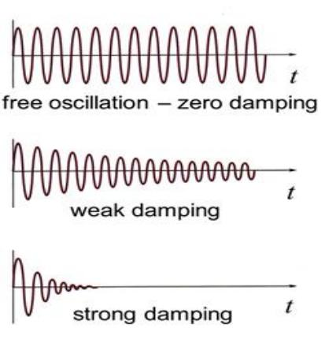

 *Fig 2.8 Showing oscillation*

#### **Forced Vibration**

Forced vibration happens when an outside force keeps pushing or pulling the object to make it move. The object may not move at its natural frequency, but the external force keeps it oscillating at its own frequency. The strength of the motion depends on how strong and fast the external force is.

#### **Resonant Vibration**

Resonance occurs when the frequency of an external force matches the object's natural frequency. This causes the object to move with a much larger amplitude. In some cases, this can be dangerous, such as with bridges or buildings, where large oscillations can lead to damage. Examples of resonance include the detonation of a bomb with a remote, the collapse of a building during an earthquake, and tuning a radio or TV channel.

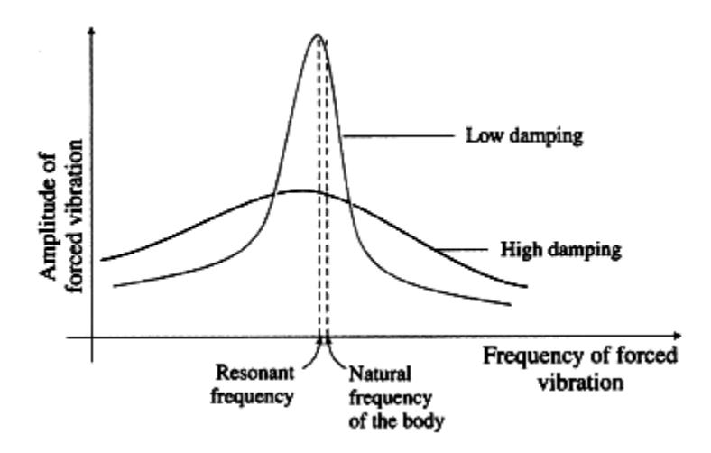

 *Fig 2.9: Showing resonance*

#### **Examples of Damped Oscillation and Resonance**

#### **Examples of Damped Oscillation**

Damped oscillation means the motion gradually decreases due to some resistance or friction. Here are some everyday examples:

#### 1. **Pendulum in Air**

A swinging pendulum slowly comes to rest because air resists its motion.

#### 2. **Car Shock Absorbers**

When a car hits a bump, the springs start oscillating, but shock absorbers reduce the motion and quickly bring the car to a steady state.

#### 3. **Tuning Fork in Air**

A vibrating tuning fork produces sound, but the vibrations slowly die out as energy is lost to the surrounding air.

#### 4. **Slow-Closing Doors**

Doors with dampers don't slam shut; instead, they close slowly and smoothly due to damping.

#### 5. **Spring in Water**

A mass on a spring dipped in water oscillates, but the water resists the motion and reduces the amplitude over time.

#### **Examples of Resonance**

Resonance happens when an object vibrates with maximum energy because it is forced to oscillate at its natural frequency. Here are some examples:

#### 1. **Swinging at the Right Time**

If you push a swing at just the right moment (matching its natural frequency), the swing goes higher and higher — that's resonance.

#### 2. **Tuning Fork and Resonance Box**

When a tuning fork is placed on a wooden box with the same natural frequency, the sound becomes louder due to resonance.

#### 3. **Breaking a Glass with a Voice**

A singer can break a glass by singing a note that matches the glass's natural frequency, causing strong vibrations.

#### 4. **Bridge Collapse (Tacoma Narrows Bridge)**

–A famous bridge collapsed because wind caused it to vibrate at its natural frequency, leading to destructive resonance.

#### 5. **Tuning a Radio**

A radio works by matching its internal frequency to that of the radio station, allowing it to resonate and clearly receive the signal.

#### **Activity 2.2**

*Understand free, damped, and forced oscillations, how damping affects motion, and the reallife effects of resonance.*

#### **Materials Required:**

Spring-mass system or pendulum, stopwatch, ruler, water or oil, small motor, notebook.

#### **Free Oscillations:**

- (i) Set up a spring with weights or a pendulum.
- (ii) Pull it slightly and let it swing or bounce.
- (iii) Measure the time for 10 swings to find the period (T).
- (iv) Talk about how mass and spring strength (or pendulum length) affect the period.

**Observe:** Write down the time (period), how often it moves (frequency), and how far it swings (amplitude).

#### **Damped Oscillations:**

- (i) Do the same experiment, but place part of the spring or pendulum in water or oil.
- (ii) Watch how the movement slows down over time.
- (iii) Measure how far it moves (amplitude) after each swing.

**Observe:** How does the liquid affect the movement and the number of swings?

**Think About:** Where do we see this slowing effect in real life? (e.g., car shock absorbers)

#### **Forced Oscillations & Resonance:**

- (i) Connect a vibrating source to the spring or move the pendulum back and forth by hand.
- (ii) Change how fast you make it move (driving frequency).
- *(iii)* Find the speed where it swings the most—this is *resonance.*

**Observe:** What happens when the driving speed matches the system's natural swing? **Think About:** Where do we see resonance in real life? (e.g., bridges, musical instruments).

**Project Title:** *Measuring the Variation of Gravitational Acceleration (g) Around Kathmandu Using a Simple Pendulum.*

#### Objective:

*To study how gravitational acceleration (g) changes across different elevations in and around Kathmandu using a simple pendulum experiment.*

#### Selected Locations for Measurement:

- i) Ratnapark (~1400m) Central Kathmandu (Lowest altitude) ,
- ii) Swayambhu (~1500m) Mid-altitude hill near Kathmandu
- iii) Thankot (~1600m) Entry point to the Kathmandu Valley
- iv) Chandragiri Hill (~2551m) Higher elevation in the valley
- v) Phulchowki Peak (~2782m) Tallest hill in the valley (Highest altitude)

#### **Theory:**

The period of a simple pendulum is given by:

$$T=2\pi\sqrt{\frac{l}{g}}$$

Rearranging the equation to find g:

$$g=4\pi^2 \frac{l}{T^2}$$

where T = Period (seconds), l = Length of pendulum (meters)and g = Gravitational acceleration

Since gravity slightly decreases at higher altitudes, we expect lower values of g at Phulchowki and Chandragiri compared to Ratnapark.

#### **Materials Required:**

- i) A string (~1 meter long)
- ii) A metal bob or stone (pendulum weight)
- iii) A stopwatch (or mobile timer)
- iv) A meter scale (for length measurement)
- v) A rigid stand (or a fixed structure to hang the pendulum)

#### Procedure:

- i) Suspend a simple pendulum at each location from a fixed stand or tree.
- ii) Measure string length accurately
- **iii)** Pull the bob to a small angle (~4° to 5°)
- iv) Release gently and start the stopwatch.
- v) Measure time for 20 full oscillations and find the period, T**.**
- vi) Compute g values for each location using the formula mentioned above.

#### Compare Results:

- i) Analyze the variation of gg across altitude changes.
- ii) Identify trends in gravitational acceleration at different elevations.

#### Expected Observations:

Higher elevations (Chandragiri, Phulchowki) → Slightly lower g while the lower elevations (Ratnapark, Swayambhu) → Slightly higher g Kathmandu's altitude influences gravitational strength.

#### **Exciting Extensions:**

Compare Nepal's gravity with the standard g = 9.81 ms-2 . Check real-world applications (How altitude affects sports, science, and aviation). Use satellite data to confirm elevation effects.

#### **Exercise**

| 1. | What will be the amplitude of vibration of a particle undergoing SHM if its<br>displacement is given as y = 3sinωt + 4cosωt?<br>a) 3 cm<br>b) 4 cm                                                                   | c) 5 cm   | d) 7 cm                                |              |            |  |
|----|----------------------------------------------------------------------------------------------------------------------------------------------------------------------------------------------------------------------|-----------|----------------------------------------|--------------|------------|--|
| 2. | What is the angle between the instantaneous velocity and acceleration of a particle<br>undergoing SHM?                                                                                                               |           |                                        |              |            |  |
|    | b) 𝜋<br>a) Zero<br>2                                                                                                                                                                                                 | c) 𝜋      |                                        | d) zero or 𝜋 |            |  |
| 3. | A particle undergoing in a SHM has an amplitude r and period T. What is the time<br>taken by it to travel from x = r to x = 𝑟                                                                                        |           |                                        |              |            |  |
|    | 𝑇<br>a)<br>2                                                                                                                                                                                                         | b) 𝑇<br>3 | 2<br>c) 𝑇<br>6                         |              | d) 𝑇<br>12 |  |
| 4. | What happens to the period of a simple pendulum if its length is tripled?                                                                                                                                            |           |                                        |              |            |  |
|    | a) The period doubles<br>b) The period triples                                                                                                                                                                       |           |                                        |              |            |  |
|    | c) The period increases by a factor of √3<br>d) The period increases by a factor of 3                                                                                                                                |           |                                        |              |            |  |
| 5  | A simple pendulum is suspended on the moon, where the acceleration due to gravity is<br>1/6<br>of Earth's gravity. If the period of the same pendulum is 2 seconds on Earth, what<br>will the period be on the moon? |           |                                        |              |            |  |
|    | a) 5<br>seconds                                                                                                                                                                                                      |           | b) 2 seconds                           |              |            |  |
|    | c) 6 seconds                                                                                                                                                                                                         |           | d) 12 seconds                          |              |            |  |
| 6. | A girl sitting on a swing is swinging with a period T. What will be the period if<br>another girl sits together and go for the swing?<br>a) is halved                                                                |           | b) is doubled                          |              |            |  |
|    | c) remains same                                                                                                                                                                                                      |           | d) is quadrupled                       |              |            |  |
| 7. | What is the natural frequency of a longitudinal vibration of a spring if the mass of the<br>system is made half and the spring stiffness is doubled?                                                                 |           |                                        |              |            |  |
|    | a)<br>is halved<br>c) is quadrupled                                                                                                                                                                                  |           | b) is doubled<br>d) remains unaffected |              |            |  |
| 8. | What will happen to the frequency of a mass-spring system if the mass is doubled?<br>a) The frequency will double<br>b) The frequency will remain the same                                                           |           |                                        |              |            |  |
|    | c) The frequency will decrease by a factor of √2<br>d) The frequency will decrease by a factor of 2                                                                                                                  |           |                                        |              |            |  |

9. *If the natural frequency of the fig I is f, what will be the frequency of the fig II on adding two similar springs of the same spring constant?*

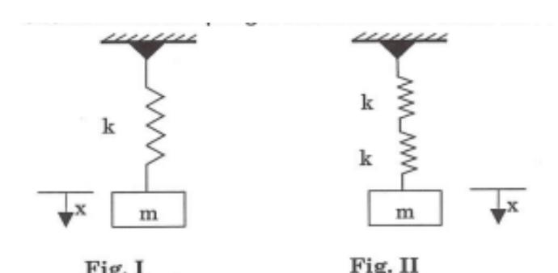

- a) f b) √2
- c) √2
- d) √2 f
- 10. *Why does resonance occur in simple harmonic motion?*
  - a. the system is disturbed by a random force
  - b. the driving frequency matches the natural frequency of the system
  - c. the amplitude is reduced
  - d. the system loses energy
- 11. *Where would you observe resonance in everyday life?*
  - a. In a swinging pendulum with no external force
  - b. When a car suspension system absorbs shocks
  - c. In musical instruments like a guitar or violin
  - d. When a spring stretches under a constant weight
- 12. *In an angular simple harmonic oscillator, the restoring torque τ is given by τ = −kθ, where θ is the angular displacement and k is the torsional constant. What is the angular frequency ω of the oscillation?*

a) 
$$\omega = \sqrt{k}$$
 b)  $\omega = \int$ 

b) 
$$\omega = \sqrt{\frac{k}{I}}$$

c) 
$$\omega = k/I$$
 d)  $\omega = I/k$ 

d) 
$$\omega = I/k$$

- 13. *A body is undergoing simple harmonic motion (SHM) along a straight line.*
  - a. Define simple harmonic motion. What are its essential characteristics?
  - b. Derive the expression for acceleration in SHM.
  - c**.** A particle of mass 0.1 kg is executing SHM with a period of 2 s and an amplitude of 0.5 m**.**
  - i) Find its total mechanical energy**.**
  - ii) Determine the kinetic energy when the displacement is 0.3 m**.**
  - iii) At what displacement is the speed half of its maximum value? *).*

*(Ans: (i) 0.123 J (ii) 0.079 J (iii) 0.433 m)*

14. Figure shows a simple pendulum that swings backwards and forwards between P and Q.

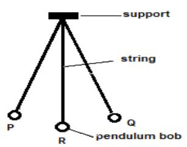

- a. The time taken for the pendulum to swing from P and Q is approximately 0.5 sec. Estimate the length of the pendulum.
- b. i) Draw free body diagram showing all necessary forces.
- (ii)Use the free body diagram to find the frequency of oscillation
  - 15. *Consider a spring-mass system placed vertically.*
    - a. Define equilibrium position in vertical SHM.
    - b. How does the restoring force act in vertical SHM? Explain using Hooke's law.
    - c**.** A 5 kg block is suspended from a vertical spring, causing it to stretch by 0.25 m**.**
    - i) Calculate the spring constant of the spring.
    - ii) If the block is displaced further and set into oscillation, find its period**.** *(Ans: (i)196Nm-1 , (ii)1.003 s)*
  - 16.

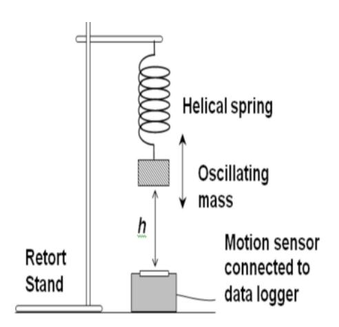

The diagram shows a mass suspended from a helical spring, oscillating vertically. A motion sensor connected to a data logger records its motion.

- (a) Name the type of oscillation shown in the diagram.
- (b) Write the expression for the period T of vertical oscillation in terms of mass mmm and spring constant k.
- (c) If the extension of the spring at equilibrium is h, derive a relation between h, g, and T.

- 17. *A torsional pendulum undergoes angular SHM.*
  - a. What is angular simple harmonic motion? Give one example.
  - b. Derive the expression for period of angular SHM in a torsional pendulum.
  - c**.** A disc of moment of inertia 0.05 kgm<sup>2</sup> is suspended by a wire with torsional constant 0.10 Nmrad -1 . Find the period of angular oscillation. *(Ans: 4.4 s)*
- 18. *A pendulum in air experiences resistance and slows down over time.*
  - a. What is damping in oscillation? Name the types of damping.
  - b**.** Explain what happens to the amplitude of oscillations when the frequency of a periodic driving force matches the natural frequency of the system.
  - c**.** A metal pendulum bob oscillates in still air. An investigator records the successive peak displacements of the bob from its equilibrium position and obtains the following data:

Peak number 1 2 3 4

Displacement (cm) 8.0 6.0 4.5 3.4

*(Assume small-angle oscillations so that the time-period is practically unchanged by the damping.)*

- i) Describe, in words, how you would sketch a displacement–time graph for this pendulum using the data above. Indicate clearly how the graph reveals that the bob is damped
- ii)  If the undamped period of the pendulum is 1.6 s, explain qualitatively whether the actual period in air will be exactly 1.6 s, slightly greater than 1.6 s, or slightly less than 1.6 s. Give a reason.
- iii)  Suppose the pendulum is now made to swing in thin oil instead of air. State two qualitative changes you would expect to see in the displacement–time graph.
- 19. *A tuning fork vibrates under an external periodic force.*
  - a. What is resonance? Under what condition does it occur?
  - b. What is the phase relation between displacement and driving force at resonance?
  - c**.** A forced oscillator has natural frequency ω0=5 rad/s. When driven by an external force of frequency ω=5rad/s, amplitude is maximum. Explain this behavior using a graph and calculate the resonance condition. 20.

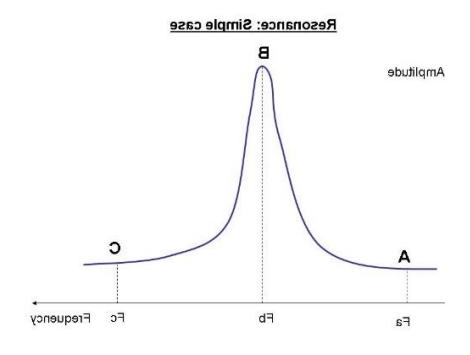

The graph shows the variation of amplitude with the frequency of a periodic force applied to a system. Points A, B, and C correspond to frequencies Fa, Fb, and Fc, respectively.

(a) Name the physical phenomenon represented by the graph.

- (b) Identify the frequency F<sup>b</sup> and explain what happens to the amplitude at this frequency.
- (c) Compare the amplitudes at points A and C and explain why they are lower than at B.
- 21. *A block of mass m is attached to a vertical spring and executes SHM.*
  - a. Define SHM and derive the equation of motion using Hooke's law. (1 mark)
  - b. What is total mechanical energy in SHM? Derive the expression and discuss how energy varies with time. (1 mark)
  - c. Explain why the restoring force in vertical SHM is independent of gravity. (1 mark)
  - d**.** Two springs with spring constants k₁ = 200 N/m and k₂ = 300 N/m are connected in parallel to a mass of 2 kg.
  - i) Find the effective spring constant of the system.
  - ii) Calculate the period of oscillation.
  - iii) If the amplitude of motion is 0.15 m, find the maximum energy stored in the system*.( Ans: (i) 500 Nm-1 (ii) 0.40s (iii) 5.625 J)*
- 22. A particle performs SHM with an amplitude of 0.4 m and a frequency of 5 Hz**.**
  - i) Find its angular velocity.
  - ii) Calculate the displacement after 0.1 seconds from the mean position.
  - iii) Find its velocity and acceleration at that point.(*Ans: (i) 31.42rads-1 (ii)Approx. 0 m (iii) – 12.57 ms-1 and an approx.. of 0 ms-2 )*
  - 23. A system oscillates with an initial amplitude of 0.5 m. Due to damping, its amplitude decreases by 5% per cycle.
  - i) Find the amplitude after 10 oscillations.
  - ii) How much energy remains after 10 oscillations if the initial energy is 40 J*?(Ans:*
  - *(i) 0.30 m*
  - *(ii) 14.3 J)*

## **Chapter 3**

## **Fluid Mechaincs**

#### <span id="page-48-0"></span>**Fluid Statics**

#### **Archimedes** (c. 287 BCE – c. 212 BCE)

Archimedes, one of the most remarkable scientists and inventors of the ancient world, made lasting contributions to mathematics, physics, and engineering. Renowned for his sharp intellect and inventive spirit, he approached scientific problems with deep insight and logical precision.

He is especially remembered for his pioneering work in mechanics and geometry, as well as for developing methods that anticipated modern calculus. Archimedes combined theoretical brilliance with practical innovation, designing a range of mechanical devices including war machines and the Archimedean screw for raising water.

His legacy as a thinker who blended abstract reasoning with real-world application has earned him a place among the most influential scientific minds in history.

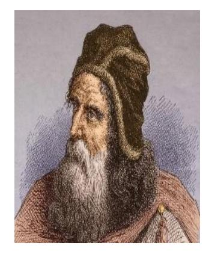

#### **3.1 Introduction**

Fluid statics is the study of fluids at rest and the forces they exert. Two major ideas in this chapter are Archimedes' principle, which explains why things float or sink, and surface tension, which explains why small objects can float on water.

Let's explore some amazing real-life observations related to fluid statics.

#### **Do you know?**

- *(iv)* We feel the same pressure underwater, no matter which way you face.
- *(v)* It is difficult to cook rice at higher altitudes, as often experienced by pilgrims visiting Muktinath.
- *(vi)* Generally nose bleeding occurs in such regions of higher altitude
- *(vii)* Atmospheric pressure is the weight of the air above us pushing down. At sea level, it's about 101,325 Pa or 1 atmosphere, but we don't feel this pressure directly on our bodies. Atmospheric pressure decreases as geographical altitude increases.
- *(viii)* When pressure is added to a fluid in a closed space, it spreads out evenly in all directions. This is how things like hydraulic lifts and brakes work!
- *(ix)* We feel easier to lift a body inside water but immediately feel heavier outside the water surface.
- *(x)* Small insects, like water striders, to walk on water without sinking? It acts like a thin "skin" on the surface of the water. A steel needle kept gently keeps on floating on water, camphor particles seem dancing while dissolved in water, antiseptics are used in cuts and wounds, hot soup has more taste, a loop of a thread kept gently on a water surface becomes circular when pierced at centre of the water surface.
- *(xi)* The water sticks together and forms beads instead of spreading out.

#### **Pressure exerted by a Fluid Column**

Fluid pressure is the force a fluid exerts per unit area on an object.

Consider a fluid column of height h and density in a cylindrical vessel with cross – sectional area A, as shown in the fig 3.1 below:

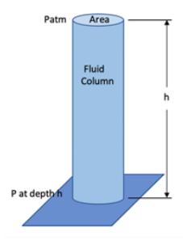

 *Fig 3.1: Showing pressure due to fluid column*

The fluid mass gives downwards force at the bottom of the vessel. This force on a unit area is the pressure exerted by the fluid at the bottom of the vessel.

i.e, 
$$P = \frac{F}{A} [Nm^{-2} (or Pa)]$$
  
Or,  $P = \frac{mg}{A} = \frac{v\rho g}{A} = \frac{Ah\rho g}{A} = h\rho g$   
 $\therefore P = h\rho g$ 

Hence, the pressure exerted by a fluid column is:

(i) directly proportional to the height of the fluid column, i.e., P ∝ h, and (ii) directly proportional to the density of the fluid, i.e., P ∝ ρ.

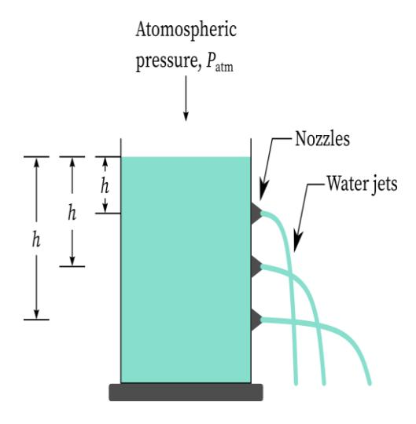

*Fig 3.2: Liquid pressure varies as per P* <sup>∝</sup> *h and its faster to fill in a lower tap*

*Also, atmospheric pressure is higher at sea level. Mercury exerts greater pressure than water due to its higher density. Moreover, water flows faster from a lower tap than from a higher one, due to the greater pressure at lower points.*

#### **Pascal's Law**

*Statement: Liquids transmit equal pressure in all the boundaries*

When a polythene bag filled with water is pricked with several small pinholes and squeezed from the outside, water jets out through all the holes with equal force. This demonstrates Pascal's law, which states that any pressure applied to an enclosed fluid is transmitted equally in all directions. Squeezing the bag distributes the pressure uniformly, causing water to emerge equally from each hole. This simple experiment clearly illustrates the principle of undiminished pressure transmission in a confined fluid.

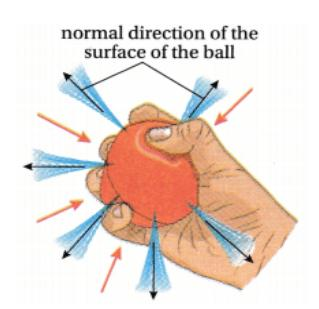

Fig 3.3: Showing Pascal's Law

#### **Specific Gravity**

```
Its defined as Sp \ gravity = \frac{\text{weight of certain volume of a substance}}{\text{weight of the same volume of water at } 4^{\circ}C}
= \frac{\text{mass of 1cc volume of a substance}}{\text{mass of 1 cc volume of water at } 4^{\circ}C}
= \frac{\text{density of a substance}}{\text{density of of water at } 4^{\circ}C} = \text{density of a substance in CGS } [\because \text{ density of water at } 4^{\circ}C]
```

It is a pure ratio of two similar physical quantities, and therefore has no unit or dimension. The instrument used to measure the density of liquids is called a hydrometer. A lactometer, a type of hydrometer, is specifically used to measure the density (or purity) of milk.

#### **Upthrust**

#### Think of the following observation:

When you lift a water-filled bucket *while it's still inside the water*, it feels lighter because the water pushes upward on it. This upward force is called buoyant force (or upthrust). As soon as the bucket is lifted out of the water, it feels heavier because the support from the water is no longer there. In simple words, objects feel lighter in water because of the upward push, but when they come out, they feel heavier because that push disappears.

The loss in weight of an object when immersed in a fluid equals the upthrust; that is, Upthrust = Loss in weight.

To understand this clearly, the buoyant force (or upthrust) is the upward force exerted by the surrounding fluid on a submerged object. It is equal in magnitude to the weight of the fluid displaced by the object. Hence, the upthrust U is given by:

U= mass of the displaced fluid (v)  $\times$  g = (volume of displaced fluid, v)  $\times$  (density of fluid  $\rho$ ) $\times$ g = v $\rho$ g, as given by Archimedes' principle.

Therefore, whether we immerse a hollow body or a solid body of any shape, the upthrust depends only on the volume of the displaced fluid (which equals the volume of the immersed part of the body) and the density of the fluid.

This is why mercury, having a higher density than water, exerts a greater upthrust than water.

#### **Archimedes' Principle**

#### Archimedes' Principle says:

*"When you put something in water, it gets pushed up by a force equal to the weight of the water it pushes away."*

#### **Activity 3.1**

*Understand Archimedes' Principle by observing how a stone loses weight when immersed in water.*

#### **Materials Needed:**

A small stone, A spring balance (to measure weight), A clear container (like a measuring cup), water and a thread.

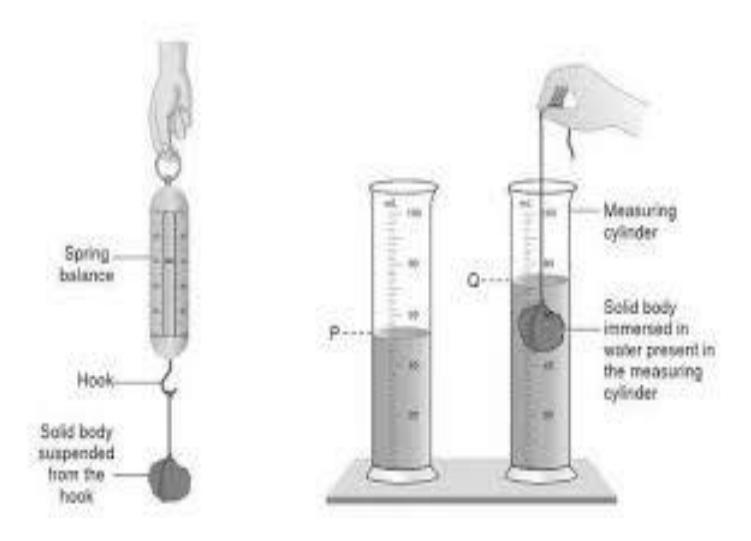

 *Fig 3.4: An activity to show Archimedes' principle*

#### **Steps:**

- (i) Tie the stone by the thread weigh the stone in the air using a spring balance. Let it is W<sup>1</sup>
- (ii) Weigh the stone in water immersing it inside a measuring cylinder containing some water. Let it is W<sup>2</sup>
- (iii) Note the difference (W₁ W₂) which is the upthrust (the upward force from the water).

#### **Measure the volume of displaced water:**

(iv)Note the initial volume level V<sup>1</sup> of water in the beaker and then observe the new water level V₂ in the measuring cylinder. Then V<sup>2</sup> – V<sup>1</sup> = V is the net water displaced due to the solid.

- (v) Finally observe that the buoyant force which is the upthrust is equal to the weight of the liquid displaced, i.e, W₁ - W₂ = Vg
- (vi) Then make an statement that the loss in weight (upthrust) is equal to the weight of the liquid displaced. It's the Archimedes' principle

#### **Conclusion:**

The stone loses weight in water because the water pushes it up. This upthrust is why things feel lighter when underwater!

#### **Some Terminologies on an Equilibrium of a Floating Body:**

- (i) The Centre of Gravity (CG) of a displaced liquid is the Centre of Buoyancy (CB). Upthrust acts vertically up through this point.
- (ii) The weight of a body acts vertically downwards through the CG while the upthrust acts vertically up through the CB and for a floating body, W = U. Here the center of buoyancy stays aligned with the center of gravity, the body remains in its new position**.** The body does not return or tip further.
- (iii) When a body tilts or shifts position in a liquid, the shape of the displaced liquid changes. This change causes the center of buoyancy to move to a new position. The exact location of the new center of buoyancy depends on the altered shape and volume of the displaced liquid.
- **(iv)** When a body tilts in a liquid, the center of buoyancy changes with the shape and volume of the displaced liquid. If the center of buoyancy moves above the center of gravity, the body returns to its original position **(**stable equilibrium**)**. If it moves below the center of gravity, the body tilts more or may fall over **(**unstable equilibrium). If both centers stay in line, the body stays in its new position **(**neutral equilibrium**)**. For example, a boat returns upright if it is stable, but a floating log may roll over if it is unstable.
- (v) When the body is tilted, the center of buoyancy shifts to a new position, and the metacenter is the point where the line through this new center of buoyancy intersects the body's original vertical axis. It helps determine whether a floating object will stay upright or tip over.
- (vi) When a floating body tilts, the center of buoyancy (CB) shifts because the shape of the displaced liquid changes. The metacenter (MC) is the point where the new line of buoyant force meets the original position of the body. The distance between the center of gravity (CG) and the metacenter (MC) is called the metacentric height**,** which affects the body's stability.

*(vii)* For the stability of a floating body, the metacenter (MC) should lie above the centre of gravity (CG). *Hence it is the reason to say why the bottom of a ship is made heavier.*

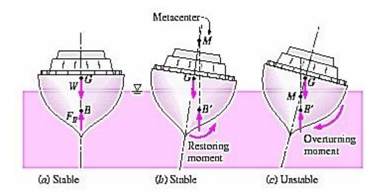

 *Fig 3.5: Showing equilibrium of a floating bode in relation to CB and MC.*

#### **3.2 Surface Tension**

#### **Thomas Young (1773–1829)**

Thomas Young was a pioneering English scientist known for his deep insight and versatility across many fields. His precise experiments and innovative thinking advanced fundamental concepts in physics and medicine.Young's work on surface forces and the angle of contact remains a cornerstone in fluid mechanics. He is remembered for his ability to connect theory with experiment, influencing both scientific thought and practical applications. His legacy extends beyond fluid mechanics to include groundbreaking contributions in optics and the study of light, marking him as one of the great scientific minds of his era.

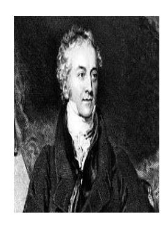

#### **Surface Tension Phenomenon**

Surface tension of a liquid is the property that makes its free surface behave like a stretched membrane, allowing it to occupy the smallest possible surface area. This behavior is similar to a fearful person curling up to hide from potential danger of a roaring tiger. Just as the person pulls inward using their body to minimize exposure, the liquid's surface exerts tangential forces to reduce its surface area.

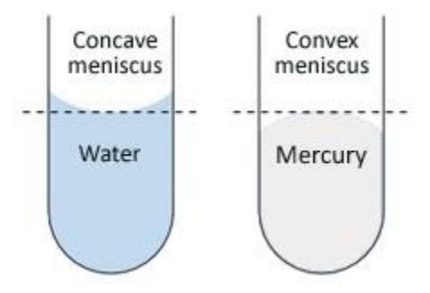

 *Fig 3.6: surface tension phenomena*

Mathematically, it is measured by the tangential forces per unit imaginary length

i.e, Surface tension, 
$$T = \frac{F}{I} \equiv Nm^{-2}$$

Dimensional formula  $\equiv [ML^0T^{-2}]$ 

Surface tension occurs only in liquids because their molecules experience attractive forces (cohesion). It takes place on the free surface of a liquid, where it meets air or another gas. Surface tension allows objects denser than the liquid (like a needle) to float on the surface without sinking, provided the object does not break the surface.

The surface tension of a liquid decreases with an increase in temperature and the addition of impurities.

This explains why *antiseptics* are used on cuts and wounds (they spread easily), why detergents are effective in cleaning, why camphor particles move or "dance" on water, and why hot soup tastes better than cold soup—as it spreads more easily over the tongue.

Let's demonstrate an activity to understand the phenomena outlined:

#### **Activity 3.2**

**Objective:** To observe surface tension and how it allows an object to float on a liquid surface.

#### **Materials Required:**

A clean needle or paperclip, A shallow dish or glass (preferably clear), Water A piece of tissue or paper towel

#### **Procedural Method:**

- (i) Fill the shallow dish or glass with water, leaving a small gap at the top to avoid overfilling.
- (ii) Carefully place the needle or paperclip on a piece of tissue, then gently lift it and place it flat on the water's surface, being cautious not to drop it directly in, as it may sink. Once the needle is carefully placed on the water, observe it closely. The needle should float on the surface without sinking.
- (iii)To see how surface tension changes, you can add a drop of dish soap to the water near the needle. The needle will suddenly sink as the soap breaks the surface tension of the water.

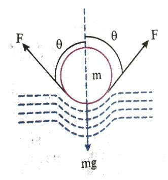

Fig 3.7: Small needle floating on water

#### **Explanation:**

When the needle is placed gently on the surface of the water, the surface tension holds the needle up. The molecules at the water's surface are attracted to each other, creating a "skin" that prevents the needle from sinking.

There is a small depression on the water surface at the point where the needle touches the water. The surface tension forces FFF act tangentially along the curved surface. The

*components of these forces combine to produce a resultant force acting vertically upward, which balances the weight of the needle acting downward.*

The soap reduces the surface tension of the water, allowing the needle to sink.

#### *More Examples*

*(i) A painting brush spreads inside water while its threads clung to each other when taken out of the water.* It is because the free surface is created outside the liquid where surface tension arises.


 *Fig 3.7a: Example of surface tension*

*(ii) A loop of a wire gently kept on a soap film becomes circular when a small hole is pierced on the soap film at the centre of the loop.* It is because the circle encloses a maximum area that minimizes the remaining surface area of the liquid.

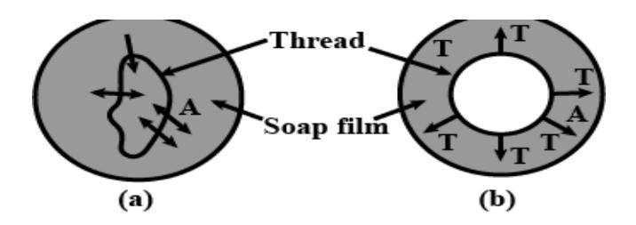

*Fig 3.7b: Example of surface tension*

#### **Molecular Theory of Surface Tension**

Inside a liquid, molecules are surrounded by other molecules on all sides and experience attractive forces in all directions. However, molecules at the surface are only pulled inward by the liquid beneath them, as there are no molecules above. This creates a "tight" surface, similar to a stretched membrane. Because surface molecules experience a stronger inward pull than those inside the liquid, the surface tends to contract, minimizing its area.

For example, a drop of water takes on a round shape because surface tension pulls the molecules together, forming the shape with the smallest possible surface area—a sphere.

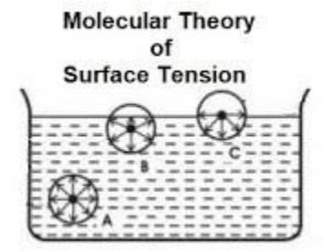

*Fig 3.8: Showing molecular theory on surface tension*

#### **3.3 Surface Energy**

Surface tension is the property of a liquid that causes it to minimize its surface area. Surface energy is the energy required to increase the surface area of a liquid by one unit. It is directly related to surface tension, which is the force acting along the surface of a liquid.

When the surface area of a liquid increases, molecules from the interior move to the surface. This movement requires energy to overcome intermolecular attraction, and that energy is known as surface energy.

In simple terms, surface energy is the energy needed to stretch a liquid's surface. Liquids naturally tend to minimize this energy by reducing their surface area, often forming droplets. Surface energy plays a key role in phenomena such as capillary action**,** wetting, and bubble formation**.**

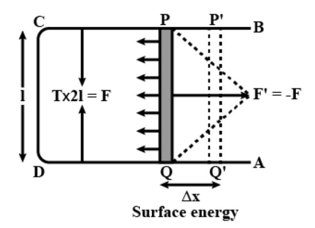

*Fig 3.9: Showing surface energy on surface tension*

Consider a rectangular wire frame with a movable horizontal wire dipped in a soap solution, forming a thin soap film. The soap film creates two free surfaces, and surface tension (T) acts along each surface.

If the length of the movable wire is PQ *= l*, the total force due to surface tension on both sides of the film is F=2T×*l***.**

When the wire is moved by a small distance Δx (PQ→P'Q') against the surface tension force that acts inwards with a requirement of minimizing the surface area, the work done to stretch the film is given by

$$W = 2T \times l \times \Delta x.$$

This work increases the surface area of the soap film. Since there are two surfaces, the increase in surface area is

$$\Delta A=2\times (l\times \Delta x)$$
.

Surface energy is defined as the work required to increase the surface area of a liquid. Using the relation between work and surface area, we get

$$W=T\times\Delta A$$
.

This shows that the surface energy is directly proportional to the product of surface tension and the increase in surface area.

*Hence, the formula for surface energy is derived as Surface Energy=T×ΔA.*

Q: *Explain why work is required to move the wire in the soap film.*

#### **3.4 Angle of Contact**

Have you ever wondered why water spreads into a thin layer on glass while mercury forms round, shiny droplets? This happens because of a property called the *angle of contact* which is directly influenced by the adhesive and cohesive nature of the liquid. They work together to determine whether a liquid will wet a surface or form droplets. It determines whether a liquid will spread out (wetting) or form droplets (non-wetting) on a surface. This concept helps explain everyday phenomena like raindrops rolling off leaves and how ink spreads on paper**.**

*Cohesion refers to the attraction between like molecules, such as water molecules attracting each other. On the other hand, adhesion is the attraction between unlike molecules, like water molecules sticking to a solid surface, such as glass*. The angle of contact depends on the balance between these two forces. Cohesion tends to pull the liquid molecules together, while adhesion pulls them toward the solid surface.

When adhesion is stronger than cohesion, the liquid spreads out on the surface, leading to a small angle of contact (< 90<sup>0</sup> ) which is known as good wetting. Conversely, when cohesion is stronger than adhesion, the liquid forms droplets, resulting in a large angle of contact (>90<sup>0</sup> ), or poor wetting. This explains why water wets glass easily (small angle) and why mercury forms droplets on glass (large angle).

*The angle of contact is the angle formed between the tangent to a liquid surface and the solid surface at the point of contact inside the liquid.*

The value of this angle depends on several factors, including:

- 1. The nature of the solid and the liquid in contact.
- 2. The cleanliness of the surfaces in contact.
- 3. The medium above the free surface of the liquid.
- 4. The temperature of the liquid.

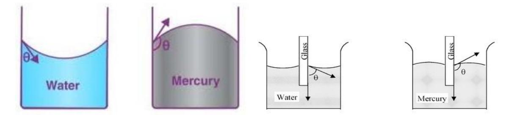

*Fig 3.10: Showing angle of contact*

*Q: We use raincoat in a rainy season, why?*

#### **3.5 Capillarity**

Capillarity is the phenomenon of the rise and fall of liquids inside narrow tubes or porous materials due to the surface tension of the liquid and the adhesive forces between the liquid and the material. This effect occurs without the need for external forces like gravity. Now, let's relate this concept to the given phenomena as an application:

- 1. *Split near the nib of a pen:* The split creates a capillary tube that functions the principle of capillarity causing ink to rise through the narrow split near the nib of the pen. The liquid moves upward due to the adhesive forces between the ink and the nib, and the surface tension of the ink.
- 2. *Using towels after washing face or hands:* There are numerous capillaries in the material of the towel which as per the capillarity draws water from your skin into the fibers of the towel. The liquid rises through the towel's fibers, helping to absorb the moisture.
- 3. *Using cotton wick to light a lamp*: In an oil lamp, capillaries present in the cotton wick causes the oil to rise through according as capillarity. Also the movement of the liquid upward is due to the adhesive forces between the oil and the fibers of the wick, enabling the lamp to burn.
- **4.** *Plants absorbing mineral salts from soild*: In plants, numeral capillaries present function as capillarity for the mineral solution to reach.

Capillarity plays a vital role in both biological and practical processes. In the human body, capillaries, which are tiny blood vessels, facilitate the exchange of gases, nutrients, and waste products between the blood and tissues. This efficient flow of blood through the capillaries relies on capillary action. Similarly, in thermometers, capillary action is used to measure temperature. As the temperature changes, liquids like mercury or alcohol rise in a small capillary tube, providing an accurate reading of the temperature. Both examples showcase how capillarity enables crucial functions in living organisms and practical devices.

#### *Example*

*Q:* A U-shaped tube, open at both ends and filled with water, has oil (which does not mix with water) poured into one side. This causes the water level to rise by 65 cm on the other side, while the oil level stands 10 cm higher than the water level. Given this setup, the density of the oil is:

a. 928 kgm-2 b. 650 kgm-2 c. 425 kgm-2 d. 800 kgm-2

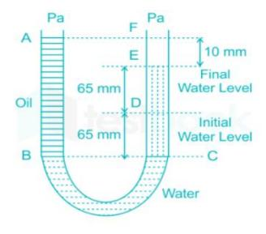

*Fig : 3.11*

*Solution:* Using the relation, P = ρgh, we have ρ0gh<sup>0</sup> = ρwgh<sup>w</sup>

Or, ρ0 =w hwh0 = 1000×130140 = 928kgm-2

#### **Fluid Dynamics**

#### **3.6 Viscosity**

#### **Isaac Newton (1643–1727) AD**

Newton, whose laws of motion are also applied in rotational dynamics, contributed significantly to fluid mechanics. His study of the linear relationship between shear stress and the velocity gradient in fluids led to the concept of Newtonian fluids, forming the basis of classical viscosity theory.

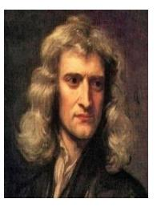

#### *Do you know the following phenomena?*

- (i) When you stir water in a bowl, it starts moving quickly, but once you stop stirring, the motion gradually slows down and eventually stops.
- (ii) Water flows faster on the top and gradually goes on decreasing deeper.
- (iii) Water moves fastest in the center of the pipe but slower near the edges.

When you stir water in a bowl, it moves quickly, but once you stop stirring, the motion gradually slows down and eventually stops. This happens because each layer of water (lamina) pushes against the layer next to it due to molecular interaction. This creates friction (viscous resistance) between the layers, which causes the motion to slow down until it stops.

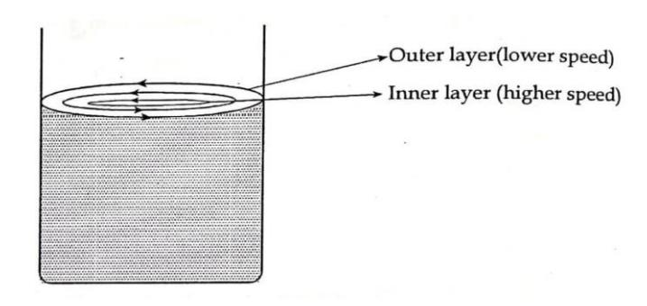

*Fig3.12: Water stirred in a beaker.*

Imagine water flowing smoothly in layers, like sheets of paper gliding over one another. At the *topmost layer*, there's no other layer above to slow it down, so it moves the *fastest*. But as we go deeper, each layer feels the *retarding force* from the one just above it. The further down we go, the more layers there are pressing down, creating *more friction*. This causes the water to slow down as we move towards the bottom. By the time we reach the very bottom, the flow is almost zero because the water is tightly held back by the friction from the riverbed and the layers above. This smooth, layer-by-layer motion is a great example of how *viscosity* and friction shape the flow of water!

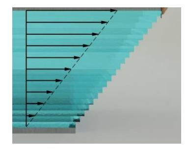

*Fig 3.13: flow of water*

In a pipe, water flows in layers called *laminae*. The *fastest* layer is in the center, while the *slowest* layers are near the walls due to friction. This smooth, layered movement is called *laminar flow*. The difference in speed across these layers creates a *velocity gradient*, where water moves faster in the middle and slower near the edges.

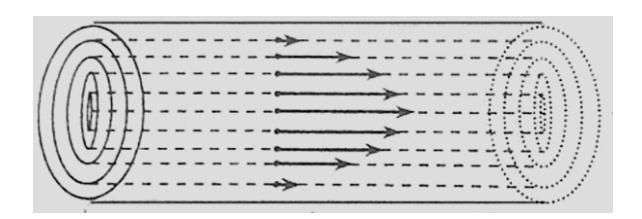

*Fig3.14: Tube of flow*

*Let's demonstrate an activity to understand the phenomena outlined:*

#### Activity 3.3

#### **Objective:**

Understand how viscosity affects how liquids flow by racing different liquids down a ramp. **Materials Needed:**

- i) Transparent inclined board or tray (e.g., acrylic sheet or plastic)
- ii) Stopwatch or timer
- iii) Various liquids (e.g., water, honey, cooking oil, shampoo, glue)
- iv) Markers or tape for starting and finishing lines
- v) Ruler (to ensure liquids start at the same point)

#### **Steps:**

#### 1. Set up the Ramp:

Place the transparent board at a slight angle (30-45 degrees). Mark a starting line at the top and a finish line at the bottom.

#### 2. Prepare the Liquids:

Pour equal amounts of different liquids (water, honey, etc.) at the starting line.

#### 3. Start the Race:

Release all liquids at the same time and start the timer. Watch how quickly each liquid moves down the ramp!

#### 4. Record & Compare:

Note the time it takes for each liquid to reach the bottom. Which liquid was the fastest? Which was the slowest?

#### 5. Understand Viscosity:

The fastest liquid (e.g., water) has low viscosity, meaning it flows easily. The slowest liquid (e.g., honey) has high viscosity, meaning it resists flow more.

#### **Conclusion:**

This fun activity shows how *viscosity* is the internal friction that resists a liquid's flow. *Thicker* liquids like honey move slower, while *thinner* liquids like water move faster.

#### **Extensions:**

- vi) Try heating liquids (like honey) and see how it changes their flow.
- vii) Change the angle of the ramp and observe how it affects the speed!

*Viscosity* is the phenomenon where *opposing forces* arise between adjacent layers of a fluid, resisting its motion. This opposing force is known as the *viscous drag*. It is similar to friction, but unlike friction, it acts within fluids, resisting the flow of one layer against another. The *thicker* or more *viscous* a liquid is, the greater the resistance it offers to flow. For example, honey has higher viscosity than water.

*Viscosity* also *decreases with rising temperature*—as fluids heat up, they become "thinner" and flow more easily. This is why machine parts may *jam* in winter: as temperatures drop, the oil or grease used in the parts becomes more viscous (thicker), increasing friction and causing the parts to stick.

#### Streamline Flow, Laminar and Turbulent Flow: Stream – Line Flow:

If the flow of a liquid is such that the velocity of each particle at a given point remains constant over time, it is called a streamline flow (or steady flow).

Let a path be defined along points A**,** B**,** and C through which the liquid is flowing, and let v₁**,**  v₂**,** and v₃ be the velocities at these respective points. If successive particles possess the same velocities at these corresponding points over time, the flow is called streamline flow, and such a path followed by the fluid particles is known as a streamline. This type of flow is also referred to as steady flow.

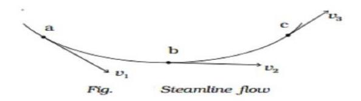

*Fig 3.15: Showing streamline flow*

#### **Laminar Flow**

If a liquid flows steadily over a horizontal surface in the form of layers with different velocities that do not mix with each other, the flow is called laminar flow. In general, it is also known as streamline flow.

#### **Turbulent Flow**

When a liquid flows at a velocity greater than its critical velocity, the motion of its particles becomes chaotic and irregular. This type of flow is known as *turbulent flow*. In such a state, the path and velocity of the fluid particles change constantly and unpredictably over time and from one point to another.

Now flip the scene — imagine a fierce storm rolling in, leaves swirling, waves crashing. That's turbulent flow in action. The fluid breaks all the rules: it tumbles, twists, and spins in wild spirals. Particles collide and swirl in unpredictable patterns, creating a powerful and dramatic spectacle. It's the rush of water over a waterfall, the wild dance of smoke from a fire, or the roar of air past a speeding jet.


 *Fig 3.16: Showing Laminar and Turbulent flow*

#### The Contrast:

Laminar Flow is order in motion – smooth, steady, and serene.

*Turbulent Flow* is chaos unleashed – energetic, powerful, and unpredictable.

From the gentle flow of blood in our veins to the roaring rivers that carve through mountains, both types of flow shape the beauty and power of our world. One whispers. The other roars. And together, they tell the story of motion itself.

#### 3.7 Newton's Formula for Viscosity, Coefficient of Viscosity

Newton explored how fluids behave when they flow and discovered something fascinating when one layer of fluid slides over another, they don't move freely; instead, they resist each other's motion. This internal resistance between fluid layers led him to formulate a famous rule known as Newton's Law of Viscosity.


Fig 3.17: Relative motion of a liquid flow

Let us consider two layers of a liquid flow, each of surface area A, located at positions x and x + dx with respect to a reference level, say the bottom of a river, where the liquid is almost at rest. The motion of the layers are characterized by the velocity v and v + dv respectively.

Hence  $\frac{dv}{dx}$  is the velocity gradient between the layers.

Clearly, the viscous dragging force F acts against the motion. According to Newton, the force is

- vi) Directly proportional to the area of the surface i.e,  $F \propto A$  and
- Directly proportional to the velocity gradient between the layers i.e,  $F \propto \frac{dv}{dx}$ On combining these two relations,

From Editioning these two relations,
$$F \propto A \frac{dv}{dx}$$
Or, 
$$F = -\eta A \frac{dv}{dx}$$

$$(3.1.)$$

Eq. (3.2) is the Newton's formula for viscosity.

Here  $\eta$  is the proportionality constant, known as the *coefficient of viscosity*. The –ve sign indicates that the viscous dragging force acts against the motion of the liquid.

If A = 1 m<sup>2</sup> and 
$$\frac{dv}{dx}$$
  $\rightarrow$  unity, then the relation gives F =  $-\eta$ 

Hence the coefficient of viscosity if the viscous force acting between two surfaces each of unit surface area when maintained at a unit velocity gradient.

#### Unit and Dimensional formula for $\eta$ :

Unit: Here in general, 
$$\eta = \frac{F}{A\frac{V}{x}} = \text{Nm}^2 \text{s}^{-1} = 1$$
 decapoise (SI)  
= dyne cm<sup>2</sup>s<sup>-1</sup> = 1 poise (CGS) = 10<sup>-5</sup>N. 10<sup>-4</sup>m<sup>2</sup>s<sup>-1</sup> = 0.1

decapoise and 1decapoise = 10poise.

#### Dimensional formula:

From 
$$\eta = \frac{F}{A_{\frac{\nu}{x}}^{\nu}} \implies \frac{MLT^{-2}}{L^{2}T^{-1}} = [ML^{-1}T^{-1}]$$

#### Think to answer

- *How does Newton's law of viscosity break down in the case of turbulent flow? Explain with reasoning.*
- viii) Why the coefficient of viscosity is considered a material property? How does it vary with temperature in liquids and gases?

#### 3.8 Poiseuille's Formula

Poiseuille's law elegantly reveals how the flow rate of a liquid through a tube is influenced by key factors: the tube's length (I), its radius ( $\mathbf{r}$ ), the pressure difference across its ends ( $\Delta P$ ), and the liquid's viscosity ( $\eta$ ). These variables are intricately linked, governing how smoothly and swiftly the liquid moves.

The law is mathematically expressed as:

$$V = \frac{\pi p r^4}{8nl}, p = \Delta P = p_2 - p_1$$

#### Assumptions made by Poiseuille while deriving the expression:

- 1. The flow of liquid is steady, with streamlines parallel to the axis of the tube.
- 2. The pressure at any cross-section remains constant, as there is no radial flow.
- 3. The liquid in contact with the tube wall is at rest (i.e., no-slip condition).

Let V be the volume of liquid flowing per second (rate of flow) through a capillary tube of radius r and length l, under a pressure difference  $\Delta P = P_1 - P_2$ , and let the viscosity of the fluid be  $\eta$ . Then the flow rate is given by:

$$V = \frac{\pi \Delta P r^4}{8nl}$$

This is known as Poiseuille's formula.


Fig 3.18:Liquid Flowing through a tube

#### Applications:

- i) Poiseuille's formula is super useful for understanding how *blood flows through tiny blood vessels* (like capillaries). Since blood is a thick fluid (viscous), this formula helps doctors and scientists see *how fast blood moves*, and what affects it — like the *size of the vessel*, the *pressure,* and how *thick* the blood is.
- ii) *IV Drips & Syringes* Helps in designing them so fluids flow smoothly.
- iii) *Oil in Machines* Engineers use it to make sure oil flows well through narrow pipes.
- iv) *Lab Equipment* Used in micro-tubes and fluid testers in science labs.

#### Limitations:

- i) Works only for *laminar (smooth) flow* not valid for turbulent flow.
- ii) Assumes a *straight, narrow, cylindrical tube* not curved or irregular shapes.
- iii) Applies to *incompressible, Newtonian fluids* (constant viscosity).
- iv) Assumes *no slip at the walls* fluid sticks to the tube surface.
- v) Not suitable for *pulsatile flows* like real blood flow affected by heartbeat.

#### Test your understanding

- i) If the *radius of a blood vessel is reduced to half* due to a blockage, by what factor does the *flow rate of blood* change, assuming all other factors remain the same?
- ii) Two identical tubes carry the same fluid. In one tube, the pressure difference is doubled, and in the other, the *length of the tube is halved*. Which tube will have the greater flow rate, or will they be the same?

#### *Examples*

Q: *A fluid of viscosity 0.001 Pa·s flows through a narrow pipe of length 0.5 m and radius 1 mm. If the pressure difference across the pipe is 2000 Pa, calculate the volume flow rate.Now, suppose the radius is doubled while all other conditions remain the same. By what factor does the flow rate change? Calculate the new flow rate.*

*Solution:* Here in the first case, we use the flow of the volume rate, V = πpr 4 8ηl .

With p = 2000 Pa, r = 1 mm = 
$$10^{-3}$$
 m,  $\eta = 0.001$  Pa,  $l = 0.5$  m;  $V = \frac{\pi \times 2000 \times 10^{-3} \times 4}{8 \times 0.001 \times 0.5} = 1.57 \times 10^{-6}$  m<sup>3</sup>/s.

For the second part when the radius is doubled, r - 2× 10−3 m, then from the above's relation,

$$V' = \frac{\pi \times 2000 \times 2 \times 10^{-3 \times 4}}{8 \times 0.001 \times 0.5} = 2.51 \times 10^{-5} \text{ m}^3/\text{s}$$

And the factor of flow rate = ′ = 16

#### *Test yourself*

*Q: Two tubes A and B carry the same liquid with viscosity η = 0.002 Pa·s.*

- *i) Tube A: length = 0.2 m, radius = 2 mm*
- *ii) Tube B: length = 0.1 m, radius = 1.5 mm*
- *iii) Both have the same pressure difference across them.*

*Which tube delivers more fluid per second, and by how much?*

*Calculate the flow rate in each tube and find the ratio .(Ans: 1.58)*

#### **3.9 Stoke's Law**

Do you know the following phenomenol events?

- i) Clouds appear to float in the sky.
- ii) Commandos safely land using the parachute
- iii) A falling hailstorm doesn't hurt much.

*Stokes' Law* is a fundamental principle in fluid dynamics that describes how small spherical particles settle or move through a fluid under the influence of gravity. It gives us a mathematical way to calculate the *settling velocity,* called the *terminal velocity*.

When a tiny sphere falls through a viscous fluid (like honey or water), three main forces act on it:

- 1. *Gravitational force –* pulling the particle downward.
- 2. *Buoyant force* pushing the particle upward.
- 3. *Viscous drag force* resisting the motion as the fluid "pulls back" on the particle.

*The settling velocity* (or terminal velocity) is the constant speed at which a small particle falls through a fluid when the downward force of gravity is exactly balanced by the upward forces of buoyancy and fluid resistance (drag). As the particle begins to fall, gravity causes it to accelerate, but as its speed increases, the fluid pushes back with greater resistance. Eventually, these opposing forces become equal, and the particle continues to fall at a steady

speed without further acceleration—this steady speed is called the settling velocity. Stokes' Law focuses on the *viscous drag force*, stating that this force is directly proportional

to the *radius* of the particle, the *viscosity* of the fluid, and the *velocity* of the particle. Mathematically, the drag force F is given by:

$$F = 6\pi \eta r v \tag{3.10}$$

Where η = viscosity of the fluid, r = radius of the sphere and v = velocity of the sphere This law helps us understand phenomena like the settling of dust particles in air or sediment particles in water. It's particularly valid for *small, smooth spheres* moving slowly in a fluid with low turbulence (laminar flow).


Fig 3,19: Showing an example of Stoke's law

#### Applications of Stoke's Law:

#### 1. Determination of Viscosity of a Liquid using Stoke's Formula

When a small sphere falls through a viscous fluid, it experiences three forces:

Weight:  $W = \frac{4}{3}\pi r^3 \rho g$ 

Buoyant force:  $U = \frac{4}{3}\pi r^3 \sigma g$ 

Viscous drag:  $F=6\pi\eta rv$ 

At terminal velocity, net force is zero:

 $6\pi\eta rv + 43\pi r3\sigma g = 43\pi r3\rho g6$ 

$$\Rightarrow \eta = \frac{2r^2(\rho - \sigma)\varrho}{2r}$$

This equation allows us to determine the viscosity  $\eta$  of the fluid by measuring the radius of the sphere, density of the sphere and fluid, gravitational acceleration, and terminal velocity.


Fig 3.20: Condition for a body to attain terminal velocity


Fig 3.21:  $v - r^2$  plot

- *2.* Determining the settling velocity of particles in sedimentation processes (e.g., water treatment).
- *3.* Measuring the erythrocyte sedimentation rate (ESR) in medical diagnostics.
- *4.* Calculating the viscosity of fluids using falling sphere methods.
- *5.* Controlling particle stability in paints, emulsions, and cosmetic formulations.
- *6.* Designing air pollution control devices like cyclones and settling chambers
- *7.* Analyzing soil texture and particle size distribution in agriculture and geology.

#### *Examples***:**

*1. You are designing a sedimentation tank for separating plastic particles from a fluid. You want the plastic spheres (density =1050 kg/m<sup>3</sup> ) to fall with a terminal velocity of at least 2.0 mm/s in a fluid of viscosity 1.2 Nsm-2 and density 1000 kg/m<sup>3</sup> .*

*What should be the minimum radius of the plastic spheres to ensure this condition? Solution:*

Using the Stoke's formula 
$$\eta = \frac{2r^2(\rho - \sigma)g}{9v} \Rightarrow r = \sqrt{\frac{9\eta v}{2(\rho - \sigma)g}}$$
  
With  $\eta = 1.2 \text{Nsm}^{-2}$ ,  $v = 2 \text{ mm/s} = 2 \times 10^{-3} \text{ m/s}$ ,  $\rho = 1050 \text{ kgm}^{-3}$ ,  $\sigma = 1000 \text{ kgm}^{-3}$ ;  $Rr = \sqrt{\frac{9 \times 1.2 \times 2 \times 10^{-3}}{2(1050 - 1000) \times 9.8}} = 4.69 \text{ mm}$ 

#### *Test Yourself*

*1. A tiny metal bead is dropped in a container filled with glycerin. The bead has a density of 8900 kg/m<sup>3</sup> and falls through glycerin, which has a density of 1260 kg/m<sup>3</sup> and viscosity of 1.5 Nsm-2 .*

*If the bead is required to reach a terminal velocity of exactly 3.5 mm/s, what should its diameter be? ( Ans: 1.12 mm)*

#### **3.10 Equation of Continuity and Applications**

The *equation of continuity* is a fundamental equation of fluid flow and represents a special case of the general physical law of *conservation of matter* in the flow of an incompressible, non-viscous, and steady fluid. It states that:

"*The amount of fluid entering a pipe per unit time is equal to the amount of fluid leaving the pipe per unit time."*

This is possible only if the *mass flow rate* remains constant throughout the pipe.

Mathematically,

$$A_1 v_1 = A_2 v_2 \tag{3.2}$$

Where A1, A<sup>2</sup> are the cross-sectional areas at two points in the pipe; v1,v<sup>2</sup> are the fluid velocities at those points.

This implies as the area of cross-section decreases, the velocity increases, and vice - versa. Proof :

The equation of continuity is derived under the assumptions that the fluid is *incompressible,* meaning its density (ρ) remains constant; the flow is *steady*, indicating that fluid properties at any point do not change with time; and the fluid is *non-viscous*, implying there is no internal friction or resistance to flow.

Let us consider an infinitely narrow tube of flow of cross-sectional area A<sup>1</sup> and A<sup>2</sup> at two ends in which fluid is flowing with the velocities v<sup>1</sup> and v<sup>2</sup> respectively.


*Fig 3.22: A pipe of varying cross section*

Hence in a time Δt, the fluid covers a distance Δx1=v1Δt at the initial end and a distance Δx<sup>2</sup> = v2Δt at the other end.

So, volume of fluid passing through each sectionV1=A1v1Δt and V<sup>2</sup> = A2v2Δt Since the fluid is incompressible, mass remains constant and hence mass of the fluid entering the tube of flow in Δt is equal to the mass of the fluid leaving the tube of flow at that time.

i.e, 
$$\rho V_1 = \rho V_2 \Rightarrow A_1 v_1 = A_2 v_2$$

This is the *Equation of Continuity* and clearly means that the quantity Av remains constant throughout the fluid flow.

Clearly, Av represents the volume of fluid flowing across any cross-section of the pipe per unit time. It is, therefore, called the volume rate of flow, or simply the rate of flow, the rate of discharge, or volume flux.

Moreover, since Av= constant, it follows that v∝ 1 that is, *the velocity of the fluid at any section of the pipe is inversely proportional to the cross-sectional area at that section*.

#### **Applications**

#### **i)** *Flow of water in pipes:*

Used to calculate how the speed of water changes when it flows through pipes of varying diameters. In a narrower section, water flows faster.

#### **ii)** *Blood flow in arteries:*

Helps explain how blood speeds up when flowing through narrowed arteries, which can affect blood pressure and health conditions.

#### **iii)** *Airflow in ventilation systems:*

Used in designing air ducts, ensuring steady airflow even when duct size changes.

#### **iv)** *Jet engines and rocket nozzles:*

In engines and rockets, the equation explains how gases accelerate when passing through a narrowing nozzle, providing thrust.

#### **v)** *Hydraulic machines:*

Applied in designing pumps, turbines, and other machines to maintain efficient fluid flow and control speed.

#### **vi)** *Weather and atmospheric studies:*

Used to study wind patterns and air movement in the atmosphere, including jet streams and cyclones.

#### Example:

Blood flows through an artery at a speed of 0.4ms<sup>-1</sup> in a region where the artery has a radius

Further along, the artery narrows due to a blockage, reducing its radius to 1.5mm.

- *i)* Calculate the speed of blood flow in the constricted region.
- ii) By what factor does the velocity increase due to the narrowing?

**Solution:** Here, velocity in wider section:  $v_1 = 0.4 \text{ms}^{-1}$ 

Radius in wider section: r<sub>1</sub>=3 mm=0.003 m

Radius in narrower section:  $r_2 = 1.5 \text{ mm} = 0.0015 \text{m}$ .

$$\begin{aligned} v_1 &= 0.4 \text{ ms}^{\text{-1}}, \, A_1 = \pi r_1{}^2 = \pi \times (3 \times 10^{\text{-3}})^2 = 9\pi \times 10^{\text{-6}} \, \text{m}^2 \\ A_2 &= \pi r_2{}^2 = \pi \times (1.5 \times 10^{\text{-3}})^2 = 2.25 \, \pi \times 10^{\text{-6}} \text{m}^2 \end{aligned}$$

- Speed of the constricted region,  $v_2 = ?$ We have,  $A_2v_2 = A_1v_1 \Rightarrow v_2 = \frac{A_1v_1}{A_2} = \frac{9\pi \times 10^{-6} \times 0.4}{2.25 \times 10^{-6}} = 1.6 \text{ ms}^{-1}$ i)
- Here  $\frac{v_2}{v_1} = \frac{1.6}{0.4} = 4$  is the factor that the velocity increases. ii)

#### Test yourself

A water tank is to be filled using a long pipe that narrows from one end to another. At the wider end, the cross-sectional area of the pipe is 50 cm<sup>2</sup>, and water flows into it with a velocity 1.2m/s.

At the narrower end, the area is 10 cm<sup>2</sup>, and the water exits into the tank from this end. *If the total volume of the tank is 500 liters, calculate:* 

i) The velocity of water at the narrower end. ii) The time required to fill the tank (in seconds), assuming the flow is steady and continuous. (Ans: i) 6 ms<sup>-1</sup>, ii) 1 minute 23 seconds)

#### **Energy of the Fluid**

A fluid in steady (or streamline) flow may possess one or more of the following types of energy: (i) kinetic energy due to its motion, (ii) potential energy due to its elevation relative to the Earth's surface, and (iii) pressure energy resulting from the force exerted by the fluid's pressure.

Let us obtain the value of each type of energy per unit mass and per unit volume of the fluid

- Kinetic energy: For a fluid with mass m and flowing with velocity v, the kinetic energy, K.E =  $\frac{1}{2}$ mv<sup>2</sup>. Therefore, K.E per unit mass =  $\frac{1}{2}v^2$ . And, mass of unit volume of the fluid = density of the fluid,  $\rho$ .
  - Hence K.E per unit volume of the fluid  $=\frac{1}{2}\rho v^2$
- Potential energy: The potential energy for the fluid of mass m at a height h is P.E = (ii) mgh. And, therefore, P.E per unit mass of the fluid = gh. and P.E per unit volume of the fluid =  $\rho gh$
- Pressure Energy: Let a tube of uniform cross-sectional area A contain an (iii) incompressible, non-viscous fluid under a hydraulic pressure P. If an additional mass Δm is gradually introduced into the tube—against this pressure but without imparting any velocity (and hence no kinetic energy)—and it occupies a length  $\Delta l$  of the tube, then the work done on the fluid mass  $\Delta m$  constitutes its pressure energy.

We have, pressure energy per unit mass of the fluid =  $PA \times \Delta I / \Delta m = PA \Delta I / A \Delta I \rho = P/\rho$ 

Hence the pressure energy per unit volume of the fluid =  $(P/\rho) \times \rho = P$ 

Finally the total energy per unit mass =  $\frac{1}{2}v^2 + gh + P/\rho$ 

And the total energy per unit volume =  $\frac{1}{2}\rho v^2 + \rho gh + P$ 

#### 3.11 Bernoulli's Equation and its Applications

The theorem, first stated by Daniel Bernoulli in 1738, asserts that the total energy of an incompressible, non-viscous fluid in steady flow remains constant throughout its motion.

i.e, 
$$\frac{1}{2}v^2 + gh + P/\rho = \text{constant}$$
.

This principle can be easily derived as follows:


Fig 3.23: Showing Bernoulli's principle

Let us consider a tube with a non-uniform cross-sectional area, through which an incompressible and non-viscous fluid flows steadily. The two ends of the tube are characterized respectively by pressures  $P_1$  and  $P_2$ , cross-sectional areas  $A_1$  and  $A_2$ , and positions  $h_1$  and  $h_2$  with respect to a reference level (say, the ground).; and entering and exiting velocities  $v_1$  and  $v_2$ , respectively.

Let the fluid move a small distance  $s_1$  at point 1 and  $s_2$  at point 2 in a small time  $\Delta t$ .

Since the fluid is *incompressible*, volume in = volume out

Therefore,  $A_1s_1=A_2s_2=\Delta V$ 

Work done by pressure on fluid entering (at point 1),

$$W_1=P_1\Delta V$$

Work done by fluid (losing energy) at exit (point 2):

$$W_2 = -P_2 \Delta V$$

Net work done on fluid,

$$W = (P_1 - P_2) \Delta V$$

The work done on the fluid causes change in Kinetic energy:  $\frac{1}{2}\,\rho\Delta Vv^2$  and Potential energy  $\rho\Delta Vgh$ 

So, 
$$(P_1-P_2) \Delta V = \frac{1}{2}\rho\Delta V(v_2^2-v_1^2) + \rho\Delta Vg(h_2-h_1)$$

Or, 
$$P_1 + \frac{1}{2}\rho v_1^2 + \rho g h_1 = P_2 + \frac{1}{2}\rho v_2^2 + \rho g h_2$$

Hence the Bernoulli's equation is

$$P + \frac{1}{2}\rho v^2 + \rho gh = constant.$$

For the ideal flow of the fluid in a horizontal tube,  $h_1 = h_2$  and hence  $P + \frac{1}{2}\rho v^2 = constant$ And we write  $(P_1 - P_2) = \frac{1}{2}\rho(v_2^2 - v_1^2)$ .

If  $P_1 > P_2$ , then  $v_2 > v_1 \Rightarrow$  lower pressure results in greater flow velocity, and vice versa. This phenomenon is well known as Bernoulli's principle

#### **Applications:**

#### i) Airplane Lift

Aircraft wings, also known as airfoils, have a curved shape designed to make air move faster over the top surface than below. This *speed difference* creates a *pressure imbalance*—lower pressure above and higher pressure below—generating an upward force called *lift*. This fundamental principle allows airplanes to take off, fly, and stay in the air.


Fig 3.24: Aerofoil lift, Bernoulli's principle

#### ii) Helicopter Flight

Helicopter *rotor blades* work similarly to airplane wings but move in a circular motion. As the blades spin, air moves faster above them, creating lift. Unlike fixed-wing aircraft, helicopters can hover in place, move vertically, and maneuver in tight spaces—all thanks to Bernoulli's principle.

#### iii) Sprayers & Atomizers

Devices like *perfume bottles, spray guns, and carburetors* utilize Bernoulli's principle to break liquids into fine mist. When air flows rapidly through a *narrow nozzle*, it creates a *low-pressure area*, pulling liquid upward into the air stream, where it gets atomized into tiny droplets. This process is essential in applications ranging from household spray cans to fuel injection in engines.


*Fig 3.25: Atomizer(sprayer), Bernoulli's principle*

#### iv) **Sports Ball Curvature**

Ever seen a football or cricket ball curve mid-air? This happens due to the *Magnus effect,* which is closely related to Bernoulli's principle. When a ball spins, air moves faster over one side than the other, creating *uneven pressure* that pushes the ball sideways, making it curve. This technique is widely used in soccer, cricket, and baseball to control the ball's trajectory.


 *Fig 3.26: Sports Ball Curvature , Bernoulli's principle*

#### i) **Venturi Effect in Pipes & Medical Devices**

The *Venturi effect* occurs when fluid speeds up as it passes through a *narrow section of a pipe*, causing pressure to drop. This principle is used in *venturimeters* to measure fluid flow rate. In medical applications, devices like *oxygen masks and nebulizers* rely on the Venturi effect to regulate airflow, helping patients receive controlled oxygen or medication as mist.


 *Fig 3.27:Venturi effect, Bernoulli's principle*

Each of these applications plays a vital role in everyday life, from aviation to healthcare and sports.

#### **Project Work**

#### Project Title

*Determining the Surface Tension of Water Using Capillary Rise Method*

#### Objectives

- i) To observe the phenomenon of surface tension in liquids.
- ii) To calculate the surface tension of water using the capillary rise method.

#### Materials Needed

- i) Clean glass capillary tube
- ii) Beaker with distilled water
- iii) Stand with clamp
- iv) Vernier caliper or micrometer screw gauge
- v) Ruler or traveling microscope
- vi) Tissue paper (for cleaning)

#### Procedure

- 1. Clean the capillary tube properly to remove any dust or oil.
- 2. Measure the inner radius of the tube using a micrometer or vernier caliper.
- 3. Pour water into a beaker and clamp the capillary tube vertically in it.
- 4. Allow the water to rise in the tube and measure the height of the water column.
- 5. Use the formula to calculate the surface tension.

#### Observation Table

| Quantity                    | Symbol | Value      |
|-----------------------------|--------|------------|
| Radius of capillary         | r      | m          |
| Height of rise              | h      | m          |
| Density of water            | ρ      | 1000 kg/m³ |
| Acceleration due to gravity | g      | 9.8 m/s²   |
| Contact angle               | cosθ   | ≈ 1        |

#### Sample Calculation

$$T = \frac{r\rho gh}{2\cos\theta}$$

Substitute the values to find the surface tension.

#### Conclusion

- i) The experiment confirms the presence of surface tension in water.
- ii) The calculated value of surface tension is approximately **……** Nm-1 , which is close to the standard value 0.072 Nm-1 at room temperature.

#### Precautions

- i) The capillary tube must be clean and dry.
- ii) Avoid air bubbles in the tube.
- iii) Measure the height accurately from the water surface to the meniscus.

#### **Exercise**

| 1.  | Which<br>a) Alcohol                                           |                        | b) Water                                                                                         | c) Mercury                             | of the following liquids is likely to have the highest surface tension?                                                                                                        | d) Oil                             |                       |
|-----|---------------------------------------------------------------|------------------------|--------------------------------------------------------------------------------------------------|----------------------------------------|--------------------------------------------------------------------------------------------------------------------------------------------------------------------------------|------------------------------------|-----------------------|
| 2.  | Which<br>a) Capillary action<br>c) Expansion of liquid volume | phenomenon is not      |                                                                                                  |                                        | influenced by surface tension?<br>b) Floating of a small insect on water<br>d) Formation of droplets                                                                           |                                    |                       |
| 3.  | a) Free surface<br>c) In contact of                           | wall                   |                                                                                                  | b) Middle region<br>d) Near the bottom | Which part of the liquid has the highest value of surface tension?                                                                                                             |                                    |                       |
| 4.  | its height is h<br>a) h                                       | on Earth?<br>b) ℎ<br>6 |                                                                                                  | c) 6h                                  | What will be the height of a liquid column in a capillary tube on the Moon's surface if<br>d) 1.6h                                                                             |                                    |                       |
| 5.  | a) 7.5 cm                                                     |                        | to a height of 7.5 cm in a capillary of radius 2 mm?<br>b) 15 cm                                 | c) 10 cm                               | What is the height of a liquid column in a capillary of radius 1 mm if the liquid rises                                                                                        | d 5 cm                             |                       |
| 6.  |                                                               |                        | gravity. What will be the upthrust on the body?<br>a) Equal to the weight of the water displaced |                                        | A body is floating on water in a beaker, and the entire system is falling freely under                                                                                         |                                    |                       |
|     |                                                               |                        | b) Equal to the weight of the body                                                               |                                        |                                                                                                                                                                                |                                    |                       |
|     |                                                               |                        | c) Equal to the loss in weight of the body                                                       |                                        |                                                                                                                                                                                |                                    |                       |
|     | d) zero                                                       |                        |                                                                                                  |                                        |                                                                                                                                                                                |                                    |                       |
| 7.  |                                                               |                        | What is the initial flow rate of water                                                           |                                        | from a 1 cm² hole at the bottom of a tank with a                                                                                                                               |                                    |                       |
|     | 5-meter water level?<br>a) 10-3 m3<br>s                       | -1                     | b) 10-4 m3<br>s                                                                                  | -1                                     | c) 10 m3<br>-1<br>s                                                                                                                                                            |                                    | d) 10-2 m3<br>-1<br>s |
| 8.  | a) 1:2                                                        |                        | b) 2:3                                                                                           |                                        | Two solids are immersed in water. One is submerged to 2/3 of its volume, while the<br>other is submerged to 1/2 of its volume. What is the ratio of their densities?<br>c) 3:4 |                                    | d) 4:3                |
| 9.  | Water flows at 4 ms-1<br>will be the flow speed?              |                        | through a horizontal                                                                             |                                        | pipe. If the pipe's diameter doubles, what                                                                                                                                     |                                    |                       |
|     | a) 1 ms-1                                                     |                        | b) 2 ms-1                                                                                        |                                        | c) 4 ms-1                                                                                                                                                                      |                                    | d) 8 ms-1             |
| 10. | Water flows at 2 ms-1<br>√2𝑔ℎ                                 |                        | instantaneous height of the water in the vessel?                                                 |                                        | through a 1 mm² hole at the bottom of a beaker. What is the                                                                                                                    | Hint: use Toricelli's theorem, v = |                       |
|     | a) 20 cm                                                      |                        | b) 10 cm                                                                                         | c) 12 cm                               | d) 15 cm                                                                                                                                                                       |                                    |                       |

- 11. Which factor has the greatest impact on the volume of liquid flowing through a pipe according to Poiseuille's law?

  - a) Pressure difference b) Length of the pipe

  - c) Radius of the pipe d) Viscosity of the liquid
- 12. Which of the following best explains aerodynamic lift?
  - a) The pressure is higher above the wing b) Air moves faster above the wing
- - c) Air moves slower above the wing d) Gravity pulls the wing upward
- 13. *A sealed container is filled with water and a small hole is made at its side.*
  - a. Define pressure in a fluid. State its variation with depth.
  - b. Derive the expression for pressure at a depth h below the surface of a liquid.
  - c**.** A hole is made at a depth of 20 cm below the surface of water. Calculate the speed of water emerging from the hole. (Take g=9.8m/s<sup>2</sup> ) (*Ans: 1.98 ms-1* )
- 14. a) The bottom of a ship is made heavier, why?
  - b) Does Archimedes' principle apply in a satellite moving in a circular orbit around the Earth? Explain.
  - c) A string supports a solid iron object with a mass of 200 g, which is totally immersed in a liquid of density of 900 kg/m³. If the density of iron is 8000 kg/m³, calculate the tension in the string. (*Ans: 1.775 N*)
- 15. *A wooden block floats in water partially submerged.*
  - a. State Archimedes' Principle.
  - b. Explain the condition for floating and sinking of a body in a liquid.
  - c**.** A block of volume 0.02 m³ is floating in water with 75% of its volume submerged. Find its density. (*Ans: 750 Kgm-3 )*
- 16. a. How can you treat Archimedes' principle in an artificial satellite?
  - b. The specific gravity of sea water is 1.03 and that of ice is 0.92. What fraction of an iceberg is above the surface of water? (*Ans: 0.107*)
  - c. A 25 cm thick block of ice floating on fresh water can support 80 kg man standing on it. What is the smallest area of the ice block? (sp. gravity of ice = 0.917) (*Ans: 3.86 m<sup>2</sup>* )
- 17. a. Define surface energy.
  - b. Derive the relation between surface energy and surface tension.
  - c. A rectangular plate with dimensions 6 cm × 4 cm × 2 mm is placed with its largest face resting on the surface of the water. Calculate the downward force exerted on the plate due to surface tension, assuming a zero angle of contact**.**

Additionally, determine the downward force if the plate is placed vertically, so that only its longest side just touches the water. (The surface tension of water is given as 7 × 10-2 Nm-1 )(*Ans: 1.4* × *10-2 N, 8.7* × *10-3 N*)

- 18. A clean glass capillary tube is dipped vertically into water.
  - a. Define surface tension. What is its SI unit?
  - b. What is capillarity? Derive the expression for capillary rise.

- c. A capillary tube of radius 0.25 mm is dipped in water. If surface tension is 0.072 N/m, and angle of contact is zero, calculate the height of water rise. (Take g=9.8 ms<sup>-2</sup>,  $\rho$ =1000kgm<sup>-3</sup>) (Ans: 5.88 cm)
- 19. a. What is the angle of contact? Explain how it affects capillary action.
  - b. Derive the relation between surface tension, capillary rise, and the radius of the tube.
  - c. Two small drops of mercury each of radius r coalesce to form a single large drop. Calculate the ratio of the total surface energies before and after the change. (Ans:  $2^{1/3}:I$ )
- 20. Oil is flowing through a narrow tube under pressure.
  - a. Define viscosity and give its SI unit.
  - b. State and explain Newton's law of viscosity.
  - c. A fluid of viscosity 0.01 Nsm<sup>-2</sup> flows through a tube with radius 2 mm. If the velocity gradient is  $400s^{-1}$ , find the shear stress. (*Ans: 4 Nm*<sup>-2</sup>)
- 21. a) Explain why small liquid drops are spherical.
  - b) Discuss the effect of adhesive and cohesive forces on the shape of drops.
- 22. a. i) Define surface energy.
  - ii) Derive an expression for surface energy in terms of surface tension and area.
  - b. Calculate the work done in breaking a drop of water of 2 mm diameter into million droplets of the same size. The surface tension of water is  $72 \times 10^{-3}$ ) (Ans:  $9 \times 10^{-5}$ J)
- 23. a. Define viscosity and coefficient of viscosity.
  - b. Derive an expression for the force required to move one layer of fluid over another.
  - c. A plate of area  $0.2 \text{ m}^2$  is moving at a velocity of  $0.1 \text{ ms}^{-1}$  over a thin layer of liquid of thickness 0.5 mm. If the viscosity of the liquid is  $0.5 \text{ N} \cdot \text{sm}^{-2}$ , find the force required to maintain the motion of the plate. (Ans: 20 N)
- a. State and explain Stokes' law.
  - b. Derive an expression for the terminal velocity of a spherical object falling through a viscous medium.
  - c. A spherical ball of radius 0.002 m falls through oil of viscosity  $0.1 \text{ N} \cdot \text{s/m}^2$ . If the density of the ball is  $900 \text{ kg/m}^3$  and that of oil is  $700 \text{ kg/m}^3$ , calculate the terminal velocity of the ball.(*Ans:*  $0.0174 \text{ ms}^{-1}$ )
- 25. a. State Poiseuille's formula for the flow of liquid through a capillary.
  - b. Explain the significance of Poiseuille's equation in fluid dynamics.
  - c. A liquid of viscosity  $0.6 \text{ N} \cdot \text{s/m}^2$  flows through a tube of radius 2 mm. If the pressure difference across 10 cm of the tube is 500 Pa, calculate the volume flow rate using Poiseuille's equation. (Ans:  $5.23 \times 10^{-9} \text{ m}^3/\text{s}$ )
- 26. a. What is causes of surface tension? Hot soup is tastier than cold soup. Why? [2]
  - b. In the figure, water is flowing through the pipe having,  $A_1 = 0.02 \text{ m}^2$ ,  $A_2 = 0.01 \text{ m}^2$ ,  $P_1 = 4 \cdot 10^4 \text{ P}_a$  and  $V_1 = 2 \text{ ms}^{-1}$


#### **Calculate:**

- (i) Velocity at end A<sup>2</sup> [
- (ii) Pressure at end A2 [2] *(Ans: 4 ms -1 ; 3.4 × 10<sup>4</sup> Nm-2*
- 27. *Water flows from a narrow pipe to a wider one.*
  - a. State Bernoulli's theorem.
  - b. Write any two applications of Bernoulli's principle in real life.
  - c**.** Water is flowing through a horizontal pipe of radius 0.02 m and length 1 m with a velocity of 0.5 m/s**.** The viscosity of water is 0.001 N·s/m², and the pressure difference across the pipe is 500 Pa**,** calculate the power loss due to viscosity over the length of the pipe. (*Ans: 15.71 W*)
- 28. a) What type of fluid does Bernoulli's principle apply to?
  - b. Derive Bernoulli's equation for a streamline flow of an incompressible and nonviscous fluid. c. Water is flowing through a horizontal pipe. At one point, the velocity of water is 2 m/s and the pressure is 3000 Pa. At another point, the velocity increases to 4 m/s. Find the pressure at this second point, assuming steady flow.

(*Ans: 32.12 Jkg-1* )

#### **Long Type**

- 29. *A horizontal pipe has varying cross-section. Water flows steadily through it.*
  - a. State and derive the equation of continuity for incompressible flow.
  - b. State Bernoulli's principle and write its mathematical form.
  - c. Why is fluid pressure lower at higher speed according to Bernoulli's principle?
  - d**.** A pipe tapers from a diameter of 10 cm to 5 cm. Water flows at 2 m/s at the wider section.

#### Find:

- (i) Speed at the narrow section
- (ii) Pressure difference between the two ends

(Assume: ρ=1000 kg/m<sup>3</sup> ) ( *Ans: i. 8 ms-1 ii. 3.0* × *10<sup>4</sup> Pa*

## **Chapter 4**

## <span id="page-80-0"></span>**First Law of Thermodynamics**

Maria Goeppert Mayer, born on June 28, 1906, in Katowice, Poland, was a brilliant German-American theoretical physicist whose love for science transcended recognition or reward. Educated at the prestigious University of Göttingen, she pursued her passion for physics with unwavering dedication, often working without pay or title simply for the joy it brought her. Her groundbreaking proposal of the nuclear shell model of the atomic nucleus earned her the Nobel Prize in Physics, making her only the second woman in history to receive that honor. Maria's quiet strength, humility, and brilliance continue to inspire generations of scientists. She passed away on February 20, 1972, in San Diego, California, leaving behind a luminous legacy in the world of physics.


#### **4.1Introduction**

Thermodynamics is the branch of physics which deals with mechanical energy, heat and work and their interaction with physical systems. The word thermodynamics is the combination of thermoand dynamics where thermo refers to heat and dynamics refers to motion or transformation. Hence, the word thermodynamics is related to the process of conversion of heat energy into mechanical energy and vice versa. The idea of inter-conversion of mechanical work and heat energy was first introduced by Sir James Joule during 19thcentury. In thermodynamics there are four laws: Zeroth law, first law, second law and third law.

The first law of thermodynamics is of law of conservation of energy. In the context of thermodynamics, first law emphasizes that the total energy of an isolated system remains constant. This law introduces the concept of heat, work, and internal energy of a system in various physical processes and gives the foundation for the energy transformation in thermodynamic processes. It also provides a foundation for further exploration into the behavior of gases, heat engines, refrigerators and other systems where energy transfer plays a key role.

#### **4.2Thermodynamic System**


Figure 4.1: Thermodynamic system

A thermodynamic system is a specified portion of matter or space, separated from its surroundings by a defined boundary, chosen for the purpose of thermodynamic analysis.

A thermodynamic system has certain value of macroscopic parameters (pressure, volume and temperature). A thermodynamic system interacts with its surroundings through exchange of energy (heat or work) or matter or both at a time.

Thermodynamic systems are of three types:

- 1. **Open system**: A thermodynamic system which exchanges both matter and energy with its surrounding. For example: Boiling water in a pot.
- 2. **Closed system:** A thermodynamic system which exchanges energy but not matter with its surrounding. For example: A gas contained in a closed and conducting cylinder fitted with piston.
- **3. Isolated system:** A thermodynamic system which exchanges neither energy nor matter with its surrounding. For example: Water in a closed and insulated thermos flask.

#### **Activity 4.1: Thermodynamic System Exploration**

**Objective**: Clarify the concept of a thermodynamic system and its surrounding.

**Materials**: Balloons, sealed containers, water, a thermometer.

#### **Procedure**:

- 1. Fill a balloon with air, water in a beaker and a sealed container.
- 2. Identify the system and surroundings for each case. For example, the balloon is a closed system, the water is an open system and the sealed container represents an isolated system.
- 3. Observe what changes happen in these systems when energy

- is added (heat or work) or when the system interacts with its surrounding.
- 4. List different types of thermodynamic systems (isolated, closed, open) and discuss real-life examples.

**Learning Outcome**: Understand different types of thermodynamic systems and their significance in energy exchanges.

#### *4.3Thermodynamic Variables (Thermodynamic co-ordinates)*

Thermodynamic variables are the values of measurable properties of a thermodynamic system which define the equilibrium state and allow us to analyze, predict and describe the behavior of the system. Thermodynamic variables are of two types:

- **1. State variables (state functions): Pressure, Volume, Temperature, Internal energy, entropy and enthalpy.**
- **2. Process variables: Work and Heat**

#### **4.4. Work done**

Work done is the transfer of energy that occurs when a force is applied to a system and the system undergoes a displacement. Force is applied due to change in macroscopic variables of a system such as pressure or volume. n thermodynamics work is the path function. It means work done depends on the path taken by the system.

**Positive work (Work done by the system)**: Work is taken as positive when the system does work on the surroundings. For example; work done during expansion of gas.

**Negative work (Work done on the system):** Work is taken as negative when work is done on the system by the surroundings. For example; work done during compression of gas.

#### **4.6 Work done during expansion of gas**

**Can you think of a situation where gas inside a cylinder does work on its** 


Figure 4.2: work done during the expansion of gas

Figure shows the expansion of certain mass of a gas in a cylinder fitted with movable, mass less and frictionless piston. Let the gas undergo expansion from initial state (P1, V1) to final state (P2, V2). Suppose at an instant of having pressure P, gas undergoes infinitesimal expansion dV due to force PA and the corresponding work done by the gas is given by given by

$$dW = F.dx = PA.dx$$
 [dx is small displacement during expansion and A is cross section]  
=  $PdV$  [Ad =  $dV$ ]

The total work done by the gas during whole process of expansion is given by

$$W = \int dW = \int_{V_1}^{V_2} P dV$$

In what way does a gas doing work on its surroundings differ from work done *on* the gas?

#### **4.7Indicator diagram**

An indicator diagram is a graphical representation of the relationship between pressure and volume of working substance during the thermodynamic process of expansion or contraction. An indicator diagram is an essential tool which is used to visualize, diagnose and analyze the performance of heat engine and refrigerator

etc.

#### **Features of indicator diagram**

- i) X- axis represents the volume whereas Y- axis represents the pressure.
- ii) Shape of the curve or loop represents the nature of the thermodynamic process (Isothermal, isobaric, isochoric, adiabatic etc.).
- iii) The area enclosed by the loop gives the work done during complete cycle of operation whereas area under the curve


Figure 4.3: indicator diagram

indicates the work done during given non-cyclic process.

Suppose a system of gas expands from A(P1,V1) and B(P2,V2) as in indicator diagram of figure 4.3. The graph AB represents the variation of pressure as a function of volume. The whole process is represented by large number of infinitesimal curves like EF. Let us consider an elementary rectangular area EFGH under the curve EF Where EH FG = P and EF=HG = dV.

Therefore, Area of shadow region = area under EF line

- = area of rectangle EFGH
- = EH × GH
- = P × dV
- = P dV
- = work done during expansion from E(P,V) to F(P, V + dV)

The total work done during whole process of expansion from A(P1,V1) to B(P2, V2) is the sum of area of all small regions like EFGH under the curve AB.

i.e., total work done, W = area of the region ABCDA

= area under AB curve

Hence, work done by a thermodynamic system is path function so that it depends not only on its initial and final state but also on the path that it follows**.**

#### **Example**

**4.1 One mole of an ideal gas undergoes a cyclic change ABCD. From the given diagram, calculate the net work done in the process. (1 atm = 10<sup>6</sup> dyne cm–1).**

#### **Solution:**

The work done in a cycle change is equal to area of the cycle.

As the cycle ABCDA is traced in clockwise direction. The work done is positive.

$$\therefore$$
 W = + area ABCDA= DC × AD

Now, DC = 
$$4 - 1 = 3$$
 litre=  $3 \times 10^3$  cm<sup>3</sup>

$$AD = 5 - 2 = 3$$
 atm=  $3 \times 10^6$  dyne cm<sup>-2</sup>

$$W = 3 \times 10^3 \times 3 \times 10^6 = 9 \times 10^9 \text{ erg}$$


Pressure is in N m<sup>-2</sup> and volume in litre. Calculate the work done during the process from A to B, B to C and C to a. Also calculate the work done in the complete cycle.


4

D

1

#### **Solution:**

The cyclic process in a triangle ABC is represented by A (4, 1), B (2, 4) and C (2, 1) on PV - diagram.

Work done during the process from A to B is given by

$$W_{AB}$$
 = + Area ABDEA (: system expands along AB)

$$\therefore$$
 W<sub>AB</sub> = area of  $\triangle$ ABC + area of rectangle BDEC

$$= \frac{1}{2} BC \times AC + DE \times CE$$

Now, BC = DE = 
$$4 - 1 = 3$$
 litters =  $3 \times 10^{-3}$ m<sup>3</sup>

And CE = 
$$2 - 0 = 2 \text{ N m}^3$$

$$\therefore W_{AB} = \frac{1}{2} \times 3 \times 10^{-3} \times 2 + 3 \times 10^{-3} \times 2 = 3 \times 10^{-3} + 6 + 10^{-8} = 9 \times 10^{-3} J$$

Work done during the process from B to C is given by

$$W_{BC}$$
 = area BCED (: system is compressed along BC) = -DE × CE = -3 × 10<sup>-3</sup> × 2 = -6 × 10<sup>-3</sup> I

Work done during the process form C to A is zero.

i.e. 
$$W_{CA} = 0$$
.

This is because in going from C to A, there is no change in volume.

Work done in the complete cycle is

$$9 \times 10^{-3} + (-6 \times 10^{-3}) + 0 = 3 \times 10^{-3}$$
J

Note: Also, work done in complete cycle, W = area of the cycle

As the cycle ABCD is traced in clockwise direction, W is positive.

$$\therefore$$
 W = + area ABC =  $3 \times 10^{-3}$ J

#### 4.8 Internal Energy and Latent Heat

Any material body is made of molecules, and the molecules are in random motion. This random molecular motion gives kinetic energy. The molecular kinetic energy is due to

velocity of molecule which is the function of temperature (KE == 
$$\frac{1}{2}$$
 mv<sup>2</sup>=  $\frac{3}{2}$  kT). Also

molecules possess potential energy because of their intermolecular force of attraction. The intermolecular force of attraction, which is responsible for potential energy, determines the volume of gas. That is why molecular potential energy is a function of volume. The sum of kinetic energy and potential energy of molecules contained within a thermodynamic system is called internal energy. Internal energy is the function of volume and temperature, i.e. U = f(V,T). Internal energy is the function of state and independent of path. i.e. it doesn't matter what path or steps the system took — only the final condition matters for its internal energy.

If a system returns to its initial state after crossing the various states, the change in internal energy becomes zero.

Internal energy cannot be measured directly with measuring device like mechanical or other form of energy. In this sense internal energy is considered as latent energy. When solid state of a substance converts into liquid or liquid state into gas its molecules have to move against strong molecular force of attraction. For this purpose, necessary energy is supplied from outside as latent heat which is added to internal energy. Hence for a system, internal energy is greatest in gaseous state and least in solid state. The internal energy changes either when heat is transferred to or from the system or when work is done by or on the system.

For a thermodynamic system, a part of applied heat is added to internal energy and remaining part is used to do work against the surrounding.

i.e. Change in internal energy(dU) = applied heat(dQ) – work done(dW) If the process takes place without exchange of heat, then dQ =0 and

$$dU = 0 - dW = -dW$$

Work is done in the expense of internal energy.

#### **Internal Energy of Ideal Gas**

For ideal gas, intermolecular force of attraction is negligible and internal potential energy is assumed to be zero. Therefore total internal energy is only due to kinetic energy. Since kinetic

energy is the function of temperature i.e.KE = 3 2 kT, internal energy of an ideal gas is the function of temperature only.

#### **Internal Energy of Real Gas**

**For a** real gas intermolecular force of attraction which determines the volume is not so negligible. Therefore total internal energy of a real gas is the sum of kinetic energy and potential energy. Since kinetic energy is the function of temperature and potential energy is the function of volume, internal energy of a real gas is the function of both temperature and volume.

#### **Equivalency of Mechanical Work and Heat Energy**

When we rub one palm against other, some heat is developed. If **W** is the amount of work done and **H** is the heat energy produced from that work, then:

```
W  H
or, W = JH. [Where J = Joule's mechanical equivalent of heat and J = 4.18J/cal 
 4.2 J/cal.]
```

When W and H are in same unit then J = 1. This is valid only when total supplied energy is converted into mechanical work and vice-versa.

#### **Example**

**4.3 The volume of steam produced by 1 g of water at 100°C s 1650 cm<sup>3</sup> . Calculate the change in internal energy during the change of state. Given J = 4.2 × 10<sup>7</sup> erg cal–1 , g = 981 cm s–2 . Latent heat of steam = 540 cal g–1 .**

#### **Solution:**

```
Given, J = 4.2 × 107 erg cal–1
    Latent heat of steam = 540 cal g–1 Mass of water = 1 g
    Temperature of water = 100°C Initial volume (V1) = 1 cm3
```

```
Final volume (V2) = 1650 cm3
 Change in volume (dV) = V2 – V1 = 1650 – 1 = 1649 cm3
```

When 1 g of water at 100°C is changed to steam at 100°C, temperature will remain constant. Therefore, heated supplied

```
dQ = latent heat of steam = 540 cal= 540 × 4.2 × 107 erg
Also, dQ = dU + PdV
      dU = dQ – PdV
Taking P = 1 atmosphere = 76 × 13.6 × 981 dyne cm–2
We have, dU = 540 × 4.2 × 107 – 76 × 13.6 × 981 × 1649
              = 22.68 × 109 – 1.67 × 109
              = 2.1 × 1010 erg.
```

#### **Test yourself**

- 4.1 An iron piece is hammered. Does the internal energy of iron increase?
- 4.2 Why is internal energy of compressed gas less than that of rarefied gas at the same temperature?

#### **4.9 First Law of Thermodynamics**

The First law of thermodynamics is the law of conservation of energy in thermodynamic processes. According to this law when dQ amount of heat is added to a system either it brings change in internal energy(dU) or performs external work (dW) or both at a time. That is

$$dQ = dU + dW$$
 ...(4.1)  
or,  $dQ = dU + PdV$  ...(4.2)

This is mathematical form of first law of thermodynamics.

The First law of thermodynamics helps us understand energy transfer in thermodynamic system which is widely applied in heat engines, refrigerators and many physical and chemical processes.

#### **Limitations of** the **first law of thermodynamics**

- i. It has no answer to the question that why heat does not flow from cold body to hot body. It means it does not indicate the direction of heat flow.
- ii. It does not provide the condition under which heat can be converted into work.
- iii. It has no answer that whether the mechanical work and heat energy are inter convertible or not.
- iv.It does not indicate that to what extent, heat energy can be converted into mechanical work (efficiency of heat engine).

To overcome above mentioned limitations second law of thermodynamics was introduced.

- 1. Explain the significance of the first law of thermodynamics.
- 2. Does the first law of thermodynamics follow the conservation principle of energy?

#### **4.10 Specific heat capacity of gas**

The specific heat capacity of gas depends on its molecular structure and number of degrees of freedom (total number of independent coordinates required to describe the motion of a system completely). For gasses, we often use molar specific heat capacities instead of principle specific heat capacity (defined for unit mass of substance). Molar specific heat capacity is defined as the amount of heat required to change the temperature of one mole gas by one degree Celsius or one Kelvin.

Specific heat capacity is given by,  $C = \frac{dQ}{ndT}$ , where; dQ is heat supplied to the gas, n is number of mole and dT is change in temperature. The SI unit of specific heat capacity is Jmol<sup>-1</sup> K<sup>-1</sup>.

Unlike solids and liquids, the specific heat capacity of a gas can vary depending on the conditions under which it is heated. Therefore we define two specific heat capacities: specific heat capacity at constant volume and specific heat capacity at constant pressure.

#### 1. Specific heat capacity at constant volume (C<sub>v</sub>)

Amount of heat required to change the temperature of one mole of gas by one degree Celsius (or one Kelvin) at constant volume.

$$C_{v} = \frac{dQ_{v}}{ndT}$$

Gas is heated in a container of fixed volume so that all the heat is used to increase the internal energy of gas without performing any work.

#### 2. Specific heat capacity at constant pressure (C<sub>p</sub>)

Amount of heat required to change the temperature of one mole of gas by one degree Celsius (or one Kelvin) at constant pressure.

$$C_p = \frac{dQ_p}{ndT}$$

Gas is heated in a vessel that allows the expansion of gas so that internal energy increases as well as the gas performs work.

The relation between heat capacity at constant pressure and constant volume is

$$C_n - C_v = R$$

At constant volume, gas molecules gain kinetic energy only. At constant pressure, as gas heats, it must expand, doing  $P\Delta V$  work, requiring extra energy. That extra energy per mole per Kelvin = R.

Hence molar specific heat capacity of gas at constant pressure is greater than that at constant volume. If we consider principle specific heat capacity (defined for unit mass) for a gas of molar mass M then,

$$\frac{C_P}{M} - \frac{C_V}{M} = \frac{R}{M}$$
or,  $c_P - c_v = r$  ... (4.3)

where  $r = \frac{R}{M}$  is ordinary gas constant defined for unit mass and  $c_p$  and  $c_v$  are principal specific heat capacities of gas at constant pressure and at constant volume respectively.

#### Why C<sub>p</sub> is greater than C<sub>v</sub>?

When a gas is heated at constant volume, all the supplied heat increases its internal energy, raising its temperature. At constant pressure, the gas expands and does work on its surroundings, requiring additional energy. Thus, the heat needed to raise the temperature at constant pressure is greater than at constant volume.

#### **Example**

- 4.3 For hydrogen the molar heat capacities at constant volume and constant pressure are respectively 20.5Jmol<sup>-1</sup>k<sup>-1</sup> and 28.8Jkg<sup>-1</sup>k<sup>-1</sup>. Calculate
- (i) the heat needed to raise the temperature of 8g of hydrogen from 10°C to 15°C at constant pressure
- (ii) the increase in internal energy of the gas,
- (iii) the external work done (Molar mass of hydrogen = 2g)

#### **Solution:**

Given, Heat capacity at constant volume ( $C_v$ ) = 20.5 j mol<sup>-1</sup> $k^{-1}$ ,

Heat capacity at constant pressure,  $C_p = 28.8 j \text{ mol}^{-1} \text{ k}^{-1}$ 

Mass (m) =  $8 \times 10^{-3}$ kg,

Temperature difference (d $\theta$ ) = 15 - 10 = 5°C,

Molecular mass (M) =  $2g = 2 \times 10^{-3} \text{kg}$ 

- (i) Heat needed at constant pressure  $\Delta Q = \frac{m}{M} C_p d\theta = \frac{8}{2} \times 28.8 \times 5 = 576 \text{ J}$
- (ii) Increase in internal energy  $\Delta U = m \frac{C_v}{M} d\theta$  =  $20.5 \times 5 \times \frac{8}{2} = 410 \text{ J}$
- (iii) The external work done  $\Delta Q = \Delta W + \Delta U$

$$\Delta W = \Delta O - \Delta U = 576 - 410 = 166I$$

#### **Test vourself**

- 4.3 Why does the gas need more energy to heat up at constant pressure than at constant volume?
- 4.4 Mathematically relate the specific heats  $C_p$  and  $C_v$ .

**Note:** If there is no exchange of heat during the process of change in temperature of gas, specific heat is zero and if there is no change in temperature of the gas even for continuous supply of heat specific heat is infinite. Hence specific heat ranges from zero to infinity.

#### **Degree of freedom, specific heat capacity and molar heat ratio**

In what ways do different gases exhibit different behaviors based on their atomicity? Can you calculate their heat ratio (γ)?

**Degree of freedom** is the total number of independent variables required to describe the motion a particle completely. In thermodynamics, the **degree of freedom** means the number of independent ways with which a system of particles can store energy. There are three types of degrees of freedom namely; translational, rotational, and vibrational degrees of freedom.

The degrees freedom corresponding to the motion of molecules along three axes (X,Y,Z axes) are translational degrees of freedom. All gases, regardless of their type, have three translational degrees of freedom. Similarly linear molecules have 2 rotational degrees of freedom and non linear molecules have 3 rotational degrees of freedom. Molecules also have vibrational degrees of freedom at higher temperature. For each vibration mode there are two degrees of freedom; one for potential energy and one for kinetic energy.

If f is the total degrees freedom for a system of particles then from the law of equipartition of energy Cv= 2 f R and C<sup>p</sup> =( 2 f +1)R and the molar heat ratio or adiabatic index is given by

$$\gamma = \frac{C_p}{C_v} = 1 + \frac{2}{f}$$

For monoatomic gas; f=3 and =1.67

For diatomic gas; f=5 and =1.4 [Considering translational and rotational motion]

#### **Test yourself**

4.5 How does the value of γ depend on whether a gas is monatomic, diatomic, or polyatomic? What role does the number of degrees of freedom play?

#### **4.11 Thermodynamic process**

A thermodynamic process is defined as sequence of changes in the equilibrium state of a thermodynamic system involving the transfer of energy in the form of heat or work or both so that state variables (pressure, volume, temperature, internal energy) will have new set values. This is the energy interactions of a system with its surroundings. A thermodynamic process is like a journey. The amount of energy transferred depends not just on where the system starts and ends, but **how it gets there**. Just like taking a short or long route changes how much fuel you use, different paths transfer different amounts of energy.

The study of thermodynamic process is important in understanding how heat engines, refrigerators etc perform their work. Different types of thermodynamics processes are described below.

#### *Isothermal process (constant temperature)*

It is a thermodynamic process in which temperature of the system remains constant throughout the process but system may expand or compress and heat may flow in or out to maintain constant temperature. It is a slow process. Melting, boiling, slow expansion of gas by maintaining the constant temperature etc. are the examples of isothermal processes.

Suppose n moles of ideal gas undergoes isothermal process from  $A(P_1, V_1)$  to  $A(P_2, V_2)$ . Let dQ be the amount of heat exchange. From the first law of thermodynamics,


Figure 4.4: isothermal process

$$dQ = dU + dW = dU + PdV = nC_v dT + PdV = 0 + PdV = PdV$$
 [For isothermal process  $dT = 0$ ]

Hence all the heat supplied converts into work without increasing internal energy.

From equation of state PV = nRT, at constant temperature nRT = constant. Therefore PV = constant and  $P_1V_1 = P_2V_2$ . This is the equation of state for isothermal process.

#### Workdone during isothermal expansion

Suppose one mole of ideal gas undergoes isothermal expansion from  $(P_1, V_1)$  to  $(P_2, V_2)$  as shown in indicator diagram. The work done during infinitesimal change in volume is given by dW = PdV [Pressure remains constant for small duration] The total workdone during the whole process is calculated as

$$W = \int_{1}^{V_2} PdV \qquad \dots (4.4)$$

But from Ideal gas equation PV =RT  $\quad$  and P =  $\frac{RT}{V}$  . Therefore,


Figure 4.5: Indicator diagram for isothermal process

$$W = \int_{1}^{V_2} \frac{RT}{V} dV$$

$$= RT \int_{1}^{V_2} \frac{1}{V} dV \quad [For isothermal process temperature T remains constant]$$

$$= RT |ln(V)|_{V_1}^{V_2} = RT [ln(V_2) - Ln(V_1)] = RT ln \left(\frac{V_2}{V_1}\right) \quad [Ln=log_e]$$

If we take n moles of ideal gas then,

$$W = nRT ln\left(\frac{V_2}{V_1}\right)$$

Also for isothermal process  $P_1V_1 = P_2V_2$  and  $\frac{V_2}{V_1} = \frac{P_1}{P_2}$  Then,

$$W = nRT ln \left(\frac{P_1}{P_2}\right)$$

#### Adiabatic process

Can you think of an example where gas expands and does work without gaining heat, such as in an insulated container? What happens to the temperature and energy of the system?

It is a thermodynamic process in which no heat is exchanged between system and surroundings throughout the process but pressure, volume and temperature of the system may change due to work done by or on the system. Adiabatic process is a fast process so that there is no chance of exchange of heat. Bursting of vehicle's tires, bursting of filled balloon, expansion of hot gases in petrol engine and propagation of sound in gases etc. are the examples of adiabatic process.

From first law of thermodynamics, dQ = dU + PdV

Or, 
$$0 = nC_v dT + P dV$$
 [:  $dQ=0$  for adiabatic process]  
or,  $P dV = -nC_v dT$  ...(4.5)

Hence during adiabatic process work is done in the expense of internal energy and hence the temperature decreases.

Again, 
$$P dV = -nC_v dT$$
  
 $P(V_2 - V_1) = -nC_v (T_2 - T_1)$ 

For expansion,  $V_2 > V_1$ , so  $T_2 < T_1$  i.e. temperature of the system decreases and cooling is observed.

For compression,  $V_2 < V_1$ , so  $T_2 > T_1$  i.e. temperature of gas increases and heating is observed.

#### Explain why the temperature of a gas drops in an adiabatic process of expansion.

#### Equation of State for Adiabatic Process

Suppose n mole of ideal gas undergoes adiabatic expansion so that initial set of pressure, volume and temperature  $(P_1, V_1, T_1)$  goes to  $(P_2, V_2, T_2)$ . Let at an instant volume and temperature undergoes infinitesimal change dV and dT respectively at almost constant pressure P. Therefore, from first law of thermodynamics

$$d\dot{Q} = dU + dW$$
or,  $0 = nC_v dT + PdV \ [\because dQ = 0 \text{ for adiabatic process}]$ 
or,  $nC_v dT + PdV = 0$  ... (4.6)
Again for n mole of ideal gas

Differentiating ideal gas equation for n moles PV = nRTPdV + VdP = nRdT

or, 
$$dT = \frac{PdV + VdP}{nR}$$
 . . .

(4.7)

From equation (4.6) and (4.7), we get

$$nC_{v} \left[ \frac{PdV + VdP}{nR} \right] + PdV = 0$$

or, 
$$\frac{C_v(PdV + VdP)}{R} + PdV = 0$$

or,  $C_v PdV + RPdV + C_v Vdp = 0$ 

or, 
$$(C_v + R) PdV + C_v VdP = 0$$


or, 
$$C_P P dV + C_v V dP = 0$$
  
or,  $\frac{C_P P dV}{C_v P V} + \frac{C_v V dP}{C_v P V} = 0$   
or,  $\gamma \frac{dV}{V} + \frac{dP}{P} = 0$  [ $\because \gamma = \frac{C_P}{C_v}$  is molar heat ratio of the gas]  
Integrating both sides
$$\gamma \int \frac{dV}{V} + \int \frac{dP}{P} = \int 0$$
or,  $\gamma \ln(V) + \ln(P) = \text{constant}$ 
or,  $\ln(V^\gamma) + \ln(P) = \text{constant}$ 
or,  $\ln(V^\gamma) = \text{constant}$ 
or,  $\ln(V^\gamma) = \text{constant}$ 
or,  $\ln(V^\gamma) = \text{constant}$ 
or,  $\ln(V^\gamma) = \text{constant}$ 
or,  $\ln(V^\gamma) = \text{constant}$ 
or,  $\ln(V^\gamma) = \text{constant}$ 
or,  $\ln(V^\gamma) = \text{constant}$ 
or,  $\ln(V^\gamma) = \text{constant}$ 
or,  $\ln(V^\gamma) = \text{constant}$ 
or,  $\ln(V^\gamma) = \text{constant}$ 
or,  $\ln(V^\gamma) = \text{constant}$ 
or,  $\ln(V^\gamma) = \text{constant}$ 
or,  $\ln(V^\gamma) = \text{constant}$ 
or,  $\ln(V^\gamma) = \text{constant}$ 
or,  $\ln(V^\gamma) = \text{constant}$ 
or,  $\ln(V^\gamma) = \text{constant}$ 
or,  $\ln(V^\gamma) = \text{constant}$ 
or,  $\ln(V^\gamma) = \text{constant}$ 
or,  $\ln(V^\gamma) = \text{constant}$ 
or,  $\ln(V^\gamma) = \text{constant}$ 
or,  $\ln(V^\gamma) = \text{constant}$ 
or,  $\ln(V^\gamma) = \text{constant}$ 
or,  $\ln(V^\gamma) = \text{constant}$ 
or,  $\ln(V^\gamma) = \text{constant}$ 
or,  $\ln(V^\gamma) = \text{constant}$ 
or,  $\ln(V^\gamma) = \text{constant}$ 
or,  $\ln(V^\gamma) = \text{constant}$ 
or,  $\ln(V^\gamma) = \text{constant}$ 
or,  $\ln(V^\gamma) = \text{constant}$ 
or,  $\ln(V^\gamma) = \text{constant}$ 
or,  $\ln(V^\gamma) = \text{constant}$ 
or,  $\ln(V^\gamma) = \text{constant}$ 
or,  $\ln(V^\gamma) = \text{constant}$ 
or,  $\ln(V^\gamma) = \text{constant}$ 
or,  $\ln(V^\gamma) = \text{constant}$ 
or,  $\ln(V^\gamma) = \text{constant}$ 

Work done during Adiabatic Process

Suppose n mole of ideal gas having molar heat ratio γ undergoes adiabatic expansion so that initial set of pressure, volume and temperature (P<sub>1</sub>, V<sub>1</sub>, T<sub>1</sub>) changes to (P<sub>2</sub>, V<sub>2</sub>, T<sub>2</sub>). Let at an instant volume and temperature undergoes infinitesimal change dV and dT respectively at almost constant pressure P. Therefore, small work done during expansion dV is dW = PdV. The total work done during whole process is

$$W = \int_{1}^{V_2} P dV$$
or,  $W = \int_{1}^{V_2} \frac{k}{V^{\gamma}} dV$  [PV<sup>\gamma</sup> = k and P =  $\frac{k}{V^{\gamma}}$  for adiabatic process]

or,  $W = k \int_{1}^{V_2} V^{-\gamma} dV$ 
or,  $W = k \left| \frac{V^{-\gamma+1}}{-\gamma+1} \right| V_2$ 
or,  $W = \frac{k}{1-\gamma} [V_2^{-\gamma+1} - V_1^{-\gamma+1}]$ 
or,  $W = \frac{1}{\gamma-1} [kV_1^{1-\gamma} - kV_2^{1-\gamma}]$ 
or,  $W = \frac{1}{\gamma-1} [P_1V_1^{\gamma} V_1^{1-\gamma} - P_2V_2^{\gamma} V_2^{1-\gamma}]$  [From adiabatic equation,  $P_1V_1^{\gamma} = P_2V_2^{\gamma} = k$ ]
or,  $W = \frac{1}{\gamma-1} [P_1V_1 - P_2V_2]$  ... (4.9)

or ideal gas equation for initial and final condition.  $P_1V_1 = nRT_1$  and  $P_2V_2 = nRT_2$ 

Using ideal gas equation for initial and final condition,  $P_1V_1 = nRT_1$  and  $P_2V_2 = nRT_2$ From equation (1)

or, W = 
$$\frac{1}{\gamma - 1} [nRT_1 - nRT_2]$$
  
or, W =  $\frac{nR}{\gamma - 1} [T_1 - T_2]$  ... (4.10)

Equation (4.9) and (4.10) are the expression for work done during adiabatic process. Derivation shows that work done during adiabatic process depends only on initial and final temperature.

#### *Relation Connecting Slope of Isothermal and Adiabatic Curve*

The slope of adiabatic curve at any point is times the slope of the isothermal curve at that point. It means adiabatic curve is steeper than isothermal curve.


Figure 4.7: Isothermal and adiabatic process

#### **Isobaric Process**

It is a thermodynamic process in which pressure of the system remains constant throughout the

entire process even though heat is removed from or given to it. The other state variables like volume, temperature, internal energy may change. Heating or cooling a gas in a cylinder with movable piston, boiling of water at constant pressure, melting of ice at constant pressure,


Figure 4.8: Isobaric process

atmospheric processes etc are examples of isobaric processes.

Isothermal process is carried out in expanding chamber. From first law of thermodynamics; dQ = dU+ dW. That is certain part of heat given to a system is used in increasing the temperature and remaining part is used in doing external work.

#### **Isochoric Process**

It is the thermodynamic process in which volume of the system remains constant throughout

the process but other state parameters (pressure, temperature and internal energy etc.) may change. Heating of a gas in a rigid container, combustion of gas in a sealed chamber etc are the examples of isochoric processes. Isochoric process is used in internal combustion engines, pressure cookers, and laboratory experiments etc.

The process is carried out by keeping the system inside non expanding chamber so that constant volume can be maintained. Since there is no change in volume, the system performs no work and total supplied heat is used to increase the internal energy of the system.


Figure 4:9 Isochoric process

#### Example

4.4 A mass of air occupying initially a volume 2 × 10-3m3 at a pressure of 760mm of mercury and a temperature of 20°C is expanded adiabatically and reversibly to twice its volume, and then compressed isothermally and reversibly to a volume of  $3 \times 10^{-3}$ m<sup>3</sup>. Find the final temperature and pressure ( $\gamma$  for air = 1.4)

#### Solution:

Given, Initial volume (V<sub>1</sub>)  $= 2 \times 10^{-3} \text{m}^3$ Initial pressure  $(\hat{P}_1)$ = 760 mm of HgInitial temperature (T<sub>1</sub>) = 293K $= 2V_1$ Final volume  $(V_2)$ 

We have for adiabatically process

$$P_{1}V_{1}^{\gamma} = P_{2}V_{2}^{\gamma}$$

$$\therefore P_{2} = \left(\frac{V_{1}}{V_{2}}\right)^{\gamma} p_{1} = \left(\frac{V_{1}}{2V_{1}}\right)^{1.4} \times 760$$

$$= 288 \text{ mm of Hg}$$

$$T_{1}V_{1}^{\gamma-1} = T_{2}V_{2}^{\gamma-1}$$

$$T_1 V_1 = T_2 V_2$$

$$T_2 = \left(\frac{V_1}{V_2}\right)^7 T_1 = \left(\frac{V_1}{2V_1}\right)^{1.4 - 1} \times 293 = 222K$$

$$V_3 = 3 \times 10^{-3} \text{ m}^3, P_3 = ?$$

As the process is isothermally, so the temperature

$$T_3^1 = 222^{\circ}k$$
  
 $P_2V_2 = P_3V_3$ 

$$P_3 = \frac{V_2 P_2}{V_3} = \frac{2 \times 2 \times 10^{-3}}{3 \times 10^{-3}} = 384 \text{ mm of Hg}$$

4.5 Air initially at 27°Cand 750 mm of Hg pressure is compressed isothermally until its volume is halved. It is than expanded adiabatically until its original volume is recorded. Assuming the change to be reversible, find the final temperature and pressure ( $\gamma$  for air = 1.4).

#### Solution:

Initial temperature  $(T_1) = 300K$ Given. Initial Pressure  $(P_1) = 750 \text{ mm of Hg}$ 

Let original volume be V m<sup>3</sup>

(i) Isothermally compression, 
$$V_2 = \frac{V}{2}$$

$$P_1V_1 = P_2V_2$$
  
 $P_1V_1 = 2V \times 750$ 

$$P_2 = \frac{P_1 V_1}{V_2} = \frac{2V \times 750}{V} = 1500 \text{ mm of Hg}$$
(ii) A dislatically expansion  $V = V$ 

(ii) Adiabatically expansion, 
$$V_3 = V$$
  
 $P_3V_3^{\gamma} = P_2V_2^{\gamma}$ 

$$P_{3} = \left(\frac{V_{2}}{V_{3}}\right)^{\gamma}$$

$$P_{2} = \left(\frac{V}{2V}\right)^{1.4} \times 1500 = 568.4 \text{ mm of Hg}$$

$$T_{3}V_{3}^{\gamma-1} = T_{2}V_{2}^{\gamma-1}$$

$$\therefore T_{3} = \left(\frac{V_{2}}{V_{3}}\right)^{\gamma-1}T_{2} = \left(\frac{V}{2V}\right)^{1.4-1} \times 300 = 227.36K$$

#### 4.14 Reversible process

A reversible process where the system undergoes changes in such a way that the forward and reverse directions are completely equivalent and the system can be returned to its initial state without leaving any net change in the surroundings and without any loss of energy. It is just an idealized process. For example; any process taking place slowly and controlled manner, all the mechanical process taking place under the action of conservative force etc.


Figure 4:10 reversible process

#### **Conditions for reversible process**

- 1. The process should be infinitely slow
- 2. There should be no loss of energy during the process.
- 3. System and surroundings should be in thermodynamic equilibrium at each point during the process.
- 4. No dissipative force of friction, viscosity, electrical resistance etc should be present.

#### **4.15 Irreversible process**

It is a thermodynamic a process that cannot be retraced. That is once an irreversible process occurs, the system and its surroundings cannot be returned to their initial states by simply reversing the process. A reversible process produces permanent change in thermodynamic system with **dissipation of energy** and production of **entropy. R**usting of iron, decay of matter, heats produced by friction etc are examples of irreversible processes. All most all processes in nature are irreversible.


Figure 4.12: Irreversible process

#### **Exercise**

- 1. Which of the following is NOT a thermodynamic system?
  - a)Open system
  - b) Closed system
  - c) Isolated system
  - d) Static system
- 2. The first law of thermodynamics is a statement of the conservation of
  - a)Mass
  - b) Momentum
  - c) Energy
  - d) Entropy
- 3. If a gas expands adiabatically, which of the following statements is true?
  - a)The internal energy of the gas remains constant
  - b) The gas absorbs heat
  - c) The work done by the gas is equal to the decrease in internal energy
  - d) The temperature of the gas remains unchanged
- 4. In an isothermal process, which of the following remains constant?
  - a)Pressure
  - b) Temperature
  - c) Volume
  - d) Internal Energy
- 5. Which of the following correctly describes the relation between heat capacity at constant pressure and volume?
  - a)C<sup>p</sup> = C<sup>v</sup>
  - b) Cp< C<sup>v</sup>
  - c) C<sup>p</sup> C<sup>v</sup> = R
  - d) C<sup>p</sup> C<sup>v</sup> = γ
- 6. A gas undergoes an isochoric (constant volume) process. What is the work done during this process?
  - a) Positive
  - b) Negative
  - c) Zero
  - d) Cannot be determined
- 7. A gas expands isothermally at a temperature of 300K from an initial volume of 2L to a final volume of 6L. If the gas follows the equation W = nRT ln( Vf Vi ), the work done is:
  - a)Positive
  - b) Negative
  - c) Zero
  - d) Infinite

- 8. A gas undergoes an adiabatic compression. What happens to its temperature?
  - a)Increases
  - b) Decreases
  - c) Remains constant
  - d) Becomes zero
- 9. A gas expands isothermally at 27°C from 1L to 4L against a constant external pressure of 2 atm. The work done (in J) is closest to:
  - a) 1384 J
  - b) 1725 J
  - c) 1845 J
  - d) 2100 J
- 10. A sample of 2 moles of an ideal gas (γ = 1.4) is compressed adiabatically from a volume of 5L to 1L. If the initial temperature is 300K, what is the final temperature?
  - a)750 K
  - b) 820 K
  - c) 900 K
  - d) 1050 K
- 11. A gas expands according to the relation PV1.4 = constant. If the initial pressure and volume of the gas are 2 atm and 3L respectively, find the final pressure when the volume becomes 6L.
  - a)0.57 atm
  - b) 0.63 atm
  - c) 0.78 atm
  - d) 1.2 atm
- 12. a. Define thermodynamic system. Write one example of each type of thermodynamic system. Differentiate between open, closed, and isolated systems with examples.
- b. How work done on the system differs from work done by the system?
- c. A gas at pressure 2 × 10⁵ Pa and volume 0.01 m³ expands isobarically to 0.03 m³. Find the work done. **[Ans: 4000 J]**
- d. Define indicator diagram and explain how work done by expanding gas can be calculated from indicator diagram.
- 13. a. Explain the concept of internal energy and its relation with heat and work. What does the equation dU = -dW signify? How internal energy of real gas differs from that of ideal gas?
- **b.**Calculate the change in internal energy of 2 moles of a monoatomic ideal gas which undergoes a temperature change from 300 K to 500 K. (Cv = 3R/2) **[Ans: 4988.4 J]**
- 14. a. State and explain the first law of thermodynamics. Discuss its significance.
  - b. Does it follow the laws of conservation of energy?
  - c. A gas absorbs 600 J of heat and does 150 J of work. Find the change in internal energy. **[Ans: 450 J]**
  - d. List out the limitations of the first law of thermodynamics.

- 15. a. Why gases have two specific heat capacities?
  - b. Derive the Meyer's relation, Cp-Cv=R.
- c. Cpis always greater than Cv, why?
- d.If Cp = 29.1 J/mol·K and Cv = 20.8 J/mol·K, find the gas constant R and γ.

**[Ans: 8.3 J/mol·K, 1.4]**

- 16. a.Explain the processes: isothermal, adiabatic, isobaric, and isochoric with the help of P–V diagrams.
- c. Differentiate between different types of thermodynamic process. Compare their P-V diagram.
- 17. a. Define adiabatic process. Derive the equation PV=constant.
- b. In an adiabatic expansion, a gas does 1200 J of work. Find the change in internal energy. **[Ans: -1200 J]**
- **c.** Find final temperature and the work done during an adiabatic expansion of 1 mole of ideal gas from volume 1 L to 5 L. Take γ = 1.4, T₁ = 300 K. (R = 8.314 J/mol·K) **[Ans: 118.8 K, 3768.3 J]**
- 18. a. Derive the expression for the work done during isothermal and adiabatic process.
  - b. A gas expands isothermally from a volume of 2 L to 8 L at a temperature of 300 K. Calculate the work done. (R = 8.314 J/mol K, n = 1 mol) **[Ans: 3457.6 J]**
- 19. a. Define the heat capacity ratio (γ).
- b. How does vary with the atomicity of a gas? Explain using the degrees of freedom.
- c. Differentiate between reversible and irreversible process.

## **Chapter 5**

## <span id="page-99-0"></span>**Second law of Thermodynamics**

Rudolf Clausius was a German physicist and one of t[he key contributors to the development of](https://www.sciencephoto.com/media/646788/view/rudolf-julius-emanuel-clausius)  thermodynamics in the 19th century. He is best known for formulating the second law of thermodynamics and introducing the concept of entropy. Clausius played a crucial role in establishing the mathematical foundation of the second law, expressing it in terms of heat flow and the idea that heat naturally flows from a region of higher temperature to a region of lower temperature. His work laid the groundwork for understanding energy transformations in physical systems and had a significant impact on the fields of thermodynamics and statistical mechanics. Clausius' contributions are foundational in explaining the limitations of energy conversion processes, particularly in engines and other mechanical systems.


**[**Rudolf Julius Emanuel Clausius (1822-1888)]

#### **5.1 Introduction**

First law of thermodynamics provides theoretical foundation for conversion of heat into mechanical energy and vice versa but it is silent about the direction of conversion of energy, efficiency of conversion, reversibility of the process and condition for inter-conversion of work and heat. To overcome these limitations of first law second law was introduced. The second law of thermodynamics is a fundamental principle that explains natural processes and the concept of irreversibility in thermodynamic systems. It states that the total entropy (or disorder) of an isolated system in any cyclic process always increases or remains constant but never decreases. According to this law all the natural processes are irreversible because entropy of such processes found increased. This law also explains that why heat flows from a hotter body to colder body spontaneously but not from colder body to hotter. Furthermore, it also highlights that energy transformations are not100% efficient because some energy is always lost as nonuseful energy. The idea of operations of heat engines and the refrigerators is the contribution of second law of thermodynamics. Therefore, second law of thermodynamics became a milestone in both theoretical and practical applications.

#### **Second law of thermodynamics**

**If you place a cold drink in a hot room, will the drink ever become hotter than the room temperature? Why or why not? How does this scenario relate to the second law of thermodynamics?**

Second law of thermodynamics is the fundamental principle that tells about the direction of natural processes and limitations of energy conversion process (efficiency). The law is stated in many ways but two statements are famous; Kelvin- Planck and Clausius statement. These two laws explain different aspect of thermodynamic process but they are equivalent. If one statement is true other statement must also be true.

#### **Kelvin- Planck's Statement (about Heat engine):**

*Statement; It is impossible to have a heat engine operating in a cyclic process which can convert all the heat taken from reservoir into useful work.*

*According to this statement any heat engine absorbs heat from hot reservoir, performs required work by utilizing such heat and rejects certain amount of heat as heat waste into cold sink. In other word, for a heat engine there must be a source at higher temperature and a sink at lower temperature. It also indicates that no heat engine will be 100 percent efficient and utilizes heat from single heat reservoir.* 

#### *Clausius statement (about refrigerator)*

**Statement:** Heat can never spontaneously flow from a colder body to a hotter body without the help of external work.

This statement is focused on the natural direction of heat transfer. According to this statement heat flows naturally from a body at higher temperature to a body at lower temperature but for reverse process external work is required. The statement indicates the possibility of refrigerator which absorbs heat from refrigerants (sink) when external work is done on the working substance and finally rejects large amount of heat to the surroundings (source).

If we could construct a heat engine that converts all heat into useful work (violation of Kelvin-Planck statement) it would also violate the Clausius statement because for this, it would require spontaneous flow of heat from cold body to hot body without support of external work. The Converse is also true. That is why Kelvin- Planck and Clausius statement are equivalent. In this way both the statements are related to the limitations of thermodynamic systems so that energy conversion and heat transfer cannot violet the natural process of heat transfer and increasing entropy.

#### **Activity 1: Exploring the Second Law of Thermodynamics**

**Objective**: State and explain the second law of thermodynamics using both Kelvin's and Clausius's statements.

**Materials**: Two metal containers, a heat source, thermometer, ice water bath.

#### **Procedure**:

- 1. **Demonstrating Kelvin's Statement**: Heat flows from a hot body to a cold body.
- i. Heat a metal container using a small flame or hot plate. Place the metal container in contact with another cold container or ice water. Measure and record the temperature change.
- ii. Discuss why the heat flow always goes from the hot body (metal container) to the cold body (ice water).
- 2. **Demonstrating Clausius's Statement**: It is impossible to transfer heat from a cold body to a hot body without doing work.
- i. Place a metal object in the ice bath and use a pump to try and transfer heat from the ice bath to the hot container.
- ii. Discuss why this process doesn't happen spontaneously without external work.

#### **Comparison of first and second law of thermodynamics**

First and second law both deals with the energy but they explain different aspect of energy transfer, transformation and efficiency limits. First law just explains about the energy conversion but has no restriction to the direction of heat flow and efficiency of energy conversion whereas second law explains about the direction of process, irreversibility and entropy.

| SN | Aspects      | First law of thermodynamics          | SN | Second law of thermodynamics                |
|----|--------------|--------------------------------------|----|---------------------------------------------|
| 1  | Direction    | It<br>does<br>not<br>indicate<br>the | 1  | According to this law naturally             |
|    | of<br>heat   | direction<br>of<br>heat<br>flow.     |    | heat flows from hot body to cold            |
|    | flow         | According to this law heat can       |    | body<br>and<br>for<br>reverse<br>flow<br>it |
|    |              | flow in any direction.               |    | requires external work.                     |
| 2  | Efficiency   | It is silent about efficiency of     | 2  | It<br>restricts<br>the<br>limitation<br>of  |
|    | of<br>energy | energy<br>conversion<br>that<br>is   |    | efficiency that no process is 100%          |
|    | conversion   | according<br>to<br>this<br>law       |    | efficient.                                  |
|    |              | efficiency may also be 100%.         |    |                                             |

#### **Heat engine**

A heat engine is a device which converts heat into mechanical work in account of difference in temperature of hot reservoir (source) and cold reservoir (sink). It absorbs heat from source, performs useful work and releases the remaining heat into the sink. A heat engine operates in cyclic process that is it returns to its initial state after each cycle. Heat engine are of different types; internal combustion engines (Petrol engine, Diesel engine), external combustion engines (steam engine, stirling engine) etc. Heat engines are used in power engines, vehicles etc.


Figure 5.1: Heat engine

#### **Essential parts of heat engine**

#### **Heat source ( High-Temperature Reservoir)**

It is a heat reservoir of infinite heat capacity maintained at high temperature. Any amount of heat can be taken from source without lowering its temperature. For example; a boiler in a steam engine, combustion chamber in petrol and diesel engine etc.

#### **Heat Sink ( Low-Temperature Reservoir)**

It is a heat reservoir of infinite heat capacity maintained at low temperature. Any amount of heat can be given to the sink without raising its temperature. For example; atmosphere for petrol and diesel engine, condenser in refrigeration cycle etc.

#### **Working substance (Working fluid)**

Working substance is the medium that absorbs heat from source, undergoes change in temperature, pressure etc to perform work and rejects remaining heat to the sink. For example; water in steam engine, air in internal combustion engine, refrigerant in refrigerator etc.

Thermal efficiency of heat engine

**A car engine converts fuel (chemical energy) into motion about the nature of energy transformation? How does the second law of thermodynamics explain this** 

Suppose a heat engine as shown in figure. Let the working substance takes Q<sup>1</sup> amount of heat from source maintained at temperature T<sup>1</sup> Kelvin; perform mechanical work W and rejects remaining heat Q<sup>2</sup> to the sink at lower temperature T<sup>2</sup> Kelvin. Therefore, amount of heat converted into mechanical work,

$$W = Q_1 - Q_2$$

Now the efficiency; the ratio of external work obtained to the heat energy taken from the source by working substance, is given by

$$\eta = \frac{External\ work\ obtained\ (W)}{Heat\ energy\ taken\ from\ the\ source\ (Q_1)}$$

Or, 
$$\eta = \frac{Q_1 - Q_2}{Q_1} = 1 - \frac{Q_2}{Q_1}$$

Commonly the efficiency is expressed in percentage. Therefore,

$$\eta = \left(1 - \frac{Q_2}{Q_1}\right) \times 100\%$$

Here,  $Q_2 < Q_1$  but not zero. Therefore, the efficiency is always less than 100%. To get 100 percent efficiency,  $Q_2$  must be zero. But for an engine according to Kelvin- Planck statement,  $Q_2 = 0$  is impossible.

#### Carnot's Theorem

Can you imagine a heat engine that operates with maximum efficiency? How do you think such an ideal engine would behave? What is Carnot's theory behind this, and how does it relate to the second law of thermodynamics?

The Carnot's theorem was developed by French physicist Sadi Carnot in 1824. This theorem provides a fundamental limit to the efficiency of reversible heat engines. According to this theorem the efficiency of a heat engine is solely determined by the temperature of hot and cold reservoir and is independent of nature of working substance.

Statement: The efficiency of all reversible engines operating between same two heat reservoirs is same and no irreversible engine working between same two heat reservoirs can have a greater efficiency than that of reversible engine.

Hence no heat engine can be more efficient than Carnot's engine operating between same two temperatures.

#### Carnot's engine and Carnot's cycle

A hypothetical engine designed by Carnot to achieve maximum possible efficiency from given set of source and sink is called Carnot's engine. It is assumed that Carnot engine is free from all imperfections of real engine. The ideal cycle of operation of Carnot's engine which consists of two isothermal and two adiabatic processes is called Carnot's cycle. Essential parts of Carnot's engine are explained below.

- 1. **Source:** It is a hot body of infinite specific heat capacity maintained at a constant high temperature. We can extract any amount of heat from the source without lowering its temperature. For example; a furnace, a boiler etc.
- 2. **Sink:** It is cold body of infinite specific heat capacity maintained at constant low temperature. We can reject any amount of heat to the sink without raising its temperature. For example; a cooler body, atmosphere, water in heat exchanger etc.
- 3. **Insulating stand:** It is a perfectly non-conducting (insulated) platform.

- 4. Working Substance (Working fluid): Working substance is the medium that absorbs heat from source, undergoes change in temperature, pressure etc to perform work and rejects remaining heat to the sink. In case of Carnot's engine ideal gas is taken as working substance.
- 4. **Cylinder (Engine or expansion device):** The mechanism of expansion and compression of working substance is carried out in side cylinder- piston system to achieve desired mechanical work. It is made with perfectly non-conducting walls but with a perfectly conducting base and fitted with a frictionless, weightless, air-tight and non-conducting piston.

#### **Working of Carnot's Engine**

The Carnot's engine works on a cycle of four different operations; two isothermal and two adiabatic as shown in figure. The detail of complete cycle of operation is explained below with the help of P-V diagram.

Carnot Engine Diagram

Suppose n moles of ideal gas as a working substance are enclosed in a cylinder. Let as indicated by point A  $(P_1,V_1,T_1)$  in P-V diagram the gas has initial value of pressure, volume and temperature.

#### **Step-1: Isothermal expansion**

In first step the cylinder with working substance is kept over source at temperature T<sub>1</sub> Kelvin and allowed to expand isothermally rom


Figure 5.2: Carnot engine and indicator diagram

 $A(P_1,V_1,T_1)$  to  $B(P_2,V_2,T_1)$ . During this expansion working substance absorbs  $Q_1$  amount of heat and gives  $W_1$  work. Therefore,

$$W_1 = nRT Ln\left(\frac{V_2}{V_1}\right) = Q_1$$
 ...(5.1)

 $[Q_1=W_1+dU=W_1, \text{ for isothermal process } dU=0]$ 

This step is represented by curve AB in the P-V diagram.

#### Step-2: Adiabatic expansion

In second step the cylinder is kept over the insulated stand after removing from the source and allowed to expand adiabatically from B (P<sub>2</sub>, V<sub>2</sub>, T<sub>1</sub>) to C (P<sub>3</sub>, V<sub>3</sub>, T<sub>2</sub>). During this expansion temperature of the gas falls to T<sub>2</sub> and the work W<sub>2</sub> is obtained. Therefore,

$$W_2 = \frac{nR}{\gamma - 1} (T_1 - T_2) \dots (5.2)$$

This step is represented by curve BC in the P-V diagram.

#### **Step-3 (Isothermal compression):**

In third step cylinder is kept over the sink after removing from insulated stand and working

substance is compressed isothermally C  $(P_3, V_3, T_2)$  to D  $(P_4, V_4, T_2)$ . During this compression,  $W_3$  work is done in the working substance and remaining heat  $Q_2$  is rejected to the sink. Therefore,

$$W_3 = Q_2 = nRT_2Ln\left(\frac{V_4}{V_3}\right) = -nRT_2Ln\left(\frac{V_3}{V_4}\right) \dots (5.3)$$

$$[Q_1=W_3+dU=W_3, \text{ for isothermal process } dU=0]$$

This step is represented by curve CD in the P-V diagram.

#### **Step-4 (Adiabatic compression):**

In fourth step cylinder is kept over the insulated stand after removing from sink and working substance is compressed adiabatically D (P<sub>4</sub>, V<sub>4</sub>, T<sub>2</sub>) to A (P<sub>1</sub>,V<sub>1</sub>, T<sub>1</sub>). During this compression, W<sub>4</sub> work is done in the working substance and temperature of working substance is increased to T<sub>1</sub>. Therefore,

$$W_4 = \frac{nR}{v-1} (T_2 - T_1) = -\frac{nR}{v-1} (T_1 - T_2) \qquad \dots (5.4)$$

This step is represented by curve DA in the P-V diagram.

In this way working of Carnot's engine completes in four steps. Now the net work done during one complete cycle,

$$\begin{split} W &= W_1 + W_2 + W_3 + W_4 \\ or, & W = nRT_1 ln \left(\frac{V_2}{V_1}\right) + \frac{nR}{\gamma - 1} \left(T_1 - T_2\right) - nRT_2 ln \left(\frac{V_3}{V_4}\right) - \frac{nR}{\gamma - 1} \left(T_1 - T_2\right) \\ or, & W = nRT_1 ln \left(\frac{V_2}{V_1}\right) - nRT_2 ln \left(\frac{V_3}{V_4}\right) = Q_1 - Q_2 \qquad \dots (5.5) \end{split}$$

Since both points B and C lie on the same adiabatic BC,  $T_1V_2^{\gamma-1} = T_2V_3^{\gamma-1}$  ... (5.6) Again, both points D and A lie on the same adiabatic DA so,  $T_1V_1^{\gamma-1} = T_2V_4^{\gamma-1}$  ... (5.7) Dividing equation (5.6) by equation (5.7), we get,

$$\left(\frac{\mathbf{V}_2}{\mathbf{V}_1}\right)^{\gamma - 1} = \left(\frac{\mathbf{V}_3}{\mathbf{V}_4}\right)^{\gamma - 1}$$
or,
$$\left(\frac{\mathbf{V}_2}{\mathbf{V}_1} = \frac{\mathbf{V}_3}{\mathbf{V}_4}\right) \qquad \dots (5.8)$$

From equation (5.5) and (5.8)

$$W=Q_{1}-Q_{2}=nRT_{1} Ln\left(\frac{V_{2}}{V_{1}}\right)-nRT_{2} Ln\left(\frac{V_{3}}{V_{4}}\right)$$

$$=nRT_{1} log_{e}\left(\frac{V_{2}}{V_{1}}\right)-nRT_{2} log_{e}\left(\frac{V_{2}}{V_{1}}\right)$$

$$=n R (T_{1}-T_{2}) log_{e}\left(\frac{V_{2}}{V_{1}}\right) \qquad ... (5.9)$$

The net work done W is positive for a cycle because  $T_1 > T_2$ . Therefore, repetition of the cycle again and again develops large amount of work which is our desire.

Now, efficiency of the engine is calculated as

Efficiency, 
$$\eta = \frac{\text{net external work (W or Q_1-Q_2)}}{\text{Heat input (Q_1)}}$$

$$= \frac{Q_1}{Q_1}$$

$$= \frac{nR(T_1 - T_2)Ln\left(\frac{V_2}{V_1}\right)}{nRT_2 Ln\left(\frac{V_2}{V_1}\right)}$$

$$= \frac{T_1 - T_2}{T_1}$$

$$\therefore \quad \eta = \left(1 - \frac{T_2}{T_1}\right) \qquad \dots (5.10)$$

Hence efficiency of Carnot's engine depends only on temperature of source  $T_1$  and that of sink  $T_2$  but it is independent of nature of working substance design and perfectness of the engine. That is why efficiency of all reversible engine working between same limits of temperature is same regardless of nature of working substance.

#### Refrigerator


Figure 5.3: Refrigerator

A refrigerator is essentially a heat engine working in reverse order. It means a refrigerator takes heat from a lower temperature region (inside the refrigerator) and rejects it to the higher temperature region (the surrounding environment) using work (usually in the form of electricity) to transfer heat against its natural flow. Refrigerators are essential household appliances for food preservation. A refrigerator works on the principle of heat transfer and is based on the reversed Carnot cycle. A complete cycle of operation of refrigerator includes evaporation, compression, condensation, and expansion. The key components of refrigerator are compressor, condenser, expansion valve, evaporator coils and thermostat.

Suppose in a refrigerator, working substance absorbs  $Q_2$  amount of heat from refrigerant (sink/interior of refrigerator) at temperature  $T_2$  by adding external work W in the form of electrical energy and finally it rejects large amount of heat  $Q_1(=W+Q_2)$  to the surrounding environment (source) at higher temperature  $T_1$ . Therefore,  $W=Q_1-Q_2$  is input and  $Q_2$  is output.

The efficiency of a refrigerator is measured in terms of coefficient of performance  $\beta$  which is defined as the ratio of heat extracted from the cold body (refrigerant) to the work done by the motor.

i.e. coefficient of performance, 
$$\beta = \frac{\text{output}}{\text{input}}$$

$$= \frac{Q_2}{Q_1 - Q_2}$$

$$= \frac{1}{\frac{Q_1 - Q_2}{Q_2}}$$

$$= \frac{1}{\frac{Q_1}{Q_2} - 1}$$

$$= \frac{1}{\frac{T_1}{T_2} - 1}$$

$$= \frac{T_2}{T_1 - T_2}$$

$$\left[\frac{T_2}{Q_1} = \frac{Q_2}{Q_1}\right]$$

Hence coefficient of performance depends only on two temperature limits and all the refrigerators working between the same two temperatures have the same coefficient of performance (independent of the nature of the working substance). Also if  $T_1-T_2$  is small,  $\beta$  will be higher it means a best refrigerator removes maximum heat with least possible work input.

For a practical refrigerator  $\beta$  is always less than  $\,\frac{T_2}{T_1-T_2}\,.$ 

#### **Internal combustion engines**

Heat engine are of two types; internal combustion and external combustion and they differ in where the combustion of fuel takes place relative to the working fluid that drives the engine. Internal combustion engines are those types of engines in which the combustion of fuel takes place inside cylinder piston system. The combustion produces hot gases that directly act on the moving parts of the engines (a piston or turbine) to perform mechanical work. For example; automobile engines of cars, trucks, motorcycles etc, aircraft engines of jet engines and turbojets etc. These engines are generally smaller and lighter compared to external combustion engines for the same power output and can have comparatively higher efficiency. These engines may contribute to air pollution and noise pollution. Also internal combustion engines are of two types; petrol engine and diesel engine.

#### **Petrol Engine (Otto engine)**

A petrol engine (also known as a gasoline engine) is a four- stroke internal combustion engine. It is first designed by German engineer Nikolaus August Otto. A petrol engine operates on a cycle of four strokes and uses spark ignition system. It operates on the **Otto cycle**, which is a type of four-strokes cycle commonly used in spark-ignition engines. A petrol engine uses 2% petrol vapor and 98% air as a working substance to achieve mechanical energy to run machinery, vehicles etc.

Petrol engine consists of a metallic cylinder which have intake valve I, spark plug S and outlet valve O as in figure. The cylinder is fitted with movable piston and a fly wheel is fitted to the piston rod in such a way that wheel rotates in a single direction by both in and out movement of piston. The opening and closing of the valves are managed by the suitable movement of piston. The complete


Figure 5.4: Petrol engine with its indicator diagram

working of petrol engine has been explained below with the help of figure and PV diagram.

#### **1. Suction Stroke**

In this stroke, intake valve opens outlet valve being closed and the piston moves outward.

This causes a vacuum so that air- petrol mixture is sucked from the carburetor. As the piston reaches the out most, the intake valve closes, volume of working substance becomes V<sup>1</sup> at constant atmospheric pressure as shown in AB line in P-V diagram.

#### **2. Compression stroke**

In this stroke, both intake valve and outlet valves are closed and the piston begins to move inward so that working substance is compressed adiabatically. As the piston compresses the air-fuel mixture, at the end both the pressure and temperature increase to sufficient high value and the spark plug is ready to ignite the mixture. The process is represented by line BC in P-V diagram. At the end of compression stroke, a series of sparks are passed into working substance for its combustion. During this process of combustion, the working substance consumes Q<sup>1</sup> heat so that temperature and pressure rise to high value keeping volume constant at V<sup>2</sup> as in line CD in P-V diagram.

#### **3. Working Stroke**

At the beginning of working stroke, working substance remains at high temperature and

pressure and hence it expands adiabatically causing forceful outward motion of piston. As a result, the volume of working substance again increases to  $V_1$  by giving external work W. This process is represented by line DE in P-V diagram.

#### 4. Exhaust Stroke

It is the last stroke of the cycle and at this stroke outlet valve is opened and remaining heat on the working substance  $Q_2$  is rejected to the surroundings. As a result of this, temperature and pressure of working substance decreases keeping the volume almost constant at  $V_1$ . This process is represented by line EB in P-V diagram. Finally, the residual burnt air is pushed out by the inward motion of piston. The final volume becomes zero at constant pressure (atmospheric pressure). The final step is represented by line BA in P-V diagram. After this step working substance goes to new fresh cycle of operation of continuous process.

In this way repeating above mentioned cycle of operation again and again large amount of useful mechanical work can be achieved from petrol engine.

Efficiency of Petrol Engine

The efficiency of petrol engine (the ratio of output work to input heat) is given by

Efficiency (
$$\eta$$
) =  $\frac{Out \ put \ work \ W}{Input \ heat \ Q_1}$  =  $\frac{Q_1 - Q_2}{Q_1}$   
=  $1 - \frac{Q_2}{Q_1} = 1 - \left(\frac{V_2}{V_1}\right)^{\gamma - 1}$   
=  $1 - \left(\frac{1}{\rho}\right)^{\gamma - 1}$ 

[Where,  $\rho = \frac{V_1}{V_2} = \frac{V_{initial}}{V_{final}}$  is called compression ratio  $\gamma = \frac{C_P}{C_V}$  is specific heat ratio]

[Note; 
$$\frac{Q_2}{Q_1} = \left(\frac{V_2}{V_1}\right)^{\gamma - 1}$$
]

#### NOTE: For a theoretical petrol engine

Compression Ratio: 8:1 to 12:1 Molar Heat Ratio (γ) for air: around 1.4

Optimum Efficiency: 56% to 63%

#### **Application of Petrol Engine**

1. Automotive applications: Cars, motorcycles, scooters light trucks and van etc.

- 2. Aviation: small aircrafts
- 3. Industrial applications: Pumps, air compressors
- 4. Marine applications: S**mall Boats**
- 5. Power equipment and tools: **Generators, lawn Mowers, Chain saws and**

#### **Trimmers**

#### **Merits of Petrol Engines**

- 1. Light weight and compact design
- 2. High value of Power to Weight ratio
- 3. Smooth operation
- 4. Lower initial cost
- 5. Easy starting
- 6. High RPM capability
- 7. Almost smokeless
- 8. Wide availability of fuel
- 9. Cost effective maintenance

#### **Demerits of petrol engine**

- 1. Lower fuel efficiency
- 2. Higher fuel cost
- 3. Shorter lifespan
- 4. Not ideal for heavy load
- 5. Reduced Durability
- 6. Risk of pre- ignition
- 7. Risk of fire
- 8. Limited for industrial applications
- 9. Occasional failure of spark plug

#### **Diesel Engine**

A Diesel engine is a four- stroke internal combustion engine more efficient than petrol engine.

It is first designed by French engineer Rudolf Diesel. A Diesel engine operates on a cycle of four strokes without using spark ignition system. A petrol engine uses diesel as fuel and air as a working substance to achieve mechanical energy to run machinery, vehicles etc.

Diesel engine consists of a metallic cylinder which have intake valve I, fuel inject valve F and exhaust valve E as in figure. The cylinder is fitted with movable piston and a fly wheel is fitted to the piston rod in such a way that wheel rotates in a single direction by both in and out movement of piston. The opening and closing of the valves is auto managed by the suitable movement of piston. The construction and working of Diesel engine is almost similar to that of petrol engine. The complete working of Diesel engine has been explained below with the help of figure and PV diagram.

#### **1. Suction Stroke**

In this stroke, intake valve opens, oil inject valve and exhaust valve being closed and the piston moves outward.


Figure 5.5: Diesel engine with its indicator diagram

This activity causes a vacuum inside the cylinder so that air is sucked. As the piston reaches the out most, the intake valve closes, volume of working substance becomes V<sup>1</sup> at constant atmospheric pressure as shown in AB line in P-V diagram.

#### **2. Compression stroke**

In this stroke, all the valves; intake valve, oil inject valve and exhaust valve are closed and the piston begins to move inward so that working substance is compressed adiabatically. As the piston compresses the working substance (air) at the end compression both the pressure and temperature increase to sufficient high value. The process is represented by line BC in P-V diagram. At the end of compression stroke fuel inject valve opens and diesel is sprayed into the working substance. At this high temperature diesel ignites itself and its combustion occurs. During this process of combustion, the working substance consumes Q<sup>1</sup> heat so that temperature rises to high value keeping the pressure constant as in line CD in P-V diagram. At such high temperature supply of diesel cut off itself.

#### 3. Working Stroke

At the beginning of working stroke, working substance remains at high temperature and pressure and hence it expands adiabatically causing forceful outward motion of piston. As a result, the volume of working substance again increases to  $V_1$  by giving external work W. This process is represented by line DE in P-V diagram.

#### 4. Exhaust Stroke

It is the last stroke of the cycle and at this stroke outlet valve is opened and remaining heat on the working substance  $Q_2$  is rejected to the surroundings. As a result of this, temperature and pressure of working substance decreases keeping the volume almost constant at  $V_1$ . This process is represented by line EB in P-V diagram. Finally, the residual burnt air is pushed out by the inward motion of piston. The final volume becomes zero at constant pressure (atmospheric pressure). The final step is represented by line BA in P-V diagram. After this step working substance goes to new fresh cycle of operation of continuous process.

In this way repeating above mentioned cycle of operation again and again large amount of useful mechanical work can be achieved from Diesel engine.

Efficiency of Diesel Engine

The efficiency of petrol engine (the ratio of output work to input heat) is given by

$$Efficiency \ (\eta) = \frac{Out \ put \ work \ W}{Input \ heat \ Q_1} = \frac{Q_1 - Q_2}{Q_1} = 1 - \frac{Q_2}{Q_1} = 1 - \left(\frac{V_2}{V_1}\right)^{\gamma - 1} = 1 - \left(\frac{1}{\rho}\right)^{\gamma - 1}$$

[Where,  $\rho = \frac{V_1}{V_2} = \frac{V_{initial}}{V_{final}}$  is called compression ratio  $\gamma = \frac{C_P}{C_V}$  is specific heat ratio]

[Note; 
$$\frac{Q_2}{Q_1} = \left(\frac{V_2}{V_1}\right)^{\gamma - 1}$$
]

#### **Applications of diesel engines**

- 1. Automotive Applications: Cars and Trucks
- 2. Agricultural Machinery: Tractors, **Irrigation Pumps**
- 3. Construction Equipment: Excavators, Bulldozers, and Cranes, Generators

**NOTE:** For a theoretical Diesel engine

Compression Ratio: 14:1 to 25:1

Molar Heat Ratio ( $\gamma$ ) for air: around 1.4

Optimum Efficiency: 65% to 72%

- 4. Marine Applications: Ships and Boats, Fishing Vessels
- 5. Industrial Power Generation: Power Plants, Backup Generators
- 6. Military Applications: Military Vehicles, Submarines
- 7. Rail Transport: Locomotives, Hybrid Trains

#### **Merits of Diesel engine**

- 1. High fuel efficiency
- 2. Durability and longevity
- 3. Lower fuel cost
- 4. Better for heavy loads
- 5. Less maintenance
- 6. Wide applications range

#### **Demerits of Diesel engine**

- 1. Higher initial cost
- 2. Heavier and larger
- 3. More noise and vibrations
- 4. Higher maintenance costs
- 5. Not ideal for light vehicles

#### **Example**

- 5.1 A Carnot's engine has the same efficiency
  - (i) Between 100 K and 500 K and (ii) Between T K and 900 K Calculate the temperature TK of the sink

#### Solution:

(i) Given,

Temperature of source (
$$T_1$$
) = 500 K  
Temperature of sink ( $T_2$ ) = 100 K  
Efficiency ( $\eta$ )

We have, efficiency 
$$(\eta) = 1 - \frac{T_2}{T_1} = 1 = \frac{100}{500} = 10.2 = 0.8$$

(ii) Temperature of source  $(T_1) = 900 \text{ K}$ 

Temperature of sink(T) = ?

Since, 
$$\eta = 1 - \frac{T_2}{T_1}$$
  
 $\therefore 0.8 = 1 - \frac{T}{900}$   
or  $\frac{T}{900} = 1 - 0.8 = 0.2$   
or  $T = 180 \text{ K}$ 

Hence, temperature of sink is 180 K

- 5.2 Carnot engine absorbs 100J of heat from a reservoir at 127°C and rejects 600 J of heat during each cycle. Calculate
  - (i) The efficiency of the engine
  - (ii) The temperature of the sink
  - (iii) The amount of the useful work done during each cycle.

#### **Solution:**

Given,

Heat taken from source 
$$(Q_1) = 1000 \text{ J}$$

Heat reject to sink 
$$(Q_2) = 600 \text{ J}$$

Temperature of source 
$$(T_1)$$
 = 127 + 273 = 400 K

Efficiency 
$$(\eta)$$
 =

Temperature of sink  $(T_2) = ?$ Amount of useful work done during each cycle (W) = ?

(i) Now, we have efficiency (
$$\eta$$
) =  $1 - \frac{Q_2}{Q_1} = 1 - \frac{600}{100} = 1 - 0.6 = 0.4$ 

$$\therefore \%\eta = 0.4 \times 100 = 40\%$$

(ii) Now, 
$$\frac{Q_2}{Q_1} = \frac{T_1}{T_2}$$

$$T_2 = T_1 \frac{Q_2}{Q_1} = 400 \times \frac{600}{1000}$$
$$= 240K = 240 - 273 = -33^{\circ}C$$

(iii) Amount of useful work done during each cycle,

$$W = Q_1 - Q_2 = 1000 - 600 = 400 J$$

Hence, the efficiency, temperature of sink and amount of useful work done during each cycle

are 40%, – 33°C and 400 J respectively.

5.3 A reversible engine converts one sixth of heat input into work. When the temperature of the sink is reduced by 62°C its efficiency is doubled. Find the temperature of the source and the sink

Solution: Given,

Efficiency 
$$(\eta) = \frac{W}{Q_1} = \frac{1}{6}$$

Also, 
$$\eta = 1 - \frac{T_2}{T_1}$$

$$\therefore \quad \frac{1}{6} = 1 - \frac{T_2}{T_1}$$

or 
$$\frac{T_2}{T_1} = \frac{5}{6}$$

or 
$$T_1 = 1.2 T_2$$
 .....(i

Now, when temperature of sink is decreased by 62°C *i.e.*, 62 K, efficiency becomes double *i.e.* when

$$T_2' = T_2 - 62$$
,  $\eta' = \frac{1}{6} \times 2 = \frac{1}{3}$ 

Now, 
$$\eta' = 1 - \frac{T'_2}{T_1}$$

or, 
$$\frac{1}{3} = 1 - \frac{T_2 - 62}{T_1}$$

or, 
$$\frac{T_2 - 62}{T_1} = 1 - \frac{1}{3} = \frac{2}{3}$$

or, 
$$T_1 = \frac{3}{2} (T_2 - 62) = 1.5 (T_2 - 62)$$
 ....(ii)

From (i) and (ii), we get

$$1.5 (T_2 - 62) = 1.2 T_2$$

or, 
$$0.3 T_2 = 62 \times 1.5$$

or, 
$$T_2 = \frac{62 \times 1.5}{0.3} = 310 \text{ K}$$

Using equation (i), we get

$$T_1 = 1.2 \times 310 = 372 \text{ K}$$

Hence, the temperature of the source and the sink are 372 K and 310 K.

#### **Test Yourself**

5.1 How do you think the efficiencies of two types of engines, like the Otto engine and the Diesel engine, compare? What role does compression ratio play in the efficiency of these engines?

#### **Entropy**

Entropy is a key concept in understanding energy transformation, the direction of natural processes and the limits of efficiency in any thermodynamic system. Entropy quantifies the level of disorder or randomness in a system and hence it is defined as a quantitative measure of the disorder or randomness of the particles in a system. Actually the entropy describes the amount of energy in a physical system that is not available to do useful work. The entropy is one of the thermodynamic variables first introduced by Clausius.

Entropy is the thermal property of a working substance which remains constant during an adiabatic process and does not produce any effect which can be demonstrated as well as can be felt like temperature, pressure etc. Therefore, there is nothing physical to represent entropy.

A higher entropy value indicates a more disordered system. The molecules are mostly ordered in solid and least ordered in gas. Hence the entropy of gas is greater than that of liquid and the entropy of liquid is greater than that of solid. Though by forcing all the molecules of a sample gas to move in same direction with same velocity we can reduce the entropy of that system. Entropy is denoted by S and mathematically it is given by

$$dS = \frac{dQ}{T},$$

dS = change in entropy

dQ = heat added

T = Absolute temperature at which heat is added

Unit of entropy is J/K.

#### **Second Law of Thermodynamics in Term of Entropy**

"Every process in nature takes place in such a way that, the entropy of system and surroundings as a whole increases but for ideal gas during reversible process, entropy remains constant." symbolically, dS 0.

dS > 0 for irreversible process dS = 0 for reversible process

To decrease the entropy of a system some work has to be done.

According to principle of increase of entropy / principle of degradation of energy, most of the natural processes are irreversible and hence entropy of earth is increasing day by day. This increase in entropy is irreversible and leads to the concept less availability of energy for doing useful work over the time.

The second law suggests that the entropy of the universe is always increasing, meaning that natural processes tend to move toward a state of higher disorder. The increase in entropy indicates that energy becomes less useful as it spreads out in an irreversible manner finally heading towards the situation of **heat death.**

#### **Exercise**

- 1. The second law of thermodynamics states that:
  - a) Energy cannot be created or destroyed
  - b) The entropy of an isolated system always decreases
  - c) Heat cannot flow from a colder body to a hotter body without external work
  - d) The internal energy of a system remains constant
- 2. Which of the following statements is correct about entropy?
  - a) Entropy measures the orderliness of a system
  - b) Entropy of the universe is always decreasing
  - c) A perfectly reversible process has maximum entropy production
  - d) Entropy of an isolated system always increases or remains constant
- 3. The efficiency of a Carnot engine depends on:
  - a) The type of working substance
  - b) The temperature difference between heat reservoirs
  - c) The amount of heat absorbed
  - d) The entropy change
- 4. The coefficient of performance (COP) of a refrigerator is defined as:
  - a) Work output divided by heat absorbed
  - b) Heat absorbed divided by work input
  - c) Work input divided by heat rejected
  - d) Heat rejected divided by work input
- 5. In an ideal Otto cycle, the efficiency depends on:
  - a) The pressure ratio
  - b) The temperature of heat source
  - c) The compression ratio
  - d) The volume expansion ratio
- 6. A Carnot engine operates between 500K and 300K. What is its efficiency?
  - a) 20%
  - b) 30%
  - c) 40%
  - d) 50%
- 7. A refrigerator absorbs 200 J of heat from a cold reservoir and does 50 J of work. What is its COP?
  - a) 2
  - b) 3
  - c) 4
  - d) 5
- 8. A diesel engine has a compression ratio of 18. If γ = 1.4, what is its theoretical efficiency?
  - a) 55%
  - b) 60%

- c) 65%
- d) 70%
- 9. A Carnot refrigerator operates between 250K and 300K. If it extracts 500 J of heat from the cold reservoir, what is the work input required?
  - a) 50 J
  - b) 100 J
  - c) 150 J
  - d) 200 J
- 10. A heat engine absorbs 600 J of heat from a high-temperature reservoir at 500K and rejects heat to a reservoir at 300K. What is the maximum possible work done? a) 240
  - J
  - b) 300 J
  - c) 360 J
  - d) 400 J
- 11. A heat engine operates between 400K and 1000K and produces 2000 J of work per cycle. How much heat must be absorbed from the hot reservoir per cycle? a) 3000 J
  - b) 4000 J
  - c) 5000 J
  - d) 6000 J
- 12. a. State and explain the second law of thermodynamics using Kelvin-Planck and Clausius statements.
- b. Compare and contrast the first and second laws of thermodynamics in terms of direction of heat flow and energy conversion efficiency.
- 13. a. What are essential parts of heat engine?
- b. Draw block diagram of heat engine. Explain how can efficiency of heat engine be estimated?
- c. A heat engine absorbs 1200 J of heat from the source and rejects 700 J to the sink. Calculate:
  - i) Work done
  - ii) Efficiency of the engine **[Ans: 500 J, 0.417 or**

#### **41.7%]**

- d. Why can efficiency of heat engine never be 100%?
  - 14. a. Describe the Carnot cycle and explain its representation in a P–V diagram.
  - b. Derive the efficiency formula of a Carnot engine and explain the significance of source and sink temperatures.
- c. The efficiency of a Carnot engine is 60%. If the sink is at 300 K, what is the temperature of the source?

[**Ans: 750 K]**

- 15. a. Differentiate between Otto and Diesel cycles. Represent both with P–V diagrams. b. A diesel engine takes in 5000 J of heat and performs 1200 J of work. Calculate the amount of heat rejected and its efficiency. **[Ans: 3800 J, 0.24 or 24%]**
- 16. a. Describe the working of a refrigerator as a reverse heat engine. Define its coefficient of performance (COP).
- b. A refrigerator removes 400 J of heat from its cold compartment and requires 100 J of work. What is its coefficient of performance (COP)? **[Ans:4]**
- 17. a. What is entropy? How does it relate to the concept of disorder in thermodynamics? b. Why is the entropy of the universe said to be always increasing? Give examples to support your explanation.
- 18. a. Explain why no heat engine can be more efficient than a Carnot engine operating between the same two temperatures.
- b. Describe practical limitations of real engines compared to ideal Carnot engines.
- c. A Carnot engine operates between a source at 500 K and a sink at 300 K. Calculate its efficiency. **[Ans: 0.4 or 40%]**
  - 19. A heat engine has an efficiency of 25%. How much heat is rejected if 600 J of heat is absorbed from the source? **[Ans:450 J]**
  - **20.** A Carnot engine rejects heat at 400 K and absorbs heat at 800 K. If it does 300 J of work per cycle, calculate: a) Efficiency, b) Heat absorbed.

[**Ans: a) 0.5 or 50% , b) 600 J]**

## **Chapter 6**

## **Wave Motion**

<span id="page-119-0"></span>Ernst Mach (1838–1916) was an Austrian physicist and philosopher. Mach studied shock waves and the behavior of sound waves. He is most famous for formulating the concept of the **Mach number.** His studies on supersonic motion and shock waves significantly advanced the understanding of aerodynamics and fluid dynamics. Mach received several honors including being elected a member of the Royal Society of Edinburgh and having a crater on the Moon named after him (Mach Crater).


Ernst Mach [1838–1916]

#### **6.1 Introduction**

Wave motion is a fundamental phenomenon in Physics that describes how disturbances or oscillations propagate through a medium or space and carry energy without transporting matter. Study of wave has a vital role in our understanding of natural processes like the transmission of sound, light, vibrations in strings and surface waves on water. This chapter imparts the theoretical and mathematical knowledge of wave motion and mainly focuses on progressive and stationary waves.


#### **Wave**

A wave is continuous transfer energy in the form of disturbance or oscillation from one part of medium to another part caused by repeated simple harmonic motion of the particles about their equilibrium position. Sound, water ripple, light and x-ray are some examples of wave.

A wave carries energy and transports momentum but cannot make the transfer of particle during its travel through a medium. In particle's motion, a particle carrying energy undergoes linear transformation but in a wave motion, there is no direct transformation of particle carrying energy but each particle undergoes successive and repeated vibration. In nature, there are three types of waves; mechanical wave, electromagnetic wave and matter wave.

#### **6.4 Progressive wave**

#### How do progressive waves transfer energy from one point to another?

A wave which travels forward continuously along particular direction with particular velocity, transferring energy without net movement of the particles of the medium is called a progressive wave. Particles vibrate about their mean position with same frequency and amplitude but there is gradual phase difference between successive particles. In progressive wave, each particle passes through the mean position with same speed but turn by turn. Therefore, there is no particle is permanently at rest. The progressive waves are of two types; longitudinal progressive waves such as sound waves and transverse progressive waves such as water waves.

#### **Progressive wave equation**

Suppose a progressive wave of frequency f, wavelength and amplitude a is travelling from reference origin O along X-direction with velocity v as shown in figure 6.1. Since particles undergo simple harmonic motion, equation of motion for the particle at O is given by,


Plane progressive wave

$$y=a \sin \omega t$$
 ...(6.1)

Similarly, for a particle P at a distance x from O is,

$$y=a \sin(\omega t-\phi)$$
 ...(6.2)

Where, = 2f, t is instantaneous time and is phase lag of particle p relative to the particle at O.

We can relate (phase difference) and x (path difference) as = 2 x. Therefore, equation (6.2) can be modified as,

$$y=a \sin \left(\omega t - \frac{2\pi}{\lambda} x\right) \qquad ...(6.3)$$

or, 
$$y=a \sin(\omega t -kx)$$
 ...(6.4)

Where, k =<sup>2</sup> is called wave number or propagation constant.

Now, taking = 2 T in equation (6.3), we get,

y=a sin 
$$(\frac{2\pi}{T}t - \frac{2\pi}{\lambda}x)$$
  
or, y=a sin  $2\pi(\frac{t}{T} - \frac{x}{\lambda})$  ...(6.5)

Again, taking  $\omega = 2\pi f = 2\pi \frac{v}{\lambda}$  in equation (6.3), we get,

y=a sin 
$$(\frac{2\pi v}{\lambda}t - \frac{2\pi}{\lambda}x)$$
  
or, y=a sin $\frac{2\pi}{\lambda}$  (vt -x) ...(6.6)

Here, equations (6.2),(6.3),(6.4),(6.5) and(6.6) are different forms of equation of a progressive wave. If the wave is travelling in opposite direction i.e. along negative X-direction, then equation of progressive wave is written as

$$y=a \sin(\omega t + kx)$$
 ...(6.7)

Hence, the general equation of a progressive wave is, y=a sin ( $\omega t \pm kx$ ) ...(6.8)

**Note:** 1. The wave number k represents the **spatial frequency** of the wave, which indicates how many wave cycles exist per unit distance. The unit of k is **radian per meter.** The wave number quantifies how rapidly the wave oscillates in space. Larger k values correspond to shorter wavelengths, meaning more wave crests per unit length.

- 2. When wave travels along X- direction, particle P lags behind the particle at O by factor  $\phi$ but when wave travels along negative X- direction, particle P leads the particle at O by factor  $\phi$ .
- 3. During a period of wave, a particle phase of a particle differs by  $2\pi$  and path differs by
- $\lambda$ . Therefore, during path difference  $\lambda$  phase differs by  $2\pi$  during path difference unit phase differs by  $\frac{2\pi}{\lambda}$  during path difference x phase differs by  $\frac{2\pi}{\lambda}$  x Hence,  $\phi = \frac{2\pi}{\lambda}$  x

#### Characteristics of progressive wave

- 1. Progressive waves transfer energy from one point to another along the direction of wave propagation.
- 2. The wave moves in a particular direction continuously, remains undamped and unobstructed.
- 3. Amplitude of each particle is same throughout the wave motion.
- 4. Unlike stationary waves, progressive waves do not have fixed nodes (no particle is at permanently rest) or antinodes.
- 5. Every particle of the medium oscillates as the wave passes but they move from their equilibrium position.
- 6. There is gradual phase difference between successive particles
- 7. Progressive wave may be either transverse (e.g., water waves) or longitudinal (e.g., sound waves).

#### **Test yourself**

- 6.1 Can you give an example of a progressive wave in real life?
- 6.2 What are the main types of progressive waves? Explain with examples.

#### **Activity 1: Rope and Slinky Experiment (Mathematical Form of Progressive Waves)**

**Objective:** Write the mathematical form of progressive waves.

**Materials:** A long rope or slinky.

**Procedure:** 

1.Hold one end of the rope/slinky and move it up and down to generate a wave.

2.Discuss the wave equation: y=a sin (ωt−kx) where a = amplitude, k = wave number, ω= angular frequency, x= position and t= time.


#### **6.5 Principle of superposition waves**

When two or more than two waves overlap in a region of a space, particles vibrate with new displacements and a new wave is formed. This phenomenon of formation of new waves from the overlapping of two or more waves is known as superposition of waves.

Principle of superposition of waves states that "when two or more waves overlap in a region of space, the resultant displacement of a particle is equal to the vector sum of the displacements due to individual wave". Mathematically if y1,y2and y3are displacements due to individual wave then, resultant displacement is given by

#### **y = y1+ y<sup>2</sup> + y3+…**

Superposition of waves gives different results such as stationary wave formation, beat formation and interference etc.

- i. Superposition of two waves of **equal frequency** travelling along **same direction** Interference. (to be discussed later)
- ii. Superposition of two waves of **equal frequency** travelling in **opposite direction** stationary wave formation
- iii. Superposition of two waves of slightly **different frequency** travelling along **same direction** –Beat formation. (out of syllabus)

#### **Formation of stationary wave**

When two progressive waves of same amplitude, speed and frequency travelling through a medium exactly in opposite directions superpose each other, a stationary wave is formed. The wave is called stationary or standing because the stationary wave does not appear to travel and there is no transfer of energy. Stationary waves are of both types; Transverse and longitudinal. The transverse stationary waves are produced during the vibration of string of guitar, piano, sonometer and sitar etc. similarly the longitudinal stationary waves are produced during the vibration of air column in side organ pipe and resonance tube etc.

In the formation of stationary wave each particle has its own amplitude, maximum velocity and acceleration. At some points in the region particles are permanently at rest and have zero displacement those points are called nodes. Similarly, at some points displacement of particles attain maximum values those points are called antinodes. Value of displacement of particle increases from zero value at node, becomes maximum at antinode and the decreases to zero at consecutive node. The particles are in phase in between two adjacent nodes and differ by  $\pi$  from adjacent antinode region. All particles attain their own maximum velocity at the same time when they pass through their mean position. Variation of pressure and density is maximum at nodes and minimum (zero) at antinodes.

Formation of a stationary wave is shown in figure 6.2.


Figure 6.2: Formation of standing wave

#### Stationary wave equation

Suppose  $y_1$  and  $y_2$  be the displacements of two progressive waves of same frequency f, wavelength  $\lambda$  and amplitude a travelling in opposite direction through a medium with same velocity v. Their equations can be written as,

$$y_1=a \sin (\omega t -kx)$$
 ...(6.9)  
 $y_2=a \sin (\omega t +kx)$  ...(6.10)

If these two waves are travelling simultaneously and superpose each other to give stationary wave then, the resultant displacement of a particle is given by principle of superposition,

i.e. 
$$y = y_1+y_2$$
  
or,  $y = a \sin(\omega t - kx) + a \sin(\omega t + kx)$   
or,  $y = a [\sin(\omega t - kx) + \sin(\omega t + kx)]$   
or,  $y = 2a \cos \frac{1}{2}[(\omega t - kx) - (\omega t + kx)] \cdot \sin \frac{1}{2}[(\omega t - kx) + (\omega t + kx)]$ 

or,  $y = 2a \cos kx \cdot \sin \omega t$ 

or, 
$$y = A \sin \omega t$$
 ...(6.11)

Equation (6.11) represents the equation of stationary wave. It is a simple harmonic wave whose amplitude A = 2a Coskx varies with distance and becomes maximum at a point called antinode and zero at a point called node.

[Note: The frequency of stationary wave is same as that of superposing progressive wave]

#### Condition for maximum amplitude (antinode)

When  $coskx = \pm 1$ , amplitude A = 2a Coskx gives maximum value i.e.  $\pm 2a$  then

$$\cos kx = \cos \frac{2\pi}{\lambda} x = \pm 1 = \cos n\pi$$
 where,  $n = 0, 1, 2, 3, ...$ 

Or, 
$$\frac{2\pi}{\lambda}x = n\pi$$

Or, 
$$x = n\frac{\lambda}{2}$$

This is the condition of antinode.

For n=0,1,2,3,4.... and so on 
$$x=0, \frac{\lambda}{2}, \lambda, 3\frac{\lambda}{2}, 5\frac{\lambda}{2}$$
....and so on.

Hence antinodes form at those points which are at phase difference of 0,  $\pi$ ,  $2\pi$ ,  $3\pi$ ,  $4\pi$ , and so on and path difference of 0,  $\frac{\lambda}{2}$ ,  $\lambda$ ,  $3\frac{\lambda}{2}$ ,  $5\frac{\lambda}{2}$  and so on.

Therefore the distance between two nearest antinodes =  $n\frac{\lambda}{2} - (n-1)\frac{\lambda}{2} = \frac{\lambda}{2}$ 

#### **Condition for minimum amplitude (node)**

When  $\cos kx = 0$ , amplitude A =  $2a\cos kx$  gives minimum value i.e. 0 then

$$\cos kx = \cos \frac{2\pi}{\lambda} x = 0 = \cos (2n+1)\frac{\pi}{2}$$
 where, n =0,1,2,3,...

or, 
$$\frac{2\pi}{\lambda} x = (2n+1)\frac{\pi}{2}$$

or, 
$$x=(2n+1)^{\frac{\lambda}{4}}$$

This is the condition of node.

For n=0,1,2,3,4.... and so on 
$$x = \frac{\lambda}{4}$$
,  $3\frac{\lambda}{4}$ ,  $5\frac{\lambda}{4}$ ,  $7\frac{\lambda}{4}$ .... and so on

Hence nodes form at those points which are at phase difference of  $\frac{\pi}{2}$ ,  $3\frac{\pi}{2}$ ,  $5\frac{\pi}{2}$ ,  $7\frac{\pi}{2}$  and so on and path difference of  $\frac{\lambda}{4}$ ,  $3\frac{\lambda}{4}$ ,  $5\frac{\lambda}{4}$ ,  $\frac{\lambda}{4}$  and so on.

Therefore the distance between two nearest antinodes =  $(2n+1)\frac{\lambda}{4}$  -  $[2(n-1)+1]\frac{\lambda}{4}$  =  $\frac{\lambda}{2}$ .

Distance between node and nearest antinode =  $(2n+1)\frac{\lambda}{4}$  -  $n\frac{\lambda}{2} = \frac{\lambda}{4}$ .

Hence nodes and antinodes appear alternatively at equal spacing of  $\frac{\lambda}{4}$  and two successive nodes or two successive antinodes are at the spacing of  $\frac{\lambda}{2}$ .

#### **Test yourself**

- 6.3 What are stationary waves and how are they different from progressive waves?
- 6.4 Why do stationary waves not transfer energy?
- 6.5 Under what conditions are stationary waves formed?
- 6.6 Given two waves:  $y_1$ =a sin ( $\omega t$ -kx),  $y_2$ =a sin ( $\omega t$ +kx) Show that their superposition results in a stationary wave equation. What is the significance of the term  $2a\cos(kx)$  in the stationary wave equation?

## Activity 2: Standing Wave Experiment Using a String (Formation of Stationary Waves)

**Objective:** Discuss the conditions for stationary waves.

Materials: String, vibrator, fixed support.

#### Procedures

- 1. Attach one end of the string to a vibrator and keep the other end fixed.
- 2. Adjust the frequency of vibration until standing waves (nodes and antinodes) appear.

#### **Discussion:**

• Explain that stationary waves form when two progressive waves moving in opposite directions interfere.

**Conditions for stationary waves:** The reflected wave should have the same amplitude and frequency as the incident wave.

#### Boundary cases during the formation of stationary wave

**Open boundary:** In this case compressions are reflected as rarefactions and vice- versa but phase of particle does not change. Therefore equations are taken as  $y_1$ =a sin ( $\omega t$  -kx) and  $y_2$ =a sin ( $\omega t$  +kx) so that resultant amplitude of stationary wave is 2a cos kx. This gives maximum value at boundary (x=0)i.e. antinode appears at boundary.


Figure 6.3: standing wave formation on open and close boundary

**Closed boundary:** In this case compressions are reflected as compressions and rarefactions are reflected as rarefactions but phase

of particle changes by  $\pi$ . Therefore equations are taken as  $y_1$ =a sin ( $\omega t$  -kx) and  $y_2$ =a sin ( $\omega t$  +kx +  $\pi$ ) so that resultant amplitude of stationary wave is - 2a sin kx. This gives zero value at boundary (x=0)i.e. node appears at boundary.

#### Characteristics of stationary wave

1. The frequency of a stationary wave is determined by the frequency of the two superposing progressive waves.

- 2. The shape of the wave does not move and the wave appears to be stationary with points of constructive and destructive interference.
- 3. Stationary waves can be formed in various systems such as strings (vibration of stretched strings; transverse stationary), air columns (resonance in pipes; longitudinal stationary) and other bounded media.
- 4. Particles are in phase in between two adjacent nodes and differ by  $\pi$  from adjacent antinode region.

Velocity of a particle at node is zero but particles in the region of antinode vibrate with different maximum velocities.

6.1 A plane progressive wave is represented by the equation  $y = 0.1 \sin{(200\pi t - \frac{20\pi x}{17})}$  where y is the displacement in mm, t is in sec, an x is the distance from a fixed origin O in meter(m). Find (i) the frequency of the wave, (ii) its wavelength, (iii) its speed, (iv) the phase difference in radians between a point 0.25m from O and a point 1.10 m from O.

Solution: Given,

$$y = 0.1 \sin \left( 200 \pi t - \frac{20 \pi x}{17} \right)$$

Compare this eqn. with  $y = a \sin(\omega t - kx)$ 

We get,

Amplitude (a) 
$$= 0.1 \text{ mm} = 10^{-4} \text{ m}$$

Angular velocity (
$$\omega$$
) = 200  $\pi$  = 2 $\pi f$ 

Wave vector (k) = 
$$\frac{2\pi}{\lambda} = \frac{20\pi}{17}$$
 m<sup>-1</sup>

i. Frequency(f)=
$$\frac{\omega}{2\pi}$$
 = 100 Hz

ii. Wavelength (
$$\lambda$$
)=  $\frac{2\pi}{k} = \frac{2\pi}{20\pi} \times 17 = 1.7 \text{ m}$ 

iii. Speed (v)= 
$$f\lambda$$
 = 170 ms<sup>1</sup>

iv. Path difference 
$$(x) = (1.10 - 0.25) \text{ m} = 0.85$$

Phase difference (
$$\phi$$
) =  $\frac{2\pi}{\lambda}x = \frac{2\pi}{1.7} \times 0.85 = \pi$ 

6.2 Stationary waves are set up by the superposition of two waves given by

$$y_1 = 0.05 \sin (5\pi t - x)$$
 and  $y_2 = 0.05 \sin (5\pi t + x)$ 

where x and y are in meters and t in sec. Find the amplitude of a particle situated at the distance, x = 1m.

**Solution:** 

According to the principle of superposition the resultant displacement y is given by

$$y = y_1 + y_2 = 0.05 \sin (5\pi t - x) + 0.05 \sin (5\pi t + x)$$
$$= 0.05 \times 2 \sin \frac{5\pi t - x + 5\pi t + x}{2} \cos \frac{5\pi t + x - 5\pi t + x}{2}$$
$$y = 0.1 \cos x \sin 5\pi t$$

 $\therefore$  Amplitude (a) = 0.1 cos x at x = 1 m

Amplitude (a) = 0.1 cos 1 = 0.1 cos 
$$\frac{180^{\circ}}{\pi}$$
  $\left[ \because \phi = \frac{2\pi}{\lambda} x \right]$   
= 0.1 × 0.5402 = 0.054 cm

#### Test yourself

6.7 The equation of a transverse wave travelling along a coil spring is

$$y = 4.0 \sin \pi (0.01x - 2.0t)$$

where y an x is in cm an t in sec. Find the i) amplitude, ii) wavelength, iii) initial phase of the origin, iv) speed an v) frequency of the wave.

#### **Exercise**

- 1. Which of the following is true for a progressive wave?
  - a) Particles remain stationary while the wave propagates
  - b) Energy is transferred without actual movement of matter
  - c) Nodes and antinodes form alternatively
  - d) The frequency of wave changes continuously
- 2. Which equation represents a progressive wave moving in the positive x-direction?
  - a)  $y=a \sin(\Box t-kx)$
  - b)  $y=a \sin(\Box t+kx)$
  - c)  $y=a \cos(\Box t+kx)$
  - d)  $y=a \cot (\Box t+kx)$
- 3. What is the necessary condition for the formation of stationary waves?
  - a) Two waves traveling in the same direction with the same amplitude
  - b) Two waves traveling in opposite directions with the same amplitude and frequency
  - c) Two waves having different wavelengths and frequencies
  - d) Two waves having the same frequency but different amplitudes
- 4. In a progressive wave, what does the velocity of the wave depend on?
  - a) Only the amplitude of the wave
  - b) The medium through which the wave propagates
  - c) Only the frequency of the wave
  - d) The phase difference between two points

| 5.  |                                                                                                                                | s to the wave velocity?                                                           | bled while its wavelength r                                                           | emains                              |
|-----|--------------------------------------------------------------------------------------------------------------------------------|-----------------------------------------------------------------------------------|---------------------------------------------------------------------------------------|-------------------------------------|
| 6.  | A string is fixed at both between two consecutions                                                                             | •                                                                                 | wave is formed. What is the                                                           | ne distance                         |
|     | a) $\frac{\lambda}{4}$ b) $\frac{\lambda}{2}$                                                                                  | c) \( \lambda \)                                                                  | d) 2λ                                                                                 |                                     |
| 7.  | If a wave equation is § a) 4ms <sup>-1</sup>                                                                                   | given by $y=0.02 \sin (200)$<br>b) 5 ms <sup>-1</sup>                             | $0\pi t$ - $4\pi x$ ), what is the wave c) 10 ms <sup>-1</sup>                        | velocity?<br>d) 20 ms <sup>-1</sup> |
| 8.  | A wave has a frequence a) 0.58 m                                                                                               | ey of 500 Hz and a velo<br>b) 0.68 m                                              | city of 340 m/s. What is its c) 0.75 m                                                | wavelength?<br>d) 0.85 m            |
| 9.  | wavelength of the star                                                                                                         | nding wave?                                                                       | nd vibrates in two segments                                                           |                                     |
|     | a) 1 m                                                                                                                         | b) 2 m                                                                            | c) 4 m                                                                                | d) 0.5 m                            |
| 10. |                                                                                                                                | es a sound wave of frequency the wavelength of the s                              | uency 256 Hz. If the speed sound wave?                                                | of sound in                         |
|     | a) 0.86 m                                                                                                                      | b) 1.33 m                                                                         | c) 1.45 m                                                                             | d) 2.25 m                           |
| 11. |                                                                                                                                |                                                                                   | irections produce a stationarm, what is the maximum and                               |                                     |
|     | <i>u)</i> 1 <b>c</b> m                                                                                                         | 3) <b>2 3</b> m                                                                   | o) . c                                                                                | a) o uni                            |
| 12. | A progressive wave is the wave?                                                                                                | represented by $y=0.05$                                                           | $5 \sin \pi$ (30t-4x). What is the                                                    | frequency of                        |
|     | a) 5 Hz                                                                                                                        | b) 10 Hz                                                                          | c) 15 Hz                                                                              | d) 30 Hz                            |
| 13. | b. Write two examples<br>c. A progressive wave is<br>physical meaning of eac<br>progressive waves.<br>d. A progressive wave is | th term in the equation and described by y = 0.02 s ) Wavelength, (iii) Frequency | tion, $y(x,t) = A \sin(kx - \omega t)$ , example and derive expressions for different | erent forms of                      |
|     | 11.2011, 1                                                                                                                     |                                                                                   |                                                                                       |                                     |

- 14. a. If two waves moving in opposite directions interfere, under what conditions will they form a stationary wave instead of canceling out?
  - b. Define stationary wave. Write two examples of stationary waves.
  - c. Two waves traveling in opposite directions are given by:

```
 y₁ = 3 sin(4x - 200t), y₂ = 3 sin(4x + 200t).
```

- (i) Write the equation of the stationary wave formed.
- (ii) What is the distance between two consecutive nodes?

**[Ans: y=6sin(4x) cos(200t), 0.785m]**

- 15. a. State principle of superposition of waves.
  - b. How does the principle of superposition help in the formation of stationary waves?
  - c. Derive the equation of a stationary wave formed by the superposition of two identical progressive waves traveling in opposite directions.
  - c.A standing wave is set up on a string of length 1.2 m with 3 antinodes. (i) What is the wavelength? (ii) If the frequency is 120 Hz, find the wave speed. **[Ans: 1.2 m, 144 m/s]**
- 16. a. Can you explain how standing waves are formed in a musical instrument like a guitar?
  - b. Discuss the physical significance of nodes and antinodes in the equation.
  - c. Why do stationary waves form nodes and antinodes instead of traveling forward?
  - d. A string fixed at both ends vibrates in its second harmonic with a frequency of 400 Hz. The length of the string is 1.5 m. Calculate: (i) The speed of the wave on the string, (ii) The wavelength of the wave. **[Ans: 600 m/s, 1.5m]**
- 17. a. Compare and contrast the characteristics of progressive waves and stationary waves under the following heads:
  - Energy transmission
  - Amplitude variation
  - Phase relationship between particles
  - Nature of nodes and antinodes
  - b. A stationary wave is represented by, y(x,t) = 2A cos(kx) sin(ωt), identify the locations of nodes and antinodes and derive the expression for the distance between two successive nodes.
- 18. a. Discuss the conditions necessary for the formation of stationary waves. Illustrate with examples of stationary waves in air columns and stretched strings.
  - b. A sound waves travels in air with speed 340 m/s. Its frequency is 1700 Hz. (i) calculate its wavelength, (ii) Write the equation of the wave assuming amplitude = 0.003 m and the wave travels in the positive x-direction.**[Ans: 0.2m, y=0.003sin(3400πt -10πx)]**

## **Chapter 7**

## **Mechanical Wave**

<span id="page-130-0"></span>**Pierre-Simon Laplace** was a French mathematician and astronomer who contributed to the fields of celestial mechanics, probability theory, and mathematical physics. His notable contribution to acoustics was the **Laplace correction** to Newton's formula for the velocity of sound in a gas. Laplace's work earned him significant recognition including election to the **French Academy of Sciences** and he was appointed **Marquis** by Napoleon Bonaparte. He was also a member of the **Royal Society of London.**


#### **Pierre-Simon Laplace** [1749–1827]

#### **7.1 Introduction**

A **mechanical wave** is a disturbance that needs a **material medium** (solid, liquid, or gas) to travel and **transfer energy**. These waves are created by a source that disturbs the medium, and energy is transmitted through the **vibration of particles** in the medium.There are **two types** of mechanical waves: **longitudinal** and **transverse**.

The previous chapterdiscussedabout thewave motion.This chapter focuses on mechanical waves, especially sound waves. It explores how they propagate, how they behave, and what factors affect their speed, showing how environmental conditions influence their movement.

#### **7.2 Speed of mechanical wave**

The speed of the mechanical wave is the distance travelled by the wave in unit time and it can be expressed in terms of wave length () and frequency (f) as v= f. The speed of mechanical wave depends on the properties of the medium (solids, liquids and gases) through which it travels. Those properties are; elastic properties and inertial properties. Since frequency is the fundamental parameter and it is controlled by the source itself, velocity and wavelength of a mechanical wave are medium dependent.

#### **Elastic property**

When sound wave travels through a medium, particles of the medium undergo simple harmonic motion. This motion causes temporary deformation of the medium so that the particles should be pulled back to original position to prevent from deformation. The property which prevents the permanent deformation of the medium is called elastic property. Therefore, for the

propagation of mechanical wave the medium should have elastic property. Elastic property is measured in terms of modulus of elasticity.

#### **Inertial property**

During the propagation of mechanical wave, particles of the medium have to transfer kinetic mechanical energy. For the transfer of kinetic mechanical energy particles of the medium should have mass. The mass is the inertial property. For the inertial property, mass of disturbed particles for given volume is measured which gives density of the medium. Hence for the propagation of mechanical wave medium should have inertial property.

Therefore velocity of mechanical wave is given by, 
$$v = \sqrt{\frac{E}{\rho}} = \sqrt{\frac{Elastic factor}{Inertial factor}}$$

#### **Speed of transverse mechanical wave through stretched string:**

The speed of transverse wave through stretched string is given by

$$v = \sqrt{\frac{T}{\mu}}$$
 [T is tension on the string and  $\mu$  is the mass per unit length of the string]

#### **Speed of sound (longitudinal mechanical wave) in solid (Rod or wire like):**

Velocity of sound through solid of wire or rod like shape is given by

$$v = \sqrt{\frac{Y}{\rho}} [Y \text{ is Young's modulus of elasticity of the string and } \rho \text{ is density of the string}]$$

#### **Speed of sound (longitudinal mechanical wave) inliquid and gas**

Speed of sound in liquid is given by,

$$v = \sqrt{\frac{k}{\rho}}$$
 [k is bulk modulus of liquid,  $\rho$  is density of the liquid]

#### **7.3 Speed of sound in gaseous medium**

One interesting thing; in our daily life sound is generally originates from vibratingsolid or liquid but it approaches to us through gas medium (atmospheric air). Therefore, to know how long a particular sound will take to reach our ear from the source, we need to know the speed of sound in thegaseous medium. Hence the calculation of speed of sound became the topics of interest. Since the sound wave is pressure wave, it brings the variation of pressure in the medium as it propagates through. This propagation also brings the variation in temperature of the medium. Hence the propagation of sound in agaseous medium is a thermodynamic process.

#### **Newton's formula**

Newton studied the speed of sound in gas considering variation of pressure and volume of gas during the propagation of sound. He assumed that propagation of sound is a slow process and difference of temperature in the region of compression and rarefaction is negligible (ideally zero). That is the process is isothermal and obeys the Boyle's law.

If a given mass of a gas has pressure P and volume V then for isothermal process,

$$PV = constant$$
 ... (7.1)

Differentiating equation (7.1), we get,

$$P dV + VdP = 0$$

Or, 
$$P dV = -V dP$$

Or, 
$$P = -\frac{dP}{\frac{dV}{V}} = \frac{Stress}{Volumetric Strain} = K(bulk modulus of elasticity)$$
 ...(7.2)

Speed of sound in gaseous medium is given by, v =√ K ρ …(7.3)

Therefore, 
$$v = \sqrt{\frac{P}{\rho}}$$
 ...(7.4)

This is Newton's formula for speed of sound in gaseous medium.

If we consider gas at STP/NTP, P= 1.013 10<sup>5</sup> Nm-2 and = 1.29kgm-3 ,

$$v = \sqrt{\frac{1.013 \times 10^5}{1.29}} = 280 \text{ms}^{-1}$$

Experimentally speed of sound in air at STP is 332ms-1 .Therefore, this difference in theoretical and experimental values suggests that Newton's assumption has some discrepancies and need to modify with necessary correction. The necessary correction was made by Laplace.

#### **Laplace's Correction**

According to Laplace propagation of sound in gaseous medium is a very fast process and there is no chance of exchange of heat from region of compression or region of rarefaction to the surroundings in so short period. Thus, the temperature of gas increases in the region of compression and it decreases in the region of rarefaction. The process isadiabatic, not isothermal. Therefore, if P be the pressure, and V be the volume of given mass of gas through which a sound wave is propagating then for adiabatic process;

$$PV^{\gamma} = constant$$
 ...(7.5)

[ is the ratio of specific heat capacities of gas which depends on atomicity of the gas. is also called adiabatic index, Laplace coefficient]

Differentiating equation (7.5), we get,

$$P \gamma V^{\gamma-1} dV + V^{\gamma} dP = 0$$

Or, 
$$P\gamma dV + V dP = 0$$

Or, 
$$P\gamma dV = -V dP$$

Or, 
$$P\gamma = -\frac{dP}{\frac{dV}{V}} = \frac{Stress}{Volumetric Strain} = k$$
 (bulk modulus of elasticity) ...(7.6)

Speed of sound in gaseous medium is given by, v =√ k <sup>ρ</sup> …(7.7)

Therefore, 
$$v = \sqrt{\frac{\gamma P}{\rho}}$$
 ...(7.8)

This is Laplace's formula for speed of sound in gaseous medium.

If we consider gas at STP,  $P = 1.013 \times 10^5 \text{ Nm}^{-2}$  and  $\rho = 1.29 \text{kgm}^{-3}$ ,

$$v = \sqrt{\frac{1.4 \times 1.013 \times 10^5}{1.29}} = 331.2 m s^{-1} \qquad \qquad [\gamma = 1.4 \text{ for diatomic gas such as } N_2 \text{ and } O_2]$$

This value of speed of sound is very nearer to the experimental value (332ms<sup>-1</sup>). Hence Laplace's formula and his assumption is taken as the correct one.

#### 7.4 Factors affecting the speed of sound in gas (air)

#### i. Temperature

Speed of sound in gas is

$$v = \sqrt{\frac{\gamma P}{\rho}} \qquad \dots (7.9)$$

If we consider one mole of ideal gas then,

$$PV = RT$$

Or,  $P \frac{M}{\rho} = RT [M \text{ is molar mass of the gas}]$ 

$$Or, \frac{P}{\rho} = \frac{RT}{M} \qquad ...(7.10)$$

From equation (7.9) and (7.10)

$$v = \sqrt{\frac{\gamma RT}{M}} \qquad \dots (7.11)$$

or. 
$$v \propto \sqrt{T}$$

[ $\gamma$ , M and  $\rho$  are constant for a given gas]

If  $v_1$  and  $v_2$  be the speed of sound in a gas at temperature  $T_1$  and  $T_2$  respectively then the relation between speed and temperature can be written as


Figure 2.1: variation of square of velocity of sound with temperature

$$\frac{v_1}{v_2} = \sqrt{\frac{T_1}{T_2}} \qquad ...(7.12)$$

Thus the speed of sound is directly proportional to the square- root of the absolute temperature of the gas.

Note: At constant temperature, velocity of sound is inversely proportional to square root of molar mass of gas  $v \propto \frac{1}{\sqrt{M}}$ . Therefore, sound travels faster in hydrogen medium than in oxygen medium of same temperature.

#### **ii. Pressure**

Also from equation (7.11), if temperature remains constant,

$$\frac{RT}{M} = \text{constant and hence} \quad \frac{P}{\rho} = \text{constant} \qquad ...(7.12)$$
From equation (1) and (4)
$$v = \sqrt{\gamma \times \text{constant}} = \text{constant} \qquad ...(7.13)$$

Thus the speed of sound in gas at constant temperature is independent of pressure variation.

At constant temperature when pressure of gas changes density of gas also changes in such a way that the ratio of pressure to density of gas remains constant all the time for every change in pressure. Hence the speed of sound is independent of pressure variation.


Figure 2.2: variation of velocity of sound in air with pressure

#### **iii. Humidity**

Presence of water vapour or moisture in atmospheric air gives humidity. The density of water vapour is smaller than that of dry air. Therefore, presence of water vapour (humidity) reduces the density of air in atmosphere i.e. moist air<dry air. Also speed of sound in air is inversely proportional to square root of density of air ∝ 1 √ . Hence the speed of sound is greater in moist air than that in dry air. This concludes that the greater is the humidity of air, the higher will be the speed of sound. Thus, distant sound can be heard on rainy day but may not be on dry day.Similarly, sound is heard more clearly during night than that during theday time.

#### **Example**

**7.1 Find the temperature at which the velocity of sound in air is double the velocity of sound in air at 0<sup>o</sup>C.**

**Solution:**Given,

Let v<sup>0</sup> be the velocity of sound at 0<sup>o</sup>C anT <sup>o</sup>C be the temperature at which the velocity of sound will be double the velocity of sound in air at 0C, i.e. vt= 2v0.

$$\frac{v_t}{v_0} = \sqrt{\frac{273 + T}{273}}$$
or, 
$$\sqrt{\frac{2v_0}{v_0}} = \sqrt{\frac{273 + T}{273}}$$
or, 
$$2 = \sqrt{\frac{273 + T}{273}}$$
Squaring both sides, 
$$4 = \frac{273 + T}{273}$$
or 
$$4 \times 273 = 273 + T$$
or, 
$$T = (4 \times 273 - 273) = 3 \times 273 = 819^{\circ} \text{C}$$

**7.2 If a detonator is exploded on a railway line, an observer standing on the rail 2 km away hears two reports. What is the time interval between these two reports? [Young's modulus for steel = 2.0 10<sup>11</sup> Nm-2, Density of steel = 8.0 10<sup>3</sup> kgm-3, density or air = 1.4 kgm-3, Ratio of molar heat capacities of air = 1.40, Atmospheric pressure = 10<sup>5</sup> Nm-2]**

#### Solution: Given,

Modulus of steel (Y) =  $2.0 \times 10^{11} \text{ Nm}^{-2}$ 

Density of steel ( $\rho_{\text{Steel}}$ ) =  $8.0 \times 10^3 \text{ kgm}^{-3}$ 

Density of air  $(\rho_{air})$  = 1.4kgm<sup>-3</sup>

Pressure (P) =  $10^5 \text{Nm}^{-2}$ 

Ratio of heat capacity ( $\gamma$ ) = 1.40

Velocity of sound in air (v<sub>a</sub>)

$$= \sqrt{\frac{\gamma P}{\rho_{air}}}$$

$$= \sqrt{\frac{1.40 \times 105}{1.4}}$$

$$= 316.23 \text{m/s}$$

 $\therefore$  Time taken by sound to travel 2km trough air  $t_a = \frac{2000}{316.23} = 6.32 \text{secs}$ 

Velocity of sound through steel rails (v<sub>s</sub>)

$$=\sqrt{\frac{Y}{\rho_{steel}}}=\sqrt{\frac{2.0\times10^{11}}{8.0\times10^3}}=\sqrt{\frac{10^8}{4}}=\frac{10^4}{2}=5000ms^{-1}$$

:. Time taken by sound to travel through 2km of steel

$$t_s = \frac{2000}{v_s} = \frac{2000}{5000} = \frac{2}{5} = 0.4 secs.$$

:. Time interval between two reports

$$= (6.23 - 0.4) \text{ sec} = 5.92 \text{secs}.$$

Hence, the time between two reports is 5.92secs.

7.3 The interval between the flash lightening and the sound of thunder is 1 second, when the temperature is 10°C. How far is the storm if the velocity of sound in air at 0°C is 330 m/sec?

#### Solution: Given,

Time interval (t) 
$$= 1 \sec$$

Temp. (T) 
$$= 10^{\circ}\text{C} = 283\text{K}$$

Velocity of sound at  $0^{\circ}$ C ( $V_0$ ) = 330ms<sup>-1</sup>

Distance of storm =?

Now,

$$\frac{\mathbf{v}_1}{\mathbf{v}_0} = \sqrt{\frac{\mathbf{T}_1}{\mathbf{T}_0}}$$

or, 
$$\frac{v_1}{330} = \sqrt{\frac{283}{273}}$$

or, 
$$v_1 = 336 \text{ ms}^{-1}$$

Now, distance covered by the sound with the velocity of 336ms<sup>-1</sup> in 1 sec. is d then

$$1 = \left(\frac{d}{v} - \frac{d}{c}\right) = d\left(\frac{1}{336} - \frac{1}{3 \times 10^8}\right)$$

d = 336m.

Hence, storm is 236m far.

#### **Activity 3: Velocity of Sound in Gas**

**Objective**: To describe the velocity of sound in gases and calculate it.

#### **Materials**:

- Long pipe or open tube
- Microphone and oscilloscope (if available)
- Temperature-controlled environment

#### **Procedure:**

- 1. Set up a long pipe or open tube where sound can travel.
- 2. Use a microphone at one end to detect the sound wave.
- 3. Strike a tuning fork at one end of the tube and record the time it takes for the sound to travel from one end to the other.
- 4. Measure the temperature of the air at the time of the experiment.
- 5. Use the formula  $v = \sqrt{\frac{\gamma RT}{M}}$  where  $\gamma$  is the molar heat ratio, R is the universal gas constant, and T is the temperature, M is molar mass to calculate the speed of sound at different temperatures.

#### **Discussion:**

- Discuss the relationship between the speed of sound and temperature in gases.
- Explain how this experiment demonstrates the effect of temperature on sound velocity.

#### **Exercise**

- 1. Which of the followings is correct about the speed of wave motion in a medium? a) It depends on the frequency of the wave. b) It depends on the wavelength of the wave. c) It depends on the properties of the medium. d) It is constant for all waves in any medium.
- 2. Which of the following factors affect the velocity of sound in air? a) Temperaturealone
  - b) Humidityalone
  - c) pressure alone
  - d) Temperature, humidity both
- 3. In which medium does sound travel fastest? a) Air b) Water c) Iron d) Wood
- 4. Which of the following expressions represents the velocity of sound in a gas?

a) 
$$v = \sqrt{\frac{\gamma RT}{M}}$$
 b)  $v = \sqrt{\frac{RT}{M}}$  c)  $v = \sqrt{\frac{PT}{M}}$  d)  $v = \sqrt{\frac{P}{M}}$ 

- 5. What is the effect of rising temperature on the velocity of sound in air?
  - a) It increases the velocity b) It decreases the velocity
- c) No effect on velocity d) It depends on the humidity
  - 6. What does Laplace's correction account for?
    - a) It adjusts for the effect of pressure on sound velocity
    - b) It adjusts for the effect of temperature on sound velocity
    - c) It adjusts for the effect of humidity on sound velocity
    - d) It adjusts for the density of the medium
  - 7. If the temperature of air increases how it does affect the speed of sound?
    - a) The speed decreases
    - b) The speed increases
    - c) The speed remains constant
    - d) It depends on the type of wave
  - 8. A sound waves travels through a liquid medium at a speed of 1500 m/s. If the same wave travels through a solid medium with a density of 8000 kg/m³, how does its speed compare? (Y =2×10<sup>11</sup>Pa )
    - a) The speed will be higher in the solid medium
    - b) The speed will be lower in the solid medium
    - c) The speed will be the same in both mediums
    - d) Not enough information to determine
  - 9. What is the effect of humidity on the velocity of sound in air?
    - a) It increases the velocity
    - b) It decreases the velocity
- c) It has no effect
- d) It depends on the temperature

- 10. If the frequency of a sound wave is doubled, what happens to the wavelength in a given medium?
  - a) The wavelength is doubled
  - b) The wavelength is halved
  - c) The wavelength remains the same
  - d) The wavelength becomes zero
- 11. A student measures the speed of sound in air at 20°C and finds it to be 343 m/s. What will the speed of sound be at 0°C?
  - a. Approximately 331 m/s
  - b. Approximately 320 m/s
  - c. Approximately 343 m/s
  - d. Approximately 300 m/s
- **12.** *The frequency of a sound wave is doubled while keeping the medium constant. What happens to the speed and wavelength?*
  - a) Speed remains same, wavelength is halved
  - b) Speed is doubled, wavelength is same
  - c) Both speed and wavelength are doubled
  - d) Speed remains same, wavelength remains same
- **13.** *A sonar signal is emitted from a submarine and returns after 4 seconds. If the speed of sound in seawater is 1500ms-1 , how deep is the enemy submarine?*
  - a) 3000 m
  - b) 2500 m
  - c) 2000 m
  - d) 1500 m
- **14.** *In a Kundt's tube experiment, a metallic rod vibrates in resonance and the measured wavelength in air is 50 cm. If the speed of sound in air is 340 ms-1 and in the metal rod is 5100 ms-1 , find the frequency of vibration.*
  - a) 680 Hz
  - b) 1020 Hz
  - c) 1200 Hz
  - d) 5100 Hz
- **15.** *The velocity of sound in hydrogen at 0°C is 1250 ms-1 . What will be the velocity of sound in oxygen at 0°C, given that the molar masses of hydrogen and oxygen are 2 g/mol and 32 g/mol, respectively?*
  - a) 312.5 ms-1
  - b) 280.5 ms-1
  - c) 331.0 ms-1
  - d) 250.5 ms-1
- **16.** *A person shouts near a 150 m high vertical cliff and hears the echo after 0.88 seconds. What is the approximate speed of sound in air?*
  - a) 320 ms-1
  - b) 340 ms-1
  - c) 360 ms-1
  - d) 380 ms-1

- 17. a. Discuss how the velocity of sound differs in solids, liquids, and gases. Why does sound travel faster in solids than in gases?
  - b.The bulk modulus of a liquid is 2.2 × 10⁹ N/m² and its density is 1000 kg/m³. Calculate the velocity of sound in the liquid. **[Ans: 1483.24m/s]**
- 18. a. Derive the formula for the velocity of sound in a gas using Newton's assumption. Then explain why Laplace's correction was necessary.
  - b. A gas has density 1.5 kg/m³ and bulk modulus 2.25 × 10⁵ N/m². Find the speed of sound in the gas. **[Ans: 387.30m/s]**
- 19. a.Describe Laplace's correction to Newton's formula for the velocity of sound in gases. How does considering adiabatic change instead of isothermal ones correct the result?
  - b. A gas has adiabatic index (γ) = 1.4 and molar mass 28.97 g/mol. Calculate the speed of sound in this gas at 300 K. (Use R = 8.314 J/molK) **[Ans:347.18m/s]**
- 20. a. Explainhow temperature affects the velocity of sound in gases. Write the expression for velocity in term of temperature and explain the physical meaning of each term.
  - b. Calculate the speed of sound in air at 27°C. (Given velocity of sound in air at 0C is 331 ms-1 ) **[Ans: 347.2m/s]**
- 21. a. Explain the effect of pressure on the velocity of sound in a gas. Why is velocity of sound independent of pressure under ideal conditions?
  - b. Calculate the velocity of sound in a metal rod whose Young's modulus is 2.0 × 10¹¹ N/m² and density is 7800 kg/m³. **[Ans: 5063.70 m/s]**
  - **c.**The pressure of a gas is doubled while keeping temperature constant. What will be the effect on the speed of sound? Justify your answer mathematically.
- 22. a. How humidity affects the speed of sound in air. Why does moist air allow sound to travel faster than dry air?
  - b.The velocity of sound in dry air at 0°C is 331 m/s. Calculate the velocity in air at 30°C with 80% humidity. Assume velocity increases by 0.1% for every 1% increase in relative humidity. **[Ans:376.92m/s]**
- 23. a. How molar mass affects the speed of sound in air?
  - b. If the speed of sound in helium is 1005 m/s and in air is 343 m/s, compare the molar masses of helium and air using the velocity formula. **[Ans: 3.37g/mol]**
- 24. a. How does the bulk modulus and density of a medium affect the speed of sound? Explain it to different states of matter.
  - b. At what temperature will the speed of sound in air be 350 m/s? Use the formula v = 331 + 0.6T. **[Ans: 31.67C]**
- 25. a. A student says that increase in the atmospheric pressure increases the speed of sound in air. Do you agree or disagree? Justify with reasoning and equations. b. A tuning fork produces a sound wave with frequency 512 Hz in air. If the speed of sound is 344 m/s, calculate its wavelength.**[Ans: 0.672m]**

## **Chapter 8**

## <span id="page-140-0"></span>**Waves in pipes and strings**

**Lord Rayleigh** was an English physicist. He is known for his pioneering work in acoustics, optics, and the study of gases. One of his key contributions was the development of the **Rayleigh end correction**, which refined the classical formula for the resonance of a pipe by accounting for the effect of the opening at the ends of the pipe. This correction improves the accuracy of predicting the frequencies of sound waves in tubes and pipes, especially at higher frequencies. Rayleigh received **Nobel Prize in Physics** in 1904 for his discovery of the element **argon**. He was a member of the **Royal Society.**


**Lord Rayleigh** [1842–1919]

#### **8.1 Introduction**

The organ pipes are the hollow tubes which are used as wind instrument to produce sound. The wood, plastic or metal can be used to make organ pipe. To produce sound in an organ pipe, air column in it is set into vibration by blowing air from one of its ends. The organ pipes are mainly of three shapes; cylindrical, conical and rectangular. When air is blown from one end of the organ pipe, longitudinal wave travels from this end, reflects from other end. The direct wave and reflected wave interfere and a stationarywave is formed. Organ pipes are specifically designed to produce a standing wave in an air column within a pipe. They resonate at specific frequencies determined by the length, shape, and construction of the pipe. The sound is produced by air flowing through the pipe and vibrating at the natural frequency of the air column.The organ pipes are two types; Open organ pipe and closed organ pipe.

#### **Open organ pipe**

If both ends of an organ pipe are open it is called open organ pipe. It has antinodes (maximum displacement) at both open ends and the frequency depends on the length and diameter of the pipe. Flute, octave pipes, open diapason etc. are the examples of open organ pipe.


Figure 8.1: open organ pipeFigure 6.1:

#### **Closed organ pipe**

If one end is closed and the otherend is open, it is called closed organ pipe. It has an antinode (maximum displacement) at theopen end and a node at theclosed end. The frequency of vibration depends on the length and diameter of the pipe. Resonance tube, coupler flute, etc. are the examples of closed organ pipes.


Figure 8.2: Close end organ pipe

#### **8.3 Harmonics and overtones**

The lowest frequency at which any vibrating medium (or system) naturally vibrates is called the **fundamental frequency**.

*Harmonics are the integer multiples of a fundamental frequencyof a vibrating system*. For example, if the fundamental frequency of a vibrating string or air column is 100 Hz, the harmonics would be: first harmonic: 100 Hz, second harmonic: 200 Hz, third harmonic: 300 Hz, fourthharmonic: 400 Hzand so on.

*Overtones are all the frequencies higher than the fundamental frequency.* Overtones can include harmonics, but specifically, overtones are usually considered to be all the higher frequencies except the fundamental.For example, if the fundamental frequency of a vibrating string or air column is 100 Hz, the overtones would be: first overtone: 200 Hz (the frequency of the secondharmonic),second overtone: 300 Hz (the frequency of the third harmonic) and third overtone: 400 Hz (the frequency of the fourth harmonic) and so on.

#### **Difference between Harmonics and overtones**

| Aspect     | S | Harmonics                               | S | Overtones                      |
|------------|---|-----------------------------------------|---|--------------------------------|
|            | N |                                         | N |                                |
|            | 1 | Harmonics are integer multiples of the  | 1 | Overtones<br>are<br>the        |
| Definition |   | fundamental frequency.                  |   | harmonicshigher<br>than<br>the |
|            |   |                                         |   | fundamental frequency.         |
| Context    | 2 | Primarily used in physics to describe   | 2 | Used in acoustics and music    |
| of Use     |   | vibrational modes.                      |   | to describe frequencies above  |
|            |   |                                         |   | the fundamental.               |
| Numbering  | 3 | 1st, 2nd, 3rd, 4th, etc.                | 3 | 1st overtone = 2nd harmonic,   |
|            |   |                                         |   | 2nd overtone = 3rd harmonic,   |
|            |   |                                         |   | etc.                           |
|            | 4 | If the fundamental frequency is 100 Hz; | 4 | If the fundamental frequency   |
| Example    |   |                                         |   | is 100 Hz:                     |
|            |   | 1st harmonic = 100 Hz,                  |   | 1st overtone = 200 Hz (2nd     |
|            |   | 2nd harmonic = 200 Hz,                  |   | harmonic)                      |
|            |   |                                         |   | 2nd overtone = 300 Hz (3rd     |
|            |   | 3rd harmonic = 300 Hz etc.              |   | harmonic) etc.                 |
|            |   |                                         |   |                                |

#### **Activity 2: Exploring Harmonics and Overtones in Pipes**

**Objective**: To understand the concept of harmonics and overtones in open and closed pipes.

#### **Materials**:

- i. Organ pipe (or any long pipe) with one open and one closed end
- ii. Tuning forks with different frequencies
- iii. Rubber bands
- iv. Ruler or measuring tape

#### **Procedure**:

- 1. Use a pipe with one end open and the other end closed. Strike a tuning fork and hold it at the open end.
- 2. Observe the fundamental frequency and the first overtone (second harmonic) formed inside the pipe. Measure the wavelength for each harmonic.
- 3. Repeat the experiment using a pipe that is open at both ends. Observe the fundamental frequency and the higher overtones (harmonics) formed in the pipe.
- 4. Calculate the frequencies for the different harmonics and compare the results for the open and closed pipes.

#### **Discussion**:

- i. Discuss how the number of harmonics differs between open and closed pipes. For example, a closed pipe only supports odd harmonics (1st, 3rd, 5th, etc.), while an open pipe supports all harmonics (1st, 2nd, 3rd, etc.).
- **ii.** Explain how the harmonic series relates to the musical pitch produced by the pipes.

#### **8.4 Stationary waves, harmonics and overtones in closed organ pipe.**

If a vibrating tuning fork is held horizontally just above the open end of the closed organ pipe,

air column inside the pipe starts vibrating from this end and the vibrationtravels toward closed end. The vibration gets reflected at the closed end. Here the direct vibration and reflected vibration superpose and produce stationary longitudinal wave. Even for the same length of the pipe, air column can vibrate at different modes to give stationary waves of different frequencies. The modes of vibrations depend on the number of nodes and antinodes. The three modes of vibrations are explained below.


**First or the fundamental mode of vibration**

In this mode of vibration, air column vibrates with lowest possible frequency and longest possible wavelength to give stationary longitudinal wave. A node forms at the closed end and an antinode at the open end as shown in figure 8.3 (a).

Let *l* be the length of air column inside the pipe in which stationary wave is formed due to the superposition of the wavesof wave length 1, frequency f<sup>1</sup> and the wavevelocity v. From figure 8.3 (a)

$$\frac{\lambda_1}{4} = l$$

$$\operatorname{or} \lambda_1 = 4l$$

The corresponding frequency, 
$$f_1 = \frac{v}{\lambda_1} = \frac{v}{4l} = \frac{1}{4l} \sqrt{\frac{\gamma P}{\rho}}$$
 ... (8.1)

[ = molar heat ratio, P= pressure of gas and = density of gas]

This is the frequency of first or fundamental mode of vibration. It is also called thefirst harmonic.

#### **Second mode of vibration**

In this mode of vibration, air column vibrates with one more node and one more antinode than that inthe fundamental mode to give a stationary longitudinal wave as shown in figure 8.3 (b) above.

Suppose the stationary wave is formed due to the superposition of the waves of wave length 2, frequency f<sup>2</sup> travelling with velocity v. From figure 8.3 (b)

$$3 \frac{\lambda_2}{4} = l$$

$$or \lambda_2 = \frac{4l}{3}$$

The corresponding frequency, 
$$f_2 = \frac{v}{\lambda_2} = \frac{v}{\frac{4l}{3}} = 3 \left(\frac{v}{4l}\right) = 3f_1$$
 ... (8.2)

This is the frequency of second mode of vibration. It is also called the third harmonic orthe first overtone.

#### **Third mode of vibration**

3

In this mode of vibration, air column vibrates with three nodes and three antinodes to give stationary longitudinal wave as shown in figure 8.3 (c) above.

Suppose the stationary wave is formed due to the superposition of the waves of wave length 3, frequency f3travelling with velocity v. From figure 8.3 (c)

$$3 \frac{\lambda_3}{4} = l$$

$$or\lambda_3 = \frac{4l}{3}$$

The corresponding frequency, 
$$f_3 = \frac{v}{\lambda_3} = \frac{v}{\frac{4l}{5}} = 5 \left(\frac{v}{4l}\right) = 5f_1$$
 ... (8.3)

This is the frequency of third mode of vibration. It is also called the fifth harmonic or the second overtone.

Similarly frequencies of higher modes of vibrations are f<sup>4</sup> = 7f1, f<sup>5</sup> = 9f<sup>1</sup> and so on. That is f1:f2:f3=1:3:5.

#### **Conclusions**

- 1. The frequency of thenth mode of vibration, fn =(2n-1) f<sup>1</sup>
- 2. The frequency of themth overtone, f<sup>m</sup> =(2m+1)f<sup>1</sup>
- 3. The even harmonics are missing.
- 4. Due to the missing of the even harmonics, sound is poorer in quality.

#### **8.5Stationary waves formation and harmonics and overtones in open organ pipe.**

If a vibrating tuning fork is held horizontally just above one of the open ends of the open organ pipe, air column inside the pipe starts vibrating from this end and the vibration travels towards the otherend. The vibration gets reflected at the end. Here the direct vibration and reflected vibration superpose and produce stationary longitudinal wave. Even for the same length of the pipe, air column can vibrate at different modes to give stationary waves of


Figure 8.4: first three modes of vibration inside open organ pipe.

different frequencies. The modes of vibrations depend on the number of nodes and antinodes. The three modes of vibrations are explained below.

#### **First or thefundamental mode of vibration**

In this mode of vibration, air column vibrates with lowest possible frequency and longest possible wavelength to give stationary longitudinal wave. In this mode there are two antinodes; one at each end,and a node in between two antinodes as shown in figure 8.4 (a).

Let *l* be the length of air column inside the pipe in which stationary wave is formed due to the superposition of the waves of wave length 1, frequency f<sup>1</sup> travelling with velocity v. From figure 8.4 (a)

$$\frac{\lambda_1}{2} = l$$

$$\operatorname{or} \lambda_1 = 2l$$

The corresponding frequency, f<sup>1</sup> = v 1 = v 2 = 1 2 √ P ρ … (8.4)

[ = molar heat ratio, P= pressure of gas and = density of gas]

This is the frequency of first or fundamental mode of vibration. It is also called the first harmonic.

#### **Second mode of vibration**

In this mode of vibration, air column vibrates with one more node and one more antinode than that in the fundamental mode to give stationary longitudinal wave as shown in figure 8.4 (b) above.

Suppose the stationary wave is formed due to the superposition of the waves of wave length 2, frequency f<sup>2</sup> travelling with velocity v. From figure 8.4 (b)

$$2 \frac{\lambda_2}{2} = l$$

$$\operatorname{or}\lambda_2 = \frac{2l}{2}$$

The corresponding frequency, 
$$f_2 = \frac{v}{\lambda_2} = \frac{v}{\frac{2l}{2}} = 2\left(\frac{v}{2l}\right) = 2f_1$$
 ... (8.5)

This is the frequency of the second mode of vibration. It is also called the second harmonic or the first overtone.

#### **Third mode of vibration**

In this mode of vibration, air column vibrates with three nodes and four antinodes to give stationary longitudinal wave as shown in figure 8.4 (c) above.

Suppose the stationary wave is formed due to the superposition of the waves of wave length 3, frequency f3travelling with velocity v. From figure 8.4 (c)

$$3 \frac{\lambda_3}{2} = l$$

$$or \lambda_3 = \frac{2l}{3}$$

The corresponding frequency, 
$$f_3 = \frac{v}{\lambda_3} = \frac{v}{\frac{2l}{3}} = 3\left(\frac{v}{2l}\right) = 3f_1$$
 ... (8.6)

This is the frequency of third mode of vibration. It is also called the third harmonic or the second overtone.

Similarly frequencies of higher modes of vibrations are f<sup>4</sup> = 4f1, f<sup>5</sup> = 5f<sup>1</sup> and so on. That is f1:f2:f3=1:2:3.

#### **Conclusions**

- 1. The frequency of thenth mode of vibration, fn =nf<sup>1</sup>
- 2. The frequency of the mth overtone, f<sup>m</sup> =(m+1)f<sup>1</sup>
- 3. Both odd and even harmonics are present.
- 4. Due to the presence of both odd and even harmonics, sound is richer in quality.

#### **Example**

*8.1 Find the ratio of the length of a closed pipe to that of an open pipe in order that the second overtone of the former is in unison with the fourth overtone of the latter.*

#### Solution:

Let  $l_1$  be the length of the closed pipe and  $l_2$  be that of an open pipe. For the second overtone of the closed pipe, length  $(l_1) = \frac{5\lambda}{4}$  or  $\lambda = \frac{4l_1}{5}$ 

For the fourth overtone of the open pipe

$$l_2 = \frac{5\lambda'}{2}$$
 or  $\lambda' = \frac{2l_2}{5}$ 

:. The frequency of vibrations is the same in both cases.

$$v = f\lambda = f\lambda'$$
or,  $\lambda = \lambda'$ 

or, 
$$\lambda = \lambda$$

$$\frac{4l_1}{5} = \frac{2l_2}{5}$$

or, 
$$l_1:l_2=1:2$$

Hence, ratio of the length of a closed pipe is 1:2.

8.2 Compare the fundamental frequencies of open and closed organ pipes of the same length.

#### Solution:

For the open pipe, the fundamental frequency  $f_0$ , is given by

or, 
$$f_0 = \frac{v}{\lambda_0} = \frac{v}{2l}$$
 ....(i)

For the closed pipe, the fundamental frequency  $f_0$  given by

or, 
$$f_0' = \frac{v}{\lambda_0'} = \frac{v}{4l}$$
 ....(ii)

Dividing (i) by (ii)

$$\frac{f_0}{f_0!} = \frac{\mathbf{v}}{2l} \times \frac{4l}{\mathbf{v}} = 2$$

#### **Test yourself**

- 8.1 If you blow air into an open pipe, why does the sound change when you close oneend of the pipe? What happens to the sound if both ends of the pipe are open?
- 8.2 The frequency of first overtone of a closed organ pipe is same as that of first overtone of open pipe. What is the ratio between their lengths?

#### 8.6 End correction in pipes

Intheabove discussion we assumed that antinode forms exactly at open end of the pipe, but practically it is found that the antinode of the wave forms a little distance out of the open end of the pipe. This is because the air molecules at the open end are free to move and the vibration extends up to a certain distance outside. Hence acoustic (or effective) length of the pipe is greater than the physical length of the pipe. Therefore, calculation of wavelength considering only the physical length of the pipe produces error and needs correction. This necessary correction is known as the end correction and it is denoted by e (x or c). The distance between the exact point of antinode and the open end of the pipe is called the end correction of the pipe.

For the measurement of the wave length of the wave, end correction should be added to the

length of the pipe as discussed below. Since antinode forms at both ends of the open pipe, end correction must be added to both ends as in figure 8.5. Therefore, for the fundamental frequency of open pipe,

$$f = \frac{v}{2(l+2e)}$$
 ... (8.7)

Similarly, since an antinode forms at theopen end of the closed pipe, end correction must be added to theopen end


Figure 8.5: end correction in open and close organ pipe

only as in figure 8.5. Therefore, for the fundamental frequency of closed pipe,

$$f = \frac{v}{4(l+e)} \qquad \dots (8.8)$$

Lord Rayleigh studied the end correction experimentally by taking pipes of different diameter and formulated an empirical relation e= 0.3d= 30% of d, where d is theinternal diameter of the pipe. This is called the Rayleigh end correction. Also e= 0.6r where r is internal radius of the pipe. Therefore, considering Rayleigh end correction, equations (8.7) and (8.8) can be modified as

$$f = \frac{v}{2(l+2\times0.3d)} = \frac{v}{2(l+2\times0.3\times2r)}... (8.9)$$

$$f = \frac{v}{4(l+0.3d)} = \frac{v}{4(l+0.3\times2r)}... (8.9)$$

Hence frequency of vibration of air column varies inversely with theinternal radius of the pipe.

#### 8.7 Velocity of transverse wave along a stretched string

A string is a perfectly flexible wire of very thin and uniform diameter throughout the length. A string can be set in to vibration so that transverse wave travels along its length. Strings are used in many musical devices in which they are fixed at both ends and sound is produced by giving disturbances at different points along the length. Guitar, sitar, sarangi etc. use strings to produce musical sound.

Suppose a string of length *l* and mass m is fixed at both ends so that it is under tension T. Now the string is set into vibration and transverse wave travels with velocity v. If the string is perfectly flexible, then experimentally it is found that;

v= 
$$\sqrt{\frac{T}{\frac{M}{l}}} = \sqrt{\frac{T}{\mu}}$$
 ...(8.10) [  $\mu = \frac{M}{l}$  is mass per unit length of the string]

Here  $\mu = \frac{M}{l} = \frac{V \times \rho}{l} = \frac{A \times l \times \rho}{l} = A \times \rho = \pi r^2 \times \rho = \pi \frac{d^2}{4} \times \rho$ , where d is diameter of the string and  $\rho$  is the density of material of the string.  $\mu$  is also called the linear mass density.

#### **8.8 Stationary waves in stretched string**

Suppose a string of length *l*, mass per unit length and density is fixed between two rigid supports as shown in figure 8.6. Let the string is under tension T. If the string plucked at any point, transverse waves are set up and they travel towards fixed ends. These waves get reflected. The reflected and direct wave superposes to give stationary transverse wave. Since the string is fixed at both ends these points act as nodes of thestationary wave so formed.

#### **First or fundamental mode of vibration**

In this mode of vibration, the string vibrates at its lowest mode for which two nodes are at fixed ends and an antinode is at mid-point as shown in figure 8.6 (a).


Figure 8.6: first three modes of vibration of a stretched string

If 1is thewave length of the wave which travels along

the string with velocity v in fundamental mode of vibration then from figure 8.6 (a)

$$\frac{\lambda_1}{2} = l$$
 Or, 
$$\lambda_1 = 2l$$

The corresponding frequency is given by, 
$$f_1 = \frac{V}{\lambda_1} = \frac{V}{2l} = \frac{1}{2l} \sqrt{\frac{T}{\mu}}$$
 .... (8.11)

This is the frequency of thefundamental mode of vibration. It is also called thefirst harmonic.

#### **Second mode of vibration**

In this mode of vibration, the string vibrates at two segments as shown in figure 8.6 (b). If 2is thewave length of the wave which travels along the string with velocity v in second mode of vibration then from figure 8.6 (b)

$$2(\frac{\lambda_2}{2}) = l$$
Or, 
$$\lambda_2 = \frac{2l}{2}$$

2

The corresponding frequency is given by, 
$$f_2 = \frac{V}{\lambda_2} = \frac{V}{\frac{2l}{2}} = 2\left(\frac{V}{2l}\right) = 2f_1$$
 .... (8.12)

This is the frequency of thesecond mode of vibration. It is also called thesecond harmonic or thefirst overtone.

#### **Third mode of vibration**

In this mode of vibration, the string vibrates at three segments as shown in figure 8.6 (c). If 3is thewave length of the wave which travels along the string with velocity v in third mode of vibration then from figure 8.6 (c)

$$3(\frac{\lambda_3}{2}) = l$$
or, 
$$\lambda_3 = \frac{2l}{3}$$

3

The corresponding frequency is given by, 
$$f_3 = \frac{V}{\lambda_3} = \frac{V}{\frac{2l}{3}} = 3\left(\frac{V}{2l}\right) = 3f_1$$
 .... (8.13)

This is the frequency of third mode of vibration. It is also called thethird harmonic or thesecond overtone.

Similarly the frequencies of higher modes of vibration are f<sup>4</sup> = 4f1, f5, 5f<sup>1</sup> and so on. Therefore f1: f<sup>2</sup> : f3: f4=1:2:3:4.

#### **Conclusions;**

- **1.** Frequency of thenth mode of vibration is given by fn=nf1, where n =1,2,3,… is mode of vibration.
- 2. Frequency of the mth overtone is given by fm= (m+1)f1, where m =1,2,3,… is order of overtone.
- 3. Bothodd and even harmonics are present.
- 4. Due to the presence of all harmonics sound is richer in quality.

#### **8.9 Laws of transverse vibration of stretched string**

How does tightening or loosening a guitar string change the pitch of the sound? How does the length of the string affect the frequency of the sound it produces?

The frequency of transverse wave in fundamental mode of vibration of stretched string is

given by,f= 1 2 √ T μ , where, *l* is resonating length, is mass per unit length and T is tension on the stretched string. From this expression we conclude that there are three laws of transverse vibration of stretched strings as mentioned below.


Figure 8.7: Variation of frequency of vibration of stretched string with length of the string

**Law of length:** Frequency of transverse vibration of stretched string is inversely proportional to the resonating length of the string. That is,

 f ∝ 1 [ mass per unit length, and tension on the string, T are kept constant]

**Example:**On a guitar or violin, when you press the string on a higher fret or fingerboard position, you shorten its vibrating length. This produces a higher pitch sound. Shorter string vibrates with higher frequency.

**Law of mass:** Frequency of transverse vibration of stretched string is inversely proportional to square root mass per unit length of the string. That is,

$$f \propto \frac{1}{\sqrt{\mu}}$$
 [length of the string, l and tension on the string. T are kept constant]

tension on the string, T are kept constant]

Example: On a guitar, the thicker strings (bass strings) produce lower-pitched sounds than the thinner strings, even when the length and tension are the same. A heavier string vibrates withlower frequency.


Figure 8.9: Variation of frequency of vibration of stretched string with mass of the string


Figure 8.10: variation of frequency of vibration of stretched string with tension in string

**Law of Tension:** Frequency of transverse vibration of stretched string is directly proportional to square root of tension on the string. That is,

f∝ √T [length of the string, *l* and mass, m are kept constant]

**Example:** When you tighten the tuning pegs on a violin or sitar, the tension increases, causing the pitch to become higher. More tension produces higher frequency.

#### **Example**

*8.3 A steel wire 1m long who's mass is 1.0 g is under a tension of 400N and is tied down at both ends.*

- *a. What is the wavelength of its fundamental mode of vibration?*
- *b. What is the frequency of this mode?*

**Solution:** Given,

Length (
$$l$$
) = 1m  
Tension (T) = 400N

Mass per unit length (μ) = 1.0 1 g/m = 10-3 kg/m

For fundamental mode of vibration

$$\frac{\lambda}{2}$$
 =  $l$  or  $\lambda = 2l = 2 \times 1 = 2m$   
 $f = \frac{1}{2l} \sqrt{\frac{T}{\mu}} = \frac{1}{2 \times 1} \sqrt{\frac{400}{10^{-3}}} = 316 \text{Hz}$ 

Hence, the frequency of this mode is 316Hz.

*8.4 A piano string 1.5 m long is made of steel of density 7800 kgm-3 and Young's modulus 2×10<sup>11</sup> Nm-2 , it is maintaining at a tension which produced an elastic strain of 1% in the string. Calculate the frequency of transverse vibration of the string when it is vibrating in second mode of vibration.* 

**Solution:** Given,

Length of the string (*l*) = 1.5 m Density of the string () = 7800 kgm-3 Young's modulus (Y) = 2×1011Nm-2 Strain= 1% = 0.01 Frequency(*f*) =?

We know,

$$f = \frac{1}{2l} \sqrt{\frac{T}{\mu}} = \frac{1}{2l} \sqrt{\frac{Tl}{m}} = \sqrt{\frac{Tl}{V \cdot \rho}} = \frac{1}{2l} \sqrt{\frac{T}{A\rho}}$$

Again Young's modulus of elasticity (Y) = Stress Strain <sup>=</sup> T/A Strain <sup>→</sup> T A = Y strain Then,

$$f = \frac{1}{2l} \sqrt{\frac{\text{Y strain}}{\rho}} = \frac{1}{2 \times 1.5} \sqrt{\frac{2 \times 10^{11} \times 0.01}{7800}} = 168.81 \text{ Hz.}$$

Hence, the frequency of fundamental mode of vibration is 168.81 Hz.

#### **Exercise**

- 1. What is the fundamental frequency of a closed organ pipe of length *l* if the speed of sound in air is v?
  - a) v/2*l*
  - b) v/ *l*
  - c) v/4 *l*
  - d) 2v/ *l*
- 2. Which of the following statements is true for an open organ pipe?
  - a) It produces only even harmonics.
  - b) It produces only odd harmonics.
  - c) It produces both even and odd harmonics.
  - d) It does not produce harmonics.
- 3. The end correction in an organ pipe is due to:
  - a) Friction of air molecules
- b) Effect of temperature
- c) Effect of pressure difference
- d) Air bulging beyond the pipe's end
  - 4. The third harmonic of a closed pipe corresponds to which overtone?
    - a) First overtone
    - b) Second overtone
    - c) Third overtone
    - d) Fourth overtone
  - 5. If the length of a vibrating string is doubled while keeping tension and linear density constant, the frequency:
    - a) Doubles
    - b) Remains the same
    - c) becomes half
    - d) Becomes four times
  - 6. A string fixed at both ends vibrates in its fundamental mode. What is the nature of its displacement at the center?
    - a) Zero displacement
    - b) Maximum displacement
    - c) Half of maximum displacement
    - d) Twice the maximum displacement
  - 7. Two strings of the same material but different lengths and diameters are stretched under the same tension. Which factor most affects their vibrational frequency?
    - a) Tension
    - b) Density
    - c) Length and diameter
    - d) Shape of the string
  - 8. A flute and a guitar string produce the same frequency of sound. Which statement must be true?
    - a) They have the same mode of vibration.
    - b) They have the same amplitude.
    - c) They produce the same fundamental frequency.
    - d) They have the same length.

- 9. A closed pipe has a fundamental frequency of 220 Hz. What will be the frequency of its first overtone?
  - a) 220 Hz
  - b) 440 Hz
  - c) 660 Hz
  - d) 880 Hz
- 10. A string of length 1.5 m is stretched under tension and vibrates with a fundamental frequency of 150 Hz. What is the speed of the wave along the string?
  - a) 150 ms-1
  - b) 225 ms-1
  - c) 300 ms-1
  - d) 450 ms-1
- 11. The fundamental frequency of a stretched string is 100 Hz. If the tension is increased by a factor of 4, what will be the new frequency?
  - a) 100 Hz
  - b) 200 Hz
  - c) 400 Hz
  - d) 50 Hz
- 12. A closed pipe resonates at 300 Hz and 500 Hz but not at 400 Hz. What is the fundamental frequency of the pipe?
  - a) 100 Hz
  - b) 200 Hz
  - c) 300 Hz
  - d) 500 Hz
- 13. Two strings of the same length but different tensions are vibrating. The first string has a tension of 4 times that of the second string. If the fundamental frequency of the second string is f, what is the frequency of the first string?
  - a) f
  - b) 2f
  - c) 4f
  - d) 8f
- 14. A pipe closed at one end produces a sound of wavelength 1.2 m in its fundamental mode. What is the length of the pipe if the velocity of sound is 340 m/s?
  - a) 0.15 m
  - b) 0.30 m
  - c) 0.60 m
  - d) 1.20 m
- 15. a. Define harmonics and overtones.
  - b. Differentiate between harmonics and overtones with respect to closed and open organ pipes.
  - c. A closed organ pipe has a fundamental frequency of 200 Hz. What is the length of the pipe? (Speed of sound = 340 m/s) **[Ans: 0.425 m]**
  - d. A string has linear density 0.01 kg/m and is under a tension of 144 N. What will be its fundamental frequency if its length is 0.6 m? **[Ans: 120 m/s, 100 Hz]**
- 16. a. Explain the formation of stationary waves in closed and open organ pipes.
  - b. How do boundary conditions affect the formation of nodes and antinodes?

- c. How does changing the length of an organ pipe affect the pitch of the sound produced? Explain using wave theory.
- d. An open organ pipe is 85 cm long. Calculate its fundamental frequency. (Speed of sound = 340 m/s) **[Ans: 200 Hz]**
- 17. a. Derive the expressions for the fundamental frequency and overtones in:
  - i) A closed organ pipe
  - ii) An open organ pipe
  - b. A closed pipe resonates with a tuning fork of frequency 256 Hz in its first harmonic. What is the length of the pipe? (v = 343 m/s) **[Ans: 0.335 m]**
- 18. a. Why are only odd harmonics present in closed pipes, while all harmonics are present in open pipes?
  - b. Compare the harmonic content in a pipe open at both ends and one closed at one end, and explain how this affects the quality of sound.
  - c. An open pipe resonates in its second harmonic at 680 Hz. What is its length? (v = 340 m/s) **[Ans : 0.25 m]**
  - d. Calculate the frequency of the third harmonic of a closed pipe of length 0.4 m. (v = 340 m/s) **[Ans: 637.5 Hz]**
- 19. a. Explain the concept of end correction in resonance tubes.
  - b. Derive the expression for effective length of a pipe including end correction. c.A resonance tube has an actual length of 0.75 m. If the end correction is 0.03 m, what is the effective length of the pipe? **[Ans: = 0.78 m]**
- 20. a. Mention the factors affecting the velocity of transverse waves along a stretched string.
  - b. Explain the laws of vibration of a stretched string.
  - c. How do length, tension, and mass per unit length affect the fundamental frequency of transverse vibration of string?
  - d. A string of length 1.2 m has a mass of 0.01 kg and tension of 100 N. Find the velocity of the transverse wave. **[Ans: 0.00833 kg/m, 109.5 m/s]**
- 21. a. A string is vibrating in its third harmonic.
  - Sketch the wave pattern and explain the number of nodes and antinodes formed.
  - b. Find the frequency of the fundamental mode of a stretched string 1 m long, under tension 150 N and mass per unit length 0.005 kg/m. [**Ans: 173.2 m/s, 86.6 Hz**]
  - c. A stretched string vibrates in its second overtone at 300 Hz. What is the fundamental frequency? **[Ans: 100 Hz]**

## **Chapter 9**

## **Acoustic Phenomenon**

<span id="page-155-0"></span>**Christian Doppler** was an Austrian physicist. He is best known for formulating the **Doppler Effect**, which describes the apparent change in frequency or wavelength of a wave to an observer due to relative to motion of the wave source with observer. This principle, first proposed in 1842, is fundamental to a wide range of phenomena, including the shifting pitch of sound from a moving vehicle, the red shift in astronomy, and the use of Doppler radar for weather forecasting and medical imaging. Doppler's work laid the foundation for modern physics and astronomy which explains how the motion of stars and galaxies affects the wavelengths of light. In honor of his work, the **Doppler effect** is named after him.


**Christian Doppler** [1803–1853]

#### **9.1 Introduction**

Sound waves are mechanical waves that propagate through a medium (solid, liquid, gas) and are produced by the vibration of particles in a medium, leading to variations in pressure, which are then perceived as sound. Acoustic phenomena refer to the behavior and properties of sound waves such as production, propagation, perception, reflection, refraction interference, diffraction and absorption. Acoustic phenomena can be both natural (like the echo of sound in a valley or the rumble of thunder) and man-made (such as the operation of musical instruments or the effects of noise pollution). A main type of acoustic phenomena; pressure amplitude of sound wave, determines the intensity, pitch, loudness, and quality of the sound. Acoustic phenomena also include the Doppler Effect (which occurs when the source and observer are in relative motion and causes a change in frequency and pitch to a listener), the formation of standing waves in musical instruments and the behavior of sound in different environments. Acoustic phenomena are fundamental to understanding how sound interacts with its environment and how it is perceived by the human ear. Hence the understanding acoustic phenomena enable students to explore sound waves in greater depth, including how they behave in real-world situations and how they are used in various technologies.

Acoustics is a branch of physics related to acoustic phenomena. Hearing is the one of the most crucial means of survival in animal world and also the speech is the most distinctive characteristics of human development and culture. Both hearing and speech are related to acoustic phenomena. Therefore acoustic has been more relevant branch of study. There are different sectors of acoustics. Some major sectors are given below.

#### **Architectural Acoustics**:

Architectural acoustics focuses on the design and control of sound within buildings and structures. It is essential in designing concert halls, theaters, classrooms and offices to ensure optimal sound quality and comfort.

#### **Musical Acoustics**:

Musical acoustics is related to the sound production and characteristics of musical instruments. It is essential to know how instruments generate sound waves and how various factors like material, shape and size influence the tone and quality of sound.

#### **Bioacoustics**:

Bioacoustics is related to the study of sound production, hearing in animals (including humans) and effects of sound on animal behavior and ecosystems. It is essential to know how animals perceive sounds and communicate and the physiological processes involved in hearing.

#### **Medical Acoustics**:

Medical acoustics is related to the application of sound in healthcare; in diagnosis, therapy and treatment using ultrasound , such as in physical therapy or lithotripsy (breaking up kidney stones using sound waves).

#### **9.2 Pressure amplitude [maximum excess pressure] of sound wave**

Sound waves are produced by the vibration of particles in a medium which introduces variations in displacement of particles and pressurein medium.The maximum displacement variation is called displacement amplitude and that of pressure variation is called pressure amplitude. Sounds are perceived by human ear as pressure variations. Hence displacement amplitude has no meaning in hearing mechanism of human ear though it is a key parameter of sound in a medium.

During propagation of sound through gas medium, pressure also varies sinusoidally above and below initial value with the same frequency as that of displacement variation. Human ear detect such pressure variation and responds accordingly. Hence the calculation of pressure variation and its amplitude is important. *The maximum value through which the pressure increases or decreases in the given medium due to the propagation of sound through it is called the pressure amplitude.*

Suppose a cylindrical volume of air column which have cross section A and length x at its normal condition. Let a sound wave travels along the axis of the cylinder with velocity v and amplitude a so that particles get displaced from their mean position as shown in figure 9.1. Suppose y<sup>1</sup> and y2represent the displacement of particles at left and right ends of the cylinder respectively. Therefore, initial volume of air column V= A x and change in volume of the cylinder V= A y.


Figure. 9.1:

Here, y is the change in length = y2– y1.

If y is positive, length of cylindrical air column increases and pressure on air decreases whereas if y is negative, length of cylindrical air column decreases and pressure on air increases.

This shows that pressure and volume of air changes due to propagation of sound wave through it and there exist stress and volumetric strain. Therefore, corresponding bulk modulus of elasticity is given by, B= Normal stress ( change in pressure) Volumetric strain

Or, 
$$B = -\frac{\Delta P}{\frac{\Delta V}{V}}$$

[(-)ve sign indicates that when volume increases, pressure decreases and vice-versa]

Or, 
$$\Delta P = -B \frac{\Delta V}{V}$$
 ...(9.1)

But 
$$\frac{\Delta V}{V} = \frac{A \cdot \Delta y}{A \cdot \Delta x} = \frac{\Delta y}{\Delta x}$$
 ...(9.2)

For very small length of the cylinder i.e. at limit x tends to,

$$\lim_{\Delta x \to 0} \frac{\Delta V}{V} = \lim_{\Delta x \to 0} \frac{\Delta y}{\Delta x} = \frac{dy}{dx} \qquad \dots (9.3)$$

From equations (9.1) and (9.3),

$$\Delta P = -B \frac{dy}{dx} \qquad \dots (9.4)$$

Suppose displacement of the wave is given by

$$y=a \sin(\omega t-kx) \qquad ...(9.5)$$

Where is the angular velocity and = 2f and f is the frequency of displacement variation as well as pressure variation. Now,

$$\frac{dy}{dx} - ak \cos(\omega t - kx) \qquad \dots (9.6)$$

From equation (9.4) and (9.6),

$$\Delta P = -B \times -ak \cos(\omega t - kx) = Bak \cos(\omega t - kx) \dots (9.7)$$

This is the expression for the variation of pressure of medium during the propagation of sound wave. The pressure variation becomes maximum when cos(t-kx) givesvalue 1. Therefore, maximum pressure variation i.e. pressure amplitude is,

$$(\Delta P)_{\text{max}} = \text{Bak} \qquad \dots (9.8)$$

$$\Delta P = (\Delta P)_{\text{max}} \cos(\omega t - kx) \qquad \dots (9.9)$$

Also, 
$$v = \sqrt{\frac{B}{\rho}}$$
 i.e.  $B = v^2 \rho$  and  $\frac{\omega}{k} = v$  i.e.  $k = \frac{\omega}{v}$  [ $\rho$  is the density of air]

Therefore, (P)max = BaK

$$=v^2\rho a \frac{\omega}{v}$$

$$= (v\rho\omega) a = constant \times a$$


Figure 9.2: Variation of displacement and pressure with distance

Thus we conclude that pressure amplitude and displacement amplitude are directly proportional. Also from equation (9.5) and (9.6) displacement variation and pressure variation are 90° out of phase. That means when pressure variation becomes maximum, displacement variation becomes zero and vice- versa. The phase relationship between pressure variation and displacement variation is shown in figure below.

#### 9.3 Intensity of sound

Intensity of Sound at a point is defined asaverage rate of transfer of sound energy through unit area held normally at the given point. It is a measure of the power of the sound wave and is typically expressed in Wm<sup>-2</sup>. The intensity of sound is directly proportional to the square of the amplitude of the wave (which determines the loudness) and is inversely proportional to the square of distance of the point from the source of sound. A louder sound has a higher intensity. Mathematically,

Intensity of sound at point, 
$$I = \left[\frac{\frac{\text{Energy (E)}}{\text{time (t)}}}{\text{Area (A)}}\right]_{\text{average}}$$
$$= \left[\frac{Power(P)}{\text{Area (A)}}\right]_{\text{average}}$$
$$= \left[\frac{P}{A}\right]_{\text{average}}...(9.11)$$

Also, Power (P) = Force (F)  $\times$  velocity of particle ( $v_p$ ) and

$$\left[\frac{P}{A}\right] = \left[\frac{\text{Force (F)} \times \text{velocity of particle (v_p)}}{\text{Area (A)}}\right]$$

=[ pressure variation ( $\Delta P$ ) × velocity ( $v_p$ )]

Therefore, 
$$I = [\Delta P \times v_p]_{average}...(9.12)$$
  $\left[\frac{Force\ (F)}{Area\ (A)} = change\ in\ pressure\ (\Delta P)\right]$ 

Suppose a sound wave has displacement equation,

$$y = a \sin (\omega t - kx)$$
 ...(9.13)

The corresponding pressure equation is  $\Delta P = \text{Bak cos}(\omega t \text{-kx}) \dots (9.14)$ 

Now, velocity of particle 
$$(v_p) = \frac{dy}{dt} = a\omega \cos(\omega t - kx)$$
 ... (9.15)

From equation (9.12), (9.14) and (9.15), we get,

$$I = [Bak \cos(\omega t - kx) \times a\omega \cos(\omega t - kx)]_{average}$$

$$I = Ba^{2}k\omega [\cos^{2}(\omega t - kx)]_{average}$$

$$= \frac{1}{2}Ba^{2}k\omega$$

$$= \frac{1}{2}\frac{Bak Bak}{Bk\omega} = \frac{1}{2}\frac{(\Delta P)_{max}^{2}}{Bk\omega}$$

Again, 
$$I = \frac{1}{2}Ba^2k\omega$$
  
 $= \frac{1}{2}v^2\rho \ a^2\frac{\omega}{v}\omega$   
 $= \frac{1}{2}\omega^2a^2v\rho$   
 $= \frac{1}{2}(2\pi f)^2 \ a^2 = 2\pi^2f^2a^2\rho v$ 

For a given medium,  $I \propto a^2$ 

... (9.16)

#### **Example**

**9.1** *A note of frequency 300Hz has an intensity of 1 W/m<sup>2</sup> . What is the amplitude of air oscillation* **by the sound? [Density of air = 0.029kg/m<sup>3</sup> , Bulk modulus = 1.42 10<sup>5</sup> N/m<sup>2</sup>**

**Solution:**Given,

Intensity (I) = 1μW/m<sup>2</sup> = 1 10-6W/m<sup>2</sup> Density () = 0.029kg/m<sup>2</sup> Frequency (*f*) = 300Hz Bulk modulus of elasticity (B) = 1.42 105N/m<sup>2</sup> We have, I = 1 2 B 2A<sup>2</sup> Amplitude, A<sup>2</sup> = 2I B<sup>2</sup> = 2I B 4<sup>2</sup> *f* 2 = I B 2<sup>2</sup> *f* 2 = 2I ρB 2<sup>2</sup> *f* 2 = 10-6 = 0.8 10–<sup>14</sup> m

 A = 0.89 10-7m Hence, the amplitude of oscillation is 0.89 10-7m.

0.029 1.42 10<sup>5</sup> 2p2 (300)

#### **9.4 Threshold of hearing and threshold of pain**

**Threshold of Hearing***is defined as the lowest intensity of sound that can be perceived by the average (normal) human ear, typically at a frequency of around 1000 Hz.* It is the quietest sound intensity (10-12 Wm-2 ) that the average human ear can detect, typically under ideal conditions. Also it represents the minimum sound level (0 dB loudness) that is audible to most people and used as a reference for measuring sound intensity level. Threshold of hearing is also called audibility threshold.

2

**Note:** A sound of given intensity can produce different hearing sensations in different frequency range because magnitude of hearing sensation depends not only on the intensity and but also on the frequency of sound. Therefore, threshold of hearing is taken for a pure tone of frequency around 1000Hz.

The value of loudness or intensity level at which sound becomes physically painful (irritating) is called threshold of pain. Generally, its value ranges from 120dB- 130dB.

#### **9.5 Inverse square law**


Figure 9.3: variation of intensity of sound with distanceFigure 8.3: First three mode of vibration of air column inside closed organ pipe

When a sound waves spreads out spherically from a source in an ideal free-field environment (without any obstructions or reflections), the sound energy spreads over a larger area as it travels farther from the source. As a result, intensity of the sound decreases. The decrease intensity is in the proportion to square of the distance from the sound source. That is *intensity* of sound is inversely proportional to the square of the distance of the point from the source. This rule is taken as inverse square law.

Mathematically,

$$I \propto \frac{1}{d^2}$$
 and  $\frac{I_1}{I_2} = \frac{d_2^2}{d_1^2} ... (9.17)$ 

#### 9.6 Loudness

Loudness is a perceptual quality (hearing sensation) of sound which indicates that how strong or weak is a sound to a human ear. Loudness is a characteristics of musical sound and it depends on the factor like intensity, frequency and the sensitivity of the listener's ear. Intensity of sound is an objective physical quantity but loudness is a subjective measure. It means loudness perception varies from person to person depending on the individual's sensitivity. Loudness also varies with background noise and the frequency of the sound. For example, two sounds with the same physical intensity might be perceived as having different loudness depending on the frequency. Loudness is related to the intensity of sound but is not directly proportional to it.

#### Difference between intensity and loudness

**Intensity** is a measurable physical property of sound but **loudness** is the subjective perception of sound strength by the human ear which is influenced by various factors such as intensity, frequency and individual sensitivity.

#### 9.7 Relation between intensity and loudness [Weber- Fechner Law]

Weber-Fechner's Law describes the relationship between the physicalintensity of a sound and its perceived magnitude (loudness) in human ears. According to Weber-Fechner's law, loudness of a sound at point (L) is proportional to the logarithm of sound intensity at that point. That is,

 $L \propto \log_{10}(I)$ 

Or,  $L = klog_{10}(I)$  [k is proportionality constant and k=1, experimentally]

Or, 
$$L = log_{10}(I)$$
 ...(...(9.18))

If L<sub>0</sub> be the loudness of sound at threshold of hearing I<sub>0</sub> then,

$$L_0 = \log_{10}(I_0)$$
 ...(...(9.19))

Subtracting equation (9.18) from (9.19), we get,

$$L - L_0 = log_{10}(I) - log_{10}(I_0) = log_{10}(\frac{I}{I_0})$$
 ...(...(9.20))

Here, L-L0indicates how much the loudness of a given sound is above the minimum value of

hearing. Absolute loudness cannot give complete sense. Therefore, this difference of loudness of a sound with respect to loudness at threshold of hearing (relative value of loudness) is taken into practice and it is termed as intensity level or sound level.*Intensity level is denoted by and defined asthe logarithmic value of ratio of intensity of given sound (I) to the threshold of hearing (I0).*


Figure 9.4: Variation of intensity level

Since, relative loudness or intensity levelratio of two

intensities, it has no dimension but a logarithmic scale is used to express it which is Bel. The unit Bel is given in honor of scientist **Alexander Graham Bell.** 

$$\beta = L - L_0 = log_{10}(\frac{I}{I_0})Bel$$
 [ If relative loudness is measured in Bel]

If 
$$I = 10I_0$$
 then,  $\beta = \log_{10} \left(\frac{10I_0}{I_0}\right) \text{Bel} = \log_{10}(10) \text{Bel} = 1 \text{Bel}$ 

*Hence relative loudness of a sound at a point is said to be one Bel if its intensity at that point is 10 times greater than that of threshold of hearing.*

Bel unit is practically inconvenient; therefore, intensity level isoften measured in decibels (dB), which is one-tenth fraction of**Bel**. The decibel scale is based on a ratio of sound intensities, where a 10 dB increase corresponds to a tenfold increase in the intensity of sound.

$$\beta = 10\log_{10}\left(\frac{I}{I_0}\right) dB$$
 [ If relative loudness is measured in decibel]

A whisper might have relative loudness about 30 dB and be perceived as soft.A normal conversation may have relative loudness around (60–70) dB and is perceived as moderately loud.A rock concert or a jet engine might produce relative loudness around 120 dB, which would be perceived as extremely loud (threshold of pain).

At threshold of hearing,

I= I0and = 0 dB

At threshold of pain,

$$I = 1 \text{Wm}^{-2} \text{and} \beta = 10 \log_{10} \left( \frac{1}{10^{-12}} \right) dB = 120 dB$$

#### **Comparison of intensity levels of sound**

If I<sup>1</sup> and I<sup>2</sup> are intensities and <sup>1</sup> and <sup>2</sup> are the relative loudness of a sound at distance d<sup>1</sup> and d<sup>2</sup> respectively from the source then,

$$\beta = 10\log_{10}\left(\frac{I_1}{I_0}\right)...(9.20)$$

$$\beta_2 = 10\log_{10}\left(\frac{I_2}{I_0}\right) \dots (9.21)$$

Therefore difference in loudness,

$$\Delta \beta = \beta_2 - \beta_1 = 10 \log_{10} \left( \frac{I_2}{I_0} \right) - 10 \log_{10} \left( \frac{I_1}{I_0} \right) = 10 \log_{10} \left( \frac{I_2}{I_1} \right) \dots (9.22)$$

Also from inverse square law,  $\frac{I_2}{I_1} = \frac{d_1^2}{d_2^2}$  then,

$$\Delta\beta = \beta_2 - \beta_1 = 10 log_{10} \left(\frac{d_1^2}{d_2^2}\right) dB = 20 log_{10} \left(\frac{d_1}{d_1}\right) dB...(9.23)$$

#### **Factors Affecting loudness**

- i. Amplitude of sound: loudness increases with increase in amplitude.
- ii. Surface area of sounding body: loudness increases with increase in surface area of sounding body.
- iii. Distance between source and listener: loudness decreases with increase in distance between source and listener.
- iv. Motion of medium: If sound is along the direction of wind, loudness increases and if the sound is in opposite to the direction of wind, loudness decreases.
- v. Presence of reflecting or absorbing bodies: Loudness increases due to reflection but it decreases due to absorption.
- vi. Frequency of sound: Loudness increases with increase in frequency of sound.

#### **Example**

9.2 A loudspeaker produces a sound intensity level of 8 decibels above a certain reference level at a point 40m from it. Find the intensity level at a point 30m from the loudspeaker.

#### **Solution:**

Let I<sub>1</sub> and I<sub>2</sub> be the sound intensities at point 40m and 30m from the loudspeakers.

$$\therefore \quad \frac{I_2}{I_1} = \frac{r_1^2}{r_2^2} = \left(\frac{40}{30}\right)^2$$

The intensity level at the second point is higher than that at the 1st point by 'b' decibels where

$$L = 10 \log_{10} \left(\frac{I}{I_0}\right)$$
$$= 10 \log_{10} \left[\frac{40}{30}\right]^2$$

Hence, intensity level at the second point = 8 + 2.5 = 10.5 decibels.

#### **Test yourself**

- 9.1 If you scream into a big empty hall, would it sound the same as if you scream in a small, crowded room? Why or why not?
- 9.2 How do factors like sound intensity and loudness differ in different environments? What other physical properties of sound affect our perception of volume?
- 9.3 An open window has dimensions  $0.5m \times 2.0m$  and the intensity level at the window is 100dB. Find the acoustic power that enters the window.
- 9.4 A loudspeaker at a rock concert generates 10-2 W/m<sup>2</sup> at 20m at a frequency 1 Hz. Assume that the speaker spreads its energy uniformly in the forward hemisphere and that none is reflected from the ground or elsewhere.
  - (a) What is the intensity level at 20m?
  - (b) What is the total acoustic power output of the speaker?
  - (c) What distance will the intensity be at the pain threshold of 120 dB?

#### **9.8 Pitch**

Pitch is the sharpness or shrillness of the sound. It is perceptual quality of sound and taken as subjective measurement. It means pitch cannot usually be measured directly**in the way physical quantities like length or mass** but it is directly related to frequency (quantitative measurement) of sound. If the frequency of sound is high, pitch of sound is high and if the frequency of sound is low, pitch of sound is low.

Pitch enables us to distinguish two different sounds based on their frequency. For example; a sound of whistle (a pitch sound about 3000Hz) and a sound of bass drum (a low pitch sound about 50Hz). Similarly, sound produced by a mosquito is high pitch sound whereas sound produced by an elephant is low pitch sound, voice of a female has greater pitch than that of a male, voice of child has greater pitch than that of an adult, a flute produces sounds of different pitch when closing and opening of different holes are altered, sound produced by thin wire has greater pitch in guitar etc.

**Frequency** and **pitch** are closely related concepts in sound but they are not the same. The difference between frequency and pitch are given below.

#### **Infrasonic**

The mechanical vibrations which are not audible to human ears and have frequency less than 20Hz are called infrasonic. Infrasonic are produced by the vibration of an object of very large size. For example; Seismic vibrations are not audible to human ears as they are of low frequency due to the vibration of the earth surface (infinite sized object).

Certain animals, including elephants, whales, and some species of bats, use infrasonic frequencies for communication over long distances. For example:Elephants use infrasonic sounds to communicate with each other across vast distances in the wild, especially when navigating through dense forests. Whales also emit infrasonic sounds for long-distance communication, which can travel through the ocean for hundreds of miles.

#### **Audible sounds**

The sounds which are audible to human ears and have frequency ranging from 20Hz to 20 kHz.

#### **Ultrasonic**

The mechanical vibrations which are not audible to human ears and have frequency greater than 20 kHz are called ultrasonic. Ultrasonic are produced by the vibration of anobject of very smallsize. For example; Molecular vibrations from quartz crystal are not audible to human ears as they are of high frequency due to molecular vibration (infinitelysmall sized object).

Ultrasonic sound is used by a variety of animals, primarily for**echolocation, navigation, hunting**, and **communication**to operate in environments where vision is limited or ineffective, such as in darkness or underwater. Bats, dolphins and whales etc uses ultrasonic frequencies for their survival and daily activities. Besides these ultrasonic sounds are used in following cases;

- i. To determine depth of the sea
- ii. To establish ship to ship communication
- iii. To analyze the development of unborn child
- iv. To kill the bacteria in liquids
- v. To find faults and cracks in metals

- vi. To diagnose the diseases in human body
- vii. Welding plastics
- viii. Cleaning the hidden parts of instrumentsetc.

#### **Supersonics**

Supersonics is the object whose speed is greater than that of sound. For examples; high speed

air craft such as **Concorde, F-22 Raptor are supersonic objects. Motion of supersonic objects produces highly energetic wave which propagates backward in the form of cone with source at vertex. The surface of the cone forms supersonicwave front with unusually increasing amplitude which is called a shock wave. Suchshock waves** 


Figure 9.5:

**create a very loud noise, like a type of explosion, which is called sonic boom The speed of supersonic object is measured in terms of Mach number which is defined as follows;**

**Mach number =**  Speed of object Speed of sound in air

**For supersonic objects Mach number goes from 1-4.99. If Mach number is 5 and more, the object is called hypersonic. For examples;** Hypersonic missiles, reentry vehicles, spacecraft re-entering Earth's atmosphere etc.

#### **9.9 Quality (Timbre)**

*Why does a piano sound different from a violin when both play the same note? What are the key factors that contribute to the unique sound of each instrument?*

**Quality of Sound,** also known as **timbre is measure of the complexity** of sound which enables us to differentiate between two sounds that have the same pitch and loudness but come from different sources. The quality of sound is affected by the factors such as the waveform, types and number of harmonics and the way of sound production. A violin and a flute playing the same pitch will give different sound due to the distinct overtones produced by each instrument.

In other words, quality is the "color" or "texture" of sound which enables us to recognize whether a sound is produced by a piano, a guitar, or a human voice even if they are all playing the same note at the same volume. The quality of a person's voice allows us to distinguish between different speakers even if they are saying the same words. For instance, we can tell whether a voice belongs to a male or female or recognize familiar voices based on their unique sound quality.If one of your friends calls you from unknown landline you may recognize your friend from her/ his quality of sound. The quality of sound is also important in forensic acoustics where experts analyze recorded sounds to identify the source of a sound or to verify the authenticity of an audio recording.

**Activity 1: Characterizing Sound: Intensity, Loudness, Pitch, and Quality Objective**: To differentiate between **intensity**, **loudness**, **pitch**, and **quality** of sound through demonstration.

#### **Materials**:

- i. Tuning forks of different frequencies
- ii. Speaker and audio generator
- iii. Sound meter (or smartphone app with decibel measurement)
- iv. Variety of musical instruments (or their recorded sounds)

#### **Procedure**:

- 1. Use a **tuning fork** of known frequency to demonstrate how **pitch** (frequency) affects sound. Strike the fork and listen to the sound produced.
- 2. Use a **speaker and audio generator** to generate sounds of different frequencies and measure their **intensity** using the sound meter. Record the intensity at different distances and discuss how **intensity** changes with distance from the source.
- 3. Play a musical instrument or recorded sound with various instruments (e.g., guitar, piano) and analyze the **quality** (timbre) of the sound. Discuss why each instrument sounds different even if they are playing the same note.
- 4. Measure the **loudness** of different sounds using the sound meter and discuss how loudness is subjective, depending on both intensity and the listener's perception.

#### **Discussion**:

- i. Explain the difference between **pitch** (frequency of the sound wave) and **loudness** (the perceived intensity of sound).
- ii. Discuss **quality** (timbre) and how different instruments produce distinct sounds due to the harmonic content of their sound waves.
- **iii.** Relate these properties to their physical meanings and their subjective perception by the human ear.

#### **9.10 Doppler's effect**


When the source of wave and the observer are in motion relative to each other, the observed frequency will differ from the frequency emitted by the source. This apparent change in frequency of wave to an observer due to relative motion between a source and an observer is called Doppler's effect or Doppler's shift. This effect causes a shift in the pitch of the sound when the source is moving toward or away from the observer. Doppler's effect is noticeable only when relative velocity between source and observer is appreciable fraction of velocity of the wave. Doppler's effect is most commonly observed with sound waves but it applies to all types of waves including light and other electromagnetic waves. Doppler's effect, first purposed by Austrian physicist Christian Doppler in 1842.

When the source of sound or light moves toward the observer, the waves are compressed and give ahigher frequency (a higher pitch for sound). This is known as a blue shift in light.When the source moves away from the observer, the waves are stretched and give a lower frequency (a lower pitch for sound). This is known as a red shift in light. When a train is approaching, you hear the whistle with a higher pitch than when the train is moving away. As the train moves towards you, the sound waves are closer together (shorter wavelength), and as the train moves away, the sound waves are spread out (longer wavelength). Police radar guns use the Doppler effect to measure the speed of moving vehicles. The radar emits a wave toward the car and as the car the frequency of the moves. reflected wave changes.


Figure 9.6: Doppler's effect

analyzing the frequency shift, the radar gun can determine how fast the car is traveling.

#### Doppler's effect in sound

Have you ever wondered why the sound of a train whistle seems to change as the train moves?

Doppler's Effect in sound can be explained in following three different cases of relative motion between source of sound and listener.

#### (a) Source is in motion and listener is at rest.

Suppose a source of sound (a car which blows horns) produces a sound of frequency f and wavelength  $\lambda$  which travels in the given medium with velocity v. Therefore,

$$f = \frac{v}{2}...(9.24)$$

Let initially both the source and listener are at rest at position S and L as shown in figure 9.6. Suppose now source moves with velocity  $v_s$  but listener remains constant at same position L. Here, we can have two different cases;

#### i. Source is moving towards stationary listener

If source moves towards the listener same number of waves between S and L will be confined in smaller distance between S' and L as shown in figure 9.6. That means now waves are crowded and wavelength has been decreased. Hence frequency for the listener has been increased. If f' and  $\lambda'$  be the new frequency and corresponding wavelength then,

$$f' = \frac{v}{\lambda'}$$
 ... (9.25)

Where 
$$\lambda' = \frac{v - v_s}{f} ... (9.26)$$

From equation (9.25) and (9.26), we get,  $f' = \frac{v}{\frac{v-v_s}{}}$ 

$$f' = \frac{v}{\frac{v - v_S}{f}}$$

$$f' = (\frac{v}{v - v_s})f...(9.27)$$

Here,  $v>v-v_s$  and f'>f i.e. when source of sound moves towards stationary listener, observed frequency is greater than real frequency.

#### ii. Source is moving away from stationary listener

If source moves away from the listener; same number of waves between S and L will be scattered in larger distance between S' and L as shown in figure 9.6. That means now waves are rarefied and wavelength has been increased. Hence frequency for the listener has been decreased. If f' and  $\lambda'$  be the new frequency and corresponding wavelength then,

$$f' = \frac{v}{\lambda'}$$
 ... (9.28)  
Where  $\lambda' = \frac{v + v_s}{f}$  ... (9.29)

From equation (9.28) and (9.29), we get,

$$f' = \frac{v}{\frac{v + v_s}{f}}$$

$$f' = (\frac{v}{v + v_c})f...(9.30)$$

Here,  $v < v + v_s$  and f' < f i.e. when source of sound moves away from stationary listener, observed frequency is smaller than real frequency.

#### (b) Listener is in motion and source is at rest


Suppose a source of sound produces a sound of frequency f and wavelength  $\lambda$  which travels in the given medium with velocity v. Let initially both the source and listener are at rest at position S and L as shown in figure. Therefore,

$$f = \frac{v}{\lambda}...(9.31)$$

Suppose now listener moves with velocity  $v_l$  but source remains constant at same position S. In this case wavelength remains same but listener observes not real velocity of sound but velocity of sound relative to listener v<sub>R</sub>. Hence, observed frequencyf' will be different than real value of frequency.

i.e.f'  $= \frac{v_R}{\lambda}$ ... (9.32) [number of waves received may be more than or less than f in 1 second] Here, we can have two different cases;

#### i. Listener is moving towards the stationary source

When listener moves towards stationary source; velocity of sound and that of listener are in opposite direction. Therefore, velocity of sound relative to listener is given by

$$v_R = v - (-v_l) = v + v_l ... (9.33)$$

Using equation (9.31), (9.32) and (9.33), we get,

$$f' = \frac{v + v_l}{\frac{v}{\epsilon}} = (\frac{v + v_l}{v})f$$

Therefore, 
$$f' = (\frac{v + v_l}{v})f$$
 ...(9.34)

Here,  $v + v_l > v$  and f' > f i.e. when listener moves towards stationary source, observed frequency is greater than real frequency.

#### ii. Listener is moving away from the stationary source

When listener moves away from stationary source; velocity of sound and that of listener are in same direction. Therefore, velocity of sound relative to listener is given by

$$v_R = v - v_l = v - v_l ... (9.35)$$

Using equation (9.31), (9.32) and (9.35), we get,

$$f' = \frac{v - v_l}{\frac{v}{f}} = (\frac{v - v_l}{v})f$$

Therefore, 
$$f' = (\frac{v - v_l}{v})f$$
 ...(9.36)

Here,  $v - v_l < v$  and f' < f i.e. when listener moves away from stationary source, observed frequency is smaller than real frequency.

#### (c) Both source and listener are in motion

When source (say S) and listener (say L) both are in motion, there is apparent change in frequency due to change in both velocity and wavelength of the wave to the listener. Due to motion of listener itself, the velocity of wave to the listener will be the relative velocity of wave with respect to listener and similarly, due to motion of source, observed wavelength is different than that sent by source. The apparent frequency in this condition is given by the formula;

$$f' = \frac{\text{Velocity of sound wave relative to the listener, } v_R}{\text{wavelength of the wave reaching the listener, } \lambda'}...(9.37)$$

The different cases of motion are explained below.

#### i. Source and listener are moving towards each other

When both source and listener are approaching each other, in this case listener is moving towards the source so the velocity of sound v and velocity of listener  $v_l$  are in opposite direction. Therefore, relative velocity of sound relative to listener is  $v_R = v_l - v_l = v_l$ .

Similarly, in this case source is moving towards the listener so the wave becomes crowded in between source and listener. Therefore, wavelength decreases and this apparent wavelength is given by

$$\lambda' = \frac{v - v_s}{f}$$

Now, using the value of v<sup>R</sup> and ′ in equation (1), we get,

$$f' = \frac{v + v_l}{\frac{v - v_s}{f}} = (\frac{v + v_l}{v - v_s})f$$

Since, v + v> v − v<sup>s</sup> , f ′ > . That is when source and listener both are approaching each other; apparent frequency is greater than the real frequency.

#### **ii. Source and listener are moving away from each other**

When both source and listener are moving away from each other, in this case listener is moving away from the source so the velocity of sound v and velocity of listener v*<sup>l</sup>* are in same direction. Therefore, relative velocity of sound relative to listener is vR= v-v*<sup>l</sup>* =v-v*l*.

Similarly, in this case source is also moving away from the listener so the wave becomes rarefied in between source and listener. Therefore, wavelength increases and this apparent wavelength is given by

$$\lambda' = \frac{v + v_s}{f}$$

Now, using the value of v<sup>R</sup> and ′ in equation (1), we get,

$$\mathbf{f}' = \frac{\mathbf{v} - \mathbf{v}_l}{\frac{\mathbf{v} + \mathbf{v}_s}{\mathbf{f}}} = (\frac{\mathbf{v} - \mathbf{v}_l}{\mathbf{v} + \mathbf{v}_s})\mathbf{f}$$

Since, v − v< v + v<sup>s</sup> , f ′ < . That is when source and listener both are moving away from each other, apparent frequency is smaller than the real frequency.

#### **iii. When source is following the listener**

When source is following the listener, source moves towards the listener but listener moves away from source. In this case listener is moving away from the source so the velocity of sound v and velocity of listener v*<sup>l</sup>* are in same direction. Therefore, relative velocity of sound relative to listener is vR= v-v*<sup>l</sup>* =v-v*l*.

Similarly, in this case source is moving towards the listener so the wave becomes crowded in between source and listener. Therefore, wavelength decreases and this apparent wavelength is given by

$$\lambda' = \frac{v - v_s}{f}$$

Now, using the value of v<sup>R</sup> and ′ in equation (1), we get,

$$\mathbf{f}' = \frac{\mathbf{v} - \mathbf{v}_l}{\frac{\mathbf{v} - \mathbf{v}_s}{\mathbf{f}}} = \left(\frac{\mathbf{v} - \mathbf{v}_l}{\mathbf{v} - \mathbf{v}_s}\right)\mathbf{f}$$

If v < v<sup>s</sup> then v − v> v − vsand f ′ > . That is when source is following the listener such that velocity of source is greater than that of listener; apparent frequency is greater than the real frequency.

If v > v<sup>s</sup> then v − v< v − vsand f ′ < . That is when source is following the listener such that velocity of source is smaller than that of listener; apparent frequency is smaller than the real frequency.

#### **iv. When listener is following the source**

When listener is following the source, source moves away from the listener but listener moves towards the source. In this case listener is moving towards the source so the velocity of sound v and velocity of listener  $v_l$  are in opposite direction. Therefore, relative velocity of sound relative to listener is  $v_R = v_{-}(-v_l) = v_{+}v_{l}$ .

Similarly, in this case source is moving away from the listener so the wave becomes rarefied in between source and listener. Therefore, wavelength increases and this apparent wavelength is given by

$$\lambda' = \frac{v + v_s}{f}$$

Now, using the value of  $v_R$  and  $\lambda'$  in equation (1), we get,

$$f' = \frac{\frac{v + v_l}{v + v_s}}{\frac{v + v_s}{f}} = (\frac{v + v_l}{v + v_s})f$$

If  $v_l > v_s$  then  $v + v_l > v + v_s$  and f' > f. That is when listeneris following the source such that velocity of listener is greater than that of source; apparent frequency is greater than the real frequency.

If  $v_l < v_s$  then  $v + v_l < v + v_s$  and f' < f. That is when listeneris following the source such that velocity of listener is smaller than that of listener; apparent frequency is smaller than the real frequency.

Taking all above situations and corresponding equations into consideration; Change in frequency depends on the value of velocity of source  $v_s$  and that of listener  $v_l$  and apparent frequency for all cases can be represented by single expression i.e.

$$f' = \left[\frac{v \pm v_l}{v \pm v_s}\right] f$$

#### **Example**

9.3 A source of sound generates sound waves which travel with a speed of 340 m/s. The frequency of the source is 500 Hz. Find the frequency of the sound heard if

- a) The source is moving towards the stationary observer with a speed of 30 m/s
- b) The observer is moving towards the stationary source with a speed of 30 m/s
- c) Both source and observer move with a speed of 30 m/s and approach one another.

Solution: Given,

Speed of sound (v) = 
$$340 \text{ m/s}$$
  
Frequency of source (f) =  $500 \text{ Hz}$ 

a) Speed of source ( $u_s$ ) = 30 m/s

Frequency of sound observed by stationary observer is given by,

$$f' = \left(\frac{v}{v - u_s}\right) f = \left(\frac{340}{340 - 30}\right) 500$$

$$f = 548.38 \text{ Hz}.$$

b) Speed of the observer  $(u_0) = 30 \text{ m/s}$ 

Frequency heard by the observer is given by,

$$f' = \left(\frac{v + u_0}{v}\right) f = \left(\frac{340 + 30}{340}\right) 500$$
  
$$\therefore f' = 544.11 \text{ Hz}$$

c) Speed of observer  $(u_o) = 30 \text{ m/s}$ Speed of the source  $(u_s) = 30 \text{ m/s}$ 

Frequency heard by observer when source and observer approach each other is given by,

$$f^{1} = \left(\frac{v + u_{0}}{v - u_{s}}\right) f$$
$$= \left(\frac{340 + 30}{340 - 30}\right) 500$$

:. 
$$f' = 596.4 \text{ Hz}$$

Hence, the frequency heard by the observer are 548.38 Hz, 544.11 Hz and 596.4 Hz.

#### **Test Yourself**

- 9.4 Why does the sound of an approaching car honking its horn sound different from the sound of the same car moving away?
- 9.5 Why do we sometimes hear sounds as higher or lower pitches when we are closer or farther from the sound source?
- 9.6 The locomotive of a train approaching a tunnel in a cliff face at 95 km/hour is sounding a whistle of frequency 100 Hz. What will be the apparent frequency of the echo from the cliff face heard by the driver? What would be the apparent frequency of echo if the train were emerging from the tunnel at the same speed? (Velocity of sound in air = 330 m/s.)

#### **Activity 2: Exploring the Doppler Effect**

**Objective**: To observe and understand the **Doppler Effect** with moving sound sources. **Materials**:

- i. Car with a working horn or any moving vehicle
- ii. Sound level meter or smartphone app for Doppler effect (optional)
- iii. Stopwatch
- iv. Measured distance markers

#### **Procedure**:

- 1. Place a **sound level meter** at a fixed location along a straight path.
- 2. Have a vehicle (car or any object that can produce sound) move towards and away from the sensor while honking the horn at a constant frequency.
- 3. Record the change in frequency (pitch) of the sound as the car approaches and then moves away from the observer.
- 4. Calculate the observed change in frequency using the formula for the Doppler Effect: f′=f ′ = ( v∓vs )fwhere:

f′ is the observed frequency,f is the source frequency,v is the speed of sound and v<sup>s</sup> is the speed of the source.

(For simplicity, assume the observer is stationary.)

#### **Discussion**:

- i. Discuss the **change in frequency** observed as the source moves towards and then away from the observer, and explain why this happens based on the Doppler Effect.
- **ii.** Discuss how the **observed frequency** increases as the sound source approaches and decreases as it moves away.

#### **Limitation of Doppler's effect**

- 1. If both the source and the observer are stationary or moving in the same direction at the same speed, there will be no change in frequency or wavelength and hence no Doppler's effect.
- 2. The Doppler Effect depends on the medium through which waves travel. For sound waves, factors like temperature, humidity, and pressure affect the speed of sound, which in turn influences the frequency shift. Changes in these conditions can alter the Doppler shift.
- 3. An object moving faster than the speed of sound will create a **sonic boom** and produce extreme Doppler shifts, making the effect more difficult to measure or predict accurately.
- 4. The Doppler Effect assumes that both the source and observer move at a constant speed along a straight line. However, if the motion is non-linear or involves acceleration, calculating the Doppler shift becomes more complex. For example, when an observer measures the shift of an object moving in a circular path, the motion isn't uniform, requiring the Doppler Effect to be calculated at multiple points, making the analysis more difficult.

#### **Doppler's Effect in Electromagnetic waves [light]**

When a star (source of wave) approaches or recedethe earth, it is observed that wavelength of the wave reaching the earth changes. When the star recedes form the earth; spectral lines from the star are displaced towards the red end (increment in wavelength). This is called **red shift**.When the star approaches the earth; spectral lines from the star are displaced towards the violet (decrement in wavelength). This is called **blue shift.**

By measuring the change in wave length of the light reaching the earth velocity with which a star is receding or approaching can be calculated. If  $\lambda$  and  $\lambda'$  be the wavelength of light emitted by a star at its stationary position and at its moving condition respectively then,

$$\lambda' = \frac{c - v_s}{f} = \frac{c - v_s}{\frac{c}{\lambda}} = \left(\frac{c - v_s}{c}\right) \lambda = \left(1 - \frac{v_s}{c}\right) \lambda$$

$$Or, \left(1 - \frac{v_s}{c}\right) \lambda = \lambda'$$

$$or, \qquad 1 - \frac{v_s}{c} = \frac{\lambda'}{\lambda}$$

$$or, \qquad \frac{v_s}{c} = \frac{\lambda'}{\lambda} - 1 = \frac{\lambda' - \lambda}{\lambda}$$

$$or, \qquad v_s = \left(\frac{\lambda' - \lambda}{\lambda}\right) c$$

By knowing the value of  $\lambda$  and  $\lambda' - \lambda$ , the velocity of star can be calculated. Observations show that light from galaxies exhibit red shift[ $(\lambda' - \lambda) > 1$ ]. This means wave length is increasing and source are moving away resulting expanding universe.

#### Doppler's Effect in case of Echo

#### i. If the sound source and listener are moving towards the reflector;

Suppose an ambulance with its siren on is approaching a tall cliff. In this case, original source of sound is in the ambulance and driver is the listener. The reflector (cliff) behaves as a plane mirror so that when the ambulance (driver as listener) moves towards reflector; source of echo (as an image of an object from plane mirror) seems moving towards reflector with the velocity of ambulance. Hence the case is like both source and listener are moving towards each other with the velocity of same magnitude. Therefore apparent frequency is calculated using the following expression

Therefore, apparent frequency is calculated using the following expression,

$$f' = (\frac{v + v_l}{v - v_s}) f[Symbols have their usual meanings]$$

Note: Source and listener can be considered at different car with different velocities.

#### ii. If the sound source and listener are moving away from the reflector;

If the ambulance moves away from the reflector (cliff); source of echo (as an image of an object from plane mirror) seems moving away from the reflector with the velocity of ambulance. Hence the case is like both source and listener are moving away from each other with the velocity of same magnitude.

Therefore, apparent frequency is calculated using the following expression,

$$f' = (\frac{v - v_l}{v + v_s}) f[Symbols have their usual meanings]$$

## 9.7 A stationary motion detector sends sounds waves of 150 KHz towards a truck approaching at a speed of 120 km/hour. What is the frequency of ware reflected back to detector? [velocity of sound in air = 340 m/s]

Solution: Given,

Frequency of source (
$$f$$
) = 150000 Hz

Speed of truck (u<sub>s</sub>) = 
$$\frac{120 \times 100}{60 \times 60}$$
 =  $\frac{200}{6}$  = 33.33 m/s

Velocity of sound (v) = 
$$340 \text{ m/s}$$

**In first case:** motion detector act as a source and truck as observer.

Now,

Apparent frequency (f) = ?

We have, 
$$f = \frac{v + u_0}{v} \times f$$

[: truck is presented us source since the sound decked by detritus is reflected by truck.]

$$f = \frac{340+33.33}{340} \times 150 = 164.7 \text{ KHz}$$

In second case: motion detector at as a observer and truck as a source, then

$$f'' = \frac{v}{v - u_s} \times f = \frac{340}{340 - 33.33} \times 164.7 = 182.6 \text{ KHz}$$

Hence, the frequency detect by motion detector is 182.6 KHz

#### **Applications of Doppler Effect**

- 2) Radar and Speed Detection (e.g., police radar guns)
- 3) Medical Ultrasound (e.g., Doppler ultrasound for blood flow monitoring)
- 4) Astronomy (e.g., measuring the redshift and blue shift of stars and galaxies)
- 5) Weather Forecasting (e.g., Doppler radar for tracking storms and precipitation)
- 6) Sonar Systems (e.g., detecting underwater objects and measuring their speed)
- 7) **Traffic Monitoring** (e.g., measuring the speed of moving vehicles using Doppler radar)
- 8) **Navigation Systems** (e.g., Doppler shift used in GPS systems for velocity and position measurement)
- 9) Acoustic Studies (e.g., measuring the speed of sound in different environments)
- 10) **Echocardiography** (e.g., Doppler effect used in heart monitoring to measure blood flow and velocity)

#### **Exercise**

- 1. The intensity of a sound wave is directly proportional to which of the following?
  - a) Amplitude
  - b) Square of amplitude
  - c) Frequency
  - d) Wavelength
- 2. The pitch of a sound depends primarily on:
  - a) Frequency
  - b) Intensity
  - c) Loudness
  - d) Quality
- 3. If the intensity of a sound wave is increased by a factor of 100, how much does the sound level in decibels (dB) increase?
  - a) 10 dB
  - b) 20 dB
  - c) 50 dB
  - d) 100 dB
- 4. A source emits a sound of frequency 500 Hz. If the source moves towards a stationary observer with a speed of 50 ms-1 (velocity of sound in air = 340 ms-1 ), what is the frequency heard by the observer?
- a)525 Hzb) 540 Hzc) 580 Hzd) 620 Hz
  - 5. An observer moves with a speed of 20 ms-1 towards a stationary sound source of frequency 400 Hz. What frequency does the observer perceive? (Speed of sound in air = 340 ms-1 )
    - a) 420 Hz
    - b) 440 Hz
    - c) 460 Hz
    - d) 480 Hz
  - 6. A train moving at 30 ms-1 blows a whistle at 600 Hz. What frequency is heard by a stationary observer standing in front of the train? (Speed of sound in air = 340 ms-1 )
    - a) 640 Hz
    - b) 660 Hz
    - c) 680 Hz
    - d) 700 Hz
  - 7. Two trains approach each other, each moving at 20 ms-1 . One train blows a whistle of 500 Hz. What is the frequency heard by the driver of the other train? (Speed of sound in air = 340 ms-1 )
    - a) 520 Hz
    - b) 550 Hz
    - c) 580 Hz
    - d) 600 Hz

- 8. A person hears a sound of frequency 450 Hz. If the source is moving away with a speed of 30 ms-1 , what was the original frequency of the sound? (Speed of sound in air = 340 ms-1 )
  - a) 480 Hz
  - b) 470 Hz
  - c) 460 Hz
  - d) 450 Hz
- 9. A supersonic jet moves towards an observer at a speed of 400 ms-1 while emitting a sound of frequency 1000 Hz. What frequency does the observer hear? (Speed of sound in air = 340 ms-1 )
  - a) 2000 Hz
  - b) 3000 Hz
  - c) 4000 Hz
  - d) No sound is heard
- 10. A stationary observer hears a frequency of 550 Hz from a moving car. If the actual frequency of the horn is 500 Hz, what is the speed of the car? (Speed of sound in air = 340 ms-1 )
  - a) 30 ms-1
  - b) 40 ms-1
  - c) 50 ms-1
  - d) 60 ms-1
- 11. A police radar emits a sound wave of frequency 1000 Hz toward a moving car, which reflects the wave back. If the car is approaching at 30 m/s and the speed of sound is 340 m/s, what is the frequency of the reflected wave received by the police?
  - a) 1088 Hz
  - b) 1094 Hz
  - c) 1100 Hz
  - d) 1110 Hz
- 12. A ship sends an ultrasonic wave of frequency 40 kHz toward the seabed. If the reflected wave is received with a frequency shift of 400 Hz due to the motion of the ship, what is the speed of the ship? (Speed of sound in seawater = 1500 m/s) a) 5 m/s
  - b) 7.5 m/s
  - c) 10 m/s
  - d) 12.5 m/s
- 13. a. Define pressure amplitude. How does it relate to sound wave propagation? b. A sound wave has pressure amplitude of 0.5 Pa and it travels through air with a density of 1.2 kg/m³ and velocity of 340 m/s. find the intensity of the wave.

```
[Ans: 3.06 × 10⁻⁴ W/m²]
```

14. a. Differentiate between intensity and loudness of sound. How are they measured? b. A sound of intensity 1.0 × 10⁻⁸ W/m² is increased to 1.0 × 10⁻⁵ W/m². By how many decibels has the loudness increased? [**Ans: 30 dB**]

- 15. a. Explain the concepts of pitch and quality of sound. Give examples of how different instruments produce sound with different quality.
  - b.A source of sound emits uniformly in all directions with total power 2 W. What is the intensity at a distance of 3 m? **[Ans: 0.0177 W/m²]**
- 16. a. How does the intensity of sound vary with distance from the source?
  - b. The sound from a speaker has an intensity of 1.0 × 10⁻⁶ W/m² at a distance of 2 m. What is the intensity at 4 m from the source?**[Ans: 2.5 × 10⁻⁷ W/m²]**
- 17. a. Discuss how the human ear perceives loudness and its logarithmic relation with intensity.
  - b. State and explain the Doppler Effect. What factors influence the observed frequency?
  - c. An observer moves towards a stationary source of frequency 600 Hz with a speed of 20 m/s. What is the frequency heard? (v = 340 m/s)**[Ans: 635.3 Hz]**
- 18. a. Derive the expression for Doppler effect when:
  - i. Source is moving, observer is at rest
  - ii. Observer is moving, source is at rest
  - iii. Both are moving
  - b.Both the source and observer move towards each other. The source emits sound of frequency 440 Hz and moves at 30 m/s, observer moves at 20 m/s, find apparent frequency. (v = 340 m/s) **[Ans: 511.0 Hz]**
- 19. a. What is the significance of the Doppler Effect in real life? Mention at least three applications.
  - b. A source of sound approaches a stationary observer. What happens to the frequency heard? Explain why.
  - c. A source emitting sound of frequency 400 Hz is moving away from an observer at rest with speed 40 m/s. What frequency is heard? (v = 340 m/s) **[Ans: 357.9 Hz]**
- 20. a. What is the condition under which no Doppler shift is observed even if there is relative motion?
  - b. A whistle of frequency 500 Hz moves towards a stationary observer with speed 30 m/s. Speed of sound is 340 m/s. What frequency does the observer hear?

**[Ans: 548.4 Hz]**

## **Chapter 10**

## <span id="page-178-0"></span>**Nature and Propagation of Light**

#### **Christiaan Huygens (1629–1695) AD**

Christiaan Huygens', one of the leading scientists of the 17th century, made lasting contributions to physics, astronomy, and mathematics. Known for his precise reasoning and innovative thinking, Huygens helped shape the scientific revolution with his work on timekeeping, mechanics, and the nature of light.

He is especially remembered for formulating the wave theory of light, introducing what is now known as Huygens' Principle. This theory provided a new way of understanding how light behaves, challenging the particle theory supported by Newton. Huygens also invented the pendulum clock, improved telescopic observations, and studied the laws of motion well before Newton's time.

His work demonstrated a deep commitment to explaining natural phenomena through careful observation and logical reasoning, leaving a legacy that influenced generations of scientists.


#### **10.1 Introduction**

Light is an electromagnetic wave made of oscillating electric and magnetic fields, traveling through a vacuum at about 3× 10<sup>8</sup> ms-1 . It shows both wave-like and particle-like behavior, described by properties like wavelength, frequency, and amplitude.

Huygens' Principle, proposed by Christiaan Huygens' in the 17th century, states that every point on a wavefront acts as a source of secondary wavelets. The new wavefront is the envelope of these wavelets. This principle explains the propagation of light and accounts for reflection, refraction, diffraction, and interference.

#### *Do you know that light behaves like both a wave and a particle?*

- i) Light helps plants grow, but also powers solar calculators.
- ii) It casts sharp shadows but also bends around obstacles.
- iii) It reflects off mirrors, refracts in water, and creates colorful interference patterns in soap bubbles.

To understand these fascinating behaviors, we study light not just as particles, as Newton believed, but also as waves thanks to Christiaan Huygens' *Wave Theory*.

#### **Activity 10.1**

- i) Form into two groups: one supports *Newton's Corpuscular Theory* (light as particles) and the other supports *Huygens' Wave Theory* (light as waves).
- ii) Have each group research and prepare arguments about how their theory explains various phenomena, such as reflection, refraction, diffraction, and interference.
- iii) After presenting their arguments, students engage in a structured debate, defending their theories and countering opposing views.
- iv) Conclude with a class discussion on how both theories contributed to the development of the modern understanding of light, highlighting the wave-particle duality.

*This activity encourages students to explore the historical development of light theories, fostering critical thinking and understanding of how scientific ideas evolve through debate and evidence.*

#### **10.2 Nature and Propagation of Light**

The nature of light is dual, exhibiting both wave-like properties (such as diffraction and interference) and particle-like properties (as photons). Light travels in straight lines, but can change direction through reflection, refraction, and diffraction when interacting with different materials. These behaviors are key to understanding how light spreads and forms patterns, which is central to optics and modern physics.

Newton's *Corpuscular Theory* proposed that light is made up of tiny, massless particles called corpuscles. According to this theory, these corpuscles travel in straight lines with high velocity and follow the laws of reflection and refraction. While it successfully explained phenomena like reflection and refraction, it failed to account for diffraction and interference, which are typical wave behaviors.

In contrast, *Huygens' Wave Theory* suggested that light is a wave that propagates through an all-pervading medium called the ether. He introduced the concept of wavefronts and secondary wavelets, which helped explain reflection, refraction, diffraction, and interference. This theory provided a more comprehensive understanding of light's behavior, especially in situations where Newton's theory fell short.

Later developments introduced more refined theories. *Young's double-slit experiment* and *Fresnel's work* supported the wave nature of light*. Maxwell's electromagnetic theory* described light as an electromagnetic wave, while *Planck's quantum theory* and *Einstein's photoelectric effect* revealed its particle nature. This led to the *quantum theory of light*, which unifies both wave and particle aspects, forming the basis of modern physics.

#### **10.3 Wave Theory of Light**

The wave theory of light suggests that light behaves as a wave rather than a stream of particles. This idea was first proposed by Christiaan Huygens in the 17th century, who introduced *Huygens' Principle*. According to this principle, every point on a wavefront (a surface where the light's wave peaks are aligned) acts as a source of secondary waves, which spread out and form a new wavefront. This explanation helped account for the ability of light to bend around obstacles (diffraction) and spread out after passing through small openings.

One of the key pieces of evidence supporting the wave theory came from Thomas Young's double-slit experiment in 1801. When light passed through two closely spaced slits, it produced an interference pattern of alternating bright and dark bands on a screen. This pattern can only be explained if light behaves as a wave, with the waves from the two slits combining in ways that either reinforce (constructive interference) or cancel out (destructive interference). The presence of this interference pattern was a major confirmation that light has wave-like properties.

In addition to *interference, polarization* and *diffraction* further support the wave theory. Polarization shows that light waves vibrate in specific directions, which can be demonstrated by passing light through polarizing filters. Diffraction, the bending of light around edges or through narrow slits, also occurs due to the wave nature of light. Together, these phenomena interference, polarization, and diffraction strongly suggest that light is a wave, and Huygens' wave theory provides a comprehensive framework for understanding these behaviors in classical physics.

#### **Wavefront and Wavelet Wavefront**

A *wavefront* is an imaginary surface that connects all points on a wave that are in the same phase (i.e., vibrating in the same way at the same time). The shape of the wavefront depends on the type of source and how the wave is spreading:

1. *Spherical Wavefront*: When the source is a single point, like a small light bulb, the waves spread out in all directions in the form of spheres.


 *Spherical wavefront Converging spherical wavefront Diverging spherical wavefront*

2. *Planar Wavefront*: When the waves are traveling in straight lines, like light from a laser, the wavefronts are flat, parallel planes.


 *Plane wavefront*

3. *Cylindrical Wavefront*: If the wave comes from a long, straight line (like light from a slit), the wavefronts form concentric cylinders around the source.


 *Fig 10.1 Cylindrical wavefront*

#### **Wavelet**

A *wavelet* is a tiny, secondary wave that comes from each point on a wavefront. According to *Huygens' Principle*, every point on a wavefront acts like a new source that sends out its own small waves, or wavelets. These wavelets spread out and create the new wavefront as time goes on.

Wavelets help explain how waves bend around obstacles (called *diffraction*) and how they spread through small openings. When the wavelets interact, they can form new patterns, like interference patterns, where waves add up or cancel each other out.

This idea of wavefronts and wavelets helps us understand how light and other waves move and behave.

#### **10.4 Huygens' Principle**

Huygen's Principle states that every point on a primary wavefront acts as a source of secondary wavelets that spread out at the same speed. The new wavefront at any later time is formed by the envelope of these secondary wavelets. This principle helps explain wave phenomena like diffraction, reflection, and refraction, and clarifies how waves interact with obstacles and openings.

- **1)** Every point on the primary wavefront acts as a source of secondary wavelets that radiate ∆outward in all directions.
- **2)** The new wavefront at any given time is the envelope of the secondary wavelets originating from the primary wavefront.


Consider a point source (primary source) S, from which the primary wavefront AB is drawn. According to Huygen's Principle, each point on this wavefront acts as a new source of secondary wavelets. After a time ∆t, these secondary wavelets form spheres with radii 'c∆t' (where c is the speed of the wave). By drawing spheres of radius 'c∆t' around each point on the wavefront, we create a new surface that touches all the spheres. This surface forms the new wavefront (A'B'), while the backward wavefront (A''B'') has no energy transmission and is discarded. Thus, the forward wavefront A'B' becomes the new wavefront. Using this principle, Huygen explained phenomena such as reflection, refraction, total internal reflection, and dispersion.

#### **10.4.1 Application of Huygens' Principle**

Huygen's Principle has several important applications in understanding wave phenomena, especially in the context of light, sound, and other waves. Some key applications include:

#### **1.) Reflection of light**

Huygen's Principle views each point on a wavefront as a source of tiny wavelets. When the wavefront hits a reflective surface, these wavelets bounce back, and their envelope forms the reflected wavefront—obeying the law of reflection (angle of incidence equals angle of reflection). This simple yet powerful idea helps us understand how waves like

light and sound behave.

There are two laws in the reflection of light:

- i) The incident ray, normal at the point of incidence and the reflected light all lie on a same plane.
- ii) The angle of incidence is equal to the angle of reflection

#### **Activity 10.2**

- **i)** Take a flat tray or shallow pan filled with water and fill the tray with water.
- **ii)** Gently tap one side of the water with a ruler or stick to create straight waves.
- **iii)** Observe how the waves hit the barrier and bounce back.
- **iv)** Notice that the waves come off the barrier at the same angle they hit it.

*It is noticed that they reflected back at the same angle.*

*You will see how waves reflect and learn that Huygens' Principle explains this by showing how each wavefront creates new smaller waves that form the reflected wave.*


*Fig 10.3: Showing Reflection phenomenon*

Let XY be a reflecting plane surface, and AB represent the incident wavefront. Light rays 1, 2, and 3, which are perpendicular to the wavefront AB, are the incident rays. According to Huygens' principle, every point on the wavefront AB acts as a source of secondary wavelets. At time t=0, point A on the wavefront reaches the reflecting surface at A. After a time t, point B on the wavefront reaches B', and the secondary wavelets from A expand to A', forming a sphere of radius AA' = BB' = ct, where c is the speed of light.

Similarly, the wavelet from point D reaches point P and then propagates to D' on the reflected wavefront in the same time t. From the center at A, draw a tangent A'B' to the spherical wavelets. This tangent represents the reflected wavefront.

The reflected rays, denoted as 1', 2' and 3', are perpendicular to A'B' and represent the reflected light rays.

Here,  $\angle BAB' = i$  and  $\angle A'B'A = r$  be respectively the angle of incidence and the angle of reflection.

Now in the right angles triangles ABB' and AA'B',

$$BB' = AA'$$
 
$$\angle ABB' = \angle AA'B' = 90^0$$
 And 
$$AB' = B'A$$

Hence the triangles are congruent and we write  $\angle BAA' = \angle A' \cdot B'A \Rightarrow i = r$ .

Thus the angle of incidence = Angle of reflection.

Further, the incident wavefront AB, the reflected wavefront A'B' and the reflecting surface XY are all perpendicular to the plane of the paper. So the incident ray, normal to the reflecting surface and the reflected ray all lie on the same plane.

Hence the second part of the law of reflection.

#### 2.) Refraction of light

Refraction is the change in the speed or intensity of light as it passes from one medium to another, often accompanied by a change in direction except at normal incidence. Refraction laws are as follows:

- i) The ratio of the sine of angle of incidence to the sine of angle of refraction is constant for a given pair of medium.
  - i.e.  $\frac{sini}{sinr} = \mu$ , where the constant quantity  $\mu$  is the refractive index of the second medium with respect to the first medium.
- ii) The incident ray, normal at the point of incidence and the refracted ray all lie on a same plane.

#### **Activity 12.3**

- i) Take a flat tray or shallow pan filled with water and fill the tray with water.
- ii) Place a transparent sheet (glass/acrylic) at an angle in the water to create two media:
- iii) Water-only region (fast medium).
- iv) Region with the transparent sheet below (slow medium).
- v) Use a stick to gently tap the water surface, creating straight wavefronts.
- vi) Watch how the wavefronts bend as they enter the region with the transparent sheet.
- vii) Note how the wavefronts slow down and change direction.

  The wavelength decreases in the slower medium (region with the sheet). The angle of refraction is smaller than the angle of incidence.

For the proof of refraction, let AB be a plane wavefront incident on a refracting interface XY separating two different media. Light waves 1, 2, 3 are the incident rays that are

perpendicular on the wavefront AB.NA is normal to XY and hence ∠BAC = i is the angle of incidence. Here c and v (c> v) be the velocity of the light in the rare and the denser medium respectively.


*Fig 10.4: Showing refraction phenomenon*

According to Huygens' principle, every point on wavefront AB acts as the source for the secondary wavelets. Point A of the wavefront strikes the refracting surface at t = 0 and by the time t, point B of the wavefront reaches point B', the secondary wavelets from A travel a distance AA' = vt in the denser medium. of radius A A' = B B' = ct, where c is the velocity of light. Correspondingly, the wavelet from point E reaches F and then to point G in the total time t.

Taking a radius equal to AA', draw a sphere with its centre at A and then draw a tangent A'B'. Clearly this will be the tangent to the sphere of radius FG with its centre at F. Hence A'B' be the refracted wavefront and 1'. 2', 3' be the refracted rays that are normal to A'B'.

Now draw N'B' normal to XY at B'. Hence ∠A B'A' = r is the angle of refraction.

In the rt. ∠d ∆ ABB',

$$\sin i = \frac{BB'}{AB'} = \frac{ct}{AB'} \tag{10.1}$$

Again in the rt. ∠d ∆ AA'B',

$$\operatorname{Sin} \mathbf{r} = \frac{AA'}{AB'} = \frac{vt}{AB'} \tag{12.2}$$

Eq. (12.1) when divided by the Eq. (10.2) yields –

$$\frac{\sin i}{\sin r} = \frac{c}{v} \tag{12.3}$$

The ratio = μis the refractive index of the denser medium w.r.to rarer medium.

Hence One writes- = μ

Finally, the ratio of the sine of angle of incidence to the sine of angle of refraction is constant for given pair of media which proves Snell's law. Further, the incident wavefront AB, the refracted wavefront A'B' and the reflecting surface XY are all perpendicular to the plane of

the paper. So the incident ray, normal to the reflecting surface and the refracted ray all lie on the same plane on which they are drawn. Hence the second law of refraction is verified.

#### **Activity 10.1**

- i) Form two groups: one supports *Newton's Corpuscular Theory* (light as particles) and the other supports *Huygens' Wave Theory* (light as waves).
- ii) Have each group research and prepare arguments about how their theory explains various phenomena, such as reflection, refraction, diffraction, and interference.
- iii) After presenting their arguments, students engage in a structured debate, defending their theories and countering opposing views.
- iv) Conclude with a class discussion on how both theories contributed to the development of the modern understanding of light, highlighting the wave-particle duality.

*This activity encourages students to explore the historical development of light theories, fostering critical thinking and understanding of how scientific ideas evolve through debate and evidence.*

#### **Project Work**

Project Title: 1

*Laser Light and the Wave Nature of Light: A Fun Demonstration of Huygens' Principle*

#### Objective:

*To create a simple experiment that demonstrates the wave nature of light through diffraction and interference, explained using Huygens' Principle.*

#### Materials Required:

- i) Laser pointer (red laser works best)
- ii) Black paper or aluminum foil
- iii) Needle or sharp pin (for making slits)
- iv) Ruler
- v) Tape
- vi) Cardboard or box (to hold items steady)
- vii) White screen or wall (for projection)
- viii)CD/DVD (optional for bonus diffraction pattern)

#### Method / Procedure:

- i) Take a piece of black paper or foil.
- ii) Carefully poke two tiny, closely spaced holes using the needle.
- iii) Try to keep the holes clean and very close together.
- iv) Tape the slit onto a vertical surface or a slit holder.
- v) Use a box or stack of books to keep your laser pointer steady.

- vi) In a dark room, shine the laser through the double slit toward a white wall or screen.
- *vii)* On the wall, you'll see a pattern of bright and dark bands—this is an *interference pattern.*
- **viii)**Optional: Shine the laser on a CD/DVD surface and observe the rainbow-like diffraction pattern**.**

According to Huygens' Principle, each slit acts as a secondary source of wavelets.These wavelets overlap and interfere:

Where they meet in phase → bright fringe (constructive interference)

Where they cancel out → dark fringe (destructive interference)

This proves that light behaves like a wave, just as Huygen predicted.

#### Conclusion:

This experiment shows how light spreads and interferes, which can't be explained by particle theory alone. Huygens' Principle gives a clear explanation of the interference pattern, helping us understand the wave nature of light in a creative and visual way.

### **Exercise** 1. *Which of the following phenomena cannot be explained by Newton's Corpuscular Theory of light?* a) Reflection b) Refraction c) Diffraction d) Rectilinear propagation 2. *What is the correct alternative for the propagation of light according to Huygens' principle?* a) Particles b) Waves c) Pulses d) Rays *3. What does Newton's Corpuscular say for the faster speed of light?* a) Air b) Water c) Glass d) Denser materials *4. Which phenomenon observed in Young's Double-Slit Experiment supports Huygens' Wave Theory?* a) Refraction b) Reflection c) Interference d) Dispersion *5. Why does Huygens' wave theory fail to explain the rectilinear propagation of light completely?* a) It assumes light travels as particles b) It does not account for diffraction effects c) It predicts light should spread in all directions from secondary wavelets

*6. According to Huygens' wave theory, why does the bending of light around obstacles* 

d) It cannot explain reflection

a) Light behaves as particles

b) Secondary wavelets spread into the shadow region

*(diffraction) occur?*

- c) The speed of light increases in the obstacle region
- d) Light cannot penetrate obstacles
- *7. Which of the following observations disproved Newton's Corpuscular Theory?*
  - a) Light travels in straight lines
  - b) The speed of light decreases in denser mediums
  - c) Reflection occurs at smooth surfaces
  - d) Light refracts at the interface between two media
- *8. Which statement about Huygens' Principle is correct?*
  - a) Every point on a wavefront acts as a source of new wavelets.
  - b) Light particles are emitted from a luminous body.
  - c) Light travels faster in a denser medium.
  - d) Light consists of discrete packets of energy.
- *9. Which is the correct option for the concept of wavefronts in Huygens' theory is used to explain?*

  - a) Polarization b) Diffraction and interference

  - c) Emission of light particles d) Straight-line motion of light
- *10. What fundamental difference exists between Newton's and Huygens' theories of light?*
  - a) Newton explained light as waves, while Huygens considered it particles.
  - b) Newton described light as particles, while Huygens considered it waves.
  - c) Both described light as waves but differed in their explanations of color.
  - d) Both described light as particles but differed in explaining speed in a medium.
- 11. While studying the behavior of light as it travels through different media, it is important to understand the concept of wavefronts and their role in describing light propagation.
  - a. What is a wavefront?
  - b. Describe the different types of wavefronts with suitable examples.
  - c. How is the direction of light propagation related to the shape of the wavefront?
- 12. When studying the behavior of light, Huygens' principle provides a powerful way to understand how light waves propagate through space.
  - a. Define Huygens' Principle.
  - b. How does Huygens' principle explain the rectilinear propagation of light?
  - c. Differentiate between wave theory and particle theory of light in terms of the nature of light and its propagation.
- 13. Huygens' principle is essential in understanding how light waves propagate and interact with obstacles.
  - a. Describe the construction of new wavefronts according to Huygens' principle.
  - b. Explain how Huygens' principle helps to describe the nature and propagation of light.
  - c. State two limitations of Huygens' wave theory of light.

- 14**.** When studying waves, understanding the concept of phase helps explain how different points on a wave relate to each other during propagation.
  - a. What is meant by phase in a wave?
  - b. What is the phase relationship of all points on a wavefront? Explain.
  - c. How does phase difference affect the propagation of light waves?
- 15**.** Understanding how wavefronts advance helps us explain the propagation of waves in different media.
  - a. What is the principle used to determine the new position of a wavefront?
  - b. Explain how the new position of a wavefront is constructed using Huygens' principle.
  - c. What shape of wavefront is formed by a point source in a homogeneous medium?
- 16**.** Huygens' principle involves the concept of wavelets, including those that appear to propagate backward, which raises interesting questions about their physical relevance.
  - a. What are backward wavelets in Huygens' principle?
  - b. Why are backward wavelets not observed in practical situations?
  - c. What theoretical assumption eliminates the effect of backward wavefronts?
- 17**.** Huygens' principle is a versatile concept that not only explains the propagation of light but also other waves such as sound, and phenomena like refraction.
  - a. How can Huygens' principle be applied to explain the propagation of sound waves?
  - b. Use Huygens' principle to explain the phenomenon of refraction of light.
  - c. How is the new position of a wavefront determined using secondary wavelets?
  - d. Why is the crossing of two wavefronts physically not possible?

## **Chapter 11 Interference of Light**

#### <span id="page-189-0"></span>**Thomas Young (1773–1829) AD and the Wave Nature of Light**

First introduced in the *Surface Tension* chapter, Thomas Young made a lasting mark on optics with his 1801 double-slit experiment, which confirmed the wave nature of light and challenged Newton's particle theory. This pivotal work laid the foundation for modern wave optics and remains a cornerstone in the study of interference.


#### **11.1 Introduction**

Interference is a fascinating wave phenomenon that occurs when two or more waves overlap and combine to create a new wave pattern. This can be beautifully illustrated by everyday examples such as the colorful patterns in soap bubbles, the iridescence of oil on water, and the formation of rainbows.

#### **Do You Know?**

- i) Have you seen rainbow-like colors on soap bubbles or oil films on water?
- ii) Why does a rainbow appear after rain, forming a spectrum of colors?
- iii) Can two light waves add up or cancel each other out?

These stunning effects are not just visual magic—they're caused by *interference*, a property of light waves.

#### **Soap Bubbles**

The colors in soap bubbles come from light interference. When light hits the bubble's thin film, it reflects off both the inner and outer surfaces. These reflected light waves interfere with each other, enhancing some colors and canceling others.


*Fig 11.1*

#### **Oil on Water**

When oil is on water, it creates a thin film. Light reflecting off the top and bottom of the oil layer interferes, resulting in colorful patterns. The different thicknesses of the oil cause the colors to change.

#### **Activity 11.1**

*Observing Interference in Soap Bubbles:*

Do the following activities:

- (i) Place a dark background in a well-lit area with sunlight or a flashlight nearby.
- (ii) Prepare the soap solution in a bowl.
- (iii) Use the bubble wand or straw to blow bubbles.
- (iv) Let the bubbles rest on the wand or a flat surface.
- (v) Look closely at the surface of the bubble against the dark background.
- (vi) Notice the swirling, vibrant colors (like a rainbow) on the bubble's surface.
- (vii) Explain that the colors are caused by interference. Light reflects off the inner and outer surfaces of the bubble, and the overlapping waves create the colorful patterns.
- (viii) Watch how the colors shift as the bubble thins out and eventually pops.

#### *Answer the following questions:*

- 1. Why do you see different colors on the bubble?
- 2. What happens to the colors just before the bubble bursts?
- **3.** How does the angle you look at the bubble affect the colors?

*Interference is the phenomenon resulting from the superposition of two light waves of the same frequency and amplitude, traveling in a phase.*


 *Fig 11.2: Superposition of two waves*

When two or more wave trains act simultaneously on any particle in a medium, the displacement of the particle at any instant is due to the superposition of all the wave trains. Light from sources A and B, proceed onwards, producing overlapping wave trains on a screen. At points where the crests (thick lines) from both slits meet, the displacements of the waves reinforce each other, doubling the displacement and creating bright regions. Similarly, where the troughs (dashed lines) from both slits meet, the displacements also double, leading to brightness.

However, at points where a crest (thick line) from one slit overlaps with a trough (dashed line) from the other, the displacements cancel each other out, resulting in darkness. This alternating pattern of brightness and darkness forms the interference pattern observed on the screen.

#### **11.2 Some Terms**

#### **Coherent Sources**

Two sources are said to be coherent if they emit light of the same frequency and amplitude, and maintain a constant phase difference.

A laser is a good example of a coherent light source, as it emits light of a single frequency with a fixed phase, making it ideal for producing interference patterns even in a lighted room. Two sources from a single light source as in the double-slit experiment, a source and its virtual image, as in Lloyd's Mirror, and a source with its two virtual images, as in the Fresnel Biprism and Fresne'ls Bimirror, Billett's lens, Rayleigh and Michelson's interferometer all act as coherent sources, leading to an interference pattern.

In contrast, ordinary light bulbs and sunlight are incoherent because they emit light with varying frequencies and random phase differences, making them unsuitable for stable interference.

#### **Types of Interference**

There are two main types of interference: *constructive interference*, where waves reinforce each other, and *destructive interference*, where waves cancel each other out. The type depends on the phase relationship between the waves.

- **i) Constructive interference:** Constructive interference occurs when two waves align in such a way that their crests or troughs add together. This happens when the phase difference is 0° or a multiple of 360°, making the waves in phase. The result is a wave with higher amplitude, making it stronger or brighter, like a bright spot in light waves.
- **ii) Destructive interference:** Destructive interference occurs when two waves meet in such a way that the crest of one wave aligns with the trough of another, causing them to cancel each other out. This happens when the phase difference between the waves is 180°, meaning the waves are out of phase. The result is a wave with reduced amplitude, and in ideal cases, they can cancel each other completely, like a dark spot


Fig 11.3: Showing constructive and destructive interference

#### **Sustained interference**

Sustained interference refers to a stable interference pattern that lasts over time. For it to happen, certain conditions must be met:

The conditions for sustained interference are:

- 1. Coherent Sources: The waves must be monochromatic with same frequency, amplitude and a constant phase relationship.
- 2. Temporal Coherence: The phase relationship must remain stable over time.
- 3. *Same Polarization*: The interfering waves must have the same polarization to maintain consistent interference.
- 4. *Controlled Path Difference*: The path difference between the interfering waves should be within the coherence length to observe clear interference patterns.
- 5. *Stable Environment:* External disturbances such as vibrations and temperature changes should be minimized to maintain coherence and phase stability.

#### **Optical Path**

The optical path is the distance that light would travel in a vacuum in the same time it takes to travel through a medium.

Let a light travels a distance d in a medium with a velocity v,

Therefore, time it took,  $t = \frac{d}{v}$ 

Let s be the distance that the light would travel in the vaccum with a velocity c in the same time t, for which it travelled the distance d in the medium.

Hence we write, 
$$s = c \times t = c \times \frac{d}{v} = \frac{c}{v} \times d = \mu d$$
  
Or,  $s = \mu d$ 

*i.e,* the optical path = absolute refractive index  $\times$  geometrical path.

#### **Path Difference and Phase Difference**

It is known that in a complete cycle, the phase is 2 and the total distance covered is λ. Hence we write,

For a path difference, λ, the phase difference = 2

- ∴ For a path difference , x, the phase difference = 2 × x
- ∴ The phase difference, ϕ = 2 × x
- *i.e, Phase difference =* 2 × *Path difference*

#### **11.3 Young's Double Slit Experiment**

Imagine you're standing in a dark room with a single light source shining towards you. In front of you is a barrier with two tiny slits. As the light passes through these slits, something magical happens—it doesn't just make two bright spots on the wall behind. Instead, it creates a mesmerizing pattern of alternating bright and dark bands. This curious display is the heart of Young's double-slit experiment, a groundbreaking demonstration that light behaves as a wave.


 *Fig 11.4: Young's double slit experiment*

When light passes through a single slit and then through two slits, it spreads out and overlaps. Where the crests of the waves coincide, they reinforce each other, creating bright regions. Conversely, where a crest meets a trough, they cancel each other out, forming dark regions. This alternating pattern of bright and dark fringes, known as an *interference pattern*, revealed that light is not merely a stream of particles—it also behaves like a wave.

Thomas Young's experiment did more than deepen our understanding of light; it laid the groundwork for the revolutionary concept of *wave-particle duality*. This principle shows that even particles like electrons can display wave-like behavior under certain conditions, opening the door to the strange and fascinating world of quantum mechanics.

It's remarkable how such a simple setup—a light source and two slits—could unlock some of the deepest mysteries of the universe.

#### **Activity 11.2**

- **1.** Take a laser or a LED source, a piece of aluminum foil or black paper with precise slits cut using a razor blade and a white paper or a piece of cardboard.
- 2. Set up a laser or LED so that it shines through the double slits (a piece of aluminum foil or black paper with precise slits cut using a razor blade) onto a screen (white paper or a piece of cardboard) placed some distance away.
- 3. Measure the distance between the slits, the screen, and the central maximum.
- 4. Observe the interference pattern of bright and dark fringes on the screen.
- 5. Measure the distance between the fringes, and use the formula ∆ = , where:

λ is the wavelength of the light,

D is the distance from the slits to the screen,

d is the separation between the slits, and

∆ is the fringe spacing.

- *Discuss how the fringe pattern changes with the wavelength of light, slit separation, or screen distance.*
- *Illustrate the wave nature of light and the principle of superposition.*

#### **11.4 Young's Double-Slit Experiment and Expression for nth Order Maxima**


 *Fig 11.5: Double – slit experiment*

Young's double-slit experiment demonstrates the wave nature of light through the phenomenon of interference. In this setup, a monochromatic light source illuminates two closely spaced, narrow slits S<sup>1</sup> and S2. These slits act as coherent sources of light, producing overlapping waves on a screen placed at a distance D from the slits.

The interference between the waves from S<sup>1</sup> and S<sup>2</sup> produces a pattern of alternating bright and dark fringes on the screen.

#### **Theory of Interference Fringes**

Let d, the distance between the two slits, D, the distance from the slits to the screen, λ, the wavelength of light, x, the distance of point P from the central maximum and θ , the angle subtended at slits by point P.

The path difference between the two waves reaching point P is

$$\Delta x = S_2 P - S_1 P = S_2 A = d \sin \theta \sim d.\theta$$
 as  $\sin \theta \sim t an \theta \sim \theta$  for the small angle.

And 
$$\theta = \frac{x}{D}$$
,

Therefore, the path difference, Δx = dsinθ ~ d.θ = 

#### i) **Condition for Constructive Interference (Bright Fringes)**

Constructive interference (bright fringe) occurs when the path difference is an integer multiple of wavelength:

$$\Delta x = n\lambda \Rightarrow \frac{xd}{D}$$
$$\therefore \frac{xd}{D} = n\lambda \Rightarrow x = \frac{n\lambda D}{d}$$

This gives the position of the *nth-order bright fringe* from the central maximum.

#### **Fringe Width (β)**

The distance between two successive bright (or dark) fringes is the *fringe width*: Hence the distance between any two consecutive bright fringes,

$$\beta = x_{n+1} - x_n = \frac{(n+1)\lambda D}{d} - \frac{n\lambda D}{d} = \frac{\lambda D}{d}$$

#### **ii) Dark Fringes**

Destructive interference (dark fringe) occurs when the path difference is an odd multiple of half wavelength:

$$\therefore \frac{xd}{D} = (2n+1)\frac{\lambda}{2} \Rightarrow x = \frac{(2n+1)\lambda D}{2d}, n = 0,1,2,3,...$$

It gives the distance of the dark fringe from the centre O.

In general, 
$$x_n = \frac{(2n+1)\lambda D}{2d}$$

Hence the distance between any two consecutive dark fringes,

And the fringe width, 
$$\beta = \frac{\lambda D}{d}$$

The distance between the centres of two consecutive bright or dark fringes is called the fringe width. Alternating bright and dark fringes are formed on both sides of the central maximum (O). The width of both bright and dark fringes is equal, and all fringes have the same width, independent of their order. The width of a bright or dark fringe is half the fringe width and is given by β = ,where λ is the wavelength, D is the distance to the screen, and d is the slit separation.

Therefore, the width of the fringe is (i) directly proportional to the wavelength of light, β ∝ λ, (ii) directly proportional to the distance of the screen from the slit, β ∝ D, (iii) inversely proportional to the distance between the two sources, β ∝ 1 .

The intensity distribution and the fringe pattern with an outline of fringe widh is illustrated in the fig below:


 *Fig 11. 6*

#### Note:

- i) The path difference in the double slit experiment is  $d\sin\theta$ . For the maxima at a point ,say P on the screen, it should be equal to  $n\lambda$  and for the minima, it is  $(2n + 1)\lambda$ .
- ii) The fringe separation increases for longer wavelengths and decreases for shorter wavelengths, but the overall pattern remains similar. The intensity distribution may change depending on the phases and amplitudes of the wavelengths.
- iii) If the entire experiment is submerged in a liquid, the wavelength decreases, making the fringe width smaller. This is because light slows down in a medium with a refractive index greater than 1, reducing the wavelength.
- iv) The colorful patterns in a soap bubble result from light interference between the top and bottom surfaces of the film. Variations in thickness cause different wavelengths to interfere, creating a spectrum of colors.
- v) If the slit separation is similar to the wavelength, the fringes will be widely spaced. At very small separations, the pattern may become weak and harder to see due to stronger diffraction. In a typical Young's double-slit experiment, slits are generally 0.1 mm wide and are at a distance of 0.5 mm.
- vi) If the light sources are slightly out of phase, the pattern will shift, but still remain visible. The phase difference will affect the fringe positions but won't eliminate the pattern as long as the sources are coherent.

vii) For the maxima, 
$$\sin\theta = \frac{n\lambda}{d}$$
 and for the minima,  $\sin\theta = \frac{(2n+1)\lambda}{2d}$ .

It gives the angle for the n<sup>th</sup> order maxima and minima.

viii) If the monochromatic light is replaced by white light, there is a white-colored central fringe, a blue-colored fringe next to it, and a red-colored fringe at the far end.

#### Example:

1. In a double-slit experiment with light of wavelength 500 nm and screen distance 2.0 m, the slit separations are 0.1 mm and 0.05 mm in two cases. Find the ratio of the fringe widths formed in the two cases.

#### Solution:

Here, wavelength,  $\lambda = 500 \text{ nm} = 5.0 \times 10^{-7} \text{m}$ ,

The slit-screen distance, D = 2.0 m,

Slit separation,  $d_1 = 0.1 \text{ mm} = 1.0 \times 10^{-4} \text{ m}$  and  $d_2 = 0.05 \text{ mm} = 5.0 \times 10^{-5} \text{ m}$ 

From 
$$\beta = \frac{\lambda D}{d} \Rightarrow \beta \propto \frac{1}{d} \Rightarrow \frac{\beta_1}{\beta_2} = \frac{d_2}{d_1} = \frac{0.05}{0.1} = \frac{1}{2}$$

2. In a double-slit experiment with light of wavelength  $\lambda$ =450nm, the distance between the slits is d=1.0 mm and the screen is placed D=5.0 m away. Find the angle for the first order maximum.

#### Solution:

Here, wavelength, 
$$\lambda = 450 \text{ nm} = 4.5 \times 10^{-8} \text{m}$$
  
The slit-screen distance, D = 5.0 m,  
Slit separation,  $d_1 = 1.0 \text{ mm} = 1.0 \times 10^{-3} \text{ m}$ 

We have, path difference, 
$$d\sin\theta = n\lambda \Rightarrow \sin\theta = \frac{n\lambda}{d}$$
  
For the first order,  $n = 1$  and hence  $\sin\theta_1 = \frac{\lambda}{d} \Rightarrow \theta_1 = \sin^{-1}(\frac{\lambda}{d})$   
 $= \sin^{-1}\frac{4.5 \times 10^{-8}}{10^{-3}} = 0.0257^{\circ}$ 

#### Test yourself

1. In a double-slit experiment with light of wavelength 600 nm, the distance between the slits is 0.2 mm and the screen is placed 4.0 m away. Find the positions of the first maximum and the first minimum on the screen. (Ans:1.2 cm, 0.6 cm.)

Project Title: Observation of Interference Pattern using Young's Double Slit Experiment

Objective: To observe the interference pattern of light and determine the wavelength of the laser using Young's Double Slit Experiment.

#### Materials Required:

- i) Laser pointer (red, ~650 nm)
- ii) Double slit (or two razor blades placed close together)
- iii) White screen or wall
- iv) Meter scale or measuring tape
- v) Clamp stand (optional)
- vi) Dark room

#### Procedure:

- 1. Fix the laser pointer so that it points steadily at the double slit.
- 2. Place the screen about 1 to 2 meters away from the slit.
- 3. Turn off the lights to darken the room.
- 4. Direct the laser beam through the double slit and onto the screen.
- 5. Observe the bright and dark fringes formed due to interference.
- 6. Measure distance between the slits d, distance from slit to screen L and the fringe width x (distance between two bright fringes).

Use 
$$\lambda = \frac{xd}{D}$$
, where

- i)  $\lambda =$  Wavelength of laser light
- ii) x = Fringe width
- iii) d = Distance between slits
- iv) D = Distance from slit to screen

|                   | Calculation:                  |                                                                                                                                                                                                                                                                     |          |               |                                                                                                       |             |
|-------------------|-------------------------------|---------------------------------------------------------------------------------------------------------------------------------------------------------------------------------------------------------------------------------------------------------------------|----------|---------------|-------------------------------------------------------------------------------------------------------|-------------|
|                   | Conclusion:<br>               |                                                                                                                                                                                                                                                                     |          |               |                                                                                                       |             |
| i)<br>ii)         | width.<br>the red laser used. | The calculated wavelength (~650 nm) confirms the wave nature of light                                                                                                                                                                                               |          |               | By measuring the positions of symmetrical bright fringes, we calculated the fringe                    | and matches |
|                   | Conclusion:                   |                                                                                                                                                                                                                                                                     |          |               |                                                                                                       |             |
| i)<br>ii)<br>iii) |                               | The interference pattern was successfully observed.<br>the standard value for red laser light.<br>This experiment demonstrates the wave nature of light                                                                                                             |          |               | The measured wavelength of the laser was approximately nm, which is close to<br>through interference. |             |
|                   |                               |                                                                                                                                                                                                                                                                     | Exercise |               |                                                                                                       |             |
| 1.                | a) Same frequency             | What is required for two light sources to be coherent?<br>c) Same wavelength and constant phase difference                                                                                                                                                          |          |               | b) Same amplitude<br>d) Same color                                                                    |             |
| 2.                | experiment?                   |                                                                                                                                                                                                                                                                     |          |               | What is the phase difference between two waves at the nth bright fringe in a double slit              |             |
|                   | a) nπ                         | b) nλ                                                                                                                                                                                                                                                               | c) 2nπ   | d) 0          |                                                                                                       |             |
| 3.                | a) Δx= 𝛥𝜙<br>2𝜋               | What is the correct relation between the<br>(Δϕ) for constructive interference?<br>b) Δx=𝛥𝜙𝜆<br>2𝜋                                                                                                                                                                  |          | c) Δx=𝛥𝜙<br>λ | path difference (Δx) and phase difference<br>d)<br>Δx = Δϕ                                            |             |
| 4.                |                               | Which one is the best alternative for two light sources to be coherent?<br>a) They are of the same frequency and intensity<br>b) They have a constant phase difference over time<br>c) They emit light of the same wavelength<br>d) They have the same polarization |          |               |                                                                                                       |             |
| 5.                |                               |                                                                                                                                                                                                                                                                     |          |               | What is the path difference at the first dark fringe in Young's double-slit experiment?               |             |
|                   | a) 𝜆<br>4                     | 𝜆<br>b)<br>2                                                                                                                                                                                                                                                        | c) λ     |               | d) 3𝜆<br>2                                                                                            |             |
|                   |                               |                                                                                                                                                                                                                                                                     |          |               |                                                                                                       |             |

Observation Table (Example format): ………….. ………..

| 6.  | is λ/2?                                        |                                                                 |                                                                                                                                                                  | What is the phase difference between two coherent light waves if their path difference                                                                                                                                                                                                                                   |  |
|-----|------------------------------------------------|-----------------------------------------------------------------|------------------------------------------------------------------------------------------------------------------------------------------------------------------|--------------------------------------------------------------------------------------------------------------------------------------------------------------------------------------------------------------------------------------------------------------------------------------------------------------------------|--|
|     | a) 0°                                          | b) 90°                                                          | c) 180°                                                                                                                                                          | d) 360°                                                                                                                                                                                                                                                                                                                  |  |
| 7.  | a) decreases                                   | b) increases                                                    | double slit experiment is replaced by blue light of same intensity<br>c) No change                                                                               | What happens to the fringe width if yellow light emitted by sodium lamp in Young's<br>d) becomes less intense                                                                                                                                                                                                            |  |
| 8.  | waves is 2λ?                                   |                                                                 |                                                                                                                                                                  | What is the phase difference when the path difference between two coherent light<br>(Hint: phase difference is periodic that repeats every 360∘<br>)                                                                                                                                                                     |  |
|     | a) 180°                                        | b) 360°                                                         | c) 540°                                                                                                                                                          | d) 00                                                                                                                                                                                                                                                                                                                    |  |
| 9.  | is increased?                                  | a) Makes fringe width smaller<br>c) Increases number of fringes |                                                                                                                                                                  | What happens to the fringe width in Young's double-slit experiment if the slit distance<br>b) Makes fringe width larger<br>d) Makes fringes disappear                                                                                                                                                                    |  |
| 10. | a) Same                                        | b) Doubles                                                      | c) Halves                                                                                                                                                        | What happens to the fringe width if the wavelength is halved in Young's experiment?<br>d) Quadruples                                                                                                                                                                                                                     |  |
| 11  | a)<br>interference?<br>b)<br>c)<br>difference. |                                                                 | and the path differences traveled by light waves.                                                                                                                | The phenomenon of interference of light depends on the coherent nature of sources<br>What are coherent sources of light? Why are they necessary for observing<br>Define the term "path difference" in the context of light interference.<br>Explain how constructive and destructive interference occur in terms of path |  |
| 12. | patterns.<br>b.                                |                                                                 | a. State the principle of superposition of waves.<br>i. What are the conditions for sustained interference?<br>ii. What happens when the path difference is λ/2? | The principle of superposition explains how waves combine to produce interference                                                                                                                                                                                                                                        |  |
| 13. |                                                | visible patterns formed when waves combine.                     |                                                                                                                                                                  | Sustained interference is a key concept in wave optics that explains the stable and                                                                                                                                                                                                                                      |  |

a. What do you mean by sustained interference? State the necessary conditions

for it.

- b. i. Two coherent sources produce an interference pattern. Why is a screen necessary to observe it?
  - ii. State one limitation of observing interference using two independent light sources.
- 14. Interference of light produces bright and dark fringes due to the superposition of waves from coherent sources.
  - a. Define constructive and destructive interference.
  - b. Explain why coherent sources are not produced by two independent bulbs.
  - c. Two slits are separated by 0.5 mm and a screen is placed 2 m away. If the wavelength of light used is 600 nm, calculate the fringe width.( *Ans: 2.4 mm*)
- 15. Young's double slit experiment demonstrates the interference of light waves and helps us understand the formation of bright and dark fringes on a screen.
  - i. Complete the diagram and write the condition for constructive interference.
  - ii. What will be the condition for destructive interference?
  - iii. Obtain an expression for the fringe width. Does the central fringe observed in the above set up lie upwards or downwards on the screen?


*Fig 11.7*

- 16. Interference of light is a fundamental phenomenon that demonstrates the wave nature of light, as observed clearly in Young's Double Slit Experiment (YDSE).
  - a. What is interference of light?
  - b. What are coherent sources? Give one example.
  - c. State the principle of Young's Double Slit Experiment. Mention the conditions for obtaining a clear interference pattern.
  - d. What happens to the interference pattern in YDSE when:
    - i. The distance between the slits is increased

- ii. The screen is moved farther from the slits
- iii. The entire setup is immersed in water?

#### *Give reasons for each case.*

- e. Derive the expression for fringe width in YDSE. Discuss how it is affected by changing the wavelength and slit separation.
- 17. Path difference and coherence are crucial concepts that determine the formation and stability of interference patterns in wave optics.
  - a. What is meant by path difference in wave interference?
  - b. Define optical path. How is it different from geometrical path?
  - c. State the conditions required for sustained interference. Why is temporal and spatial coherence necessary?
  - d. Explain what happens to the interference pattern in the following situations. Give reasons.
    - i. The two interfering waves differ slightly in frequency
    - ii. One of the coherent sources becomes slightly brighter than the other
  - e. Two coherent sources produce an interference pattern in air. Derive an expression for the position of bright fringes on the screen in terms of path difference and wavelength. Explain what changes if the experiment is performed in glass instead of air.
- 18. Fringe visibility and coherence are key factors in the clarity and stability of interference patterns, especially in Young's Double Slit Experiment (YDSE).
  - a. What is meant by fringe visibility?
  - b. State the condition for the appearance of dark fringes in an interference pattern.
  - c. Why is monochromatic light essential for obtaining a clear and steady interference pattern? What would happen if white light were used?
  - d. In Young's Double Slit Experiment, why is a single slit placed before the double slit? Explain its role in maintaining coherence.
  - e. In a Young's Double Slit Experiment, the distance between the slits is 0.3 mm and the distance from the slits to the screen is 1.2 m. The wavelength of light used is 480 nm.
    - i. Calculate the fringe width.
    - ii. How far is the 4th bright fringe from the central maximum?

(*Ans: 1.92 mm, 7.68 mm*}

21. In the double-slit experiment, a monochromatic light source is used to produce an interference pattern on a screen.


*Fig 11.8*

- (a) Derive the expression for the fringe separation (β) in terms of the wavelength (λ) of light, the distance (d) between the slits, and the distance (D) between the slits and the screen.
- (b) Explain the formation of bright and dark fringes. How does the interference pattern change when the distance between the slits is increased or the wavelength of light is changed?
- (c) What happens to the interference pattern if monochromatic light is replaced by white light? Explain the change in the pattern and its implications.
- (d) Discuss the conditions required for obtaining a clear interference pattern in the double-slit experiment.
- 22. The figure shows a setup of Young's Double Slit Experiment (YDSE).


 *Fig 11.9*

- **a.** Write the condition for constructive interference and explain its significance.
- **b.** Derive the expression for the fringe width Δy on the screen in terms of slit separation d, distance to screen x, and wavelength λ.
- **(c)** If d=0.5 mm, x=1.5 m and λ=600 nm, calculate the fringe width Δy. ( *Ans: 1.8 mm*).

- 23. The double-slit experiment is fundamental in understanding interference patterns, where fringe width depends on key parameters like wavelength, slit separation, and screen distance.
  - a. Derive an expression for the fringe width (β) in the double-slit interference pattern. How is the fringe width related to the wavelength of light, the distance between the slits, and the distance from the slits to the screen?
  - b. In the double-slit experiment, monochromatic light of wavelength 600 nm is incident on two slits placed 0.5 mm apart. The screen is placed 2 meters away from the slits. Calculate the fringe width (β) for the given values of wavelength, slit separation, and screen distance.(*Ans: 2.4 mm*)
  - c. What will happen to the interference pattern if the distance between the slits is doubled while keeping the wavelength and screen distance constant? Explain your answer.
  - d. In the context of the double-slit experiment, describe the conditions under which constructive and destructive interference occur. How do these conditions lead to the formation of bright and dark fringes?
- 24. Interference of light is a fundamental wave phenomenon that leads to the formation of alternate bright and dark bands due to superposition.
  - a. Explain the phenomenon of interference in light. Discuss the conditions necessary for observing interference and differentiate between constructive and destructive interference.
  - b. A monochromatic light of wavelength 500 nm passes through a double-slit apparatus. The distance between the slits is 0.2 mm, and the screen is placed 1.5 m away from the slits. Calculate the fringe separation (β) on the screen. *(Ans: 3.75 mm)*
  - c. If the wavelength of the light is changed to 600 nm, how will the fringe separation change? Explain the effect of the wavelength on the fringe width in the interference pattern. *(Ans: 4.5 mm)*
- 25. Fringe width in the double-slit experiment helps quantify the spacing between successive bright or dark bands, providing insight into the wave nature of light.
  - a. Explain the concept of fringe width in a double-slit experiment. Derive the expression for the fringe width and discuss the factors that affect it.
  - b. In a double-slit experiment, a monochromatic light of wavelength 700 nm passes through slits 0.25 mm apart. The screen is placed 2 meters away. Calculate the distance between the third bright fringe and the central maximum. *(Ans: 16.8 mm)*

- c. If the wavelength of the light is changed to 800 nm, calculate the new position of the third bright fringe. How does changing the wavelength affect the position of the fringes? *(Ans: 19.2 mm)*
- 26. The interference of light demonstrates its wave nature by producing alternate bright and dark fringes due to the superposition of coherent waves.
  - a. Define interference. Discuss the conditions necessary for observing interference and explain the difference between constructive and destructive interference.
  - b. How would the interference pattern change if the distance between the slits is halved while keeping the wavelength and screen distance constant? Explain the effect of slit separation on the interference pattern.
  - c. A monochromatic light of wavelength 450 nm is used in a double-slit experiment. The distance between the slits is 0.1 mm, and the screen is placed 3 meters away from the slits. Calculate the distance between the first and second dark fringes. *(Ans: 13.5 mm)*
- 27. A microwave source is directed towards a metal plate with two narrow slits. A receiver (O) is slowly moved along the line PO as shown in the diagram. The wavelength of the microwaves is 2.8 nm and separation between the slits is 4mm and the receiver is at a distance of 80 cm from the slits.


- *Fig 11.10* 
  - a. Calculate the separation between adjacent maxima*. ( Ans: 5.6*×*10 -7 m)*
  - b. What will be the phase difference, if bright fringe if formed at point 'P'?
  - **c.** Why are well-defined interference patterns more difficult to observe when the slits are far apart or when the source is not coherent? Explain.

## **Chapter 12 DIFFRACTION**

#### <span id="page-205-0"></span>**Francesco Maria Grimaldi (1618–1663) AD**

Francesco Maria Grimaldi, an Italian physicist and Jesuit priest, was the first to observe and describe the phenomenon of diffraction, noting how light bends around edges and spreads after passing through narrow openings. He also coined the term "diffraction" in his work.

Though his findings were not widely recognized during his lifetime, they challenged the prevailing particle theory of light and paved the way for the later development of wave theory by scientists like Huygens, Young, and Fresnel.

Grimaldi's work reflected a deep commitment to careful experimentation and observation, making him a key figure in the early study of light and optics.


#### **12.1 Introduction**

Diffraction is the bending and spreading of light when it passes through a narrow opening or around the edge of an obstacle. It is a wave phenomenon that becomes noticeable when the size of the opening or obstacle is comparable to the wavelength of light. Diffraction produces a pattern of alternating bright and dark bands, providing strong evidence for the wave nature of light.

#### **Do You Know?**

- i) Have you ever noticed that you can still hear someone's voice even when they're around a corner?
- ii) Why do shadows formed by very small objects sometimes appear blurry or show soft fringes at the edges?
- iii) Have you seen light bending slightly as it passes through tiny openings or narrow gaps? These unusual effects aren't just tricks of the eye or ear—they're caused by a fascinating wave behavior known as *diffraction*. This property is unique to waves and offers strong evidence that *light doesn't just travel in straight lines—it behaves like a wave!*

#### **Activity 12.1**

 (ii) Form into small groups with the following materials to each group with the materials listed below:

*Laser pointer or flashlight, Cardboard or opaque paper, Scissors, Ruler, White screen or white wall (to project the diffraction pattern), Small razor blades or pins (to create slits), Tape*

 (ii) Create a narrow slit in a piece of cardboard or opaque paper using the razor blade or pins. The slit should be as narrow as possible (less than 1 mm) to produce noticeable diffraction effects.

- (iii) Shine the laser pointer or flashlight through the slit and direct the light onto a white screen or wall at a distance of 1–2 meters. They should observe the diffraction pattern that forms.
- (iv) Notice alternating light and dark bands (interference fringes), which are characteristic of diffraction.
  - (v) Record their observations, including the number of bands and their relative brightness.
  - (vi) Repeat the experiment using slits of different widths (e.g., wider slits) and observe how the diffraction pattern changes. They should notice that narrower slits produce more distinct diffraction patterns with more fringes.
  - (vii) Discuss why these changes occur, linking it to the relationship between slit width and the diffraction effect.
  - (viii) Gather and discuss their results as a class. Discuss the observed diffraction patterns and how they demonstrate the wave nature of light.
  - (ix) Explain how the patterns relate to Huygens's Principle and how light behaves as a wave, bending around obstacles and slits to form interference patterns.

#### **Conclusion**:

- (i) Summarize the activity and reinforce the key concepts: diffraction, Huygens's Principle, and the wave nature of light.
- (ii) Optionally, assign a few follow-up questions, such as:
- i) How does the diffraction pattern change with the size of the slit?
- ii) What would happen if we used a different color of light (e.g., red or blue) in the experiment?

When light passes through a narrow slit, it spreads out and forms a pattern of alternating bright and dark bands, known as diffraction fringes. This spreading occurs because light behaves as a wave. The narrower the slit, the more pronounced the pattern. This demonstrates how light bends around edges and supports the wave theory of light.

#### *12.2 Types of Diffraction*

*Diffraction is the bending or spreading of waves as they encounter obstacles or openings, occurring when the size of the obstacle or slit is comparable to the wavelength of the waves.* It is a fundamental concept in physics, particularly in optics and wave mechanics, and can be classified into different types depending on the wave characteristics, setup geometry, and conditions. The main types of diffraction are as follows:

#### **(i) Fresnel Diffraction (Near-field Diffraction):**

Fresnel diffraction occurs when the light source and screen are close to the obstacle, causing the wavefronts to be curved. The resulting pattern is complex and depends on the object's shape and position. It is common in near-field optics and requires more advanced mathematical treatment.

#### **(ii) Fraunhofer Diffraction (Far-field Diffraction):**

Fraunhofer diffraction occurs when light waves are parallel and the screen is far from the obstacle. It produces a simpler and well-defined pattern, typically with a central bright fringe and alternating dark and bright bands. It is widely used in optical experiments and is easier to analyze mathematically.


 *Fig 12.1: Showing Fresnel's and Fraunhofer's diffraction*

#### **12.3 Fraunhofer Diffraction at a Single Slit:**

Fraunhofer diffraction at a single slit occurs when monochromatic light passes through a narrow slit and is focused by a converging lens onto a distant screen. This arrangement assumes the light source and screen are effectively at infinity or that lenses are used to produce parallel wavefronts and focus them sharply. The resulting pattern shows a bright central fringe (maximum) surrounded by alternating dark and bright bands. This phenomenon provides strong evidence for the wave nature of light.

The experimental set up has been shown in the fig 12.2 below:

Let AB be a narrow rectangular slit of width d, through which a plane wave front passes, with all parts of the wave front in phase. As per Huygens 'Principle, secondary wavelets are emitted in all directions from every point along the slit. These wavelets are collected by a converging lens and focused at different points on a screen placed in the focal plane. The illumination at each point on the screen, where the wavelets are concentrated, depends on the path or phase difference between the wavelets originating from different parts of the slit. At the central point O, all wavelets meet constructively, creating a bright fringe known as the central maximum.


 *Fig 12. 2: Fraunhofer diffraction at a single slit*

Consider the wavelets reaching point P on the screen at an angle  $\theta$  from the normal to the slit aperture. The path difference between the wavelets from points A and B of the slit is equal to BE, where AE is normal to BP, as shown in the figure.

Therefore, 
$$BE = d\sin\theta$$
 (12.1)

## Condition for secondary minima and maxima Secondary minima:

Let the path difference BE is equal to the wavelength,  $\lambda$ . The slit AB is imagined to be divided into two equal halves, AC and CB. The wavelets from corresponding points on each half of the slit, separated by a distance  $\frac{d}{2}$ , reach point P and have a path difference  $\frac{\lambda}{2}$ . Since the path difference corresponds to half a wavelength, the waves interfere destructively, resulting in a dark fringe at point P.

And we write,  $BE = \lambda$ 

Or, 
$$d\sin\theta = \lambda$$
 (12.2)

Let the path difference be  $2 \lambda$ . The slit AB is imagined to be divided into four equal parts. The wavelets from corresponding points on the upper two parts and the lower two parts of the slit, separated by a distance  $\frac{d}{4}$ , reach point P and have a path difference of  $\frac{\lambda}{2}$ . Since the path difference corresponds to half a wavelength, the waves interfere destructively, resulting in a dark fringe at point P.

And we write,  $BE = 2\lambda$ 

Or, 
$$d\sin\theta = 2\lambda$$
 (12.3)

In general, let the path difference be n  $\lambda$ . The slit AB is divided into 2n equal parts and on proceeding onwards in the same way as in above, we get a dark fringe at point P. Hence

BE = 
$$n \lambda$$
  
Or,  $d\sin\theta = n\lambda$   
Or,  $d\sin\theta_n = n\lambda \Rightarrow \sin\theta_n = n\frac{\lambda}{d}$  (12.4)

where n=1,2,3,... and  $\theta_n$  is the angle for the  $n^{th}$  minima.

For  $n=1 \Rightarrow$  first minima,  $n=2 \Rightarrow$  second minima and so on

#### **Secondary maxima:**

Let the path difference BE be  $3\frac{\lambda}{2}$ . Let the slit is imagined to be divided into three equal parts. The wavelets from each corresponding point of the first two parts reach the point P and have a path difference of  $\frac{\lambda}{2}$  in out of phase, and cancelling each other. The wavelet from the remaining third part hence contributes to produce a bright fringe at point P.

Hence the path difference, BE = 
$$d\sin\theta = 3\frac{\lambda}{2}$$
 (12.5)

Let the path difference be  $5\frac{\lambda}{2}$ . The slit is divided into five equal parts. The wavelets from corresponding points on the first two parts and the next two parts reach point P out of phase and cancel each other out. Only the wavelet from the remaining last part contributes to the bright fringe at P.

Hence the path difference, BE = 
$$d\sin\theta = 5\frac{\lambda}{2}$$
 (12.6)

In general, if the path difference is  $(2n+1)\frac{\lambda}{2}$  i.e., an odd multiple of half the wavelength, the slit is divided into 2n+1 equal odd parts. The wavelets from corresponding points in each pair reach point P out of phase, and the remaining last part contributes to create a bright fringe. Hence, the path difference is given by:

$$d\sin\theta = (2n+1)\frac{\lambda}{2}$$
Or, 
$$d\sin\theta_n = (2n+1)\frac{\lambda}{2} \implies \sin\theta_n = (2n+1)\frac{\lambda}{2d}$$
(12.7)

where n = 1, 2,3,... and  $\theta_n$  gives the angle of the  $n^{th}$  maxima.

For n=1, it corresponds to the first maxima, n=2 to the second maxima, and so on.

The intensity distribution of the diffraction pattern for a single slit is shown in Figure 12.3 below:


Fig 12.3: Intensity distribution for diffraction at a single slit

The central wide peak is the central maximum, while the respective peaks on either side represent the first-order maxima, second-order maxima, and so on, with decreasing intensity as you move away from the central maxima. This is because the central maxima arises from the wavelets from all parts of the slit, the first-order maxima results from the wavelets from one-third of the slit, and the second-order maxima results from the wavelets from one-fifth of the slit.

#### Width of Central Maximum

There is zero path difference at O where central maximum is formed. All the waves reaching this point have the same phase resulting to a maximum brightness.

Take  $x_n$  as a distance of the first order minimum in the either side of the central maximum, D is the distance between the slit and the screen.

For  $\theta$  as the angular breadth of the central maximum, from  $\Delta POC$ ,

$$Tan\theta = \frac{OP}{OC} = \frac{x_n}{D}$$

For the first order minimum, we write

$$\sin\theta = \frac{\lambda}{d}$$

As the angle is of small value,

$$\frac{x_n}{D} = \frac{\lambda}{d} \Rightarrow x_n = \frac{\lambda D}{d}$$
 (12.8)

For the lens very close to the slit, D ≈ f .

Therefore, 
$$x_n = \frac{\lambda f}{d}$$
 (12,9)

Since the widthe of the central maximum is the distance between the first order minima on either side of it.

Therefore required width of it = 
$$2 \times x_n = 2 \times \frac{\lambda D}{d} = 2 \frac{\lambda D}{d}$$
 (12.10)

#### **Points to remember:**

- (i) The width of the central maximum ∝ 1 at constant value of λ and D. Hence width of the central maximum increases with the slit width decrease and vice – versa.
- (ii) The width of the central maximum ∝ λ at constant value of d and D. Hence width of the central maximum increases with the wavelength increase.
- (iii) The width of the central maximum ∝ D at constant value of λ and d. Hence width of the central maximum increases with increase of the distance between the slit and the screen.

Note: In case of white light , the central maximum is white and the others are coloured.

#### **12.4 Diffraction Grating**

A *diffraction grating* is an optical device composed of a large number of equally spaced parallel slits separated by opaque rulings. The opaque lines, called *rulings*, and the transparent regions, called *slits*, together form a repeating structure. The width of each slit is denoted by *a*, and the width of each ruling by *b*, making the total spacing between adjacent rulings *d = a + b*, known as the *grating element*. When light passes through the grating, it undergoes diffraction and interference, spreading into its component colors. Different wavelengths are diffracted at different angles, producing a clear and measurable spectrum.

#### **Activity 12.2**

- (i) Take a piece of cardboard or paper and cut several parallel slits (1-2 mm wide) in it. Ensure slits are evenly spaced (around 1-2 mm apart).
- (ii) Shine a flashlight or LED light through the slits at a fixed distance. Place a white screen several feet away to view the diffraction pattern.
- (iii) Notice a central bright spot and additional spots forming at angles on both sides. These are the diffraction maxima.
- (iv) Measure the angles (θ) of the diffraction maxima from the central spot using a protractor.
- (v) Vary and adjust the slit spacing and observe how the diffraction pattern changes. Narrower spacing results in wider diffraction angles.
- (vi) Use the equation dsinθ = nλ to explain how the diffraction angle depends on the slit spacing (d), light wavelength (λ), and diffraction order (n).

*Clearly, this activity simulates a diffraction grating using homemade slits and helps students understand how slit spacing affects the diffraction pattern and how it can be related to the wavelength of light.*


Fig 12.4: Diffraction grating

When a plane wavefront falls on the grating, each slit acts as a source of secondary wavelets. These wavelets interfere constructively or destructively at different angles depending on the wavelength of light. The condition for constructive interference (bright fringes or maxima) is:  $(a+b)\sin\theta_n = n\lambda$  or  $\sin\theta_n = Nn\lambda$  (12.11),

where  $\theta_n$  is the diffraction angle for the  $n^{th}$  order, $\lambda$  is the wavelength of light, n = 0, 1, 2, ... indicates the order of maxima, and N = 1/(a + b) is the number of lines per unit length of the grating.

For destructive interference (minima), the condition is:

$$(a+b)\sin\theta_n = (2n+1)\frac{\lambda}{2}$$
 or  $\sin\theta_n = N(2n+1)\frac{\lambda}{2}$ 

These are known as the grating equations or grating laws.

A *plane transmission grating* is typically a flat surface with parallel lines ruled or etched on it. As light passes through or reflects off it, the different wavelengths are diffracted at different angles, forming a spectrum. Common examples include CDs and DVDs, where microscopic grooves act as diffraction gratings, producing colorful patterns when viewed under sunlight.


Fig 12. 5: Illustration of diffraction grating

Though a prism also disperses light into a spectrum, it does so by *refraction*. In contrast, a grating uses *diffraction and interference*, which allows higher accuracy in wavelength measurement, especially at larger diffraction angles.

*Note:* Greater accuracy in measuring wavelength is achieved with a grating than with interference methods, due to the larger values of diffraction angle  $\theta$ .

**Example** 

- 1. A diffraction grating with 5000 lines per centimeter is used to diffract light of wavelength 600 nm (nanometers). The grating is placed perpendicular to a monochromatic light source, and the diffraction pattern is observed on a screen placed 2 meters away from the grating.
- i) Determine the angle of diffraction for the first-order (n = 1) and second-order (m = 2) maxima for the given wavelength of light.
- *ii) What is the minimum distance between the first-order and second-order maxima on the screen?*

Solution: Here, Given:

Grating lines per centimeter =  $5000 \Rightarrow d = \frac{1}{5000/cm} = \frac{1}{5000/10^{-2}} \text{ m} = 2 \times 10^{-6} \text{ m}$ Wavelength of light ( $\lambda$ ) =  $600 \text{ nm} = 600 \times 10^{-9} \text{ m}$ Distance from the grating to the screen (D) = 2 m

i) For the first order diffraction,  $d\sin\theta_1 = n\lambda \Rightarrow \theta_1 = \sin^{-1}(\frac{\lambda}{d})$ , n = 1  $= \sin^{-1}(\frac{6 \times 10^{-9}}{2 \times 10^{-6}})$   $= \sin^{-1}(0.003) = 0.172^0$ 

For the 2nd order diffraction,  $d\sin\theta_1 = n\lambda \Rightarrow \theta_2 = \sin^{-1}(\frac{2\lambda}{d})$ , n = 2  $= \sin^{-1}(\frac{2\times 6\times 10^{-9}}{2\times 10^{-6}})$   $= \sin^{-1}(0.006) = 0.344^0$ 

(ii) For the 1<sup>st</sup> order,  $\tan \theta_1 = \frac{x_1}{D} \Rightarrow x_1 = D \tan \theta_1 = 2 \times \tan 0.00172 = 0.06$  cm

And for the  $2^{nd}$  order,  $x_2 = D \tan\theta_2 = 2 \times \tan 0.0344 = 0.12$  cm Hence the required distance  $= \Delta x = x_2 - x_1 = 0.12 - 0.06 = 0.06$  cm.

1. A diffraction grating is used to observe the diffraction pattern of light with a wavelength of 550 nm. The first-order diffraction maximum is observed at an angle of 20°. The grating is placed perpendicular to a monochromatic light source, and the diffraction pattern is projected onto a screen. Calculate the number of rulings (lines per meter) on the diffraction grating.

Solution: Here, Wavelength of light,  $\lambda = 550 \text{ nm} = 550 \times 10^{-9} \text{ m}$  Wavelength of light,  $\lambda = 550 \text{ nm} = 550 \times 10^{-9} \text{ m}$  Angle of diffraction for the first-order maximum,  $\theta_1 = 20^0$ 

We have for the first order maximum,  $d = \frac{\lambda}{\sin \theta} = \frac{550 \times 10^{-19}}{\sin 20} = 1.61 \times 10^{-6} \text{ m}$ Now the number of lines per meter,  $\frac{1}{d} = \frac{1}{1.61 \times 10^{-6}} = 6.21 \times 10^{5} \text{ lines/m}.$ 

#### Test yourself

- 1. A diffraction grating is used to observe the diffraction pattern of monochromatic light. The wavelength of the light is 480nm. The grating has 5,000 lines per centimeter. The diffraction pattern is projected onto a screen that is located 2 meters away from the grating.
  - (i) What is the angular position of the second-order diffraction maximum? (Ans: 28.68°)
  - (ii) If the diffraction grating is rotated by  $10^{0}$  about an axis perpendicular to the light path, what happens to the angular position of the first-order diffraction maximum? **Hint:** the rotation just shifts the angle of the diffraction pattern by the amount of the rotation. (Ans:  $\theta = \theta_1 + 10^{0} = 23.9^{0}$ )

#### **12.5 Resolving Power of Optical Instruments**

The resolving power of an optical instrument is the ability to distinguish between closely spaced objects or fine details. It is determined by factors like the wavelength of light, the numerical aperture (NA) in microscopes, and the aperture size in telescopes.

When light passes through a circular aperture, like a lens or the iris of the eye, the image of a point object isn't sharp, but forms a diffraction pattern. This happens especially when the object size is close to the wavelength of light. Similar to single-slit diffraction, the circular aperture creates a pattern of concentric rings, known as Airy discs, which become fainter as they move away from the center.

To get a clear image, point sources must be resolved, meaning their images should be far enough apart so their diffraction patterns don't overlap. The minimum distance for resolution is when the central maximum of one image coincides with the first minimum of the other. This is known as the Rayleigh criterion.


 *Fig 12.6:Showing how image is resolved.*

#### **12.5.1 Resolving Power of a Microscope**

When a point object O is illuminated by light of wavelength λ and observed through a microscope, the minimum distance d between two distinguishable objects is given by d =  $\frac{\lambda}{2\mu sin\theta}$ , where  $\mu$  is the refractive index of the medium and  $\theta$  is the semi-vertical angle. The term  $\mu sin\theta$  is known as the numerical aperture.

The resolving power of a microscope is the reciprocal of the minimum separation between two points seen distinctly.


Fig 12.7: Showing a technique for the resolving power of a microscope

Resolving power of the microscope, 
$$\frac{1}{d} = \frac{2\mu \sin\theta}{\lambda}$$
 (12.13)

The resolving power of a microscope improves with a higher refractive index of the medium, which can be demonstrated with an oil immersion objective. Furthermore, using ultraviolet (UV) light instead of visible light boosts the microscope's resolving power because UV light has a shorter wavelength, allowing finer details to be distinguished.

#### 12.5.2 Resolving Power of a Telescope

The resolving power of a telescope is its ability to distinguish two closely spaced objects as separate. It depends on the telescope's aperture size and the wavelength of light used. A larger aperture allows more light to be collected, improving the telescope's ability to resolve finer details.

The angular separation is given by

$$d\theta=1.22\frac{\lambda}{D}$$

Where:

 $d\theta$  is the angular separation between the two objects that can still be resolved,  $\lambda$  is the wavelength of light,

D is the diameter of the telescope's aperture.

The resolving power hence is the reciprocal of the angular separation

Therefore, Resolving power of the telescope, 
$$R = \frac{1}{d\theta} = \frac{D}{1.22\lambda}$$
 (12.14)

A smaller value of  $d\theta$  means better resolution, enabling the telescope to clearly distinguish objects that are close together in the sky.

#### Points to note:

i) The wavelength of light is around  $10^{-6}$  m, and obstacles/apertures of this size are rare, making diffraction in light uncommon. In contrast, the wavelength of sound is around 1 m, and obstacles/apertures of this size are easily available, making sound wave diffraction common. The reason we can't see a man behind the wall but can hear his voice is due to diffraction. Sound waves can bend around obstacles, while light waves cannot.

- ii) When holding the hand at arm's length, sunlight is blocked from reaching our eyes, but sound waves still reach our ears due to diffraction.
- iii) Diffraction is not observed with chest X-rays as the ribs are widely spaced and cannot act as a diffraction grating.
- iv) When a single slit diffraction apparatus is immersed in water without changing any other parameter, the wavelength of the light goes to decrease (by75%) which results to a decrease in the width of the central maxima as per the expression of the width of the central maxima 2

 Project Title: *Study of Diffraction Patterns in Everyday Objects* Objective:

*To investigate and compare diffraction patterns produced by various everyday objects like a feather, needle, hair, or fine mesh, and to understand how diffraction depends on the shape and spacing of obstacles.*

#### Materials Required:

- i) Laser pointer (red, ~650 nm)
- ii) Human hair, feather (barbs), thin sewing needle
- iii) Fine mesh (tea strainer or window screen)
- iv) White screen or wall
- v) Ruler or meter scale
- vi) Stand or clamp (optional)
- vii) Dark room

#### Procedure:

- 1. Set up the laser pointer at a fixed position.
- 2. Place an object (e.g., hair or needle) in front of the laser beam.
- 3. Project the beam onto a screen placed 1–2 meters away.
- 4. Observe and photograph the diffraction pattern formed.
- 5. Repeat for each object: feather, mesh, needle, etc.
- 6. Compare the width, number, and sharpness of the fringes.

| Observation Table:<br> |  |
|------------------------|--|
| Conclusion:            |  |

- i) Diffraction is not limited to lab slits it occurs in real-world situations too.
- ii) The patterns vary based on the size, shape, and spacing of obstacles.
- iii) The project highlights the wave nature of light in a practical, observable way.

#### **Exercise**

| 1. | What is the angular position of the first diffraction minimum in a single-slit        |
|----|---------------------------------------------------------------------------------------|
|    | diffraction pattern, if the wavelength of light is $\lambda$ and the slit width is d? |

a)  $\sin\theta = \frac{\lambda}{d}$  b)  $\sin\theta = 2\frac{\lambda}{d}$  c)  $\sin\theta = 3\frac{\lambda}{d}$  d)  $\sin\theta = \frac{\lambda}{2d}$ 

What happens to the diffraction pattern when the wavelength of light is increased in a 2. single-slit diffraction experiment?

a) The central maximum becomes narrower.

b) The central maximum becomes wider.

c) The fringes become dimmer.

d) The pattern becomes sharper.

3. If the slit width in a single-slit diffraction experiment is halved, what will happen to the angular width of the central maximum?

a) It will remain the same.

b) It will double.

c) It will become half.

d) It will quadruple.

4. What happens if red light is used in place of blue light in diffraction?

a) No change.

b) Band becomes broader and farther apart.

c) Band becomes narrower and crowded

d) Band disappears.

5. What causes the distance between consecutive maxima to increase in a diffraction pattern?

a) Decreasing wavelength. c) Decreasing slit width.

b) Increasing wavelength. d) Increasing slit width.

6. What is the resolving power of an optical instrument?

a) The ability to magnify the image

b) The ability to distinguish two objects as separate

c) The ability to focus on an object

d) The ability to reflect light

7. Which is the best choice that the light travels in a straight line?

a) Light consists of small tiny particles.

b) Wavelength of light is very small

c) Frequency of light is very small

d) The velocity of light changes with the change in medium

Which is the best alternative for the resolving power of the microscope? a)  $R = \frac{\lambda}{2u\sin\theta}$  b)  $R = \frac{2\mu\sin\theta}{\lambda}$  c)  $R = \frac{\lambda}{2\sin\theta}$  d)  $R = \frac{2\sin\theta}{\lambda}$ 8.

a)  $R = \frac{\lambda}{2\mu \sin \theta}$ 

9. Which of the following increases the resolving power of a microscope?

a) Increasing the wavelength of light

b) Decreasing the aperture size

- c) Using a lens with a larger numerical aperture
- d) Using a lens with a smaller focal length
- 10. *Which is the best suited option as per the design of the telescope?*
- a) Decreasing the wavelength of light
  - b) Increasing the size of the objective lens
- c) Increasing the focal length of the telescope
  - d) Decreasing the distance between the lens and the object
- 11. *What determines the diffraction limit of resolution in an optical instrument?*
  - a) The aperture size and the wavelength of light
  - b) The lens curvature and the aperture size
  - c) The distance between the object and the lens
  - d) The refractive index of the medium
- 12. *What happens to the resolving power of a microscope if the objective lens has a larger numerical aperture?*
  - a) The resolving power decreases
  - b) The resolving power increases
  - c) The image becomes blurred
  - d) The image becomes dimmer
- *13. Diffraction is a key phenomenon in wave optics where light bends around obstacles or openings, leading to characteristic patterns on a screen.*
  - a. Diffraction is a fundamental wave phenomenon that occurs when light interacts with small openings or edges.
  - b. Define diffraction of light. Under what conditions is diffraction significant?
  - c. Differentiate interference from diffraction based on wave sources and fringe formation.
  - d. A light of wavelength 500 nm is passed through a single slit of width 0.1 mm. Calculate the angular width of the central maximum on a screen placed 2 m away. *(Ans: 0.01 rad or 2 cm)*
- *14. When light encounters obstacles or narrow openings, it bends and spreads—a phenomenon known as diffraction. This behavior becomes more prominent under certain conditions and helps distinguish between types of diffraction patterns.*
- *15. The bending of light becomes more prominent in narrow apertures and is classified into distinct types.*
  - a. Compare Fresnel and Fraunhofer diffraction with diagrams or setup descriptions.
  - b. Derive the condition for minima in single-slit diffraction using geometry.
  - c. A single slit of width 0.2 mm is illuminated by light of wavelength 600 nm. Calculate the angular position of the first minimum. *(Ans: 3.0 × 10⁻³ rad or 0.17°)*
  - d. Why does light reflect as partially polarized when it hits a non-metallic surface?

- *16. Diffraction gratings disperse light into its components, helping us analyze wavelength behavior.*
  - a. What is a diffraction grating? Mention two practical applications.
  - b. State and explain the grating equation for constructive interference.
  - c. A diffraction grating has 6000 lines/cm. Find the angle of second-order diffraction for light of wavelength 500 nm.(*Ans: 36.8<sup>0</sup>* )
- *17. Diffraction limits the resolution power of optical instruments like microscopes and telescopes.*
  - a. Define resolving power and explain its relation to diffraction.
  - b. State Rayleigh's criterion and its relevance to angular resolution.
  - c. Calculate the minimum angular separation between two objects that a telescope with an aperture of 0.2 m can resolve using light of wavelength 550 nm*.(Ans: 3.36*×*10-6 rad or 0.69 arcseconds)*
- *18. The effect of diffraction depends on the relative sizes of aperture and wavelength.*
  - a. Why is diffraction insignificant for everyday objects?
  - b. How does diffraction affect the performance of optical instruments?
  - c. A slit of width 0.05 mm is illuminated by a monochromatic light of wavelength 650 nm. Calculate the angular position of the second diffraction minimum.(*Ans: 1.49<sup>0</sup>* )
- *19. Light behavior through narrow openings provides insight into fringe visibility and diffraction patterns.*
  - a. What is the effect on the diffraction pattern if slit width decreases?
  - b. Compare the intensity and width of central maxima in single-slit diffraction and double-slit interference.
  - c. A laser beam of wavelength 650 nm passes through a slit of width 0.1 mm. Calculate the width of the central maximum on a screen 1.5 m away. .(*Ans: 19.5 mm*)
- *20. The single-slit diffraction pattern is determined by angular spread and aperture size.*
  - a. Define angular width in single-slit diffraction.
  - b. Explain how diffraction influences the resolution of optical instruments.
  - c. A monochromatic light of wavelength 550 nm falls normally on a grating having 4000 lines/cm. Find the angle for the first-order maximum.(Ans: 12.7<sup>0</sup>
  - d. How does Huygens' principle explain diffraction of light?
- *21. The grating element is key in understanding diffraction orders.*
  - a. What is the grating element? How is it related to number of lines per cm?
  - b. Derive the expression for the angular position of maxima in grating diffraction.
  - c. Calculate the number of diffraction orders observable with light of wavelength 500 nm and a grating with 5000 lines/cm*.( Ans: 4)*
  - d. Explain the relationship between the angular width of the central maximum and the wavelength of light in single-slit diffraction.

)

- 22 a. In a single-slit diffraction diagram, explain the pattern observed on the screen.
  - b. Derive the condition for the first minimum in Fraunhofer diffraction.


- (c) Monochromatic light of wavelength 650 nm is incident on a single slit of width 0.15 mm. The diffraction pattern is observed on a screen placed 2 meters away from the slit. Calculate the angle at which the second diffraction minimum occurs.(*Ans: 0.497<sup>0</sup>* )
- *23. The figure shows a single-slit diffraction pattern on a screen.*


- (a) Write the angular condition for minima in single-slit diffraction.
- (b) Derive the expression for the linear position y of the first minimum.
- (c) If a=0.2mm, D=2 m, and λ=600 nm, calculate the distance y of the first minimum from the central maximum. (*Ans: 6 mm*)


- *24. Diffraction gratings are used to disperse light into its spectral components by utilizing the principle of interference of waves diffracted from multiple closely spaced slits.*
  - a. How does a diffraction grating disperse light into its components?
  - b. Derive the grating equation used to calculate diffraction angles.

- c. A diffraction grating has 5000 lines per cm. Calculate the angle of the secondorder maximum for light of wavelength 500 nm. *(Ans: 30°)*
- *25. Diffraction can be broadly classified into two types — Fresnel and Fraunhofer each occurring under specific conditions and producing distinct patterns.*
  - a. State the conditions for Fresnel and Fraunhofer diffraction.
  - b. Discuss differences in the fringe patterns formed.
  - c. In a Fraunhofer diffraction experiment with a single slit, light of wavelength 450 nm produces a central maximum that is 2 cm wide on a screen placed 1.5 m from the slit. Calculate the slit width. *(Ans: 67.5 μm)*
- *26. The width of a slit plays a crucial role in shaping the diffraction pattern of light, influencing how light spreads and forms maxima and minima on a screen.*
  - a. How does changing the slit width affect the diffraction pattern?
  - b. Derive the relation between slit width, λ, and central maxima width.
  - c. Light of wavelength 700 nm passes through a slit of width 0.2 mm. Determine the angular width of the central maximum. *(Ans: 0.400 radians or 0.4<sup>0</sup> )*
- *27. Fraunhofer diffraction through a single slit demonstrates the wave nature of light by producing a characteristic pattern of bright and dark fringes when light passes through a narrow aperture and is observed at a distance or with a lens.*
  - a. Describe the conditions to observe Fraunhofer diffraction through a single slit.
  - b. Why is the central maximum wider and brighter than others?
  - c. Derive the condition for angular position of minima.
  - d. Monochromatic light of wavelength 600 nm falls on a single slit of width 0.15 mm. Calculate the angular position of the first diffraction minimum. (*Ans: 0.23°)*
- *28. In diffraction grating experiments, light is diffracted through thousands of closely spaced slits, producing sharp maxima at certain angles. These patterns are used to calculate wavelength, analyze spectra, and resolve fine details in optical instruments.*
  - a. Define "grating element" and its relation to line density.
  - b. Why does increasing the number of lines improve grating resolution?
  - c**.** Light of wavelength 520 nm is incident normally on a grating having 6000 lines/cm.
    - i. Find the grating element (distance between two adjacent lines).
    - ii. Calculate the maximum order of diffraction that can be observed with this light.
    - iii. Find the angle of diffraction for the second-order maximum.

(*Ans: d≈1.67×10−6m mmax=3m, θ(m=2)≈38.7*<sup>∘</sup> )

## **Chapter 13**

## **Polarisation**

#### <span id="page-221-0"></span>**Louis Malus (1775–1812)**

Louis Malus was a French physicist and engineer known for his pioneering work in optics. Trained as a military engineer, he combined experimental skill with theoretical insight to uncover new properties of light—most notably the polarization of light by reflection, which led to Malus's Law. Though his career was short, his discoveries had a lasting impact on the study of optics and helped shape the course of modern physics.


#### **13.1 Introduction**

Experiments such as interference and diffraction have shown that light behaves as a wave. These phenomena involve the overlapping and bending of light, forming characteristic patterns.

Another important wave phenomenon is *polarisation,* which provides strong evidence that light is a *transverse wave*. While ordinary light vibrates in many directions perpendicular to its path, *polarised light* vibrates in only one direction. This selective vibration confirms that only transverse waves—not longitudinal waves like sound—can be polarised.

#### **Do You Know?**

- i) Why do polarized sunglasses cut glare from water or roads?
- ii) How do 3D glasses make images pop out of the screen?
- iii) Have you seen light change brightness when viewed through rotating filters? These cool effects are caused by a unique wave property of light called *polarisation*. It reveals something amazing: *light doesn't just travel—it vibrates*, and under special conditions, we can control *which direction it vibrates in.*

#### **Activity 13.1**

#### *Let do the activity that follows:*

- (i) Take a string (or a rope), ie one end of the string to a stable surface (like a doorknob or a chair).
- (ii) Hold the other end of the string in your hand.
- (iii) Shake the string up and down to create vertical waves. These waves represent unpolarized light, vibrating in multiple directions perpendicular to the string's length.
- (iv) Cut a vertical slit in the middle of the first cardboard sheet. This slit represents a polarizing filter that allows only vertically polarized light to pass through.

- (v) Do the same for the second cardboard sheet, cutting a vertical slit in the middle.
- (vi) Place the first cardboard sheet with the vertical slit in the path of the vibrating string.
- (vii) Notice that the string can pass through the vertical slit easily because the waves are aligned with the slit. This demonstrates how vertically polarized light can pass through a vertical polarizing filter.
- (viii) Now, place the second cardboard sheet with the vertical slit in the path of the string, after the first sheet.
- (ix) The string still passes through easily, showing that vertically polarized light continues to pass through another vertical filter.
- (x) Take the second cardboard sheet and rotate it 90 degrees to create a horizontal slit.
- (xi) Place it back in the path of the vibrating string, after the first sheet with the vertical slit.
- (xii) Observe that the string cannot pass through the horizontal slit easily because the waves are not aligned with the slit. This demonstrates how vertically polarized light is blocked by a horizontal polarizing filter, proving the transverse nature of light.

#### *Predict the following:*

- 1. String pass through the vertical slit but not the horizontal slit.
- 2. Light is a transverse wave?
- 3. How polarization is important in everyday life.

#### *Conclusion:*

This activity demonstrates the concept of polarization by showing that only waves vibrating in a specific direction can pass through a slit aligned with that direction. It also confirms that light waves are transverse, with vibrations occurring perpendicular to their direction of travel. This understanding helps explain many optical phenomena and supports the practical use of polarizing filters in science and technology.

#### **13.2 Polarised and Unpolarised light**

Polarised Light is light that vibrates in a single plane. It is typically produced by passing unpolarised light through a polarising filter or by reflection from certain surfaces. In polarised light, the electric field oscillates in one direction, and this property can be utilised in various applications such as 3D glasses, glare reduction in photography, and scientific studies of molecular structures.

Unpolarised Light consists of light waves vibrating in multiple planes, with no specific direction of oscillation. It is the natural state of most light sources, like sunlight or incandescent bulbs. Unpolarised light is commonly used in everyday situations, such as general lighting and vision, without any special control over the direction of the light's vibration.


 *Fig 13.1: Showing polarised and unpolarised light*

#### **13.3 Polarization of Light Waves**

Polarization of Light Waves is the process where light waves are confined to oscillate in a single plane. In unpolarised light, waves vibrate in multiple directions, but polarization restricts them to one. This can be achieved through a polarising filter or reflection from surfaces. Polarised light has practical uses, such as reducing glare in sunglasses, enhancing photography contrast, and enabling 3D movies.


 *Fig 13.2: Showing polarization of light wave*

To polarize light using tourmaline crystals, place an unpolarized light source in front of the first crystal. It allows only the light vibrating in a single plane to pass through, thus polarizing it. When a second tourmaline crystal is placed after the first, light passes through if it is aligned in the same direction. However, if the second crystal is rotated by 90 degrees, it blocks the light completely, clearly demonstrating the effect of polarization.

#### **13.4 Plane of Vibration and Plane of Polarization**

The plane of vibration is the plane in which the electric field of a light wave oscillates. It lies along the axis of vibration, which is perpendicular to the direction of wave propagation. Since the electric field vibrates within this plane and the light travels at right angles to it, the plane of vibration is always perpendicular to the plane of polarization.


*Fig 13.3: Plane of Vibration and Plane of Polarization*

The plane of polarization is the plane that contains both the direction of light propagation and the direction of the electric field's vibration. In a polarized wave, the electric field oscillates in a fixed plane, which is always perpendicular to the direction of travel. Thus, the plane of polarization includes both the electric field vector and the direction in which the wave moves.

#### **13.5 Polarisation by Reflection, Brewster's Law**

In 1808, Malus discovered that light reflected and refracted from a transparent surface becomes partially plane-polarized, and the degree of polarization depends on the angle of incidence. Building on this, Brewster focused on reflected light and, in 1811, found that at a specific angle—now known as Brewster's angle (θₚ)—the reflected light becomes completely polarized. This occurs when the reflected and refracted rays are perpendicular to each other. Brewster's Law expresses this relationship mathematically, linking the angle of incidence to the refractive indices of the two media and explaining the condition for complete polarization.


*Fig 13. 4: Polarisation by reflection, Brewster's angle*

Let an unpolarised light AO strikes at O on a surface of a transparent medium of refractive index μ at polarising angle θp. The ray refracts along OC and the reflected light along OB is completely polarised.

From Snell's law,

$$\mu = \frac{\sin i}{\sin r} = \frac{\sin \theta p}{\sin r} \tag{13.1}$$

Since at polarizing angle the reflected and the refracted ray are at right angle,

$$\theta_{p} + 90^{0} + r = 180^{0} \Rightarrow \theta_{p} + r = 90^{0}$$

Or,  $r = 90^{0} - \theta_{p}$ 

The Eq. 13.1 now is written as

$$\mu = \frac{\sin\theta p}{\sin r} = \frac{\sin\theta p}{\sin(90 - \theta_p)} = \frac{\sin\theta p}{\cos\theta p} = \tan\theta_p$$

$$\therefore \qquad \mu = \tan\theta_p$$

Hence at polarizing angle, the refractive index of a medium I equal to the tangent of the polarizing angle. It is known as Brewster's law.

#### **Applications of Brewster's Law:**

Brewster's Law has several key applications, including:

- 1. *Polarizing Filters* **–** Reduce glare in sunglasses and camera lenses.
- 2*. Photography* Minimize reflections for clearer images.
- 3. *Laser Technology* **–** Reduce light loss by aligning components at Brewster's angle.
- 4. *Optical Coatings* **–** Cut reflections in lenses and eyeglasses.
- **5.** *Scientific Research* **–** Analyze light behavior at surfaces in material studies.

#### *Example*

*1. A beam of light is incident at polarizing angle on a piece of a transparent material of refractive index 1.62. What is the angle of refraction for the transmitted beam?*

*Solution:* Here,

Refractive index, 
$$\mu = 1.62$$
  
We have  $\tan \theta_p = \mu \Rightarrow \theta_p = \tan^{-1}\mu$   
 $= \tan^{-1}1.62 = 58.31^0$   
We have  $\theta_p + r = 90^0$   
 $\therefore r = 90^0 - 58.31^0 = 31.69^0$ 

*2. Calculate the polarizing angle for a light ray travelling from water of refractive index 1.33 to glass of refractive index 1.53.*

Solution: Here, 
$$\mu_w = 1.33$$
,  $\mu_g = 1.53$   
Polarizing angle,  $\theta_p = ?$   
We have,  $\tan \theta_p = {}_w\mu_g \Rightarrow \theta_p = \tan^{-1}({}_w\mu_g) = \tan^{-1}\frac{\mu_g}{\mu_w} = \tan^{-1}\frac{1.53}{1.33} = 49^0$   
Test yourself

*1. The refractive index of a certain glass is 1.66. For what value of the incident angle is light reflected from the surface of this glass completely polarized if the glass is immersed in (a) air, (b) water of refractive index 1.33?(Ans: (a) 58.9<sup>0</sup> , (b) 51.3<sup>0</sup> )*

#### **13.6 Polaroids**

Polaroids are special films made from millions of tiny molecules all lined up in the same direction. This unique alignment allows Polaroids to act like light filters that *selectively absorb* light vibrating in certain directions.

Light waves normally vibrate in many different directions—this is called *unpolarized light*. But when unpolarized light passes through a Polaroid, the film absorbs the vibrations that align with its molecules and lets through only the light vibrating *perpendicular* to those molecules. The result is *plane-polarized light*, where the light waves vibrate in just one direction.

This happens because the electric field part of light interacts with the Polaroid's molecules. These molecules act like tiny antennas, soaking up the electric vibrations that match their orientation while allowing the rest to pass.


 *Fig 13.5: Polaroid action*

#### **Uses of Polaroid:**

Polaroids are used in various applications, including:

- 1, *Sunglasses –* Reduce glare from reflective surfaces.
- 2. *Photography –* Enhance contrast and cut reflections.
- 3. *3D Glasses –* Create depth by filtering light for each eye.
- 4. *Optical Instruments –* Improve contrast and analyze light.
- 5. *LCD Screens –* Control light for better display clarity.
- 6. *Stress Analysis –* Reveal stress patterns in materials.

|    | Exercise                                                                                                                                                                                                                                                             |
|----|----------------------------------------------------------------------------------------------------------------------------------------------------------------------------------------------------------------------------------------------------------------------|
| 1. | What is polarization of light?<br>a) Bending of light<br>b) Change in frequency<br>c) Restricting light to a plane<br>d) Reflection of light                                                                                                                         |
| 2. | Which material is used as a polarizing filter?<br>a) Glass<br>b) Water<br>c) Polaroid<br>d) Diamond                                                                                                                                                                  |
| 3. | Which one suits for the direction of the plane polarised light?<br>a) All directions<br>b) One direction<br>c) Two perpendicular directions<br>d) No directions                                                                                                      |
| 4. | What happens to the transmitted light when the angle between the axes of two polarizers<br>is 90°?<br>a) The intensity becomes zero<br>b) The intensity is halved<br>c) The intensity remains the same<br>d) The intensity is doubled<br>d) The intensity is doubled |
| 5. | What condition occurs at the Brewster angle?                                                                                                                                                                                                                         |
|    | a) Equal angle of incidence and refraction<br>b) Maximum polarized light<br>c) Complete absorption of light<br>d) No<br>polarization                                                                                                                                 |

*6. What is the angle of incidence for which reflected light is completely polarised in an air –*

d) 54<sup>0</sup>

c) 57<sup>0</sup>

a) 55<sup>0</sup>

*glass interface of refractive index 1.49?*

b) 56<sup>0</sup>

| 7.  |                                                            | e between the reflo<br>larised in an air –                                                                                  |                                                                                           |                                                                                                 | ht whence reflected light                                                                    |
|-----|------------------------------------------------------------|-----------------------------------------------------------------------------------------------------------------------------|-------------------------------------------------------------------------------------------|-------------------------------------------------------------------------------------------------|----------------------------------------------------------------------------------------------|
|     | a) 45 <sup>0</sup>                                         | b) 180 <sup>0</sup>                                                                                                         | c) $90^0$                                                                                 | d) 60 <sup>0</sup>                                                                              |                                                                                              |
| 8.  | a) Sunglasses                                              | lication of polariza<br>b) Option<br>d) All or                                                                              |                                                                                           |                                                                                                 |                                                                                              |
| 9.  |                                                            | correct option for<br>d wave b)                                                                                             |                                                                                           |                                                                                                 | ed? d) light wave                                                                            |
| 10. |                                                            | for the property of b) optical a                                                                                            |                                                                                           |                                                                                                 | tion? d) optical rotation                                                                    |
| 11. |                                                            | rising angle for a b) $\tan^{-1} \frac{1}{\sqrt{2}}$                                                                        | =                                                                                         | _                                                                                               |                                                                                              |
|     | polarised light str                                        | entage of intensity<br>tike a polarizing m<br>b) 50%                                                                        |                                                                                           |                                                                                                 | nitted when an                                                                               |
| 13. | nature and h  a. Defir  b. Diffe \neach.  c. A lig  ray is | as practical appliance polarization of larentiate between put the ray is incident of a completely polar late the refractive | cations in opticities in colorized and upon a glass surfacted. If the reflections         | cs.  Inpolarized light value at Brewster's lected and refract                                   | with one example for angle, and the reflected ed rays are at 90°, incidence. (Ans: $\mu=1.5$ |
| 14. | can be contra.  a. What b. Explace. Light refractions.     | olled, especially the is plane-polarized ain polarization by                                                                | hrough reflection with reflection with the argle of interest of the medium in that medium | on at specific ang<br>the asuitable diagrant the angle between<br>the acidence is 56°, comments | am.\neen the reflected and alculate:                                                         |

- *15. Polaroids are optical devices that help analyze and manipulate the polarization state of light, with important applications in reducing glare and enhancing contrast.*
  - a. What are Polaroids?
  - b. Mention two practical applications of Polaroids in optics.
  - c. Unpolarized light passes through two Polaroid sheets placed sequentially:
    - i. What happens to the intensity after the first Polaroid? Explain.
    - ii. What happens if the second Polaroid's axis is perpendicular to the first? Why?
    - iii. Describe what occurs when the second Polaroid is gradually rotated from perpendicular to parallel orientation relative to the first. How does this demonstrate polarization?
- *16. When light is reflected at a particular angle known as Brewster's angle, the reflected beam becomes completely polarized. This phenomenon has important applications in optics.*
  - a. State Brewster's law and derive it mathematically.
  - b. Using a diagram, explain why light reflected at Brewster's angle is completely polarized.
  - c. State two practical uses of polarization in everyday life or technology.
- *17. The figure shows the refraction and reflection of light at the boundary between a denser and a rarer medium.*


*Fig 13.6*

- a. Define Brewster's angle and state its significance.
- b. Using the figure, explain why reflected light is completely polarized at Brewster's angle.
- c. If the refractive index of the denser medium is 1.5, calculate the Brewster's angle. (*Ans:56.3<sup>0</sup>* )
- d. Unpolarized light is incident on a glass slab such that the reflected light is completely polarized. Given the refractive index of glass is 1.66, calculate:

- a. The Brewster's angle(*Ans: 59.7<sup>0</sup>* )
- b. The angle between the reflected and refracted rays (*Ans:90<sup>0</sup>* )
- c. The speed of light in the glass (*Ans: 1.81*× *10<sup>8</sup>* )
- *18. A ray of light passes from a denser medium to a rarer medium at an angle of incidence i. The reflected and refracted rays make an angle of 90*<sup>∘</sup> *with each other. The angle of reflection and refraction are respectively r and r′.*


*Fig 13.7*

- (a) Find the critical angle.
- (b) Define plane-polarized light and differentiate it from unpolarized light.
- (c) Explain why reflected light at Brewster's angle is completely polarized using the concept of electromagnetic wave vibrations.
- *19. Certain anisotropic materials like calcite exhibit double refraction, which splits a light beam into two rays, providing insights into the vector and transverse nature of light waves.*
  - a. Explain polarization of light and its significance in wave optics.
  - b. State and explain Brewster's law.
  - c. Describe a simple experiment that demonstrates the transverse nature of light.
  - d. What are Polaroids and how are they used to produce polarized light?
  - e**.** A beam of unpolarized light strikes a transparent surface at the polarizing angle. If the refractive index of the material is 1.5, calculate the polarizing angle. (*Ans: 56.3<sup>0</sup>* )

## **Chapter 14**

## **Electrical Circuits**

#### <span id="page-231-0"></span>Gustav Kirchhoff (1824 – 1887) AD

**Gustav Kirchhoff** was a German scientist who worked with the chemist **Robert Bunsen** to develop the science of **spectrum analysis**, which os a method used to find out what things objects like the **Sun** are made of by studying the light they give off.

In **1845**, Kirchhoff introduced **two laws** that made it easier to calculate how much **current**, **voltage**, and **resistance** there is in different parts of an electrical system.

He also built on the work of another German scientist, **Georg Simon Ohm** and figured out the laws on how electricity moves through materials, especially in **three-dimensional conductors** (materials that let electricity pass through them in all directions).


#### Do you know?

**There is a very sensitive and accurate device that can compare the electromotive forces of two cells without drawing any current from them. Because of this feature, it is used by scientists to calibrate standard cells and detect very small potential differences that an ordinary voltmeter cannot measure, making it essential for precision experiments in laboratories called potentiometer.**

#### INTRODUCTION

Ohm's law is useful in dealing with simple electrical circuit. To study complicated circuits containing more than one source of e.m.f., it may not be valid. If the given circuit is such that we can identify how the resistances are connected in series or in parallel and we can also find the effective resistance offered by the circuit. Using Ohm's law, we can find the desired current or voltage in the circuit. But if the circuits are complicated and if we cannot identify how the resistances are connected, then it is difficult to apply Ohm's law directly. In this condition, Kirchhoff has put forward the following two laws in current electricity and they are very helpful for solving complicated circuits.

#### **Kirchhoff's laws**

Kirchhoff's laws are not limited to direct current (DC) systems. They also apply to **alternating current (AC)** circuits, including those with **complex impedances** (resistors, capacitors, and inductors).

There are two Kirchhoff's laws.

#### **Kirchhoff's first law**

The junction rule is based on conservation of electric charge. No charge can accumulate at a junction, so the total charge entering the junction per unit time must equal the total charge leaving per unit time. Charge per unit time is current, so if we consider the currents entering a junction be positive and those leaving be negative, the algebraic sum of currents into a junction must be zero.

This law states that the algebraic sum of the currents meeting at a point in an electrical circuit is always zero. This law is based on the fact that in an electrical circuit, a point can neither act as the source of charge nor can accumulate at that point i.e. I = 0.

#### **Sign convention**

- i. If the current is moving towards the junction, it is taken as positive.
- ii. If the current is moving away from the junction, it is taken as negative.

Consider a point O in an electrical circuit at which the currents I1, I2, I3, I<sup>4</sup> and I5are flowing through the five conductors in the directions as shown in **Figure 14.1.**

Therefore, currents I<sup>1</sup> and I4flowing towards

O are positive while the currents I1, I<sup>3</sup> and I<sup>5</sup> are taken as negative.

Therefore, according to Kirchhoff's first law,

$$I_1 + I_2 + I_3 + (-I_4) + (-I_5) = 0$$
  
or,  $I_1 + I_2 + I_3 - I_4 - I_5 = 0$   
 $\therefore I_1 + I_2 + I_3 = I_4 + I_5$ 

This shows that total current moving towards the junction is equal to the total current moving away from the junction.


Kirchhoff's second law states that in any closed electric circuit, the total electromotive force (e.m.f.) is equal to the total voltage drop across the resistors in the loop.

In other words, when going around a closed loop in a circuit, the energy supplied by the batteries is exactly balanced by the energy used up by the resistors.

This is expressed as:

$$\sum V=0$$

This is known as the loop rule.

The law is based on the principle of conservation of energy. In a closed path, the total change in electric potential is zero. If this were not true, the electric potential at a single point would not be well-defined, which is not possible.

The loop rule also confirms that the electrostatic force is conservative, meaning it does not use up or create energy on its own.

#### **Sign convention**

To apply this law, the most important factor is the direction of motion, as it determines the sign convention.

(i) If there is increase in potential, it is taken as positive, i.e. If we travel from –ve to +ve of a cell, the e.m.f. is taken as positive.

*Figure 14.1: Current flowing junction.*


(ii) If there is decrease in potential, it is taken as negative, i.e. If we travel from +ve to -ve of a cell, the e.m.f. is taken is negative.


(iii) If we travel in the direction of current the product IR is taken negative. i.e. -IR


- Kirchhoff's 1st law is based on the principle of conservation of charge.
- According to 1<sup>st</sup> law incoming current is equal to outing current at a junction.
- Kirchhoff's 2<sup>nd</sup> law is based on the principle of conservation of energy.
- ➤ Kirchhoff's 1<sup>st</sup> law is called junction rule.
- ➤ Kirchhoff's 2<sup>nd</sup> law is called loop rule/mesh rule.
- ➤ If n cells, each of e.m.f. E, are connected in series, out of which x cells are connected wrongly, then the effective e.m.f. is, (n -2x) E
- > The effective internal resistance by the combination is nr as internal resistance offered will


(iv) If we travel in opposite direction of current, IR is taken as positive. i.e. +IR


#### **Example**

- 14.1 A closed electrical circuit ABCDA with:
  - 1. Two batteries (e.m.f.s) =  $\mathbf{E}_{1}$  and  $\mathbf{E}_{2}$
  - 2. Five resistors =  $\mathbf{R}_1$ ,  $\mathbf{R}_2$ ,  $\mathbf{R}_3$ ,  $\mathbf{R}_4$ ,  $\mathbf{R}_5$
  - 3. Currents in branches =  $I_1$ ,  $I_2$ ,  $I_3$ ,  $I_4$ ,  $I_5$

#### For Loop ABCA:

- 1. Total voltage around the loop = 0 (Kirchhoff's second law)
- 2. Batteries in the loop: **E**<sub>1</sub> and **E**<sub>2</sub> So, net voltage:

$$\mathbf{E}_{1} - \mathbf{E}_{2}$$

- 3. Currents and resistors in the loop:
  - i.  $I_1$  through  $R_1$
  - ii. I, through R,
  - iii. I<sub>3</sub> through R<sub>3</sub> (in opposite direction)
- 4. Total voltage drop:

$$I_{1}R_{1} + I_{2}R_{2} - I_{3}R_{3}$$

5. Applying Kirchhoff's law:

$$E_1 - E_2 + I_1R_1 + I_2R_2 - I_3R_3 = 0$$
  
- $E_1 + E_2 = I_1R_1 + I_2R_2 - I_3R_3$ 

#### For Loop ACDA:

- 1. Battery in this loop:  $\mathbf{E}_{2}$
- 2. Resistors: R<sub>39</sub> R<sub>4</sub>, R<sub>5</sub>
- 3. Currents: I<sub>3</sub>, I<sub>4</sub>, I<sub>5</sub>


Figure 14: Closed mesh.

4. Total voltage drop:

$$I_3R_3 + I_4R_4 + I_5R_5$$

5. Applying Kirchhoff's law:

$$\mathbf{E}_2 + \mathbf{I}_3 \mathbf{R}_3 + \mathbf{I}_4 \mathbf{R}_4 + \mathbf{I}_5 \mathbf{R}_5 = \mathbf{0}$$

Activity 14.1: Verification of Kirchhoff's Voltage and Current Laws

Objective: To verify Kirchhoff's Voltage Law (KVL) and Kirchhoff's Current Law (KCL) in an electrical circuit.

Materials Required:

DC power supply (battery) Resistors (different values) Switch

Connecting wires Breadboard Voltmeter Ammeter

Procedure:

1. Connect a simple closed-loop circuit with two loops using resistors, a battery, and connecting wires.

2. Place the ammeter at different points in the circuit to measure current through each branch.


4. Apply Kirchhoff's Current Law (KCL) at any junction and note down the readings.

5. Apply Kirchhoff's Voltage Law (KVL) to different loops and note down the readings.


Observation:

1. The sum of currents entering a junction should be equal to the sum of currents leaving the junction (KCL).

2. The sum of voltage drops in a loop should be equal to the supplied voltage (KVL).

Conclusion:

This experiment confirms Kirchhoff's laws, which are fundamental in analyzing electrical circuits.

#### **Example**

**14.2Two batteries of e.m.f. 6V and 12V and internal resistance 1 and 2 respectively are connected in parallel with a resistance of 15. Find the current through each branch of the circuit and potential difference across the resistance.**

#### **Solution:**

Let current due to cells of e.m.f. E<sup>1</sup> and E<sup>2</sup> be I<sup>1</sup> and I<sup>2</sup> as shown in figure. Then, according to Kirchhoff's first law, the current through R = 15 will be I<sup>1</sup> + I2.

Applying second Kirchhoff's law to closed part BAEDB, we have

$$E_1 = I_1 r_1 + (I_1 + I_2) R$$

or, 
$$6 = I_1 \times 1 + (I_1 + I_2)15$$

or, 
$$16I_1 + 15I_2 = 6$$
 ....(i)

Applying second Kirchhoff's law to closed part CFEDC, we have

$$E_2 = I_2 r_2 + (I_1 + I_2) R$$

or, 
$$12 = I_2 \times 2 + (I_1 + I_2)15$$

or, 
$$15I_1 + 17I_2 = 12$$
 .....(ii)

Solving equations (i) and (ii), we obtain


$$I_1 = -1.66A$$
 and  $I_2 = 2.17A$ 

Since  $I_1$  is negative, the current due to cell  $E_1$  will flow in the direction opposite to that of  $I_1$  shown in the figure.

Now, 
$$I_1 + I_2 = -1.66 + 2.17 = 0.51A$$

 $\therefore$  Potential difference across R =  $(I_1 + I_2)R = 0.51 \times 15 = 7.65V$ 

Hence, the potential difference across is 7.65V.

14.3A battery of 6V and internal resistance  $0.5\Omega$  is joined in parallel with another battery of 10V and internal resistance  $1\Omega$  The combination sends a current through an external resistance of  $12\Omega$  find current through each wire.

Solution, Given,

E.m.f. of 
$$1^{st}$$
 battery (E<sub>1</sub>) = 6V

Internal resistance of 1<sup>st</sup> battery  $(r_1) = 0.5\Omega$ 

E.m.f. of 
$$2^{nd}$$
 battery (E<sub>2</sub>) =  $10V$ 

and internal resistance  $(r_2) = 1\Omega$ 

External resistance (R) = 
$$12\Omega$$


$$6V = 0.5I_1 + (I_1 + I_2)12$$

$$6V = 12.5I_1 + 12I_2 \dots (i)$$

In lower loop

$$10V = I_2 + 12(I_1 + I_2)$$

$$10 = 13I_2 + 12I_1 \dots (ii)$$

By solving eqn (i) and (ii) we get

$$162.5I_1 + 156I_2 = 78$$

$$144I_1 + 156 I_2 = 120$$

$$18.5I_1 = -42$$

$$I_1 = -2.77A$$

Putting the value of  $I_1$  in equation (i) we get

$$-12.5 \times 2.27 + 12I_2 = 6$$

$$-28.375 + 12I_2 = 6$$

$$12I_2 = 34.375$$


I<sup>2</sup> = 2.86A.

Hence, the current following through each resistance is 2.77A and 2.86A.


#### **Test yourself**

- 14.1 Explain the significance of Kirchhoff's voltage law*.*
- 14.2 In the given circuit, find the value of current I1, I<sup>2</sup> and I3. [Ans: I<sup>1</sup> 1A, I<sup>2</sup> = 0.5A, I<sup>3</sup> = 1.5A]
- 14.3 Find the current drawn from the battery in the following circuit.

[Ans: 0.5A]


#### **14.2 WHEATSTONE BRIDGE PRINCIPLE FROM KIRCHHOFF'S LAW**

A Wheatstone bridge is an electrical circuit used to determine an unknown resistance (X). It consists of four resistances: two fixed P, Q a variable (R), and the unknown (X). P and Q are made of materials like Manganin or Constantan, ensuring minimal temperature effects. A galvanometer detects the null point, allowing the unknown resistance to be calculated.

By adjusting the value of P and Q, R is varied. Then at a certain value of R, the galvanometer shows the null deflection. At that time,

$$\frac{P}{Q} = \frac{X}{R}$$

This is principle of Wheatstone bridge.

Let I1, I3, I4, and I2be the current flowing through the resistance P, Q, R and X and I<sup>g</sup> be the current flowing through the galvanometer which is connected between the points B and D.A cell or battery is connected between the points A and C. Then Applying the Kirchhoff's 2nd law in a loop ABDA.

V = 0 –I1P + (–IgG) + I2X = 0 ……. (14.1) In a loop BCDB –I3Q + I4R + IgG = 0 ……. (14.2) Again, applying the junction law at a junction B


*Figure 14.3: Bridge network*

$$\sum I = 0$$

$$I_1 + (-I_g) + (-I_3) = 0$$
 ..... (14.3)

Also, applying junction law at junction D

$$I_g + I_2 + (-I_4) = 0$$
 ...... (14.4)

At a certain value of R, the galvanometer shows the null deflection i.e. the current passes through it is zero.

$$I_g = 0$$

Then eqn (14.1), (14.2), (14.3) and (14.4) reduce to

$$I_1P = I_2X$$
 ..... (14.5)

$$I_3Q = I_4R$$
 ...... (14.6)

$$I_1 = I_3$$

$$I_2 = I_4$$

Using these equation, we get

$$I_1P = I_2X$$

$$I_1Q = I_2R$$

Dividing these two equations, we get

$$\frac{I_1P}{I_1Q} = \frac{I_2X}{I_2R}$$

$$\overline{I_1Q} = \overline{I_2F}$$

$$\therefore \quad \frac{P}{Q} = \frac{X}{R}$$

This is the principle of Wheatstone bridge.

#### Do you know?

- Wheat stone bridge is used to measure resistance.
- Wheat stone is more accurate than other methods of measuring resistance because it is a null method
- > If we have 5 resistors each of resistance R then we should connect 5 resistors in Bridge network to get effective resistance of R.
- Meter Bridge, PO Box and potentiometer are the instruments works on the principle of Wheatstone bridge principle.
- Wheatstone bridge, also known as the resistance bridge, calculates the unknown resistance by balancing two legs of the bridge circuit.
- The Wheatstone bridge is used for measuring the very low resistance values precisely.

#### Activity 14.2: Finding the unknown resistance using Wheatstone bridge Objective:

To determine an unknown resistance using a Wheatstone bridge.

Materials Required:

Wheatstone Bridge Setup Unknown resistance Key

Known resistances Galvanometer

Battery Connecting wires

#### Procedure:

- 1. Connect the Wheatstone bridge circuit with known resistances R<sub>1</sub>, R<sub>2</sub> and unknown resistance R<sub>3</sub>.
- 2. Place the galvanometer between the two arms of the
- 3. Adjust the variable resistance R<sub>4</sub> until the galvanometer shows zero deflection (bridge is
- 4. Use the Wheatstone bridge formula:  $\frac{R_1}{R_2} = \frac{R_3}{R_4}$  to calculate unknown resistance R<sub>3</sub>. to calculate R<sub>3</sub>.


#### Observation:

The galvanometer shows zero deflection when the bridge is balanced, and we can use the formula to find the unknown resistance.

#### Result:

The unknown resistance is determined accurately using the Wheatstone bridge formula. Conclusion:

The Wheatstone bridge is an effective method to measure an unknown resistance using the principle of a balanced circuit.

#### **14.3 METER BRIDGE**

**Principle:** It is constructed on the principle of Wheatstone bridge.

It consists of a wooden board over which a constantan wire of 1m is stretched between two copper strips.

A meter scale is also fitted on the board parallel to the length of the wire. Another strip is fitted on the wooden board to provide two gaps across which a resistance box and the unknown resistance are connected. One terminal of a sensitive galvanometer is connected to point and the other to a jockey which can be slide over the wire to balance the bridge. The circuit is now exactly same as


*Figure 12.4: Meter bridge*

that of Wheatstone bridge. The resistance of wire between points A and B (position of jockey in balanced state of the bridge) represents P and that of wire between B and C represents Q. Therefore, when bridge is balanced,

$$\frac{P}{Q} = \frac{X}{R}$$

The slide wire bridge is also known as Meter Bridge.

#### **Application of Meter Bridge**

A meter bridge can be used to measure an unknown resistance or to compare the values of two unknown resistances.

#### **To measure an unknown resistance**

To determine the unknown resistance X, the circuit is set up based on the Wheatstone bridge principle. By adjusting the jockey along the wire, the balance point N is found where the galvanometer shows no deflection.


*Figure 14.5: Experimental diagram of meter bridge.*

The resistance in the right gap is introduced with help of resistance box R and its value is so adjusted that the balance point B is obtained. In such a case, if AN=*l*, then BN=100 – *l*. The resistance of portion between A and N is taken as P and that of portion between B and N is taken as Q. If wire is of uniform cross-section, then

$$P \propto l$$
  
and  $Q \propto (100 - l)$   
Dividing  $\frac{P}{Q} = \frac{l}{100 - l}$  ...... (14.7)

From the principle of Wheatstone bridge

$$\frac{P}{Q} = \frac{X}{R}$$

$$\therefore \frac{X}{R} = \frac{l}{100 - l}$$
or,  $X = \left(\frac{l}{100 - l}\right)R$ 

Knowing the values of R and *l*, the value of X can be found.

#### Example

14.4 The resistance in the left gap of a meter bridge is  $10\Omega$  and the point is 40cm from the left end. Calculate the value of the unknown resistance.

Solution: Given,

Length 
$$(l)$$
 = 40cm

Resistance (R) = 
$$10\Omega$$

Now, we have

$$\frac{P}{O} = \frac{X}{R}$$

$$X = R \times \frac{l}{100 - l}$$
$$= 10 \times \frac{40}{100 - 40} = 10 \times \frac{40}{60} = 6.66\Omega$$

Hence, the value of unknown resistance is  $6.66\Omega$ .

14.5 Four resistance  $5\Omega$ ,  $50\Omega$ ,  $6\Omega$ ,  $60\Omega$  are connected to the corresponding arms of the Wheatstone bridge. If a cell of e.m.f. 1.5V and negligible internal resistance is connected across the bridge, calculate the current in arms and the cell-When the bridge is in balanced position.

#### **Solution:**

Here, the resistance is connected as shown in figure below.

Now, 
$$\frac{P}{Q} = \frac{R}{X}$$

i.e. 
$$\frac{5}{6} = \frac{50}{60}$$

The bridge is in balanced position and hence no current flows through the galvanometer. Suppose the distribution of current is as shown. In the closed part ABDA from 2nd Kirchoff's law, we have,

$$-I_1 \times 5 + I_2 \times 50 = 0$$
  
or,  $-I_1 + 10I_2 = 0$   
or,  $I_2 = \frac{I_1}{10}$ 

In the closed part ABCLMA, we have

$$-5I_1 - 6I_1 - (I_1 + I_2) \times 0 = -1.5$$

or, 
$$11I_1 = 1.5$$

or, 
$$I_1 = 0.1363A$$

$$\therefore I_2 = \frac{I_1}{10} = \frac{0.1363}{10} = 0.01363A$$

$$I = I_1 + I_2 = 0.1363 + 0.01363$$
$$= 0.15 A$$


14.6 **P, Q, R and X are four coils of wire of 2, 2, 2 and 3 resistances respectively arranged to form a Wheatstone bridge. Calculate the value of resistance with which the coil X-must be shunted in order that the bridge may be balanced.** 

#### **Solution:**

For the bridge to be balanced, we have,

$$\frac{P}{Q} = \frac{X}{R} \dots (i)$$

If the X is shunted which means another resistance S must be connected in parallel with XS

From first equation

$$\frac{P}{Q} = \frac{X \parallel S}{R}$$

or, 
$$\frac{P}{Q} = \frac{XS}{(X+R)R}$$

or, 
$$\frac{P}{Q} = \frac{XS}{(X+S)R}$$

$$2 = \frac{3S}{3+S}$$

$$\therefore 6 + 2S = 3S$$

$$\therefore$$
 S = 6 $\Omega$ 

Hence, the value of resistance is 6.

#### **14.4 POTENTIOMETER**

A potentiometer is an electrical instrument used to measure the e.m.f. of a cell, compare the e.m.f. of two cells, and determine the internal resistance of a cell. Unlike a voltmeter, which draws some current and causes a voltage drop, a potentiometer provides an accurate measurement without drawing current.

The sensitivity of a potentiometer depends on its potential gradient, with higher sensitivity achieved by increasing resistance in the primary circuit or extending the length of the potentiometer wire. It consists of uniform wire of 10 m length in ten


*Figure 14.6: Potentiometer circuit*

segments (each 100 cm long) made of constantan or manganin, stretched on a wooden board with a meter scale. A battery supplies current through the wire, regulated by a rheostat to maintain constancy.

#### **Principle**

The potentiometer is based upon the principle that when a constant current is passed through a wire of uniform cross-sectional area, the potential drop across any portion of wire is directly proportional with the length of that portion.

Let V be potential difference across certain portion of wire whose resistance is R. If I is the current through the wire, then from Ohm's law

$$V = IR$$

We know that R = *l* A

Where *l*, A and are length, area of cross-sectional and specific resistance of the material of wire respectively.

$$\therefore \quad V = I \rho \frac{l}{A}$$

If constant current is passed through the wire of uniform area of cross-section then , I and A are constants and we have,

$$V = constant \times l$$
  
or,  $V \propto l$  ...... (14.8)

Hence, if a constant current flows through a wire of uniform area of cross section, the potential drop along the wire is directly proportional to the length of the wire.

#### **Application of potentiometer**

A potentiometer can be put to a variety of uses as explained below:

#### **1. To compare e.m.f. of two cells**

To compare the e.m.f. of two cells E<sup>1</sup> and E2, a circuit is set up with their positive terminals connected to point A of the potentiometer. Their negative terminals are connected to the terminals a two-way key, which is linked to a jockey J through a galvanometer G. A standard battery of e.m.f. E, an ammeter, a rheostat, and a one-way key are connected between points A and B to maintain a constant current in the potentiometer wire.

To compare the e.m.f. of the two cells, a constant current is passed through the potentiometer wire between point A and B. The current is kept constant by using the rheostat.


*Figure 14.7: Potentiometer circuit for the comparison of e.m.f. ˈs of two cells.*

First of all, E<sup>1</sup> is closed and E<sup>2</sup> is open. When the jockey is sliding over the wire. Suppose, a null deflection is found at a point P such that,

balancing length (between A and P) is *l*1.

$$AP = l_1(cm)$$

From the principle of potentiometer,

$$E_1 \propto l_1$$
  
 $E_1 = kl_1$  ..... (14.9)

Where, k is proportionality constant of wire Then, E<sup>2</sup> is closed and E<sup>1</sup> is open again, when the jockey is sliding over the wire. Suppose, a null deflections found at an another point C' such that

$$E_2 = kl_2$$
 ...... (14.10)

Dividing them, we get

$$\frac{\mathbf{E}_1}{\mathbf{E}_2} = \frac{l_1}{l_2}$$

Do you know?

- **Potentiometer consists of a long uniform wire of constantan or magnanin stretched on a wooden box.**
- **Working principle of potentiometer is that e.m.f. directly proportional with length of wire.**
- **Potentiometer based on null deflection method.**
- **It can be used to measure internal resistance of a cell and to compare the e.m.f.'s of two cells.**
- **Sensitivity of potentiometer can be increased by decreases by potential gradient.**
- **Potentiometer is also called ideal voltmeter.**
- **Potentiometer can be used to calibrate voltmeter.**

It may be pointed out that e.m.f. of the driver cell should always be greater than e.m.f. of the either of the two cells.

#### **2. To measure internal resistance of a cell**

To determine the internal resistance of a cell, a circuit is set up as shown in Figure 14.9. A constant current I is maintained through the potentiometer wire using a rheostat. With key K<sup>2</sup> open, the jockey is moved to balance the e.m.f. E of the test cell.

The test cell is connected with a resistance box and key K2. Its positive terminal is linked to point 'A' and the negative to a galvanometer, which detects null deflection. The jockey is used to slide along the wire to find the balance point.

First of all, the key K<sup>2</sup> is open, in this case there is flow of current through the standard cell. When the jockey is sliding over the wire AB. Suppose, a null deflection is found at a point C such that AC = *l*1(cm).

Then, From the principle of potentiometer

$$E \propto l_1$$

Since, 'E' be the e.m.f. which is used in open circuit

$$E = kl_1$$
 ...... (14.11)

Where k is proportionality constant

Again, the key is closed then the jockey is sliding over the wire again null deflection is found at a point C' such that AC' =  $l_2$ (cm)

From the principle of potentiometer

$$V_{AC'} \propto l_2$$
  
 $V_{AC'} = kl_2$  ...... (14.12)

We have the internal resistance of cell,

$$r = \left(\frac{E}{V} - 1\right) R$$

From eqn (14.11) and (14.12), we get

$$\mathbf{r} = \left(\frac{\mathbf{k}l_1}{\mathbf{k}l_2} - 1\right)\mathbf{R}$$

$$\therefore \qquad \mathbf{r} = \left(\frac{l_1}{l_2} - 1\right) \mathbf{R}$$

В

Figure 14.8: Potentiometer circuit to measure the internal resistance of a cell.

Knowing the values of  $l_1$ ,  $l_2$  and R, the internal resistance r of the cell can be found.

#### Example

14.7 In a potentiometer experiment, balance point with a cell of unknown e.m.f. was obtained at 55cm from one end and with a cell of e.m.f. 1.5V was got at 60cm from the same end. Calculate the unknown e.m.f.

Solution: Given,

First balanced length  $(l_1)$  = 55cm

Second balanced length  $(l_2) = 60 \text{cm}$ 

$$E_1 = ?$$

$$E_2 = 1.5V$$

Now, 
$$\frac{E_1}{E}$$

$$\frac{E_1}{E_2} = \frac{l_1}{l_2}$$

or, 
$$E_1 = E_2 \times \frac{l_1}{l_2} = 1.5 \times \frac{55}{60} = 1.375V$$

Hence, the unknown e.m.f. is 1.375V.

A wire of length 10 m resistance 1.5Ω/m is connected to a cell of e.m.f. 4 V and internal resistance 1  $\Omega$  in series. What is the potential gradient of wire?

Solution: Given,

Length 
$$(l)$$
 = 10m

Resistance per unit length 
$$(R/l) = 1.5\Omega/m$$

E.m.f. (E) 
$$= 4V$$

Internal resistance (r) = 
$$1\Omega$$

The resistance of the wire is  $1.5 \times 10 = 15\Omega$ 

Then, the current in the circuit (I) = 
$$\frac{\text{emf}}{\text{Total resistance}} = \frac{4}{15+1} = 0.25\text{A}$$

So the potential gradient is = 
$$0.25 \times \frac{15}{10} = 0.375 \text{V/m}$$
.

Hence, the potential gradient is 0.375V/m.

14.9 A simple potentiometer circuit is set up as in the figure, using a uniform wire AB, 1.0m long which has a resistance of 2.0 $\Omega$ . The resistance of the 4V battery is negligible. If the variable resistor R were given a value of 2.4 $\Omega$ . What would be the length AC for zero galvanometer deflection?

If R were made  $1.0\Omega$  and the 1.5V cell and galvanometer were replaced by a voltmeter of resistance  $20\Omega$ , what would be the reading of the voltmeter if the contact C were placed at the mid-


#### **Solution:**

For zero deflection in the galvanometer

$$1.5 = I R_{AC}$$

point of AB?

Where (I) is the current in the wire

$$1.5 = \frac{4}{R + R_{AB}} \times R_{AC}$$

or, 
$$1.5 = \frac{4}{2.4 + 2} \times \frac{2.0}{1} \times l_{AC}$$

or, 
$$l_{AC} = \frac{1.5 \times 4.4}{4 \times 20} = 0.825$$
m

The resistance of the wire AC when C at mid-point of AB (R) =  $\frac{2}{2}$  = 1 $\Omega$ .

 $\therefore$  Combined resistance of the wire AC and the voltmeter resistance  $R_{AC}$  is given by

$$\frac{1}{R_{AC}} = \frac{1}{1} + \frac{1}{20} = \frac{21}{20}$$

or, 
$$R_{AC} = \frac{20}{21} \Omega$$

Current in the circuit,

$$I = \frac{4}{R + R_{AC} + R_{CB}}$$

$$I = \frac{4}{1 + \frac{20}{21} + 1} = \frac{4 \times 21}{62}$$

:. Voltmeter reading,

$$V_{AC} = IR_{AC}$$
  
=  $\frac{4 \times 21}{62} \times \frac{20}{21} = 1.29V$ 

#### **Test yourself**

- **14.4 Why is the use of a potentiometer preferred over that of a voltmeter for measurement of e.m.f.. of a cell?**
- **14.5 The wire of a potentiometer should be of uniform area of cross-section. Why?**
- **14.6 What type of cell should be used in the main circuit of the potentiometer and why?**
- **14.7 Why the current should not be passed through a potentiometer wire for long time?**
- **14.8 Copper wire is not used in potentiometers. Why?**
- **14.9 What do you understand by sensitiveness of a potentiometer and how can you increase the sensitiveness of a potentiometer?**
- 14.10 In the given circuit, AB is a resistance wire of uniform cross-section in which a potential gradient of 0.01Vcm–<sup>1</sup> exists.
  - (i) If the galvanometer G show zero deflection with 180cm, what is the e.m.f. E<sup>1</sup> of the cell used?
  - (ii) If the internal resistance of the driver cell increases on some account, how will it change the balance point in the experiment?
- 14.11 The total length of the wire of a potentiometer is 10m. A potential gradient of 0.015V/cm is obtained when a steady current is passed through this wire. Calculate.
  - i. distance of null point on connecting standard cell of 1.018V.
  - ii.The unknown potential difference if the null point is obtained at a distance of 940cm and the maximum potential difference which can be measured by this instrument.

#### **14.5 CONVERSION OF GALVANOMETER INTO AMMETER AND VOLTMETER**

#### **Galvanometer**

Galvanometer is an instrument used to detect small electric current in the circuits.

On the basis of the principle of motor effect it works, the galvanometer may be a moving magnet galvanometer or a moving coil galvanometer. In laboratory, usually Weston type moving coil galvanometer (also known as pointer type galvanometer) is used.

With proper modification, a galvanometer can be used to measure larger electric current as well as potential difference. It is then called an ammeter or a voltmeter respectively.

#### **Shunt**

A low resistance which is always connected in parallel to a galvanometer is called shunt. It carries most of the current passing through the circuit and thus leaving a very small amount of current to flow through the galvanometer.

#### **Uses of shunt**

(i) The moving coil galvanometer is a very sensitive instrument. It gets damaged, if large current passes through it. To avoid the damage, a shunt is used so that only a small part of the total current in the circuit passes through the galvanometer.


*Figure 14.9: Circuit containing shunt.*

- (ii) Shunt is used for converting galvanometer into an ammeter.
- (iii) The current flowing through a circuit containing a resistance can be increased by connecting a shunt across the resistance. It decreases the total resistance of the circuit.

#### **Conversion of galvanometer into ammeter**

An ammeter measures current in an electric circuit. A galvanometer, a low-resistance instrument, produces full-scale deflection with a small current Ig and may be damaged by larger currents. To convert a galvanometer into an ammeter of range 0 to I A, a shunt resistance S is connected in parallel. This ensures that when current I flows, only I<sup>g</sup> passes through the galvanometer, while the remaining (I−Ig) flows through S.


*Figure 14.10: A circuit to convert galvanometer into ammeter.*

Let G be the resistance of the coil of the galvanometer.

The coil of the galvanometer and the shunt are connected in parallel. Therefore, the potential different is same across shunt and galvanometer.

i.e., potential difference across shunt = potential difference across the coil

or, 
$$(I - I_g) \times S = I_g \times G$$

Here, s be the resistance of shunt and g be the resistance of galvanometer.

$$\therefore S = \frac{I_g}{I - I_g} G$$

Knowing the values of Ig, I and G, the value of S can be calculated. By connecting shunt of this value, the given galvanometer can be converted into ammeter of the given range (0 to I).

#### **Conversion of galvanometer into voltmeter**

Voltmeter is an instrument used for measuring potential difference across the two ends of a current carrying conductor. To convert a galvanometer into a voltmeter of range 0 to V, a high resistance R is connected in series. The galvanometer gives full-scale deflection with current Ig. The value of R is adjusted so that when a voltage V is applied, the current Ig flows through the series combination, ensuring accurate measurement.


*Figure 14.11: A circuit to convert a galvanometer into voltmeter*

If G is the resistance of the galvanometer, then

$$V = V_G + V_R$$

$$V = I_g G + I_g R$$

$$= I_g (G + R)$$

$$I_g = \frac{V}{G + R}$$

or, R = V Ig – G Knowing, V, Igand G, the value of R can be found. When the resistance of this value is connected in series to the galvanometer, it will work as a voltmeter of range 0 to V volt.

#### **Example**

14.10 **A galvanometer has an internal resistance of 1. It gives maximum deflection for a current of 50mA. Show how this instrument can be converted into (i) a voltmeter with a maximum range of 2.5V (ii) an ammeter with a maximum range of 2.5A.**

Solution: Given,

Resistance of galvanometer (G) = 1  $\Omega$  Potential difference (V) = 2.5V Current through galvanometer (I<sub>g</sub>) = 50mA =  $50 \times 10^{-3}$ A = 0.05A Current (I) = 2.5A

(i) To convert the galvanometer into voltmeter, a resistance R is connected in series. It is given by

$$R = \frac{V}{I_g} - G = \frac{2.5}{50 \times 10^{-3}} - 1 = 49\Omega$$

(ii) To convert the galvanometer into ammeter, a resistance S is connected in parallel and is given by

$$S = \frac{I_g \times G}{I - I_g} = \frac{0.05 \times 1}{2.5 - 0.05} = 0.02\Omega$$

Hence, the suitable resistance to convert galvanometer into voltmeter and ammeter are  $49\Omega$  and  $0.02\Omega$ .

#### Test yourself

14.12 A galvanometer can bear maximum current of 25mA and a resistance  $5\Omega$ . Find suitable resistance to convert it into (i) A voltmeter of range 0 - 2V and (ii) an ammeter of range 0 - 10 A.

[Ans: $75\Omega$ ,  $0.125\Omega$ ]

14.13 The resistance of a galvanometer coil is 9.36  $\Omega$  and the current required for full scale deflection is 0.0224 A. We want to convert this galvanometer to an ammeter reading 20 A full scale. The only shunt available has resistance of 0.025 $\Omega$ . What resistance must be connected in series with the coil? [Ans: 11450  $\Omega$ ]

14.14 A galvanometer having full scale deflection current of 10 mA and resistance  $8\Omega$  is joined in circuit as shown. When the terminals A and B are used and C remains open, the range of the ammeter is I. When the terminals A and C are used and B remains open, then the range of the ammeter is. [Ans: I/2]


14.15 A multi-range voltmeter can be constructed by using a galvanometer circuit as shown in the figure. We want to construct a voltmeter that can measure 2V, 20V and 200V using a galvanometer of resistance  $10\Omega$  and that produces maximum deflection for current of 1 mA. Find the value of  $R_1$ ,  $R_2$  and  $R_3$  that have to be used. [Ans:  $1990 \Omega$ ,  $180000\Omega$ ,  $180000 \Omega$ ]


#### Activity 14.3:

Study of the effect of different series resistances on voltmeter range.

Objective:

To analyze how changing the **series resistance** affects the **range of a voltmeter**.


#### Materials Required:

- Galvanometer
- Resistance box
- DC power supply
- Standard voltmeter
- Connecting wires
- Switch

#### Procedure:


- 1. Convert the **galvanometer** into a voltmeter by connecting a **series resistance (Rs)** and note the maximum voltage range.
- 2. Repeat the experiment with different values of R<sup>s</sup> **Rs1 , Rs2** etc.
- 3. Record the corresponding voltage ranges for each resistance value.
- 4. Plot a graph between **series resistance (Rs) and voltmeter range (Vmax)**.

#### **Observation:**

As the **series resistance increases, the voltmeter range increases**.

#### **Result:**

The voltmeter range is directly proportional to the **series resistance** used.

#### **Conclusion**:

By varying **series resistance**, we can design voltmeters of different ranges from a **single galvanometer**.

#### **Project work:**

**14.1 Objective:** To convert the galvanometer into an ammeter of desired range.

#### **Apparatus Required**

Galvanometer Milli Ammeter Two resistance boxes A resistance wire Screw gauge One-way key Sand paper. A battery A rheostat

#### **Theory …………**

#### **Procedure**

- 15 Count the number of divisions on both sides of zero on the galvanometer scale.
- 16 Find the current (Ig) needed for full-scale deflection.

17 Calculate the shunt resistance using the formula:

$$\mathbf{S} = \frac{\mathrm{Ig} \times \mathrm{G}}{\mathrm{I} - \mathrm{Ig}}$$

- 18 Cut a wire 2 cm longer than the required value of I. Mark 1 cm from each end.
- 19 Connect the wire to the galvanometer terminals so that the marks are just outside the screws. This setup now works as an ammeter of range I.
- 20 Connect the circuit as shown in the diagram.
- 21 Insert the key and move the rheostat until the galvanometer shows almost full deflection.
- 22 Note the reading on the galvanometer scale and the matching reading on the ammeter.
- 23 Record the observations.


#### **Observation …………**

#### Result:

The galvanometer, when connected with a suitable shunt resistance, behaves like an ammeter and gives readings that closely match the actual ammeter values.

#### **Conclusion**

A galvanometer can be successfully converted into an ammeter of a desired range by connecting a calculated shunt resistance in parallel. The converted instrument shows current readings that agree with those of a standard ammeter, thus verifying the conversion.

#### **14.6 SUPERCONDUCTIVITY**

Superconductivity was discovered by Prof. K. Onnes in 1911. It is a phenomenon where certain metals and alloys lose all electrical resistance at very low temperatures called critical temperature. When cooled to a critical temperature these materials allow electric current to flow indefinitely without resistance. The critical temperature varies for different materials: mercury (4.2K), lead (7.25K), and niobium (9.2K). A plutonium-cobalt-gallium alloy has been found to exhibit superconductivity below 18.5K. A simple experiment


*Figure 14.12: Relation between resistivity and temperature*

demonstrates that a current in a superconducting ring persists for years without an external power source. Research is ongoing to achieve room-temperature superconductivity, with limited success so far.

#### **Application of superconductors**

- 1. Superconductors are used for making very strong electromagnets.
- 2. Superconductor is playing an important role in material science research and high energy particle physics.
- 3. Superconductivity is used to produce very high speed computers.
- 4. Superconductors are used for the transmission of electric power.

#### **Perfect Conductor**

A perfect conductor is idealized material or conductor which exhibits infinite electrical conductivity and having perfectly zero electrical resistivity. Also the electric field is zero inside the perfect conductor and on the surface of the conductor the tangential electric field is also zero and the potential is constant inside it and the potential difference is zero between two points in a conductor.

#### Do you know?

- > Super conductor has zero Electric Resistance (Infinite Conductivity)
- A superconductor obeys the Meissner effect (expulsion of magnetic field), but a perfect conductor does not.
- Above critical or transition temperature a conductor does not show superconductivity but below the critical temperature it shows superconductivity.
- Superconductors mainly used for creating powerful electromagnets in MRI scanners.
- Superconductivity was first observed by Heike Kamerlingh Onnes in 1911 in mercury at 4.2 K.
- > Superconductors are perfectly diamagnetic.
- > Shunt is very low resistance connected parallel to galvanometer to convert galvanometer into ammeter.
- >  $S = \left(\frac{I_g}{I I_g}\right)G$  is value of shunt to convert galvanometer into ammeter.
- $\rightharpoonup R = \left(\frac{V}{I_g} G\right)$  is a value of high resistance to be connect series with galvanometer to convert galvanometer into voltmeter.

#### Meissner effect

The Meissner effect is the expulsion of a magnetic field from a material as it transitions into a superconducting state.

The Meissner effect, discovered by Walther Meissner and Robert Ochsenfeld in 1933, is a key property of superconductors. When cooled below the critical temperature ( $T_c$ ), a superconductor expels all magnetic fields from its interior, exhibiting perfect diamagnetism ( $\chi = -1$ ). This occurs due to surface currents that create an opposing magnetization, canceling the external field inside. Above critical temperature ( $T_c$ ), the material allows the magnetic field to pass through without significant effect. This phenomenon enables superconductors to conduct electricity without resistance or energy loss.


Figure 14.13: Exclusion of magnetic field by the super conductor

#### 14.7 JOULE'S LAWS OF HEATING

In 1841 AD, **Joule** experimentally studied the dependence of amount of heat produced on various factors due to the passage of currents. His experimental results are called Joule's laws of heating. From experiments, Joule found that the amount of heat produced in a conductor due to the flow of the current is:

- (i) directly proportional to the square of the current i.e.  $H \propto I^2$
- (ii) directly proportional to the resistance of the conductor i.e.  $H \propto R$
- (iii) directly proportional to the time for which current is passed through the conductor i.e.  $H \propto t$

Combining above results

$$H \propto I^{2}Rt$$
  
or,  $H = I^{2}Rt$  ..... (23.21)

To convert into heat energy in terms of calorie;

$$H = \frac{I^2Rt}{J}$$
 ..... (23.22)

Where J is called *Joule's mechanical equivalent of heat*. Its value is 4.18J cal-1. It is simply a conversion factor. Thus, factor I2Rt represents the energy in Joule and by dividing by J, we obtain the energy in calorie.

#### **Variation of heat energy with resistance**

By keeping all parameter constant (current and time) the value of resistance is varied then corresponding value of amount of heat produced is noted then we get

$$H \propto R$$

The variation of heat energy with resistance is found to be straight line passing through origin.

#### **Variation of heat energy with time**

By keeping all parameter constant (current and resistance), the amount of heat produced for different time is noted then we get

$$H \propto t$$
.

The variation of heat energy with time is found to be straight line passing through origin.


*Figure 14.14: Variation of heat produced with various factors*

#### **Variation of heat energy with current**

By keeping all parameter constant (current and resistance), the amount of heat produced for different time is noted then we get

$$H \propto I^2$$

The variation of heat energy with square of current is found to be straight line passing through origin.

From all the above relations, we can write:

Heat developed in the resistor, H I <sup>2</sup>Rt

#### 14.2 Project work: Effect of Resistance on Heat Produced in a Conductor.

#### **Objective:**

To study the effect of different resistances on the heat produced in a conductor.

#### Materials Required

• Nichrome wires of different resistances DC power supply

Ammeter
 Thermometer
 Voltmeter
 Calorimeter

• Stopwatch

#### Procedure

- 1. Connect a nichrome wire of known resistance  $R_1$  in the circuit.
- 2. Measure the initial temperature of the water in a calorimeter.
- 3. Pass current I through the wire for a fixed time t and measure the final temperature.
- 4. Repeat the experiment with a different resistance  $(R_2, R_3,$  etc.) for constant current and compare the heating effect.
- 5. Use Joule's Law: H=I<sup>2</sup>Rt=I<sup>2</sup>Rt

to analyze the effect of resistance on heat production.


#### Observation

• Wires with higher resistance produce more heat for the same current.

#### Result:

Heat generated increases as resistance increases, proving the relation  $H \propto R$ .

#### Conclusion

The higher the resistance, the greater the heat produced, which supports Joule's Law.

#### **Exercise**

- 1. What is the value of I<sup>4</sup> flowing in the circuit shown below?
- a. 13 A
  - b. 17A
  - c. 23 A
  - d. 27 A


- 2. The statement. In a close loop of an electronic circuit, the algebraic sum of e.m.f. is equal to the algebraic sum of the potential drops'' corresponding to
  - a. Kirchhoff's voltage law (KVL)
  - b. Ohm's law
  - c. Lenz's law
  - d. Kirchhoff's current law (KCL)
- 3. Consider the following two statements-
  - (i) Kirchhoff's junction law follows the principle of conservation of charge.
  - (ii) Kirchhoff's junction law follows the principle of conservation of the electric field.
    - a. Both (i) and (ii) are correct
    - b. (i) is correct but (ii) is wrong
    - c. (ii) is correct but (i) is wrong
    - d. Both are wrong
- 4. If a null point in a potentiometer with a cell of e.m.f. E is, obtained at balance distance 'I' on the wire then

2

.

- a. E *1* b. E *l*

- c. E 1/*1* d. E 1/*l* 2
- 5. A length 650 cm of potentiometer wire is required to balance the e.m.f. of a cell. When a resistor of 8 is connected across the terminals of the cell, the length required for balance is 520 cm calculate the internal resistance of the cell.

  - a. 3 b. 1.5
  - c. 2 d. 5
- 6. A galvanometer is connected to the secondary coil. The galvanometer shows an instantaneous maximum deflection of 7 divisions when current is started in the primary coil of the solenoid. Now if the primary coil is rotated through 180<sup>o</sup> , then the new instantaneous maximum deflection will be
  - a. 7 units b. 14 units
- - c. 0 units d. 21 units
- 7. A resistance of 5 is connected in the left gap of a meter bridge and 15 in the other gap. The position of balancing point is
  - a. 25 cm b. 15 cm
  - c. 60 cm d. 75 cm
- 8. The resistivity of a potentiometer wire is 40 × 10–<sup>8</sup> ohm–m and its area of cross section is 8 × 10–<sup>6</sup> m<sup>2</sup> . If 0.2 ampere current is flowing through the wire, the potential gradient will

  - a. 10–<sup>2</sup> /m b. 10–1V/m
  - c. 3.2 × 10–2V/m d. 1 V/m
- 9. A potentiometer consists of a wire of length 400 cm and of resistance 10 . It is connected to cell of e.m.f. 2 volt having negligible internal resistance. Calculate the potential difference per unit length ofthe wire.

  - a. 5 Vm–<sup>1</sup> b. 0.5 Vm–<sup>1</sup>
  - c. 5 Vm–<sup>1</sup> d. none

- 10. Two cells of 1.25 V and 0.75 V are connected in parallel. The effective voltage will be
  - a. 0.75V b. 1.25 V

- c. 2.00 V d. 0.50 V
- 11. The instrument for the accurate measurement of the e.m.f. of a cell is

  - a. a voltmeter b. an ammeter

  - c. a potentiometer d. a slide wire bridge
- 12. The internal resistance of ideal voltmeter is:
  - a. zero b. infinity

- c. small d. large
- **13.** Calculate the shunt to be connected in parallel with a galvanometer if 10 % of the main current should be allowed to pass through the galvanometer whose resistance is 99 Ω
  - a. 9Ω b. 9.9Ω

- c. 10Ω d. 11 Ω
- 14. (a) State Kirchhoff's current and voltage law.
- (b) Using Kirchhoff's law find the current in the resistor 2Ω circuit.
- (c) Can we use both AC and DC in Kirchhoff's law in the electric circuit?


- (a) what is the value of e.m.f. of unknown cell?
- (b) What purpose does the high resistance of 600 kΩ have?
- (c) Is the balance point be affected by this high resistance?
- (d) Would the method work in the above situation if the driver cell of the potentiometer had an e.m.f. of 1.0V instead of 2.0V?


- (i) State the principle of potentiometer.
- (ii) What is potential gradient? On what factors does the potential gradient of potentiometer depend?
- (iii) The students obtained the balance point for distance 34.5 cm using standard cell of e.m.f 1.50 V. The balance distance AC is 25.00 cm for the test cell. Calculate the e.m.f of the test cell.


- **17. (a) State the principle of potentiometer. A potentiometer is also called a voltmeter of infinite resistance why?**
  - **(b)In the meter bridge experiment, the balance point is observed at j with** *l* **= 20 cm.**
- **(i) the values of R and X are doubled and then interchanged. What would the position of new balance point?**
  - **(ii) If the galvanometer and battery are interchanged at the balance position, how will the balance point get affected?**


- **18. (a) State the two Kirchhoff's laws for the electrical circuit.** 
  - **(b) In meter bridge shown below, the null point is found at the distance of 60 cm from A. If now a resistance of 5Ω is connected in series with S, the null point is obtained at 50 cm from A. determine the values of R and S.**


- **19. (a) The arrangement of potentiometer circuit for the determination of internal resistance (r) of a cell is shown in figure. Derive an expression for the internal resistance of a cell.**
- **(b) How can you convert a galvanometer into voltmeter of suitable range?**


- 20. (a) What is the principle of potentiometer?
  - (b) Why is the potentiometer preferred to a voltmeter to measure the e.m.f. of a cell?
  - **(c) the e.m.f. of a battery is balanced by a length 75 cm on a potentiometer wire and e.m.f. of a standard cell of 1.02 volt is balanced by a length 50cm of it. Calculate the e.m.f. of the battery.**
- 21. Kirchhoff's laws in electricity are very useful in solving the complicated circuit connections.
  - (a) What is the significance of first law?
  - (b) State and explain second law with circuit diagram.
  - (c) Apply these laws to calculate unknown value of resistance.
  - (d) What is Meter Bridge? Write name of material used to construct Meter Bridge.
- 22. A student sets up a circuit as shown in the figure given below to measure the e.m.f. of a test cell.
  - (a) Explain why he is unable to find a balance point and state the change he must make in order to achieve the balance.
  - (b) State how he would recognize the balance point.
  - (c) He obtained the balance point for distance 37.5cm using standard cell of e.m.f. 1.50V. And for the test cell, the balance distance AB was 25.0 cm. Calculate the e.m.f. of the test cell.
  - **(d) he could have used an ordinary voltmeter to measure the e.m.f. of the test cell directly. The student, however, argues that the above instrument is more precise than an ordinary voltmeter. Justify his logic.**


- 23. (a) Using Kirchhoff's laws for electrical circuits, derive an expression for balanced condition of Wheatstone bridge.
- (b) In the given circuit diagram, AB is a uniform wire of resistance 15 Ω and length 1m. For ε<sup>1</sup> = 2 V and ε<sup>2</sup> = 75mV, balancing point is obtained at 30 cm from A. Calculate R.


- (c) Compare the resistance of milli-ammeter, ammeter and microammeter.
- 24. (a) Find the terminal potential difference across the cell of e.m.f. 12 V.
  - (b) Briefly explain how potentiometer could be used to measure the internal resistance of a cell.
  - (c) Compare the resistance of micro-voltmeter, voltmeter and milli-voltmeter.


- 25. **(a)** State Kirchhoff's second law.
  - **(b)** Two batteries, each of electromotive force (e.m.f.) 6.0 V and negligible internal resistance, are connected in series with three resistors, as shown in Figure.

Resistor X has resistance 4.0 Ω and resistor Y has resistance 1.5 Ω.

- **(i)** The resistance R of the variable resistor is changed until the voltmeter in the circuit reads zero. Calculate
  - **1.** The current I in the circuit. **[Hints: 6.0 – 4.0I = 0→ I = 1.5 A]**
  - **2.** The resistance R.

[Hints: 
$$6.0 + 6.0 = I (4.0 + R + 1.5) \rightarrow 12 = 1.5 (4.0 + R + 1.5) \rightarrow R = 2.5 \Omega$$
]

- 26. **(a)** State Kirchhoff's second law.
  - **(b)**An electric heater containing two heating wires X and Y is connected to a power supply of electromotive force (e.m.f.) 9.0 V and negligible internal resistance, as shown in figure.

Wire X has a resistance of 2.4 Ω and wire Y has a resistance of 1.2 Ω. A voltmeter is connected in parallel with the wires. A variable resistor is used to adjust the power dissipated in wires X and Y.


The variable resistor is adjusted so that the voltmeter reads 6.0 V.

- (i) Calculate the resistance of the variable resistor**. [Hints: current in variable resistor = (6.0/2.4) + (6.0/1.2) (= 7.5A) then p.d. across variable resistor = 9.0 – 6.0 (= 3.0V) finally, R = V/I =3.0/7.5 = 0.40 Ω]**
- (ii) Calculate the power dissipated in wire X. **[Hnts: P=I<sup>2</sup>R or V<sup>2</sup> /R or IV gives 6.0<sup>2</sup> /2.4 = 15 W]**
- 27. (a) (i) State Kirchhoff's second law.
  - (ii) Kirchhoff's second law is linked to the conservation of a certain quantity. State this quantity.
  - (b) The circuit shown in Fig. is used to compare potential differences. The uniform resistance wire XY has length 1.00 m and resistance 4.0 Ω. Cell A has e.m.f. 2.0 V and internal resistance 0.50 Ω. The current through cell A is I. Cell B has e.m.f. E and internal resistance r. The current through cell B is made zero when the movable connection J is adjusted so that the length of XJ is 0.90 m. The variable resistor R has resistance 2.5 Ω.


- (i) Apply Kirchhoff's second law to the circuit CXYDC to determine the current I. **[Hints:**
- **2.0=I(4.0+2.5+0.5) →I =0.29A]**
- (ii) Calculate the potential difference across the length of wire XJ. **[Ans:R= (0.90/1.0)×4=3.6 then V=IR= 0.29×3.6 = 1.03 V]**

[Ans:
$$R = (0.90/1.0) \times 4 = 3.6$$

- (iii)Use your answer in (ii) to state the value of E. **[Ans: E= 1.03 V]**
- (iv) State why the value of the internal resistance of cell B is not required for the determination of E.

**[Hints: p.d. across r is zero since no current along r]**

28.

(a) A metal wire of constant resistance is used in an electric heater. In order not to overload the circuit for the heater, the supply voltage to the heater is reduced from 230 V to 220 V. Determine the percentage reduction in the power output of the heater.

[Hints: either P 
$$\propto$$
 V<sup>2</sup> or P = V<sup>2</sup>/R =  $(230^2 - 220^2)/230^2 = 8.5\%$ ]

 (b) A uniform wire AB of length 100 cm is connected between the terminals of a cell of e.m.f. 1.5 V and negligible internal resistance, as shown in figure.1.


An ammeter of internal resistance 5.0 Ω is connected to end A of the wire and to a contact C that can be moved along the wire. Determine the reading on the ammeter for the contact C placed

- (i) at A, [Ans: zero] (ii) at B. [Ans: 0.3 A]
- (c) Using the circuit in (b), the ammeter reading I is recorded for different distances L of the contact C from end A of the wire. Some data points are shown on figure.2.
  - (i) Use your answers in (c) to plot data points on figure.2. Corresponding to the contact C placed at end A and at end B of the wire. **[Ans: (i) correct plots to within ± 1mm]**
  - (ii) Draw a line of best fit for all of the data points and hence determine the ammeter reading for contact C placed at the midpoint of the wire. **[Hints: (reasonable line/curve through points giving current as 0.12A allow ± 0.005A)]**
  - (iii) Use your answer in (ii) to calculate the potential difference between A and the contact C for the contact placed at the midpoint of AB.
  - (iv) **[Hints: V = IR= 0.12 × 5.0 = 0.6 V]**
- (d) Explain why, although the contact C is at the midpoint of wire AB, the answer in (c)(iii) is not numerically equal to one half of the e.m.f. of the cell. **[Hints: circuit acts as a potential divider/current divides/current in AC not the same as current in BC, resistance between A and C not equal to resistance between C and B or current in wire AC × R is not equal to current in wire BC × R].**


*figure: 2*

## <span id="page-258-0"></span>**Chapter 15**

## **Thermoelectric Effect**

Thomas Johann Seebeck was a German physicist. He contributed in the field of thermodynamics, electromagnetism and materials science. His most famous discovery of the thermoelectric effect is now called the Seebeck effect is a foundational principle in the study of thermoelectric and has contributed in the creation of thermocouples which are widely used for temperature measurements today. While conducting experiments on electrical circuits, Seebeck discovered that a voltage (electromotive force) was generated when two dissimilar metals were connected at two junctions and subjected to a temperature difference. This discovery gave the better understanding of relationship between heat and electricity which is crucial in thermoelectric power generation and refrigeration.


#### **15.1 Introduction**

The thermoelectric effect is the phenomenon where a temperature difference across a material or junction of materials generates an e.m.f. The electricity from such e.m.f. is called thermoelectricity. This effect is based on interaction between heat and electric charge in a conducting material and it is the foundational to the fields of thermoelectric. Thermoelectric effect was discovered by German physicist Thomas Johann Seebeck in 1821.This effect offers unique opportunities for energy conversion and thermal management, especially in the areas like renewable energy and electronics. The thermoelectric effect has numerous practical applications such as temperature measurement, thermoelectric power generation and cooling technologies etc. Thermoelectric effects are of three types; Seebeck effect, Peltier effect and Thomson's effect.

#### **15.2 Seebeck Effect**

When two conducting wires of different materials are joined to form a closed loop and two joined ends are kept at different temperatures then a small e.m.f.is set up in the circuit and small current flows in the circuit in a particular direction. This effect is called thermoelectric effect also it is known as Seebeck effect as it was discovered by Thomas J Seebeck. The e.m.f. developed by this effect is called thermo e.m.f. and current from such e.m.f.is called thermoelectric current.

#### **Causes of Seebeck effect**

Different metals have different electron density. Therefore when two metals are used to make thermocouple, the free electrons diffuse from metal with higher electron density to the metal with lower electron density. Due to this diffusion, a potential difference is set up at the junction two metals. This potential is called contact potential. If two junctions are at the same temperature, the contact potentials at the junctions will be equal and opposite and hence no current flows through the given thermocouple. But if one junction of the thermocouple is heated, the rate of diffusion of free electrons at that junction will be greater and creates a greater contact potential. Hence there will be an effective e.m.f. in the thermocouple which is called thermo e.m.f.

#### **15.3 Thermocouples**

A couple of wires of two different metals forming a loop and producing a thermoelectricity is called a thermocouple. The magnitude of e.m.f. developed and direction of current in the couple depends on the pair of metals chosen from the thermoelectric series and the temperature of the junctions. The direction of current flow changes if heating and cooling of the junctions are

reversed. A very common thermocouple; Iron- copper thermocouple and direction of thermoelectric current is shown in figure 15.1

#### **Thermoelectric series**

A thermoelectric series is an arrangement of metals in series according to the ranking given to them based on polarity and magnitude of e.m.f. they generated when they are part of a thermocouple. The thermoelectric series helps in selecting suitable metal pair for thermocouple and in determining the


*Figure 15.1: Thermocouple*

direction and magnitude of current for a couple during the process of conversion of temperature differences into electric voltage. The arrangement of metals in the thermoelectric series is given below.

Antimony, Iron, Zinc, Silver, Gold, Tin, Lead, Copper, Platinum, Cobalt, Nickel, Bismuth

The principle used in the selection of metals in this series is Seebeck effect and in this series, when any two metals are selected to make a thermocouple, the metal which is left in series has a lower electrochemical potential compared to the metal which is right in series. Therefore, the direction of current flow through the cold junction is from the metal which is left to the metal which right in series. For convenience, direction of current can be obtained either from a rule; Hot Cu-Fe (hot coffee) means current flows from copper to iron in hot junction or another rule; ABC (A- antimony, B- bismuth, C- cold junction), means current flows from antimony to bismuth in cold junction. Also the greater is the separation of the members in the series, the larger will be the potential difference developed.

#### **Example**

#### 1. **What is the cause of thermo e.m.f.?**

**Ans;** Different metals have different number of electrons per unit volume or different electron density (n) which in turn is the function of temperature. When two dissimilar metals of different electron densities are joined end to end, the free-electrons tend to diffuse from a metal of high electron-density to a metal of low electron density. The flow of these free electrons constitutes a current. As the metals are kept at different temperatures, the flow of electrons increases and results the large amount of current. That is more thermo e.m.f.

#### 2. **What are the factors on which the thermo e.m.f. produced in thermocouple depends?**

Ans; The thermo e.m.f. depends on

- i. Nature of the metals forming the thermocouple or the electron densities of the metals.
- ii. Temperature difference between the junctions of the thermo-couple.

#### **15.4The variation of thermo e.m.f. with temperature**

For the experimental study of variation of thermo e.m.f. with temperature, an iron- copper thermo couple can be used as shown in figure 15.2 (a). One junction is kept at constant low temperature (c) with the help of ice-


water and temperature of other junction is varied by heating it in a oil bath. When temperatures of both junctions are at same value (c), no e.m.f.is produced and the galvanometer shows no deflection. But when the temperature of oil bath is increased by heating the oil, keeping ice-water junction at constant temperature, the galvanometer shows that the thermo e.m.f. goes on increasing, becomes maximum then decreases to zero and finally it reverses the direction as shown in figure 15.2(b).

*The temperature of hot junction of a thermocouple at which thermo e.m.f. becomes maximum is called neutral temperature (n).*

For iron- copper thermocouple, neutral temperature is about 270C when cold junction is maintained at 0C.

The temperature of hot junction at which thermo e.m.f. becomes zero and reverses its direction is called temperature of inversion ( $\theta_i$ ).

The temperature of inversion depends on temperature of cold junction and the nature of metal used in thermocouple.

The variation of thermo e.m.f. with temperature gives parabolic graph as in figure, 15.2(b) which can be expressed as

$$E = \alpha \theta + \frac{1}{2} \beta \theta^2$$

Where  $\alpha$  and  $\beta$  are the thermoelectric coefficients whose value depend on material of conductor and the temperature difference of two junctions.

By knowing the values of  $\alpha$  and  $\beta$ , value of  $\theta_n$  and  $\theta_i$  can be estimated as;

$$\theta_n = -\frac{\alpha}{\beta}$$
, and  $\theta_i = -\frac{2\alpha}{\beta}$ .

Therefore, if  $\theta_c$  is the temperature of cold junction then

$$\theta_{i}$$
-  $\theta_{n}$ =  $\theta_{n}$ -  $\theta_{c}$ 

$$\theta_{n}$$
=  $\frac{\theta_{c} + \theta_{i}}{2}$ 

#### **Example**

1. In a given thermocouple, the temperature of cold junction is -10°C, while the temperature of inversion is 510°C. What will be the neutral temperature?

**Solution:** Given, temperature of cold junction ( $\theta_c$ ) =10°C

Temperature of inversion ( $\theta_i$ ) =510°C

Neutral temperature  $(\theta_n) = ?$ 

We know, 
$$\theta_n = \frac{\theta_c + \theta_i}{2} = \frac{10 + 510}{2} = 260^{\circ}$$
C

2. The thermo e.m.f. and temperature of hot junction  $\theta$  satisfy a relation  $E=a\theta+b\theta^2$ , Where  $a=4.1\times10^5 \mathrm{V}~(^{\circ}\mathrm{C})^{-1}$  and  $b=-4.1\times10^{-8}\mathrm{V}~(^{\circ}\mathrm{C})^{-2}$ . If the cold junction temperature is  $0^{\circ}\mathrm{C}$  find the neutral temperature.

**Solution:** Given equation is  $E=a\theta+b\theta^2$  ...(i)

a= 
$$4.1 \times 10^5 \text{V (°C)}^{-1}$$
, b=- $4.1 \times 10^{-8} \text{V (°C)}^{-2}$ , cold junction temperature = 0°C Now,  $\frac{\text{dE}}{\text{d}\theta} = a + 2b\theta$ 

The neutral temperature is the temperature of hot junction at which thermo e.m.f. is

maximum and  $\frac{dE}{d\theta} = 0$ 

or, 
$$a + 2b\theta = 0$$

$$a = -2b\theta$$

$$\theta_n = \frac{a}{-2b} = \frac{4.1 \times 10^{-5}}{-2 \times (-4.1 \times 10^{-8})} = 500^{\circ}\text{C}$$

3. One junction of a thermocouple is at  $0^{\circ}$ C and the other at  $0^{\circ}$ C. The thermo e.m.f. (in volts) is given by  $\varepsilon = 20 \times 10^{-6}0 - 0.02 \times 10^{-6}0^{2}$ . Find the neutral temperature and maximum value of e.m.f.

**Solution:** Given,

$$\begin{split} \epsilon &= 20 \times 10^{-6}\theta - 0.02 \times 10^{-6}\theta^2 \\ \therefore & \frac{d\epsilon}{d\theta} = 20 \times 10^{-6} - 0.02 \times 10^{-6} \times 2\theta \\ &= 2 \times 10^{-6} - 4 \times 10^{-8}\theta \end{split}$$

At neutral temperature  $\theta_n$ ,

Thermo e.m.f. is maximum

i.e. at 
$$\theta = \theta_n$$

$$\frac{d\epsilon}{d\theta} = 0$$
or,  $2 \times 10^{-5} - 4\theta_n \times 10^{-8} = 0$ 
or,  $\theta_n = \frac{1000}{2}$ 

$$\therefore \theta_n = 500^{\circ}C$$

Also,

 $\epsilon_m = 20 \times 10^{-6} \theta_n - 0.02 \times 10^{-6} \times \theta_n^2 = 20 \times 10^{-6} \times 500 - 0.02 \times 10^{-6} \times (500)^2 = 0.005 V = 5 mV$ 

Hence, neutral temperature and maximum thermo e.m.f. are 500°C and 5mV respectively.

## 4. If the temperature of the cold junction of a thermocouple is lowered, what will be the effect on its neutral temperature?

Ans: The neutral temperature is the temperature of hot junction at which thermo e.m.f. becomes maximum. It depends only on the nature of metals forming thermocouple but it is independent of temperature of the cold junction. Therefore, lowering the temperature of cold junction does not bring any changes in neutral temperature.

#### **Test yourself**

How could thermoelectric effect be useful in practical applications, like measuring temperature?

#### **Activity 1: Seebeck Effect Demonstration**

**Objective:** To observe the Seebeck effect and understand how a temperature difference generates an electric potential.

#### **Materials Needed:**

- Two different metal wires (e.g., copper and iron)
- A heat source (e.g., candle or Bunsen burner)
- A voltmeter or galvanometer
- Connecting wires
- Clamps to hold wires

#### **Procedure:**

- 1. Connect the two different metal wires at one end to form a junction.
- 2. Attach the other ends of the wires to the voltmeter or galvanometer.
- 3. Place the junction of the wires over the heat source (e.g., flame).
- 4. Observe and record any changes in the voltage as the temperature of the junction increases.

#### **Discussion Questions:**

- How does the voltage change with the temperature difference?
- What happens when the junction is cooled? Does the voltage change in the opposite direction?
- How does this observation relate to the **Seebeck effect**?


#### **15.5 Peltier Effect**


Figure 15.3: Peltier effect

When an electric current is passed through a thermocouple, heat is evolved at its one junction and heat is absorbed at other junction depending on the direction of current flow. This effect is called Peltier effect as it was found by Jean Peltier in 1834. The Peltier effect is reverse of Seebeck effect. It is a reversible effect. That means when direction of current is reversed the heat absorbed or evolved at its junctions gets interchanged as shown in figure 15.3. The Peltier can be used in thermoelectric coolers (Peltier devices) for refrigeration or cooling applications.

Heat is absorbed at the junction where the current enters to high potential metal and released at the junction where it exits.

#### **Causes of Peltier effect**

When two dissimilar metals are joined then contact potential is established at the junctions and the electrons tend to diffuse from higher potential metal to lower potential metal. In case of Cu-Fe thermocouple, potential of Fe is greater than that of Cu. Therefore when a dc source is connected across a metal, the current flows from higher potential metal to lower potential metal at one junction [Fe to Cu at junction 2 in figure15.3 (a), at junction 1 in figure (b)] hence the energy is given out at this junction and junction becomes hot. Similarly at another junction the current flows from lower potential metal to higher potential metal [Cu to Fe at junction 1 in figure15.3 (a), at junction 2 in figure (b)] hence energy is required for the purpose which is absorbed from the junction and junction becomes cool.

#### **Activity 2: Exploring the Peltier Effect (Reverse Thermoelectric Effect)**

**Objective:** To demonstrate the **Peltier effect** and understand how a temperature difference is created by passing current through a thermocouple.

#### **Materials Needed:**

- Thermocouple (constructed as in the previous activity)
- Power supply (DC source)
- Voltmeter or thermometer
- Heat sinks (optional)
- Wires and clamps

#### **Procedure**

- 1. Set up the thermocouple as described earlier.
- 2. Connect the thermocouple to the DC power supply to provide current through the junction.
- 3. Measure and observe the temperature at both ends of the thermocouple.
  - One side of the junction will get cold (cooling effect).
  - The other side will get hot (heating effect).
- 4. Use the thermometer to measure the temperature difference at the junction.
- 5. Try adding heat sinks to see how they affect the cooling and heating effects.

#### **Discussion Questions**

- What happens to the temperature of the junction when current is passed through it?
- How does the Peltier effect compare to the Seebeck effect? How are they related to energy transfer?
- Can you think of practical uses of the Peltier effect in devices like refrigerators or thermoelectric coolers?

#### **15.7 Thermopile**

Thermopile is an electrical device used for the detection and measurement intensity of solar heat radiation. It can also be used to measure high temperature of the furnace. Thermopile works on the principle of thermoelectric effect and hence uses Seebeck effect.

A thermopile is constructed with the series combination of number of Sb-Bi thermocouples in the form of pile and one set of junctions are coated with lamp black to absorb the heat radiation and another set of junctions are maintained at constant low temperature. A sensitive galvanometer is connected to the circuit which detects the thermo e.m.f. developed in the system caused by the radiation.


Figure 15.4: Thermopile

When heat radiations fall on the set of black coated junctions, the radiations are absorbed and the temperature of junctions is increased. This causes the temperature difference and hence the thermo e.m.f. across the ends of the thermopile. The thermo e.m.f. thus developed gives the deflection in galvanometer. Detection and measurement of radiations is such that the higher is the intensity of heat radiation the higher will be the deflection in galvanometer.

#### **Exercise**

- 1. Which of the following statements correctly defines the Seebeck effect?
  - a) The conversion of heat energy into electrical energy due to a temperature difference.
  - b) The emission of electrons from a heated metal surface.
  - c) The production of heat due to the passage of electric current.
  - d) The generation of a magnetic field in a coil due to current flow.
- 2. In a thermocouple, the thermoelectric e.m.f.is generated due to:
  - a) The difference in electrical resistance of the metals.
  - b) The difference in temperature between two junctions of dissimilar metals.
  - c) The application of an external magnetic field.
  - d) The flow of current from high potential to low potential.
- 3. Why does the thermoelectric e.m.f. vary non-linearly with temperature in a thermocouple?
  - a) Because the resistance of metals varies with temperature.
  - b) Due to the dependence of electron energy distribution on temperature.
  - c) Because the temperature difference between junctions remains constant.
  - d) Due to the direct proportionality between e.m.f. and temperature.
- 4. What is the main function of a thermocouple?
  - a) To generate a magnetic field.
  - b) To convert electrical energy into mechanical energy.
  - c) To measure temperature using thermoelectric e.m.f.
  - d) To store electrical energy.
- 5. A thermocouple made of iron and constantan is used in an industrial furnace. If the hot junction is at 800°C and the cold junction is at room temperature (25°C), what type of e.m.f. behavior is expected?
  - a) The e.m.f. remains constant irrespective of temperature change.
  - b) The e.m.f. increases with temperature difference.
  - c) The e.m.f. decreases with temperature difference.
  - d) The e.m.f. oscillates randomly.
- 6. A Peltier device is used for cooling an electronic circuit. What happens when the direction of current is reversed?
  - a) The cooling effect remains unchanged.
  - b) The cooling and heating junctions switch roles.
  - c) The entire device stops working.
  - d) The thermoelectric e.m.f. becomes zero.
- 7. The efficiency of a thermoelectric generator depends on:
  - a) The material used and the temperature difference between junctions.
  - b) Only the material used.
  - c) Only the temperature difference.
  - d) The external electric field applied.

- 9. A thermocouple generates an e.m.f. of 5 mV when the temperature difference between its junctions is 100°C. What will be the e.m.f. generated when the temperature difference increases to 500°C, assuming a linear relationship? a) 10 mV b) 20 mV c) 25 mV d) 50 mV
- 10. A Peltier module has a coefficient of performance (COP) of 0.5. If the input power is 10 W, what is the amount of heat absorbed at the cold junction? a) 2 W b) 5 W c) 10 W d) 20 W

- 11. A thermocouple consisting of copper and constantan develops a thermoelectric e.m.f. of 1 mV for a temperature difference of 10°C. If the hot junction is at 300°C and the cold junction is at 20°C, calculate the expected e.m.f.
  - a) 20 mV b) 25 mV c) 28 mV d) 30 mV

- 12. a. What is Seebeck effect?
  - b. Discuss the cause of thermo e.m.f. Explain its mechanism with the help of a diagram.
  - c. List out the factors on which the thermo e.m.f. produced in thermocouple depends?
  - d. In a Copper- Iron thermocouple, the e.m.f.is related to the temperature of hot junction (when cold junction is at 0C) as E= a+ b 2 , with a= 14VC -1 and b = 0.04VC -2 . Find the neutral temperature and the temperature at which thermo e.m.f.changes its sign.

[**Ans: 175C, 350C**]

- 13. a. What is thermoelectric e.m.f?
  - b. Describe the origin of thermo e.m.f. and explain the variation of thermo- e.m.f. with the temperature of hot junction.
  - c. The temperature of two junctions of a thermocouple are maintained at 0C and C. The thermo e.m.f. generated is given by the relation E= 10-5 - 0.0110-5 2 . Find the neutral temperature of the thermocouple and maximum value of thermo e.m.f.

[**Ans: 50C, 0.25mV**]

- 14. a. Explain the Peltier effect. How is it different from the Seebeck effect?
  - b. How can you say that Peltier effect is converse of Seebeck effect?
  - c. Compare and contrast the Seebeck and Peltier effects with relevant examples and applications.
  - d. The e.m.f. produced by a thermocouple is given by E = aT + bT², where a = 25 µV/°C and b = 0.01 µV/°C². Calculate the e.m.f. when T = 100°C.

**[Ans: 2.6 mV]**

- 15. a. Define neutral temperature and inversion temperature in a thermocouple. How are they determined?
  - b. On what factor does temperature of inversion depend?
  - c. The junctions of nickel-copper thermocouple are maintained at 0C and 100C. find the Seebeck e.m.f. produced. For nickel a= 16.310-6VC -1 and = - 0.04210-6VC -2 .

[**Ans: 1.4210-3V**]

- 16. a. Discuss the principle and construction of a thermocouple.
  - b. How is it used to measure temperature? How can thermocouples be used for temperature measurement in industries? List advantages and limitations.
  - c. A thermocouple has neutral temperature at 270°C. If the temperature of the cold junction is 30°C, at what temperature will the e.m.f. become zero again (i.e., inversion temperature)? **[Ans: 510°C]**
- 17. a. Discuss the materials used in common thermocouples and explain why they are chosen.
  - b. Two metals A and B form a thermocouple. The e.m.f. generated is 2.8 mV when the hot junction is at 150°C and the cold junction is at 30°C. Find the average Seebeck coefficient. **[Ans: 0.0233 mV/°C]**
- 18. a. Describe the working of a thermopile and its use in detecting radiation.
  - b. A thermocouple gives a reading of 5 mV when the hot junction is at 200°C. Find the e.m.f. when the hot junction is at 150°C, assuming a linear relation.

**[Ans: 3.75 mV]**

- 19. a. Explain the construction and calibration of a thermocouple using standard reference junctions.
  - b. A thermocouple produces a thermoelectric e.m.f. of 4.5 mV when the hot junction is at 100°C and cold junction is at 0°C. Calculate the Seebeck coefficient.

**[Ans: 0.045 mV/°C]**

## <span id="page-268-0"></span>**Chapter 16 Magnetic Fields**

#### **Hans Christian Oersted** (1777 – 1851) AD

**Hans Christian Oersted** made an important discovery that changed science. He found that **electricity and magnetism are connected**. He showed that when **electricity flows through a wire**, it can **move a magnet** nearby. This discovery, called **electromagnetism**, helped lead to many of the modern technologies we use today.

Oersted also found a chemical called **piperine** (from black pepper) and was the first to **separate the element aluminum**.


#### Do you know?

**"An external hard drive attached to a computer works by magnetically encoding information, allowing it to be stored and retrieved quickly. A key idea in the development of digital devices is the ability to generate and use magnetic fields in this manner."** 


#### **Understanding the relation between electricity and magnetism**

#### **OERSTED'S DISCOVERY**

Oersted's experiment was a key discovery that showed the connection between electricity and magnetism. He found that when an electric current flows through a wire, it creates a magnetic field around it, which was demonstrated by the deflection of a nearby compass needle. The deflection grew stronger with increased current, and reversed direction when the current was reversed.


*Figure 16.3: Oersted Experiment*

This experiment was crucial because it proved that electricity could generate magnetism, laying the groundwork for the field of electromagnetism. It led to innovations such as electric motors, generators, and transformers, shaping modern technology and our understanding of physics.

#### **Limitations of Oersted's Discovery**

- 1.Oersted showed that electric current creates a magnetic field, but he didn't explain how strong the field is or how it changes with distance from the wire.
- 2.His experiment didn't show the full shape or direction of the magnetic field around the wire. That was explained later by scientists like Ampère.
- 3.Oersted used a steady current (direct current), so his experiment didn't show what happens when the current changes over time, which is important in many modern technologies.
- 4.He didn't discover that electric and magnetic fields can travel together as waves, this was explained much later by James Clerk Maxwell.
- 5.His discovery didn't explain how magnetic fields push or pull on moving electric charges, which is important in motors and many other devices. In conclusion Oersted's discovery was an important first step in understanding electromagnetism, but many more discoveries were needed to fully explain how electricity and magnetism work together.

#### **MAGNETIC LINES OF FORCE**

#### **Activity 16.1**

**Objective:** Observing magnetic lines of force

**Materials**: Bar magnet, sheet of paper, iron filings. **Steps**:

- 1. Place the bar magnet on a table and cover it with the sheet of paper.
- 2. Gently sprinkle iron filings evenly over the paper.

3. Tap the paper lightly. **Observation**: The iron filings align along the magnetic field lines, showing the pattern of magnetic lines of force.

**Conclusion:** The iron filings reveal the invisible magnetic field lines around the bar magnet, showing their direction and pattern from the north to the south pole.

Magnetic lines of force are imaginary lines representing the direction of a magnetic field. They emerge from the north pole of a magnet, curve through space, and re-enter at the south pole, forming continuous, closed loops.


*Figure 16.5: magnetic lines of force*

These lines can be visualized using a compass needle. In a lab, a sheet of paper is placed over a bar magnet aligned along the north-south axis. By tracing the direction of a compass needle at various points, a pattern of magnetic lines can be drawn. Because the

tangent at any point indicates the magnetic field's direction, magnetic lines never intersect. If they crossed, it would imply multiple field directions at the same point, which is impossible.

The path around the magnet through which a unit north pole can move, is known as magnetic lines of force.

A typical pattern of magnetic lines of force around a bar magnet forms a continuous, closed loop.

#### **The properties of magnetic lines of force are as follows**

1. Magnetic field lines emerge from the north pole and merge at the south pole.


- 2. As the distance between the poles increases, the density of magnetic lines decreases.
- 3. The direction of field lines inside the magnet is from the South Pole to the North Pole.
- 4. Magnetic lines do not intersect with each other.
- 5. The strength of the magnetic field is proportional to the density of magnetic field lines; closer the lines indicates a strong magnetic field.

*Figure 16.7: magnetic force lines never intersect to each other*

#### **MAGNETIC FLUX**

#### **Activity 16.2:**

Objective: Observing Magnetic Flux with a Coil.

#### **Materials**

- Coil of copper wire (20–50 turns)
- Bar magnet
- Multimeter
- Wires


*Figure 16.6: Observation of magnetic flux in different cases*

#### **Procedure**

- 1. Connect the coil to the multimeter.
- 2. Move a bar magnet in and out of the coil.
- 3. Observe the galvanometer needle or multimeter readings.

**Conclusion:** moving the magnet in and out of the coil induces an electric current, showing that a changing magnetic flux generates an electromotive force (e.m.f.) in the coil.

The magnetic lines of force are imaginary lines originating from the magnet*. The* 

*magnetic lines of force passing through a certain area is magnetic flux when the lines of force are taken perpendicular to the area*. In other words, the magnetic flux through a small plane surface is the product of the flux density normal to the surface and the area of the surface and is denoted by . Thus,


*Figure 18.7: Flux on the surface in different cases*

$$\phi = BA$$
 ...... (16.1)

Where the magnetic induction B is in a direction normal to the area A.

If the induction B does not act normal to the surface, then the flux is given by

$$\phi = BA \cos\theta \qquad \dots (16.2)$$

Where is the angle, which the induction B makes with normal to the surface.

#### **Units of magnetic flux**

In SI, if B is one Tesla and area is one square meter, the magnetic flux is said to be one Weber (Wb) i.e. a uniform magnetic induction of 1 Tesla normal to the area of 1 m<sup>2</sup> gives rise to a magnetic flux of 1 Weber.

It should be noted form the equation (i) that B = /A. Therefore, B is also expressed as Weber per square meter (Wb m–<sup>2</sup> ) in SI System. Thus,

$$1 \text{ Tesla} = 1 \text{ Wb m}^{-2}$$

In CGS system, unit of magnetic flux is Maxwell and the unit of magnetic induction is gauss. From equation (18.1), we have,

Do you know? (For MCQ)

- **Magnetic flux, BAcosθ**
- **Unit of magnetic flux is Weber =N/Am =Tm<sup>2</sup>**
- **When the surface is perpendicular to the direction of B then flux is maximum.**

1 Gauss = 1 Maxwell cm–<sup>2</sup>

Also, 1 Telsa = 10<sup>4</sup> Gauss

and 1 Weber = 10<sup>8</sup> Maxwell

#### **Flux linked with a coil**

If we consider a coil of number of turns 'N' placed perpendicular to the direction of uniform field of induction B and if its cross section area for each of the turn is A, the total flux through it, called 'flux linkage is given by,

$$\phi = NBA$$
 ...... (16.3)

If the induction B subtends angle  $\theta$  with the normal to the plane of the coil, then in general the magnetic flux will be given by

$$\phi = NBA \cos\theta \qquad \dots \dots (16.4)$$

**Dimension of Magnetic Flux** 

$$\phi = BA = \frac{F}{qv} A \quad (: F = Bqv)$$

$$= \frac{F}{Itv} A = \frac{[MLT^{-2}][L^2]}{[A][T][LT^{-1}]}$$

$$\phi = [ML^2T^{-2}A^{-1}]$$

#### Test yourself

16.1If the magnetic field is given by (5i+4j+9k), the magnetic flux through a surface of area 20 unit lying in the Y-Z plane will be:

(a) 100 units

(b) 20 units

(c) 80 units

(d)180 units

#### 17.9 MAGNETIC FIELD INTENSITY OR FLUX DENSITY

The magnetic field intensity at any point around a bar magnet is defined as the force experienced by a unit north pole placed at that point. It is a vector quantity that indicates the strength and direction of the magnetic field. The magnetic flux density (also called magnetic field B) is defined as the magnetic flux per unit area perpendicular to the field. It represents how concentrated the magnetic field lines are in a given area. When the magnetic flux density increases, the magnetic field intensity also increases, provided the medium remains the same. It is represented by 'B'. It's unit in SI system is Tesla and in CGS is Oersted

The conversion factor is 1 Tesla =  $10^{-4}$  Oersted.

#### 17.11 NEUTRAL POINT

Neutral point is a place at which horizontal components of the Earth magnetic field is equal and opposite to the magnetic field due to bar magnet.

The point at which intensity due to a bar magnet is neutralized by the Earth's horizontal component of magnetic is called neutral point. received painting from the control of the control of the control of the control of the control of the control of the control of the control of the control of the control of the control of the control of the control of the control of the control of the control of the control of the control of the control of the control of the control of the control of the control of the control of the control of the control of the control of the control of the control of the control of the control of the control of the control of the control of the control of the control of the control of the control of the control of the control of the control of the control of the control of the control of the control of the control of the control of the control of the control of the control of the control of the control of the control of the control of the control of the control of the control of the control of the control of the control of the control of the control of the control of the control of the control of the control of the control of the control of the control of the control of the control of the control of the control of the control of the control of the control of the control of the control of the control of the control of the control of the control of the control of the control of the control of the control of the control of the control of the control of the control of the control of the control of the control of the control of the control of the control of the control of the control of the control of the control of the control of the control of the control of the control of the control of the control of the control of the control of the control of the control of the control of the control of the control of the control of the control of the control of the control of the control of the control of the control of the control of the control of the control of the control of the control of the control of the control of the control of the control of the control of the control of the control of the control of the control of the control o

Figure 16.8: Positions of neutral point

At neutral point compass needle doesn't show any particular direction. Suppose a bar magnet is placed in the magnetic meridian

with its north pole pointing south. In this case neutral point is observed at the axial line of the bar magnet.

#### **16.2 DIRECTION OF MAGNETIC FIELD around current carrying conductor**

#### Activity 16.3:

**Objective:** To observe the magnetic field direction around a current-carrying conductor. **Materials Needed:**

- Insulated copper wire
- DC power supply/battery
- Compass needles
- Cardboard sheet
- Switch
- Suitable resistor


*Figure 16.9: Magnetic field around current conductor*

#### **Procedure**

- 1. Pass the wire vertically through a cardboard sheet and connect it to the power supply via a switch and a protective resistor.
- 2. Place compass needles in a circle around the wire on the
- 3. cardboard.
- 4. Switch on the current and observe the needle deflections.
- 5. Reverse the current and observe changes in needle direction.

#### **Observation**

Compass needles align in circles around the wire, showing the magnetic field direction. Reversing the current reverses, the needle deflections.

#### **Conclusion**

The magnetic field direction around a current-carrying conductor follows the right-hand thumb rule.

The following rules are applied to know the direction of the magnetic field produced due to the flow of current through a conductor or a circular coil.

#### (i) **Right hand thumb rule:**

This rule is used to know the direction of magnetic field produced due to a straight current carrying conductor.

According to this rule, if we grasp the conductor in the palm of the right hand so that a thumb points in the


*Figure 16.10: right hand thumb rule*

direction of the flow of current, then the direction in which the fingers curl, gives the direction of magnetic lines of force.

(ii) **Maxwell's cork screw rule:** This rule is also used to know the direction of magnetic field produced by the straight current carrying conductor.


According to this rule, if a right handed cork screw is rotated so that it moves in the direction of the flow of current through the conductor, then the direction of the rotation of the thumb gives the direction of magnetic lines of force.

(iii) **Right hand grip rule:** This rule is used to know the direction of magnetic field produced due to a circular current carrying coil and the long current carrying solenoid.

According to this rule, if we curl the fingers of the right hand in the direction of flow of current through the circular coil or in long solenoid then the direction in which the thumb points gives the direction of magnetic lines of force.


*Figure16.12: Right hand grip rule*

#### **16.3 FORCE ON MOVING CHARGE INSIDE UNIFORM MAGNETIC FIELD/LORENTZ MAGNETIC FORCE**

Consider a charge +q moving with velocity v inside a magnetic field of strength B. Suppose that magnetic field acts along z- axis, while the charge + q moves with velocity v in yz- plane making an angle with the direction of B. It is found that the charge experiences force F along *x*-axis i.e., perpendicular to the plane of v and B such that


uniform magnetic field

(i) the force is directly proportional to that magnitude of the charge

i.e., 
$$F \propto q$$
 ...... (16.5)

(ii) the force is directly proportional to the component of velocity along a direction perpendicular to the direction of magnetic field i.e.

$$F \propto v \sin\theta$$
 ...... (16.6)

 (iii) the magnitude of the force F is directly proportional to the magnitude of the magnetic field B.

i.e., 
$$F \propto B$$
 ....... (16.7)

Combining equation (16.5), (16.6) and (16.7), we get

$$F \propto Bqvsin\theta$$

$$F = kBqvsin\theta$$

Where, k is proportionality constant, experimentally it is found that k = 1.

Therefore 
$$\vec{F} = Bqvsin\theta$$
, ....... (16.8)

In vector form,  $\vec{F} = q (\vec{v} \times \vec{B})$ 

The equation (16.8) gives the magnitude of force acting on the particle moving inside a magnetic field which is perpendicular to > Straight current carrying conductor produces both v and B.

#### Special cases:

Case: i when charged particle perpendicular to the direction of magnetic > Force experienced by any moving charge inside

In such a case. ∴  $\theta = 90^{\circ}$ 

or,  $F = Bqv \sin 90^{\circ}$ 

or, F = Bav

Therefore, the charged particle experiences a bloom to the charged particle experience any torce.

Force experience by current carrying conductor maximum force when it moves perpendicular to the direction of the magnetic field and the nature of the path is circular.

#### Do you know?

- > Magnetic flux density is a vector quantity.
- Unit of magnetic flux density is Tesla.
- ➤ Dimensional formula is [ML°T<sup>-2</sup>A<sup>-1</sup>]
- magnetic field along circular loop.
- > Circular current carrying loop produces magnetic field along straight line.
- moves > Direction of magnetic field can be determined by using right had thumb rule.
  - uniform magnetic field is,  $F=Bqvsin\theta$ .
  - Rest charge does not experience magnetic force.
  - > Neutral particle does not experience magnetic
  - ➤ When magnetic field is applied along the direction of motion of charge particle. The charge particle
  - inside uniform magnetic field is, F= BI/sinθ
  - Force is maximum when  $\theta = 90^{\circ}$

If the charged particle does not experience any force, when it moves Case: ii parallel or anti parallel to the direction of the magnetic field, F = BqvSin0 = 0Case: iii If the charged particle is at rest,

Then v = 0

 $F = Bq(0)\sin\theta = 0$ 

Therefore, no force acts on a charged particle due to magnetic field, if it is at rest.

#### Flemings left hand rule to determine the direction of Lorentz magnetic force

It states that if the fore- finger, central finger and the thumb of the left hand are stretched mutually perpendicular to each other such that fore finger points in the direction of the magnetic field (B) and the central finger in the direction of motion (v) of charged particle (positive) then the thumb points in the direction of the force (F) experienced by the charged particle.


Figure 16.14: Illustration of Fleming left hand rule

Figure 16.14 shows the directions of v and B perpendicular to each other. The force F acts along the direction perpendicular to both v and B illustrates the Fleming's left hand rule to know the direction of the force acting on the charged particle.

#### **Example**

#### **16.1** What is the work done by the magnetic field on a moving charge?

The Lorentz magnetic force experienced by the charge q moving with velocity v is given by

 $F = Bqv \sin\theta$ 

Now, work done by the magnetic field on the charge is

 $W = Fd\cos\theta$ 

For uniform magnetic field the charge particle transverses circular path.

i.e. 
$$\cos\theta = \cos 90^{\circ} = 0$$
  
 $W = 0$ 

Hence, no work is done by the magnetic field on the moving charge.

*16.2An electron is moving northward with a velocity 10<sup>7</sup> ms–<sup>1</sup> in a magnetic held of 3T directed eastwards. Calculate the instantaneous force on the electron. Given that charge on electron = 1.6 10–<sup>19</sup> C.*

**Solution:** Here,

Electronic charge (e) = 1.6 ×10–<sup>19</sup> C

Velocity of an electron (v) = 10<sup>7</sup> ms–<sup>1</sup> ,

Magnetic field (B) = 3T

Angle between v and B is 90o.

or, F = qvB sin 90°  
= 
$$1.6 \times 10^7 \text{ ms}^{-1} \times 3 \times 1$$
  
=  $4.8 \times 10^{-12} \text{ N}$ 

Force is 4.8 × 10–12N

*16.3A 2MeV proton moves vertically downward though a uniform magnetic field of 2.5 Tesla.*

*Calculate the force acting on the proton. (Given the mass of proton = 1.7 10–<sup>27</sup> kg, charge on proton= 1.6 10–<sup>19</sup> C)*

 **Solution:** Given,

Magnetic field (B) = 2.5 Tesla

Energy of proton (E) = 
$$2 \text{ MeV} = 2 \times 10^6 \text{ eV} = 3.2 \times 10^{-13} \text{ J}$$

Mass of proton (m) = 
$$1.7 \times 10^{-27}$$
 kg

Charge on proton (e) = 
$$1.6 \times 10^{-19}$$
 C

If v is velocity of proton, then <sup>1</sup> 2 mpv<sup>2</sup> = KE

or, 
$$v = \sqrt{\frac{2 E}{m_p}} = \sqrt{\frac{2 \times 3.2 \times 10^{-13}}{1.7 \times 10^{-27}}}$$
  
= 2 × 10<sup>7</sup> ms<sup>-1</sup>

We have, the magnetic force on proton (F) = Bevsin

$$\therefore F = 2.5 \times 1.6 \times 10^{-19} \times 2 \times 10^{7} \sin 90^{\circ}$$

$$F = 8 \times 10^{-12} \text{ N}$$

Hence, the force acting on proton is 8 10–<sup>12</sup> N.

#### **Test yourself**

- *16.4 A proton moving in a straight line enters a strong magnetic field along the field direction. How will its path and velocity change?*
- *16.5A conductor, even though it is carrying current, has zero net charge. Why, then, does a magnetic field exert a force on it?*
- *16.6A charged particle moves through a region of space with constant velocity. If the external magnetic field is zero in this region, can we conclude that the external electric field in the region is also zero? Explain.*
- *16.7An electron enters a magnetic field of flux density 3T with velocity of 10<sup>6</sup> ms–<sup>1</sup> at an angle of 30<sup>0</sup> with a field. Calculate the magnitude of force on the electron. [Ans: 2.4 10–13N]*
- *16.8Find the force on an electron crossing a uniform magnetic field of intensity 0.3 T with a velocity of 106m s–<sup>1</sup> . The charge carried by an electron is –1.6 10–19C. [Ans: 4.8 10–14N]*

#### **16.5 FORCE ON A CURRENT CARRYING CONDUCTOR PLACED IN A MAGNETIC FIELD**

#### **Activity 16.4:**

**Objective: To observe magnetic force on a current-carrying conductor**

**Materials**: Copper wire, U shape magnet, battery, switch, metal stand.

#### **Procedure**:

- 1. Suspend a straight copper wire horizontally using clips from a metal stand.
- 2. Place a shaped magnet beside it, with the magnetic field perpendicular to the wire, as shown in the figure.
- 3. Connect the wire to a battery through a switch and close the circuit.

**Observation**: The wire moves side to side due to the magnetic force. Reversing the current, reverses the direction of movement.


*Figure 16.15: force on a current carrying wire*

**Conclusion:** A current-carrying conductor placed in a magnetic field experiences a force, demonstrating the motor effect. The direction of this force depends on the direction of the current and the magnetic field.

The current in a conductor arises from the motion of free electrons in a specific direction. When the conductor is placed in a magnetic field, the moving electrons experience a force due to the magnetic field (as described by the Lorentz force). This results in the conductor itself experiencing a net force.

Consider a straight conductor of length *l***,** area of cross section **A**, carrying current **I** is placed making an angle with uniform magnetic field **B**. Since the current in the conductor is due to motion of free electrons, the force on an electron moving in a magnetic field is

$$F_e = Bevsin\theta$$

If v<sup>d</sup> be the drift velocity of electron in a uniform magnetic field, then the force on electrons in a magnetic field is

F= Bqv<sub>d</sub>sin
$$\theta$$
 ........ (16.9)  
or, F = Bq× $\frac{l}{t}$ ×sin $\theta$  [using, I= v<sub>d</sub>enA]


*Figure16.16: Force on a current carrying wire*

or, 
$$F = Bl \times \frac{q}{t} \times \sin\theta$$

or, 
$$F = BIl\sin\theta$$

In vector form, 
$$\overrightarrow{F} = I(\overrightarrow{l} \times \overrightarrow{B})$$

Direction of force is perpendicular to both  $\overrightarrow{l}$  and  $\overrightarrow{B}$  as explained by **Fleming's left hand rule** 

#### Do you know?

It is important to note that relation is valid only if magnetic flux  $\vec{B}$  is uniform over the whole length of the conductor

#### **Special cases**

- Case I: If  $\theta = 0^{\circ}$  or 180,  $\sin \theta = 0$ ; From (16.9), F = IB0 = 0 (Minimum)
  - It means a linear conductor carrying a current if placed parallel to the direction of magnetic field, it experiences no force.
- Case II: If  $\theta = 90^{\circ}$ ,  $\sin \theta = 1$ ; from equation (16.9),  $F = I (B \times l) = BIl (Maximum)$ 
  - It means a linear conductor carrying current if placed perpendicular to the direction of magnetic field, it experiences maximum force.

#### **Example**

- 16.4 Does a charge moving with a velocity in a uniform magnetic field experience a force? If so, what are the maximum and minimum values of this force?
- Ans: A charge moving with a velocity in a uniform magnetic field, may or may not experiences a force in a direction perpendicular to both magnetic fields as well as the velocity of the charge, which is called magnetic Lorentz force. If a charge + q moves with a velocity  $\overrightarrow{v}$  in a direction which makes an angle  $\theta$  with the direction of uniform magnetic field  $\overrightarrow{B}$ , then the charge experiences a force

$$\overrightarrow{F} = q (\overrightarrow{v} \times \overrightarrow{B})$$

- i.e.  $F = qvB \sin\theta$  and it will be minimum i.e.  $F_{min} = 0$  when  $\sin\theta = 0$ , i.e.  $\theta = 0^{\circ}$ . But it will be maximum, i.e.  $F_{max} = Bqv$  when  $\sin\theta = 1$ , i.e.  $\theta = 90^{\circ}$ .
- 16.5 What is the path described by a charged particle inside a uniform magnetic field, moving with a velocity in a direction (i) parallel to the field (ii) perpendicular to the field (iii) at an angle,  $\theta$  with the direction of magnetic field?
- **Ans:** i. in this case, the charged particle does not experience any magnetic force so that the path of the charged particle is straight line.
  - ii. In this case, the charged particle always experiences magnetic force in a direction perpendicular to both magnetic field and the direction of velocity which provides centripetal force and hence the charged particle takes a circular path.
    - iii. In this case, the charged particle follows a helical path with its axis parallel to magnetic field due to the combined effect of above two components of velocity.

iv.

- 16.6 If a magnetic force does no work on charged particles, how can it affect their motion?
- Ans: When a charged particle moves in a uniform, magnetic field (B), it experiences a force F as F = Bqvsin $\theta$ , where q is charge of particle, v is its velocity and  $\theta$  is angle between B and v. This force is acting towards the centre of circle or the motion is circular. The direction of force 'F' and the distance covered's' are always perpendicular to each other such that, work done W = Fscos90 = 0. Thus, even though the magnetic force does no work, it changes the direction of the particle's velocity, resulting in circular motion.
- 16.7 wire carrying current of 10 A and 2 m in length is placed in a field of flux density 0.34 T What is the force on the wire if is placed at 60° to the field?

Solution: Given,

Length of the wire (l) = 2 m Magnetic field applied (B) = 0.34T

Current flow through the wire (I) = 10 A

Angle between the direction of applied magnetic field and current ( $\theta$ ) =  $60^{\circ}$ . We know that the force acting on the wire is given by

$$F = BI l \sin\theta = 0.34 \times 10 \times 2 \times \sin 60^{\circ} = 6.8 \times \frac{\sqrt{3}}{2} = 5.88 N$$

16.8 A copper wire has  $1 \times 10^{29}$  free electrons per cubic meter and cross sectional area 2mm<sup>2</sup> carries a current of 6 A. Calculate the force acting on each electron if the wire is placed perpendicularly in a uniform magnetic field of flux density 0.1 T.

#### Solution: Given,

No. of free electrons per  $m^3$  (n) =  $1 \times 10^{29}/m^3$ Cross section area (A) =  $2 \text{ mm}^2 = 2 \times 10^{-6} \text{ m}^2$ Current (I) = 6AFlux density (B) = 0.1 TForce on electron (F) =?

Now, The drift velocity  $(v_d) = \frac{I}{enA}$ 

$$F = Bev_d = Be\frac{I}{enA} = \frac{BI}{nA} = \frac{0.1 \times 6}{1 \times 10^{29} \times 2 \times 10^6} = 3 \times 10^{-24} \text{ N}$$

Hence, force on each electron is  $3 \times 10^{-24}$ N

16.9 A vertical straight conductor X of length 0.5 m is situated in a uniform horizontal magnetic field of 0.T (i) Calculate the force on X when a current of 4 A is passed into it (ii) Through what angle must X be turned in a vertical plane so that the force on X is halved?

#### Solution:

Current (I) = 4 A Magnetic field (B) = 0.1 T Length (I) = 0.5 m Angle ( $\theta$ ') =  $\frac{F}{2} = \frac{0.2}{2} = 0.1 \text{ N}$ Here,  $F' = B \text{ I I } \sin \theta'$ 

i.e.  $\theta' = \sin^{-1} \left[ \frac{F'}{BIl} \right] = \sin^{-1} \left[ \frac{0.1}{0.1 \times 4 \times 0.5} \right] = 60^{\circ}.$   $\theta = 60^{\circ}$ 

Hence, the angle is  $60^{\circ}$ .

Therice, the arigin is 60°.

16.10 A straight horizontal rod X, of mass 50 gm and length 0.5 m is placed in a uniform magnetic field of 0.2 T perpendiculars to X. Calculate the current in X, if the force acting on it just balances its weight.  $(g = 10 \text{ N kg}^{-1})$ 

#### Solution: Given,

Length (
$$l$$
) = 0.5m Magnetic field ( $B$ ) = 0.2 T Weight ( $W$ ) =  $mg = 50 \times 10^{-3} \times 10 = 0.5$  N, Force ( $F$ ) =  $W = mg$  Current ( $I$ ) =? We have,

Force ( $F$ ) =  $BIl \sin\theta$  mg =  $BIl \sin\theta$  or, 0.5 = 0.2 ×  $I$  × 0.5 × 1

∴  $I = \frac{1}{0.2} = 5$  A

∴ Current ( $I$ ) = 5A.

Hence, the current in X is 5A.

16.11 A horizontal straight wire 5 cm long weight 1.2 g/m is placed perpendicular to a uniform horizontal magnetic field of flux density 0.6 T. If the resistance of the wire is 3.8Ω/m. Calculate the p.d. that has to be applied between the ends of the wire to make it just self-supporting.

#### Solution: Given,

Length of the wire (
$$l$$
) = 5 cm = 0.05m

Magnetic field applied (B) = 
$$0.6 \text{ T}$$

Angle between the direction of magnetic field and current ( $\theta$ ) = 90°

Resistance per unit length of the wire 
$$\left(\frac{R}{l}\right) = 3.8\Omega/m$$

Resistance of the wire (R) = 
$$3.8 \times l = 3.8 \times 0.05 = 0.9\Omega$$

Also mass per unit length of the wire 
$$\left(\frac{m}{l}\right)$$
 = 1.2 g/m

Mass of the wire (m) = 
$$1.2 \times 0.05 \text{ g} = 6 \times 10^{-5} \text{ k}$$

We know that force acting on the wire is given by

$$F = BIl \sin\theta = B\left(\frac{V}{R}\right)l \sin\theta$$

i.e., 
$$V = \frac{FR}{B l \sin \theta} = \frac{mgR}{B l \sin \theta}$$

[Since: 
$$w = mg = F$$
]

$$\therefore V = \frac{mgR}{B l \sin\theta} = \frac{6 \times 10-5 \times 10 \times 0.19}{0.6 \times 0.05 \times \sin 90^{\circ}} = \frac{1.14 \times 10^{-4}}{0.03} = 3.8 \times 10^{-3} V$$

Hence, the patented difference is  $3.8 \times 10^{-3}$  V.

Hence, the current and voltage sensitivity changed are 10:1 and 1:4 respectively.

16.12 A horizontal rod of mass 10 g and length 0.10 m is placed on a smooth plane inclined at 60° to the horizontal. A uniform vertical magnetic field of value B is applied in the region. Calculate B, if the rod remains stationary on the plane when a current of 1.73 A flows in the rod.

Solution: Given,

$$Mass(m) = 10 gm$$

Length (
$$l$$
)= 0.10 m

Angle (
$$\theta$$
) =  $60^{\circ}$ 

Current (I) = 
$$1.73A$$


From figure,

$$BIl\cos 60^{\circ} = mg \sin 60^{\circ}$$

$$B \times 1.73 \times 0.1 \times \cos 60^{\circ} = 10 \times 10^{-3} \times 10 \times \sin 60^{\circ}$$

or, 
$$B = 10 \times 10^{-3} \times 10 \times \frac{\sqrt{3}}{2} \times \frac{1}{0.173} \times \frac{2}{1} = 1T$$
.

#### **Test yourself**

16.7 At what conditions the magnetic force on a current carrying conductor in a magnetic field will be maximum and minimum? What are their values?

16.8 What current is required to balance a rod of mass 40 g and length 0.5 m if it is placed across a magnetic field of intensity 0.2 T. Given  $g = 10 \text{ ms}^{-2}$ . [Ans:4 A]

## 16.6 FORCE & TORQUE IN RECTANGULAR CURRENT CARRYING COIL INSIDE UNIFORM MAGNETIC FIELD

When current is passed through a rectangular loop of wire in a uniform magnetic field, then the magnetic force produces torque. The produced torque rotates the coil, which makes the area perpendicular to direction of magnetic field.

Let us consider a coil PQRS of length  $\it l$  and breadth b carrying current I and having N number of turns in uniform magnetic field of flux density B, Suppose the plane of the coil makes an angle  $\alpha$  with the direction of magnetic field.

The force on a coil in a magnetic field produces a turning effect called torque  $(\tau)$ .

Torque ( $\tau$ ) = force × perpendicular distance between them

From Figure 16.17

$$\tau = F \times b \sin \theta$$
 ...... (16.10)

Force on PQ and RS are equal and directed perpendicular to the corresponding arms.,

Lorentz force (F) = 
$$BIl$$
 ...... (16.11)

Here, force acting on PS & QR are equal and opposite and act on same line. Hence, they cancel to each other.

From (16.10) and (16.11),

Torque (
$$\tau$$
) = BI $l \times b\sin\theta$ = BIAsin $\theta$   
[Here, area of coil A =  $l \times b$ ]

For, N number of turns,

$$\tau = BINAsin\theta$$

In Vector form

$$\overrightarrow{\tau} = (\overrightarrow{B} \times \overrightarrow{A}) I$$

If the plane of the coil makes an angle with the magnetic field, then,

$$\theta = (90 - \alpha)$$

$$\tau = BINA \sin (90 - \alpha)$$

$$\tau = BINAcos\alpha$$

#### **Special cases:**

- (i) When  $\alpha = 0^{\circ}$ , then  $\tau = BINA \cos 0 = BIN$ That gives the maximum value of torque acting on coil.
- (ii) When  $\alpha$  = 90°, then  $\tau$  = BINA cos90° = 0 That gives minimum value of torque acting on coil

#### **Example**

16.13 At what condition the torque produced in a rectangular coil placed in a magnetic field are maximum and minimum?

**Ans:** When 'N' turns of rectangular coil each of area A is taken in a uniform magnetic field (B), the torque acting on the coil is represented by,  $\tau = BINAcos\theta$ , where I is the current flow through the coil and  $\theta$  is the angle between the direction of the magnetic field and the plane of rectangular coil. Thus, the torque  $(\tau)$  will be maximum


Path of electron is helix when moving electron is incident inside uniform magnetic making an angle with the field.

 Charge particle does not do any work inside uniform magnetic field.

Radius of circular orbit of charge particle inside uniform magnetic field,  $r = \frac{m V}{B_P}$ 

Frequency of electron inside uniform magnetic field, f =  $\frac{Be}{2\pi m}$ 

> Frequency and period are independent of velocity of an electron.

Time period of electron inside uniform magnetic field,  $T = \frac{2\pi}{R(a/m)}$ 

and hence  $\tau$ = BINA, when  $\cos\theta$  = 1, i.e. 0°. Again the torque ( $\tau$ ) will be minimum and hence  $\tau_{min}$  = 0, when  $\cos\theta$  = 0, i.e.  $\theta$  = 90°.

16.14 Why does a current carrying rectangular coil rotate, when it is placed in a magnetic field though the net force acting on it is zero?

**Ans:** When a current carrying rectangular coil is placed in a magnetic field, the magnetic Lorentz forces acting on the opposite sides of the coil are equal and opposite so that the net force acting on the coil is zero. But, the line of action of two equal and opposite forces are not same and hence a couple is formed which rotates the coil.

#### **Test yourself**

16.9What is the net force acting on a rectangular coil placed in a uniform magnetic field?

16.10 A current-carrying circular loop is free to rotate and placed in a uniform magnetic field. What is the orientation of the plane of the loop in stable rotational equilibrium?

16.11 A rectangular current carrying coil rotates in a magnetic field though the net force acting on it is zero. Why?

- *16.12 A uniform metal bar of mass 10g rests on two parallel metal rails at a distance of 10 cm from each other. A current of 2 A is supplied by a battery. A magnetic field of intensity 0.2 T is applied across the frame. Through what angle must the rails be titled to stop the bar from sliding? [Ans: 24 <sup>o</sup> ]*
- *16.13 A square coil of side 10 cm is suspended inside a magnetic field of intensity 0.1 T. The coil has 100 turns and a current of 2A flows through it. Find the magnitude of the torque acting on the coil, when its plane*
  - *(iii) is parallel to the magnetic field.*
  - *(iv) makes an angle of 60<sup>0</sup> with the magnetic field [Ans (i) 2N m (ii) 1 nm]*

#### **16.7 MOVING COIL GALVANOMETER**

*Galvanometer is an electrical device which is used to detect and measure very small current*.

#### **Principle**

A moving coil galvanometer is based on fact that when a current carrying rectangular coil is placed in uniform magnetic field, torque will be experienced by coil.

#### **Construction**

It consists of a rectangular coil (ABCD) of length *l*, breadth x, and N turns of insulated copper wire wound on a non-magnetic frame (typically brass). The coil is suspended by a fine phosphor-bronze wire from a movable torsion head H. It is placed in a strong radial magnetic field B created by cylindrical permanent magnets. The lower end of the coil is connected to a fine spiral spring (quartz or phosphor-bronze). A soft iron cylindrical core is fixed at the center to enhance the field. A needle attached to the wire indicates deflection on a calibrated scale

The current is passed into and out of the coil through the suspension coil at the top and the bottom.

#### **Working**

If current, I is flowing in the coil, the two forces are action in the coil such that they produce torque on the coil. Maximum deforming torque produced on coil is,

$$\tau = BINA$$
 ...... (16.12)

Where,

B = magnetic field intensity, I = Current passed through the coil.

N = No. of turns of the coil, A = area of coil

Then, the spring provides the restoring torque,

Restoring torque

Restoring torque = k ......... (16.13)

Where, k is proportionality constant called spring constant. For equilibrium of the coil,

Deforming torque = Restoring torque [from equation (16.12) and (16.13)]

i.e. BINA = k

or, 
$$I = \frac{k\theta}{BNA}$$
 ...... (16.14)  
 $I = G\theta$ 

Where, G = <sup>k</sup> BNA which is called galvanometer constant

So, I Thus, defection of the coil is directly proportional to the current flowing through it. This is called theory of moving coil galvanometer.

#### **Current Sensitivity of the galvanometer**

Deflection made by needle of a galvanometer per unit current is called current sensitivity. A galvanometer is said to be sensitive if

it produces a large deflection even when a small current passes through it. Therefore,

current sensitivity = 
$$\frac{\theta}{I} = \frac{NBA}{k}$$
 ...... (16.15)


*Figure 16.18: Moving coil galvanometer*

Thus, a galvanometer will be highly sensitive, if

- (i) Number of turn of coil (N) is large; (ii) Magnetic field of flux density (B) is large
- (iii) Area of coil (A) is large and
- (iv) Spring constant (k) is small.

#### **Voltage Sensitivity of Galvanometer**

Voltage Sensitivity of Galvanometer is defined as deflection produced per unit potential differences applied across galvanometer. A galvanometer is set to be sensitive for voltage if gives large deflection in small voltage.

Voltage sensitivity = V

If R is resistance of the coil of galvanometer, then V = IR

$$\therefore \frac{\theta}{V} = \frac{\theta}{IR} = \frac{\theta}{I} \times \frac{1}{R} = \frac{NAB}{kR} \qquad \dots (16.16)$$

Hence, voltage sensitivity will be higher if

- (v) Resistance of material (R) is small
- (i) Number of turn of coil (N) is large (ii) magnetic field of flux density (B) is large
- (iii) Area of coil (A) is large (iv) spring constant (k) is small and

#### **Test yourself**

- *17 How magnetic field is made radial in a moving galvanometer?*
- *18 Why is the cylindrical core of soft iron used in moving coil galvanometer?*

#### **16.8 HALL EFFECT**

In 1879 AD Hall found that an e.m.f. developed across a current carrying conductor when a magnetic field is applied perpendicular to the direction of current and this phenomenon is called Hall Effect.

Let us consider a slab of conductor having width d and thickness t so that the area of cross section is A = dt. Suppose a conventional current I flow through the conductor from the left to right along positive x axis so that free electrons present in the conductor move from right to left with the drift velocity Vdas shown in Figure 16.19. When a uniform magnetic field B is applied along z axis, each electron experiences a Lorentz magnetic force, F=Bev<sup>d</sup> along vertically downward direction. So, electrons accumulate on the lower face, which makes the lower face negatively charged while upper face positively charged. Thus a potential different is developed across the lower and upper face of the slab. The flow ceases when e.m.f. reaches to a critical value V<sup>H</sup> called the Hall voltage.

Thus, *when a magnetic field is applied normal to a current carrying conductor, a voltage is developed across the conductor in the direction perpendicular to both electric and magnetic field. This effect is called Hall Effect.* 


*Figure 16.19(a): Hall effect*

Here the electric field intensity set up across the slab in vertically downward direction is given by

$$E = \frac{V_H}{d}$$

So, electric force acting each electron in vertically upward direction is given by

$$F_e = eE = \frac{eV_H}{d}$$

Since electron carries negative charge.

If this force F<sup>e</sup> is balanced by the Lorentz electromagnetic force, F<sup>m</sup> then the electron is in equilibrium. Thus, Fe= F<sup>m</sup>

$$\frac{eV_H}{d} = Bev_d$$

$$V_H = Bdv_d \dots (16.17)$$

But,  $I = v_d enA$  where n represents no of free electrons present in the conductor per unit volume.

i.e. 
$$v_d = \frac{I}{enA} = \frac{I}{entd}$$
 ...... (16.18)

Solving equation (16.17) and (16.18)

or, 
$$V_H = Bd \frac{I}{entd}$$

or, 
$$V_H = \frac{BI}{net}$$

This gives the value of Hall voltage

This shows that the Hall voltage is higher for smaller value of 'n'.

#### Do you know?

- > In Hall effect, the output voltage produced across the crystal is due to movement of charge carriers towards one end.
- Hall voltage is zero when the semiconductor is extrinsic.
- $\text{ } \text{ } \text{ } \text{ } \text{ } \text{ } \text{ } \text{$
- > For semiconductor, n  $\rightarrow$  10<sup>22</sup>/m³ and for metal n  $\rightarrow$  10<sup>29</sup>/m³
- Hall voltage is much more in the case of semiconductor than metallic conductor.
- ➤ Hall effect can be used to measure magnetic field intensity
- > In moving coil galvanometer soft iron core to make radial (Always  $\theta = 90^{\circ}$ )
- > Current sensitivity,  $\frac{\theta}{I} = \frac{NBA}{k}$
- > Current sensitivity depends on number of turns.
- Voltage sensitivity,  $\frac{\theta}{V} = \frac{\theta}{IR} = \frac{\theta}{I} \times \frac{1}{R} = \frac{NAB}{kR}$
- Voltage sensitivity depends on number of turns and resistance.

#### Measuring magnetic flux density using a Hall probe

A Hall probe measures magnetic flux density using the Hall Effect. It has a flat surface at the end of a cylindrical body. To get accurate readings, this flat surface must be held perpendicular to the magnetic field lines. If the orientation is incorrect, the measured Hall voltage decreases. Since Hall voltage is directly


Figure 16. 19: (b): Hall Probe, (c): Hall Probe Measuring Magnetic Flux Density

proportional to magnetic flux density, the field strength can be calculated using formula

$$B = \frac{V_H net}{I}$$

The voltage is maximum when the field is perpendicular to the probe and zero when it is parallel. A Hall probe is sensitive enough to detect even Earth's magnetic field

#### Example

16.15 A slice of indium antimonite is 2.5 mm thick and carries a current of 150 mA. A magnetic field of flux density 0.5T, correctly applied, produced a maximum Hall voltage of 8.75 mV between the edges of the slice. Calculate the number of free charge carriers per unit volume, assuming they each have a charge of  $-1.6 \times 10^{-19}$ C.

#### Solution: Given,

Thickness (t) = 
$$2.5 \text{ mm} = 2.5 \times 10^{-3} \text{m}$$
 Current (I)=  $150 \text{mA} = 150 \times 10^{-3} \text{A}$ 

Magnetic field (B) = 
$$0.5T$$
 Hall voltage ( $V_H$ ) =  $8.75 \text{mV} = 8.75 \times 10^{-3} \text{V}$ 

Electronic charge (e) = 1.6 × 10–19C Electron density (n) =?

Now, we have,

$$V_{H} = \frac{BI}{net} \implies n = \frac{BI}{V_{H}et}$$
or, 
$$n = \frac{0.5 \times 150 \times 10^{-3}}{8.75 \times 10^{-3} \times (1.6 \times 10^{-19}) \times 2.5 \times 10^{-3}} = \frac{75}{35 \times 10^{-22}}$$

$$\therefore \quad n = 2.14 \times 10^{22}$$

Hence, the number of electrons are 2.14 × 1022/m<sup>3</sup>

*16.16 A slab of copper, 2 mm thick and 1.50 cm wide, is placed in a uniform magnetic field of flux density 0.40 T, so that maximum flux passes through the slab. When a current of 75 A flows through it, a potential difference of 0.81 V is developed between the edges of the slab. Find the concentration of the mobile electrons in copper.* 

#### **Solution:** Given,

Thickness of slab (t) = 2 mm = 2 × 10–3m Width of slab (b) = 1.50 cm = 1.5 × 10–2m Magnetic flux density (B) = 0.40 T Current in slab (I) = 75 A Induced voltage (VH) = 0.81 V = 0.81 × 10–6V No of electron per m3 (n) =?

We have,

$$V_{H} = \frac{IB}{net}$$
 or 
$$n = \frac{IB}{V_{H}et} = \frac{75 \times 0.40}{0.81 \times 10^{-6} \times 1.6 \times 10^{-19} \times 2 \times 10^{-3}} = 1.15 \times 10^{29} / m^{3}.$$

Hence, the number of electrons are 1.15 × 1029/m<sup>3</sup>

#### **Test yourself**

**16.14**Why hall effect is much greater in semiconductors than in metals?

**16.15**Can hall effect experiment be used for determining earth's magnetic field?

**16.16**[The Hall voltage across a conductor in a 58 mT magnetic field is 2.0 μV. When used](https://homework.study.com/explanation/the-hall-voltage-across-a-conductor-in-a-58-mt-magnetic-field-is-2-0-muv-when-used-with-the-same-current-in-a-different-magnetic-field-the-voltage-across-the-conductor-is-2-5-muv-what-is-the-strength-of-the-second-field.html)  [with the same current in a different magnetic field, the voltage across the conductor is](https://homework.study.com/explanation/the-hall-voltage-across-a-conductor-in-a-58-mt-magnetic-field-is-2-0-muv-when-used-with-the-same-current-in-a-different-magnetic-field-the-voltage-across-the-conductor-is-2-5-muv-what-is-the-strength-of-the-second-field.html)  [2.5 muV. What is the strength of the second field?](https://homework.study.com/explanation/the-hall-voltage-across-a-conductor-in-a-58-mt-magnetic-field-is-2-0-muv-when-used-with-the-same-current-in-a-different-magnetic-field-the-voltage-across-the-conductor-is-2-5-muv-what-is-the-strength-of-the-second-field.html) [Ans: 72.5 mT]

**16.17**An electromagnet supplies a field of intensity 1 T across a block of copper carrying a current of 8 A. The thickness of the copper block is 8 10–<sup>4</sup> mm. Assuming the number of electrons per cubic metre of copper to be nearly 10<sup>29</sup> , calculate the magnitude of the Hall voltage generate. **[Ans: 0.6 V]**

#### 16.9 BIOT-SAVART'S LAW (OR LAPLACE'S LAW)

In 1820 AD Oersted discovered that a magnetic field is always associated with an electric current. Just at the same time, Laplace gave a rule for calculating the magnitude of the field produced. It is known as Laplace's law or Biot Savart's law.

Consider a conductor XY through which current I is flowing in the direction as shown in Figure 16.20. Around the conductor XY, magnetic field is produced due to flow of current through it. Biot Savart's law helps to calculate the magnitude and direction of magnetic field at point P due to small element AB = dl of the conductor. Let r be distance of point P from the centre C of the element AB and  $\theta$  be angle between the element and the line joining point P to its centre.


Figure 16.20: Biot - Savart law

According to Biot Savart's law, the strength of magnetic field dB at point P due to current through the element AB is found to be

(i) directly proportional to the magnitude of the current through the element i.e.

$$d \; B \propto I$$

(ii) directly proportional to the length of the element i.e.

(iii) directly proportional to the sine angle between the conductor and the line joining the observation point to the centre of the element i.e.

$$dB \propto \sin\theta$$

(iv) inversely to the square of the distance of the observation point from the centre of the element i.e.

$$dB \propto \frac{1}{r^2}$$

Combining the above factors, we have

$$dB \propto \frac{I \, dl \, \sin \theta}{r^2}$$

or, 
$$dB = k \frac{I dl \sin \theta}{r^2}$$

Where k is the constant of proportionality and its value depends upon the system of units in which the quantities I, dl, r and dB are measured.

In cgs system k = 1 and in S.I. the constant  $k = \frac{\mu_0}{4\pi}$ . Here,  $\mu_0$  is called the permeability of the free space and

has value  $\mu_0\text{=}~4~\pi\times10^{\text{--}7}~Henry~per~meter~(Hm^{\text{--}1})~or~Wb~A^{\text{--}1}~m^{\text{--}1}$ 

$$dB = \frac{\mu_0}{4\pi} \frac{I \, dl \sin \theta}{r^2} \qquad \text{(in SI system)}$$

#### **Direction of dB**

The direction of magnetic field at B can be found by right hand thumb rule. It follows that the direction of dB at P will be perpendicular to paper and in inward direction.

#### **Applications**

#### (i) Magnetic field at the centre of a current carrying circular coil

Consider a circular having radius 'r' and centre at O. Current 'I' is flowing through the coil as shown in Figure 16.21. In order to find the magnetic field at the centre of the coil, consider a small length element  $\mathrm{d}l$ .

According to Biot-Savart's law, the magnetic field at point O due to the small length element is given by

$$dB = \frac{\mu_0}{4\pi} \frac{Idlsin\theta}{r^2}$$

Angle between d*l* and r is 90°, therefore  $\sin\theta = 1$ .

$$dB = \frac{\mu_0}{4\pi} \frac{Idl}{r^2}$$


Figure 16.21: Magnetic field at the center of circular conductor

The circular loop can be divided into a large number of such small current elements. The magnitude and direction of dB at the centre of the coil due to all such current element is same. The magnetic field due to the whole circular coil at O can be found by integrating dB, and it gives

$$B = \frac{\mu_0}{2r}I$$
 for one turn

If the coil has N turns then B =  $\frac{\mu_0 IN}{2r}$ 

This gives the magnitude of magnetic field at centre of circular current carrying conductor

#### Do you know?

- Magnetic field at the centre of circular coil vanishes for infinitely large loop because magnetic field at the centre of the circular loop is given by  $B = \frac{\mu_0 NI}{2r}$  where, r is the radius of the
- loop. For infinitely large loop, r = ∞ and B=0.
   The magnetic field is maximum at the center and B decreases on increasing x from center.
- Magnetic field due to straight conductor is, B  $= \frac{\mu_0 I}{2\pi a}.$

**Direction**: Direction of the magnetic field is along the axis of coil as given by right hand grip rule.

#### **Example**

16.18 Explain why magnetic field at the centre of circular coil vanishes for infinitely large loop.

Ans: Magnetic field at the centre of the circular loop is given by  $B = \frac{\mu_0 NI}{2a}$  where, a is the radius of the loop. For infinitely large loop,  $a = \infty$  and B=0.

16.19 A circular coil has 50 turns and a mean radius of 10 cm. If it carries a current of 3A, find the magnetic field at the centre of coil.

Solution: Given,

Current (I) = 
$$3 \text{ A}$$
 Radius (r)=  $10 \text{ cm} = 10 \times 10^{-2} \text{ m} = 0.10 \text{ m}$ 

Number of turns (N) = 50

Magnetic permeability of free space ( $\mu_0$ ) = 4  $\pi \times 10^{-7}$  Hm<sup>-1</sup>

So the magnetic field at the centre of the coil is,

$$B = \frac{\mu_0 NI}{2r} = \frac{4\pi \times 10^{-7} \times 50 \times 3}{2 \times 0.10} = 9.4 \times 10^{-4} \text{ Tesla}$$

Hence, the magnetic field at eh center of the coil is  $9.4 \times 10^{-4}$  Tesla.

16.19In the Bohr model of the hydrogen atom the electron circulates around the nucleus in a path of radius 5.1×10<sup>-11</sup> meter at a frequency of 6.8×10<sup>15</sup> rev/sec. What value of B is set up at the centre of the orbit?

**Solution:** Given

Radius (r) = 
$$5.1 \times 10^{-11}$$
 m Frequency (f) =  $6.8 \times 10^{15}$  rev/s For Hydrogen (q) =  $1.6 \times 10^{-19}$ 

Then,

Magnetic field (B) = 
$$\frac{\mu_0 I}{2r}$$
 [I=q/t = e/t and f=1/t]  
=  $\frac{\mu_0 e f}{2r}$  =  $\frac{4\pi \times 10^{-7} \times 1.6 \times 10^{-19} \times 6.8 \times 10^{15}}{2 \times 5.1 \times 10^{-11}}$  = 14 T

Hence, Magnetic field is 14T.

16.20An alpha particle makes a full rotation in a circle of radius 1 meter in 2s. Calculate the value of magnetic field induction at the centre of the circle. ( $\mu_0$ =4 $\pi$ ×10-7H/m)

**Solution:** Given

Frequency (f) = 
$$\frac{1}{T}$$
 =  $\frac{1}{2}$  = 0.5 rev/s Charge (q)= 2e

Then, Magnetic field (B) =?

We have,

$$B = \frac{\mu_0 I}{2r}$$
 [I=e/t and f=1/t]  
=  $\frac{\mu_0 e f}{2r}$  =  $\frac{4\pi \times 10^{-7} \times 2 \times 1.6 \times 10^{-19} \times 0.5}{2 \times 1}$  = 1.x 10-25T

Hence, the magnetic field is  $1.x \cdot 10^{-25}$ T.

16.21A copper wire 28m long is wound into a flat circular coil 8.0cm in diameter. If the current of 4.50A flows through the coil, what is the magnetic induction at the centre?

Solution: Given,

Length of the wire (l) = 28m

Radius of the coil (r) = Diameter/2 = 8/2 = 4cm= 0.04m

Current in the wire (I) = 4.5A

Then,

 $2\pi r \times N = 28$ 

N = 111 turns

We know, B = 
$$\frac{\mu_0 NI}{2r}$$
 =  $\frac{4\pi \times 10^{-7} \times 111 \times 4.5}{2 \times 0.04}$  = 7.8x10<sup>-3</sup>T

$$B = 7.8 \times 10^{-3} \text{T}$$

Hence, the magnetic field is 7.8x10<sup>-3</sup>T.

**16.22**One-meter length of wire carrying constant current. The wire is bending to form circular loop. The magnetic field at the center of this circular loop is B. The same is now bending into circular loop of smaller size containing four turns in the loop. Calculate the magnetic field at the center of new loop.

Solution: Given,

Length (l) = 1 m 
$$\rightarrow$$
 radius of loop (r) =  $\frac{l}{2\pi} = \frac{1}{2\pi}$ 

Magnetic field at center = B

We have, 
$$B_{\text{at center}} = B = \frac{\mu_0 I}{2r} = \frac{\pi \mu_0 I}{I}$$
 ....(i)

When same wire is bend to form 4 loops coil.

$$B'_{at \ new \ center} = 4 \times \frac{\mu_0 I}{2r'} \qquad \qquad ....(ii)$$

Here 
$$r' = \frac{l}{8\pi}$$
 then

B'<sub>at new center</sub> = 
$$4 \times \frac{\mu_0 I}{2\frac{l}{8\pi}} = 16 \times \frac{\pi \mu_0 I}{l}$$
 ....(iii)

Dividing equation (iii) by (i)

$$\frac{B'_{\text{at new center}}}{B} = 16$$

∴ Magnetic field at new center (B') =16 B

*16.23Two identical coils carrying equal currents have common center and their planes are right angled to each other. What is the ratio of magnitude of magnetic field and field due to one coil alone at the center?*

**Solution: T**wo identical coils carrying equal currents have common center and their planes are right angled to each other,

 The magnetic field at the center due to one coil (B1) = μ0<sup>I</sup> 2r …. (i)


 Since, they have common center, the magnetic field due to second coil at the center (B2) = μ0<sup>I</sup> 2r …. (ii)

Because their planes are right angled to each other

Resultant magnetic field (B) = B<sup>1</sup> <sup>2</sup>+B<sup>2</sup> 2

$$=\sqrt{2B_1^2}$$

$$=\sqrt{2} B_1 .....(iii)$$

Then, the ratio of magnitude of magnetic field and field due to one coil alone at the center,

$$\frac{B}{B_1 \text{ or } B_2} = \frac{\sqrt{2} B_1}{B_1} = \sqrt{2}$$

The ratio of magnitude of magnetic field and field due to one coil alone at the center is 2

#### **Test yourself**

**16.18** In an atom, the radius of the electron orbit is 4 × 10–11m. The electron revolves with frequency of 10<sup>15</sup> revolutions per second. Charge on the electron is 1.6 10–<sup>19</sup> C. Calculate the magnetic field at the centre of the orbit. **[Ans: 2.01 T]**

#### **(i) Magnetic field at a point on the axis of a current carrying circular coil**

Consider a circular coil having radius 'a' and whose centre is 'O'. Suppose current 'I' is flowing through the coil as shown in figure 16.22.

Let P be the point on the axis of the coil at a distance x from its centre O, where the magnetic field due to the circular coil has to be determined. In order to find magnetic field at P. Consider a small length element AB of the coil. Let its length be d*l*. Join the centre C of the current element to the point P. Let CP = r. The magnetic field at P due to small current element AB is given by

$$\begin{array}{cccccccccccccccccccccccccccccccccccc$$

**Figure16.22: Magnetic field at the axis of circular loop or coil**

$$dB = \frac{\mu_0}{4\pi} \frac{Id l \sin \theta}{r^2} \qquad [\theta = 90^{\circ}]$$
$$= \frac{\mu_0}{4\pi} \frac{Id l}{r^2}$$

Direction of Magnetic field at point P is perpendicular to r . Therefore, it has two components. Horizontal component = dBsinϕ

Vertical components = dBcosϕ

Similarly, magnetic field is also produced by A'B' at point in same way. The cosine components are equal and opposite so, they cancel each other. Only sine components are responsible to produce magnetic field. Therefore, magnetic field produce by circular current carrying conductor is along the axis i.e. magnetic field outside the axis is zero.

Detailed calculation shows that the total magnetic field at a point on the axis at distance x of a

current carrying circular conductor is ∝ Ia 2 x 3

#### **Graphical variation of magnetic field.**

The graph of B(x) versus *x* is bell-shaped and symmetric about the center of the loop. The magnetic field is maximum at the center and decreases as the distance *x* increases.


*Figure16.23: Variation of magnetic field on the axis of circular current carrying conductor.*

#### **Direction**

The direction of magnetic field is given by right hand first rule. Hold the axis of the coil in the right hand so that the fingers point in direction of current. Then the thumb gives direction of magnetic field.

#### **Test yourself**

**16.19 Can the magnetic field on the axis of a circular loop ever become zero? If yes, under what conditions? If no, why not?**

**16.20Why is the magnetic field along the axis of a circular loop symmetric on both sides of the center?**

#### **(ii) Magnetic field due to a long current carrying solenoid**

A long coil of wire consisting of closely packed loop is called solenoid. Magnetic field produce by solenoid is strong, uniform and along the axis. Magnetic field outside the solenoid is very small. It can assume to be 0.

However, the mathematical calculation using the Biot Savart's law gives that inside a long solenoid, the magnetic field at any point on the axis is given by the equation, B = onI where n is the number of turns per unit length and I is the current. Hence, a B is directly proportional to I, n and o, the permeability of the material inside the solenoid. The field is uniform inside the solenoid. The field at the end of the solenoid, however, is not uniform, and is **only half of the field inside.** 


*Figure 16.24: Solenoid*

#### **Graphical variation of magnetic field**

The graph shows that the magnetic field inside a solenoid is strong and uniform at the center, gradually decreases near the ends, and becomes very weak outside the solenoid.

**Direction of B:** Direction of B can be determined by right hand first rule. Hence direction of the field is along the axis of the solenoid.


*Figure 16.25: Nature of magnetic field due to current carrying solenoid*

#### **Example**

*16.24A horizontal wire of length 5 cm and carrying a current of 2 A is placed in the middle of a long solenoid at right angle its axis. The solenoid has 1000 turns per meter and carries a steady current I. Calculate I, if the force on the wire is vertically downwards and equal to 10–<sup>4</sup> N.*

**Solution:** Given,

Length (
$$l$$
) = 5 cm = 5 × 10-2m Current ( $I_1$ ) = 2 A  
Number of turns per meter (n) = 1000 Force (F) = 10-4 N  
Current ( $I_2$ ) =?

If I be current flowing through solenoid, then the magnetic field at the wire due to current flow through the solenoid is given by,

$$B = \mu_0 \text{ nI}_1$$
and
$$F = BI_2 l$$

$$F = (\mu_0 \text{ nI}_1) I_2 l$$
or,
$$I_2 = \frac{F}{\mu_0 \text{ nI } I_1 l}$$

$$I_2 = \frac{10^{-4}}{4\pi \times 10^{-7} \times 1000 \times 2 \times 5 \times 10^{-2}} = 0.8 \text{ A}$$

$$\therefore I_2 = 0.8 \text{A}$$

Hence, the current is 0.8A.]

#### **(iii) Magnetic field due to a straight current carrying conductor**

Let us consider an infinitely long straight conductor carrying current I. Let P be the point at which the field is to be measured. The long conductor can be considered as a sum of infinite small elements. According to Biot Savart's law, each piece will produce a magnetic field at P equal to

$$dB = \frac{\mu_0 Idl \sin\theta}{4\pi r^2}$$

Hence, if the field of every element is added up, the total magnetic field at point P is given by the equation,

> B= 0I 2a where a is the perpendicular distance from

the conductor and I is the current in the conductor.


**Fig. 6.13: Magnetic field due to <sup>a</sup> straight conductor** *Figure 16.26: magnetic field of long straight conductor*

#### **Graphical variation**

The graph shows that the magnetic field B around a long straight current-carrying wire is strongest close to the wire and becomes weaker on moving away. This means the magnetic field decreases with distance r from the wire.

**Direction of B:** Direction of B can be determined by right hand thumb rule.

#### Example

17 Calculate the magnetic field at the centre of coil in the form of a squire of side 4 cm carrying a current of 5 A.


Figure 16.27: Magnetic field due to long straight current carrying conductor

#### Solution

Magnetic field at 0 due to conductor PQ is

$$B_1 = \frac{\mu_0}{4\pi} \frac{I}{r} (\sin \theta_1 + \sin \theta_2)$$

Here, 
$$\theta_1 = \theta_2 = 45^\circ$$

$$I = 5 A$$

$$r = 2 cm = 0.02 m. So$$

$$B_1 = \frac{4\pi \times 10^{-7}}{4\pi} \times \frac{5}{0.02} \left[ \sin 45^\circ + \sin 45^\circ \right] = \frac{5 \times 10^{-7}}{0.02} \times \frac{2}{\sqrt{2}} = 3.54 \times 10^{-5} \ \mathrm{T}$$

Net magnetic field intensity at 0 due to current carrying square

$$B = 4 B = 4 \times 354 \times 10^{-5} T$$

$$B = 1.42 \times 10^{-4} \text{ T}$$

Hence, the magnetic field is  $1.42 \times 10^{-4}$  T.


#### Test yourself

**16.21** Calculate the magnetic field at a distance of 5 m from an infinite straight conductor carrying a current of 100 A. [Ans:4×10<sup>-6</sup> T]

#### 16.10 AMPERE'S CIRCUITAL LAW

Ampere's law is an alternative to **Biosavart law** but it is useful for calculating magnetic field only in situations with **considerable symmetry**.

**Statement:** It states that "The total magnetic effect (B dl) summed along a closed loop is equal to μ<sub>0</sub> times the net current enclosed by that loop".

This result holds good irrespective of the size and shape of the closed path enclosing the current. This law is true for steady currents only.


Figure 16.28: Ampere's law illustration

#### **Application**

For current distribution with sufficient symmetry; we can use Ampere's law to solve for the magnetic field. In order to illustrate the use of Ampere's law, we shall consider the following cases.

#### (i) Magnetic field due to a straight current carrying conductor

Consider a long straight conductor carrying current I. It is desired to find the magnetic field  $\overrightarrow{B}$  at a point P at a perpendicular distance r from the conductor. The magnetic lines of force are concentric circles centered at the conductor. We choose a circle of radius r as the closed path. The magnitude of

 $\overrightarrow{B}$  is the same everywhere on this closed path. Since total path length along a circle is  $2\pi r$ ,

Ampere's law gives,  $B \times 2\pi r = \mu_0 I$ 

or, B = 
$$\frac{\mu_0 I}{2\pi r}$$

This is the same expression as was obtained by using Biot-Savart law.


Figure 16.29: Long straight conductor

#### (ii) Magnetic field due to a long current carrying solenoid

A long coil of wire consisting of closely packed loops is called a solenoid. Figure 16.30 shows the magnetic field due to a solenoid carrying current. Note that magnetic field resembles to that of a bar magnet. Inside the solenoid, the magnetic field is uniform and parallel to the solenoid axis. Outside the solenoid, the magnetic field is very small as compared to the field inside and may be assumed to be zero.

**Expression**: Consider a long solenoid having closely packed coils. Let

- I = Current through the solenoid.
- n = Number of turns per unit length (N/l)
- B = Magnitude of magnetic field inside the solenoid.

In order to use Ampere's circuital law to determine the magnetic field inside a solenoid, we choose a rectangular


Figure 16.30: Solenoid

closed path abcda, where ab =l. The line integral of  $\overrightarrow{B}$  over the closed path abcda is given by;

Sum of B. d *l* from a to b + sum of B. d*l* from b to c + sum of B. d*l* from c to d + sum of B. d*l* from d to a.

Filed along ab is constant (B) and the total path length is l. Thus, sum of Bd l from a to b = Bl.

Filed along bc is 0 since the path is perpendicular to B. Same applies for the path da.

Sum of B. d *l* along the path dc is also 0 because there is no field (B=0).

Thus, integral of B.dl of the loop abcda = Bl. Toal current inside the imaginary loop is NI.

Now, Ampere's law is, Integral of B.d $l = \mu_0 \times$  current enclosed by abcda or, B $l = \mu_0 \times$  number of turns in abcda  $\times$  I

or, 
$$Bl = \mu_0 \times NI$$

or, B = 
$$\mu_0 \left( \frac{N}{l} \right) I$$

$$\therefore$$
 B =  $\mu_0$ nI

#### (iii) Magnetic field due to a Toroid

An endless solenoid in the form of a ring is called a toroid. Figure 16.31 shows the magnetic field due to a toroid carrying current. The magnetic lines of force inside the toroid are circular, concentric with the centre of the toroid. Note that magnetic field inside the toroid is uniform because the toroid has no ends.

**Expression:** Consider a thin toroid having a large radius. Let

I = Current through the toroid

r = Mean radius of the toroid

n = Number of turns per unit length of  $coil\left(\frac{N}{2\pi r}\right)$ 

B= Magnitude of magnetic field the toroid


Figure 16.31: Toroid

In order to apply Ampere's circuital law, we choose the closed path on a circle of radius r (dotted line path). Note that B is constant along the path. The total path length is  $2\pi r$ . So, summation of B.dl = B.2 $\pi r$ .

According to Ampere's circuital Law,

Line integral of B.d $l = \mu_0 \times$  current enclosed by closed path

Or, B 
$$(2\pi r) = \mu_0 \times NI$$
  
or, B  $= \mu_0 \frac{N}{2\pi r} I$   
or, B  $= \mu_0 nI$ 

#### Do you know?

➤ Note that it is the same expression as for a solenoid. This is not surprising because a toroid is a solenoid in the form of a ring. Magnetic field inside the toroid is independent of the radius of the toroid. It is because magnetic field is only confined to inside the toroid. The magnetic field inside the toroid is constant and is always tangent to the field lines.

#### 16.11 FORCE BETWEEN PARALLEL CURRENT CARRYING CONDUCTORS

We have seen that a current carrying conductor produces magnetic field around it. If two such wires are placed nearby, the magnetic field of one will exert a force on the other and vice-versa.

#### (a) When like current passing through conductors

Let us consider two parallel conductors 1 and 2 at distance r, carrying current  $I_1$  and  $I_2$  in same direction which is shown on Figure 16.33.

The magnitude of the magnetic field at P at the position of conductor 2 due to the current flowing through conductor 1 is

$$B_1 = \frac{\mu_0 I_1}{2\pi r}$$
 acting inward according to

right hand thumb rule.

So, the magnitude of force on conductor 2 due to magnetic field of conductor 1, B<sub>1</sub> is


Figure 3.14 Attractive and repulsive force on current carrying wires

Figure 16.32: Force between parallel conductor

$$F_{21} = B_1 I_2 l \sin 90^{\circ}$$

$$F_{21} = B_1 I_2 l$$

$$F_{21} = \frac{\mu_0 I_1 I_2 l}{2\pi r}$$

$$\frac{F_{21}}{l} = \frac{\mu_0 I_1 I_2}{2\pi r} \dots \dots (16.19)$$

2r

*l*


The force is acting towards the conductor 1 according to Fleming's left hand rule.

**Figure 16.33: Force between parallel conductors**

Similarly, the magnitude of the magnetic field at Q on the conductor 1 due to the current flowing through conductor 2 is

$$B_2 = \frac{\mu_0 I_2}{2\pi r}$$
 acting outward according to right hand thumb rule.

So, the force on conductor 1 due to the magnetic field of conductor 2, B<sup>2</sup> is

$$F_{12} = B_2 I_1 l$$

$$F_{12} = \frac{\mu_0 I_1 I_2 l}{2\pi r}$$

$$\frac{F_{12}}{l} = \frac{\mu_0 I_1 I_2}{2\pi r} \qquad ..................................$$

The force is acting towards the conductor 2 according to Fleming's left hand rule.

Hence, from equation (16.19) and (16.20) **force per unit length** on conductor 1 is equal to **force per unit length** on conductor 2 and nature of force is **attractive according to Fleming's left hand rule***.*

#### **(b) When unlike current passing through it**

Let us consider two parallel conductors 1 and 2 at distance r, carrying current I<sup>1</sup> and I<sup>2</sup> in opposite direction which is shown in Figure 16.34.

The magnitude of the magnetic field at P on the conductor 2 due to the current flowing through conductor 1 is

$$B_1 = \frac{\mu_0 I_1}{2\pi r}$$
 acting inward according to right hand thumb rule.

So, the magnitude of force on conductor 2 due to magnetic field of conductor 1, B<sup>1</sup> is

$$\begin{array}{c|c} I_1 & B_2 & B_1 \\ \hline P & Q & F_{12} \\ \hline Repulsive & force & I_2 \\ \hline r & 2 & \end{array}$$

**Figure: 16.34: Force between parallel conductors**

$$F_{21} = B_1 I_2 l$$

$$F_{21} = \frac{\mu_0 I_1 I_2 l}{2\pi r}$$

$$\frac{F_{21}}{l} = \frac{\mu_0 I_1 I_2}{2\pi r} \qquad ..................................$$

Similarly, the magnitude of the magnetic field at Q on the conductor 1 due to the current flowing through conductor 2 is

$$B_2 = -\frac{\mu_0 I_2}{2\pi r}$$
 (negative sign is for opposite direction).

The field is acting inward according to right hand thumb rule.

So, the force on conductor 1 due to the magnetic field of conductor 2,  $B_2$  is

$$F_{12} = B_{2}I_{1}l$$

$$F_{12} = -\frac{\mu_{0}I_{1}I_{2}l}{2\pi r}$$

$$\frac{F_{12}}{l} = -\frac{\mu_{0}I_{1}I_{2}}{2\pi r} \qquad ..................................$$

So, from equation (16.21) and (16.22) **force per unit length** on conductor 1 is equal and opposite to **force per unit length** on conductor 2 and nature of force is **repulsive** according to Fleming's left hand rule.

#### Do you know?

- > In case of two parallel, linear conductors of unequal size, carrying currents, the total force on long conductor is equal to total force on short conductor i.e. the force on long conductor is equal to the force per unit length on a current carrying conductor multiplied by the length of short conductor.
- > Two parallel conductors carrying along same direction are attracted to each other by the force per unit length=  $\frac{\mu_0 I_1 I_2}{2\pi r}$
- > Two parallel conductors carrying along opposite direction are repel to each other by the force per unit length=  $\frac{\mu_0 I_1 I_2}{2\pi r}$

#### Define 1 Ampere

Let 
$$I_1 = I_2 = 1A$$
;  $r = 1 \text{ m}$   
Then,  $\frac{F}{l} = \frac{\mu_0}{4\pi} \frac{2 I_1 I_2}{r} = \frac{10^{-7} \times 2 \times 1 \times 1}{1} = 2 \times 10^{-7} \text{ N/m}$   $(\frac{\mu_0}{4\pi} = 10^{-7})$ 

Thus, one ampere is the current that produces a force of  $2 \times 10^{-7}$  newton per meter between two long, thin wires placed 1 meter apart in a vacuum.

#### Example

#### 16.25A current carrying solenoid tends to contract. Explain why?

Ans: A solenoid consists of a large number of turns which carry the current in the same direction. This means that the turns in a solenoid act as parallel conductors carrying currents in the same direction. The force per unit length between two parallel conductors is given by  $F = \frac{\mu_0}{2\pi} \frac{I_1 I_2}{r}$ . This force is attractive if  $I_1$  and  $I_2$  have the same sign. This implies that two conductors attract if the currents in them flow in the same direction. In other words, two parallel current carrying conductors attract each other. This explains why a current carrying solenoid tends to contract.

16.26Two long parallel conductors carry 12 A and 8 A current in the same direction. If the wire are10 cm apart, find where a third parallel wire also carrying a current must be placed so that the force experienced by it shall be zero.

#### **Solution:**

Let, a third wire is placed between two wires at a distance *x* from the wire carrying 12 A so that force experienced by it per unit length will be zero.

i.e. 
$$F_1 = F_2$$

i.e. 
$$\frac{\mu_0 I_1 I}{2\pi x} = \frac{\mu_0 I_2 I}{2\pi (0.1 - x)}$$
 where I is the current flow in third wire

But, 
$$I_1 = 12 \text{ A}$$
 and  $I_2 = 8 \text{ A}$ 

or, 
$$\frac{12}{x} = \frac{8}{0.1 - x}$$
 or,  $x = 0.06$  m

Hence, the third wire is should place at 6 cm from 1st wire.


- 16.27Two vertical conductor X and Y are 0.12 m apart and carry currents of 2A and 4A respectively in downward direction (a) ignoring earth's magnetic field, find
- (a) the distance from X of a point where the magnetic fields due to X and Y neutralize each other.
- (b) calculate the force per meter on X and Y.


Solution, Given,

Current along 
$$X(I_x) = 2A$$

Current along 
$$Y(I_v) = 4A$$

$$= 0.12m$$

a) Let, 'P' be a point at a distance x from X where magnetic fields due to X and Y neutralize each other i.e.  $B_x = B_y$ 

$$\frac{\mu_0 I_x}{2\pi \ x} = \frac{\mu_0 I_y}{2\pi \ (0.12 - x)}$$

or, 
$$\frac{2}{x} = \frac{4}{0.12 - x}$$

or, 
$$x = 0.04 \text{ m}$$

b) Force per meter on X due to magnetic field of Y is given by,

$$\frac{F_X}{l_X} = B_Y I_X = \frac{\mu_0 I_Y}{2\pi r} I_X = \frac{4 \pi \times 10^{-7} \times 4 \times 2}{2\pi \times 0.12} = 3.33 \times 10^{-6} \text{N/m}$$

Hence, the force per meter on X and Y is  $3.33 \times 10^{-6}$ N/m.

#### Test yourself

16.22 If two current elements are not parallel to each other, do they exert equal and opposite forces? 16.23

#### **PROJECT WORK**

16.1 Objective: To experimentally verify the relationship between the force per unit length between two parallel current-carrying conductors and their separation distance.

**Materials Required:** Two long, straight conducting wires, power supply, ammeter, rheostat, ruler, and a spring balance or sensitive weighing balance.

#### **Procedure**

- 1. Set up the two parallel conductors with an adjustable separation.
- 2. Pass currents of known magnitude through the conductors and measure the force between them using the spring balance or weighing method.
- 3. Repeat for different separations and plot the force per unit length versus  $\frac{1}{2}$ .
- 4. Compare experimental results with the theoretical expression.

1.00 m

I = 12.0 A

1.00x10<sup>-3</sup> m

I = 12.0 A

4.00 g wir

**Expected Outcome:** The force should inversely vary with the distance.

**16.2. Objective: To study the magnetic field produced by a straight current-carrying conductor using the Biot-Savart law and map the field lines**.

**Materials Required:** Straight conductor, power supply, compass, cardboard, iron filings.

#### **Procedure**

- 1. Place the conductor vertically through the center of a cardboard sheet.
- 2. Sprinkle iron filings around the wire.
- 3. Pass a current through the wire and gently tap the cardboard to observe the magnetic field lines.
- 4. Use a compass to confirm the direction of the field lines at different points.
- 5. Vary the current and observe changes in the field's strength.

**Expected Outcome:** Circular field lines will form around the conductor, and their strength will increase with current.

**16.3. Objective: To determine the Hall voltage and use it to measure the strength of the magnetic field.**

**Materials Required:** Hallprobe current source, voltmeter), strong magnets, and connecting wires.

#### **Procedure**

- 1. Pass a current through the Hallprobe placed between the poles of a magnet.
- 2. Measure the Hall voltage across the sample for different magnetic field strengths.
- 3. Calculate the magnetic field using B = Hnet I where n is the charge carrier density.
- 4. Analyze how the Hall voltage varies with the applied magnetic field.

**Expected Outcome:** The Hall voltage should be directly proportional to the magnetic field strength.

**16.4. Objective: To construct a simple moving coil galvanometer and study its working principle. Materials Required:** Small rectangular coil, soft iron core, permanent magnet, pivot mechanism, spring or hairpin for restoring torque, scale for calibration.

#### **Procedure**

- 1. Construct a rectangular coil and mount it on a pivot within a magnetic field produced by the permanent magnets.
- 2. Attach a lightweight pointer to the coil and a scale for reading deflections.
- 3. Pass small currents through the coil and observe the deflection of the pointer.
- 4. Calibrate the galvanometer by determining the deflection per unit current.

**Expected Outcome:** The deflection of the galvanometer should be proportional to the current passing through the coil.


## Exercise

| 1.  | unifo             | work done i<br>rm magnetic<br>$8 \times 10^4  \mathrm{J}$<br>$4 \times 40^4  \mathrm{J}$ |                         |                       | .4 × 10-<br>zero           |                     |                                  | e momer                  | nt 10 A              | .m² through                            | 180° from           |
|-----|-------------------|------------------------------------------------------------------------------------------|-------------------------|-----------------------|----------------------------|---------------------|----------------------------------|--------------------------|----------------------|----------------------------------------|---------------------|
| 2.  | 2x cm<br>will b   | s A and B ar<br>n respectivel<br>oe<br>4:1 exactly                                       | y from th               | e pole ne             | arer to                    | the poi             | ints. The                        | ratio of                 | the ma               | gnetic field                           | at A and B          |
| 3.  | A tor             | oidal solence<br>eability 2000<br>sed through<br>0.12 T                                  | oid has 30              | 00 turns a            | nd a m                     | ean rac             | dius of 1                        | 0cm. It l                | nas a sc             | oft iron core                          | of relative         |
| 4.  | Two j             | particles each<br>rotated at a<br>atio of the m                                          | h of mass<br>a constant | m and ch<br>t angular | arge q<br>speed a          | are atta<br>about a | ched to t<br>perpend             | wo ends<br>licular a     | of a lig             | tht rod of ler<br>sing through         | its centre.         |
|     | a.                | $\frac{q}{m}$                                                                            |                         | b.                    | $\frac{q}{2}$ m            |                     | c.                               | <u>2q</u><br>m           | d.                   | $\frac{q}{\pi}m$                       |                     |
| 5.  |                   | is the force<br>ated by dista                                                            |                         | ength bet             | ween t                     | he two              | straight o                       | conducto                 | or carry             | ring same cu                           | irrent I and        |
|     | a.                | $\frac{\mu_0 I}{2\pi b^2}$                                                               |                         | b.                    | $\frac{\mu_o I^2}{2\pi b}$ |                     | c.                               | $\frac{\mu_0 I}{2\pi b}$ | d.                   | $\frac{\mu_0 l^2}{2b}$                 |                     |
| 6.  | A coi<br>a.<br>c. | l having N n<br>Magnetic fl<br>Magnetic s                                                | lux                     | b.                    | Mag                        | netizing            | g field                          | ries a cu                | rrent I.             | The quantit                            | y NIA is:           |
| 7.  |                   | vire carrying<br>netic field int                                                         |                         |                       |                            |                     |                                  |                          | angle b              | etween the                             | m then the          |
|     | a.                | $\frac{\mu_0 I}{4\pi a}$                                                                 |                         | b.                    | $\frac{\mu_0 I}{2a}$       | c.                  | $\frac{\pi_0 I}{2\sqrt{2}\pi a}$ | d.                       | $\frac{\mu_0}{2(a +$ | $\frac{I}{\sqrt{a}}$                   |                     |
| 8.  |                   | l having nur<br>ity ω the ma                                                             |                         |                       |                            |                     | nted in a                        | uniform                  | magne                | tic field B w                          | ith angular         |
|     | a.                | ΝΑΒω                                                                                     |                         |                       |                            |                     | c.                               | $\frac{NA\omega}{B}$     | d.                   | $\frac{B\omega}{NA}$                   |                     |
| 9.  |                   | l of area <b>A</b> ₀ i<br>nduced e.m.                                                    |                         |                       | etic fie                   | ld whos             | se streng                        | th chang                 | ges from             | n $\mathbf{B}_0$ to $\mathbf{4B_0}$ in | n <b>t</b> seconds. |
|     |                   | $\frac{4B_0}{A_o t}$                                                                     |                         |                       | $\frac{3B_0}{A_o t}$       |                     | c.                               | $\frac{3B_0A_0}{t}$      | d.                   | $\frac{4B_0}{A_0t}$                    |                     |
| 10. | Magne             | etic lines of f                                                                          |                         |                       |                            |                     |                                  |                          |                      |                                        |                     |
|     | a.<br>c.          | intersects wi                                                                            |                         | agnet                 | b.<br>d.                   |                     | ect at infine                    | •                        | oint                 |                                        |                     |
|     |                   | lentical coils<br>What is the ra                                                         |                         |                       |                            |                     |                                  |                          |                      |                                        |                     |
|     | a.                | 1                                                                                        | b.                      |                       | c.                         |                     |                                  |                          | d.                   | 2                                      |                     |

12. The magnetic field at the center O of a circular portion of the current currying wire of radius 3 cm is


b. 
$$\frac{8\pi}{3} \times 10^{-4} \text{ T}$$


c. 2π×10-5 T d. 2π ×10-4 T

13. Current flows through uniform, square frames as shown in the figure. In which case is the magnetic field at the center of the frame not zero?


14. In a moving coil galvanometer, the deflection (θ) on the scale by a pointer attached to the spring is

(a) 
$$\left(\frac{NA}{kB}\right)I$$

(b) 
$$\left(\frac{N}{kAB}\right)I$$

(c) 
$$\left(\frac{\text{NAB}}{k}\right)$$

(d) 
$$\left(\frac{\text{NAB}}{k\text{I}}\right)$$
.

- 15. Which one of the following is correct statement about magnetic forces?
  - (a) Magnetic forces always obey Newton's third law.
  - (b) Magnetic forces do not obey Newton's third law.
  - (c) For very high current, magnetic forces obey Newton's third law.
  - (d) Inside low magnetic field, magnetic forces obey Newton's third law.
- 16. **A rectangular loop carrying a current I is situated near a long straight wire such that the wire is parallel to the one of the sides of the loop and is in the plane of the loop. If a steady current I is established in wire as shown in figure, the loop will**


- (a) rotate about an axis parallel to the wire.
- (b) move away from the wire or towards right.
- (c) (c) move towards the wire.
- (d) (d) remain stationary.
- 17. A force acts on a wire carrying a current in a magnetic field. Figure shows the direction of the current in the wire and the direction of the force acting on the wire.


- (a) On figure draw arrows to indicate the direction of the magnetic field. **[Ans: N to S]**
- (b) The magnetic field is reversed. State what happens, if anything, to the direction of the force on the wire.

**[Hins: Force also reversed]**

- (c) A wire carrying current of 10 A and 2 m in length is placed in a field of flux density 0.34 T. What is the force on the wire if is placed at 60<sup>o</sup> to the field? **[Ans: F =BI***l***sinθ = 5.89 N]**
- 18. Figure shows a vertical conductor passing through a horizontal piece of card.
  - (a) (i) On figure draw a cell and a switch in series with the conductor to form a complete circuit. Use the correct circuit symbols.
  - (ii) A student sprinkles iron filings onto the card and closes the switch. There is a current in the conductor. Describe the pattern of the magnetic field seen.


- (iii) The student reverses the direction of the current in the conductor. State the effect, if any, on the pattern he sees.
- (b) A straight horizontal rod X, of mass 50 gm and length 0.5 m is placed in a uniform magnetic field of 0.2 T perpendiculars to X. Calculate the current in X, if the force acting on it just balances its weight. (g = 10 N kg–1). **[Ans: 5A]**
- 19. (a) Explain what is meant by a magnetic flux density.
  - **(b)** A particle has mass m, charge +q and speed v.

The particle enters a uniform magnetic field of flux density B such that, on entry, it is moving normal to the magnetic field, as shown in Figure.


The direction of the magnetic field is perpendicular to, and into, the plane of the paper.

- **(i)** On figure draw the path of the particle through, and beyond, the region of the magnetic field.
- **(ii)** There is force acting on the particle, causing it to accelerate. Explain why the speed of the particle on leaving the magnetic field is v.
- **(c)** The particle in **(b)** loses an electron so that its charge becomes +2q. Its change in mass is negligible.

Determine, in terms of v, the initial speed of the particle such that its path through the magnetic field is unchanged. Explain your working. **[Hints: Bqv= mv2/r]**

20.Figure shows a current-carrying coil in a magnetic field.

The direction of the current on side AB of the coil is labeled.

The force F on side AB is also labeled.

**(a)** On figure, draw an arrow labeled X, on side CD, to show the direction of the current in this side of the coil and an arrow labeled P, to show the direction of the force on CD.

**[Hints: Current X opposite that of AB and force P also opposite to AB i.e. upward]**


(b) Give two ways of increasing the forces F and P on the sides of the coil**.** 

**[Hints: increasing magnitude of current and strength of bar magnet]**

**(c) (i)** Name the particles that flow in the metal wire of the coil. **[Hints: Free electrons]**

(ii) The wire of the coil is replaced by a thinner wire. This wire is the same length and is made of the same metal.

State and explain how this changes the current in the coil. [Hints: Current is same, Using I=venA]

21. A proton is moving with constant velocity v. It enters a uniform magnetic field that is normal to the initial direction of motion of the proton, as shown in Figure.

A uniform electric field is applied in the same region as the magnetic field so that the proton passes undeviated through the fields.

**(a)** On Figure draw an arrow labeled E to show the direction of the electric field. **[Hints: Arrow labeled E down to the page]** 


**(b)** The proton is replaced by other particles. The electric and magnetic fields remain unchanged.

State and explain the deviation, if any, of the following particles in the region of the fields.

- (i) an α-particle with initial velocity v. [Hints: Bqv =qE, force is independent of charge and mass so no deviation ]
- (ii) an electron with initial velocity 2v [Hints: Magnetic force > Electric force so electron deviates downward]
- 22. A thin slice of conducting material is placed normal to a uniform magnetic field of flux density B, as shown in figure.

The magnetic field is normal to face CDEF and to face PQRS. A current I pass through the slice and is normal to the faces CDQP and FERS. A potential difference, the Hall voltage  $V_{\rm H}$ , is developed across the slice.


- (i) State the faces between which the Hall voltage  $V_{\text{H}}$  is developed.
- (ii) The current I is produced by charge carriers, each of charge +q moving at speed v in the direction of the current. The number density of the charge carriers is n. Derive an expression relating the Hall voltage  $V_H$  to I, B, n, q and t, where t is thickness of the slice.
- (iii) Suggest why the Hall voltage is difficult to detect in a thin slice of copper.
- 23. (a) State Hall effect.

A thin rectangular slice of Aluminium has sides of length 65 mm, 50 mm and 0.10 mm, as shown in Figure. A current I of 3.8 A is normal to face RSXY of the slice. In Aluminium, the number of free electrons per unit volume is  $6.0 \times 10^{28}$  m<sup>-3</sup>. A uniform magnetic field of magnetic flux density B equal to 0.13 T is normal to face QRYZ of the Aluminium slice in the direction from Q to P.


A Hall voltage V<sub>H</sub> is developed across the slice and is given by the expression

$$V_{\rm H} = \frac{\rm BI}{\rm nqt}$$

- (b) Use figure to state the magnitude of the distance t. [Ans: 0.10 mm]
- (c) Calculate the magnitude of the Hall voltage  $V_H$ . [Hints:  $V_H = \frac{BI}{nqt} = 51 \mu V$ ]
- 24. State and explain Biot-Savart law.
  - (b) Use this law to find the magnetic field at the center of current carrying circular coil.

- (c)A circular coil of 100 turns has a radius of 10 cm and carries a current of 5A. Determine the magnetic field at a point on the axis of the coil at a distance of 5 cm from the center of the coil.
- 25. When a charge particle moves in a uniform magnetic field, it experiences a force, called the Lorentz force.
  - (a) What is the vector representation of Lorentz force?
  - (b) State Fleming left hand rule.
  - (c) A horizontal straight wire 5 cm long weighing 1.2gm–1 is placed perpendicular to a uniform horizontal magnetic field of flux density 0.6T. If the resistance of the wire is 3.8m–1 , calculate the potential difference that has to be applied between the ends of the wire to make it just self-supporting.
- 26. An electron is deflected in electric and magnetic fields.
  - (a) What path does the electron follow in electric field when the electron is projected normally in the field?
  - (b) An electron passes through a space without deviation. Does it mean there is no field?
  - (c) Is there any condition that an electron does not experience any force inside the magnetic field?
- 27. (a) Mathematically state Biot-Savart law.
- (b) Find an expression for magnetic field intensity at the center of circular current carrying coli containing N number of turns. Also show the direction of magnetic field intensity with suitable figure.
- 28. (a) Two parallel conductors carrying current along same direction are attracted to each other, why? Explain by calculating force per unit length between the current carrying such conductors with suitable figure.
  - (b) Define one Ampere current on the basis of force between two parallel conductors.
- 29. Two long, straight, current-carrying conductors, PQ and XY, are held a constant distance apart, as shown in figure 1.

The conductors each carry the same magnitude current in the same direction.

A plan view from above the conductors is shown in figure 2.


- **(a)** On figure 2 draw arrows, one in each case, to show the direction of
- **(i)** The magnetic field at Q due to the current in wire XY (label this arrow B**). [Hints: down the page]**
- **(ii)** The force at Q as a result of the magnetic field due to the current in wire XY (label this arrow F). **[Hints: Towards Y]**


- **(b) (i)** State Newton's third law of motion.
- **(ii)** Use this law and your answer in **(a)(ii)** to state the direction of the force on wire XY**. [Hints: Direction opposite to the a (ii)]**
- **(c)** The magnetic flux density B at a distance d from a long straight wire carrying a current I is given by B = 2.0 × 10–<sup>7</sup> × I d

Use this expression to explain why, under normal circumstances, wires carrying alternating current are not seen to vibrate. Make reasonable estimates of the magnitudes of the quantities involved. **[Hints: suggested suitable I and d find B then use F= BI***l* **and estimate F which is very small than weight so wires carrying alternating current are not seen to vibrate]**

30. Figure shows a view, from above, of two wires X and Y. These wires carry equal currents vertically downwards through a piece of card.


One complete magnetic field line is drawn around each wire. In this question, ignore the effects of the Earth's magnetic field.

- (a) On figure draw the complete magnetic field line due to the current in wire X that passes through point A. Mark the direction of this field line. **[Hints: oval/circle through or near A centered on or near X clockwise arrow on line(s) around X and none wrong]**
- (b) Point B is midway between the two wires. Explain why the magnetic field at B is zero. **[Hints: fields (due to X and Y) cancel or X and Y fields equal and opposite]**
- (c) There is a force on wire Y due to the current in wire X.
  - (i) State the direction of the force on wire Y. **[Hints: to the left or towards X/A/B]**
  - (ii) Explain why there is a force on wire Y. **[Hints current (in wire Y) and (magnetic) field (caused by other wire) or two (magnetic) fields interact]**

## **Chapter 17**

## <span id="page-305-0"></span>**Magnetic Properties of Materials**

#### **Stephen Hawking** (1942 – 2018) AD

Stephen Hawking was one of the greatest scientists in history. He had a disease called **ALS (Amyotrophic Lateral Sclerosis)**, which slowly made his body weak and paralyzed. Over time, he could not walk, speak, or move most parts of his body. However, he still communicated using a special computer that worked with movements of his cheek.

Even with this serious illness, Hawking worked hard to understand the universe. He studied how the universe began, how it works, and what might happen in the future. His ideas changed the way people think about space and time.

He also wanted to help everyone understand these big ideas. In 1988, he wrote a famous book called *A Brief History of Time*. This book tells the story of the universe in simple words so that anyone can read and learn from it. It became a best-seller all over the world.

#### Do you know?

Few materials has a characteristic **Curie temperature** above which it **loses its ferromagnetic properties** and becomes paramagnetic.

Example: Iron's Curie temperature is about **1043 K.** At this temperature, thermal agitation **disrupts the alignment of magnetic domains.**

#### **17.1 HISTORY**

The Chinese knew about the direction property of a magnet as long back as 2600 B.S., but this is regarded only as legendary as there is no written evidence. The name magnet is derived from the iron ore magnetite (Fe3O4) found near the ancient city of Magnesia, a province near Asia Minor, about 600 B.C. But there is another version for the origin of the name, that the magnet was discovered accidently by one of the Greek tribes called magnets. So the word magnet is originated from the name of the tribe.

The first recorded information regarding the properties of a magnet appear in the famous book 'De Rerun Natural' written by a Roman poet, Titus Lucretius Carus (95 - 52 B.C.). Pliny (AD 23 - 79), a celebrates Latin writer (historian) has quoted a Greek philosopher saying this, "There is a divinity in the stone which Eusipedes calls a magnet. This stone not only attracts iron rings, but also imparts to them a similar power to attract other things" Major contribution to the study of magnetism was given by Peter Peregrinus, Dr. William Gilbert Oersted, Sir Humphry Davy, William Wollaston Ampere, Biot, Savart, Faraday and others.

#### **Induced magnetism and magnetizing field.**

When a piece of magnetic substance is placed inside a magnetic field, the substance gets magnetized. The magnetism so produced in the substance is called induced magnetism and this phenomenon is called magnetic induction.

#### Do you know?

Induced means Caused or produced due to the influence of something else, without direct contact.

The magnetic field which produces induced magnetism in a magnetic substance placed inside it is called magnetizing field.

The strength of the magnetizing field is called magnetic intensity and is denoted by H. Magnetic intensity at a point is defined as the force experienced by a unit north pole placed at that point and its direction is that in which the unit north pole will move, when free to do so.

The path along which the unit north pole moves inside the magnetic field is called magnetic line of force. The magnetic intensity may also be defined in terms of magnetic lines of force as below:

Magnetic intensity at a point is equal to (and can be defined as) the number of magnetic lines of force crossing unit area around that point, the area being held perpendicular to the direction of lines of force.

The unit of magnetic intensity is Oersted in CGS system and ampere metre–<sup>1</sup> in SI.

#### **Pole strength**

A **north pole** of a magnet has a certain amount of magnetic strength and a **south pole** has the same strength but opposite nature.

Pole strength tells us **how strong the magnetic effect is at each pole** of a bar magnet. It is denoted by the letter m.

#### **Magnetic dipole moment**

Imagine a small bar magnet. It has a **north pole** and a **south pole** together, this is called a **magnetic dipole**. The **magnetic dipole moment** tells us **how strong** the magnet is and **which direction** it points (from south to north inside the magnet).

The **magnetic dipole moment** is a measure of how strong and in what direction a magnet or a current-carrying loop acts like a tiny magnet.

#### **Magnetic dipole moment of a bar magnet**

A dipole moment of a bar magnet is defined as a product of strength of one pole of the magnet and distance between the two poles. It is given by

M= pole strength× separation between poles=m×2*l* 

#### **Magnetic dipole moment in a current loop**

A current-carrying loop (like a wire shaped into a circle) also behaves like a tiny magnet. It creates a magnetic field, just like a bar magnet. The magnetic dipole moment (M) of this loop is given by

$$M=I\times A$$

Where: I= Current in the loop

A = Area of the loop (in square meters)

M = Magnetic dipole moment (in ampere-meter²)

In case of a coil containing N turns

The magnetic moment is given by

$$M=NI\times A$$

#### **Example**

17.1Why is the magnetic dipole moment of a bar magnet defined as M=m×2*l* and not as M=m×*l*?

**Ans:** A bar magnet is considered a magnetic dipole it has two opposite poles: north and south.

If we place the center of the magnet at the origin (0 point):

The north pole is at +*l* and the south pole is at −*l*,

So the total separation between the poles is:

$$(+l)$$
  $-(-l) = 2l$ 

#### **Intensity of magnetization**

Intensity of magnetization gives the measure of the extent to which the specimen is magnetized.

It is defined as the magnetic moment developed per unit volume. It is denoted by I.

If M is magnetic dipole moment developed and V is the volume of the magnetic specimen, then intensity of magnetization is given by

$$I = \frac{M}{V}$$

If A is area of cross section of the specimen and 2*l* its length, then

$$I = \frac{m \times 2l}{A \times 2l}$$

or, 
$$I = \frac{m}{A}$$

Hence, intensity of magnetization may also be defined as the pole strength developed per unit area of cross section of the specimen.

The unit of intensity of magnetization in Weber metre–<sup>2</sup> or ampere meter–<sup>1</sup> in SI system.

#### **Magnetic induction**

Consider a soft iron bar placed in a uniform magnetizing field [Fig. 17.1 (a)].

The uniform magnetizing field has been represented by parallel lines. As soon as the iron bar is placed in the magnetic field, it gets magnetized. Its left end becomes S pole, while its right


end becomes N pole. On acquiring induced magnetism, it produces its own magnetic field. In the regions A and B, the magnetizing field is strengthened, while in the regions C and D, the magnetizing field is opposed by the field produced by the magnetized iron bar. The resultant field is as shown in Figure 17.1 (b).

The magnetic lines of force inside the magnetic substance (iron bar) are called lines of induction.

The number of magnetic lines of induction crossing per unit area normally through a magnetic substance is called magnetic induction. It is denoted by B. Its unit is gauss or maxwell cm–<sup>2</sup> in CGS system and Tesla or Weber metre–<sup>2</sup> in SI system.

The magnetic induction developed in the specimen is due to following two factors:

- i. due to magnetizing filed (H) and
- ii. due to induced magnetism in the specimen.

By definition, number of lines of induction passing per unit area due to magnetizing field = H to induced magnetism = I, where I is intensity of magnetization of the specimen. Therefore,

$$B = \mu_0 (H + I)$$
 ...... (17.1)

#### **Magnetic Permeability ()**

**Magnetic permeability** is a measure of **how easily a material allows magnetic field lines to pass through it**.

It tells us **how well a material can "support" or "carry" a magnetic field**

It is defined as the ratio of total magnetic induction to the magnetizing field. It is represented by .

i.e. 
$$\mu = \frac{B}{H}$$

The higher the value of permeability of substance, the higher will be the conducting power of magnetic field.

#### **Relative permeability (r)**

The relative permeability can be defined as the ratio of magnetic permeability of the medium to the permeability of vacuum. It is represented by r.

i.e. 
$$\mu_r = \frac{\mu}{\mu_0}$$

#### **Magnetic Susceptibility ()**

**Magnetic susceptibility** is a measure of h**ow much a material becomes magnetized when placed in a magnetic field.**

In other words, it tells us **how easily a material gets magnetized** when exposed to an external magnetic field.

It is defined as the ratio of intensity of magnetization to the magnetizing field. It is represented by .

i.e. 
$$\chi = \frac{I}{H}$$

The magnetic susceptibility has no unit.

#### **Relation between Relative permeability (r) and magnetic susceptibility**

We have, the relation between magnetic induction (B), intensity of magnetizing field (H) and intensity of magnetization (I) is

B = 
$$\mu_0$$
 (H + I)  
or, B =  $\mu_0$  H (1 +  $\chi$ H)  
or,  $\frac{B}{H}$  =  $\mu_0$  (1 +  $\chi$ )  
or,  $\mu$  =  $\mu_0$  (1 +  $\chi$ )  
or,  $\mu$  = (1 +  $\chi$ )  
 $\mu_0$  = (1 +  $\chi$ )....................................

Do you know? **Magnetic permeability is µ = <sup>B</sup> H and has the unit of Tm/A. Relative permeability is µr = µ µo has no unit. Magnetic susceptibility and has no unit. The relation between relative permeability and magnetic susceptibility is µr - 1**

This gives the required expression of relative permeability.

#### Example:

**17.2Magnetic field B and magnetic intensity H in a material are found to be 2T and 950 Am–<sup>1</sup> respectively. Calculate the <sup>r</sup> and of the material. (<sup>0</sup> = 4 10–<sup>7</sup> Wb. A–1M–<sup>1</sup> )**

**Solution:** Given,

Magnetic field (B) = 2 Tesla  
Intensity (H) = 950 Am<sup>-1</sup>  
$$(\mu_0) = 4\pi \times 10^{-7}$$
 Wb A<sup>-1</sup>m<sup>-1</sup>

We have, 
$$B = \mu_0 (1 + \chi)H$$
  
or,  $(1 + \chi) = \frac{B}{H \times \mu_0}$   
or,  $\chi = \frac{B}{H \times \mu_0} - 1 = \left(\frac{2}{950 \times 4\pi \times 10^{-7}} - 1\right)$   
 $\therefore \chi = 1674$ 

Again we have, 
$$\mu_r = (1 + \chi)$$
  
or,  $\mu_r = (1674 + 1)$   
 $\therefore \mu_r = 1675$ 

#### 17.5 MAGNETIC HYSTERESIS

#### **Definition:**

Hysteresis means "Lagging". The lagging of magnetic induction (B) behind the intensity magnetizing field (H) is called magnetic hysteresis.

# Degree of magnetization (B or M) Retentivity Strength of magnetic field (H) Saturation Saturation Saturation Coercivity

#### Figure 17.2: Ferromagnetic hysteresis curve

#### **Explanation:**

A graph is drawn between the intensity of magnetizing field (H) and magnetic induction (B).

- (i) When the magnetizing field (H) is increased from zero, the magnetic induction is also increased.
- (ii) Further increasing the value of H, the B value is also increased and finally reaches the saturation point. i.e., B is constant.
- (iii) Then decreasing the value of H, the B value is also decreased, but at the point H = 0,  $B \ne 0$ . Now the material retains some amount of magnetism, which is known as **Retentivity** (or) Residual magnetism.
- (iv) Further decreasing the value of H in the negative side, the B value is also decreased. At point C, the material is fully demagnetized. The force required to remove the residual magnetism is called **Coercive force**.
- (v) The cycle continues in the opposite direction as shown in the figure. The cycle is completed, making the hysteresis loop.


Figure 97.3: Hysteresis curve for soft and hard magnetic materials

#### **17.3 CLASSIFICATION OF MAGNETIC SUBSTANCE**

Magnetic substance in nature can be divided into three groups.

#### **Diamagnetic substances**

Those substances which when placed inside the magnetic field are slowly repelled by magnetic field are known as diamagnetic substance. Substance like Cu, Zn, Na, water etc. are feebly magnetized in opposite direction of magnetizing field. The properties of diamagnetic substance are as follows.


*Figure 17.5: Diamagnetic liquid in magnetic field.*

- (i) When a diamagnetic substance is suspended near a magnetic field, it aligns in a direction perpendicular to the magnetic field.
- (ii) They are magnetized in opposite direction to the direction of applied magnetic field.
- (iii) They are weakly repelled by the magnet.
- (iv) The value of susceptibility is independent of temperature.
  - (v) The value of relative permeability is less than one.
  - (vi) They do not show the magnetic hysteresis.
  - (vii) Superconducting materials are perfect diamagnetic.
  - (viii) Bismuth, antimony, mercury, silver, and water are some examples of diamagnetic substance.


#### **Paramagnetic substances**

Those substances which when placed inside the magnetic field are slowly attracted by magnet are

known as paramagnetic substances. They are feebly magnetized in the direction of magnetizing field. The properties of paramagnetic substances are as follows.

- (i) When paramagnetic substance is suspended near a magnetic field it is directed along the direction of magnetizing field.
- (ii) They are magnetized along the field direction.
- (iii) They are weakly attracted by the magnet.
- (iv) The value of relative permittivity is greater than one.
- (v) Their magnetic susceptibility has small positive value.
- (vi) They do not show the magnetic hysteresis.
- (vii) Platinum, potassium, chromium and oxygen are some examples of paramagnetic substance.
- (viii) Magnetic susceptibility of paramagnetic substances is inversely proportional to the absolute temperature,


**temperature.**

**1 and very small susceptibility.**

- **Paramagnetic substance has permeability around**
- **Diamagnetic susceptibility depends on temperature. Ferromagnetic substance has very high**
- **permeability and susceptibility. Susceptibility inversely proportional with**
- **temperature. At high temperature ferromagnetic substances turns into paramagnetic.**
- **Super conductor is perfectly diamagnetic material.**


*Figure 17.5: Paramagnetic substance in stronger and weak magnetic field*

$$\chi \propto \frac{1}{T}$$
 or, 
$$\chi = \frac{C}{T}$$

Where C is the constant of proportionality known as Curie constant This law, known as Curie's Law which was discovered by Pierre Curie.


*Figure 17.6: Paramagnetic liquid inside magnetic field*

#### **Ferromagnetic substances**

Those substances which are strongly attracted by magnet are known as ferromagnetic substance. They are strongly magnetized in the direction of magnetizing field. The properties of ferromagnetic substance are as follow.

- (i) When ferromagnetic substance is suspended near a magnetic field it is directed fast along the direction of magnetic field.
- (ii) They are strongly magnetized along field direction.
- (iii) They are strongly attracted by a magnet.
- (iv) The value of susceptibility is inversely proportional to the temperature.
- (v) The value of relative permeability of these substances in much larger than unity.
- (vi) Their magnetic susceptibility has large and positive value.
- (vii) They show the magnetic hysteresis.
- (viii) Iron, cobalt and nickel are some examples of ferromagnetic substance.

#### **17.4 FERROMAGNETISM ON THE BASIS OF DOMAIN THEORY**

**Domain Theory** explains that the ferromagnetic materials are divided into small regions called domains, where atomic magnetic moments are aligned. Without an external magnetic field, domains are randomly oriented, canceling out the overall magnetism.

When an external magnetic field is applied:

- 1. In pure materials, domains aligned with the field grow until all magnetic moments point in the field's direction.
- 2. A strong field causes all moments to align completely with the field.

When heated, this alignment breaks down, and at the Curie temperature, the material becomes paramagnetic.


Figure 17.7: Domain theory


#### **Some important points**

 Energy **and Hysteresis Loop:** The energy per unit volume spent during a complete magnetization cycle is equal to the area of the hysteresis loop.

#### **Hysteresis Loop Characteristics:**

The shape of the hysteresis loop varies with the material.

- **Soft Iron:** Narrow and tall loop with a small area, resulting in minimal energy loss. Ideal for transformer and generator cores due to low energy dissipation. Materials like silicon, iron, and mumetal also have narrow loops and are suitable for transformer cores.
- **Steel:** Wide and shorter loop with a large area, indicating significant energy loss but irrelevant for permanent magnets.

#### **Permanent Magnet Materials:**

- Steel has high coercivity and moderate retentivity, making it suitable for permanent magnets.
- Common materials include cobalt steel, chromium steel, tungsten steel, and alnico (a brittle alloy of iron, aluminum, cobalt, and copper).

#### **Electromagnet Materials:**

 Soft iron, with very low Coercivity and small hysteresis loop area, is ideal for electromagnets due to minimal energy loss

#### **Exercise**

| 1. | The permanent magnet is made from which one of the substances? |  |  |  |
|----|----------------------------------------------------------------|--|--|--|
|    |                                                                |  |  |  |

a. diamagnetic b. paramagnetic

c. ferromagnetic d. soft iron

2. At a certain place the horizontal component of the Earth's magnetic field is B<sup>0</sup> and the angle of dips is 45<sup>o</sup> . What will be the total intensity of the field at that place?

a. B<sup>o</sup> b. 2 B<sup>o</sup>

c. 2B<sup>o</sup> d. Bo 2

3. Where does the Earth's magnetic field not have a horizontal component?

a. at the equator b. at a magnetic pole

.

c. at a latitude d. at a longitude of 60<sup>o</sup> .

4. How can a magnetic field be detected?

a. always exerts force on a charge particle

b. never exerts force on a charged particle

c. exerts force on a moving charged particle along the magnetic field.

d. exerts force on a moving charged particle inclined at an angle to magnetic field.

6. What happens to the susceptibility of a ferromagnetic substance when the temperature is increased?

a. Increases b. decreases

c. remain constant d. can increase or decrease

7. The magnetic susceptibility for diamagnetic substance is

a. Isobaric b. Isogonic

c. Isoclinic d. Isodnamic

- 8. Magnetic lines of force

  - a. cannot interact at all b. intersect at infinity

  - c. intersects within the magnet d. intersect at the neutral point
- 9. What is the temperature above which a ferromagnetic material becomes paramagnetic called?
  - a. critical temperature
  - **b.** inversion temperature
  - **c.** curie temperature
  - d. Debye temperature
- 10. What is the cause of the Earth's magnetic field?
  - a. motion and distribution of some material in an outside the earth
  - b. interaction of cosmic rays with the current of Earth
  - c. a magnetic dipole buried at the centre of the Earth
  - d. induction effect of the sun
- 11. A magnet of dipole moment 2 Am<sup>2</sup> is deflected through 300 from magnetic meridian. The required deflecting torque is (B<sup>H</sup> = 0.4 10–4T)
  - a. 0.4 10-4 Nm b. 0.4 Nm
- - c. 0.2 10-4Nm d. none of these
- 12. The hysteresis loop of a ferromagnetic material becomes narrower when
  - a. the coercivity decreases.
  - b. the coercivity increases.
  - c. the saturation magnetization decreases.
  - d. the saturation magnetization increases.
- 13. These materials are used to make magnets for electric generators, transformer cores, and the electromagnetic core. Then it is proper to use:
  - a. for electric generators and transformers
  - b. for electromagnets and (b) for electric generators
  - c. for transformer and (b) for electric generators
  - d. for electromagnets and transformers

- 14. (a) A ferromagnetic substance becomes paramagnetic substance above Curie temperature. Explain why?
  - (b) Magnetic intensity at a point is 1000 AM–<sup>1</sup> . Find the value of magnetic induction if magnetic susceptibility of a material is 1272. **[Ans: 1.6 T]**
- 15. (a) Define relative permeability and magnetic susceptibility.
  - (b) Establish the relation between magnetic susceptibility and relative permeability.
  - (c) What are the properties of substance to make it a permanent magnet?
- 16. **(a)** Define **retentivity** and **coercivity**.
  - **(b)** Two hysteresis loops are shown in the figure. Study the diagrams and answer the following questions
  - **(i)** Which diagram best represents the hysteresis loop for **soft iron**? Give a reason for your answer.


- **(ii)** Which material, (a) or (b), is more suitable for making a **transformer core**, and which one is better for making a **permanent magnet**? Justify your answer.
- **(iii)** Name the physical quantity represented by the **area of the hysteresis loop**.
- **17. (a) (i)** Define magnetic hysteresis. Sketch and label a typical hysteresis loop for a ferromagnetic material.
- **(ii)** Explain the significance of the following terms with reference to the hysteresis loop.
  - 1. Retentivity
  - 2. Coercivity
  - 3. Hysteresis loss
- **(iii)** How are these properties useful in selecting materials for permanent magnets and transformer cores?
  - **(b) (i)** Differentiate between diamagnetic, paramagnetic, and ferromagnetic materials based on the following
    - 1. Magnetic susceptibility
    - 2. Behavior in external magnetic field
    - 3. Examples
    - **(ii)** Explain why ferromagnetic materials exhibit hysteresis but diamagnetic and paramagnetic materials do not. Include the concept of magnetic domains in your explanation.

## **Chapter 18**

## <span id="page-316-0"></span>**Electromagnetic Induction**

#### **Michel Faraday (**1791 – 1867**) AD**

**Michael Faraday** was an English scientist who helped us understand **electricity and magnetism**. He started as a **chemist**, but became one of the most important scientists of the **1800s**. Faraday did many important things:

- He was the **first to make electricity** using a **magnet**.
- He made the **first electric motor** and **dynamo** (a machine that makes electricity).
- He showed that **electricity and chemical bonding** are connected.
- He discovered that **magnetism can affect light**.
- He also found a special magnetic property called **diamagnetism**.


#### **Do you know?**

**Most of the electricity we use is generated through electromagnetic induction. Nepal's first hydropower plant, and Asia's second, is the Pharping hydropower project, which now operates as a living museum. In the powerhouse, electricity is generated through electromagnetic induction, this is the process where a conductor (coil) moves in a magnetic field to produce an electric current (or e.m.f.).**


**? Why is it necessary to swipe a credit card through a card reader, instead of holding it still in the slot ?**

#### **ELECTROMAGNETIC INDUCTION**

In 1820, Oersted discovered that electric current creates a magnetic field. Later, in 1831, Faraday found the opposite effect: moving a closed coil in a magnetic field creates electric current.

*The phenomenon by which an electric current is produced in a closed coil due to the relative motion between it and the magnetic field is called electromagnetic induction*. The current so produced is called the induced current and the potential difference under which the current flows are called induced e.m.f. In a power-generating station, magnets move relative to coils of wire to produce a changing magnetic flux in the coils and an e.m.f. Other components of electric power systems, such as transformers also depend on magnetically induced e.m.f.

#### **Observing induction**

#### **Experiment 18.1**

Experiment: To demonstrate electromagnetic induction using a straight conductor moving in a magnetic field

#### Apparatus Required

- Straight insulated copper wire (approx. 20–30 cm)
- Strong bar magnets (pair)
- Sensitive voltmeter or galvanometer
- Connecting wires
- Support stand (optional)

#### Procedure:

- 1. Connect the **straight copper wire** to a **voltmeter** using connecting wires.
- 2. Place the **bar magnets** facing each other such that a **uniform magnetic field** is created between their poles.
- 3. Hold the copper wire **stationary** inside the magnetic field. Observe the voltmeter.
- 4. Move the wire **perpendicularly through the magnetic field** between the magnets and observe the voltmeter reading.


*Figure 108.1: Demonstration of electromagnetic induction*

#### Observation

- 1. When the wire is **stationary**, whether inside or outside the magnetic field, the voltmeter shows **no deflection**.
- 2. When the wire is moved **perpendicularly** through the magnetic field, the voltmeter shows a **deflection**.

#### **Conclusion**

**Electromagnetic induction** occurs only when there is a **change in magnetic flux** through the conductor.

#### **Experiment 18.2**

**Experiment: Demonstration of electromagnetic induction using a coil and bar magnet**

#### **Materials Required:**

- Insulated copper wire (~1–2 meters)
- Iron rod or pencil
- Galvanometer
- Bar magnet

#### **Procedure**

1. Wind the insulated copper wire tightly around the iron rod or pencil to form a solenoid, make approximately 50–100 turns to ensure better sensitivity and leave about 5–6 cm of wire free at both ends for connections.


*Figure 18.2: Demonstration of electromagnetic induction*

2. Attach the two free ends of the coil to the terminals of the galvanometer.

- 3. Hold the bar magnet in one hand. Bring it close to one end of the coil without inserting it and observe the galvanometer (there should be no deflection yet).
- 4. Quickly insert the bar magnet into the center of the coil and observe the deflection in the galvanometer needle. This deflection indicates the generation of an induced current due to a changing magnetic field.
- 5. Quickly remove the bar magnet from the coil and observe the needle deflect in the opposite direction, indicating a reversal in current direction.

#### **Observation**

- 1. When the bar magnet is inserted into the coil quickly, the galvanometer needle deflects in one direction.
- 2. When the bar magnet is removed quickly, the needle deflects in the **opposite direction**.
- 3. The **faster** the motion of the magnet (either insertion or removal), the **greater** the deflection of the needle.
- 4. When the magnet is held stationary inside or near the coil, **no deflection** is observed.
- 5. The direction of needle deflection depends on the **polarity of the magnet** (north or south pole entering first) and the **direction of motion**.

#### **Conclusion**

**Electromagnetic induction** occurs when there is a **change in magnetic flux** through the coil.

#### **18.1 FARADAY'S EXPERIMENT**

In 1831, Faraday set up an experiment as shown in Figure 18.3. He connected a coil with a few turns to a sensitive galvanometer and observed the following:

- 1. When a magnet is moved towards the coil, the galvanometer shows a sudden deflection.
- 2. The deflection only occurs while the magnet is moving.
- 3. If the magnet is moved quickly, the deflection in the galvanometer is larger.
- 4. The direction of the deflection reverses if the magnet is moved away or its polarity is changed.

Faraday found that similar results occurred when the coil was moved and the magnet was kept stationary. This showed that the effect depended on the relative motion between the magnet and the coil.


*Figure 18.11: Faradays Experiment*

"The galvanometer shows a deflection only when a current flows through it. This current is called the *induced current*, and the voltage created in the coil is called the *induced e.m.f.* Faraday named this process *electromagnetic induction*, where electricity is produced due to magnetism."

#### **Faraday's Laws of Electromagnetic Induction**

On the basis of the experiments, Faraday gave the following laws: **Qualitative law**

It states that "Whenever the magnetic flux linked with a closed circuit changes, an e.m.f. is induced in the circuit".

#### **Quantitative law**

It states that "the magnitude of the induced e.m.f. is directly proportional to the rate of change of the magnetic flux linkage." or, the induced e.m.f. in a closed loop is equal to the negative of the time rate of change of magnetic flux through the loop i.e., =

–d dt

Suppose we have a coil with N identical no of turns, and if the flux varies at the same rate through each turn, the total rate of change through all the turns is N times as large as for a single turn. Then,

$$\varepsilon = -N \frac{d\phi}{dt}$$

t

Let <sup>1</sup> and <sup>2</sup> be magnetic flux linked with the coil initially and after time t. Then, rate of change of magnetic flux linkage = N<sup>1</sup> – N<sup>2</sup>


*Figure18.4: Demonstration of Faraday's experiment*

If the flux is increasing, so dϕ

is decreasing, dϕ

positive, then the induced e.m.f. or current is negative, if the flux

and the induced e.m.f. or

dt is

dt is negative

Do you know?

If is the induced e.m.f. produced, then

$$\varepsilon = \frac{N\phi_1 - N\phi_2}{t}$$

$$\varepsilon = \frac{dN\phi_1}{dt}$$

The unit of and are so chosen that constant of proportionality is unity. Then,

$$\varepsilon = -\frac{dN\phi_1}{dt}$$

The negative sign indicates the opposing nature of induced e.m.f. i.e. the direction of flow of current due to induced e.m.f. is so that it opposes the change in magnetic flux.

Induced charge (q) = Idt = 
$$\frac{-d\phi}{R}$$

Current induced (I) = R = 1 R –d dt

In SI system, is measured in Volt, in Weber and t in second, whereas in CGS system, it is measured in e.m.u of e.m.f. in Maxwell and t in second.

#### **Example**

Now,

*18.1 Find the magnitude of induced e.m.f. in a 200 turn coil with a cross sectional area of 0.16 m<sup>2</sup> , if the magnetic field through the coil changes from 0.10 Weber m–<sup>2</sup> to 0.50 Weber m–<sup>2</sup> at the uniform rate over a period 0.02 second.*

**Solution:** Given,

No. of turns (N) = 
$$200$$
 Area of coil (A) =  $0.16$ m<sup>2</sup>

Initial magnetic field ( $B_1$ ) = 0.10 Weber m<sup>-2</sup> Final magnetic field ( $B_2$ ) = 0.50 Weber m<sup>-2</sup>

Time (t) 
$$= 0.02 s$$

Initial value of magnetic flux linkage ( $N\phi_1$ ) =  $NB_1A$ 

Final value of magnetic flux linkage ( $N\phi_2$ ) =  $NB_2A$ 

Magnitude of the induced e.m.f

$$\epsilon = \frac{N\phi_1 - N\phi_2}{t} = \frac{NB_2A - NB_1A}{t} = \frac{NA (B_2 - B_1)}{t}$$
$$= \frac{200 \times 0.16 \times (0.50 - 0.10)}{0.02} = \frac{200 \times 0.16 \times 0.40}{0.02} = 640 \text{ V}$$

Hence, induced e.m.f. is 640V.

18.2 A magnetic flux passing perpendicular to the plane of a coil is given by  $\phi = 4t^2 + 5t + 2$ , where  $\phi$  is in Weber and t is in seconds. Calculate the magnitude of instantaneous e.m.f. induced in the coil when t = 3sec.

Solution: Given,

Flux in the coil (
$$\phi$$
) =  $4t^2+5t+2$ 

Time (t) 
$$=$$
?

E.m.f. induced (
$$\epsilon$$
) =

We have, induced e.m.f (
$$\epsilon$$
) =  $\frac{d\phi}{dt}$  =  $\frac{d(4t^2 + 5t + 2)}{dt}$ 

$$\varepsilon = (8t + 5) = (8 \times 3 + 5) = 29V$$

Hence, the magnitude of induced e.m.f. is 29 V.

18.3 A coil of 100 turns each area  $2.0 \times 10^{-3}$  m<sup>2</sup> has a resistance of  $12\Omega$ . It lies in a horizontal plane in a vertical magnetic flux density of  $3.0 \times 10^{-3}$  Wm<sup>-2</sup>. What charge circulates through the coil if its ends are short circuit and the coil is rotated through  $180^{\circ}$  about a diametrical axis?

Solution, Given,

Number of turns 
$$(N) = 100$$

Area of cross section (A) =  $2.0 \times 10^{-3}$ m<sup>2</sup>

Magnetic induction (B) =  $3.0 \times 10^{-3} \text{ W/m}^2$ 

Resistance (R) =  $12\Omega$ 

When the coil is rotated through 180°, the direction of field is reserved,

$$\varepsilon = \frac{N\phi_1 - N\phi_2}{t} = \frac{NBA\cos 0 - NBA\cos 180}{t}$$

$$IR = \frac{NBA (1-(-1))}{t}$$

$$\frac{q}{t} R = \frac{2NBA}{t}$$

$$q = \frac{2NBA}{R}$$
[Single section of the content of the content of the content of the content of the content of the content of the content of the content of the content of the content of the content of the content of the content of the content of the content of the content of the content of the content of the content of the content of the content of the content of the content of the content of the content of the content of the content of the content of the content of the content of the content of the content of the content of the content of the content of the content of the content of the content of the content of the content of the content of the content of the content of the content of the content of the content of the content of the content of the content of the content of the content of the content of the content of the content of the content of the content of the content of the content of the content of the content of the content of the content of the content of the content of the content of the content of the content of the content of the content of the content of the content of the content of the content of the content of the content of the content of the content of the content of the content of the content of the content of the content of the content of the content of the content of the content of the content of the content of the content of the content of the content of the content of the content of the content of the content of the content of the content of the content of the content of the content of the content of the content of the content of the content of the content of the content of the content of the content of the content of the content of the content of the content of the content of the content of the content of the content of the content of the content of the content of the content of the content of the content of the content of the content of the content of the content of the content of the

or, q = 
$$\frac{2 \times 100 \times 2 \times 10^{-3} \times 3 \times 10^{-3}}{12}$$

[Simply, Charge circulated = 
$$\frac{\text{Change in flux}}{\text{Resistance}}$$
]

or, q = 10–<sup>4</sup> C

Charge (q) = 10–<sup>4</sup> C

Hence, the charge circulated is 10–<sup>4</sup> C.

#### **Test yourself**

*18.1 A magnetic field of flux density 10 Tesla acts normal to a 50 turn coil of 100 square cm area. Find the e.m.f. induced in it, if the coil is removed from the field in 1/20 second.*

#### **18.2 LENZ'S LAW**

Lenz's law helps us determine the direction of the current caused by an induced e.m.f. It states that *the induced current always flows in such a way that it opposes the change that created it*. Lenz's law is based on the principle of energy conservation and explains how mechanical energy is converted into electrical energy."

**Explanation:** When a magnet's north pole moves toward a coil, an induced current flows in the coil to create a magnetic field that opposes the approaching magnet. This means the coil's magnetic field points from right to left. To create this right-to-left field, the current in the coil flows in a specific direction, as shown in figure 18.5.

If the magnet moves away from the coil instead, the induced current flows in the opposite direction, creating a magnetic field from left to right to oppose the magnet's movement.


*Figure 18.5: Demonstration of Lenz's law*

#### **Lenz's law is in accordance with the law of conservation of energy**

The law of conservation of energy states that energy cannot be created or destroyed but can change from one form to another.

Lenz's law follows this principle. It tells us that the electrical energy (induced e.m.f.) in a coil is produced by using mechanical work. When a magnet moves toward a coil, the induced e.m.f. creates a current that produces a magnetic field opposing the magnet's motion. The work done to move the magnet against this force is converted into electrical energy in the coil. So, the induced e.m.f. is generated by the mechanical energy used to move the magnet, aligning with the law of conservation of energy.

#### *Activity 18.3: Demonstration of Lenz's law*

#### *Objective:*

To observe the direction of induced current based on Lenz's Law.

*Materials Needed*

- Bar magnet
- Single loop of wire (connected to a galvanometer)

#### *Procedure*

- 1. Hold the wire loop steady and bring the bar magnet toward the loop while observing the galvanometer.
- 2. Pull the magnet away and observe the galvanometer again.

#### *Observation*

1. Note the direction of needle deflection when the magnet moves toward vs. away from the loop.

*Figure 18.6: Verification of Lenz's law*

#### *Conclusion*

 Discuss how the observed change in current direction aligns with Lenz's Law: the induced current creates a magnetic field that opposes the magnet's motion.

#### **Example**

*18.4 A metal ring is suspended freely by a thread in a vertical plane as in figure. A bar magnet is moved towards and away from the ring. What is the motion of the ring?*

**Ans**: When the magnet moves towards or away from the ring, an induced e.m.f. is generated in the ring, which opposes the magnet's movement (Lenz's law). This causes the ring to move away when the magnet approaches and to move closer when the magnet retreats. Thus, the ring continually moves in response to the magnet's motion. Ring <sup>N</sup> <sup>S</sup>


**Ans**: According to Lenz's law generated current flows always in such a direction as to oppose the change which is giving rise to it. As the current is increasing, the magnetic field due to straight wire is also increasing. The flux through the loop is outwards and increasing. Flux due to generated current should be inwards, so direction of current flow should be clockwise.


**Ans**: When both magnets move towards loop, the A side plate of capacitor will be positive while the lower plate B is negative, making the induced current in a anti - clockwise direction from left and clockwise from right.

*18.7 Predict the polarity of the capacitor when the two magnets are quickly moved in the directions marked by arrows.*

Ans: Current in the coil will be anti-clockwise, when seen from the left, therefore plate A will become + ve (positive) and plate B will be negative.


#### **Test yourself**

*18.2 A current from A to B is decreasing in magnitude. What is the direction of induced current if any, in the loop as shown in the figure?*


- *18.4 If a bar magnet falls through a metal ring, will its acceleration be equal to g? Explain your answer.*
- *18.5 Predict the direction of the induced current in the rectangular loop abed as it is moved into the region of a uniform magnetic field directed normal to the plane of the loop.*


*18.6 A metal ring is held horizontally and a bar magnet is dropped through the ring with its trajectory along the axis of the ring. The acceleration of the falling magnet is*

- (a)) more than g (b)) equal to g (c)) less than g (d))zero

#### **Fleming's Right Hand Rule**

The direction of induced e.m.f., as given by Lenz's law, can also be found using Fleming's right-hand rule. This rule is helpful to find the direction of induced current when we know the direction of the motion of a conductor and the magnetic field. According to Fleming's right-hand rule, if you hold your right hand so that the thumb, forefinger, and middle finger are at right angles to each other, then:


*Figure 18.7: Flemings Right hand* 

*rule.*

- 1. the forefinger points in the direction of the magnetic field.
- 2. the thumb points in the direction of motion.
- 3. the middle finger points in the direction of the induced current (referring to conventional current).

#### **Example**

*18.8A verticial magnetic field is perpendicular to the vertical plane of a loop. When the loop is rotated about a horizontal axis in the plane, the current produced in the loop reverses directions twice per rotation. Explain why there are two reversals for one rotation.* 

Ans: As the loop rotates in a vertical magnetic field, the magnetic flux through it changes.

The direction of the induced current depends on whether the flux is increasing or decreasing. Since the flux changes direction twice in one full rotation, the current also reverses **twice per rotation.**

#### **Conditions for Generation of Induced e.m.f.**

From Faraday's experiments, we know that an induced e.m.f. is produced in a coil when the magnetic flux linked to it changes. This can happen in several ways:

- 1. **Relative motion between a coil and magnet:** Moving either causes a change in magnetic flux, producing an induced e.m.f.
- 2. **Changing current in the same coil:** As current in a coil varies, the magnetic flux changes, inducing an e.m.f. (self-induction).
- 3. **Changing current in a nearby coil:** If current in one coil changes, it induces an e.m.f. in a neighboring coil (mutual induction).
- 4. **Moving a rod in a magnetic field:** Moving a
- rod perpendicular to the magnetic field induces an e.m.f. across its length.
- 5. **Rotating a coil in a magnetic field:** Rotating a coil changes the flux through it, producing an e.m.f., which is the basic principle of electric **strength of applied magnetic field.**

Do you know?

- **Lenz's law follows the principle of conservation of energy.**
- **Mechanical energy is converted into electrical energy according to Lenz's law.**
- **Lenz's law is useful to determine the direction of flow of current around the closed circuit.**
- **The induced e.m.f. does not depend on the resistance of the circuit.**
- **The induced e.m.f. depends on the number of coil, area of coil, angular velocity of the coil and**

generators.

**Motional e.m.f.** is the voltage generated when a conductor moves through a magnetic field. According to **Faraday's law of electromagnetic induction**, a change in magnetic flux induces an e.m.f. In the case of motional e.m.f, the change occurs due to the **physical motion** of the conductor in a magnetic field.

#### Motional e.m.f. on a rod (Straight wire)

Consider a plane sheet of paper with a magnetic field B. A straight conductor of length l is moving at a right angle to the magnetic field with velocity v, as shown in figure 18.8. At a certain moment, the conductor covers a small distance x. The total area covered by the conductor is lx. The magnetic flux  $\Phi$  is then given by:


$$\phi = B.A$$
or the small.

For the small area, i.e. *lx* 

= Blx

From Farady's law of electromagnetic induction,

$$\varepsilon = \frac{\mathrm{d}\phi}{\mathrm{d}t}$$

Using the value of  $\phi$  from above then,

$$\therefore \varepsilon = \frac{d}{dt} (Blx)$$

$$= Bl \frac{dx}{dt}$$

$$= Blv$$

$$\left[ \frac{dx}{dt} = v \right]$$

If the conductor moves at an angle  $\theta$  then the velocity 'v' is given by its component  $vsin\theta$ 

$$∴$$
ε = B $l$ vsinθ

Direction of induced e.m.f. can be determined by Flemings right hand rule.

#### Do you know?

- > Energy stored in inductor is  $E = \frac{1}{2} LI^2$
- Energy density  $u = \frac{B^2}{2\mu_0}$  (Magnetic energy density)
- > E.m.f. on moving rod inside uniform magnetic field,  $E = B l v \sin \theta$ ,  $E_{max} = B l v$
- > E.m.f. on rotating coil inside uniform magnetic field is,  $E = BNA\omega sin\theta$ ,  $E_{max} = BNA\omega$
- E.m.f. between rim and disc of a rotating wheel is E=

#### Example

18.9A horizontal straight wire 10 m long extending east and west is falling with a speed of 5.0 m s<sup>-1</sup> at right angles to the earth's magnetic field  $0.30 \times 10^{-4}$  Weber m<sup>-2</sup>. What is the instantaneous value of the e.m.f. induced in the wire?

Solution: Given,

Length of the wire (l) = 10 m

Velocity of the wire (v) = 5.0 m/s

Horizontal component of earth's magnetic field (B)= 0.30 × 10<sup>-4</sup> Weber m<sup>-2</sup>

Now. E = Byl= 
$$0.30 \times 10^{-4} \times 5.0 = 1.5 \times 10^{-3} \text{ V}$$

Hence, the instantaneous value of the e.m.f. induced in the wire is  $1.5 \times 10^{-3}$  V

19.10 Find in volts the e.m.f. induced in a straight conductor of length 20 cm on the armature of dynamo and 10 cm from the axis when the conductor is moving in a uniform radial field of 0.5 T and the armature is rotating at 1000 r.p.m.

Solution: Given

Length (l) = 20 cm = 0.2 m

Radius (r) = 10 cm = 0.1 m

Magnetic inductile number of rev per min (B) = 0.5 T

frequency (f) = 
$$1000 \text{ r.p.m} = \frac{1000}{60} \text{ r.p.s}$$
  
Induced e.m.f. ( $\epsilon$ ) =?  
Since,  $\epsilon$  =  $Bvl$   
or,  $\epsilon$  =  $Br\omega l$  ( $\therefore$  v =  $r\omega$ )  
or,  $\epsilon$  =  $Br2\pi f l$   
or,  $\epsilon$  =  $0.5 \times 0.1 \times 2 \pi \times \frac{1000}{60} \times 0.2$   
or,  $\epsilon$  =  $1.05 \text{ V}$   
Hence the induced e.m.f is  $1.05 \text{ V}$ .

18.11 A metal aircraft with a wing span of 40 m flies with a ground speed of 1080 km/hr in a direction eastward direction at constant altitude in a region of the northern hemisphere where the vertical component of the earth's magnetic field is  $1.75 \times 10^{-5}$  T. Find e.m.f. that developed between tips of the wing.

Solution: Given,

Length (l) = 40 m  
Velocity (v) = 
$$1080 \text{ km/h} = \frac{1080 \times 1000}{60 \times 60} = 300 \text{m/s}$$

Vertical component of earth magnetic field (B<sub>V</sub>) =  $1.75 \times 10^{-5}$  T

$$\epsilon = ?$$

The induced e.m.f.

$$\varepsilon = B_v v l = 1.75 \times 10^{-5} \times 40 \times 300$$

$$\therefore$$
 V = 0.21V

Hence, the induced e.m.f. is 0.21V.

18.12 A vertical metal disc, radius  $8 \times 10^{-2}$  m is rotating about its centre at 50 rev/s with its plane perpendicular to a horizontal magnetic field of 0.1 T. Find the e.m.f. between the centre and the rim. Solution: Given.

Radius (r) = 
$$8 \times 10^{-2}$$
 m Frequency (f) =  $50$  rev/s  
Flux density (B) =  $0.1$  T Induced e.m.f. ( $\epsilon$ ) =?

Since,  $\varepsilon = Blv$ 

Here, 
$$l = r$$
 and  $v = \frac{0 + r\omega}{2} = \frac{r\omega}{2} = \frac{r 2 \pi f}{2}$ 

$$\therefore \quad \epsilon \quad = \frac{Br^2 \ 2 \ \pi f}{2} = \frac{0.1 \times (8 \times 10^{-2})^2 \ 2 \ \pi \times 50}{2} = 0.1 \ V$$

Hence, the induced e.m.f. is 0.1 V.

18.13 An angle aob made of a conducting wire moves along its bisector through the magnetic field B as suggested in figure given. Find the e.m.f. between two free ends if the magnetic field is perpendicular to the plane of the angle.


**Solution:** The rod oa is equivalent to a battery of e.m.f.,  $Bvlsin(\theta/2)$ . From right-hand rule, the positive terminal of the battery appears towards a. Similarly, the rod ob is equivalent to a battery of e.m.f.,  $Bvlsin(\theta/2)$  with the positive terminal towards o. The equivalent circuit is shown in the figure.


#### **Test yourself**

- 18.7 When a wheel of metal spoke 1.2 m long is rotated in magnetic field of flux density  $5 \times 10^{-5} \, T$  normal to the plane of wheel, an e.m.f. of  $10^{-2} V$  is induced between the rim and axle. Find the rate of rotation of the wheel. [Ans: 44.2 rev/s]
- 18.8 A Jet plane is traveling due west at the speed of 1800 km/hr. What is the voltage difference developed between the ends of the wings 25 m long if the earth's magnetic field at the location is  $5 \times 10^{-4}$  T and dip angle is  $30^{\circ}$ ?

  [Ans: 2.5V]

18.9 A straight wire of length 2 meters moves at a speed of 500 cm s<sup>-1</sup> in a direction at right angles to a uniform field of induction 100 Guass. Find the e.m.f. generated in volt. [Ans: 0.1 V]

18.10 A rectangular loop PQMN with movable arm PQ of length 10 cm and resistance 2 Ω is placed in a uniform magnetic field of 0.1 T acting perpendicular to the plane of the loop as is shown in the figure. The resistances of the arms MN, NP and MQ are negligible. Calculate the


- (i) e.m.f. induced in the arm PQ and [Ans: 0.2 V]
- (ii) current induced in the loop when arm PQ is moved with velocity 20 m/s. [Ans: 0.1A]

Motional e.m.f. on rotating coil: Consider a coil with N turns and area A, rotating at a constant angular velocity  $\omega$  in a magnetic field with flux density B, where its axis is perpendicular to the field. When the normal to the coil makes an angle  $\theta$  with the magnetic field, the magnetic flux through the coil is given by


$$\phi = NBA \cos\theta$$
$$= NBA \cos\omega t$$

From Faradays laws of electromagnetic induction

$$\varepsilon = \frac{-d\phi}{dt}$$

$$\varepsilon = \frac{-d}{dt} \text{ (NBA cos\omegat)}$$

$$\varepsilon = -\text{ NBA}\omega \text{ (-sin}\omega\text{t)}$$

$$\varepsilon = \text{ NBA}\omega \text{ sin}\omega\text{t} \qquad ......(18.1)$$

Equation (18.1) gives the instantaneous induced e.m.f. in the coil. As time t increases, the value of sin $\omega$ t oscillates from 0 to maximum, then back to zero, and repeats in the opposite direction. This type of induced e.m.f. is called alternating e.m.f. The induced e.m.f. is maximum ( $\varepsilon$ <sub>o</sub>) when the plane of the coil is parallel to the magnetic field. The maximum value of induced e.m.f. is given by:  $\varepsilon$ <sub>o</sub> = NBA $\omega$  sin90°

or, 
$$\varepsilon_0 = NBA\omega$$
 ...... (18.2)


Figure 18.10: Magnitude and direction of induced e.m.f. on rotating coil.

This maximum value of  $\epsilon_o$  called the peak value of alternating e.m.f. It depends upon the number of turns, the strength in the field, the area of the coil and the angular velocity of rotation. The instantaneous e.m.f. in terms of peak value is given by the equations (18.1) and (18.2) i.e.

$$\varepsilon = \varepsilon_0 \sin \omega t$$
 ...... (18.3)

Variation of e.m.f. with angle of rotating coil with magnetic field is shown in graph.

From equation (iv)

(i) At 
$$\theta = 0^{\circ}$$
,  $\varepsilon = \varepsilon_0 \sin 0 = 0^{\circ}$ 

(ii) At 
$$\theta = 90^{\circ}$$
,  $\varepsilon = \varepsilon_0 \sin 90^{\circ} = \varepsilon_0$ 

(iii) At 
$$\theta = 180^{\circ}$$
,  $\varepsilon = \varepsilon_0 \sin 180^{\circ} = 0$ 

(iv) At 
$$\theta = 270^{\circ}$$
,  $\varepsilon = \varepsilon_0 \sin 270^{\circ} = -\varepsilon_0$ 

(v) At 
$$\theta = 360^{\circ}$$
,  $\varepsilon = \varepsilon_0 \sin 360^{\circ} = 0$ 

#### Example

18.14 A rectangular coil of dimensions 0.10 m  $\times$  0.5 m consisting of 2000 turns rotates about an axis parallel to its long side, making 2100 revolutions per minute in a field of 0.1 T. What is the maximum e.m.f. induced in the coil? Also find the instantaneous e.m.f. when the coil is at 30° to the field.

#### **Solution:**

Number of turns of the coil (N) = 2000 turns

Area of the coil (A) = 
$$0.10 \text{ m} \times 0.5 \text{ m} = 0.05 \text{m}^2$$

Frequency (f) 
$$= \frac{2100}{60} \text{ per s.}$$

Magnetic field (B) 
$$= 0.1T$$

Angular velocity (
$$\omega$$
) =  $2\pi f = \frac{2 \pi \times 2100}{60} = 220 \text{ rads}^{-1}$ 

Maximum induced e.m.f., ( $\varepsilon_0$ )= NBA $\omega$  = 2000 × 0.1× 0.05 × 220 =2200 V

Now, Induced e.m.f. when coil makes an angle of 30° with the field is given by

$$\varepsilon = \varepsilon_0 \sin \omega t$$

$$\epsilon = 2200 \sin 30^{\circ} = 1100 \text{ V}$$

$$\therefore$$
 Induced e.m.f. = 1100 V

Hence, the instantaneous induced e.m.f. is 1100 V.

18.15 A coil of 50 turns has dimensions 10 × 10 cm. It is rotated at the rate of 5 rev/s in a uniform magnetic field of flux density 0.7 Tesla. What is the maximum e.m.f. induced in it?

Solution: Given,

No. of turns (N) = 
$$50$$
  
Rate of rotation (f) =  $5 \text{ rev/s}$ 

Area of the coil (A) = 
$$10 \times 10 \text{ cm}^2 = 100 \times 10^{-4} \text{ m}^2$$

The induced e.m.f. in a rotating coil ( $\epsilon$ ) = NBA  $\omega$  sin  $\omega$ t

Here, angular velocity 
$$\omega = 2\pi f = 2 \times \frac{22}{7} \times 5 = \frac{220}{7} \text{ s}^{-1}$$

$$\epsilon_{\text{max}} = \text{NBA} \ \omega = 50 \times 0.7 \times 100 \times 10^{-4} \times \frac{220}{7} = 11 \ \text{V}.$$

Hence, the induced e.m.f. is 11 V.

#### **Alternating Current Generator /AC Generator**

An AC generator is an electrical device that converts mechanical energy into electrical energy.

**Principle:** It operates on the principle of electromagnetic induction. When a coil is rotated around an axis perpendicular to a uniform magnetic field, an induced electromotive force (e.m.f.) is generated across it.

#### Construction of an AC Generator:

- 1. **Armature:** A rectangular coil with multiple copper wire turns, wound around a soft iron core, which increases magnetic flux.
- 2. **Field Magnet:** A strong permanent magnet with concave poles. The armature rotates between these poles, with its axis perpendicular to the magnetic field.


Figure 18.11: Structure of alternating current generator

- 3. **Slip Rings:** Two rings connected to the coil ends. These rings rotate with the armature.
- 4. **Brushes:** Flexible metal press against the slip rings, transferring current from the armature to an external load.

Working: Consider a coil with N turns and area A, rotating at a constant angular velocity  $\omega$  in a magnetic field with flux density B, where its axis is perpendicular to the field. When the normal to the coil makes an angle  $\theta$  with the magnetic field, the magnetic flux through the coil is given by

$$\phi = N B A \cos \theta \quad [\theta = \omega t]$$

$$= N B A \cos \omega t \qquad \dots (18.4)$$

From faradays Laws of electromagnetic induction

$$\varepsilon = \frac{-dN\phi}{dt}$$

$$\varepsilon = -\frac{d}{dt} (NBA\cos\omega t)$$

$$\varepsilon = -NBA \frac{d}{dt} (\cos\omega t)$$

$$\varepsilon = NBA\omega \sin\omega t \qquad ....... (18.5)$$


Figure 18.12: variation of induced current with time

Now the current induced during electromagnetic induction

$$I = \frac{\varepsilon}{R} = \frac{NBA\omega \sin \omega t}{R} \qquad ....(18.6)$$

Here R be the resistance.

Equation (18.6) shows that the induced current is also sinusoidal whose nature is shown in figure 18.12.

#### **Activity 18.4: Build a Simple AC Generator Model**

**Objective:** To understand the basic principles of an AC generator.

#### **Materials Needed:**

- Small coil of wire (e.g., copper wire)
- Small bar magnet
- LED light
- Cardboard, scissors, and tape

#### **Procedure:**

- 1. Make a small loop or coil with the copper wire (around 20-30 turns).
- 2. Attach the ends of the wire to the LED.
- 3. Place the bar magnet inside the coil and rotate it quickly.

#### **Observation:**

 Students should observe the change in the LED lighting up, which indicates the generation of alternating current as the magnet moves.

*Figure 18.13: Demonstration of AC generator*

#### **Discussion Points:**

- Explain how the relative motion between the coil and the magnet induces an e.m.f.
- Discuss how the frequency of rotation affects the output current.

#### **Test Yourself**

- *18.11 What replacement is required to convert an AC generator to DC generator*
  - A. Armature with coil
  - B. Concave magnets with horseshoe magnet
  - C. Slip rings with split rings
  - D. All of the above
- *18.12 What determines the frequency of a.c. produced by a generator?*
  - A. The number of rotations of coil in one-second
  - B. A speed of rotation coil
  - C. Both A and B
  - D. Magnetic field.

#### **18.4 EDDY CURRENTS**

When a metallic sheet or block is placed in a changing magnetic field, such as when a magnet's north pole approaches it, the changing magnetic flux induces currents in the block. These currents, called eddy currents, oppose the motion causing them, as described by Lenz's law. Since the sheet can have many closed loops for currents to flow, these currents can be large, producing heat and mechanical braking effects, especially when the block is rotating.


*Figure 18.14: Demonstration of Eddy current* **Fig. 7.15: production of Eddy Currents**

**Undesirable Effects of Eddy Currents:** In devices like motors,

transformers, and dynamos, eddy currents can cause overheating and energy loss. To reduce this, the metal parts are made from thin, insulated layers (laminated), which reduce eddy currents by limiting the current flow paths.


**Desirable Effects of Eddy Currents:** Eddy currents also have useful applications:

- 1. **Electromagnetic Damping:** In a moving coil galvanometer, eddy currents help stop oscillations quickly.
- 2. **Induction Furnace:** High-frequency currents create eddy currents in metal, heating it even up to its melting point (induction oven).
- 3. **Induction Motors:** Eddy currents help the motor's rotor rotate in sync with the magnetic field.
- 4. **Induction Brakes:** In trains, eddy currents in a rotating metal drum generate a braking force.
- 5. **Inductothermy:** Eddy currents are used to heat tissues in medical treatments.
- 6. **Speedometer:** Eddy currents help measure the speed of a vehicle by resisting the motion of a rotating magnet.

#### **18.5 SELF AND MUTUAL INDUCTION**

#### **Self-Induction**

Consider a coil connected to a battery and a key. When the key is pressed, current begins to flow, creating a growing magnetic field in the coil. This changing magnetic field induces an e.m.f. in the coil that opposes the increase in current.

When the key is released, the current decreases, and the coil's magnetic field weakens. This also induces an e.m.f. that opposes the decrease in current.


**Fig. 7.6 Figure 18.16: Self-induction of a coil** 

In both cases, an opposing e.m.f. is produced in the coil during the growth and decay of current. This opposing e.m.f. is called **back e.m.f.**

*The phenomenon in which an opposing induced e.m.f. is produced in a coil due to a change in current or magnetic flux linked with the coil is called self-induction.*

Thus, Self-induction opposes changes in current in a coil, similar to how inertia resists changes in motion.

When current I flows through a coil, the magnetic flux ϕ linked with the coil is directly proportional to the current, i.e., ϕ ∝ I.

or, 
$$\phi = LI$$

The constant L, known as the coefficient of self-induction or self-inductance of the coil, depends on the number of turns, cross-sectional area, and the core material's permeability.

The induced e.m.f. () produced in a coil due to changing magnetic flux is given by

$$\epsilon = \frac{d\phi}{dt} = -\frac{d}{dt} \text{ (LI)}$$
or, 
$$\epsilon = -L \frac{dI}{dt}$$

Here, dI dt is rate of change of current in the coil. The negative sign shows the opposing nature of the induced e.m.f.

#### **Unit of self-inductance**

In SI the unit of self inductance is Henry (H)

The self-inductance of a coil is said to be one Henry, if the rate of change of current of 1 ampere per second induces on e.m.f. of 1 V in it.

#### Example

Current in a 10 milli Henry coil increases uniformly from zero to one ampere in 0.01 second. Find the value of self-induced e.m.f.

#### Solution:

Self-inductance of the coil.

Self-inductance (L) = 10 milli Henry= 10-2 Henry

Initial current in the coil

Final current in the coil = 1 ampere

∴ Change in current. dI = 1 - 0 = 1 ampere Time in which the current changes, dt = 0.01 s

We know that magnitude of induced e.m.f.,  $\varepsilon = -L \frac{dI}{dt}$  =  $10^{-2} \times \frac{-1}{0.01} = -1 \text{ V}$ 

The self-induced e.m.f. will act so as to oppose the growth of current.

#### Test Yourself

- 18.13 A plot of magnetic flux  $(\phi)$  versus current I is shown. Which of the following statement is correct?
  - (a) Self inductance of A > self inductance of B.
  - (b) Information is not sufficient
  - (c) Self inductance of B > self inductance of A.
  - (d) Both A and B have same self inductance.


#### Factors on Which Self Inductance Depends /Self Inductance of Solenoid

For a long solenoid of length *l*, cross-sectional area A, and total turns N, the magnetic field B inside the coil carrying a current I is given by B=uonI in free space, and n represents the number of turns per unit length. This applies when the solenoid is in air or vacuum. Hence,

Tying a current I is given by 
$$B=\mu_0 nI$$
 in free space, and expresents the number of turns per unit length. This clies when the solenoid is in air or vacuum. Hence,  $B=\mu_0 nI$  &  $n=\frac{N}{I}$ 

$$\therefore \quad \mathbf{B} = \frac{\mu_0 \mathbf{NI}}{l}$$

Now, the flux  $(\phi)$  linked with each turn is given by

$$\phi = BA = \frac{\mu_0 NI}{l} \times A$$

And, the flux  $(\phi)$  linked with the coil is given by

$$N\phi = \frac{N\mu_0 NIA}{l} = \mu_0 \frac{N^2}{l} IA$$

The inductance (L) of the coil is given by

$$L = \frac{N\phi}{I} = \frac{\mu_0 N^2 A}{l}$$

Hence, the inductance (L) of a coil is:

- 1. directly proportional to the permeability  $(\mu)$  of the medium in which it is placed.
- 2. directly proportional to the area of cross section (A)


Figure 18.17: A current carrying solenoid

- Do you know? (For MCQ)
  - Self induction is inertial property of electrical
  - > Self induction is zero for straight wire.
  - Unit of self induction is Henry or Weber/A.
- Self induction depends on the nature of material of the core, number of turns and area of cross section of core
- Self induction, L  $\alpha$  N<sup>2</sup>
  - Self induction of solenoid,  $L = \frac{N\phi}{r} = \frac{\mu_0 N^2 A}{r}$

- 3. directly proportional to the square of the number of turns of the coil.
- 4. inversely proportional to the length (*l*) of the coil.

#### Application of self-inductance

- 1. Chokes: Used to block or filter high-frequency AC signals in circuits.
- 2. **Inductors:** Store energy in magnetic fields and smooth current variations.
- 3. **Tuned Circuits:** Select specific frequencies in radios and televisions using LC circuits.
- 4. Transformers (Primary Coil): Self-inductance helps regulate current flow.
- 5. **Induction Heating:** Heating metal objects by induced currents in coils.

#### Example

18.14 If the number of turns of a solenoid is doubled, keeping the other factors constant, how does the self-inductance of the solenoid change?

**Ans**: The self-inductance of a solenoid is given by  $L = \mu_0 \frac{N^2}{l}$  A where N is number of turns of solenoid, l is length of solenoid and A be its area of cross section. If the number of turns N is make doubled, then self-inductance of solenoid is increased by four times.

18.15 A lamp is a circuit consisting of a coil of large number of turns and a battery does not light up to full brilliancy instantly on switching on the circuit, why?

Ans: Since the lamp and the coil are in series, the same current passes through them when the power is switched on. When the power is switched on, the current rises from zero and a high rate of change of current  $\frac{dI}{dt}$  is set up in the coil. This produces an induced current. According to Lenz law, the induced current in the coil is in opposite to the current supplied by the battery. As a result, the net current through the lamp reduces and it glows less bright for an instant. As the current supplied by the battery grows up, the rate of change of current  $\frac{dI}{dt}$  gradually decreases. After a certain time,  $\frac{dI}{dt}$  becomes zero and the current through the lamp becomes maximum. The lamp then glows with full brilliancy.

18.16 Two closely circuit coil has the same number of turns but one has twice the radius of the other. What is the ratio of self inductance of two coils?

**Ans:** The magnetic produced in the coil is given by

$$\phi$$
 = BA for circular coil B =  $\frac{\mu_0 I}{2r}$ 

$$\therefore \quad \phi \quad = \frac{\mu_0 I.A}{2r} = \frac{\mu_0 I}{2r} \times \pi r^2$$

$$LI = \frac{\mu_0 \pi r}{2}$$

for 1st coil, 
$$L_1I = \frac{\mu_0 \pi r_1}{2}$$
 .....(i)

for 2<sup>nd</sup> coil, 
$$L_2I = \frac{\mu_0 \pi r_2}{2}$$
 .....(ii)

Dividing equation (i) by (ii)

$$\frac{L_1}{L_2} = \frac{r_1}{r_2} = \frac{1}{2}$$

$$L_1: L_2 = 1:2$$

#### **Mutual Induction**

Consider two coils, P (primary) and S (secondary), placed close together. A battery and key K are connected to P, and a galvanometer is connected to S.

When the key is pressed, current begins to flow in P, creating a growing magnetic flux that induces an opposing e.m.f. in P (self-induction). Since P and S are close, this changing flux also induces an e.m.f. in S, which opposes the current in P.

Similarly, when the key is released, an induced e.m.f. is produced in both coils, but with the opposite sign to that created when the key was pressed. Thus, during both the increase and decrease of current in the primary coil, an opposing e.m.f. is induced in the secondary coil.

The phenomenon in which an opposing e.m.f. is induced in a coil due to a change in current or magnetic flux linked with a neighboring coil is called **mutual induction**.

For two coils P and S, if a current I flows through coil P, the magnetic flux  $\phi$  linked with coil S is directly proportional to the current in P i.e.,  $\phi \propto I$ .


Figure 18.18: Demonstration of mutual induction

or, 
$$\phi = MI$$

Where M is called co efficient of mutual induction or simply mutual inductance of the two coils

If 
$$I = 1A$$
, then  $\phi = M \times 1$   
or,  $M = \phi$ 

Thus, mutual inductance of two coils is numerically equal to the magnetic flux linked with the one coil, when a current flow through the neighboring coil.

The induced e.m.f. ( $\epsilon$ ) produced in a coil due to changing magnetic flux is given by

$$\varepsilon = -\frac{d\phi}{dt} = -\frac{d}{dt} (MI)$$
 or, 
$$\varepsilon = -M\frac{dI}{dt}$$

Here  $\frac{dI}{dt}$  is rate of change of current in coil P and  $\epsilon$  is the induced e.m.f. produced due to mutual inductance in S-coil. The negative sign shows the opposing nature of the induced e.m.f.

#### unit of mutual inductance

In SI the unit of Mutual-inductance is Henry (H)

#### **Application of Mutual Inductance**

- 1. **Transformers:** Transfer electrical energy between coils, stepping voltage up or down.
- 2. Wireless power transfer: Charge devices without direct electrical contact.
- 3. **Induction motors:** Operate through mutual induction between stator and rotor coils.
- 4. Signal coupling: Used in communication circuits and antennas to transfer signals.
- 5. **Sensors:** Inductive proximity sensors detect metal objects based on mutual inductance changes.

#### Example

18.17 A long solenoid is wound with 500 turns per meter and the current in its windings is increasing at the rate of 1sw 00A/s. The cross-sectional area of the solenoid is 4.0 cm<sup>2</sup>.

## (a) Find the magnitude of the induced e.m.f. in the wire loop outside the solenoid. (b) Find the magnitude of the induced electric filed within the loop if its radius is 2.0 cm.

Solution: Given,

Number of turns per meter (n) = 500

Cross-sectional area (A) =  $4 \text{ cm}^2 = 4 \times 10^{-4} \text{m}^2$ 

The rate of increasing of current  $\left(\frac{dI}{dt}\right) = 100A/s$ 

Radius (r) = 
$$2 \text{ cm} = 2 \times 10^{-2} \text{m}$$

Then we have,

$$\varepsilon = \frac{-d\phi}{dt}$$

(a) Again we have,

$$\phi = BA$$

$$\therefore \quad \varepsilon = \frac{-d(BA)}{dt}$$

For long solenoid, magnetic field (B) = $\mu_0$ nI

$$\therefore \quad \varepsilon = -\mu_0 n A I \frac{dI}{dt}$$

or, 
$$\varepsilon = -4\pi \times 10^{-7} \times 500 \times 4 \times 10^{-4} \times 100$$

$$\epsilon = -25 \times 10^{-6} \text{V} = -25 \mu \text{V}.$$

(b) 
$$E = \frac{\varepsilon}{l}$$
 for solenoid,  $l = 2\pi r$ 

$$\therefore E = \frac{25 \times 10^{-6}}{2\pi (2.0 \times 10^{-2})} = 2 \times 10^{-4} V/m$$

# 18.18 A current of 10 A in the primary of a circuit is reduced to zero at a uniform rate in 10<sup>-3</sup> second. If the co efficient of mutual inductance is 3 Henry, what is the induced e.m.f. in the secondary?

Solution: Given,

Initial current in the primary coil  $(I_1)$  = 10 A

Final current in the primary coil  $(I_2)$  = 0

 $\therefore$  Change in current in the primary coil (dI) = 10 - 0 = 10 A

Time in which the current changes (dt) =  $10^{-3}$  s

Mutual inductance (M) = 3 H

The magnitude of induced e.m.f. is given by

$$\varepsilon = M \frac{dI}{dt} = 3 \times \frac{10}{10^{-3}} = 30000 \text{ V}$$

 $\therefore$  Induced e.m.f. ( $\epsilon$ ) = 30000 V

18.19 The e.m.f. induced in the secondary is 288 V while the primary current changes from 0 to 9.0 A in 0.025 s. Find the mutual inductance between the coils.

Solution: Given,

Change in current ( 
$$dI_p$$
) = 9 - 0 = 9 A

We have,

$$\epsilon_{\rm s} = M \frac{{\rm d}I_{\rm P}}{{\rm d}t}$$
 or,  $M = \frac{288 \times 0.025}{9} = 0.8 \, {\rm H}$ 

Hence, the mutual inductance is 0.8 H.

#### **Test yourself**

18.15 What is mutual inductance of pair of coils, if the current of 10 A in one coil causes the flux in the second coil of 1000 turns to change by 10000 Maxwell?

18.16 Calculate the mutual inductance between the two coils, when the current changes from 2.0 to 5.0 ampere in 0.25 s in one coil induces on e.m.f. of 12 mV in the other. [Ans:  $10^{-2}$  H]

#### **18.6 ENERGY STORED IN AN INDUCTOR**

When the current is first turned on in a coil, an induced e.m.f. opposes the increasing current. The current does work to overcome this opposition. Once the current becomes steady, the induced e.m.f. disappears, and no more work is needed. The work done to reach steady current is stored as magnetic potential energy in the coil's magnetic field which is called energy stored in an inductor. The general expression for energy store in inductor is


Figure 18.19: Energy storing in solenoid

$$E = \frac{1}{2} LI^2$$

This can be understood by comparing it to familiar physical concepts. Just as **resistance** (R) opposes the flow of current and causes **energy dissipation** as heat, **inductance** (L) opposes changes in current and leads to **energy storage** in the magnetic field. In resistors, when the current grows from 0 to I, the rate of energy dissipated as heat is

 $P=I^2R$  if the current is constant and  $\frac{1}{2}I^2R$  if the current changes from 0 to I. In an inductor, L is the opposition to the growth of current and when the current grows from 0 to I. The stored energy is analogous to **kinetic energy** 

$$KE = \frac{1}{2}mv^2$$

where **mass** (m) resists changes in velocity. Similarly, **inductance** (L) resists changes in current. Thus, inductance plays a role similar to **inertia** in mechanics while a resistor converts electrical energy into heat (irreversibly), an inductor **stores energy temporarily** in its magnetic field and can release it back into the circuit, much like a spring stores and releases mechanical energy.

#### **Factors Affecting Energy Storage in an Inductor**

- 1. **Inductance (L):** Higher inductance leads to greater energy storage for a given current.
- 2. **Current (I):** Energy stored is proportional to the square of the current.

#### Example

18.17 A plane circular coil has 200 turns and its radius is 0.10m. It is connected to a battery after switching on the circuit a current of 2A is set up in the coil. Calculate the energy stored in the coil.

#### **Solution: Given**

No. of turns of the coil (n) = 200 turns Set up current (I) = 2A Radius of the coil (r)= 0.10m Energy stored in the coil (U) =?

Now,

$$\begin{split} U &= \frac{1}{2} L I^2 & \left[ \phi = B A, B = \frac{\mu_{oNI}}{2r}, A = \pi r^2 \right] \\ &= \frac{1}{2} \frac{\mu_o N^2}{2r} I^2 A = \frac{1}{2} \frac{\mu_o N^2}{2r} I^2 \pi r^2 = \frac{\mu_o N^2}{4} I^2 \pi r = \frac{1}{4} \times 4\pi \times 10^{-7} \times (200)^2 \times (2)^2 \times \pi \ 0.1 \end{split}$$

Hence, the energy stored in the coil is  $1.58 \times 10^{-2}$ J.

#### 18.7 TRANSFORMER

A transformer is a device that changes low alternating voltage at high current to high voltage at low current and vice versa.

**Principle:** It operates on mutual induction, where a change in current or magnetic flux in one coil induces an e.m.f. in another coil.

**Construction:** A transformer consists of two separate coils (primary coil P and secondary


Figure 18.20: Transformer

coil S) wound on a laminated iron core. The AC input is applied to the primary coil, and the output is obtained from the secondary coil. Laminated iron strips coated with varnish reduce energy losses from eddy currents.

#### **Types of Transformers**

**Step-Up Transformer:** The secondary coil (Ns) has more turns than the primary coil (Np), i.e., Ns >Np. It converts low voltage at high current into high voltage at low current.

Step-Down Transformer: The secondary coil (Ns) has fewer turns than the primary coil (Np), i.e.,

Ns < Np. It converts high voltage at low current into low voltage at high current.

**Theory:** When an alternating e.m.f. is applied to the primary coil, it creates a changing magnetic flux, which is linked to the secondary coil through the laminated iron core. This changing flux induces an alternating e.m.f. in the secondary coil. The soft iron core efficiently couples nearly all the magnetic flux from the primary coil to the secondary coil.


Figure 18.21: Step up and step down transformer

If  $\frac{d\phi}{dt}$  is rate of change of magnetic flux at any instant through the

primary coil, then according to the law of electromagnetic induction, induced e.m.f. in primary coil.

$$E_p = -N_p \frac{d\phi}{dt}$$
 .....(18.7)

The factor  $E_p$  appears on L.H.S. for the reason that magnetic flux changes through each of the  $N_p$  turns of the primary coil.

Also the induced e.m.f. in secondary coil

$$E_s = -N_s \frac{d\phi}{dt} \qquad \dots (18.8)$$

Dividing equation (i) by (ii) we have

$$\frac{E_s}{E_p} = \frac{N_s}{N_p} \qquad \qquad ...... (iii)$$

The ratio  $\frac{N_s}{N_p}$  is called transformation ratio and is equal to  $\sqrt{\frac{L_s}{L_p}}$ , where  $L_p$  and  $L_s$  are the co-efficient

of self- induction of primary and the secondary coils respectively. For a step up transformer, transformation ratio is greater than one while for a step down transformer its value is less than one.

If we assume that there are no energy losses, then instantaneous output power = instantaneous input power

or, 
$$E_sI_s=E_pI_p$$

Where Ip and Is are the instantaneous values of current in the primary and secondary coils, respectively, with corresponding voltage values Ep and Es

Therefore, 
$$\frac{E_s}{E_p} = \frac{I_p}{I_s}$$
 ......(18.9)

Thus, a step up transformer increases the voltage by decreasing the current and a step down transformer decreases the voltage by increasing the current in accordance with the law of conservation of the energy. In other words, a transformer simply transforms the voltages and is not a generator of electricity.

Do vou know?

- Transformer works on the principle of mutual inductance.
- Transformer equation is

$$\frac{\underline{E_s}}{\underline{E_p}} = \frac{\underline{N_s}}{\underline{N_p}} = \sqrt{\frac{\underline{L_s}}{\underline{L_p}}} = \frac{\underline{I_p}}{\underline{I_s}}$$

$$\begin{aligned} & \qquad \qquad \textbf{Efficiency of a transformer is} \\ & \qquad \qquad \eta = \frac{E_{s} \cdot I_{s}}{E_{p} \cdot I_{p}} \times 100\% = & \frac{P_{out}}{P_{in}} \times 100\% \end{aligned}$$

- > Different kind of losses of transformer is flux loss, copper loss, hysteresis loss, eddy current loss and humming loss.
- Transformer useful only on ac.
- Hysteresis loop gives energy loss per unit volume in every cycle of ac.
- Retentivity very high but corecivity very less for soft iron and coercivity high but retentivity is very small for hard iron (steel).
- Hysteresis loss is high in steel but low in soft iron.
- Permeability and susceptibility both high for soft iron but permeability and susceptibility both low for steel.
- Hard iron is useful to make permanent magnet but soft iron is useful to make transformer core and electromagnets

The efficiency of a transformer is defined as output power per unit input power. Generally, it is measured in percentage.

$$\eta = \frac{\text{output power}}{\text{input power}} \times 100\%$$

or, 
$$\eta = \frac{E_s \cdot I_s}{E_p \cdot I_p} \times 100\%$$
 ......(18.10)

#### **Transformer Losses**

- Flux Losses: Imperfect coupling means some magnetic flux from the primary coil does not link with the secondary coil.
- Copper Losses: Resistance in coil windings converts some energy into heat ( $P = I^2R$ , reduced by using thicker wire.)
- **Iron Losses:** 
  - Hysteresis Loss: Repeated magnetization and demagnetization of the core causes energy loss, minimized with a soft iron core.
  - II. Eddy Current Losses: Induced currents in the iron core produce heat; using laminated cores reduces these losses.

**Humming Loss:** Magnetization cycles cause core vibrations, producing a humming sound.


Figure 18.22: Hysteresis loop

#### **Use of the transformer for long distance transmission**

For efficient long-distance power transmission, electricity is sent at high voltage and low current. This minimizes heat loss due to the resistance of transmission lines. By stepping up the voltage (e.g., from 440 V to 22,000 V), the current is reduced, greatly decreasing power loss. At the destination, a step-down transformer lowers the voltage but increases the current because most


electrical appliances require more current to operate. This method reduces energy loss and keeps transmission costs low.

#### **Key Facts About Transformers and Power Transmission**

- 1. **Soft Iron Core:** Used in transformers to enhance magnetic flux, making induction more efficient.
- 2. **Laminated Cores:** Reduce eddy currents and overheating in transformers and dynamos.
- 3. **Laminated Armatures:** Prevent excess heat and energy loss in motors and generators.
- 4. **AC Transmission:** Preferred for long distances as it allows voltage adjustment, minimizing energy loss.
- 5. **High Voltage, Low Current:** Reduces heat loss during transmission (H =I<sup>2</sup>Rt) improving efficiency. A step-up transformer raises voltage for long-distance transmission.

#### **Example**

#### *18.18Can a transformer work with dc? Justify your answer.*

**Ans:**No, a transformer cannot work with dc. When the primary of the transformer is connected to a dc, the primary draws steady current which produced constant magnetic flux. Since, the primary produces constant magnetic flux, the flux linked with the secondary of the transformer is not changing. Since no change in magnetic flux linked with the secondary is obtained, no e.m.f. is induced in the secondary. Hence, a transformer cannot work with a DC.

#### 18.19The core of transformer is laminated, why?

**Ans:** If the core of the transformer were a soil metal block, the varying magnetic field would produce eddy current and the energy is lost in the form of heat. If the core is in the form of laminas, there is significant decrease in eddy currents.

#### *18.20What is an ideal transformer?*

**Ans:**An ideal transformer is the one where all the power developed in a primary coil is transferred to the secondary coil. For an ideal transformer,

$$I_sE_s = I_pE_p$$

Where, I<sup>s</sup> and I<sup>P</sup> is current in secondary coil and primary coil. Esand E<sup>p</sup> are the voltage across secondary coil and primary coil respectively.

*18.21In a step up transformer, the transformation ratio is 100. The primary voltage is 220 volt and input is 1100 W. The number of turns in primary is 100. Calculate (i) the number of turns in the secondary (ii) the current in the primary (iii) the voltage across the secondary and (iv) the current in the secondary.*

**Solution:** Given,

Transformation ratio (k) = 
$$100$$
  
Number of turns in primary coil (N<sub>p</sub>) =  $100$ 

Now, 
$$\frac{N_s}{N_p} = k$$

$$N_S = k \times N_p = 100 \times 100 = 10000$$

(ii) Input power, E<sup>p</sup> I<sup>p</sup> = 11000 watt, E<sup>p</sup> = 220 V

$$I_p = \frac{1100}{E} = \frac{1100}{220} = 5 \text{ A}$$

(iii) Also 
$$\frac{E_s}{E_p} = k$$

$$E_s = k. E_p = 100 \times 220 = 22000 V$$
(iv) Also, 
$$\frac{E_s}{E_p} = \frac{I_p}{I_s}$$

$$I_s = \frac{E_p}{E_s} \times I_p = \frac{220}{22000} \times 5 = 0.05 A$$

Hence, the current in the secondary is 0.05A.

#### **Test Yourself**

*18.17 A step down transformer transforms supply line voltage 220 volts into 100 volts. Primary coil has 500 turns. The efficiency and power transmitted by the transformer are 80% and 80kW find (a) the number of turns in the secondary coil (b) power supplied. [Ans 100, 105W]*

*18.18A transformer has 500 turns in the primary coil and 100 turns in the secondary coil. What is the output voltage, if the input voltage is 4000 volts? If the transformer is assumed to have an efficiency of 100% what primary current is required to draw 2000 W from the secondary? [Ans: 0.0005 A]*

#### *Project Work*

#### **18.1 Demonstrating Lenz's Law with a Falling Magnet**

*Objective:* To observe Lenz's law in action using a magnet falling through a copper or aluminum tube.

*Procedure:* Drop a strong magnet through a non-magnetic, conductive tube and observe the slower fall compared to free fall. Students explain how the induced currents create opposing magnetic fields, illustrating Lenz's law.


#### **18.2 Building a Simple Electromagnetic Induction Coil**

*Objective:* To demonstrate self-induction and measure the induced e.m.f.

*Procedure:* Wind a copper coil and connect it to a galvanometer. When the coil is connected to a power source and quickly switched off, observe the current changes due to self-induction. We can measure and explain the induced e.m.f. based on coil turns and core material.


#### **18.3 Creating a Basic Transformer Model**

*Objective:* To understand the working principle of a transformer and verify the step-up or stepdown nature of voltage.

*Procedure:* Use two coils of different turns wound around an iron core. Connect the primary coil to an AC source and measure the output voltage from the secondary coil. We can calculate the voltage ratio based on the turn ratio, demonstrating transformer principles.


#### **Exercise**

| 1.  | A conduction wire of length 10cm moves with a velocity of 10ms–1 at right angles to a magnetic field of<br>flux density 0.01T. Then the 'e.m.f.' generated in the wire is:                                                                                                                                  |    |                |    |                                        |      |          |          |
|-----|-------------------------------------------------------------------------------------------------------------------------------------------------------------------------------------------------------------------------------------------------------------------------------------------------------------|----|----------------|----|----------------------------------------|------|----------|----------|
|     | a.<br>0 V                                                                                                                                                                                                                                                                                                   | b. | 0.01 V         | c. | 0.1 V                                  | d.   | 1.0 V    |          |
| 2.  | Lenz' law is a statement of                                                                                                                                                                                                                                                                                 |    |                |    |                                        |      |          |          |
|     | a.<br>law of conservation of charge                                                                                                                                                                                                                                                                         |    | b.             |    | law of conservation of energy          |      |          |          |
|     | c.<br>law of conservation of mass                                                                                                                                                                                                                                                                           |    | d.             |    | law of conservation of linear momentum |      |          |          |
| 3.  | Which of the following circuit elements will oppose the change in circuit                                                                                                                                                                                                                                   |    |                |    |                                        |      | current? |          |
|     | a.<br>Capacitor                                                                                                                                                                                                                                                                                             |    |                |    |                                        |      |          |          |
|     | b.<br>Inductor                                                                                                                                                                                                                                                                                              |    |                |    |                                        |      |          |          |
|     | c.<br>Resistor                                                                                                                                                                                                                                                                                              |    |                |    |                                        |      |          |          |
|     | d.<br>Resistor and capacitor                                                                                                                                                                                                                                                                                |    |                |    |                                        |      |          |          |
| 4.  | A coil having number of turns N and area A is rotated in a uniform magnetic field B with angular<br>velocity ω the maximum e.m.f. induced in a coil is                                                                                                                                                      |    |                |    |                                        |      |          |          |
|     | a.<br>NABω                                                                                                                                                                                                                                                                                                  | b. | 1<br>NABω<br>2 | c. | NAω<br>B                               |      | d.       | Bω<br>NA |
| 5.  | A rectangular loop of side 8 cm and 2 cm having resistance of 1.6  is placed in a magnetic field of 0.3T<br>directed normal to the loop. The magnetic field is gradually reduced at the rate of 0.02 T/S. How much<br>power is dissipated by the loop at heat?<br>1.6  10-4W<br>a.<br>6.4  10-10 W<br>c. | b. | 3.2  10-8W    |    |                                        |      |          |          |
|     |                                                                                                                                                                                                                                                                                                             | d. | 12.8  8-8 W   |    |                                        |      |          |          |
| 6.  | A current of 3 Amp flowing in the primary coil is reduced to zero in 0.001 second, then the induced                                                                                                                                                                                                         |    |                |    |                                        |      |          |          |
|     | e.m.f. in the secondary coil is 15000 volts. The mutual inductance between the two coils is<br>a.<br>0.5 H                                                                                                                                                                                                  | b. | 5 H            | c. | 1.5 H                                  | d.   | 10 H     |          |
| 7.  | The magnetic flux linked with a coil is given by the equation:  = 5t2 + 3t + 6. The induced e.m.f. in the<br>coil in the fourth second coil is                                                                                                                                                             |    |                |    |                                        |      |          |          |
|     | a.<br>20 V                                                                                                                                                                                                                                                                                                  | b. | 40 V           |    | c.                                     | 10 V | d.       | 80 V     |
| 8.  | A current varying at the rate of 3A/s in a coil generates an e.m.f. of 8 mV in a nearby coil. The mutual<br>inductance of the two coils is                                                                                                                                                                  |    |                |    |                                        |      |          |          |
|     | a.<br>2.66 H                                                                                                                                                                                                                                                                                                | b. | 2.66 × 10–3mN  |    |                                        |      |          |          |
|     | c.<br>0.266 H                                                                                                                                                                                                                                                                                               | d. | 2.66 mH        |    |                                        |      |          |          |
| 9.  | A coil of wire of radius r has 600 turns and a self-inductance of 108 mH. The self inductance of a similar<br>coil of 500 turns will be                                                                                                                                                                     |    |                |    |                                        |      |          |          |
|     | a.<br>108 mH                                                                                                                                                                                                                                                                                                | b. | 90 mH          |    |                                        |      |          |          |
|     | c.<br>75 mH                                                                                                                                                                                                                                                                                                 | d. | 100 mH         |    |                                        |      |          |          |
| 10. | What is the coefficient of mutual induction when the magnetic flux changes by 2 × 10–2Wb and change<br>in current is 0.0A?                                                                                                                                                                                  |    |                |    |                                        |      |          |          |

- 11.(a) State Faraday's laws of electromagnetic induction.
- (c)A coil has 5000 turns. What is the e.m.f. produced in the coil when the magnetic flux cutting the coil changes by 8×10–4Wb in 0.1 s?
- (d) A light aluminum ring is suspended from a long thread as shown in figure. When a strong magnet is moved away from it, the ring follows the magnet, why? What would happen if the magnet were moved towards the ring?


- 12. Lenz's law gives the direction of induced e.m.f.
  - (a) State Lenz's law
- (b) Draw a mark to show the direction of current if induced on a circular loop when the current flowing through a straight conductor A to B is increasing. Write your logic.
  - (c) Figure shows a rectangular metal frame ABCD placed in a uniform magnetic field of 4.5×10 -3 T. Obtain an expression for the e.m.f. induced on frame.


- (d) Calculate the amount of force experienced by side PQ.
- (e) Why the side QR does not experienced force?
- 13. Lenz law give the direction of induced e.m.f.
- (a) State how the Lenz law in accordance with the conservation of energy.
- (b) Draw a mark to show the direction of current if induced on a circular loop when the current flowing through a straight conductor P to BQ is increasing. Write your logic.


- (c) Name electrical inertia and find its expression for a solenoid.
- (d) What is the value of electrical inertia of straight conductor?
- (e) When a wheel with metal spokes 1.2 m long is rotated in a magnetic field of flux density 5×10-5 T normal to the plane of wheel, an e.m.f. of 10-2 V is induced between the rim and axle. Find the rate of rotation of the wheel. [Ans: 44 rev/s]
- 14. (a) State Faraday's quantitative law of electromagnetic induction.
  - (b) State and explain Lenz's law.
  - (c) A solenoid S is wound on a soft-iron core, as shown in Figure A coil C having 120 turns of wire is wound on to one end of the core. The area of cross-section of coil C is 1.5 cm<sup>2</sup> .


A Hall probe is close to the other end of the core. When there is a constant current in solenoid S, the flux density in the core is 0.19 T. The reading on the voltmeter connected to the Hall probe is 0.20 V.

The current in solenoid S is now reversed in a time of 0.13 s at a constant rate.

- (i) Calculate the reading on the voltmeter connected to coil C during the time that the current is changing.
  - (ii) Complete table for the voltmeter readings for the times before, during and after the direction of the current is reversed.

|                             | before current | during current change | after current |
|-----------------------------|----------------|-----------------------|---------------|
|                             | changes        | when current is zero  | changes       |
| reading on voltmeter        |                |                       |               |
| connected to coil C / V     |                |                       |               |
| reading on voltmeter        |                |                       |               |
| connected to Hall probe / V | 0.20           |                       |               |

15. A solenoid is connected in series with a battery and a switch, as illustrated in figure

A small coil, connected to a sensitive ammeter, is situated near one end of the solenoid. As the current in the solenoid is switched on, there is a changing magnetic field inside the solenoid.


- (a) (i) State the Faradays qualitative law of electromagnetic induction.
  - (ii) On figure draw an arrow on the axis of the solenoid to show the direction of the magnetic field inside the solenoid. Label this arrow P.
- (b) As the current in the solenoid is switched on, there is a current induced in the small coil. This induced current gives rise to a magnetic field in the small coil.
  - (i) Lenz's Law governs the direction of induced current. Which fundamental principle of physics is it based on?
  - (ii) Use Lenz's law to state and explain the direction of the magnetic field due to the induced current in the small coil. On Fig, mark this direction with an arrow inside the small coil. [2]
- (c) The small coil has an area of cross-section 7.0 × 10–4m<sup>2</sup> and contains 75 turns of wire. A constant current in the solenoid produces a uniform magnetic flux of flux density 1.4mT throughout the small coil. The direction of the current in the solenoid is reversed in a time of 0.12s. Calculate the average e.m.f. induced in the small coil.
- 16. (a) An ideal transformer is illustrated in figure.

 Explain why, when there is an alternating current in the primary coil, there is a current in the load resistor.


- (b) A step down transformer is used at 220 V line to provide a current of 0.5 A to a 15 Watt bulb. If the secondary has 20 turns, find the number of turns in the primary coil and the current in the primary coil. **[Ans: 1470, .0681 A]**.
- 17. An electrical conductor is placed between the poles of a magnet as shown in figure.
  - **(a)** State a material from which an electrical conductor can be made.
  - **(b) (i)** A voltmeter measures the electromotive force (e.m.f.) across the conductor. State the unit of e.m.f.
    - **(ii)** State what, if anything is shown by the meter when the conductor is moved.


- Horizontally, from side-to-side, between the poles of the magnet.
- Vertically, up-and-down, between the poles of the magnet. **[Hints: pointer deflects /moves, backwards and forwards]**
- **(c)** State **two** factors that affect the size of the e.m.f. across the conductor. **[Hints: strength of magnet, 2 rate of (relative) movement]**
- 18. **(a)** A teacher demonstrates electromagnetic induction using the apparatus shown in figure 1.

The teacher pulls the magnet down until one end is inside the coil. The teacher then releases the magnet. The magnet moves up and down repeatedly. As it moves, one end of the magnet enters and leaves the coil.


Describe and explain the readings on the centre-zero millivoltmeter as the magnet enters and leaves the coil. **[Hints: needle moves (one way) as N pole / magnet moves downward / into coil as coil cuts across magnetic field (of magnet) needle moves in opposite direction as N pole /** 


**magnet moves upward / out of coil field is cut in opposite direction needle at zero when spring at max extension magnet is stationary so no cutting of field lines]**

(b) Figure b shows a system for transmitting electricity from a power station.

State the name of the device used in X and the name of the device used in Y.

19. A small rectangular coil ABCD contains 140 turns of wire. The sides AB and BC of the coil are of lengths 4.5 cm and 2.8 cm respectively, as shown in Figure.

The coil is held between the poles of a large magnet so that the coil can rotate about an axis through its centre. The magnet produces a uniform magnetic field of flux density *B* between its poles. When the current in the coil is 170 mA, the maximum torque produced in the coil is 2.1 × 10–3 N m.


- (a) For the coil in the position for maximum torque, state whether the plane of the coil is parallel to, or normal to, the direction of the magnetic field**. [Ans: parallel]**
- (b) For the coil in the position shown in Fig, calculate the magnitude of the force on

(i) Side AB of the coil, **[Ans: F= BIl = 7.5×10-3 N**

(ii) Side BC of the coil. **[Ans: no force]1**

- (c) Use your answer to (b)(i) to show that the magnetic flux density *B* between the poles of the magnet is 70 mT. **[Ans: maximum torque = BINA→B= 70mT ]**
- (d) (i) State Faraday's law of electromagnetic induction.
  - (ii) The current in the coil in (a) is switched off and the coil is positioned as shown in

Figure The coil is then turned through an angle of 90° in a time of 0.14 s.

Calculate the average e.m.f. induced in the coil. **[Hints: change in flux linkage = BAN** 

**= 0.070 × 4.5 × 10–2 × 2.8 × 10–2 × 140 = 0.0123 Wb then, induced e.m.f.= 0.0123 / 0.14 = 88 mV ]**

- 20. Figure shows the construction of a simple a.c. generator. When the coil is rotated an e.m.f. is induced in the coil.
  - (a) Explain why an e.m.f. is induced.
  - (b) State the purpose of the slip rings.
  - (c) The direction of the current in the coil can be found from Lenz's law. State and explain Lenz's law.


21. A farmer connects a house to the mains electricity. The house is a long way from the nearest 230 V mains electricity supply.

Figure1. shows the mains supply connected to the house.

(a) The farmer uses 230 V lamps in the house but they do not light up at full brightness. Explain why the lamps are dim.


(b) The farmer adds transformers, as shown in figure.2.

The lamps in the distant house light up at full brightness. Explain why the lamps are now bright. **[hints: Step up transformer A increase voltage and decrease current as a result, H= I <sup>2</sup>Rt is very less, no heat loss from wire and step down transformer B decrease voltage and increase current so light up at full bright]**


- (c) The 230 V mains supply provides 690 W of power to transformer A in figure 2.
  - (i) Calculate the current supplied to the transformer. **[Ans: 3A]**
- (ii) Calculate the energy supplied to the transformer in 10 minutes. Give your answer in joules.

**[Ans: 414 kJ]**

## **Chapter 19**

## <span id="page-345-0"></span>**Alternating current**

#### **Nikola Tesla**, (1856 - 1943), AD

**Nikola Tesla** was a Serbian-American inventor and engineer. He discovered the **rotating magnetic field**, which is very important for machines that use **alternating current (AC)** electricity. He also created the **three-phase system** for sending electric power over long distances.

Tesla moved to the **United States in 1884**. He sold the rights to his AC machines d**ynamos, transformers, and motors** to **George Westinghouse**.

In **1891**, Tesla invented the **Tesla coil**, which is still used in some **radio** technologies.

Westinghouse used Tesla's AC system to **light up the World's Fair in Chicago in 1893**. This big success helped them win the job to build the **first power plant at Niagara Falls**.


#### **Do you know?**

An airport metal detector has a large loop of wire, called an inductor. This loop is tuned to a specific frequency when there is no metal nearby. When you carry metal, it changes the properties of the loop, causing a small change in the circuit's current, which the detector senses to detect the metal. To detect small pieces of metal, the detector must be very sensitive to these tiny changes.


**? Waves from a broadcasting station create an alternating current in a radio's circuit. If a radio is tuned to a station with a frequency of 1000 kHz, will it also pick up signals from a station broadcasting at 600 kHz?**

#### **19.1 Activity: Simple Way to Distinguish AC and DC**

#### **Objective**

To identify the difference between alternating current (AC) and direct current (DC) using a simple setup.

#### **Materials Required**

- 1. Battery (DC source)
- 2. AC mains supply (low voltage, through an adapter or transformer)
- 3. AC and DC bulbs
- 4. Connecting wires


*Figure19.1: Electrical circuit*

#### **Procedure**

- o Connect the DC bulb to the battery using the wires with suitable polarity.
- Observe that the bulb glows steadily.
- o Swap the connections in the DC setup (positive to negative and vice versa). Observe that the bulb only glows when connected correctly, indicating fixed polarity in DC.
- o Again, Connect the AC bulb to the 220 V AC source using the wires.
- o In an AC setup, the behavior of the bulb remains the same regardless of how it is connected, indicating that AC has no fixed polarity.

#### Result

The bulb glows steadily and requires correct polarity to operate. In contrast, with an AC source, the LED's behavior remains the same despite the changing polarity, as AC has no fixed polarity.

#### Discussion

- DC: Flows in one direction, has fixed polarity, and is used in batteries and electronic devices.
- AC: Alternates direction periodically, no fixed polarity.

#### 19.1 Introduction

In the late 1800s, there was a debate between two inventors over electric power distribution. One supported direct current (DC), while the other advocated for alternating current (AC). AC eventually prevailed, and today most power systems use AC because AC's advantage was that transformers could step voltages up for efficient long-distance transmission and down for safer consumer use.

AC is supplied by sources like a coil rotating in a magnetic field, creating a sinusoidal voltage. This is the basis of modern AC generators or alternators, which supply the sinusoidally varying voltage.

A sinusoidal voltage might be described by a function such as

 $V = V_0 \cos \omega t$  or,  $V_0 \sin \omega t$ 

 $I = I_0 \cos \omega t$  or  $I_0 \sin \omega t$ 

Where, V is the instantaneous potential difference and  $V_0$  is a maximum potential difference which is voltage amplitude; and  $\omega$  is the angular frequency, equal to  $2\pi f$ .

For example: If V =  $10\sin 40\pi t$  :  $V_0 = 10V$  and  $\omega = 40\pi$ 

#### 19.2 ALTERNATING CURRENT AND E.M.F.

The current or e.m.f. whose magnitude changes with time and direction reverse periodically is known as alternating current or e.m.f.

The instantaneous values (values at any time t) of alternating current and e.m.f. are given by

$$I = I_0 \sin \omega t$$

And 
$$V = V_0 \sin \omega t$$


Figure 19.2: Representation of alternating current and e m f

Where  $I_o$  and  $V_o$  are their maximum values and are called peak value of alternating current (or current amplitude) and peak value of alternating e.m.f. (or voltage amplitude) respectively.

Here,  $\omega = 2\pi f$ 

Where *f* is the frequency of alternating current (a.c) or e.m.f If T is period of AC, then

$$T = \frac{2 \pi}{\omega} \qquad \left( As f = \frac{1}{T} \right)$$

As shown in figure 19.2 the AC continuously varies with time.

#### **19.3 ROOT MEAN SQUARE (RMS) VALUE OF AC**

The rms value of current is the steady current when it is passed through a resistance for a given time will produce the same amount of heat as the alternating current does in the same resistance in the same time.

*Therefore, the rms value of ac is its dc equivalent that would produce the same heating effect (power) in a resistor.*

It is denoted by Irms or I<sup>v</sup>

#### **Relation between root mean square value and Peak value of AC**

Suppose the instantaneous value of AC passing through a resistance R is given by I = Iosin t

Now, <I>= I<sup>o</sup> < sin t>

= 0 since < sin t>=0 because the value of sin t changes from -1 to 1.

Hence, average power in a resistor = (average current)2 R = 0. This does not make sense.

How about taking the average of the squares of the current and then taking its root, <(I<sup>2</sup> )> ? Squaring eliminates the sign and gives only the magnitude!

Since we are taking the root of the mean of the squared values, this quantity is called root mean squared (rms) value.

So, 
$$I_{rms} = \sqrt{\langle I^2 \rangle}$$
  
=  $\sqrt{\langle (I_o^2 \sin^2 \omega t) \rangle}$   
=  $I_o \sqrt{\langle \sin^2 \omega t \rangle}$ 

And, mean value of sin2ωt = 1/2.

Hence, 
$$I_{\rm rms} = \frac{I_0}{\sqrt{2}}$$
 Similarly,  $V_{\rm rms} = \frac{V_0}{\sqrt{2}} = 0.702 E_0$ 

#### **Example**

*19.1The electric mains in a house are marked as 220 V, calculate the peak voltage.*

#### **Solution:**

This means, the AC whose voltage fluctuates between -311V and +311V does the same work as that of 220V AC.

*19.2The equation of alternating current of a circuit is given by I = 50sin100t. Find (i) frequency of AC applied (ii) mean value of current during positive half cycle (iii) virtual value of current and (iv) the value of current 1/300 second after it was zero.*

**Solution:** The value of current in an AC circuit is given by I = I0sint = I<sup>0</sup> sin2t

Given,

Current (I) = 50 sin100 t

Comparing the two equations, we have

$$2\pi ft = 100\pi t....(i)$$

And 
$$I_0 = 50 \text{ A}$$

Using these equations, we have

(i) Frequency, 
$$(f) = \frac{100 \,\pi \,t}{2 \,\pi \,t} = 50 \,\text{Hz}$$

(ii) Mean value of AC, 
$$(I_m) = 0.636 I_o$$

(iii) Virtual value AC (Iv) = 0.707 Io= 0.707 50 = 35.35 A

(iv) The value of current at t (I) = 
$$1/300$$
 s is given by  
=  $50 \sin 100 \times \pi \times 1/300$   
=  $50 \sin \frac{\pi}{2} = 43.3 \text{ A}$ 

$$= 50 \sin \frac{\pi}{3} = 43.3 \text{ A}$$

Hence, the current is 43.3 A.

*19.3Alternating voltage in an AC circuit is represented by V = 100 2 sin (100 t) volts. Find its root mean square value and the frequency.* 

#### **Solution: Given,**

Potential is given by

$$V = 100\sqrt{2} \sin(100\pi t)$$
 ..... (i)

Root mean square value of potential =?

Frequency (*f*) =?

Comparing with standard equation

$$V = V_0 \sin \omega t$$
 ...... (ii)

We get, peak value of potential

$$V_0 = 100\sqrt{2}$$

Rms potential = 
$$\frac{V_0}{\sqrt{2}} = \frac{100\sqrt{2}}{\sqrt{2}} = 100V$$

For frequency,

$$\omega = 100\pi$$

or, 
$$2\pi f = 100\pi$$

$$\therefore f = 50$$
Hz

Hence, the rms value of potential and frequency are 100V and 50 Hz respectively.

#### **Test yourself**

*19.1Which is more dangerous in use 220 V AC or 220 V DC? Why?*

#### **Phasor diagram**

A phasor diagram s a diagram that shows the phase relationship between two or more sine waves having the same frequency. In a phasor diagram, the phasors are represented by arrows, which rotate counterclockwise, with an angular frequency of ω about the origin.


*Figure 129.3: Phasor diagram*

- **Phasor Characteristics**
- (a) The length of a phasor (arrow) corresponds to the peak value of the alternating quantity it represents.
- (b) Its vertical projection at any moment indicates the instantaneous value of that quantity.

#### 19.5 AC THROUGH A RESISTOR

Consider a resistor of resistance R (having no inductance) connected to an alternating source of e.m.f. V. The instantaneous value of alternating current through the resistance be given by

$$I = I_0 \sin \omega t$$
 ...... (19.1)

Since potential difference across the resistor is IR,

$$V = V_0 \sin \omega t$$
 ...... (19.2)

From equations (19.1) and (19.), it follows that the alternating current and e.m.f. remain in phase with each other ( $\theta = 0^{\circ}$ ), when AC passes through a resistance. This fact is graphically represented in phasor diagram. The phase difference between I and E is zero.


Figure 19.4: (a) Circuit diagram (b) Wave diagram


Figure 19.5: Phasor diagram

#### 19.6 AC THROUGH AN INDUCTOR

Consider a pure inductor with inductance L (having no ohmic resistance) connected to an alternating source of e.m.f. 'V'. Let the instantaneous value of the current through the inductance is given by

$$I = I_0 \sin \omega t$$
 ...... (19.3)

Further, suppose that V and  $\frac{dI}{dt}$  respectively are the


Figure 19.6:AC through an Inductor (a) Circuit diagram, (b)

Wave diagram

values of the e.m.f. of the sources and the rate of change of current in the inductance at that instant.

Then, instantaneous induced e.m.f. produced in inductance=  $-L \frac{dI}{dt}$ 

Net e.m.f. in the circuit=  $V + \left(-L \frac{dI}{dt}\right)$ 

Since, there is no resistance in the circuit,

$$V + \left(-L \frac{dI}{dt}\right) = 0$$

or, 
$$V = L \frac{dI}{dt} = L \frac{d}{dt} (I_0 \sin \omega t)$$

or, 
$$V = L I_o \frac{d}{dt} (\sin \omega t) = L \omega I_o \cos \omega t$$

or, 
$$V = I_o(L\omega) \cos\omega t$$

Now,  $L\omega$  has got dimensions of resistance and is called inductive reactance. It is denoted by  $X_L$ .

Therefore,  $V = I_0 X_L \cos \omega t$ 

Further,  $I_0 X_L = V_0$ 

The peak value of alternating e.m.f. therefore,

$$V = V_0 \cos \omega t = V_0 \sin \left( \omega t + \frac{\pi}{2} \right) \dots (19.4)$$


Figure 19.7: Phasor diagram

#### Do you know?

- Resistor, inductor and capacitor are three circuit elements in ac circuit.
- Resister does not produce any phase between current and emf.
- Inductor produces phase of  $\pi/2$  between current and emf such that emf leads current.
- > Capacitor produces phase of  $\pi/2$  between current and emf such that current leads emf.
- > Capacitor blocks dc and provides path for ac.
- > Inductor blocks ac and provides free path for dc.
- Reactance of inductor directly proportional with frequency of ac.
- Reactance of capacitor inversely proportional with

From equations (19.3) and (19.4), it follows that the alternating e.m.f. leads the current by a phase angle 90°, when AC passes through an inductance. It is graphically represented as shown in Figure 19.6 (b).

In a vector diagram, the phase relationship between e.m.f. vector and current vector ( $\theta = \pi/2$ ) is shown in phasor diagram.

Inductance, L  

$$X_L = 2\pi/L$$
 $X_L = 0$ 
 $X_L = 0$ 
 $X_L = \infty$ 
 $X_L = \infty$ 
 $X_L = \infty$ 
 $X_L = \infty$ 
 $X_L = \infty$ 

Also, as  $X_L = L\omega = 2\pi f L$ , the.  $X_L$  increases if the frequency of the current increases. Hence, current in the inductor decreases with the increase in frequency.

#### **Example**

19.2An inductance of negligible resistance, whose reactance is 22  $\Omega$  at 200 Hz, is connected to a 220 volt, 50 hertz power line. What is the value of the inductance and current?


Figure 19.8: graphical variation if current and inductive reactance with frequency

#### **Solution:**

The inductive reactance at 200 Hz  $(X_L)$  = 22 ohm

Thus, 
$$X_L = 2\pi f L = 22$$

$$L = \frac{22}{2\pi f} = \frac{22}{2 \times \frac{22}{7} \times 200} = \frac{7}{400} = 0.0175 \text{ H}$$

The inductive reactance of the coil at  $50\,\mathrm{Hz}$ 

$$X_{L} = 2\pi f L = \frac{2\pi \times 50 \times 7}{400} = \frac{2 \times 22 \times 50 \times 7}{7 \times 400} = 5.5 \Omega$$

And current,

$$I = \frac{v}{x_L} = \frac{220}{5.5} = 40A$$

Hence, the current is 40A.

#### 19.7 AC THROUGH A CAPACITOR

Consider a capacitor having capacitance C is connected across an alternating source of e.m.f. 'V'. Let the instantaneous value of the current

through the capacitor is given by

$$I = I_0 \sin \omega t$$
 ...... (19.5)

Let us suppose that E and  $V_c$  be the values of e.m.f. of the source and the potential difference across the capacitors. Then,

$$V_c = \frac{q}{s}$$
 ...... (19.6)


(a) Figure 19.9: AC through Capacitor (a) Circuit diagram (b) wave diagram

If dq be the instantaneous charge across the capacitors in time dt

then, 
$$I = \frac{dq}{dt}$$

$$dq = Idt$$

∴ 
$$dq = I_0 \sin \omega t dt$$

Integrating on both sides, we have

$$q = \int dq = \int I_0 \sin\omega t dt$$

$$q = I_o \left| \frac{-\cos\omega t}{\omega} \right|$$

$$\therefore$$
 q =  $-\frac{I_0}{\omega}$ cos $\omega$ t

Substituting the value of q in equation (19.6) we have

$$V_c = -\frac{I_o}{\omega C} \cos \omega t$$

Since, instantaneous e.m.f. of source = potential difference across the capacitors

i.e. 
$$V = V_c$$

or, 
$$V = -\frac{I_o}{\omega C} \cos \omega t$$


Figure 19.10: Phasor diagram


Figure 19.11: graphical variation if current and inductive reactance with frequency

Now,  $\frac{1}{\omega C}$  has got the dimension of resistance and is called the capacitive reactance it is denoted by X<sub>C</sub>.

Therefore,  $V = -I_0X_C \cos \omega t$ 

Further  $I_0Xc = V_0$ , the peak value of alternating e.m.f.

Therefore,  $V = -V_0 \cos \omega t$ 

or, 
$$V = V_0 \sin(\omega t - \pi/2)$$
 ...... (19.7)

From equations (19.5) and (19.7), if follows that the alternating e.m.f. lags the current by a phase angle  $\pi/2$ , when AC passes through capacitance it is graphically represented as shown in Figure 19.9 (b).

In a vector diagram, the phase relationship between e.m.f. vector and current vector ( $\theta = \pi/2$ ) is shown in figure 19.10.

Also, as  $X_C = \frac{1}{C\omega} = \frac{1}{2\pi fC'}$  the.  $X_C$  increases if the

Do you know?

- > The peak value of alternating current in inductor,  $I_0 = \frac{E_0}{X_1}$
- The inductive reactance ( $X_L = L\omega = 2\pi f L$ ) is zero for DC (f = 0) and has a finite value for AC in other words an inductance offers an easy path to DC whereas a resistive path to AC
- The peak value of alternating current in capacitor,  $I_0 = \frac{E_0}{X_c}$
- The capacitive reactance,  $X_c = \frac{1}{\omega C} = \frac{1}{2\pi fC}$  is infinity for DC (f = 0) and finite value of AC in other words capacitance offers an easy path for AC whereas it totally blocks the DC.

frequency of the current decreases. Hence, current in the capacitor increases with the increase in frequency.

Inductance, L  

$$X_L = 2\pi fL$$
 $X_L = 0$ 
 $X_L = 0$ 
 $X_L = 0$ 
 $X_L = 0$ 
 $X_L = 0$ 
 $X_L = 0$ 

#### Test vourself

19.2Why capacitors block DC and offers as an easy path for AC?

#### 19.8 A.C THROUGH AN INDUCTANCE AND RESISTANCE (LR CIRCUIT)

Let the instantaneous value of alternating voltage be given by

$$V = V_0 \sin \omega t$$
 ...... (19.8)

Consider a circuit containing a resistance 'R' and inductance 'L' connected in series with AC source of e.m.f.. (V) and frequency (f). Suppose  $V_R$  and  $V_L$  is corresponding voltage across 'R' and 'L'. Here  $V_R$  is in phase with current 'I' but


Figure 19.12: LR circuit, Circuit diagram and phasor diagram

 $V_L$  leads current by  $\frac{\pi}{2}$ . Therefore,  $V_L$  and  $V_R$  are

right angle to each other. Circuit, phase relation and phasor diagram are shown in figure 19.12(b).

From phasor diagram, in  $\Delta$  OAB

$$OB^2 = OA^2 + AB^2$$

or, 
$$V^2 = V_R^2 + V_L^2$$

or, 
$$V^2 = (IR)^2 + (IX_L)^2$$

Where,  $X_L = \omega L = 2\pi f L$  is inductive reactance.

or, 
$$V^2 = I^2(R^2 + X_{L^2})$$

or, 
$$V = I \sqrt{(R^2 + X_L^2)}$$

$$\therefore I = \frac{V}{\sqrt{R^2 + X_L^2}} \qquad \dots (19.9)$$


Figure 19.13: Wave diagram

Equation (19.9) given current in circuit and  $= \frac{V}{I} = \sqrt{R^2 + X_L^2}$  is effective opposition given by LR circuit to AC and by definition, it is called the impedance of LR circuit (Z).

$$Z = \sqrt{R^2 + X_1^2}$$
 ...... (19.10)

Let  $\theta$  be the angle by which the e.m.f. leads current again from phasor diagram. In  $\Delta OAB$ .

$$\tan\theta = \frac{AB}{OA}$$

$$tan\theta = \frac{V_L}{V_R} = \frac{IX_L}{IR}$$

$$\therefore \quad \theta = \tan^{-1}\left(\frac{X_L}{R}\right)$$

:. Phase between current and e.m.f. ( $\theta$ ) = tan<sup>-1</sup> $\left(\frac{X_L}{R}\right)$  ...... (19.11)

#### Example

19.3When 100-volt DC is applied across a coil, a current of 1 ampere flows through it. When 100-volt AC at 50 cycles s<sup>-1</sup> are applied to the same coil only 0.5 ampere current flows. Calculate the resistance, the impedance and the inductance of the coil.

Solution:

Resistance, 
$$R = \frac{V}{I} = \frac{100}{1} = 100 \Omega$$

In AC circuit impedance

$$Z = \frac{V}{I} = \frac{100}{0.5} = 200 \Omega$$

For a LR circuit

$$\begin{array}{ccc} \therefore & Z & = \sqrt{R^2 + X_L^2} \\ & X_{L^2} & = Z^2 - R^2 = (200)^2 - (100)^2 \end{array}$$

$$= 40000 - 10000 = 30000$$

$$\therefore X_{L} = \sqrt{3} \times 100 = 173.2 \Omega$$
But,
$$X_{L} = 2 \pi f L$$

$$\therefore L = \frac{X_{L}}{2\pi f} = \frac{173.2}{2 \times 3.14 \times 50} = 0.55 H$$

Hence, the inductance is 0.55 H

19.6 An alternating voltage of 10 V rms and frequency 50 Hz is applied to (i) a resistor of 5  $\Omega$  (ii) an inductor of 2H and (iii) a capacitor of 1 $\mu$ F. Determine the rms current following in each case.

#### Solution

(i) Rms value of e.m.f. ( $V_{rms}$ ) = 10 V Resistance (R) =  $5\Omega$ 

Rms value of current in resistor  $(I_{rms}) = \frac{v_{rms}}{R} = \frac{10}{5} = 2 \text{ A}$ 

(ii) Inductance (L) = 2H

Rms value of current in inductor ( $I_{rms}$ ) =  $\frac{v_{rms}}{x_L} = \frac{v_{rms}}{2\pi fL} = \frac{10}{2\pi \times 50 \times 2} = 0.016 \text{ A}$ 

(iii) Capacitance (C) =  $1\mu F = 10^{-6} F$ Rms value of current in capacitor  $I_{rms} = \frac{v_{rms}}{x_c} = \frac{v_{rms}}{z_{\pi fC}} = 10 \times 2 \pi \times 50 \times 10^{-6} = 0.0031 A$ Hence, the rms value of current is 0.0031 A.

19.7AC mains of 200 V, 50 Hz is joining to a circuit containing an inductance of 100 mH and a resistance of 20  $\Omega$  in series. Calculate the power consumed.

Solution: Given,

E.m.f. (V) = 
$$200 \text{ V}$$
 Frequency (f) =  $50 \text{ cycles/sec}$   
Inductance (L) =  $100 \text{ mH} = 0.1 \text{ H}$  Resistance (R) =  $20 \Omega$   
Power consumes (P) =?

The impedance of L - R circuit is

$$Z = \sqrt{R^2 + (L\omega)^2}$$
or,  $Z = \sqrt{R^2 + (2\pi fL)^2} = \sqrt{(20)^2 + (2\pi \times 50 \times 0.1)^2}$ 
or,  $Z = 37.24\Omega$ 

The circuit is given by,

$$I = \frac{v}{z} = \frac{200}{37.24} = 5.37A$$

Power consumed,  $P = I^2R = (5.37)^2 \times 20 = 576.74 \text{ W}$ 

Hence, the power consumed is 576.74 W.

19.8A 50 V, 50 Hz AC supply is connected to a resistor of resistance  $40\Omega$  in series with a solenoid whose inductance is 0.2 H. The potential difference between the ends of the resistor is found to be 20 V. What is the resistance of the wire of the solenoid? (Assume  $\pi^2 = 10$ )

Solution: Given,

E.m.f. (V) = 
$$50 \text{ V}$$
 Frequency (f) =  $50 \text{ Hz}$   
Inductance (L) =  $0.2 \text{ H}$  Resistance (R) =  $40\Omega$   
Potential across resistance (V<sub>R</sub>) =  $20 \text{ V}$  Internal resistance of coil (r)=?

Let 'r' be the resistance of the solenoid then the impedance of the circuit is,

$$Z = \sqrt{(R+r)^2 + X_L^2}$$
 or, 
$$Z = \sqrt{(40+r)^2 + (2\pi fL)^2} = \sqrt{(40+r)^2 + 4 \times 10 \times 2500 \times 0.04} = \sqrt{(40+r)^2 + 4000}$$

The current through the circuit is,

$$I = \frac{V_R}{R} = \frac{20}{40} = 0.5 \text{ A}$$

Impedance of circuit is

$$Z = \frac{V}{I} = \frac{50}{0.5} = 100 \Omega$$

i.e. 
$$100 = \sqrt{(40 + r)^2 + 4000}$$

or, 
$$(40 + r)^2 + 4000 = 10000$$

or, 
$$(40 + r)^2 = 6000$$

or, 
$$40 + r = 77.5$$

or, 
$$r = 37.5 \Omega$$

Hence, the internal resistance of coil is 37.5  $\Omega$ .

19.9A coil having inductance and resistance is connected to an oscillator giving a fixed sinusoidal output voltage of 5 V rms with the oscillator set at a frequency of 50Hz the rms current in the coil is 1 A and at a frequency of 100 Hz, the rms current 0.625 A. (a) Determine the inductance of the coil, (b) calculate the ratio of the powers dissipated in the coil in the two cases.

Solution: Given.

E.m.f. (V) 
$$= 5V$$

Frequency  $(f_1) = 50 \text{ Hz}$ 

Current 
$$(I_1) = 1 A$$

Frequency  $(f_2) = 100 \text{ Hz}$ 

Current (
$$I_2$$
) = 0.625 A

(a) Inductance (L)

=?

The impedance of circuit at frequency 50 Hz is

$$Z_1 = \frac{v}{L_1} = \frac{5}{1} = 5 \Omega$$

The impedance of circuit of frequency 100 Hz is

$$Z_2 = \frac{v}{I_2} = \frac{5}{0.625} = 8 \Omega$$

Since,

$$Z_1 = \sqrt{R^2 + \omega_1 L^2}$$

or, 
$$Z_{1^2} = R^2 + \omega_{1^2}L^2$$

or, 
$$Z_1^2 = R^2 + 4 \pi^2 f_1^2 L^2$$
 .....(i)

Similarly, 
$$Z_2^2 = R^2 + 4 \pi^2 f_2^2 L^2$$
 ..... (ii)

Subtracting equation (ii) from (i) we get

$$Z_2^2 - Z_1^2 = (4\pi^2 f_2^2 - 4\pi^2 f_1^2)L$$

or, L = 
$$\frac{Z_2^2 - Z_1^2}{4\pi^2 (f_2^2 - f_1^2)} = \frac{(8)^2 - (5)^2}{4\pi^2 [(100)^2 - (50)^2]} = 1.32 \times 10^{-4} \text{H}$$

b) Since,  $P_1 = I_1^2 R$  and  $P_2 = I_2^2 R$ 

$$\frac{P_1}{P_2} = \frac{I_1^2}{I_2^2} = \left(\frac{1}{0.625}\right)^2 = 2.56$$

Hence, the ratio of power is 2.56.

19.10 An inductor of 80 mH is in series with a 20  $\Omega$  resistor and a 100 V (rms) 50 Hz AC source. Calculate (a) the rms current (b) the phase angle between the current and applied voltage (c) the power factor.

#### Solution: Given

Alternating e.m.f. (V) = 100 V

Frequency (f) = 50 Hz

Inductance (L)

 $= 80 \text{ mH} = 80 \times 10^{-3} \text{ H}$ 

Resistance (R) =  $20 \Omega$ 

a) Alternating current  $(I_{rms}) = ?$ 

$$I_{rms} = \frac{v}{z} = \frac{100}{\sqrt{R^2 + (\omega L)^2}} = \frac{100}{\sqrt{(20)^2 + (2\pi f L)^2}}$$

or, 
$$I_{rms} = \frac{100}{\sqrt{(20)^2 + (2\pi \times 50 \times 820 \times 10^{-3})^2}}$$

or, 
$$I_{rms} = 3.1 \text{ A}$$

b) Power factor  $(\cos \phi) = ?$ 

$$\tan \phi = \frac{IX_L}{IR}$$

or, 
$$\tan \phi = \frac{X_L}{R} = \frac{L\omega}{R} = \frac{2\pi f L}{R} = \frac{5.1}{20}$$

or, 
$$\tan \phi = 1.255$$

or, 
$$\phi = 51.5^{\circ}$$

Power factor  $\cos \phi = \cos 51.5^{\circ} = 0.6225$ 

Hence, the power factor is 0.6225.

#### 19.9 AC THROUGH A CAPACITANCE AND RESISTANCE (CR CIRCUIT)

Suppose a capacitance C and a resistance R are connected in series to an alternating source of e.m.f. **V**. Let the instantaneous values of e.m.f be given by

$$V = V_0 \sin \omega t$$
 ...... (19.12)

Consider a circuit containing a resistance 'R' and capacitance 'C' connected in series with AC source of e.m.f. (V) and frequency (f).


Figure 19.14: LC series circuit, circuit diagram and wave diagram

Suppose V<sub>R</sub> and V<sub>C</sub> is corresponding voltage across 'R' and 'C'. Here V<sub>R</sub> is in phase with current 'I' but V<sub>C</sub>

lags behind current by  $\frac{\pi}{2}$  . Therefore,  $V_C$  and  $V_R$  are right angle to each other.

Circuit, phase relation and phasor diagram are shown in phasor diagram.

From phasor diagram, in  $\Delta$  OAB

$$OB^2 = OA^2 + AB^2$$

or, 
$$V^2 = V_R^2 + V_C^2$$

or, 
$$V^2 = (IR)^2 + (IX_C)^2$$

Where,  $X_C = \frac{1}{\omega C} = \frac{1}{2\pi fC}$  is capacitive reactance.

or, 
$$V^2 = I^2(R^2 + X_{C^2})$$

or, 
$$V = I \sqrt{(R^2 + X_C^2)}$$


Figure 19.15: Phasor diagram

$$I = \frac{V}{\sqrt{R^2 + X_C^2}} \qquad ......(19.13)$$

Equation (19.13) given current in circuit and  $\frac{V}{I} = \sqrt{R^2 + X_{C^2}}$  is effective opposition given by CR circuit to AC and by definition, it is called the impedance of CR circuit (Z).

$$\therefore Z = \sqrt{R^2 + X_C^2}$$
 ...... (19.14)

Let  $\theta$  be the angle by which the e.m.f. leads current again from phasor diagram. In  $\Delta OAB$ 

$$Tan\theta = \frac{AB}{OA}$$

$$Tan\theta = \frac{V_C}{V_R} = \frac{IX_C}{IR}$$

$$\therefore \quad \theta = \operatorname{Tan^{-1}}\left(\frac{X_{C}}{R}\right) \qquad \qquad \dots \dots \dots (19.15)$$

.. Phase between current and potential (θ) =  $\tan^{-1} \frac{X_C}{R}$ 

Example

19.11 If the source is 10 V, frequency 1 kHz, and the capacitance 2  $\mu$ F, what value of R in the circuit would allow a current of 0.1 A to flow?

Solution: Given,

E.m.f. (V) = 
$$10 \text{ V}$$
 Frequency (f) =  $1 \text{ kHz} = 10^3 \text{ Hz}$ 

Capacitance (C) = 
$$2 \mu F = 2 \times 10^{-6} F$$
 Current (I<sub>v</sub>) = 0.1 A

If Z is impedance of CR circuit, then

Impedance (Z) 
$$= \frac{E_V}{I_V} = \frac{10}{0.1} = 100 \Omega$$

Now, 
$$Z = \sqrt{R^2 + \frac{1}{C^2 \omega^2}} = \sqrt{R^2 + \frac{1}{4\pi^2 f^2 C^2}}$$

Resistance (R) = 
$$\sqrt{Z^2 - \frac{1}{4\pi^2 f^2 C^2}}$$
  
=  $\sqrt{100^2 - \frac{1}{4 \times 9.87 \times (10^3)^2 \times (2 \times 10^{-6})^2}}$   
=  $\sqrt{100^2 - 6332.3} = 60.56 \Omega$ 

Hence, the resistance is  $60.56\Omega$ .

19.12 Calculate the reactance of an inductor L of inductance 100 mH and of a capacitor C of capacitance  $2\mu F$  both at frequency of 50 Hz. At what frequency their reactances are equal in magnitude?

Solution: Given,

Inductance (L) = 
$$100 \text{ mH} = 100 \times 10^{-3} = 0.1 \text{H}$$

Capacitance (C) = 
$$2\mu F = 2 \times 10^{-6} F$$

Frequency (
$$f$$
) = 50 Hz  
Resonating frequency ( $f_0$ ) =?

Reactance of inductor ( $X_L$ ) =  $\omega L = 2\pi f L = 2\pi \times 10 \times 0.1 = 31.4\Omega$ 

Reactance of capacitor (X<sub>C</sub>) 
$$= \frac{1}{\omega C} = \frac{1}{2\pi f L} = \frac{1}{2\pi \times 50 \times 2 \times 10^{-6}} = 1591.5 \Omega$$

When, 
$$f = f_0$$
,  $X_L = X_C$ 

or, 
$$2\pi f_0 L = \frac{1}{2\pi f_0 c}$$

or, 
$$f_0 = \frac{1}{2\pi\sqrt{LC}} = \frac{1}{2\pi\sqrt{0.1 \times 10^{-6}}} = 355.9 \text{ Hz}$$

Hence, the frequency is 355.9 Hz.

19.13 A constant AC supply is connected to a series circuit consisting of a resistance of  $300\Omega$  in series with a capacitance  $6.67\mu\text{F}$ , the frequency of the supply being  $3000/2\pi$  Hz. It is desired to reduce the current in the circuit to half its value. Show how this could be done by placing an additional resistance.

Solution: Given,

Resistance (R) = 
$$300\Omega$$

Capacitance (C) = 
$$6.67 \mu F = 6.67 \times 10^{-6} F$$

Frequency (f) 
$$=\frac{3000}{2\pi}$$
Hz

Initial current 
$$(I)$$
 =  $I$  (Let)

Final current (I') =  $\frac{I}{2}$ 

First

$$I = \frac{V}{\sqrt{R^2 + X_C^2}}$$
 .....(i)

$$I' = \frac{V}{\sqrt{(R+r)^2 + X_C^2}}$$

$$\frac{I}{I'} = \frac{\sqrt{R^2 + X_c^2}}{\sqrt{(R+r)^2 + X_c^2}}$$

$$4(R^2 + X^2_C) = (R + r)^2 + X^2_C$$
  $[I' = \frac{I}{2}]$ 

$$4R^2 + 4X^2_C = (R + r)^2 + X^2_C$$

$$4R^2 + 3X^2_C = (R + r)^2$$

$$(R + r)^2 = \left[ 4 \times (300)^2 + 3 \times \frac{1}{4\pi^2 \left(\frac{3000}{2\pi}\right)^2 \times (6.67 \times 10^{-6})^2} \right] = 4 \times (300)^2 + \frac{3 \times 10^{12}}{4 \times 10^8} = [4 \times (300)^2 + 3 \times 10^{-6})^2$$

(7500)]

$$(R + r)^2 = 6062\Omega$$

$$\therefore$$
 r = 6062.2 - 300 = 306.2 $\Omega$ 

Hence, the additional resistance is  $306.2\Omega$ .

#### 19.10 AC THROUGH AN INDUCTANCE, CAPACITANCE AND RESISTANCE (LCR CIRCUIT)

Suppose an inductance L, a capacitance C and a resistance R be connected in series to an alternating source of e.m.f. V. Let the instantaneous value of alternating current be given by

$$V = V_0 \sin \omega t$$
 ...... (19.16)

Consider a circuit containing a resistance 'R', inductance 'L' and capacitance 'C' connected in series with AC source of e.m.f.


Figure 19.16: AC through LCR series circuit (a) circuit diagram (b) Wave

(V) and frequency (f). Suppose  $V_R$ ,  $V_L$  and  $V_C$  are corresponding voltage across 'R', 'L' and 'C'. Here

 $V_R$  is in phase with current 'I' but  $V_L$  leads current by  $\frac{\pi}{2}$  and  $V_C$  lags behind current by  $\frac{\pi}{2}$ . For a case, If inductive reactance  $X_L$  is greater than capacitive reactance  $X_C$  then  $V_L > V_C$ . The resultant of  $V_L$  and  $V_C$  in this case is  $(V_L - V_C)$ . Circuit, phase relation and phasor diagram.

#### From phasor diagram

$$OB^2 = OA^2 + AB^2$$

or, 
$$V^2 = V_R^2 + (V_L - V_C)^2$$

or, 
$$V^2 = (IR)^2 + (IX_L - IX_C)^2$$

or, 
$$V^2 = I^2[R^2 + (X_L^2 - IX_C)^2]$$

or, 
$$V = I \sqrt{R^2 + (X_L - X_c)^2}$$

$$I = \frac{V}{\sqrt{R^2 + (X_L - X_C)^2}} \dots (19.17)$$


Figure 19.17: Phasor diagram

Equation (19.17) gives current in LCR circuit and  $\frac{E}{I} = \sqrt{R^2 + (X_L - X_C)^2}$  is effective opposition given by LCR circuit to AC and by definition, it is called the impedance of LCR circuit (Z).

$$\therefore$$
 Z =  $\sqrt{R^2 + (X_L - X_C)^2}$  ...... (19.18)

Let  $\theta$  be the angle by which the e.m.f. leads current again from phasor diagram. In  $\Delta OAB$ 

$$\tan \theta = \frac{AB}{OA}$$

$$\tan \theta = \frac{V_L - V_C}{V_R} = \frac{IX_L - IX_C}{IR}$$

$$\therefore \quad \theta = \tan^{-1}\frac{X_L - X_C}{P} \dots \dots (19.19)$$

The phase angle (0) will depend upon the comparative values of the two reactance i.e.  $X_L = L\omega$  and  $X_c = \frac{1}{C\omega}$ . Three different cases may arise depending upon whether  $L\omega > \frac{1}{C\omega}$  or  $L\omega < \frac{1}{C\omega}$  or  $L\omega = \frac{1}{C\omega}$ . They are discussed as follows:

- (i) When  $L\omega > \frac{1}{C\omega}$ : From equation (19.19), if follows that when  $L\omega > \frac{1}{C\omega}$  tan  $\theta$  is positive and hence  $\theta$  is positive. It implies that in such a circuit, e.m.f. will lead the current by the phase angle  $\theta$ .
- (ii) When  $L\omega < \frac{1}{C\omega}$ : From equation (19.19), it follows that when  $L\omega < \frac{1}{C\omega}$  tan  $\theta$  is negative and hence  $\theta$  is also negative. Therefore, in such a circuit, the e.m.f. lags behind the current by the phase angle  $\theta$ .


Figure 19.18: variation of X<sub>L</sub> and X<sub>C</sub> with frequency in LCR series circuit

(iii)  $L\omega = \frac{1}{C\omega}$  (Resonance of LCR Circuit)

Z becomes just equal to R. It is because the factor  $\left(L\omega - \frac{1}{C\omega}\right)^2$  becomes zero. In this case circuit behaves as purely resistive circuit. Therefore, current and e.m.f. are in same phase.

#### 19.2 Activity:

**Objective:** To understand the concept of electrical resonance by tuning a home radio to different stations.

#### **Materials Required**

A home radio (AM/FM)

A list of nearby radio station frequencies (optional)

#### **Procedure**

Turn on the radio and ensure it is set to either the AM or FM band.

Slowly rotate the tuning knob or press the tuning buttons to move across the frequency spectrum.

Listen carefully as you tune through different frequencies.

Notice that when you reach the frequency of a specific station, the sound becomes clear and strong.

This indicates that the radio circuit has resonated at the station's carrier frequency.

Tune into several stations and note their frequencies.

Observe how the clarity of reception depends on precise tuning, showing the selective nature of resonance.


Figure 19.19: Radio

#### Result

The radio receives a clear signal when its internal LC circuit resonates with the frequency of a particular station. This demonstrates how electrical resonance is used to selectively tune into specific frequencies.

#### Discussion

Explain that the radio has an LC circuit, where the inductance (L) and capacitance (C) can be varied to resonate at different frequencies.

#### 19.11 RESONANCE IN SERIES LCR CIRCUIT

When a vibrating body is set into oscillation by an external source, it vibrates with maximum amplitude at its natural frequency. This is called *resonant vibration*.

In an electrical circuit, resonance occurs when the frequency of the applied e.m.f. matches the circuit's natural frequency. At this point, the current (I) and voltage (V) are in phase, and the phenomenon is known as *electrical resonance*.

At resonance, the current in an electrical circuit is the maximum. Thus, the electrical resonance occurs in a LCR series circuit if its impedance (Z) is the minimum. For a series LCR circuit, the impedance is given by

$$Z = \sqrt{R^2 + \left(\omega L - \frac{1}{\omega C}\right)^2}$$

Now for Z (impedance) to be minimum, the factor  $\omega L - \frac{1}{\omega C}$  in the above equation should be zero. That is  $\omega L - \frac{1}{\omega C} = 0$ 

or, 
$$\omega L = \frac{1}{\omega C}$$
  
or,  $\omega^2 = \frac{1}{LC}$  or,  $\omega = \frac{1}{\sqrt{LC}}$ 

If  $f_0$  is the resonant frequency of the circuit, which is the frequency of the ac source, we have

$$\omega = 2\pi f_0 = \frac{1}{\sqrt{LC}}$$

$$\therefore f_0 = \frac{1}{2\pi\sqrt{LC}}$$

This is the expression for the resonant (or natural) frequency of the LCR series circuit.


Rmedium

Series Resonance – Impedance vs. Frequency.

Figure 19.20: Resonance curve

#### **Resonance Curve**

For a series LCR circuit, the current in the circuit is given by  $I = I_0 \sin \omega t$ 

or, 
$$I = \frac{V_0}{z} \sin \omega t$$

In this equation,  $\sin \omega t$  is the periodic part of the current which varies with time only. Leaving the periodic part, are left with the amplitude part of the current which can be written as

$$I = \frac{V_0}{Z} = \frac{V_0}{\sqrt{R^2 + (\omega L - \frac{1}{\omega C})^2}}$$
$$= \frac{V_0}{\sqrt{R^2 + (2\pi f L - \frac{1}{2\pi f C})^2}}......(19.12)$$

PHYSICS, Grade 12

In an LCR circuit, the amplitude of current (I) depends on the frequency  $(f_o)$  of the AC source. When plotted the graph of I versus f forms a resonance curve, with the current amplitude peaking at a specific frequency  $(f_o)$ . This frequency is the natural or resonant frequency of the circuit.

Do you know?

- $\rightharpoonup$  The dimension of  $\frac{L}{R}$  = CR =  $\sqrt{LC}$  = time
- > In ac electrical energy consumed in resistance only.
- > Self-induction helps in the operation of choke coil.
- Resistance is zero for wattles current.
- In television Audio wave is amplitude modulated and Video wave is frequency wave.
- Ac is more danger than dc because peak voltage for ac is very larger than dc.
- High inductive circuit has low power factor and high capacitive circuit has high power factor.
- > Ac can be converted into dc using rectifier.
- > Dc can be converted into ac using oscillator.

#### 19.12 QUALITY FACTORS OF LCR SERIES CIRCUIT

In a series LCR circuit, the potential difference across L or C at resonance is many times greater than the applied e.m.f. ( $V_{rms}$ ). This kind of amplification of the potential difference in the LCR circuit is called Q factor (quality factor). The quality factor (Q - factor) of a series LCR circuit is, in fact, defined as the ratio of the potential difference across L or C to the applied e.m.f. That is

Q factor= 
$$\frac{P.D. \text{ across L or C}}{\text{Applied e.m.f.}} = \frac{V_L \text{ (or } V_C)}{E_r}$$
  
=  $\frac{I_r X_L}{I_r R} = \frac{X_L \text{ (or } X_C)}{R}$ 


Since 
$$X_L = L \omega = \frac{1}{\sqrt{LC}}$$
 at resonance,

Q factor = 
$$\frac{\omega L}{R} = \frac{L}{R\sqrt{LC}} = \frac{1}{R}\sqrt{\frac{L}{C}}$$


#### Some Important Facts

- a. A coil of zero ohmic resistance consumes no power.
- b. An ac circuit containing capacitor only does not consume power.
- c. A series LCR circuit is used as a radio tunner.

#### Example

- 19.14 An iron cored coil of 2 H and 50  $\Omega$  resistance placed in series with a resistor or 450  $\Omega$  and 200 V, 50Hz AC supply is connected across the arrangement, find
  - (i) the current flowing the coil
  - (ii) it's phase angle relative to the voltage supply
  - (iii) the voltage across the coil


Figure 19.21: Variation of quality factor with frequency

Solution: Given,

Inductance (L) = 
$$2H$$
 Internal resistance (r) =  $50\Omega$ 

Resistance (R) = 
$$450 \Omega$$
 Voltage (V) =  $200V$ 

Frequency 
$$(f) = 50$$
Hz Current  $(I) = ?$ 

Phase 
$$(\phi) = ?$$
 Voltage across the coil  $(V_L) = ?$ 

We have,

Current (I) = 
$$\frac{V}{Z}$$

$$I = \frac{V}{\sqrt{(R+r)^2 + X_L^2}} = \frac{V}{\sqrt{(R+r)^2 + 4\pi^2 f^2 L^2}}$$

or, 
$$I = \frac{200}{[(450 + 50)^2 + 4\pi^2 (50)^2 \times 2^2]^{1/2}}$$
  
=  $\frac{200}{[644784]^{1/2}} = \frac{200}{803}$ 

Again, 
$$\tan \phi = \frac{X_L}{R} = \frac{\omega L}{R} = \frac{2\pi f L}{R}$$

$$\phi = \tan^{-1}\left(\frac{2\pi \times 50 \times 2}{450}\right) = \tan^{-1}(1.39) = 51.8^{\circ}$$

$$\therefore$$
  $\phi = 51.8^{\circ}$ 

Voltage across the coil (V<sub>L</sub>) =  $IX_L = 0.25 \times 2\pi \times 50 \times 2 = 157V$ 

Hence, the current, phase angle and voltage are 0.25A, 51.8° and 157V respectively.

# 19.15 L-C-R alternating current series circuit of L = 1H, C = $1\mu$ F and R = $100\Omega$ are connected in series with a source of frequency 50Hz. What is the phases shift between current and voltage?

Solution: Given,

Inductance (L) = 1H Capacitance (C) = 
$$1\mu$$
F = 10-6F

Resistance (R) = 
$$100\Omega$$
 Frequency (f) =  $50$ Hz

Phase 
$$(\phi)$$
 =?

We know,

$$tan\phi = \pm \left(\frac{X_{L} - X_{C}}{R}\right)$$

$$= \pm \left(\frac{\omega L - \frac{1}{\omega C}}{R}\right) = tan\phi = \pm \left[\frac{2\pi \times 50 \times 1 - \frac{1}{2\pi \times 50 \times 10^{-6}}}{100}\right] = \pm \frac{\left[100\pi - \frac{10^{6}}{100\pi}\right]}{100}$$

or, 
$$\tan \phi = \frac{2868.94}{100}$$

or, 
$$tan \phi = 29.69$$

Phase 
$$(\phi) = \tan^{-1}(29.69)$$

∴ 
$$\phi = 88^{\circ}$$

Hence, phase shift between current and potential is 88°

19.16 An iron cored coil of inductance 3H and  $50\Omega$  resistance is placed in series with a resistor of  $550\Omega$ , and a 100V, 50Hz ac supply is connected across the arrangements. Find the current following in the coil and the voltage across the coil.

Solution: Given,

Inductance (L) = 
$$3H$$
 Internal resistance (r) =  $50\Omega$ 

Resistance (R) = 
$$550\Omega$$
 Voltage (V) =  $100V$ 

Frequency 
$$(f) = 50$$
Hz Current  $(I) = ?$ 

Voltage across the coil  $(V_L)$  =?

We have,

$$I = \frac{V}{Z} = \frac{V}{\sqrt{(R+r)^2 + X_L^2}}$$

$$I = \frac{100}{\sqrt{(R+r)^2 4\pi f^2 L^2}} = \frac{100}{\sqrt{(550+50)^2 + 4\pi^2(50)^2 \times 3^2}} = \frac{100}{\sqrt{1248264.39}} = \frac{100}{1117.25}$$

$$I = 0.09A$$

Voltage across the coil (V<sub>L</sub>) = IX<sub>L</sub> = I×2 $\pi$ fL= 0.09 × 2 $\pi$  × 50 × 3 = 85V

$$\therefore$$
  $V_L = 85V$ 

Hence, the current and voltage across the coil are 0.09A and 85V respectively.

19.17 An inductor, a resistor and a capacitor are connected in series across an AC circuit. A voltmeter reads 60V when connected across the inductor, 16V across the resistor and 30V across the capacitor:

(i) What will the voltmeter read when placed across the series circuit?

(ii) What is the power factor of the circuit?

Solution: Given,

= 16V

Potential across the inductor 
$$(V_L) = 60V$$
 Potential across the resistor  $(V_R)$ 

Potential across the capacitor 
$$(V_C) = 30V$$
 Power factor  $(\cos \phi) = ?$ 

E.m.f. of circuit

$$V = \sqrt{V_R^2 + (V_L - V_C)^2} = [(16)^2 + (60 - 30)^2]^{1/2}$$

$$\therefore$$
 V = 34V

From phase diagram

$$tan\phi = \frac{V_L - V_C}{V_R} = \frac{60 - 30}{16} = 1.875$$

$$\phi = \tan^{-1} (1.875)$$

∴ 
$$\phi = 62^{\circ}$$

The power factor  $(\cos\phi) = \cos62^{\circ} = 0.47$ 

Hence, the power factor is 0.47.

19.18 A circuit consists of an inductor of  $200\mu H$  and resistance of  $10\Omega$  in series with a variable capacitor and a 0.10V (rms), 1.0 MHz supply. Calculate (i) the capacitance to give resonance (ii) quality factor of the circuit at resonance.

Solution: Given,

Inductance (L) = 
$$200\mu H = 200 \times 10^{-6}H = 2 \times 10^{-4}H$$

Resistance (R) = 
$$10 \Omega$$
 Capacitance (C) =?

Potential across capacitor 
$$(V_C) = 0.1V$$
 Quality factor  $(Q) = ?$ 

Frequency (f) = 
$$1 \text{ MHz} = 10^6 \text{Hz}$$

At resonance  $X_L = X_C$ 

$$\therefore \omega L = \frac{1}{\omega C}$$

$$f = \frac{1}{2\pi\sqrt{LC}}$$

or, 
$$10^6 = \frac{1}{2\pi(2 \times 10^{-4})^{1/2}C^{1/2}}$$

or, 
$$C^{1/2} = \frac{1}{2\pi \times \sqrt{2 \times 10^{-4} \times 10^6}} = 1.125 \times 10^{-5}$$

$$\therefore$$
 C = 1.27 × 10<sup>-10</sup> F

Quality factor

$$Q = \frac{1}{R} \sqrt{\frac{L}{C}} = \frac{1}{10} \sqrt{\frac{2 \times 10^{-4}}{1.26 \times 10^{-10}}}$$

Hence, the capacitance and quality factor are  $1.27 \times 10^{-10}$ C and 126 respectively.

#### **Power factor**

**Power factor** is the ratio of useful power (real power) to the total power (apparent power) used in an electrical system.

It shows how effectively electrical power is being used. A power factor of 1 (or 100%) means all the power is being effectively used. A **low power factor** means more power is wasted.

Mathematically,

Power factor 
$$(\cos\phi) = \frac{\text{Real power}}{\text{Apparent power}}$$

$$= \frac{I^2 R}{I^2 Z}$$

$$= \frac{R}{Z}$$

$$= \frac{R}{\sqrt{R^2 - (\omega L - \frac{1}{\omega C})^2}}$$

#### 19.13 POWER IN AN AC CIRCUIT

In AC circuit, both the e.m.f. and the current continuously change with time. Therefore, for an AC circuit instead of simply power (the product of voltage and current) one has to define instantaneous power of the AC circuit.

The instantaneous power of an AC circuit is defined as the product of the instantaneous e.m.f. and the instantaneous current in it.

The peak or maximum power,  $P_o = I_o V_o$ .

Since both current and e.m.f. vary with time, average power needs to be calculated.

As the minimum power is zero, the maximum is  $P_0$  and there might be a phase difference between I and V, the average power, P is given by the equation,  $P = \frac{1}{2} I_0 E_0 \cos\theta$  where  $\theta$  is the phase angle by which the e.m.f. leads or lags behind the current in an AC circuit.

or, 
$$\langle P \rangle = \frac{I_0 V_0}{2} \cos \theta$$
  

$$= \frac{V_0}{\sqrt{2}} \cdot \frac{I_0}{\sqrt{2}} \cos \theta$$
or,  $P_{ave} = V_{rms} I_{rms} \cos \theta$  ....... (19.21)

Now, the factor  $V_{rms}I_{rms}$  is called the apparent power and  $\cos\theta$  is known as power factor. Thus, Average power = apparent power × power factor

The **power factor** of an AC circuit is a measure of **how effectively electrical power is being converted into useful work**. It is defined as the **cosine of the phase angle** between the **voltage** and the **current** in the circuit.

#### **Special cases:**

(i) In case of pure resistive circuit,  $\theta = 0^{\circ}$ 

Then average power consumed,  $P_{ave} = V_{rms}I_{rms}\cos\theta = V_{rms}I_{rms}\cos\theta^o = V_{rms}I_{rms}$ So maximum power loss through resistive circuit.

- (ii) In case of pure capacitive circuit,  $\theta$  = 90° Then average power consumed,  $P_{ave}$ =  $V_{rms}I_{rms}\cos\theta = V_{rms}I_{rms}\cos90^\circ = 0$  So no power loss through pure capacitive circuit.
- (iii) In case of pure inductive circuit,  $\theta = 90^{\circ}$ Then average power consumed,  $P_{ave} = V_{rms}I_{rms}\cos\theta = V_{rms}I_{rms}\cos90^{\circ} = 0$

So no power loss through pure inductive circuit.

Hence current flowing through pure inductor and capacitor are wattles current.

#### Example

#### 19.19 What do you mean by wattles current?

Ans: A current is said to be wattless if it doesn't consume any power in a circuit. In case of wattless current phase difference between current and e.m.f. should be  $\pi/2$  in a circuit.

We have power in AC is given by

$$P_{av} = I_{rms} V_{rms} \cos \phi$$

In case of inductor  $\phi = \pi/2$ 

$$P_{av} = I_{rms} R_{rms} \cos \pi/2 = 0$$

Hence no power is consumed by an inductor.

#### Do you know?

- ► Impedance of LCR ac circuit is,  $z = \sqrt{R^2 + (X_1^2 X_2^2)}$
- When X<sub>1</sub>> X<sub>c</sub> circuit is inductance dominated and in this case emf leads current.
- When X<sub>1</sub> < X<sub>c</sub> circuit is capacitance dominated and in this case current leads emf.
- When  $X_1 = X_c$  circuit is said to be resonance in this case current and emf have same phase.
- > In case of resonance impedance of ac circuit is minimum so that current is maximum.
- Resonance frequency,  $f_r = \frac{1}{2\pi \sqrt{LC}}$
- $\rightharpoonup$  Quality factor,  $Q = \frac{\omega L}{R} = \frac{1}{\omega CR} = \frac{1}{r} \sqrt{\frac{L}{C}}$
- Power lost in ac circuit,  $P = E_{rms}I_{rms}Cos\phi$
- $\triangleright$  Cos  $\phi$  is power factor, its value lies between 0 to 1.
- $\triangleright$   $\phi$  is phase angle, its value lies between 0 to  $\pi/2$ .
- $\rightharpoonup P = 0$  when  $\phi = \pi/2$ , current is said to be wattles.

#### Test yourself

19.3 An air core coil and an electric bulb are connected in series across a 220V, 50 Hz AC source. The bulb glows with some brightness. How will the glow of the bulb be affected on introducing a capacitor in series in the circuit?

#### **Exercise**

- **1.** When 100 V DC is applied across a coil, a current of 1 A flows through it. When 100 V AC of 50 Hz is applied to the same coil only 0.5 A flows. The inductance of the coil is a. 0.55mH b. 5.5mH c. 0.55H d. 55mH
- 2. In an AC circuit containing L, C, and R resistance is 2, capacitive reactance is 4, and inductive reactance is 4. They are connected in series with a 12V supply. The current in the circuit would be

- a. 2A b. 6A c. 12A d. 1.2A

- 3. In a inductor, the resistance X<sup>L</sup> and resistance R are

- a. X<sup>L</sup> = R b. X<sup>L</sup> >>R c. X<sup>L</sup> << Rd. X<sup>L</sup> =
- 4. The resonant frequency of a circuit is f. If the capacitance is made 4 times the initial value, then the resonant frequency becomes

- a. *f*/2 b. 2*f* c. *f* d. *f*/4
- 5. The ratio of mean value over half cycle to rms value of AC is

  - a. 2 : b. 2 2 : c. 2 : d. 2 : 1

- 6. In LCR circuit potential difference between terminals of inductance is 60 V, between terminals of condenser is 30V and between terminals of resistance is 40 V. Supply voltage will be equal to

  - a. 50 V b. 70 V c. 130 V d. 10 V
- 7. A capacitor of capacitance of 1μF is charged to a potential of 1 V. It is connected in parallel to an inductor of inductance 10-3 μH. The maximum current that will flow in the circuit has the value
  - a. 100 mA b. 1mA c. 1 μA d. 1000 mA

- 8. An step-down transformer is connected to 2400 V line and 80 amperes of current is found to flow in output load. The ratio of the turns in primary and secondary coil is 20:1. If transformer efficiency is 100%, then the current flowing in the primary coil will be

  - a. 1600 A b. 20 A c. 4 A d. 1.5 A

- 9. Reactance of a capacitor C F for AC, frequency 400/Hz is 25. The value of C is

  - a. 100 b. 50 c. 450 d. 25

- 10. What will be the phase difference between virtual voltage and virtual current when current in the circuit is wattless?

- a. 65° b. 180° c. 90° d. 45°
- 11. An alternating current *I* varies with time *t* as shown in the graph below.

Using the graph and answer the following questions.

- (a) What is peak value of current?
- (b) State the value of ac current when time is 0.23 s.
- (c) Find time period and frequency of ac current shown in figure.
- (d) Find the rms and mean value of ac current.


- 12. (a) What is power factor of pure capacitive circuit?
- (b) Obtain an expression for phase relationship between current and voltage in pure capacitive circuit.

- (c) Why pure capacitive circuit is open circuit for DC?
- (d) An iron cored coil of 2 H and 50 Ω resistance placed in series with a resistor of 450 Ω and 200 V, 50 Hz AC supply is connected across the arrangement, find the current flowing the coil, its phase angle relative to the voltage supply and the voltage across the coil.

#### 13. (a) Define rms value of AC.

The variation with time *t* of the sinusoidal current *I* in a resistor of resistance 450 Ω is shown in figure.

Use data from figure to determine, for the time *t* = 0 to *t* = 30 ms,


(c) The mean current.


#### 14.(a) What is power factor of pure inductive circuit?

- (b) Obtain an expression for phase relationship between current and voltage in pure inductive circuit.
  - (c) Why pure indicative circuit is short circuit for DC?
- (d) A coil having inductance and resistance is connected to an oscillator giving a fixed sinusoidal output voltage of 5 V rms. With the oscillator set at a frequency of 50 Hz, the rms current in the coil is 1 A and at a frequency of 100 Hz, the rms current is 0.625 A. Determine the inductance of the coil.
- 15. An inductor, a capacitor and a resistor are connected in series along with a source of alternating voltage


- (a) Write a relationship between the current and voltage.
- (b) Draw phasor diagram to show the lagging or leading relationship of voltage and current in the circuit connection.
- (c) In the series LCR circuit, R = 25L = 30mH & C = 10F. And these elements are connected to 240 volts, 50 Hz ac source. Calculate the current in the circuit and voltmeter reading across the capacitor.
- 15. (a) Write the expression for impedance in LCR circuit.
  - (b) Find the condition of resonance LCR circuit.
  - (c) A circuit consists of a capacitor of 2μF and a resistor of 1000 Ω. An alternating e.m.f. of 12V (rms) and frequency 50 Hz is applied. Find the current flowing, the voltage across capacitor and the phase angle between the applied e.m.f. and current.
- 17.The figure below shows the variation of e.m.f. and current with time in a typical LRC circuit.
  - (i) Explain whether the phase constant is positive or negative.

(ii)Sketch a phasor diagram for the given case.

- (iii) Is the circuit more inductive or capacitive? Explain.
- (iv) To increase the rate at which energy is transferred to the resistive load, should the inductance be increased or decreased? Justify your answer.


18.(a) The variation with time t of the sinusoidal current I in a resistor of resistance 450 Ω is shown in figure.

Use data from figure to determine, for the time t = 0 to t = 30 ms,

- (i) The frequency of the current.
- (ii) The energy dissipated by the resistor.
- (b) Discuss the phase relationship between the voltage and current in the ac circuit containing capacitor and resistor in series and hence derive the expression for the impedance of the circuit.


- (c) An air core coil and an electric bulb are connected in series across a 220V, 50 Hz AC source. The bulb glows with some brightness. How
  - will the glow of the bulb be affected on introducing a capacitor in series in the circuit?
- 19.(a) Define impedance of LCR circuit.
  - (b) A series LCR circuit connected across an ac source of emf 50 V and 50 Hz is given in figure.
    - (i) Calculate impedance of the circuit. If L = 60 mH, C = 0.50 μF and R = 300 Ω.
    - (ii) How does resonance occurs in above circuit? Write the required expression.
  - (c) A device X is connected across an ac source of voltage V = Vosinωt and current through X is given by I = Iosin(ωt + π/2).
    - (i) Identify the device X? Also write an expression for its reactance.
    - (ii) Draw a graph showing the variation of voltage and current over a one cycle of alternating current for X.


(b) In figures (a), (b) and (c), three a circuits with equal current have been shown in figure.


- (ii) What difference do you expect in the opposition provided by the circuit for the current flow in figure (a) and (b) if given ac e.m.f. is replaced by equivalent dc e.m.f.?
- 21. (a) Define resonance in AC circuit with one example.
- (b) Prove that an expression for resonance frequency in case of AC circuit is

$$f = \frac{1}{2\pi} \frac{1}{\sqrt{LC}}$$

(c) The maximum capacitance of a variable capacitor is 33pF. What should be the self-inductance to be connected to this capacitor for the natural frequency of the LC circuit to be 810 kHz corresponding to A.m. broadcast band of Radio Nepal? **[Ans: L=1.17 H]**

## **Chapter 20**

## **Electrons**

<span id="page-370-0"></span>Sir Joseph John Thomson (1856–1940) was a famous English physicist who won the Nobel Prize in Physics in 1906 for his work on how electricity moves through gases. In 1897, he discovered that cathode rays were made of tiny, negatively charged particles, which he named electrons. He found that these particles were much smaller than atoms. In 1913, he also found the first evidence of isotopes. Working with Francis Aston, he used mass spectrometry to study positively charged particles, which led to the invention of the mass spectrograph, a tool for analyzing atomic particles.


**Sir Joseph John Thomson** 18 December 1856 – 30 August 1940

#### **Do you know?**

- From charging your smartphone to powering entire cities how does one tiny particle make it all possible?
- You can't see it, touch it, or hear it yet it's moving through your body, your phone, and the stars above. What is this invisible force shaping our universe?


#### **20.1 Introduction**

#### **Understanding Electrons – The Building Blocks of Matter and Energy**

Electrons are one of the most important and fascinating particles in the field of physics. Though incredibly small nearly 2,000 times lighter than a proton electrons play a major role in the structure of atoms and the behavior of matter and energy. They carry a negative electric charge and are found orbiting the nucleus of atoms in defined energy levels or shells. These arrangements determine how atoms bond, react and interact with one another.

The discovery of the electron in 1897 by J.J. Thomson marked the beginning of modern atomic theory. Since then, our understanding of electrons has expanded greatly. We now know that electrons are responsible for electric currents in circuits, are central to magnetism, and even exhibit wave-like behavior, a key concept in quantum mechanics.

In this chapter, we will explore the nature of electrons and understand their motion in electric and magnetic fields.

#### **20.2 Millikan's Oil Drop Experiment**

In the early 20th century, scientists knew electrons had a negative charge, but they didn't know how much. Robert A. Millikan designed a clever experiment in 1909 to measure the exact value of the charge of an electron. It also provided strong experimental evidence for the quantization of electric charge the idea that electric charge exists in multiples of a fixed value, i.e. 1.6×10-19 C. The experiment took place in the Ryerson Physical Laboratory at the University of Chicago and later he received the Nobel Prize in Physics in 1923.


*Fig. 20.1 Millikan's Setup for Oil Drop Experiment*

#### **Experimental Setup**

#### **Principle**

The experiment is based on Stokes' law of viscosity, which describes the resistive force on

small spherical objects moving through a fluid. It also involves balancing gravitational, buoyant, viscous, and electric forces on tiny charged oil droplets.

#### **Apparatus setup**

The experimental setup of Millikan's oildrop experiment consists of a sealed chamber equipped with three glass windows. Window W<sup>1</sup> is used to pass light into the chamber for illumination, W2allows the entry of X-rays which ionize the air inside the chamber, and

*Fig. 20.2 Experimental Setup* 

W<sup>3</sup> is used for observing the oil droplets through a travelling microscope. Inside the chamber, there are two large horizontal circular metal plates,

labeled A (top) and B (bottom), with a separation of 3.5 cm and a diameter of 22.0 cm. The top plate A is connected to the positive terminal of a high-voltage source and has a small central hole to allow the entry of oil droplets. The bottom plate B is connected to ground (earth). Fine oil droplets are sprayed into the chamber using an atomizer


*Fig. 20.3 Schematic diagram of Millikan's Oil drop Experiment* 

through the hole in plate A. As the droplets enter, some gain a negative charge due to the ionization of the air by the X-rays. To maintain consistent experimental conditions, the chamber is surrounded by a water jacket that regulates

and keeps the temperature constant.

**Theory**: This experiment is performed in two stages. In the first stage, terminal velocity of an oil drop is studied under the influence of gravity alone; and in the second stage the terminal velocity of an oil drop is studied in the presence of both gravity and an electric field.

#### First Stage - Oil droplet moving under the influence of gravity alone

The oil droplet experiences the following forces:

Gravitational force:  $F_g = \frac{4}{3} \pi r^3 \rho g$  ; where r= radius of droplet,

 $\rho$  = density of oil-drop

Buoyant force (Upthrust):  $U = \frac{4}{3}\pi r^3 \sigma g$ ; where  $\sigma =$  density of medium (air)

oil r v v v v v v v v v v v v v v v v v v

Fig. 20.4 Motion of Oil drop under gravity alone

Viscous Force (Stoke's law):  $F_v=6\pi\eta rv$  ; where  $\eta=$  coefficient of viscosity

When the droplet attains terminal velocity  $v_I$ , the net force on the oil droplet becomes zero and the droplet falls at a constant speed.

That means, Net downward force = Net upward force

$$F_g - U = F_v$$
 .....(i)  
or  $\frac{4}{3}\pi r^3(\rho - \sigma) g = 6\pi \eta r v_1$  .....(ii)

$$\mathbf{r} = \sqrt{\frac{9\eta v_1}{2(\rho - \sigma)g}} \qquad \dots (iii)$$

This equation (i) gives the value of the radius of the oil droplet.

#### Second Stage - Droplet moving under the combined effect of gravity and an electric field

When an electric field is applied and the oil droplets are allowed to fall under the effect of gravity and the electric field, the droplet will acquire a different terminal velocity,  $v_2$ . The forces acting on the droplet at this condition are;

Electrostatic force,  $F_e = q E$  where E = electric field strength  $= \frac{V}{d}$ ; V = high potential difference between the plates, d = distance between the plates, q = charge on oil drop = n e; n = n e; n = n e; n = n e; n = n e; n = n e; n = n e; n = n e; n = n e; n = n e; n = n e; n = n e; n = n e; n = n e; n = n e; n = n e; n = n e; n = n e; n = n e; n = n e; n = n e; n = n e; n = n e; n = n e; n = n e; n = n e; n = n e; n = n e; n = n e; n = n e; n = n e; n = n e; n = n e; n = n e; n = n e; n = n e; n = n e; n = n e; n = n e; n = n e; n = n e; n = n e; n = n e; n = n e; n = n e; n = n e; n = n e; n = n e; n = n e; n = n e; n = n e; n = n e; n = n e; n = n e; n = n e; n = n e; n = n e; n = n e; n = n e; n = n e; n = n e; n = n e; n = n e; n = n e; n = n e; n = n e; n = n e; n = n e; n = n e; n = n e; n = n e; n = n e; n = n e; n = n e; n = n e; n = n e; n = n e; n = n e; n = n e; n = n e; n = n e; n = n e; n = n e; n = n e; n = n e; n = n e; n = n e; n = n e; n = n e; n = n e; n = n e; n = n e; n = n e; n = n e; n = n e; n = n e; n = n e; n = n e; n = n e; n = n e; n = n e; n = n e; n = n e; n = n e; n = n e; n = n e; n = n e; n = n e; n = n e; n = n e; n = n e; n = n e; n = n e; n = n e; n = n e; n = n e; n = n e; n = n e; n = n e; n = n e; n = n e; n = n e; n = n e; n = n e; n = n e; n = n e; n = n e; n = n e; n = n e; n = n e; n = n e; n = n e; n = n e; n = n e; n = n e; n = n e; n = n e; n = n e; n = n e; n = n e; n = n e; n = n e; n = n e; n = n e; n = n e; n = n e; n = n e; n = n e; n = n e; n = n e; n = n e; n = n e; n = n e; n = n e; n = n e; n = n e; n = n e; n = n e; n = n e; n = n e; n = n e; n = n e; n = n e; n = n e; n = n e; n = n e; n = n e; n = n e; n =

When all the forces are balanced in the presence of an electric field, oil drop falls with a smaller terminal velocity  $v_2$ . In this condition,


Fig. 20.5 Motion of Oil drop in electric field

$$F_g - U = F_v + F_e$$

$$\frac{4}{3}\pi r^3 (\rho - \sigma) g = 6\pi \eta r v_2 + q E$$

Using equation (ii), we get

$$6\pi\eta r v_1 = 6\pi\eta r v_2 + q E$$

$$q = \frac{6\pi\eta r(v_{1-}v_2)}{E}$$

$$\therefore q = \frac{6\pi\eta(v_{1-}v_{2})}{E} \sqrt{\frac{9\eta v_{1}}{2(\rho-\sigma)g}} \qquad \dots \qquad (iv)$$

Using multiple measurements, Millikan found that the values of q were always multiples of the number 1.602×10−19 . This is known as the elementary charge, e. Hence, e=1.602×10−19 C.

**Note:** (i) If the electric force is greater than gravity, the oil droplet moves upward with the terminal velocity, 2.

In this case,

$$F_g - U + F_v = F_e$$
  
 $6\pi \eta r v_1 + 6\pi \eta r v_2 = q E$   
 $q = \frac{6\pi \eta (v_1 + v_2)}{E} \sqrt{\frac{9\eta v_1}{2(\rho - \sigma)g}} \qquad \dots (v)$ 

(ii) If the oil drop remains stationary between the plates in the presence of an electric field,

Weight = Electrostatic force

$$\begin{aligned} F_g &= F_e \\ qE &= mg \end{aligned} \qquad \dots \dots (vi)$$

#### **Significance of Millikan's Oil Drop Experiment**

- 1. Determination of the Charge of Electron:
  - It was the first direct and accurate measurement of the fundamental unit of electric charge, the charge of a single electron (approximately 1.6×10−19 C)
- 2. Evidence for Quantization of Charge:
  - Millikan's results showed that all measured charges on the oil drops were integer multiples of the smallest unit, strongly supporting the idea that electric charge is quantized (i.e. q = ± ne)
- 3. Experimental Confirmation of Atomic Theory:
  - By proving that electrons carry a discrete and measurable charge, Millikan's work reinforced the idea that matter is made up of discrete particles—a foundation of atomic theory.
- 4. Support for the Existence of Electrons:
  - While J.J. Thomson discovered the electron, Millikan's experiment confirmed that electrons are real particles with specific values of charge and mass. Its mass, m = 9.1×10−31 kg.

#### **Example**

#### *20.1 What is the use of X-rays in Millikan's oil drop experiment?*

The oil droplets coming out of the nozzle of the atomizer get charged because of friction. However, all the oil droplets sprayed by the atomizer do not get enough

charge. In such situations, X-rays are passed through them and the droplets get fully charged.

## 20.2 How did Millikan's experiment lead to the concept of the quantum nature of electric charge?

In Millikan's experiment, it is observed that the charge carried by the oil droplet is an integral multiple of a fixed number. Therefore, the charge on the oil droplet is

q = ne, where n is the number of excess electrons and e is the basic charge of an electron.

This gives the quantum nature of the electric charge.

20.3 An oil drop of radius  $10^{-6}$  m carrying a certain charge remains stationary between the two horizontal plates. Find the number of excess electrons in the oil drop, if the applied electric field is  $1.7 \times 10^5$  V/m. The density of oil is  $2.0 \times 10^3$  kgm<sup>-3</sup>.

Given; radius (r) =  $10^{-6}$  m

electric field strength (E) =  $1.7 \times 10^5$  V/m

density of oil ( $\rho$ ) = 2.0×10<sup>3</sup> kg m<sup>-3</sup>

number of electrons (n) = ?

When oil drop remains stationary between two horizontal plates having electric field

Weight = Electrostatic force

$$mg = qE$$

$$\frac{4}{3}\pi r^3 \rho g = ne E$$

$$n = \frac{4}{3eE} \pi r^3 \rho g = \frac{4 \times 3.14 \times (10^{-6})^3 \times 2 \times 10^3 \times 9.8}{3 \times 1.6 \times 10^{-19} \times 1.7 \times 10^5} = 3.0$$

There are 3 electrons in the oil droplet.

#### **Test yourself**

- 20.1Why is the temperature of the bath kept constant in Millikan's oil drop experiment?
- 20.2What is the significance of Millikan's oil drop experiment?
- 20.3An oil droplet of mass  $3 \times 10^{-11}$  g and of radius  $2 \times 10^{-4}$  cm carries 20 excess electrons. What is its terminal velocity?
  - (i) When do droplets fall under the effect of gravity alone? Ans:  $4.3 \times 10^{-4}$  m/s
  - (ii) When a droplet falls under the electric field of magnitude  $3 \times 10^5$  V/m directed downward, and the coefficient of viscosity of air =  $180 \times 10^{-7}$ Nsm<sup>-1</sup>.

[Ans:  $1.85 \times 10^{-3} m/s$ ]

#### **Activity 20.1: Quantization of Charge Using a Charged Electroscope**

#### **Objective:**

To observe that electric charge is transferred in **discrete amounts** (not continuously), demonstrating the **quantization** of charge.

#### **Materials:**

- Gold-leaf or aluminum foil electroscope (can be homemade)
- Plastic rod or comb
- Wool cloth or sweater (for charging)
- Small pith balls (optional, for comparison)
- Metal object (like a key or spoon) connected to ground
- Stopwatch or video camera (optional)

#### **Procedure**

- 1. Charge the plastic rod by rubbing it with wool.
- 2. Touch the electroscope terminal gently with the charged rod. You will see the foil leaves separate due to repulsion.
- 3. Repeat the charging process in short, equal touches—each time bringing the rod briefly into contact with the electroscope.
- 4. Observe and record how the leaves gradually open in steps, not smoothly.
- 5. If available, record the process using a phone or camera. You may even slow it down to observe changes frame by frame.
- 6. Between touches, you can also discharge the electroscope partially by bringing it near the grounded object.
- 7. Repeat charging and discharging a few times to emphasize that the leaf divergence increases or decreases in steps.

#### **Discussion**

- Each touch of the rod transfers a certain fixed amount of charge (a multiple of the electron's charge, ~1.6 × 10⁻¹⁹ C).
- The foil leaves do not spread apart continuously, but rather in small jumps.
- This supports the idea that charge comes in packets (quantized), and q = n·e, where *n* is an integer.

#### 20.2 Motion of Electron Beam in Electric Fields


Fig. 20.6: Path of an electron in electric field.

Suppose a horizontal beam of electrons, moving with velocity v, enters at right angles to a uniform electric field of strength E as shown in figure 20.2. The electric field E acts vertically downward from positive plate to negative plate and acts over a horizontal distance D.

The electric field acts vertically and no horizontal force acts on the electron beams entering the field. Therefore, the horizontal velocity v of the electron beams remains constant throughout the journey. The electron beam accelerates in a vertical direction due to the electric field.

Force on the electron beam, F = qE; along the vertical direction.

The acceleration of the electron beam, 
$$a = \frac{F}{m} = \frac{eE}{m}$$
 ..... (i)

Let an electron beam describe a horizontal distance x and vertical distance y, in time t. Then,

and 
$$t = \frac{x}{v}$$
 
$$y = ut + \frac{1}{2}at^2 = 0 + \frac{1}{2}at^2 = \frac{1}{2}(\frac{eE}{m})(\frac{x}{v})^2 = \frac{eE}{2mv^2}x^2$$
 
$$y = kx^2 \qquad \dots \dots (ii)$$

where,  $k = \frac{eE}{2mv^2}$ ;  $E = \frac{V}{d}$ ; V is potential between the plates separated by distance d.

This equation (ii) is the equation of parabola so the path of the electron beam in an electric field is parabolic in nature. When the electron just leaves the electric field, it follows straight path as shown in Fig. 20.2 as there are no forces acting on electron outside the plates.

The velocity of electron in vertical direction in time t is  $v_y = at = \frac{eE}{m} \times \frac{x}{v} = \frac{eVx}{mdv}$  ..... (iii)

The horizontal component of velocity,  $v_x = v$ 

The velocity of electron beam after time t is 
$$v = \sqrt{v_x^2 + v_y^2} = \sqrt{v^2 + (\frac{eVx}{mdv})^2}$$
 ..... (iv)

Hence, the direction at which the electron beam emerges out from the field is given by,

$$tan\theta = \frac{v_y}{v_x} = \frac{eVx}{mdv^2}$$
  
$$\therefore \theta = tan^{-1}(\frac{eVx}{mdv^2}) \quad \dots \quad (v)$$

#### **Example**

#### *20.4 Will an electron beam gain kinetic energy, if it enters the uniform electric field?*

Yes, an electron beam will gain kinetic energy if it enters a uniform electric field, provided the field exerts a force in the direction of motion of the electrons. In this case work is done on electron beam by electric force.

#### *20.5 How would be increasing the strength of the electric field affect the acceleration of the electron beam?*

The acceleration of the electron beam, a = = 

Here, a ∝ E

So, with the increase in electric field strength, the acceleration of the electron beam also increases.

*20.6 Two plane metal plates 5.0 cm long are held horizontally 3.0 cm apart in a vacuum, one being vertically above the other. The upper plate is at a potential of 400 V and the lower is earthed. Electrons having a velocity of* . × / *are injected horizontally midway between the plates and in a direction parallel to the 4.0 cm edge. Calculate the vertical deflection of the electron beam as it emerges from the plates. (e/m for electron in* . × / *)*

Given: length of plates (D) = 5.0 cm = 5.0 × 10−2

distance between the plates (d) = 3.0 cm =3.0 × 10−2

potential supplied between the plates (V) = 400 V

velocity of electron (v) = 1.0 × 10<sup>7</sup>/

$$e/m = 1.76 \times 10^{11} \ C/kg$$

vertical deflection of electron beam (y) =?

We have,


Vertical deflection of electron beam 
$$(y) = \frac{1}{2}at^2 = \frac{1}{2}(\frac{eE}{m})(\frac{D}{v})^2$$

$$= \frac{eV}{2md \ v^2} D^2 \qquad ; \text{ here, } x = D \text{ and } E = \frac{V}{d}$$

$$y = \frac{1.76 \times 10^{11} \times 400}{2 \times 3.0 \times 10^{-2} \times (1.0 \times 10^{7})^{2}} (5.0 \times 10^{-2})^{2} = 3.0 \times 10^{-2} m$$

**Activity 20.2: Visit [https://ophysics.com/em6.html,](https://ophysics.com/em6.html) the OPhysics simulation webpage, and study the variation in the deflection of the charged particle in an electric field of different strengths. Determine the parameters at which the charged particle grazes lower the edge of the plate.** 

**Hint:** One option would be: v **=** 6.3 × 10<sup>5</sup>/ , q = 0.5µC, m = 2× 10−16 , d= 3.7 cm, and E = 567.5 N/C

#### **Test yourself**

20.4An electron and a proton are projected in an electric field at right angles to a field with the same velocity. Which particle has a more curved trajectory?

20.5What is the shape of the path followed by an electron beam entering (i) perpendicularly (ii) parallelly into a uniform electric field between two parallel plates?

20.6A beam of electrons moving with a velocity of 1.0 × 10<sup>7</sup>/ enters midway between two horizontal plates in a direction parallel to the plates. The plates are 5.0 cm long, 3.0 cm apart and have a p.d V applied between them. Calculate the value of V if the beam is deflected so that it just grazes the edge of the upper plate. (Use e/m = 1.8 × 10<sup>11</sup> / )

Ans: 200 V

#### **20.3 Motion of Electron Beam in Magnetic Fields**

When an electron beam enters a magnetic field perpendicular to its velocity, it experiences a force called the Lorentz force, given by ⃗ = (⃗ × ⃗⃗)

The direction of the force is given by Fleming's left-hand rule or Right-hand palm rule.

The magnitude of the force is given by = ; is angle between ⃗ and ⃗⃗

This force is always perpendicular to both the velocity and the magnetic field, causing the electron to move in a circular or helical path, depending on the angle of entry. This force acts as a centripetal force, changing the direction but not the speed of the electron.

Consider an electron beam enters, with velocity *v*, perpendicular to the direction of the uniform magnetic field of magnitude B as shown in figure 20.3. The magnitude of force acting on the electron beam is given by

$$F = evB$$
 ..... (i)

This force only changes the direction of motion but not the speed and energy of the electron. For a uniform magnetic field, this

*Fig. 20.7 Motion of electron in magnetic field*

force is constant and due to this force, the electron beam takes a circular path of radius r. For this, the necessary centripetal force is provided by the Lorentz force. Thus,

Lorentz force = Centripetal force

$$Bev = \frac{mv^2}{r}$$
 ; m is the mass of an electron   
  $\therefore r = \frac{mv}{Be}$  ...... (ii)

This expression gives the magnitude of the radius of the circular path.

The period of revolution of the electron beam in the magnetic field is given by

Period (T) = 
$$\frac{2\pi r}{v} = \frac{2\pi}{v} \times \frac{mv}{Be} = \frac{2\pi m}{Be}$$
 ..... (iii)

The period of revolution of the charged particle is independent of the speed(v) and the radius (r) of the path.

Frequency of the revolution, = 2 …… (iv)

- **Note:** (i) When the velocity of the electron beam is parallel to the magnetic field. In this case,
  - θ = 0 so that F = 0. Thus, no force acts on the electron beam and beam passes undeflected through the magnetic field. This will happen in case of antiparallel motion of electron beam.
  - (ii) For angles other than θ = 0 , 90 , or 180 , the path of the electron beam becomes helical. In this case, the electron beam rotates in circle at speed while moving in the direction of the field with a speed .

#### **Example**

*20.7 An electron beam at rest inside a uniform magnetic field does not experience any force. Explain***.** 

The magnitude of force experienced by an electron inside a uniform magnetic field is given by = . In this case, velocity of this electron is zero. So, the magnitude of the force becomes zero.

*20.8 An electron and a proton moving with the same speed enter the same magnetic field region at right angles to the direction of the field. For which of the two particles will the radius of the circular path be smaller?*

The path of an electron or proton beam inside a magnetic field is given by = 

$$\therefore$$
 r  $\propto$  m

Since the mass electron is smaller than that of the proton, the radius of the circular path of the electron will be smaller.

*20.9 An electron beam travels in a circular path of radius 4 cm when it enters perpendicular to the direction of uniform magnetic field of 0.01 T. Find the orbital speed, period of revolution and angular frequency of the electron beam.* 

Given: radius (r) = 
$$4 \text{ cm} = 4 \times 10^{-2} \text{ m}$$

Magnetic field strength (T) = 0.01 T

Orbital speed (v) = ?

Period (T) = ?

Angular frequency ( $\omega$ ) =?

Orbital speed of electron (v) = 
$$\frac{eBr}{m} = \frac{1.6 \times 10^{-19} \times 0.01 \times 4 \times 10^{-2}}{9.1 \times 10^{-31}} = 7.0 \times 10^7 \text{ m/s}$$

Period (T) = 
$$\frac{2\pi m}{Be} = \frac{2\pi \times 9.1 \times 10^{-31}}{0.01 \times 1.6 \times 10^{-19}} = 3.6 \times 10^{-9} \text{ s}$$

Angular frequency (
$$\omega$$
) =  $\frac{2\pi}{T} = \frac{2\pi}{3.6 \times 10^{-9}} = 1.7 \times 10^9 \text{ rad/s}$ 

#### **Test yourself**

20.7Can a magnetic field change the speed of an electron? Why or why not?

**20.8** How would the motion of the electron differ if it were a positron instead?

**20.9** An electron is moving with a speed of  $3\times10^6$  m/s perpendicular to a magnetic field of strength 0.1 T. The radius of the circular path of the electron in the magnetic field is 0.02 m. Calculate: (i) the kinetic energy of the electron, (ii) the momentum of the electron and (iii) the frequency of revolution of the electron.

[Ans:  $5.6 \times 10^{-18}$ J,  $3.19 \times 10^{-24}$ kg m/s and  $2.79 \times 10^{7}$ Hz]

Activity 20.3: Visit <a href="https://ophysics.com/em7.html">https://ophysics.com/em7.html</a>, the OPhysics simulation webpage, and study the variation in the deflection of the charged particle in a magnetic field. Determine the radius of path for given parameters;  $m = 4 \times 10^{-25} kg$ ,  $v = 7.5 \times 10^6$  m/s,  $q = -1.6 \times 10^{-16}$  C, p = 2 T.

#### 20.4 Thomson's experiment to determine specific charge of electrons

Sir J.J. Thomson conducted a landmark experiment in 1897 to determine the specific charge (charge-to-mass ratio,  $\frac{e}{m}$ ) of the electron.

**Principle**: When a beam of electrons is subjected to electric and magnetic fields, it experiences forces. If the magnitudes and directions of these two fields are adjusted such that their effects cancel each other out, the beam passes through the region undeflected, as if no force is acting on it.

Experimental Setup: (Figure need to redraw)


Fig. 20.8 Schematic Diagram of Thomson's

The apparatus consists of a highly evacuated discharge tube (nearly 0.01 mm Hg) which has two electrodes, cathode Cand anode A. When a high potential difference is applied between the cathode and anode using an induction coil, a narrow electron beam emerges out from a hole in the anode and passes between two parallel plates. A uniform electric field is set up between the plates. A uniform magnetic field is applied between the plates perpendicular to the electric field and directed inward using an electromagnet. A fluorescent screen is used to visualize the spot where the electron strikes it.

#### **Theory:**

In the absence of both electric and magnetic fields, the electron beam moves straight and strikes the screen at S.

In the presence of the magnetic field of strength B, the electron beam is deflected downwards and strikes the screen at S1. The force acting on the electron due to the magnetic field is given by

= ; where v is the velocity of the electron beam.

When an electric field is applied between two parallel plates, the electron beam deflected upward and strikes the screen at S2. If E is the electric field strength between the plates, the electric force experienced by the electron beam is given by

 = ; where = ; V is the potential difference between the plates, d is the distance between them.

When both the magnetic and the electric fields are applied simultaneously and perpendicular to each other in such a way that their effects cancel each other out (also known as crossed field) the beam passes through the region undeflected, as if no force is acting on it and strikes the screen at S again. In this condition,

$$F_m = F_e$$
  
 $evB = eE$   
 $v = \frac{E}{B} = \frac{V}{dB}$  .....(i)

If V is the potential difference between the anode and the cathode, the potential energy eV of the electron beam at the cathode is converted into gain in its kinetic energy at the anode. Thus,

$$\frac{1}{2}mv^2 = eV$$

$$\frac{1}{2}m\left(\frac{V}{dB}\right)^2 = eV$$

$$\frac{e}{m} = \frac{V}{2d^2B^2}$$

Knowing the values of V, d, and B, the value of  $\frac{e}{m}$  can be determined from this experiment. The experimentally observed value was nearly  $1.76 \times 10^{11}$  C/kg.

#### **Example**

20.10 In Thomson's method for determining the specific charge of an electron, why is the electric field kept perpendicular to the magnetic field? What can be estimated by the ratio of these fields?

In Thomson's method, the electric field is kept perpendicular to the magnetic field so that their forces can act in opposite directions on the electron beam. This allows for a condition where the net deflection of the beam becomes zero when the electric force eE balances the magnetic force, Bev, enabling accurate measurement of the velocity of the electron.

The ratio  $\frac{E}{B}$  gives the velocity (v) of the electron, since at equilibrium evB = eE then,  $v = \frac{E}{B}$ .

20.11 How does Thomson's experiment prove that electrons are negatively charged particles?

When cathode rays (electron beams) are passed through electric and magnetic fields, they bend, indicating they are made of charged particles. The direction of deflection shows that these particles carry a negative charge.

20.12 In Thomson's experiment, the velocity of electrons is  $2 \times 10^7$  m/s. The magnetic field used is  $B=1 \times 10^{-2}$  T and the radius of the circular path in the magnetic field is r=0.01 m. Calculate the specific charge (e/m) of the electron.

Given: velocity of electron (v) =  $2 \times 10^7$  m/s

Magnetic field (T) =  $1 \times 10^{-2}$  T

Radius (r) = 0.01 m

We have, 
$$\frac{e}{m} = \frac{v}{Br} = \frac{2 \times 10^7}{1 \times 10^{-2} \times 0.01} = 2 \times 10^{11} \text{ C/kg}$$

#### **Test yourself**

- **20.10** How does increasing the strength of the electric field affect the path of the electron beam?
- 20.11 What is the role of the cathode rays (electron beam) in Thomson's experiment?
- **20.12** An electron moves through perpendicular electric and magnetic fields. If  $E=5\times10^3$  V/m and  $B=5\times10^{-3}$  T, check if the beam remains undeflected at velocity v =  $1\times10^6$  m/s.

#### **Exercise**

1. What is the kinetic energy of an electron which is accelerated through a p.d of 100 V?

a. 1 eV b. 100eV c. 1.6× 10−18 J d.100× 10−18J

2. In J.J. Thomson's experiment, the charge-to-mass ratio (e/m) of the electron was found using which of the following options?

a. only electric field

- b. only magnetic field
- c. crossed the electric and magnetic field.
- d. both electric and magnetic fields acting parallel to each other.
- 3. Which property of the electron was established by Millikan's oil drop experiment?

a. mass b. charge c. speed d. spin

4. In Thomson's e/m experiment, if the magnetic field is doubled while keeping the electric field and deflection constant, what must happen to the velocity of electrons for the beam to remain undeflected?

**a.** Halved b. Doubled c. Remains unchanged d. Reduced to one-fourth

5. In Millikan's oil drop experiment, if the strength of the electric field is increased and the drop remains suspended, what does this imply about the charge on the oil drop?

a. Charge has increased b. Charge has decreased

c. Mass has increased d. Drop has a higher charge than previously measured

- 6. An electron enters a region with perpendicular electric and magnetic fields and continues in a straight line. If the electric field is suddenly turned off, the electron will:
  - a. Stop moving
  - b. Continue in a straight line
  - c. Move in a circular path
  - d. Oscillate back and forth
- 7. If in a CRT, the deflection on the screen is more in the electric field than in the magnetic field, what could be a valid conclusion?
  - a. Magnetic field is stronger
  - b. Electric field is weaker
  - c. Velocity of the electrons is low
  - d. Magnetic force dominates

- 8. In Millikan's oil drop experiment, an oil drop carrying a charge Q is held stationary by a potential difference of 2400 V between the plates. To keep a drop of half the radius stationary, the potential difference has to be made 600 V. What is the charge on the second drop?
  - a. 3Q/2
  - b. Q/2
  - c. Q/4
  - d. Q
- 9. A Thomson's tube operated at 2 kV allows an electron beam to pass with a speed of 6×10<sup>6</sup> m/s. What is the velocity when it operates at 8kV?
  - a. 2.4×10<sup>7</sup> m/s
  - b. 3.6×10<sup>7</sup> m/s
  - c. 4.8×10<sup>7</sup> m/s
  - d. 1.2×10<sup>7</sup> m/s
- 10. A horizontal beam of electrons is passed between two horizontal parallel plates, 2.0 cm apart, as shown.


The upper plate has an electrical potential of +4.0 V, and the lower plate has an electrical potential of – 4.0 V.

What is the force on each electron when between the plates?

- (a) 3.2 × 10–17 N downwards (b) 3.2 × 10–17 N upwards
- (c) 6.4 × 10–17 N downwards (d) 6.4 × 10–17 N upwards
- 11. (i) Discuss the motion of an electron in a uniform magnetic field and show that if a free electron moves at right angle to a magnetic field, the path is a circle and the period of revolution is independent of the speed of the electron.
  - (ii) Prove that the path of a horizontal beam of electrons entering mid-way between two oppositely charged plates is parabolic.
  - (iii) A beam of electrons moving with a velocity of 10<sup>7</sup> m/s, enters midway between two horizontal parallel plates in a direction parallel to the plates. Each parallel plate is 5 cm long. These plates are kept 2 cm apart and a potential difference of 90V is applied between them. Calculate the velocity of the

electron beam with which it just grazes the edge of the positive plate. (e/m=1.8 x 10<sup>11</sup> c/kg). [Ans: 1.08×10<sup>7</sup>m/s]

- 12. (i) What is a specific charge of an electron? Describe J.J. Thomson's experiment to determine the specific charge of an electron.
  - (ii) An oil drop of density 960 kg/m<sup>3</sup> and radius 10-7 m is driven vertically upward through air by an electric field of 1.95x10<sup>4</sup> V/m with a constant velocity of 3.5x10-4 m/s. If the viscosity of air is 1.8x10- 5 Ns/m<sup>2</sup> , calculate the net number of electronic charges on the drop. [Neglect the up thrust due to air]

[Ans: 4 electrons]

- 13. (a) The figure aside shows the experimental setup of Millikan's oil drop experiment.
  - Draw a free body diagram to represent the motion of an oil drop when it is constantly moving in a downward direction in absence of an electric field as well as in presence of an electric field along with the forces acting on it.


- (b) Find the expression for a charge on oil drop of radius *r* moving with constant velocity *v* in a downward direction.
- (c) Determine the magnitude of charge produced on oil drop of radius 1.5x10-6 mm when its terminal velocity changes from 0.25 mm/s to 0.1mm/s while moving through an electric field of 10<sup>5</sup> V/m. The coefficient of viscosity of oil drop is 1.8×10-5 Ns m-2 . [Ans: 7.64×10−22 C]
- 14. (a) What is meant by quantization of charge?
  - (b) In Millikan's oil drop experiment, an oil drop of weight 1.5×10-14N is held stationary between plates 10 mm apart by applying a potential difference of 470 V between the plates.
    - (i) State the condition necessary for the drop to remain stationary. Also, sketch the forces acting on the oil drop.
    - (ii) Calculate the charge on the oil drop. [Ans: 3.19×10−19 C]
    - (iii) Explain what would happen if the above oil drop is suddenly struck by a stray alpha particle.
- 15. A beam of electrons is under the potential difference of 1.36 × 10<sup>4</sup>V applied across two parallel plates 4 cm apart and a magnetic field 2 × 10-3 T at right angles to each other. [Given; mass of electron = 9.1 × 10-31 kg].
  - (i) State the condition necessary for the beam to remain undeflected. Also, sketch the forces acting on the electronic beam.

- (ii) If two fields produce no deflection in the electronic beam, calculate the velocity of electrons. [Ans: 1.7×10<sup>8</sup> m/s]
- (iv) Explain what would happen to the nature of motion of the electronic beam, if the electric field between the parallel plate is made zero.
- 16. Millikan's apparatus contained an electric field created between a parallel pair of plates where an electrically charged oil drop balanced between two plates by altering the field.
  - (a) What is the use of X-rays in this experiment? Also discuss the physical principle involved in this experiment.
  - (b) What happens if the falling drop suddenly experiences net zero force in the vertical path?
  - (c) Mention the types of forces that play an important role during the motion of drop in the viscous medium. Also, sketch the forces involved in this situation.
  - (d) In Millikan's oil drop experiment, an oil drop is falling with a terminal velocity of 2.0×10−4 m/s in air. The density of the oil is 920 kg/m<sup>3</sup> , and the viscosity of air is 1.8×10−5 Ns/m<sup>2</sup> . Assume g=9.8 m/s<sup>2</sup> .Calculate the radius of the oil drop. [Ans:1.34×10−6m]
- 17.The Millikan oil-drop experiment enabled the charge on the electron to be determined.
- (a)State a fundamental property of charge that was suggested by this experiment.
  - (b) Two parallel metal plates P and Q are situated in a vacuum. The plates are horizontal land separated by a distance of

5.4 mm, as illustrated in figure.

The lower plate P is earthed. The potential difference between the plates can be varied. An oil droplet of mass 7.7 × 10–<sup>15</sup> kg is


observed to remain stationary between the plates when plate Q is at a potential of +850 V.

- **(i)** Suggest why plates P and Q must be parallel and horizontal.
- **(ii)** Calculate the charge, with its sign, on the oil droplet.

[Ans: = 
$$4.8 \times 10^{-19}$$
 C, negative]

- (d) The procedure in (b) was repeated for three further oil droplets. The magnitude of the charge on each of the droplets was found to be 3.2 × 10–<sup>19</sup> C, 6.4 × 10–<sup>19</sup> C and 3.2 × 10–<sup>19</sup> C. Explain what value these data and your answer in (b)(ii) would suggest for the charge on the electron.
- 18. A proton is moving with constant velocity v. It enters a uniform magnetic field that is normal to the initial direction of motion of the proton, as shown in figure.

A uniform electric field is applied in the same region as the magnetic field so that the proton passes undeviated through the fields.

- **(a)** On figure, draw an arrow labeled E to show the direction of the electric field.
- **(b)** The proton is replaced by other particles. The electric and magnetic fields remain unchanged.


State and explain the deviation, if any, of the following particles in the region of the fields.

- **(iii)** an α-particle with initial velocity v.
- **(iv)** an electron with initial velocity 2v.
- 19. Figure shows a beam of electrons, two charged plates and a screen. These components are inside an electron tube, the outline of which is not shown.

The beam of electrons hits the screen at the point P.


(b) Two plane metal plates 4.0 cm long are held horizontally 3.0 cm apart in a vacuum, one being vertically above the other. The upper plate is at a potential of 300 V and the lower is earthed. Electrons having a velocity of 1.0 × 10<sup>7</sup> ms–<sup>1</sup> are injected horizontally midway between the plates and in a direction parallel to the 4.0 cm edge. Calculate the vertical deflection of the electron beam as it emerges from the plates. [e/m for electron = 1.8 ×10<sup>11</sup> Ckg–<sup>1</sup> ].

[Ans: 
$$y = 1.44 \times 10^{-2}$$
m]


## **Chapter 21**

## **Photons**

#### <span id="page-388-0"></span>**Albert Einstein**

Albert Einstein (1879-1955 AD), a pivotal figure in modern science, revolutionized physics with his development of the special and general theories of relativity. He was awarded the Nobel Prize in Physics in 1921 for his explanation of the photoelectric effect, which played a key role in the development of quantum theory.

Beyond relativity, Einstein made significant contributions to statistical mechanics, quantum theory, and cosmology. He introduced the concept of mass-energy equivalence (E=mc²) and contributed to our understanding of Brownian motion and the quantum nature of light.

Later in his career, he dedicated himself to the unification of the fundamental forces of physics, taking a geometrical approach that contrasted with mainstream trends in the field. His relentless pursuit of a unified theory reflected his deep belief in the harmony and simplicity of nature's laws.


#### **Do you know?**

- Light can knock electrons out of metal.
- Solar panels can produce electricity.

#### **21.1 QUANTUM THEORY OF RADIATION**

At the dawn of the 20th century, classical physics struggled to explain certain phenomena related to the interaction of energy and matter. One of the most puzzling issues was the nature of blackbody radiation—the way objects emit radiation based on their temperature. To address this, German physicist Max Planck introduced what came to be known as the quantum theory of radiation.

Planck proposed that energy is not emitted or absorbed continuously, as classical electromagnetic theory suggested, but rather in discrete, indivisible packets of energy called quanta. This radical idea led him to introduce the concept of quantization of energy. According to this theory, when an electron is accelerated, it does not radiate energy in a continuous stream. Instead, it releases energy in tiny bundles. Each bundle, or quantum, has an energy value given by the formula:

E=hf

Here, E is the energy of the quantum, f is the frequency of the radiation, and h is Planck's constant, a fundamental constant of nature with a value of approximately  $6.62 \times 10^{-34}$  jouleseconds.

Just as electric charge has a smallest unit ( $e=1.6\times10^{-19}$  C), energy in the quantum world also has a fundamental unit—the quantum. This unit cannot be divided further, marking a clear departure from classical ideas.

The quantum theory of radiation has since become a cornerstone of modern physics. It has successfully explained a wide range of phenomena that classical theories could not account for. Some notable examples include:

- The variation of specific heat of solids with temperature
- The photoelectric effect, where light causes electrons to be ejected from a metal surface
- The Compton effect, which describes the scattering of X-rays by electrons
- The hydrogen atom spectrum, including the discrete lines observed in its emission
- The structure and origin of X-ray spectra

These successes have not only validated Planck's hypothesis but have also paved the way for the development of quantum mechanics—a framework that continues to revolutionize our understanding of the physical world.

In quantum theory, the **quantum of radiation is called a photon**. A photon carries energy but has no rest mass. Its energy is directly related to the frequency of the radiation it represents.

If  $\lambda$  is the wavelength of the radiation which travels with the speed of light c, then

$$\therefore \quad \text{Energy (E)} \quad = hf = \frac{hc}{\lambda}$$

Now, according to Einstein's mass-energy relation, a mass m has equivalent energy,  $E = mc^2$  where c is the velocity of light in vacuum.

$$\therefore$$
 m = E/c<sup>2</sup>

So, If E = hf is the energy of a photon, its equivalent mass can be written as,  $m = \frac{hf}{c^2}$ 

Therefore, the momentum of the photon (quantum) is given by

$$p = mass \times velocity = \frac{hf}{c^2} \times c = \frac{hf}{c}$$

$$\therefore \quad \mathbf{p} = \frac{\mathbf{h}}{\lambda} \quad (: c = \lambda \times f)$$

#### **Characteristics of Photon**

The quantum of radiation of photons possesses the following characteristics:

a. The energy of each photon depends only on the frequency or on the wavelength;

i.e. 
$$E = hf = \frac{hc}{\lambda}$$

- b. The photons travel in a straight line with the speed of light in a vacuum.
- c. The rest mass of the photon is zero (i.e. m<sup>0</sup> = 0).
- d. The momentum of a photon is given by, p = <sup>h</sup> λ
- e. The frequency of a photon is independent of the medium.
- f. The wavelength and the speed of the photons change as they pass from one medium to another.
- g. It has both particle and wave nature.
- h. It exerts force and pressure when incident on a surface.

#### **21.2 PHOTOELECTRIC EFFECT**

In 1888 AD, Hallwach observed that when an insulated zinc plate, which was negatively charged and connected to a gold leaf electroscope, was exposed to ultraviolet light, it gradually lost its charge. Hallwach explained this by proposing that the ultraviolet light caused electrons to be emitted from the metal surface. This phenomenon came to be known as the **photoelectric effect**. After Hallwach's initial discovery, **Philipp Lenard** conducted further experiments that strengthened the evidence for the photoelectric effect. Lenard studied how electrons were emitted from metal surfaces when exposed to light of different frequencies and intensities.

*Thus, the phenomenon of ejection of electrons from a metal surface, when light of sufficient frequency falls upon it, is known as the photoelectric effect.*

The electrons so emitted were called photoelectrons. This effect showed that light behaves as a stream of particles (photons), each carrying a specific amount of energy.

#### **21.3 EXPERIMENTAL STUDY OF PHOTOELECTRIC EFFECT**

In 1900, Lenard studied the photoelectric effect experimentally. Figure 21.1 shows the experimental arrangement used to study the photoelectric effect.

The apparatus consists of an evacuated glass tube fitted with two electrodes C (cathode) and A (anode). A varying potential difference is applied between the two electrodes. When light of suitable frequency incident on the electrode C, electrons are emitted. Some of the electrons having enough kinetic energy reach the electrode A despite its negative polarity. The applied voltage between the electrodes acts as a retarding potential, opposing the motion of the electrons.


As the negative voltage on electrode A is increased, **fewer electrons** can reach it, and the **current measured by the ammeter decreases**. When this opposing voltage reaches a certain value, known as the **stopping potential (V0)**, **no electrons** can reach electrode A, and *Fig. 21.1 Photoelectric Effect* 

the current drops to zero. At this point, the work done by the electric field is equal to the maximum kinetic energy of the electrons i.e.

$$eV_0 = \frac{1}{2} \text{ mv}^2_{\text{max}}$$
 ..... (21.1)

Since the charge of an electron (e) is constant, we can get,

$$V_0 \alpha \frac{1}{2} m v^2_{max}$$

This relationship helps to understand how the photoelectric effect is used to measure the energy of photoelectrons.

The various experimental observations led to the following facts, which are sometimes called the laws of photoelectric emission.

#### **Laws of photoelectric emission**

**(i) Photoelectrons are emitted only when the frequency of the incident radiation is greater than a certain critical value, called the threshold frequency (f0) which depends on the characteristic of the metal.**

When light of a certain frequency strikes a metal surface, photoelectrons are emitted. To stop this photoelectric current, a specific stopping potential must be applied. As the frequency of the incident light is gradually decreased, the required stopping


potential also decreases, as shown in figure 21.2. Eventually, at a particular frequency f0, the photoelectric current drops to zero even without applying any retarding potential. This frequency f<sup>0</sup> is known as the threshold frequency of the metal, below which no photoelectrons are emitted.

**(ii) The emission of photoelectrons begins as soon as the light falls on the metal surface.**

It has been found that the time lag is less than 10–<sup>8</sup> s between the instants, the light falls and the emission of photoelectrons takes place.

**(iii)The maximum kinetic energy of an electron emitted from a metal surface does not depend on the intensity of the incident light; it depends solely on the frequency of light.**

When light with a frequency f greater than the threshold frequency f0strikes a metal surface, photoelectrons are emitted. If the light of the same frequency f but different intensities (e.g., L<sup>1</sup> and L2) is used, the graphs plotting retarding potential against the photoelectric current will appear as shown in figure 21.3(a). Since the stopping potential remains unchanged for different light intensities, it indicates that the maximum kinetic energy of the emitted electrons does not depend on the light's intensity.


*Fig. 21.3 Variation of retarding potential with intensity and frequency.* **Fig. 2.3: Variation of retarding potential with intensity and frequency**

However, if light of varying frequencies (f1, f2) but the same intensity III is used, the corresponding graphs, as shown in figure 21.3(b), reveal different values of stopping potential. This demonstrates that the maximum kinetic energy of the photoelectrons depends on the frequency of the incident light. Additionally, since f2>f1, it is evident that increasing the light's frequency results in photoelectrons with greater maximum kinetic energy.

#### **(iv) The number of photoelectrons emitted, or the photoelectric current, depends on the intensity of the incident light, not its frequency**

**This observation can be understood from figure. 21.3, where figure 21.3(b) shows that changing the frequency does not change the number of emitted photoelectrons. On the other hand, figure 21.3(a) illustrates that when the intensity of the light increases (for example, from L1to L2), the number of photoelectrons emitted also increases.**

#### **Activity/ Project work:**

[https://phet.colorado.edu/sims/cheerpj/photoelectric/latest/photoelectric.html?simulati](https://phet.colorado.edu/sims/cheerpj/photoelectric/latest/photoelectric.html?simulation=photoelectric) [on=photoelectric](https://phet.colorado.edu/sims/cheerpj/photoelectric/latest/photoelectric.html?simulation=photoelectric)

Using the above simulation link, study the variation of frequency versus energy, the intensity of light versus current, and voltage supplied versus current to understand the laws of the photoelectric effect.

#### **Examples**

## 21.1Does increasing the intensity of light increase the kinetic energy of photoelectrons?

No, the kinetic energy of photoelectrons depends on the frequency of light, not its intensity.

## 21.2What will happen to the number of photoelectrons if the intensity of light is doubled?

The number of photoelectrons emitted will also be doubled as photoelectrons emitted from a metallic surface directly depend on the intensity of light incident on the surface, provided frequency is greater than threshold frequency.

#### 21.4 EINSTEIN'S PHOTOELECTRIC EQUATION

To explain the photoelectric effect, Einstein proposed that each photon of light with frequency f carries energy equal to hf. In metals, many free electrons move randomly within the material, but they cannot escape from the surface on their own. This is because the metal exerts an attractive force that prevents them from leaving. For an electron to escape, it must be given a minimum amount of energy known as the work function  $(\phi)$ .

Photoelectron emission occurs when a single photon interacts with a single electron, transferring all of its energy to the electron. If the energy of the photon hf is greater than the work function  $\varphi$ , the electron is emitted. The energy used to overcome the work function is  $\varphi$ , and any remaining energy (hf- $\varphi$ ) becomes the electron's maximum kinetic energy. Thus,

$$\frac{1}{2} \operatorname{mv^2}_{\max} = (hf - \phi)$$

Incident energy (E) =  $\phi + \frac{1}{2} \text{ mv}^2_{\text{max}}$ 

Incident Energy = [Work function + Kinetic energy (maximum)]

or, 
$$hf = \phi + \frac{1}{2} \text{ mv}^2_{\text{max}}$$
 .... (21.2)

Here, m represents the mass of the electron, and  $v_{max}$  is the maximum velocity of the emitted photoelectron. However, most electrons have kinetic energy lower than this maximum value, as they lose some energy through collisions while escaping from the metal surface. The work function of a metal is a characteristic property of the material and does not depend on the type of incident radiation. It is also referred

to as the threshold energy of the metal. If  $f_0$  is the frequency corresponding to this threshold energy, it is known as the threshold frequency. Then,

$$\phi = hf_0$$

Therefore, 
$$hf = hf_0 + \frac{1}{2} mv^2_{max}$$
 [from equation (21.2)]  
We have,  $\frac{1}{2} mv^2_{max} = \frac{hc}{\lambda} - \frac{hc}{\lambda_0}$   
 $\frac{1}{2} mv^2_{max} = hc \left(\frac{1}{\lambda} - \frac{1}{\lambda_0}\right)$ 

This is Einstein's photoelectric equation.

From Einstein's relation, it follows that:

- 1. Photoelectrons can have positive kinetic energy and hence can be ejected out of metal surface only if  $f > f_0$  i.e. frequency of incident radiation is greater than the threshold frequency for the metal.
- 2. Photoelectron will come out with a greater value of maximum kinetic energy  $(\frac{1}{2} \text{ mv}^2_{\text{max}} = \text{h}f \text{h}f_0)$ , as the frequency of incident radiation is increased.
- 3. Photoelectrons will be ejected in larger numbers when a more intense radiation is incident. This is because the intense radiation will contain a large number of photons and the photoelectric effect is one to one phenomenon i.e. one photon is capable of ejecting a maximum of only one electron.

#### Work function (φ)

It is the minimum amount of energy of incident radiation necessary just to eject the electrons from the surface of metals. It is denoted by  $\phi$ . It is the characteristic of metal. It is different for different metals or it is the characteristic of the metal. The work function is equal to the ionization energy. In this case, the maximum kinetic energy of photoelectrons is zero. i.e.  $E = \phi$ 

| Metal     | Work function (eV) | Metal    | Work<br>function(eV) |
|-----------|--------------------|----------|----------------------|
| Cesium    | 1.9                | Calcium  | 3.2                  |
| Potassium | 2.2                | Copper   | 4.5                  |
| Sodium    | 2.3                | Silver   | 4.7                  |
| Lithium   | 2.5                | Platinum | 5.6                  |

If E is the energy of the incident photon then,

- (i) if  $E < \phi$ , no photoelectric effect will take place
- (ii) if  $E = \phi$ , the photoelectric effect will just take place but the KE of the elections will be zero.

(iii) if E >, the photoelectric effect will take place along with the gain of KE by ejected electrons.

#### **Threshold frequency (***f***0)**

It is the minimum frequency of the incident radiation necessary to eject the electrons from the surface of the metal. The electron may just come out in this case from the surface of metal.

If *f* = Frequency of incident photon and *f*<sup>0</sup> = Threshold frequency, then,

- (i) if *f* < *f*0, no ejection of photoelectrons and therefore no photoelectric effect.
- (ii) if *f* = *f*0, photoelectrons are just ejected from the metal surface and in this case kinetic energy of the electron is zero.
- (iii) if *f* > *f*0, then the photoelectrons will come out of the surface along with kinetic energy.

#### **Threshold wavelength (λ0)**

The maximum wavelength of incident radiation or photon that just ejects an electron from the metal surface. It λ > λ0, the energy supplied to the electron is smaller than work function (), no photoelectrons are emitted.

We have, 
$$\lambda_0 = \frac{c}{f_0}$$

If λ is the wavelength of incident photon then,

- a) if λ < λ0, then photoelectric effect will take place and ejected electron will possess kinetic energy.
- b) if λ = λ0, then photoelectric effect will just take place and kinetic energy of ejected photo electron will be zero.
- c) if λ > λ0, there will be no photoelectric effect.

#### **Example**

#### *21.3What happens if the frequency of light is below the threshold frequency?*

No photoelectrons are emitted, regardless of the intensity of light, as *f* ≥ *f*<sup>0</sup> is necessary for the photoelectric effect to occur.

#### *21.4Why is there a cutoff frequency below which no photoelectrons are emitted?*

Because photons below the cutoff frequency have energy less than the work function of the metal, so they cannot eject electrons from the surface.

#### *21.5*Infrared light does not cause electrons to be emitted but U-V light does. Why?

Light radiation is not continuous. It is discrete as a form, of packets. Packet of energy is known as photon. The photons of U- V light have more energy than that of infrared light as well as U.V. light have higher frequency. Due to higher frequency, U- V light can cause emission of photo electrons from the metal surface.

21.6Which has more energy a photon in the infrared or one in the ultraviolet? Give reason The energy of a photon is given by

$$E = hf$$

Where h is Planck's constant and *f* is frequency.

Higher is the frequency, higher is the energy.

Since ultraviolet photon has higher frequency than the infrared photon, ultraviolet photon has more energy than infrared photon.

21.7The energy required to remove an electron from sodium is 2.3eV. Does the sodium show photoelectric effect for orange light with wavelength 680nm?

The work function is the minimum energy to just eject or remove the electron then

$$\phi = \frac{ch}{\lambda_0} = \frac{6.625 \times 10^{-34} \times 3 \times 10^{-8}}{2.3 \times 1.6 \times 10^{-19}} = 5397 \text{Å}$$

This is the maximum wave length which ejects the electrons. Hence sodium will not show photo electric effect for orange with  $\lambda = 680$ nm.

21.8Calculate the energy of a photon whose (i) frequency is 1000 kHz (ii) wavelength is 5890 Å (iii) wavelength is 1Å. Also express the energy of the photon in eV in each case. Given,  $1 \text{eV} = 1.6 \times 10^{-19} \text{ J}$ ,  $h = 6.62 \times 10^{-34} \text{ Js}$  and  $c = 3 \times 10^8 \text{ ms}^{-1}$ .

Solution: Given,

The energy of a photon is given by (E) =  $hf = \frac{hc}{\lambda}$  where c is velocity of light.

Planck's constant (h) = 
$$6.625 \times 10^{-34}$$
Js

Velocity of light (c) = 
$$3 \times 10^8 \text{ ms}^{-1}$$

We have, 
$$1eV = 1.6 \times 10^{-19} \text{ J}$$

(i) Here, frequency (f) =  $1000 \text{ kHz} = 10^6 \text{Hz}$ 

:. Energy (E)= 
$$hf = 6.62 \times 10^{-34} \times 10^6 = 6.62 \times 10^{-28} J$$
.

$$= \frac{6.62 \times 10^{-28}}{1.6 \times 10^{-19}} = 4.14 \times 10^{-9} \text{ eV}$$

(ii) Here, wavelength ( $\lambda$ ) = 5890 Å = 5890  $\times$  10<sup>-10</sup> m

$$\therefore \text{ Energy (E)} = \frac{hc}{\lambda} = \frac{6.62 \times 10^{-34} \times 3 \times 10^8}{5890 \times 10^{-10}} = 3.37 \times 10^{-19} J = \frac{3.37 \times 10^{-19}}{1.6 \times 10^{-19}} = 2.11 \text{ eV}.$$

(iii) Here, wavelength ( $\lambda$ ) = 1Å = 10<sup>-10</sup> m

$$\therefore \text{ Energy (E)} = \frac{hc}{\lambda} = \frac{6.62 \times 10^{-34} \times 3 \times 10^8}{10^{-10}} = \frac{1.99 \times 10^{-16}}{1.6 \times 10^{-19}} = 1243.8 \text{ eV}$$

Hence, energy is 1243.8eV.

21.9 If 5% of the energy supplied to an incandescent light bulb is radiated as visible light, how many visible light photons are emitted by a 100-watt bulb? Assume the wavelength of all visible photons to be 5600Å. Given  $h = 6.625 \times 10^{-34} \, \text{J} \, \text{s}$ .

Solution: Given,

Wavelength (
$$\lambda$$
) = 5600Å = 5600 × 10<sup>-10</sup>m,  
Planck's constant (h) = 6.6265 × 10<sup>-34</sup> J.s  
Energy of one photon =  $\frac{hc}{\lambda}$  =  $\frac{6.625 \times 10^{-34} \times 3 \times 10^8}{5600 \times 10^{-10}}$  = 3.549 × 10<sup>-19</sup>J.

A 100 watt bulb requires 100J of energy per second.

- $\therefore \text{ Energy radiated by the bulb per second} = \frac{100 \times 5}{100} = 5 \text{ J}$
- ∴ Number of photons emitted per second as visible light =  $\frac{5}{3.549 \times 10^{-19}}$  = 1.41 × 10<sup>19</sup>
- 21.10 Calculate the threshold frequency and threshold wavelength of photons which can eject photoelectrons from nickel surface. Given that work function of nickel metal is 5.9 eV and value of Planck's constant  $6.62 \times 10^{-34}$  Js.

Solution: Given,

Work function ( $\phi$ ) = 5.9 eV = 5.9 × 1.6 × 10<sup>-19</sup> J= 9.44 ×10<sup>-19</sup> J If  $f_0$  is threshold frequency, then

hf<sub>0</sub> = 
$$\phi$$
  
or,  $f_0 = \frac{9.44 \times 10^{-19}}{6.62 \times 10^{-34}} = 1.43 \times 10^{15} \text{ Hz}$ 

The threshold wavelength in given by  $(\lambda_0) = \frac{c}{f_0} = \frac{3 \times 10^8}{1.43 \times 10^{15}} = 2.098 \times 10^{-7} \text{m}$ 

21.11 One mill watt of light of wavelength 4560Å is incident on a cesium surface. Calculate the photoelectric current liberated, assuming a quantum efficiency of 0.5% given (work function  $\phi$  = 1.92eV, h = 6.6 × 10<sup>-34</sup>Js, C = 3 × 10<sup>8</sup>m/s

#### Solution: Given,

Wavelength (
$$\lambda$$
) = 4560Å = 4560 × 10<sup>-10</sup>m  
Power (P) = 1mW = 10<sup>-3</sup>W  
Efficiency = 0.5%

Power of the source (P) = 
$$\frac{E}{t} = \frac{nhc}{t\lambda}$$

No. of photons emitted per 
$$\sec\left(\frac{n}{t}\right) = \frac{P\lambda}{hc}$$

$$= \frac{10^{-3} \times (4560 \times 10^{-10})}{6.62 \times 10^{-34} \times 3 \times 10^{8}}$$

$$= 2.32 \times 10^{15}$$

Since, the efficiency is 0.5% only 0.5% of the incident photons release the photoelectrons then photoelectric current (I) =  $\frac{q}{t}$ 

$$= \left(\frac{\text{ne}}{\text{t}}\right) \times 0.5\%$$

$$= \frac{2.32 \times 10^{15} \times 1.6 \times 10^{-19} \times 0.5}{100}$$

$$= 1.856 \times 10^{-6} \text{A}$$

Hence, the photoelectric current is  $1.856 \times 10^{-6}$ A.

#### Test yourself

- 21.1 Give an example of a physical entity that is quantized. State specifically what the entity is and what the limit are on its values.
- 21.2 Is visible light the only type of electromagnetic radiation that can cause the photoelectric effect?
- 21.3Is there any relation between the momentum of a photon and its energy?
- 21.4Photons of energies 1.0 eV, 2.0 eV and 3.0 eV strike a metal surface whose work function is 1.8 eV.
- 21.5State which of these photons could cause the release of an electron from the metal. (2.0 eV and 3.0 eV)
- 21.6 Calculate the maximum kinetic energies of the electrons released in each case. (0.2 eV and 1.2 eV)
- 21.7 If 5% of the energy supplied to an incandescent light bulb is radiated as visible light how many visible light photons are emitted by a 100W bulb? Assume the required wavelength of all visible photon to be 5600  $\text{\AA}$  [h = 6.6x10<sup>-34</sup>JS] [Ans: 1.41 × 10<sup>19</sup>]
- 21.8The work function energy of platinum is  $9.0 \times 10^{-19}$  J. Calculate: (a) threshold frequency for the emission of photoelectrons from platinum (b) the maximum kinetic energy of a photoelectron when radiation of frequency  $2.0 \times 10^{15}$  Hz is incident on a platinum surface. (The Planck constant =  $6.63 \times 10^{-34}$  J s.)

[Ans: 
$$1.4 \times 1015 \text{ Hz}$$
,  $4.0 \times 10-19 \text{ J}$ ]

#### 21.5 EXPERIMENTAL VERIFICATION OF EINSTEIN'S EQUATION

R.A. Millikan verified Einstein's photoelectric equation with the help of an experimental arrangement shown in figure 21.5.


The drum **D** holds three cylindrical blocks, each with surfaces coated with alkali metals. These metal surfaces can be cleaned using a knife edge **K**. When a beam of monochromatic light shines on the alkali metal, it causes the emission of photoelectrons. These photoelectrons travel toward electrode **C**, which is typically maintained at a negative potential relative to the cylindrical blocks. As a result, the emitted photoelectrons experience repulsion, and only those with sufficiently high speed can reach electrode **C**. The negative voltage of electrode **C** is gradually increased until it becomes strong enough to repel even the fastest photoelectrons.

If  $\frac{1}{2}$  mv<sup>2</sup><sub>max</sub> is the kinetic energy of the fastest photoelectron and V<sub>0</sub>, is the stopping potential, then.

$$\frac{1}{2} \text{ mv}^2_{\text{max}} = eV_0$$

Here, e is a charge of an electron.

Millikan plotted a graph between the frequency of incident light and the stopping potential over a wide range of frequencies. The graph was a straight line as shown in figure **21.6**.

Let us consider Einstein's photoelectric equation.

$$hf = \phi + \frac{1}{2} mv^2_{max}$$

$$hf = hf_0 + eV_0$$

$$V_{o} = \left(\frac{h}{e}\right) f + \left(-\frac{h}{e}\right) f_{0}$$

This shows that the stopping potential and frequency are dependent. This equation is in the form of an equation of straight line y = mx + c then comparing this equation with  $V_o = \left(\frac{h}{e}\right) f + \left(-\frac{h}{e}\right) f_0$ , Then we get, slope (m) =  $\frac{h}{e}$ , h = m × e, then from this figure.

The slope is given,  $\tan\theta = \frac{AB}{BC}$ 

$$\therefore$$
  $\tan\theta = \frac{h}{e}$ 

∴ 
$$h = e \tan\theta = \frac{AB}{BC} \times 1.6 \times 10^{-19}$$
 and making an intercept  $-\frac{hf_0}{e}$  on the stopping potentials axis. Hence, by knowing, all factors the value of Planck's constant is found to be  $6.625 \times 10^{-34}$  Js.

Therefore, the experimental graph obtained between  $V_0$  and f is in agreement with Einstein's photoelectric equation.

**To find value of h:** The slope of the graph between  $V_0$  and f can be measured. On multiplying with e (the electronic charge), the value of h can be obtained. It comes out to be

$$h = 6.625 \times 10^{-34} Js.$$

**To find the work function:** By definition, when light of threshold frequency ( $f_0$ ) is incident, photoelectrons just come out. The intercept of the straight line graph on y-axis gives the threshold frequency  $f_0$  which when multiplied with h, gives the work function of the alkali metal.

#### Example

#### 21.12 Why photo electric effect can't be observed with all wavelengths of light?

The process of emission of electrons from metal surface due to energy of incident light with suitable frequency is known as photo electric effect. The required wavelength at which photo electrons are ejected out is known as threshold wavelength denoted by  $\lambda_0$ . It is clear that when wavelength is less than threshold wavelength i.e. in terms of frequency  $f < f_0$ , photo electric effect is not possible. The alkali metals like sodium, potassium and cesium to U.V. light of shorter wavelength achieves more energy so that emission of photoelectrons is possible. Not for all possible wavelengths, emission of electrons is possible

#### 10. What is meant by stopping potential?

The retarding potential that should be applied to stop the photoelectron from reaching the collector anode is called stopping potential. The stopping potential is denoted by  $V_0$ . The energy due to the stopping potential reduces the Kinetic energy of fastest fastest-moving electrons to zero. In this case,  $eV_0 = \frac{1}{2} mv^2_{max}$ .

## 21.13 The work function of certain metal surface is 3.5 eV. If photon of energy 3 eV strikes on the metal surface, will the emission of electron be possible?

No, emission of electron is possible only when the energy of photon is greater than the work function of the metal surface.

21.14 A sodium surface ejects photoelectrons when mercury light of frequency 4.7  $\times$  10<sup>14</sup> Hz strikes it. The work function of sodium metal is 2.88  $\times$  10<sup>-19</sup> J, find the maximum possible kinetic energy of the ejected electrons? Given,  $h = 6.62 \times 10^{-34}$  JS.

Solution: Here,

Work function (
$$\phi$$
) = 2.88 × 10<sup>-19</sup> J  
Frequency ( $f$ ) = 4.7 × 10<sup>14</sup> Hz  
Planck's constant ( $h$ ) = 6.62 × 10<sup>-34</sup> Js

Let  $\frac{1}{2}$  mv<sup>2</sup><sub>max</sub> be the maximum possible kinetic energy. Then we have

$$hf = \phi + \frac{1}{2} \text{ mv}^2_{\text{max}}$$
or,  $\frac{1}{2} \text{ mv}^2_{\text{max}} = hf - \phi$ 

$$= 6.62 \times 10^{-34} \times 4.7 \times 10^{14} - 2.88 \times 10^{-19}$$

$$= 3.11 \times 10^{-19} - 2.88 \times 10^{-19} = 0.23 \times 10^{-19} \text{I}$$

Hence, the maximum possible kinetic energy of electron is  $0.23 \times 10^{-19}$ J

21.15 Work function of molybdenum is 5 eV. If ultraviolet light of wavelength 1000 Å falls upon it, find the maximum velocity of the ejected photoelectrons. Planc's constant h =  $6.62 \times 10^{-27}$  ergs, charge e =  $4.8 \times 10^{10}$  e.s.u and m =  $9 \times 10^{-28}$ g.

Solution: Given,

Planck's constant (h) = 
$$6.62 \times 10^{-27}$$
 ergs  
Work function ( $\phi$ ) =  $hf_0 = 5$  eV =  $5 \times 1.6 \times 10^{-12}$  erg =  $8 \times 10^{-12}$  erg.

Wavelength ( $\lambda$ ) = 1000 Å = 1000 × 10<sup>-8</sup> cm

We have.

Energy (E) 
$$=\frac{hc}{\lambda} = \frac{6.6 \times 10^{-27} \times 3 \times 10^{10}}{1000 \times 10^{-8}} = 19.8 \times 10^{-12} \text{ erg.}$$

Kinetic energy of the photoelectrons is given by

$$= \frac{1}{2} \text{ mv}^2_{\text{max}} = \text{h}f - \text{h}f_0 = 19.8 \times 10^{-12} - 8 \times 10^{-12} \text{ erg}$$

$$\therefore \quad \text{v} \quad = \left(\frac{2 \times 11.8 \times 10^{-12}}{\text{m}}\right)^{1/2} = \left(\frac{2 \times 11.8 \times 10^{-12}}{9 \times 10^{-28}}\right)^{1/2} = 1.619 \times 10^8 \text{ cm/s}$$

Hence, the velocity of photo electron is  $1.619 \times 10^8$  cm/s.

21.16 The work function of potassium, is 2.3 eV. If the photoelectrons are emitted with maximum velocity of 10<sup>4</sup>ms<sup>-1</sup>, calculate frequency of the incident

radiation on the metal. Given that mass of electron,  $m = 9.1 \times 10^{-31}$  kg. and Planck's constant  $h = 6.62 \times 10^{-34}$  Js.

Solution: Given,

Work function (
$$\phi$$
) = 2.3 eV = 2.3 × 1.6 × 10<sup>-19</sup>J = 3.68 × 10<sup>-19</sup> J  
Velocity (v) = 10<sup>4</sup> ms<sup>-1</sup>  
Planck's constant (h) = 6.62 × 10<sup>-34</sup> Js  
Mass (m) = 9.1 × 10<sup>-31</sup> kg

Then energy of incident photon is given by

$$hf = \phi + \frac{1}{2} \text{ mv}^2$$

$$= 3.68 \times 10^{-19} + \frac{1}{2} \times 9.1 \times 10^{-31} \times (10^4)^2$$

$$= 3.68 \times 10^{-19} + 4.55 \times 10^{-23}$$

$$= 3.6795 \times 10^{-19} \text{J}$$
or, 
$$f = \frac{3.6795 \times 10^{-19}}{6.62 \times 10^{-34}} = 5.56 \times 10^{14} \text{ Hz}$$

Hence, frequency of incident radiation is  $5.56 \times 10^{14}$  Hz.

#### **Test vourself**

- 21.9 Radiations of wavelength 5400 Åfall on a metal whose work function is 1.9eV. Find the energy of the photoelectrons emitted and their stopping potential. Planck's constant =  $6.62 \times 10^{-34}$  JS. (Ans: 3.9V)
- 21.10 A UV light of wave length 400nm strikes a cesium surface of work function 1.9eV. Find the velocity of electron emitted from the cesium surface.

Given 
$$m_e = 9.1 \times 10^{-31} \text{kg}$$
,  $c = 3 \times 10^8 \text{ ms}^{-1}$ ,  $h = 6.62 \times 10^{-34} \text{Js}$  (ans:  $1.55 \times 10^6 \text{m/s}$ )

21.11Light described at a place by the equation  $E = (100 \text{V/m}) \left[ \sin(5 \times 10^{15} \text{s}^{-1}) + \sin(8 \times 10^{15} \text{s}^{-1}) \right]$  t] falls on a metal surface having work function 2.0 eV. Calculate the maximum kinetic energy of the photoelectrons. (Ans: 3.27 eV)

#### **Activity/project work:**

Demonstrating the Photoelectric Effect using a Solar Cell materials required:

- a small **solar panel** (commonly available in electronics kits)
- **light sources** of varying intensity (e.g., led torch, sunlight, bulb)
- multimeter (to measure current or voltage)
- black chart paper (to block light)
- ruler

#### **Activity procedure:**

- 1. **Set up the solar panel** on a stand and connect the **multimeter** to measure voltage or current.
- 2. Shine a **light source** directly on the panel and record the voltage or current.

- 3. Repeat with **different light sources** (e.g., led, bulb, sunlight) or by **changing distance** to vary intensity.
- 4. Observe how the output voltage/current **changes with light intensity**.
- 5. Optionally, use coloured filters to **change the frequency/wavelength** and observe any difference.
- 6. Use **black chart paper** to block light completely and show that no current is generated in the absence of light.

#### **Exercise**

- 1. Einstein's photoelectric equation states that E<sup>1</sup> = E W. In this equation E<sup>K</sup> refers to
  - a. KE of all the emitted electrons
  - b. mean KE of the emitted electrons
  - c. maximum KE of the emitted electrons
  - d. maximum KE of emitted electrons
- 2. Emission of electrons from the surface of metal by action of light on it is:
  - a. Thermionic emission b. Photoelectric emission
  - c. Electronic emission d. cold emission
- 3. Which of the following radiation of same intensity gives maximum photocurrent?
  - a. infra red b. visible
- - c. ultra violet d. all of the above
- 4. A photon is a
  - a. quantum of light energy b. quantum of matter

  - c. +vely changed particle d. instrument for measuring light intensity
- 5. The photo-electric current can be increased by
  - a. increases frequency b. increases intensity
- - c. decreases intensity d. decreases wavelength
- 6. The study of photo-electric effect is useful in understanding
  - a. quantization of energy b. quantization of charge

  - c. conservation of charge d. conservation of kinetic energy
- 7. A metal with work function of 0.6 eV is illuminated with a light of 2 eV. The stopping potential is

  - a. 4.6 V b. 0.8 V

  - c. 1.4 V d. 3.6 V
- 8. The work function of a metal is 2.51 eV. Its threshold frequency is

  - a. 7.5 × 10<sup>13</sup>Hz b. 10.4 × 10<sup>12</sup>Hz
  - c. 6.08 × 10<sup>14</sup>Hz d. 6.8 × 10<sup>11</sup>Hz

- 9. The threshold frequency of a metal is  $f_0$ . When light of frequency  $4f_0$  is incident on the metal, the maximum KE of emitted photoelectrons is
  - a.  $5hf_0$

b.  $hf_0/2$ 

c.  $hf_0$ 

- d.  $3hf_0$
- 10. Ultraviolet radiation of 6.2 eV falls on an aluminums surface (work function = 4.2 eV). The KE in Joules of fastest electron is appros.)
  - a.  $5.2 \times 10^{-17}$ J
- b.  $3 \times 10^{-19} J$
- c.  $2.4 \times 10^{-18}$ J
- d.  $2.65 \times 10^{-16} \text{J}$
- 11. (a) Define threshold frequency, stopping potential and work function in photoelectric emission.
  - (b) Show that the existence of threshold frequency is evidence in favor of the quantum theory
- 12. In the photoelectric effect, when electromagnetic radiation strikes the surface of a metal, electrons leave the metal surface. However, when radiation of less than a certain frequency strikes the surface, it is observed that there is no emission of electrons. a) i. Explain why there is no emission of an electron if the frequency is lower than a certain value.
  - ii. State two other pieces of evidence provided by the photoelectric effect which suggest that electromagnetic radiation has particle properties.
  - b) i. The work function of the metal is 3.8 eV. Calculate the minimum frequency of electromagnetic radiation that causes photoelectric emission.
  - ii. An electron at the surface of the metal is emitted with a kinetic energy of 4.5 x 10<sup>-19</sup> J. Calculate the energy of the incident photon in eV.
  - c) Mention any two applications of the photo-electric effect in our daily life.
- 13. (a)Describe Millikan's experiment to calculate the value of Planck's constant.
  - (b) The photoelectric work function of potassium is  $3.8 \times 10^{-19}$ J. If light of wavelength 5000 Å is incident on it, find (a) the stopping potential (b) the kinetic energy of the most energetic electrons and (c) the velocity of these electrons.

[Ans: (a) 
$$0.1075 \text{ V}$$
 (b)  $1.72 \times 10^{-2} \text{J}$  (c)  $1.94 \times 10^{5} \text{ ms}^{-1}$ ]

- 14. (a) What is photoelectric effect? Obtain Einstein's photoelectric equation. State and explain the laws of photoelectric emission from this equation.
  - (b) A sheet of silver is illuminated by monochromatic ultraviolet radiation of wavelength = 1810 Å. What is the maximum energy of the emitted electron? Threshold wavelength of silver is 2640 Å. [Ans: 2.155 eV]
- 15. (a) Explain Einstein's theory of photo-electricity. Hence, arrive at Einstein's photoelectric equation.
  - (b) It is found that photosynthesis starts in certain plants when exposed to sunlight but it does not start if the plant is exposed only to infrared light. Explain

- 16. A parallel beam of monochromatic light of wavelength 660 nm has an intensity of 0. 25 mW m–2 . The beam is incident normally on a surface where the light is absorbed totally. Calculate, for a cross-sectional area of 1.2 cm<sup>2</sup> of the beam: a) the number of photons passing per second through the area, b) the momentum of a photon of the light, c) the force exerted on the surface by the light. (planck constant h = 6.63 × 10–34 J s; speed of light c = 3.00 × 10<sup>8</sup> m s–1 .) [Ans: a) 1.0 × 1011 b) 1.0 × 10−27 N s c) 1.0 × 10−16 N]
- 17. Electrons are emitted from a metal surface when it is illuminated with suitable electromagnetic radiation.
  - **(a)** Name the effect described above.
  - **(b)** The variation with frequency *f* of the maximum kinetic energy *E*kof the emitted electrons is shown in figure.

Use figure to determine

- **(i)** the threshold frequency of the radiation, **[Ans: 6.8×10<sup>14</sup> Hz]**
- **(ii)** a value for the Planck constant. **[Ans: 6.62×10-34 Js]**
- **(c)** On figure draw a line to show the variation with frequency f of the maximum kinetic energy E<sup>k</sup> of the emitted electrons for a second metal which has a lower work function than that in **(b)**. **[Hints: The line should have same slope and left of the given graph (left parallel to given)]**


- **(d)** The kinetic energy of the electrons is described as the maximum. Suggest why emitted electrons are likely to have a range of values of kinetic energy for any one frequency of the electromagnetic radiation. **[Hints: The maximum KE corresponding to electrons emitted from surface, other electrons require more energy to be brought to the surface]**
- **18.** A stationary isolated nucleus emits a γ-ray photon of energy 0.51MeV.
  - **(a)** State what is meant by a photon.
  - **(b)** For the γ-ray photon, calculate

(i) Its wavelength. [Hints: 
$$E = hc/\lambda = 2.4 \times 10^{-12} m$$
]

(ii) Its momentum. [Hints: 
$$\Delta p = h/\lambda = 2.7 \times 10^{-22} \text{NS}$$
]

- **(c)** For this nucleus, determine the change in mass Δm during the decay that gives rise to the energy of the γ-ray photon. **[Hints: Δm =E/c <sup>2</sup>=9.1×10–31kg]**
- 19.**(a)** Explain what is meant by the photoelectric effect.
  - **(b)** One wavelength of electromagnetic radiation emitted from a mercury vapour lamp is 436 nm. Calculate the photon energy corresponding to this wavelength. **[Ans: E=hc/λ = 4.6 × 10–19J]**

**(c)** Light from the lamp in **(b)** is incident, separately, on the surfaces of caesium and tungsten metal.

Data for the work function energies of caesium and tungsten metals are given in Table.

| Metal     | Work function |
|-----------|---------------|
|           | /eV           |
| Caesium   | 1.4           |
| tungsten. | 4.5           |

Calculate the threshold wavelength for photoelectric emission from

(i) Caesium, [Ans: 
$$\lambda = 890 \text{ nm}$$
]

**(ii)** Tungsten. **[Ans: λ= 280nm]**

[Ans: 
$$\lambda = 280$$
nm]

**(d)** Use your answers in **(c)** to state and explain whether the radiation from the mercury lamp of wavelength 436 nm will give rise to photoelectric emission from each of the metals.

> Caesium: **[Ans: 436nm ˂ 890 nm, yes]** Tungsten: **[Ans: 436nm ˃ 280nm, no]**

## **Chapter 22**

## **Semiconductor Devices**

<span id="page-407-0"></span>William Bradford Shockley (1910–1989), a pioneering American physicist and electrical engineer, played a pivotal role in the birth of modern electronics. As the leader of a research team at Bell Laboratories—alongside John Bardeen and Walter Brattain—Shockley contributed to groundbreaking work on semiconductors, culminating in the invention of the transistor. This transformative achievement earned the trio the Nobel Prize in Physics in 1956.

Driven to bring new transistor designs to market, Shockley later helped lay the foundation for what would become California's Silicon Valley. Though his technical brilliance was widely recognized, his rigid and unpredictable management style led many of his top recruits to leave. Ironically, their departure sparked a wave of innovation, as these engineers went on to establish some of the most influential tech companies in history.


#### **22.1 FORMATION OF P-N JUNCTION**

When a p-type semiconductor is joined with an n-type semiconductor to form a single unit, the resulting structure is known as a p-n junction, junction diode, or simply a junction. In the ptype region, holes are the majority of charge carriers, whereas in the n-type region, electrons dominate. Because of the difference in carrier concentration, holes from the p-side diffuse into the n-side, and electrons from the n-side diffuse into the p-side. When these charge carriers meet at the junction, they recombine and neutralize each other, creating a depletion layer, a thin


*Fig. 22.1: Depletion layer*

region near the junction that lacks free charge carriers. This layer typically measures between 0.01 µm to 1µm in thickness.

As electrons and holes migrate, the regions near the junction become electrically charged: the p-side becomes slightly negative, and the n-side slightly positive. This creates an electric field across the depletion layer, forming a potential barrier that opposes further movement of charge carriers. This internal electric field acts like a built-in voltage, preventing additional diffusion. The potential barrier is typically around 0.15–0.3 V for germanium and 0.7 V for silicon junction diodes, and its exact value depends on the level of doping in the semiconductor material.

#### 22.2 BIASING OF P-N JUNCTION

The process of applying potential difference across *p-n* junction for its operation is called biasing of *p-n* junction. There are two types of biasing.

- (i) Forward biasing
- (ii) Reverse biasing

#### 1. Forward Bias

When a battery is connected to the diode with p-section connected to the positive pole and n-section to the negative pole the junction diode is said to be forward-biased shown in figure 22.2 (a)

If the forward bias voltage is greater than the potential barrier, the majority of charge carriers (holes of the p section and electrons of the n section) move towards the junction and cross it, the current which flows due to the majority of charge carriers is called forward current and it increases with forward bias.

In case, the forward bias is greater than the barrier voltage, the majority of charge


Figure 22.2 (a): Forward bias of p n junction

carriers move towards the junction and the depletion layer becomes thin. Due to this, the junction diode offers low resistance to the flow of current.

#### 2. Reverse Bias

When a battery is connected to junction diode with p- section connected to negative pole

and n- section connected to the positive pole, the junction is said to be reverse biased shown in figure 22.2 (b).

When a reverse bias is applied, the majority of charge carriers are pulled away from the junction so that the depletion layer becomes thick. The resistance of the junction diode becomes very high. The majority of charge carriers do not cross the junction. However, a very small amount of current flows due to the motion of minority charge carriers. This current is called reverse current.


Figure 22.2(b): Reversed bias of p n junction

It may be noted that the potential barrier opposes the forward current, while it aids the reverse current.

**Note.** The junction diode is represented by the symbol as shown in **figure 22.3**. The arrowhead represents the p section of the junction diode a points in the direction in which the holes-or conventional current will flow, when junction diode is forward biased.


p-n junction diode

PHYSICS, Grade 12

#### 22.3 CHARACTERISTICS OF A JUNCTION DIODE

The graph between the potential difference across the junction diode and the current through it, is called the characteristic of junction diode.

#### Forward characteristics


Fig. 22.4 Forward characteristics of diode

Forward characteristics is a graph showing the relation between circuit current and forward biasing potential. To study the forward characteristic of a junction diode, the circuit arrangement is shown in figure 22.4 (a). During forward bias, the junction diode possesses very low resistance. Therefore, a forward current of a few hundred milliamperes is flowing through the circuit.

When the junction diode is given increasing forward bias, no current flows until the potential barrier ( $\approx 0.3$  V at room temperature of Ge junction diode) is overcome. As the forward bias is further increased, the current also increases more or less linearly. For further increase of forward bias, the majority carriers gain energy sufficient to knock out valence electrons from Ge -atoms and the current increases sharply figure 22.4 (b). If forward bias is still increased, the kinetic energy of electrons heats the body of the junction diode. Due to this, the covalent bonds in the Ge-crystal break up and the junction diode is spoiled.

#### Reverse characteristics.

The graph showing the relation between circuit current and reverse biasing voltage called reverse biasing. To study the reverse characteristics of a junction diode, the circuit arrangement as shown in figure 22.5 (a) is used. During reverse bias, the junction diode possesses a very high resistance ( $\approx 10^5 \Omega$ ). As the current is very small during reverse bias, microammeter has to be used to measured current.


Fig. 22.5: Reverse characteristics of diode

When the junction diode is reverse-biased, the majority of carriers are prevented from crossing the junction. As the reverse bias is increased, the reverse current increases

PHYSICS, Grade 12

only negligibly until when reverse bias becomes very high ( 25V), a sudden increase in current occurs. At the high reverse bias, even the minority carriers become capable of producing heat enough to break covalent bonds. The value of reverse bias at which a sharp rise in current occurs due to the breakdown of the junction diode is called reverse break voltage.

#### **22.4 ZENER DIODE**

A Zener diode is a special diode which is designed to operate in a breakdown region. It allows current to flow not only in the forward direction but also in the **reverse direction** when the voltage exceeds a certain value called the **Zener breakdown voltage**. It is commonly used to **regulate voltage** in electronic circuits by maintaining constant output voltage across its terminals when reverse-biased and operating in the breakdown region.

*An electronic circuit that converts a varying dc input to a constant dc output is called a voltage regulator.* 

#### **Electronic symbol for Zener diode**

The electronic symbol for a Zener diode is shown in figure 22.6. That is instead of a simple bar, an S-shaped bar is used to represent the n–region of the diode.


#### **Example**

#### *22.1A p-n diode conducts electricity when forward-biased and does not conduct when reverse-biased. Explain.*

When a p-n junction is forward-biased, the width of the depletion layer (and hence the resistance of the diode) decreases. The majority of charge carriers can overcome the barrier and conduct electricity.

When a p-n diode is reverse-biased, the width of the depletion layer (and hence the resistance of the diode) increases. The majority of carriers are unable to overcome the barrier and conduct electricity. This is why the p-n diode conducts electricity when forward-biased and does not conduct electricity in reverse-biased.

#### *22.2An n-type semiconductor has a large number of electrons. Is it electrically neutral?*

Yes, an n-type semiconductor is electrically neutral. Although it has a large number of free electrons (majority carriers), these extra electrons come from donor atoms that are electrically neutral overall. Each donor atom loses an electron but becomes a positively charged ion, balancing the negative charge of the free electron. As a result, the total charge remains neutral.

#### **Test yourself**

- **22.1A p-type semiconductor has a large number of holes. Is it electrically neutral?**
- **22.2How depletion layer increase in reverse biased diode? Explain.**

#### **Application of Diodes**

Some of the applications of diodes are as follows:

- (a) As rectifiers
- (b) As a switch in logic circuits in computers
- (c) As Zener diode in voltage regulation.

#### 22.5 JUNCTION DIODE AS RECTIFIER

An electronic device which converts AC power into DC power is called a rectifier and a process called rectification.

**Principle:** The study of the junction diode characteristics reveals that the junction diode offers a low resistance path when forward biased and a high resistance path when reverse biased. This feature of the junction diode enables it to be used as a rectifier. The two half cycles of alternating input e.m.f. provide opposite kinds of bias to the junction diode. If the junction diode gets forward-biased during the first half cycle, it will get reverse-biased in the second half cycle and vice-versa. In other words, when an alternating e.m.f. signal is applied across a junction diode, it will conduct only during those alternate half cycles, which bias it in the forward direction.

#### **Full wave rectifier**

Figure 22.6 shows the circuit diagram of a full wave rectifier using four diodes. The diodes  $D_1$ ,  $D_2$ ,  $D_3$ , and  $D_4$  are arranged in the form of a Wheatstone bridge network. The two opposite ends A and C of the network are connected to the ends  $S_1$  and  $S_2$  of the secondary transformer T. The ends B and D are connected to the load resistance  $R_L$ . The primary P of the transformer is connected to the ac mains.


Fig. 22.7: Circuit diagram of bridge rectifier

When an AC voltage is applied to the primary, at some instant the positive half of the input cycle passes through the secondary, keeping the points A positive and C negative. Diodes  $D_1$  and  $D_3$  conduct and current flows in the direction  $ABR_L \, DCS_2S_1$  A.


Fig. 22.8: Input and output voltage in bridge rectifier

At the same time D<sup>2</sup> and D<sup>4</sup> will not be conducting, since they are reverse-biased. During the next half cycle, the point A is negative and C is positive. Therefore, in this case diodes D<sup>2</sup> and D<sup>4</sup> conduct and current flows in the direction CBR<sup>L</sup> DAS1S<sup>2</sup> C. But now D<sup>1</sup> and D<sup>3</sup> will not be conducting. Therefore, during both halves of the input cycle, current flows through the load R<sup>L</sup> in the same direction. Thus, a DC output is developed across R<sup>L</sup> and we have full-wave rectification which is shown in **figure 22.7**

#### **Example**

#### *22.3 What is the role of a diode in a rectifier circuit?*

A diode allows current to flow only in one direction, converting alternating current (AC) into direct current (DC). It blocks the negative half of the AC cycle in half-wave rectifiers and redirects it in full-wave rectifiers.

#### *22.4 What is meant by pulsating DC output in rectifiers?*

Pulsating DC is a unidirectional current that still varies in magnitude over time. It is not smooth like pure DC but is the result of converting AC to DC using rectifiers without any filtering.

#### **Test yourself**

- 22.3 (i) What would happen if both diodes in a full-wave rectifier circuit were connected in the same direction? Explain with reason.
  - (ii) Copy the circuit and complete to form a full wave rectifier.


**Project work/ Activity 22.1: Design and build a 5V, 2A mobile charger using a rectifier circuit.** 

#### **Materials required:**

| Component             | Specification                                                               |
|-----------------------|-----------------------------------------------------------------------------|
| Step-down Transformer | 230V AC to 9V–12V AC, 3A                                                    |
| Bridge Rectifier      | 4 diodes (e.g., 1N5408) or ready-made module                                |
| Filter Capacitor      | 2200 µF, 25V electrolytic capacitor (Alternative<br>two 1000µF in parallel) |

| Component                   | Specification                                                   |
|-----------------------------|-----------------------------------------------------------------|
| Voltage Regulator IC        | LM7805 (for 5V output) or DC-DC buck converter<br>(e.g. XL4015) |
| Heat Sink                   | For LM7805 (it heats up at 2A)                                  |
| USB Output Port             | Female USB socket                                               |
| Protection Diode (optional) | 1N4007 to prevent reverse polarity                              |
| Enclosure/PCB/Perfboard     | For mounting                                                    |
| Fuse (optional)             | 2A slow-blow fuse                                               |
| Wires, Soldering Tools      | –                                                               |

#### **Steps:**

- 1. Use step-down transformer to convert 230V mains to 9V to 12V AC, ensure current rating at least 2.5A.
- 2. Use Bridge rectifier to convert AC to pulsating DC using four diodes (e,g. 1N5408).
- 3. Use 2200µF capacitor to smooth the rectified DC
- 4. Use LM7805 or XL4015 voltage regulator for 5V output.
- 5. Connect the output to a USB female port.
- 6. Use a multimeter to check voltage across the output ( a phone or load resistor) and measure current.


#### **22.6 LOGIC GATE**

A digital circuit which either allows a signal to pass through or stop it is called a gate. Such a gate allows the signal to pass through only when some logical conditions are satisfied. Hence they are called logic gates. They are constructed using a combination of semiconductor diodes.

The logic gates are the building blocks of digital systems such as computers, mobile phones, calculators etc. Each logic gate follows a certain logical relationship between input and output voltages.


*Fig. 22.9 Symbol of logic gate OR gate.*

The basic logic gates are of three types.

1. OR gate 2. AND gate 3. Not gate.

Each basic logic gate is indicated by a symbol and its function is defined either by a truth table or by a Boolean expression.

#### **22.7 TRUTH TABLE AND BOOLEAN EXPRESSION**

#### **Truth Table**

It is a table that shows all possible input combinations and the corresponding output combinations for a logic gate. It is also called the table of combinations.

Example of the truth table

| A | B | A or B |
|---|---|--------|
| 0 | 0 | 0      |
| 0 | 1 | 1      |
| 1 | 0 | 1      |
| 1 | 1 | 1      |

George Boole invented a kind of algebra which deals with logical statements that have only two values namely either a true or a false value. The logical statements are called Boolean variables. The true value of Boolean variable is denoted by 1 and the false value by 0. It is also to be noted that the symbol 1 and 0 have nothing to do with numerical values of 1 and 0.

In electronic circuits, the symbols 1 and 0 are used to represent the active and the passive states (i.e. on or off states) of the circuit. In Boolean algebra, the addition (+) sign represents the OR function; e.g. A+B means A or B. The multiplication ( or .) sign represents AND function; e.g. A.B means A and B. Similarly, the bar (-) sign represents NOT function; eg. –<sup>A</sup> means NOT A.

#### **The OR Gate (Y=A+B)**

"An (OR) gate is a logic gate whose output is '1' if any or all the inputs are in '1' state. Figure **2.10 (a)** shows a two-input OR gate using two ideal diodes D<sup>1</sup> and D2. Here A and B represent the inputs, Y represents output and R represents the output load resistor. **Figure 22.10 (b)** gives the symbolic representation of the OR gate.


#### **Cases**

**Case I:** When A = 0, B = 0, both inputs are zero, so both the diodes D<sup>1</sup> and D<sup>2</sup> do not conduct current through R is zero and so output voltage is zero, i.e. Y = 0

**Case II:** When A = 1 and B = 0 the diode D<sup>1</sup> in forward biased and so it conducts and D<sup>2</sup> does not conduct. Hence output voltage is 1 i.e. Y = 1.

**Case III:** When A = 0, B = 1, the Diode D<sup>2</sup> is forward biased and is it conduct but D<sup>1</sup> does not Hence output voltage is 1V i.e. Y = 1.

**Case IV:** When A = 1, B = 1 both diodes are forward biased. Hence both are conduction so output voltage is 1 i.e. Y = 1.

The logic operation of OR gate can be summarized in tabular form is known as Truth Table. The above results are tabulated in the Truth table.

|   | Input | Output    |
|---|-------|-----------|
| A | B     | Y = A + B |
| 0 | 0     | 0         |
| 0 | 1     | 1         |
| 1 | 0     | 1         |
| 1 | 1     | 1         |

**Truth table**

#### **The AND Gate (Y=A.B)**

An 'AND' gate is a logic gate whose output is '1' if and only if all the inputs are in '1' state.

**Figure 2.11(a)** shows a two inputs AND gate using two ideal diodes and **figure 22.11(b)** gives its symbolic presentation. Here A and B represents the two inputs and Y the output. R represents the output load resistor. The two input voltages are assumed to be either 0 or 1V.


#### **Cases**

**Case I:** When both A = 0 and B = 0, the inputs are short circuited to ground so output voltage is zero i.e. Y = 0.

**Case II:** When A = 1 and B = 0 diode D<sup>2</sup> conduct and short circuited to ground so output voltage is zero i.e. Y = 0

**Case III:** When A = 0 and B = 1 diode D<sup>1</sup> conduct and short circuited to ground so output voltage is zero i.e. Y = 0.

**Case IV:** When both A = 1 and B = 1 neither D<sup>1</sup> nor D<sup>2</sup> conducts No currents, flow through R and output Y = 1.

The above results are tabulated in the Truth table.

| A | B | Y = A.B |
|---|---|---------|
| 0 | 0 | 0       |
| 0 | 1 | 0       |
| 1 | 0 | 0       |
| 1 | 1 | 1       |

Truth Table

#### **NOT Gate (Y=– A)**

The NOT gate circuit has only one input and one output. It inverts the pulse applied in to it. If the inputs is '1' the output is 0 and when the input is '0' the output is '1'. NOT gate can't be made by using diodes. The transistor was first invented to realize NOT gate. A NOT gate using transistor is shown in figure 22.12 (a) and symbolic representation given by figure 22.12 (b).

(i) When no signal is applied i.e. A = 0 output is '1' and vice Versa. The results are tabulated in Truth table.


# **The NOR Gate (Y=—A + B )**

A combination of OR Gate and NOT gate is called NOR Gate.

A NOR gate can be implemented by placing 'OR' circuit and NOT circuit. The symbolic representation is shown in figure 22.13(b).


Fig. 22.13: (a) NOR gate from OR and NOT gate and (b) Symbolic representation of NOR gate

The output of OR gate is inverted by NOT gate and thus yields NOR operation Consider the input values as follows,

#### Cases

Case I, when 
$$A = 0$$
 and  $B = 0$ , then  $Y = \overline{A + B} = 1$   
Case II, when  $A = 0$  and  $B = 1$ , then  $A + B = 1$ ,  $Y = \overline{A + B} = 0$   
Case III, When  $A = 1$  and  $B = 0$ , then  $A + B = 1$ ,  $Y = \overline{A + B} = 0$   
Case IV, When  $A = 1$  and  $B = 1$ , then  $A + B = 1$ ,  $Y = \overline{A + B} = 0$ 

| Input |   | Output                 |
|-------|---|------------------------|
| A     | В | $Y = \overline{A + B}$ |
| 0     | 0 | 1                      |
| 0     | 1 | 0                      |
| 1     | 0 | 0                      |
| 1     | 1 | 0                      |

Truth table

So, A NOR gate has a high (1) output when both the inputs are low (0).

#### The NAND Gate $(Y = \overline{A.B})$

Combination of NOT gate and AND gate is NAND gate. It is obtained by connecting a NOT gate in the output of an AND gate. Figure 5.47(a) represent circuit diagram of NAND gate and figure 5.47 (b) symbolic representation.


The NAND gate is implemented by placing a transistor NOT circuit after the AND circuit consider the input values as follows.

#### Cases

Case I: When A = 0 and B = 0, then AB = 0,  $Y = \overline{A.B} = 1$ 

Case II: when A = 0, and B = 1, then AB = 0,  $Y = \overline{A.B} = 1$ 

Case III: A = 1, and B = 0 then, AB = 0,  $Y = \overline{A.B} = 1$ 

Case IV: when A = 1, and B = 1, then AB = 1, Y =  $\overline{A.B}$  = 0

So, a NAND gate has a high (1) output when only one or both the inputs are low (0).

| Inp | out | Output               |
|-----|-----|----------------------|
| A   | В   | $Y = \overline{A.B}$ |
| 0   | 0   | 1                    |
| 0   | 1   | 1                    |
| 1   | 0   | 1                    |
| 1   | 1   | 0                    |

Truth table

#### NAND Gate as a Universal Gate

The NAND gate is a universal gate as its repeated use can produce other logic gates. Figure below shows how NAND gates can be connected to produce NOT gate, AND gate, and OR gate. In a same way NOR gate can be connected to produce these basic gates and considered universal gate.

| Logic<br>Function | Symbol | Circuit using NAND gates only          |
|-------------------|--------|----------------------------------------|
| Inverter          | AA'    | A — A'                                 |
| AND               | A A.B  | A B A.B                                |
| OR                | A A+B  | A ———————————————————————————————————— |
|                   |        | В                                      |

| Logic<br>Function | Symbol  | Circuit using NOR gates only |
|-------------------|---------|------------------------------|
| Inverter          | AA'     | A — A'                       |
| AND               | A A.B   | A A.B                        |
| OR                | A — A+B | A B A+B                      |

#### **Sample Examples:**

#### *22.5 Why are the NAND gates called as digital building blocks?*

The repeated use of NAND gates can produce all three basic gates i.e OR, AND, and NOT gates. Hence NAND gates are called universal gate.

#### *22.6 The output of an OR gate is connected to both the inputs of a NOR gate. Draw the logic circuit of this combination of gates and write its truth table.*

$$Y' = A + B$$
 and  $Y = \overline{(A+B) + (A+B)} = \overline{A+B}$ 


| Y'=A | + B | NO | r | =A+B |
|------|-----|----|---|------|
| 1000 |     | 7  |   |      |

#### *22.7 Generate the output for given logic circuit.*


| Inp | ut |    |          | Output    |            |     |  |  |
|-----|----|----|----------|-----------|------------|-----|--|--|
| Α   | В  | B' | Y1 = A+B | Y2 = A.B' | Y3 = Y1.Y2 | Y3' |  |  |
| 0   | 0  | 1  | 0        | 0         | 0          | 1   |  |  |
| 0   | 1  | 0  | 1        | 0         | 0          | 1   |  |  |
| 1   | 0  | 1  | 1        | 1         | 1          | 0   |  |  |
| 1   | 1  | 0  | 1        | 0         | 0          | 1   |  |  |

#### **Test yourself**

- **22.5**The output of an OR gate is connected to both the inputs of a NAND gate. Draw the logic circuit of this combination of gates and write its truth table**.**
- 22.6The output of a two-input NAND gate is fed into a NOT gate. Name the gate obtained draw its logic symbol and write its truth table.
- **22.7**Draw a circuit diagram to realize the OR gate from the NOR gate and also write its truth table**.**
- **22.8**Work out the truth table for the following circuit.


#### **Exercise**

| 1. |                                                  |    | Barrier potential difference is the potential difference<br>across:             |
|----|--------------------------------------------------|----|---------------------------------------------------------------------------------|
| a. | Terminals of a cell                              | b. | Depletion layer of a P-N junction                                               |
| c. | Capacitor plates                                 | d. | Ends of a conductor                                                             |
| 2. |                                                  |    | The current through a p-n junction is negligible when the junction is           |
| a. | forward biased                                   | b. | reverse biased                                                                  |
| c. | positive biased                                  | d. | negative biased                                                                 |
| 3. | A reverse biased PN junction has                 |    |                                                                                 |
|    | a)<br>Very narrow depletion layer                |    |                                                                                 |
|    | b)<br>Almost no current                          |    |                                                                                 |
|    | c)<br>Very low resistance                        |    |                                                                                 |
|    | d)<br>Large current flow                         |    |                                                                                 |
| 4. | Which device is used to convert AC in to DC?     |    |                                                                                 |
| a. | Transformer                                      | b. | Rectifier                                                                       |
| c. | Diode                                            | d. | Triode                                                                          |
| 5. | A Zener diode can be used as                     |    |                                                                                 |
|    | a)<br>Rectifier                                  |    |                                                                                 |
|    | b)<br>Voltage regulator                          |    |                                                                                 |
|    | c)<br>Oscillator                                 |    |                                                                                 |
|    | d)<br>Voltage divider                            |    |                                                                                 |
| 6. | All logic gates can be made by repetitive use of |    |                                                                                 |
| a. | OR gates                                         | b. | AND gates                                                                       |
| c. | NOT gates                                        | d. | NAND gates                                                                      |
| 7. | a.<br>1                                          | b. | What is the minimum number of NAND gates required to implement a NOT gate?<br>2 |
| c. | 3                                                | d. | 0                                                                               |
| 8. | Which of the                                     |    | following is given by this logic circuit?                                       |
|    | a)<br>OR gate                                    |    |                                                                                 |
|    | b)<br>AND gate                                   |    |                                                                                 |
|    | c)<br>NAND gate                                  |    |                                                                                 |
|    | d)<br>NOT gate                                   |    |                                                                                 |
|    |                                                  |    |                                                                                 |


- 9. Which of the following is given by this logic circuit?
  - a) OR gate
  - b) AND gate
  - c) NAND gate
  - d) NOR gate


- 10. Boolean algebra is essentially based on

- a) Logic b) truth c) number d) symbol
- 11. a) Explain the formation of potential barrier and depletion layer in PN junction.
  - b) Explain the forward and reverse characteristics of PN junction diode.
- 12. a) What is junction diode? Explain full wave rectifier using two diodes.
  - b) What will happen if one of the diodes is damaged?
  - c) The output of full wave rectifier has pulsating dc. Which device can be used to get constant output voltage? Draw its symbol and its characteristics
- 13. a**)** What are logic gates? Give truth table for two input NAND gate with symbol.
  - b) Explain why NAND gate is considered as universal gate.
- 14. a) Draw a circuit diagram to realise AND gate from NOR gate with its truth table.
  - b) Which gate will you get if you connect NOT gate at the output of circuit diagram of part (a)?
  - c) Show that the circuit given below acts as OR gate using truth table.


## **Chapter 23**

## <span id="page-423-0"></span>**Quantization of energy**

#### **Niels Bohr (1885–1962) AD**

**Niels Bohr, a renowned Danish physicist, was born in Copenhagen to Christian Bohr, a professor of physiology. Encouraged by his intellectually rich environment, Bohr developed a strong interest in physics from an early age. He is best known for his groundbreaking theory of atomic structure and radiation, which earned him the Nobel Prize in Physics in 1922. Later, he contributed to the Manhattan Project but strongly advocated for the peaceful use of atomic energy.**


#### **Do you know???**

- Why electrons in atoms don't spiral into the nucleus, even though they're attracted to it?
- The German physicist Max Planck was the first person to recognize that energy is sometimes quantized and led the early development of Quantum physics.


*Max Planck* 

#### **23.1 BOHR'S ATOMIC MODEL**

In the early 20th century, the structure of the atom was a major puzzle in physics. Ernest Rutherford's nuclear model (1911) had successfully demonstrated that atoms consist of a tiny, dense nucleus surrounded by orbiting electrons. However, this model faced two critical failures:

- 1. **Atomic Stability** According to classical electromagnetism, an accelerating electron (as it orbits the nucleus it's velocity changes continuously) should continuously lose energy and spiral into the nucleus, causing the atom to collapse. Yet, atoms are stable.
- 2. **Line Spectra of Hydrogen** When excited, hydrogen emits light only at specific wavelengths (discrete lines), but Rutherford's model could not explain why electrons didn't produce a continuous spectrum.


In **1913**, **Niels Bohr** proposed a revolutionary solution by introducing **quantized electron orbits**. He retained Rutherford's nuclear concept but added three key postulates:

#### Postulates of Bohr's atomic model

- (i) The electrons revolve round the nucleus in certain permitted circular orbits of definite radii and energy, also known as stationary orbits.
- (ii) The permitted orbits are those in which the angular momentum of an electron is an integral multiple of  $\frac{h}{2\pi}$  where h is 'Planck's constant' and whose value is  $6.62 \times 10^{-34}$  Js.

If m and v are the mass and velocity of the electron in a permitted orbit of radius r, then

$$mvr = n \frac{h}{2\pi}$$
 ...... (23.1)

Where n is called the principal quantum number and has the integral values 1, 2, 3,......

The equation (23.1) is called 'Bohr's quantization condition.

(iii) The energy is radiated only when an electron jumps from higher to lower energy orbit and the energy is absorbed, when it jumps from lower to higher energy orbit.

If  $E_1$  and  $E_2$  are energies associated with the orbits of principal quantum number  $n_1$  and  $n_2$  respectively, the frequency f of the radiation emitted is given by

$$hf = E_2 - E_1$$
 ..... (23.2)

The equation (23.2) is called 'Bohr's frequency condition.

#### 23.2 BOHR'S THEORY OF HYDROGEN ATOM

A hydrogen atom consists of a nucleus having a unit of positive charge and an electron having a unit of negative charge revolving around it in a circular orbit. The electrostatic force of attraction between the nucleus and the electron is given by

$$F = \frac{1}{4\pi\epsilon_0} \frac{e^2}{r^2}$$

Where  $\varepsilon_0$  is permittivity of space

$$k = \frac{1}{4\pi\epsilon_0} = 9 \times 10^9 \text{N m}^2 \text{ C}^{-2} \text{ in SI system}$$

If m and  $v_n$  are mass and velocity of the electron in the  $n^{th}$  orbit, then the centripetal force required by the electron to move in circular orbit or radius  $r_n$  is

$$F_c = \frac{mv_n^2}{r_n}$$

Further the electrostatic force of attraction between the electron and the nucleus provides the necessary centripetal force. Therefore, for circular motion of electron

$$\frac{1}{4\pi\epsilon_0} \frac{e^2}{r_n^2} = \frac{mv_n^2}{r_n}$$
 ...... (23.3)

According to Bohr's quantization condition, angular momentum of the electron is equal to integral multiple of reduced Planck's constant. i.e.

$$mv_{n}r_{n} = n \frac{h}{2\pi}$$
or,  $v_{n} = \frac{nh}{2\pi mr_{n}}$  ..... (23.4)

Putting the value of v in equation (23.3), we get

$$m\left(\frac{nh}{2\pi mr_n}\right)^2 = \frac{e^2}{4\pi\epsilon_0 r_n}$$

On solving we get,  $r_n = \frac{n^2 h^2 \epsilon_o}{\pi e^2 m}$ 

We have

h = 
$$6.625 \times 10^{-34}$$
 JS=  $8.85 \times 10^{-12}$ C<sup>2</sup>m<sup>-2</sup>N<sup>-1</sup>

$$e = 1.6 \times 10^{-19} C$$

$$m = 9.1 \times 10^{-31} \text{ kg}$$

∴ putting these values, we get

$$r_n = n^2 \times 0.53 \times 10^{-10} \text{m} = 0.53 \text{ n}^2 \text{Å}$$
  
 $r_n \propto n^2$ 

Where, n = 1, 2, 3, 4...... from equation (23.4) it follows that the radii of stationary orbits are proportional to  $n^2$  and increase in the ratio 1:4:9:16......from the first orbit.

For other type of atom having atomic number (Z), the radius is given as

or, 
$$r_n = \frac{n^2 h^2 \varepsilon_o}{\pi Z e^2 m}$$
 ...... (23.5)

Velocity of electron in nth orbit

We have from equation (23.4)

$$v_n = \frac{nh}{2\pi m r_n}$$
 ..... (23.4)

Substituting the value of  $r_n$  in equation (3.4) ten we get

$$v_n = \frac{nh}{2\pi m \frac{n^2h^2\epsilon_0}{\pi me^2}} = \frac{e^2}{2\epsilon_0 nh}$$

Where, n = 1, 2, 3, ....... and substituting the values of e, h, and  $\varepsilon_0$ , we can write,  $v_n = (\frac{c}{137})\frac{1}{n}$ 

This shows that  $v_n \propto \frac{1}{n}$ , as n increases, the velocity of the electron decreases.

#### Energy of electron in nth stationary orbit

Since, the total energy is the sum of kinetic energy and potential energy. The kinetic energy is due to the motion of electron and potential energy is due to force between the electron and nucleus.

Let KE and PE be kinetic and potential energy of the electron in nth orbit. Then, total energy of the electron in the nth orbit is given by

$$E_n = KE + PE$$

Now, kinetic energy of electron is the due to the motion of the electron in the orbit.

$$KE = \frac{1}{2} m v_n^2$$

Using equation (3.3), we get

KE 
$$= \frac{1}{2} \text{ mv}_n^2, \text{ we have } v_n = \frac{e^2}{2nh\epsilon_o}$$
$$= \frac{1}{2} \text{ m} \left(\frac{e^2}{2nh\epsilon_o}\right)^2 = \frac{me^4}{8n^2h^2\epsilon_o^2}$$

Potential energy of electron,

PE = potential due to nucleus at distance  $(r) \times$  charge on electron

$$\therefore \, \mathrm{PE} = V \, \, e = \frac{(-e) \times e}{4\pi\epsilon_0 r_n} \, = \frac{-e^2}{4\pi\epsilon_0 \frac{n^2 h^2 \epsilon_0}{\pi e^2 m}} = -\frac{m e^4}{4\epsilon_0^2 n^2 h^2} \qquad \qquad [\, \therefore V = \frac{e}{4\pi\epsilon_0 r} \,]$$

 $\therefore$  Total energy of electron in the nth orbit (E<sub>n</sub>) = KE + PE

$$E_n = \frac{me^4}{8\epsilon_0^2 n^2 h^2} - \frac{me^4}{4\epsilon_0^2 n^2 h^2} = \frac{-me^4}{8\epsilon_0^2 n^2 h^2}$$

If we substitute the value of constant

h = 
$$6.625 \times 10^{-34} \text{ JS}$$

$$\epsilon_0 = 8.85 \times 10^{-12} \text{C}^2 \text{m}^{-2} \text{N}^{-1}$$

$$e = 1.6 \times 10^{-19} C$$

$$m = 9.1 \times 10^{-31} \text{ kg}$$

We can obtain the energy of electron in nth orbit. Therefore, energy of electron in nth orbit is

$$\frac{-me^4}{8\varepsilon_0^2 n^2 h^2}$$

$$E_n = \frac{-13.6 \text{ eV}}{n^2} \qquad ...................................$$

If  $E_{n_1}$  and  $E_{n_2}$  are energies of the electron in the stationary orbits of principal quantum numbers  $n_1$  and  $n_2$  respectively, then

$$E_{n_1} = \frac{-me^4}{8\epsilon_0^2 n_1^2 h^2}$$
 ..... (23.8)

$$E_{n_2} = \frac{-me^4}{8\epsilon_0^2 n_2^2 h^2}$$
 ..... (23.9)

When an electron jumps from energy orbit  $E_{n_2}$  to energy orbit  $E_{n_1}$  then according to Bohr's frequency condition, the energy emitted is given by:

$$E_{n} = hf = En_{2} - En_{1}$$

$$= \frac{-me^{4}}{8\epsilon_{0}^{2}h^{2}} \left(\frac{1}{n_{2}^{2}} - \frac{1}{n_{1}^{2}}\right)$$

$$hf = \frac{me^{4}}{8\epsilon_{0}^{2}h^{2}} \left(\frac{1}{n_{1}^{2}} - \frac{1}{n_{2}^{2}}\right) \qquad (23.10)$$

The equation (23.10) gives the value of frequency f of the radiation emitted. If  $\lambda$  is wav length of the radiation emitted, then

$$c = f\lambda \text{ or } f = \frac{c}{\lambda}$$
 ...... (23.11)

Therefore, from equation (3.9) we have

$$\frac{c}{\lambda} = \frac{me^4}{8\epsilon_0^2 h^3} \left( \frac{1}{n_1^2} - \frac{1}{n_2^2} \right)$$

$$\frac{1}{\lambda} = \frac{me^4}{8\epsilon_0^2 ch^3} \left( \frac{1}{n_1^2} - \frac{1}{n_2^2} \right) \qquad (23.12)$$

Where,  $\frac{1}{\lambda}$  is called wave number. The equation (23.10) gives the value of the wavelength of the radiation emitted.

Further, the factor  $\frac{me^4}{8\epsilon_0^2ch^3}$  is denoted by R and is called Rydberg's constant. Its value is  $1.09678\times 10^7$  m<sup>-1</sup>.

Therefore, equation (23.12) may be written as

$$\frac{1}{\lambda} = R \left( \frac{1}{n_1^2} - \frac{1}{n_2^2} \right) \qquad \dots (23.13)$$

#### **23.3 LIMITATIONS OF BOHR'S ATOMIC MODEL**

Following are a few limitations of Bohr's atomic model:

- 1. It only explains the hydrogen atom and cannot accurately describe atoms with more than one electron.
- 2. It fails to explain the fine structure and splitting of spectral lines (like the Zeeman effect).
- 3. It does not consider the wave nature of electrons or the principles of quantum mechanics.
- 4. It cannot explain the chemical behaviour and bonding of atoms.
- 5. It contradicts the Heisenberg Uncertainty Principle regarding precise electron position and momentum.

#### **Example**

#### *23.1 What does the negative sign in the energy levels of the hydrogen atom signify?*

The negative sign in the energy levels of the hydrogen atom indicates that the electron is bound to the nucleus. It means the electron has less energy than a free electron at rest, which is assigned zero energy. To remove the electron from the atom (ionize it), energy must be supplied to overcome this negative energy. Hence, the negative value shows that the electron is in a stable, bound state within the atom.

#### *23.2Why does the energy of an electron become more negative as it moves closer to the nucleus in Bohr's model?*

In Bohr's model, as the electron moves closer to the nucleus, the electrostatic force between the negatively charged electron and the positively charged nucleus performs work on the electron. This work done by the force is negative, indicating a decrease in the system's potential energy. Since the potential energy is negative due to the attractive interaction, moving the electron to a lower orbit (smaller radius) causes the potential energy to become more negative. Although the kinetic energy increases, the overall total energy (sum of kinetic and potential energies) becomes more negative. This signifies that the electron is more strongly bound to the nucleus at lower energy levels, reflecting greater stability of the system.

#### *23.3 What is a stationary orbit in Bohr's atomic model?*

A stationary orbit in Bohr's atomic model is a specific orbit around the nucleus in which an electron can revolve without emitting energy. In these orbits, the electron's energy remains constant, and the angular momentum is quantized.

#### *23.4 Which postulate of Bohr's model explains the discrete spectral lines of hydrogen?*

The postulate that **explains the discrete spectral lines of hydrogen** is the third postulate which states;

Electrons emit or absorb energy only when they jump between stationary orbits, and the energy difference between these orbits corresponds to the energy of the emitted or absorbed photon.

23.5 Calculate the radius of hydrogen atom in its stable state. Also find the velocity of electron in this orbit. Take mass of electron =  $9.1 \times 10^{-31}$  kg, charge on electron =  $1.6 \times 10^{-19}$  C and Planck's constant =  $6.62 \times 10^{-34}$  Js.

#### Solution:

Radius of the nth orbit of hydrogen atom is given by

$$r_n = \frac{n^2h^2\epsilon_0}{\pi e^2m}$$

Therefore, the radius of stable orbit (n = 1) is given by

Here, h = 
$$6.62 \times 10^{-34}$$
 Js, m =  $9.1 \times 10^{-31}$  kg. e =  $1.6 \times 10^{-19}$  C   
  $r_1$  =  $\frac{1^2 \times (6.625 \times 10^{-34})^2 \times 8.85 \times 10^{-12}}{\pi \times (1.6 \times 10^{-19})^2 \times 9.1 \times 10^{-31}} = 0.53 \times 10^{-10}$ m=  $0.53$ Å

Velocity of electron in this orbit is given by

$$v_1 = \frac{e^2}{2nh\epsilon_o} = \frac{(1.6 \times 10^{-19})^2}{2 \times 1 \times 6.62 \times 10^{-34} \times 8.85 \times 10^{-12}} = 2.19 \times 10^6 \text{m/s}$$

23.6 Find the wavelength of the radiation emitted from a hydrogen atom when an electron jumps from third orbit the second orbit. ( $\varepsilon_0 = 8.85 \times 10^{-12} \text{C}^2 \text{N}^{-1} \text{m}^{-2}$ ,  $h = 6.62 \times 10^{-34} \text{Js}$ ,  $m = 9.1 \times 10^{-31} \text{kg}$ )

Energy level of the 3<sup>rd</sup> orbit, 
$$E_3 = -\frac{me^4}{8\epsilon_0^2 n^2 h^2} = -\frac{me^4}{8\epsilon_0^2 h^2 \times 9}$$

Energy level of the 2<sup>nd</sup> orbit

$$E_2 = -\frac{me^4}{8\epsilon_0^2 n^2 h^2} = \frac{me^4}{8\epsilon_0^2 h^2 \times 4}$$

: the frequency of radiation is given by

$$\begin{split} hf &= E_3 - E_2 = -\frac{me^4}{8\epsilon_0^2 \ h^2 \times 9} - \left(\frac{me^4}{8\epsilon_0^2 \ h^2 \times 4}\right) \\ or & hf &= \frac{me^4}{8\epsilon_0^2 \ h^2} \left(\frac{1}{4} - \frac{1}{9}\right) \\ &\therefore & f &= \frac{me^4}{8\epsilon_0^2 \ h^3} \left(\frac{9-4}{36}\right) \\ &\therefore & \lambda &= \frac{c}{f} = \frac{8\epsilon_0^2 \ ch^3}{me^4} \times \frac{36}{5} \\ or & \lambda &= \frac{8\times (8.85\times 10^{-12})^2\times 3\times 10^8\times (6.63\times 10^{-34})^3\times 36}{9.1\times 10^{-31}\times (1.6\times 10^{-19})^4\times 5} = 7.71\times 10^{-7} \, m \end{split}$$

Hence, the wavelength is  $7.71 \times 10^{-7}$  m.

23.7 An alpha particle having kinetic energy of 7.68 MeV is projected towards the nucleus of copper (Z = 29). Calculate its distance of nearest approach.

#### Solution: Given,

Kinetic energy of alpha particle (KE) = 7.68 MeV= 7.68  $\times$ 1.6  $\times$ 10<sup>-13</sup> J = 1.23  $\times$ 10<sup>-12</sup> J

At the distance of the nearest approach, we have PE = KE, as all K.E changes to PE

$$\therefore PE = \frac{K(ze) (2e)}{r_0} \text{ where } k = \frac{1}{4\pi\epsilon_0}$$

$$\therefore KE = \frac{K(ze) (2e)}{r_0} = E_k$$

or, 
$$r_0 = \frac{K \text{ (ze) } 2e}{E_k} = \frac{9 \times 10^9 \times 29 \times 2 \times (1.6 \times 10^{-19})^2}{1.2288 \times 10^{-12}} = 1.09 \times 10^{-14} \text{ m}.$$

Hence, the distance of the nearest approach is  $1.09 \times 10^{-14}$  m.

#### **Test yourself**

- 23.1 According to Bohr, when does an electron emit or absorb energy?
- 23.2 What physical quantity is quantized in Bohr's model of the atom?
- 23.3 State Bohr's quantization condition for the angular momentum of an electron.
- 23.4 How does Bohr's model explain the emission spectrum of hydrogen?
- 23.5 In the singly ionized helium atom, a single electron orbits the nucleus, which has a charge of 2e. What is the radius of the first Bohr's orbit for this ion? (Ans:  $2.65 \times 10^{-11}$  m)
- 23.6 Calculate the radius of the third orbit of the electron in the hydrogen atom. Given h =  $6.62 \times 10^{-34}$  Js, m =  $9.1 \times 10^{-31}$  kg and e =  $1.6 \times 10^{-19}$  C.[Ans: 4.763 Å ]

#### 23.4 SPECTRAL SERIES OF HYDROGEN ATOM

When an electron in a hydrogen atom moves from a higher energy level to a lower one, the energy difference between these two levels is released as radiation with a specific wavelength, known as a spectral line. Since the wavelength depends on the particular energy levels involved in the electron's transition, different spectral lines are produced. These lines group into several spectral series, as illustrated in figure 23.2.


#### 1. Lyman series

It is the series in which the spectral lines corresponding to the transition of electron from a higher energy state  $n_2 \ge 2$  to the orbit having  $n_1 = 1$ .

Therefore, for Lyman series,  $n_1 = 1$  and  $n_2 = 2$ , 3, 4...... From equation (23.13), the wavelengths of the spectral lines constituting the Lyman series are given by

$$\frac{1}{\lambda} = R \left( \frac{1}{n_1^2} - \frac{1}{n_2^2} \right)$$
 ..... (23.14)

Where  $n_2 = 2, 3, 4, \dots$  they are found to lie in ultraviolet region.

#### 2. Balmer series

It is the series in which the spectral lines correspond to the transition of electron from  $n_2 \ge 3$  higher energy state to the orbit having  $n_1 = 2$ .

Therefore, for Balmer series,  $n_1 = 2$  and  $n_2 = 3$ , 4, 5 ...... The wave lengths of the spectral lines in Balmer series are given by

$$\frac{1}{\lambda} = R\left(\frac{1}{2^2} - \frac{1}{n_2^2}\right)$$
 ..... (23.15)

Where,  $n_2 = 3$ , 4, 5...... The spectral lines of this series correspond to visible region.

#### 3. Paschen series

It is the spectral series in which the spectral lines corresponding to the transition of electron from  $n_2 \ge 4$  higher energy state to the orbit having  $n_1 = 3$ 

Thus, for Paschen series,  $n_1$  =3 and  $n_2$  = 4, 5, 6 ......The wavelength of the spectral lines in Paschen series are given by

$$\frac{1}{\lambda}$$
 = R $\left(\frac{1}{3^2} - \frac{1}{n_2^2}\right)$  ..... (23.16)

Where  $n_2 = 4, 5, 6$  .......... The spectral lines of this series lie in infra red region.

#### 4 Brackett series

It is the spectral series in which the spectral lines corresponding to the transition of electron from  $n_2 \ge 5$  higher energy state to the orbit having  $n_1 = 4$ .

Here  $n_1 = 4$  and  $n_2 = 5$ , 6, 7, ..... The wavelengths of the spectral lines in this series are given by

$$\frac{1}{\lambda} = R\left(\frac{1}{4^2} - \frac{1}{n_2^2}\right), \dots (23.17)$$

Where,  $n_2 = 5, 6, 7, \dots$  The spectral lines of Brackett series also lie in infra red region.

#### 5. Pfund series

It is the spectral series in which the spectral lines correspond to the transition of electron from  $n_2 \ge 5$  higher energy state to the orbit having  $n_1 = 5$ .

Here,  $n_1 = 5$  and  $n_2 = 6$ , 7, 8, ....... The wavelength of the spectral lines in the P fund series are given by

$$\frac{1}{\lambda} = R\left(\frac{1}{5^2} - \frac{1}{n_2^2}\right), \qquad \dots (23.18)$$

Where,  $n_2 = 6, 7, 8...$  This series lie in the far infra red region.

#### Example

#### 23.8Which spectral series of hydrogen lies in the visible region?

The Balmer series lies in the visible region.

#### 23.9How does the Paschen series originate in hydrogen spectra?

The wavelength for different spectral lines originating from the transitions is given by

$$\frac{1}{\lambda} = R \left( \frac{1}{n_1^2} - \frac{1}{n_2^2} \right)$$

For Paschen series,  $n_1 = 3$ ,  $n_2 = 4$ , 5, 6 .....

$$\frac{1}{\lambda} = R \left( \frac{1}{3^2} - \frac{1}{n_2^2} \right)$$

When electron jumps from higher orbits  $n_2 = 4$ , 5, 6, 7..... To  $n_1 = 3$  orbits, then the Paschen series is obtained. The series consists of spectral lines of well-defined wavelengths that originate from the transition of electrons into the third orbit.

## 23.10 Rydberg constant is equal to $1.09678 \times 10^7 m^{-1}$ . Calculate the wavelength of the first number of the Balmer series.

#### Solution:

For Balmer series

$$\frac{1}{\lambda} = R\left(\frac{1}{2^2} - \frac{1}{n_2^2}\right)$$
, where  $n_2 = 3, 4, 5$ .....

For first number of Balmer series,

$$n_2 = 3.$$

$$\therefore \frac{1}{\lambda} = R\left(\frac{1}{2^2} - \frac{1}{3^2}\right) = R\frac{5}{36}$$

or 
$$\lambda = \frac{36}{5R}$$

Here, R =  $1.09678 \times 10^7 \text{m}^{-1}$ 

$$\lambda = \frac{36}{5 \times 1.09678 \times 10^7} = 6.565 \times 10^{-7} \text{m} = 6565 \text{ Å}$$

## 23.11 The first member of Balmer series of hydrogen atom has a wavelength of 6563Å. Compute the wavelength of its second member.

Solution: Given.

For the first member of Balmer series

$$n_1 = 3$$
,  $n_2 = 2$ 

$$f_1 = \frac{\text{me}^4}{8\epsilon_0^2 \, \text{h}^3} \left( \frac{1}{n_1^2} - \frac{1}{n_2^2} \right) = \frac{\text{me}^4}{8\epsilon_0^2 \, \text{h}^3} \left( \frac{1}{4} - \frac{1}{9} \right)$$

The corresponding wavelength  $\lambda_1 = \frac{c}{f_1}$  .....(i)

For the second member of the Balmer series

$$n_1 = 2$$
,  $n_2 = 4$   
 $f_2 = \frac{\text{me}^4}{8s^2 h^3} \left(\frac{1}{2^2} - \frac{1}{4^2}\right) = \frac{\text{me}^4}{8s_0^2 h^3}$ 

Corresponding wavelength  $\lambda_2 = \frac{c}{f_2}$ .....(ii)

Dividing (ii) by (i)

$$\frac{\lambda_2}{\lambda_1} = \frac{f_1}{f_2} = \frac{\frac{\text{me}^4}{8\epsilon_0^2 \text{h}^3} \left(\frac{1}{4} - \frac{1}{9}\right)}{\frac{\text{me}^4}{8\epsilon_0^2 \text{h}^3} \left(\frac{1}{4} - \frac{1}{16}\right)}$$

or, 
$$\frac{\lambda_2}{\lambda_1} = \frac{\frac{9-4}{36}}{\frac{4-1}{16}} = \frac{5}{36} \times \frac{16}{3} = \frac{20}{27}$$

$$\lambda_2 = \frac{20}{27} \lambda_1 = \frac{20}{27} \times 6863 = 4861.5 \text{ Å}$$

Hence, the wavelength of second Balmer series is 4861.5  $\hbox{\AA}$ 

#### **Test yourself**

- 23.7 How does the Balmer series originate in hydrogen spectra?
- 23.8 Which spectral series of hydrogen lies in the infrared region and starts from n=4?
- 23.9 Find the wavelength of the radiation emitted from a hydrogen atom when an electron jumps from the third orbit to the second orbit. [Given ,  $\epsilon_0$  = 8.84×10-  $^{12}C^2/Nm^2$  h= 6.62×10-34JS,  $m_e$  = 9.1×10-31kg] (ans: 7.71×10-6m )
- 23.10 The first member of Lyman series of hydrogen atom has a wavelength of 1215Å. Compute the wavelength of its third member. (ans: 97.2nm)

#### **23.5 ENERGY LEVEL DIAGRAM OF HYDROGEN ATOM**

The energy of an electron in nth energy orbit of hydrogen atom as given by equation (23.7) is

$$\begin{split} E_n &= \frac{-me^4}{8\epsilon_o^2 n^2 h^2} \\ &= \frac{-9.1 \times 10^{-31} \times (1.6 \times 10^{-19})^4}{n^2 \times (6.625 \times 10^{-34})^2 \times (8.85 \times 10^{-12})^2} \\ &= \frac{-13.6eV}{n^2} \end{split}$$

But, 
$$1.6 \times 10^{-19} \text{ J} = 1 \text{ eV}$$
  
or,  $E_n = -\frac{13.6}{n^2} \text{ eV}$ 

Energy associated with first orbit hydrogen atom is given by:

n2

$$E_1 = -\frac{13.6}{1^2} = -13.6 \text{ eV}$$
 (: n = 1)

It is called ground state energy of hydrogen atom.


$$E_2 = -\frac{13.6}{2^2} = -3.4 \text{ eV}$$
 (: n = 2)

It is called energy of first excited state of hydrogen atom.

The energy of second, third, fourth ……..excited states of hydrogen atom are given by:

$$E_3 = -\frac{13.6}{3^2} = -1.51 \text{ eV}$$

$$E_4 = -\frac{13.6}{4^2} = -0.85 \text{ eV}$$

$$E_5 = -\frac{13.6}{5^2} = -0.54 \text{ eV}$$

When, 
$$E_{\infty} = -\frac{13.6}{\infty^2} = 0$$

Therefore, we find that as n increases, the energy associated with a state becomes less negative and approaches closer to the maximum value zero for n equal to . It may be pointed out that for very large values of principal quantum number n, the energy values are so close that they form an energy continuum. Furthermore, when n is equal to infinity, the electron is no longer bound to the nucleus i.e. it becomes a free electron. Figure 23.**3** shows the energy levels of hydrogen atom and various spectral series emitted by it. It is called the energy level diagram of the hydrogen atom.


#### **23.6 EXCITATION AND IONIZATION POTENTIALS**

#### **Excitation Energy and Potential**

Excitation energy is the amount of energy needed to move an electron from the ground state to any higher or excited energy level. A higher energy level is called an excited level because the electron has absorbed energy and moved to a state with more energy than the ground state.

For hydrogen atoms,

The energy of the electron in the ground state (n = 1) is E1=– 13.6 eV and in the first excited state (n = 2) is E<sup>2</sup> = – 3.4 eV.

Therefore, the energy required to raise the electron from ground state to the first excited state is given by

$$E_2 - E_1 = -2.4 \text{ eV} - (-13.6) = 10.2 \text{ eV}$$

This value, 10.2 eV, is called the first excitation energy of hydrogen.

Since 1 electron volt (eV) is the energy gained by an electron when accelerated through a 1volt potential, applying a 10.2-V potential would give the electron 10.2 eV of energy. Therefore, the excitation potential is the voltage required to supply this energy.

So, an accelerating potential of 10.2 V will raise an electron from the ground state to the first excited state in a hydrogen atom.

Similarly, to move the electron from n=1 to n=3, the energy needed is:

$$E_3-E_1=-1.51-(-13.6)=12.09 \text{ eV}$$

Hence, the second excitation energy is 12.09 eV, and the corresponding excitation potential is 12.09 V**.**

#### **Excitation energy and Potential**

Ionization energy is the amount of energy needed to remove an electron completely from the ground state of an atom. That is, to move it to an infinite distance from the nucleus, effectively taking it out of the atom.

When the electron reaches the energy level n=∞, it is no longer bound to the atom. So, the ionization energy of hydrogen is the energy required to move the electron from n=1(ground state) to n=∞, calculated as:

Ionization energy=
$$E_{\infty}$$
- $E_1$ =0 -(-13.6) =13.6 eV

This value is numerically equal to the ground state energy but taken as a positive quantity since energy must be supplied to remove the electron.

Since 1 eV corresponds to 1 volt of accelerating potential, a potential difference of 13.6 V is needed to ionize the hydrogen atom. This is called the ionization potential.

The term ionization is used because, once the electron is removed, the remaining hydrogen atom becomes a positively charged ion (proton).

**PHYSICS, Grade 12** 432

#### **Emission Spectra**

Emission spectra are the spectra of light emitted by an atom when its electrons fall from higher energy levels to lower ones. Each transition emits a photon with a specific wavelength, producing bright lines on a dark background. These spectra is unique for every element and help in identifying substances. There are three types of emission spectra. They are continuous, line and band spectra.

#### 1. Continuous Spectra

The continuous spectra contain all wavelengths of visible light without any gaps. It is produced by hot solids, liquids, or dense gases. Example: Light from the sun or an incandescent bulb.

#### 2. Line Spectra

The line spectra consist of distinct lines of specific wavelengths, emitted by excited atoms of elements in a gaseous state. Each line corresponds to a particular electronic transition. Example: Hydrogen emission spectrum.

#### 3. Band Spectra

The band spectra appear as a series of closely spaced lines forming bands. It is produced by molecules, especially in gases, due to transitions involving both electronic and vibrational energy levels. Example: Spectra of nitrogen or oxygen.

#### **Absorption Spectra**

Absorption spectra are formed when atoms absorb specific wavelengths of light as electrons are excited from lower to higher energy levels. The absorption spectra are formed when light containing all wavelengths passes through a cooler gas or substance, and the atoms or molecules in the gas absorb specific wavelengths corresponding to the energy needed to excite their electrons to higher energy levels. These absorbed wavelengths appear as dark lines or bands in the continuous spectrum.


**PHYSICS, Grade 12** 433

#### **Examples**

#### 23.12 Differentiate between excitation and ionization energy.

The minimum energy required for an electron to jump from the ground state to one of the higher states is called excitation energy.

The first excitation energy corresponds to the transition from n = 1 orbit to n = 2 orbit. Which is [-3.4 - (-13.6)] eV = 10.2 eV.

The energy required for the electron to jump from the ground state to the infinite state is called ionization energy

Ionization energy = 0 - (-13.6) eV = 13.6 eV

#### 23.13 How line spectrum is formed?

A line spectrum is formed when atoms of elements in a gaseous state are excited to higher energy states and distinct lines of specific wavelengths are emitted. Each line corresponds to a particular electronic transition. Example: Hydrogen emission spectrum.

# 23.14 Hydrogen atom in its ground state is excited by means of monochromatic radiation of wavelength $975^{\circ}A$ . How many different lines are possible in the resulting spectrum? Calculate the longest wavelength amongst them. (Ionization energy for hydrogen atom = 13.6 eV)

#### **Solution:**

Energy of hydrogen atom in the nth state,

$$E_n = \frac{-13.6 \text{ eV}}{n^2}$$


Energy of the ground state (n = 1) = - Ionization energy

$$\therefore E_1 = -13.6 \text{ eV}$$

Energy of the first excited state (n = 2),

$$E_2 = \frac{E_1}{4} = \frac{-13.6}{4} = -3.4 \text{eV}.$$

Energy of the  $2^{nd}$  excited state (n = 3),

$$E_3 = \frac{E_1}{9} = \frac{-13.6}{9} = 1.51 \text{ eV}$$

Energy of the  $3^{rd}$  excited (n = 4),

$$E_4 = \frac{E_1}{16} = \frac{-13.6}{16} = -0.85 \text{ eV}$$

∴ Energy of the incident photon =  $\frac{hc}{\lambda}$ 

$$= \frac{6.62 \times 10^{-34} \times 3 \times 10^{8}}{975 \times 10^{-10}} J$$

$$= \frac{6.62 \times 10^{-34} \times 3 \times 10^{8}}{975 \times 10^{-10} \times 1.6 \times 10^{-19}} eV$$

$$= 12.75 \text{ eV}$$

i) When a H - atom in the ground state absorbs this energy, it is excited to a state with energy

$$= (-13.6 + 12.75) \text{ eV}$$

= -0.85 eV which correspond to n = 4 energy levels.

In general, the number of lines is given by  $\frac{n(n-1)}{2}$ 

For n = 4, the number of lines = 
$$\frac{4(4-1)}{2}$$
 = 6

Hence there are six lines spectrum as shown in energy level diagram.

ii) The longest wavelength line corresponds to smallest energy  $(\lambda_m)$ 

$$\begin{split} \text{i.e. n} &= 4 \text{ to n} = 3, \\ E_{min} &= E_4 - E_3 = -0.85 - (-1.52) = 0.67 \text{ eV} \\ \lambda_{max} &= \frac{hc}{E_{min}} = \frac{6.62 \times 10^{-34} \times 3 \times 10^8}{0.67 \times 1.6 \times 10^{-19}} = 18807 \text{Å}. \end{split}$$

Hence, the maximum wavelength is 18807Å.

#### **Test yourself**

- 23.11 Explain how the absorption spectrum is formed.
- 23.12 Differentiate between line spectra and band spectra.
- 23.13 Differentiate between ionization potential and excitation potential.
- 23.14 The ground state of the electron in the hydrogen atom may be represented by the energy -13.6 eV and the first two excited states –3.4 eV and – 1.5 eV respectively. On a scale in which an electron completely free of the atom is at zero energy. Use this data to calculate the ionization potential of the hydrogen atom and the wavelength of three  $E_1$ lines in the emission spectrum of hydrogen.

(Ans: 13.6V,  $1.02 \times 10^{-7}$  m)


Activity 23.1: Please visit the following simulations and observe how the electron is excited to higher states and how it emits a spectrum of characteristic wavelengths. https://phet.colorado.edu/sims/html/models-of-the-hydrogen-atom/latest/models-of-thehvdrogen-atom all.html

#### 23.8 DUAL NATURE OF RADIATION

The dual nature of radiation is one of the most important and revolutionary concepts in modern physics. It refers to the fact that electromagnetic radiation, such as light, exhibits both wave-like and particle-like behaviour, depending on the experimental conditions. The phenomenon like interference, diffraction and polarization of light could be explained

satisfactorily by considering that radiation is electromagnetic, i.e. radiation is of wave nature. The phenomena of the photoelectric effect and Compton effect were explained only by the quantum theory of light i.e. radiation has a dual nature.

#### **23.9 DE–BROGLIE DUALISTIC HYPOTHESIS**

#### **Dual nature of matter**

Since radiation exhibits a dual nature i.e. having both wave-like and particle-like characteristics and the universe is made up of both radiation and matter, de Broglie proposed that matter must also have a dual nature, suggesting that symmetry in nature demands this.

According to this idea, matter behaves like a particle during processes such as emission or absorption, but shows wave-like behavior during propagation.

Just as light behaves as waves in some experiments (like interference and diffraction) and as particles in others (like the photoelectric effect), electrons, though generally considered particles, also exhibit wave behaviour in certain conditions. Many experiments have demonstrated that electrons can interfere like waves and produce interference patterns or fringes.

The electron microscope, which offers extremely high magnification, works based on the wave nature of electrons. Moreover, not just electrons, but protons, neutrons, and even larger particles, have been found to possess intrinsic wave-like properties**.**

#### **de–Broglie hypothesis**

According to de-Broglie (pronounced as **/də ˈbrɔɪ/, s**ounds like: *"duh BROY"*) a moving material particle sometimes acts as a wave and sometimes as a particle. The wave associated with moving particles is called matter wave or de-Broglie wave whose wavelength called de-Broglie wavelength is given by

$$\lambda = \frac{h}{mv} \qquad (23.19)$$

Where m and v are the mass and velocity of the particle and h is a Planck's constant.

#### **Derivation of de-Broglie wavelength**

According to Planck's quantum theory, the energy of a photon of a radiation of frequency f and wavelength is

$$E = hf$$
 ...... (23.20)

Where h is a Planck's constant. If photon is considered to be a particle of mass m, the energy associated with it, according to Einstein mass energy relation, is given by

$$E = mc^2$$
 ...... (3.21)

From (25.20) and (25.21), we get

$$hf = mc^2$$

or, 
$$m = \frac{hf}{c^2}$$
 ..... (23.22)

Since each photon moves with the same velocity c, therefore, momentum of photon,

$$p = mass \times velocity$$

i.e. 
$$p = \frac{hf}{c^2} \times c$$

$$= \frac{hf}{c} = \frac{h}{c/f} = \frac{h}{\lambda} \qquad (:: \lambda = \frac{c}{f})$$
or,  $\lambda = \frac{h}{p}$  ......(23.23)

de-Broglie assumed that the equation (23.23) be equally applicable to both photons of radiation and other material particles.

If a material particle of mass m, is moving with velocity v, then momentum of the particle is P = mv. According to de-Broglie hypothesis, the wavelength of wave associated with the moving material particle is

$$\lambda = \frac{h}{p} = \frac{h}{mv} \qquad \dots (23.24)$$

This is de-Broglie wave equation for material particle.

#### 23.10 DE-BROGLIE WAVELENGTH OF AN ELECTRON

Consider an electron of mass m and charge e. Let v be the velocity acquired is electron when accelerated from rest through a potential difference of V volt. Then

Gain in kinetic energy of electron =  $\frac{1}{2}$ mv<sup>2</sup>

Work done on the electron = eV

$$\frac{1}{2} mv^2 = eV$$
or,  $v = \sqrt{\frac{2eV}{m}}$ 

If  $\lambda$  is the de-Broglie wavelength associated with the electron, then

$$= \frac{h}{mv} = \frac{h}{m\sqrt{2eV/m}}$$

$$= \frac{h}{\sqrt{2meV}} \qquad (23.25)$$

Substituting the standard values in (23.25), we get

$$= \frac{6.63 \times 10^{-34}}{\sqrt{2 \times 9 \times 10^{-31} \times 1.6 \times 10^{-19} \times V}}$$

$$= \frac{12.27}{\sqrt{V}} \times 10^{-10} \text{ m}$$
$$= \frac{12.27}{\sqrt{V}} \text{ Å}$$

#### **23.11 UNCERTAINTY PRINCIPLE**

When a particle with mass m is in motion, it has a specific position in space and certain measurable quantities like momentum, energy, etc., at a given time t. To fully describe the behaviour of the particle, we need to measure pairs of related physical quantities known as complementary (or conjugate) variables — such as position and momentum, energy and time, angular momentum and angular displacement, and so on.

In classical physics, it is assumed that we can measure both variables in each pair simultaneously and precisely. For example, classical mechanics allows us to determine a particle's exact position (x) and momentum (p) at the same time. Likewise, energy (E) and time (t) can both be known accurately at any given moment.

However, quantum theory presents a different view. It states that it is impossible to simultaneously determine the exact values of the position and momentum of a particle. This limitation arises due to the presence of an inherent uncertainty in such measurements. If we try to measure a particle's position more accurately (reducing the uncertainty in position, Δx), the uncertainty in momentum (Δp) increases, and vice versa.

Similarly, trying to measure energy (E) more precisely results in a greater uncertainty in the measurement of time (Δt). This fundamental limitation is known as the Heisenberg Uncertainty Principle.

#### **Heisenberg's Uncertainty Principle**

This principle states that in any simultaneous determination of a pair of complementary (or conjugate) variables of a particle, the product of the uncertainties of the variables is greater than and equal to <sup>h</sup> 2 where h is Planck's constant. That is if P and Q are two complementary or conjugate variables, P and Q are the error or uncertainties in P and Q respectively, then according to the principle of uncertainty, P Q h 2 .

For example, if x and p represents the uncertainties in position (x) and momentum p of a particle, then we have x. p h 2

Similarly, for energy time pair, E. t h 2 where E and t are uncertainties in energy and time respectively.

#### **Application of the Uncertainty Principle**

#### 1. Non-Existence of Electrons in the Nucleus

If electrons were inside the nucleus, their position would be extremely confined ( $\Delta x$  very small), which would make their momentum (and thus energy) extremely large due to the uncertainty principle. This contradicts experimental observations.

So, if an electron can exist in the nucleus, the uncertainty in its position should not exceed a typical radius of the nucleus as  $10^{-14}$  m. That is  $\Delta x \le 10^{-14}$ .

Using Heisenberg's uncertainty principle, the uncertainty in the momentum of the electron if it exists in the nucleus can be calculated to be

$$\Delta p = \frac{h}{2\pi \ \Delta \ x} = \frac{6.62 \times 10^{-34}}{2 \times 2\pi \times 10^{-14}} = 5.3 \times 10^{-21} \ kg. \ ms^{-1}.$$

Since the mass of an electron is  $9.1\times10^{-31}$  Kg, the velocity of the electron, using its momentum of the order of  $5.3\times10^{-21}$  kg ms<sup>-1</sup> comes out to be 58 c where c is the velocity of light in vacuum, the maximum ever possible velocity. The above discussion implies that if the electron is to exist in the nucleus, it should have velocity  $v\approx58$  c which is impossible.

Hence, electrons cannot exist inside the nucleus.

#### 2. Stability of Atoms

The uncertainty principle prevents electrons from spiralling into the nucleus. If an electron were to fall into the nucleus, its position would be exactly known, causing infinite uncertainty in momentum, which is not physically possible. This explains the stability of atoms.

#### 3. Energy Levels in Atoms

The uncertainty principle plays a key role in quantum mechanics and helps explain why electrons occupy discrete energy levels rather than a continuous range of energies.

#### 4. Broadening of Spectral Lines

The uncertainty in energy and time  $(\Delta E \cdot \Delta t \ge \frac{h}{2\pi})$  explains the natural broadening of spectral

lines. Short-lived excited states cause uncertainty in energy, leading to broadened spectral lines.

#### Example

#### 23.15 If matter has a wave nature, why is this not observed in our daily experience?

According to de-Broglie's hypothesis, every moving particle can be associated with a wave whose wavelength is given by

$$\lambda = \frac{h}{mv}$$

The smaller the mass and the greater the velocity, the more noticeable is the wave nature. In our daily experiences, we come across heavier bodies and move at low speeds, so their de–Broglie wavelength is not detectable and the wave nature is not observable.

## 23.16 A photon and electron have got the same de-Broglie wavelength. Which has greater total energy? Explain.

For a photon, energy,

$$E_1 = hf = hc / \lambda$$
 .....(i)

For an electron moving with velocity v and effective mass m, de-Broglie wavelength ( $\lambda$ ) is given by

$$\lambda = \frac{h}{mv}$$
 or  $m = \frac{h}{\lambda v}$  .... (ii)

Total energy of the electron,

$$E_2 = mc^2 = \frac{hc^2}{\lambda v}$$
 from (ii)

$$\frac{E_2}{E_1} = \frac{hc^2/\lambda v}{hc/\lambda} = \frac{c}{v} > 1 :: E_2 > E_1$$

It shows that the total energy of an electron is greater than that of the photon.

## 23.17 Show that de-Broglie hypothesis of matter wave supports the Bohr's concept of stationary orbit.

According to de-Broglie hypothesis, the wavelength of the wave associated with electron while moving with velocity v is given by

$$\lambda = \frac{h}{mv}$$
 .....(i)

According to de-Broglie, stationary orbit is that orbit whose circumference is integral multiple of wavelength of wave associated with electron in that orbit. If  $\lambda$  is the de-Broglie wavelength of electron while revolving in  $n^{th}$  orbit of radius r, then

$$2\pi r = n \lambda$$
 or  $\lambda = 2\pi r/n$  .....(ii)

From (i) and (ii)

$$\frac{2\pi r}{n} = \frac{h}{mv}$$
 or  $mvr = \frac{nh}{2\pi}$  i.e. Total angular momentum =  $n\left(\frac{h}{2\pi}\right)$ 

This is what is stated by Bohr about the stationary orbits.

## 23.18 The life time of an excited state of an atom is about 10-8 sec. Calculate the minimum uncertainty in the determination of the energy of the excited state.

Solution: Given,

Uncertainty of time ( $\Delta t$ ) =  $10^{-8}$ s

Uncertainty in the determination of energy ( $\Delta E$ ) = ?

We have,  $\Delta E. \Delta t \ge \frac{h}{2\pi}$ 

$$\triangle E \geq \frac{h}{2\pi\Delta t} = \frac{6.6\times 10^{-34}}{2\pi\;(10^{-8})} = 1.05\times 10^{-26}\; J = \frac{1.05\times 10^{-26}}{1.6\times 10^{-19}J}\; eV = 6.56\times 10^{-8}\; eV.$$

Hence, the minimum uncertainty in the determination of the energy is  $6.56 \times 10^{-8}$  eV.

When the transition takes from  $E_2$  to  $E_1$ 

$$\lambda_3 = \frac{hc}{E_2 - E_1} = \frac{6.6 \times 10^{-34} \times 3 \times 10^8}{\left[-1.5 - (-3.4)\right] \times 1.6 \times 10^{-19}} = 6.5 \times 10^{-7} \text{ m}$$

## 23.19 Obtain the de-Broglie wavelength of neutron of kinetic energy 150 eV. [mass of neutron = $1.675 \times 10^{-27}$ kg]

Solution: Given,

Kinetic energy (E) = 
$$150 \text{ eV} = 150 \times 1.6 \times 10^{-19} \text{ J} = 2.4 \times 10^{-17} \text{ J}$$

Mass of neutron (m) =  $1.675 \times 10^{-27}$  kg.

We have,

de-Broglie wavelength ( $\lambda$ ) =  $\frac{h}{mv}$ 

Also, we have 
$$\frac{1}{2}$$
 mv<sup>2</sup> = KE

or, mv = 
$$\sqrt{2m\text{K.E.}}$$

$$\therefore \quad \lambda = \frac{h}{\sqrt{2mK.E.}} = \frac{6.62 \times 10 - 34}{\sqrt{2 \times 1.675 \times 10^{-27} \times 2.4 \times 10^{-17}}} \text{ m} = 2.34 \times 10^{-12} \text{ m}$$

Hence, the de-Broglie wavelength is  $2.34 \times 10^{-12}$  m.

#### **Test yourself**

- Calculate the de Broglie wavelength of an electron which has been accelerated through a potential difference of 200V. Given-mass of electron =  $9.1 \times 10^{-31}$ Kg and Planck's constant (h) =  $6.6 \times 10^{-34}$ Js. (Ans:  $8.6 \times 10^{-11}m$ )
- 23.16 If an electron position can be measured to an accuracy of  $10^{-9}$ m. How accurately can its velocity the measured? ( $m_e = 9.1 \times 10^{-31}$ kg) (Ans:  $1.16 \times 10^{5}$ ms<sup>-1</sup>)

#### 23.12 DISCOVERY OF X-RAYS

The discovery of X-rays was accidentally made by a German professor Rontgen in 1885 AD. During the study of discharge through gases at very low pressure, he found that a photographic plate placed near the discharge tube was found to be affected by the discharge, even when it was wrapped completely in thick black paper. Also a fluorescent screen covered in a thick black paper lying in the vicinity of the discharge tube and the screen, the shadow of the keys was cast on the screen.

These observations led him to conclude that some radiation having strange property of penetrating the objects which are opaque to ordinary light, are coming out of the discharge tube. Since that time, no such radiation was known to exist, these rays were called X-rays. They are also called Rontgen rays.

#### **23.13 PRODUCTION OF X-RAYS**

Experiments have shown that when **high-speed electrons** collide with a **target made of a heavy element**, **X-rays are generated**. A device used for generating Xrays is known as an **X-ray tube**. To produce X-rays, such a tube requires three main components: (i) a source of electrons (ii) a device to accelerate them and (iii) a metal target of high atomic weight so as to produce X-rays.

An early type of X-ray tube used by Rontgen was a gas-filled X-ray tube. Due to many technical defects, it has now become more or less obsolete

**The X-ray tube designed by Dr. Coolidge** is now widely used for industrial, medical, and other commercial applications**.**

#### **23.14 COOLIDGE X-RAY TUBE**

The modern X-ray tube, developed by Dr. Coolidge in 1916, operates under vacuum conditions and is known as the Coolidge X-ray tube.

#### **Construction**

An X-ray tube consists of a highly evacuated glass bulb with a tungsten filament cathode and a metal target (anticathode) on a copper block. When heated by a low-voltage AC supply, the filament emits electrons. A negatively charged molybdenum shield focuses the electrons into a narrow beam. A high voltage (~10,000V) accelerates these electrons toward the target (usually tungsten or platinum). On striking the target, X-rays are produced along with intense heat. To prevent overheating, the anode is cooled using air or water circulation.


The target in the X-ray tube should have the following characteristics:

- i) Its atomic weight should be very high.
- ii) It should have a high melting point to withstand the high temperature.
- iii) It should have high conductivity.
- iv) The energy level inside the target atom must consist of energy transition levels that lie within the wavelength range of X-rays.

Platinum, tungsten and tantalum have all these characteristics but tungsten is found to be most suitable. The X-ray tube is enclosed in a box lined with lead about 5mm thick except for a small window for the X-rays.

#### Working

On passing current through the filament, electrons are emitted. They get accelerated due to the high potential difference (V) applied between the filament and the anode. And electrons are emitted by the filament with negligible speed. The electrons are accelerated in their path from the filament to the target. The kinetic energy of an electron when it hits the target is

$$\frac{1}{2}mv^2 = eV$$

As the electron enters into the target material, it readily loses its kinetic energy and is brought to rest inside the metal. The electron before finally being stopped, makes several collisions with the atoms in the target. The kinetic energy of the electrons is reduced. A part of this lost kinetic energy is converted into a photon of electromagnetic radiation and the remaining part increases the kinetic energy of the colliding particle of the target. The energy received by the colliding particle goes into heating the target. The electron makes another collision with its reduced energy. The electron knocks out an inner electron of the atom with which it collides. The electrons striking against the tungsten target give rise to X-rays. In Coolidge X-ray tube, the quality and intensity of X-rays can be separately controlled as

In Coolidge X-ray tube, the quality and intensity of X-rays can be separately controlled as explained below:

i) Control on quality: When potential difference V is applied across the two electrodes, the kinetic energy acquired by the electron is given by

$$eV = \frac{1}{2} mv^2$$
 ...... (23.1)

where e, m and v are the values of charge, mass and velocity of electrons (in S.I.). Therefore, as the potential difference is increased, electrons will acquire greater kinetic energy and hence will produce more energetic (or penetrating) X-rays. Hence, the quality (energy) of X-rays produced can be varied by varying potential differences across the two electrodes. X-rays of high energy are called hard X-rays while those of low energy are called soft X-rays. Hard X-rays have more penetration power.

- **ii)** Control on intensity: The intensity of X-rays produced is directly proportional to the number of electrons striking the target which in turn is directly proportional to the temperature of the filament. Hence, the intensity of X-rays can be varied by varying currents through the filament.
- iii) Frequency and wavelength of X-rays produced: By making use of equation (4.1), it is possible to know the maximum possible frequency (or minimum wavelength) of the X-rays produced. When the whole of the kinetic energy of the electron is converted into the energy of X-rays produced, then X-rays of maximum frequency  $f_{\text{max}}$  are produced. The initial potential energy of the incident electron becomes its final kinetic energy. Thus, the maximum frequency is given by

$$h f_{\text{max}} = eV$$
 ...... (23.2)

where h is Planck's constant

$$f_{\text{max}} = \frac{\text{eV}}{\text{h}}$$
 ...... (23.3)

The equation (23. 3) gives the maximum possible frequency of the X-rays produced.

The minimum possible wavelength of the X-rays produced is given by

$$\lambda_{min} = \frac{c}{f_{max}}$$

where c is velocity of electromagnetic waves and is equal to 3 108ms–<sup>1</sup> . Using equation (4.3), we have

$$\lambda_{min} = \frac{hc}{eV}$$

This expression shows that min ∝ 1 , which is **Duane–Hunt Law**. Thus, the greater the accelerating voltage V, the smaller the min of the x-rays produced.

#### **Example**

*23.20 To produce X-rays, the target of the Coolidge tube is made of tungsten and not of aluminium or steel. Why?*

For the production of X-ray, the target must fulfil the following conditions,

- a) It must have a high melting point.
- b) It must have a greater atomic number.
- c) The energy level inside the target atom must consist of energy transition levels that lie within the wavelength range of X-rays.

These conditions are fulfilled by tungsten and not by steel or aluminium. Hence, the target is the tungsten.

*23.21 The Target of the Coolidge tube gets heated when X-rays are produced. Why?*

When cathode rays are suddenly stopped by the metal target, the K.E of the cathode rays is captured by the target. Only a small part of about 0.5% of the incident energy is converted into X-ray & the remaining will be lost in the form of heat at the target. Hence, the target will be heated when X-rays are produced.

*23.22 X-rays can be produced by electrons & electrons can be produced by X-ray. Explain.*

When the electrons moving with high speed are suddenly stopped by a heavy metal target, X-rays will be produced. On the other hand, when an X-ray falls on photosensitive metal, electrons are emitted due to the photoelectric effect. Thus, the photoelectric effect is the inverse effect of the production of X-rays.

*23.23 What is the wavelength of most energetic X-ray emitted when a metal target is bombarded by a electron of energy 100KeV?*

**Solution:** Given,

Energy of electron = 100 KeV = 100 × 1.6 × 10–<sup>19</sup> × 10<sup>3</sup> J.

The energy carried by this election is used to produce the X-ray then

We have 
$$\frac{1}{2}mv^2 = eV = \frac{hc}{\lambda}$$

or, 
$$100 \times 10^3 \times 1.6 \times 10^{-19} = \frac{6.625 \times 10^{-34} \times 3 \times 10^8}{\lambda}$$

or, 
$$\lambda = \frac{6.625 \times 10^{-34} \times 3 \times 10^8}{100 \times 10^3 \times 1.6 \times 10^{-19}} = 0.124 \times 10^{-10} \text{m}$$

$$\therefore \lambda = 0.124 \text{ Å}$$
.

Hence, the wavelength of most energetic X-ray is 0.124A° .

*23.24 Calculate the energy in electron volt of a quantum of X-radiation of wavelength 0.15nm. Given h = 6.62 10–<sup>34</sup> Js, e = 1.6 10–19C.*

**Solution:** Given,

Wavelength (
$$\lambda$$
) = 0.15nm = 0.15 × 10<sup>-9</sup>m

Planck's constant (h) = 
$$6.62 \times 10^{-34}$$
 Js

Charge of electron (e) = 
$$1.6 \times 10^{-19}$$
C

Energy of X-radiation = 
$$\frac{hc}{\lambda}$$
 =  $\frac{6.62 \times 10^{-34} \times 3 \times 10^8}{0.15 \times 10^{-9}}$  =  $1.324 \times 10^{-15}J$  =

$$\frac{1.324 \times 10^{-15}}{1.6 \times 10^{-19}} = 8275 \text{ eV}$$

Hence, the energy of x-radiation is 8275 eV.

*23.25 Calculate the maximum frequency of the continuous X-rays from an X-rays tube, whose operating voltage is 50,000V. Given h = 6.62 10–34 J, e = 1.6 10–<sup>19</sup> C and c = 3 108ms–<sup>1</sup> .*

**Solution:** Given,

Potential (V) = 
$$50,000 \text{ volt}$$

Charge (e) = 
$$1.6 \times 10{\text{-}}19C$$

Planck's constant (h) = 
$$6.62 \times 10-34$$
 Js

Maximum frequency of the X-rays is given by

$$f_{\text{max}} = \frac{eV}{h}$$

Here,

$$\therefore f_{\text{max}} = \frac{1.6 \times 10^{-19} \times 50000}{6.62 \times 10^{-34}} = 1.21 \times 10^{19} \text{ Hz}$$

Hence, the maximum frequency is 1.21 10<sup>19</sup> Hz.

*23.26 The anode to cathode potential applied in an X-ray tube is 20,000V. Calculate (i) the resultant energy of the electrons and (ii) the minimum wavelength of the X-rays produced. Given, h = 6.62 10–34Js and e = 1.6 10–19C.*

Solution: Given,

Potential (V) = 20,000 V  
Planck's constant (h) = 
$$6.62 \times 10^{-34}$$
 Js  
Electronic charge (e) =  $1.6 \times 10^{-19}$ C.

Energy of the electrons =  $eV = 20000 \times 1.6 \times 10^{-19} J = 3.2 \times 10^{-15} J$ 

If  $\lambda_{min}$  is the minimum wavelength of X-rays produced, then

$$\begin{split} \frac{hC}{\lambda_{min}} &= eV \\ \text{or, } \lambda_{min} &= \frac{hC}{eV} = \frac{6.62 \times 10^{-34} \times 3 \times 10^8}{3.2 \times 10^{-15}} = 6.21 \times 10^{-11} m \end{split}$$

Hence, the minimum wavelength of X-rays is  $6.21 \times 10^{-11}$ m.

23.27 An X-ray tube has the anode potential equal to 15kV. Current is found to be of the strength 20 mA. How many electrons hit the target per second and how much heat is generated at the anode per second? Given  $e = 1.6 \times 10^{-19}$ C.

Solution: Given,

Potential (V) = 
$$15kV = 15000 V$$

Electronic charge (e) = 
$$1.6 \times 10^{-19}$$
C

Current (I) = 
$$20mA = 20 \times 10^{-3}A$$

Let n be the number of electrons hitting the target per second,

Then, 
$$I = ne$$

or, n = 
$$\frac{I}{e} = \frac{20 \times 10^{-3}}{1.6 \times 10^{-19}}$$
  
=  $12.5 \times 10^{16}$   
=  $125 \times 10^{15}$  no. of electrons/sec.

Also, the maximum heat energy generated at the anode per sec =  $I \times V = 20 \times 10^{-3} \times 1500 = 300W$ 

#### **Test yourself**

- 23.17 What is the relation between the wavelength of X-ray & the anode potential?
- 23.18 X-rays penetrate through the flesh but not through bones. Why?
- 23.19 For the fixed target, is it possible to control the intensity of the X-ray?
- When X-rays are produced only about 10% of the initial input energy appears as X-ray energy. Explain what has happened to the other 90% of the energy.
- What is the minimum potential for the production of X-rays of wavelength 0.1Å?
- 23.22 Electrons are accelerated from rest through a potential difference of 10,000V in an X-ray tube. Calculate (i) the resultant energy of the electrons

- in eV, (ii) the maximum energy and the minimum wavelength of the xradiation generated. (charge of electrons = 1.6 10–19C, mass of electron = 9.11 10–<sup>31</sup> kg, Planck constant = 6.62 10–34 Js, speed of electromagnetic radiation in vacuum = 3.00 108ms–<sup>1</sup> ) [Ans: 1.6 10–15J, 12Ǻ]
- 23.23 A Coolidge tube operates at 200kV. Find the maximum velocity of electrons striking the anticathode. Given, h = 6.62 10–34 Js. m = 9.1 10– <sup>31</sup>kg and e = 1.6 10–19C. [Ans: 2.65 108ms–<sup>1</sup> ]

#### **23.15 PROPERTIES OF X-RAYS**

X-rays have the following properties:

- i. X-rays are electromagnetic wave of very short wavelength ranging from 0.06 oA to 100oA .
- ii. X-rays travel in vacuum with the speed of light (3 108ms–<sup>1</sup> ), as they are also electromagnetic waves.
- iii. They are not deviated by electric and magnetic fields.
- iv. They affect the photographic plate very intensely.
- v. They ionize the gas through which they pass.
- vi. They cause fluorescence in substances like zinc sulphide, barium platino cyanide, calcium tungstate etc.
- vii. Like light, X-rays can also cause photoelectric effect.
- viii.They travel in straight line and while doing so they cast the shadow of the objects falling in their path.
- ix. X-rays can penetrate the materials that are opaque to visible or ultraviolet light. They can easily pass through paper, thin sheet of metal, wood, flesh etc. but they cannot penetrate denser objects such as bones, heavy metals etc.
- x. They have injurious effects on human bodies because X-rays are a form of highenergy ionizing radiation that can penetrate body tissues and damage living cells.
- xi. When X-rays fall on certain metals, secondary X-rays are produced which are characteristic of the metal. The secondary X-rays are accompanied by fast moving electrons.

#### **23.16 APPLICATIONS OF X-RAYS**

X-rays have been found to be of great use in a variety of fields as listed below:

- **i) Medical diagnosis:** X-rays are used in hospitals for the detection of fractures, diseased organs, foreign matter like bullets, formation of bones or stones in the human body and observing the progress of a heling bones.
- **ii) Radiotherapy:** Controlled X-rays exposures are used to cure untraceable skin diseases and malignant growths. Soft X-rays are used, if the affected parts are superficial, while hard X-rays are used for deep seated organs.

- **iii) Engineering:** x-rays are used in engineering for detecting faults, cracks, flaws and gas pockets in finished metal products. They are used for the testing of welding. castings and moulds. They are also used to detect cracks in the engines of cars and aeroplanes.
- **iv) Detective departments:** They are used in detective departments for detection of explosives, and other contraband goods and are used by customs departments for detecting gold and silver in the body of smugglers. They are also for distinguishing real diamonds, gems etc. from artificial ones. They are used in airports to scan luggage.
- **v) Industry:** X-rays are used in industry for detecting the pearls in oysters, for testing the uniformity of insulating materials and homogeneity of timber, to examine the defects in rubber tyres, golf and tennis balls, wood, etc.
- **vi) Scientific research:** X-rays have been used in investing the structure of crystals, constitution and properties of atoms and arrangements of atoms and molecules in the complex substances.
  - In addition to the above mentioned uses, X-rays are also used in detecting change in old oil paintings.

#### **23.17 X-RAY DIFFRACTION**

In 1912, Von Laue and his team directed a narrow beam of X-rays through a zinc sulphide crystal, with a photographic plate positioned behind it. After several hours of exposure and subsequent development, the plate revealed numerous faints but orderly spots surrounding a central bright spot. This arrangement, known as the Laue pattern, results from the diffraction of X-rays.

The experiment's first key finding was that X-rays, like ordinary light, exhibit wave-like behavior since they undergo diffraction. Studies on light diffraction show that diffraction through a slit only occurs if the slit's width is comparable to the light's wavelength. A standard transmission diffraction grating has roughly 6000 lines per cm etched on glass. However, X-rays

have an extremely short wavelength (around 10⁻¹⁰ cm)—thousands of


*Fig. 23.7: X-ray Diffraction*

times smaller than visible light—making conventional gratings ineffective for X-ray diffraction. A grating capable of diffracting X-rays would need an impractical number of lines, far beyond what can be manufactured.

The second major conclusion from the experiment was that the diffraction pattern produced by X-rays passing through a ZnS crystal indicated a highly ordered three-dimensional arrangement of atoms within the crystal. This observation led Von Laue to propose that the regular spacing of atoms in a crystal could serve as a natural diffraction grating. His hypothesis was later validated when W.L. Bragg successfully explained the Laue spots, further advancing the understanding of X-ray diffraction in crystals.

#### **23.18 DETERMINATION OF WAVELENGTH OF X-RAYS (BRAGG'S LAW)**

Ordinary light diffracts through slits comparable to its wavelength (~400–700 nm). X-rays, with much shorter wavelengths (~0.1 nm), require slits on the atomic scale, which are not possible with conventional gratings. However, crystals, with regularly spaced atoms (~0.1 nm apart), act as natural diffraction gratings. In 1912, Von Laue showed that X-rays diffract through crystals, confirming their ordered structure. Later, W.L. Bragg explained this using parallel atomic layers called Bragg planes separated by a lattice constant.

#### **Bragg's law**

When a beam of X-rays of wavelength λ falls on a crystal at a glancing angle θ, the rays are reflected from parallel atomic planes spaced by distance d. An X-ray reflected from one plane interferes with that reflected from an adjacent plane. Although the reflected rays travel nearly the same path due to the small lattice spacing (≈ 1 Å), there is a slight path difference. Constructive interference and thus strong reflected X-rays occurs only when this path difference equals an integral multiple of the wavelength


*Fig. 23.8: Bragg's Diffraction* **Fig. 4.8 : Bragg's Diffraction**

i.e. path difference = n, n = 1, 2, 3, ……..(23.8)

To find path difference, drop PL and PM perpendiculars to BQ and QB' respectively at a point L and M

Then, path difference = LQ + QM

From the right angles triangles PLQ and PMQ

$$LQ = QM = d \sin\theta$$

total path difference = d sin + d sin = 2d sin

Using the condition for reinforcement given by equation (23.8), we have,

$$2d \sin\theta = n\lambda \qquad \dots (23.9)$$

Bragg's equation, **nλ = 2d sin θ**, gives the condition for X-ray reflection from crystal planes. For monochromatic X-rays (fixed λ), reflection occurs only at specific glancing angles θ₁, θ₂, θ₃, ... corresponding to orders n = 1, 2, 3, .... At these angles, X-rays are reflected obeying the law of reflection; otherwise, they are absorbed. The value of **n** indicates the order of reflection (e.g., n = 1 for first-order).

$$2d \sin\theta_1 = \lambda \qquad \dots (23.10)$$

Knowing the lattice constant of the crystal and measuring the glancing angle at which X-rays are incident, its wavelength can be found.

#### **Example**

#### *23.28 Why is a crystal required to observe X-ray diffraction?*

A crystal is required because it has regularly spaced atomic planes with interatomic distances on the order of X-ray wavelengths (~0.1 nm). These planes act as a threedimensional grating that can diffract X-rays, satisfying the condition for constructive interference given by Bragg's Law.

#### *23.29 What is meant by the first-order and second-order diffraction in Bragg's Law?*

The order of diffraction refers to the integer *n* in Bragg's Law.

- First-order diffraction corresponds to n=1, where X-rays reflect from successive planes with path differences equal to one wavelength.
- Second-order diffraction means n=2, where the path difference is two wavelengths, resulting in a higher angle of reflection for constructive interference.

#### *23.30 The lattice constant of a crystal is 10–7cm. What is the upper limit for the wavelength of X-rays with this crystal can be studied?*

#### **Solution:**

Given, Lattice constant (d) = 10–7cm = 10–9m We have, 2dsinθ = nλ For maximum value (sinθ)max = 1, n = 1 2d = λ λ = 2d = 2 × 10–9 = 20 × 10–10m = 20A°

Hence, the wavelength () = 20A° .

*23.31The spacing of atomic planes in a crystal is 1.1.x10-10m and then a monochromatic beam of X-ray is incident on them of glancing angle of 50° a first order image is produced calculate the wavelength what is the glancing angle for the second order image?*

**Solution:** Given,

#### **Case I**

Space between atomic planes (d) = 1.1 × 10-10m Glance angle (θ1) = 5<sup>o</sup> Order of image produced (n) = 1 Wavelength ( ) = ?

We have,

$$2d\sin\theta_1 = n_1\lambda$$
or 
$$\lambda = \frac{2d\sin\theta_1}{n} = \frac{2 \times 1.1 \times 10^{-10} \times \sin 5^{\circ}}{1}$$

= 1.92x10-11m

#### Cass II:

```
Space between atomic planes (d) = 1.1 \times 10^{-10} \text{m}

Glancing angle (\theta_2) = ?

Order of image produced (n_2) = 2

Wavelength (\lambda) = 1.92 \times 10^{-11} \text{m}

We have,

2d\sin\theta_2 = n_2 \lambda

or \sin\theta_2 = \frac{n_2}{2d} \lambda = \frac{2 \times 1.92 \times 10^{-11}}{2 \times 1.1 \times 10^{-10}}

\theta_2 = 10^{\circ}
```

Hence, the required wavelength is 1.92x10<sup>-11</sup>m and glancing angle is 10<sup>0</sup>

#### **Test yourself**

- 23.24 What will happen to the diffraction angle  $\theta$  if the wavelength  $\lambda$  increases, keeping d and n constant?
- 23.25 X-ray beam of wavelength 2.9Å is diffracted from the plane of a cubic crystal. The first-order diffraction is obtained at angle 35°, calculate the spacing between the planes. [Ans: 5.06x10-10m]
- 23.26 X-rays are incident on the Zinc sulphide crystal. Its crystal spacing is 3.08 × 10-8cm and the first-order reflection take place at a glancing angle of 12°. Calculate the wavelength of incident X-rays. [Ans: 1.28 × 10-10 m]

#### **Exercises**

| 1.  |             | The reciprocal of wavelength is                                                                                                                                  |    |                |    |                                         |        |                            |  |
|-----|-------------|------------------------------------------------------------------------------------------------------------------------------------------------------------------|----|----------------|----|-----------------------------------------|--------|----------------------------|--|
|     | a.          | frequency                                                                                                                                                        | b. | wave number    |    |                                         |        |                            |  |
|     | c.          | amplitude                                                                                                                                                        | d. | wave velocity  |    |                                         |        |                            |  |
| 2.  |             | The angular momentum of the electron in the second orbit of the 'H' atom is:                                                                                     |    |                |    |                                         |        |                            |  |
|     | a.          | h/2m                                                                                                                                                            | b. | h/2           |    |                                         |        |                            |  |
|     | c.          | 2h/                                                                                                                                                             | d. | h/            |    |                                         |        |                            |  |
| 3.  |             | How many fast-moving electrons strike on target per second to get total anode<br>current 0.02 Ǻ?                                                                 |    |                |    |                                         |        |                            |  |
|     | a.          | 1.25 <br>1017                                                                                                                                                   | b. | 1.25 <br>1018 | c. | 1.25 <br>1019                          | d.     | 1.25 <br>1020             |  |
| 4.  |             | The ionization energy of an atom compared to the binding energy of a nucleus is                                                                                  |    |                |    |                                         |        |                            |  |
|     | a.          | more                                                                                                                                                             | b. | less           |    |                                         |        |                            |  |
|     | c.          | equal                                                                                                                                                            | d. |                |    | sometimes more and sometimes less       |        |                            |  |
| 5.  |             | The ionization emery of hydrogen atom is<br>atom would be                                                                                                        |    |                |    | 13.6eV. The ionization energy of helium |        |                            |  |
|     | a.          | 13.6 eV                                                                                                                                                          | b. | 27.2 eV        | c. | 6.8eV<br>d.                             | 54.4eV |                            |  |
| 6.  |             | The energy of hydrogen atom in its ground state is –<br>level corresponding to n = 5 is                                                                          |    |                |    |                                         |        | 13.6 eV. The energy of the |  |
|     | a.          | -0.54 eV                                                                                                                                                         | b. | -5.40eV        | c. | -0.85 eV                                | d.     | -2.72<br>eV                |  |
| 7.  |             | The ionization energy of hydrogen is 13.6 eV. The energy required to excite the<br>electron in singly ionized helium atom (He+) from first to second orbit is:   |    |                |    |                                         |        |                            |  |
|     | a.          | 13. 6 eV<br>13.6 eV                                                                                                                                              | b. | 2 <br>13.6 eV | c. | 3 <br>13.6 eV                          | d.     | <br>4                     |  |
| 8.  |             | An electron in n = 1 orbit of hydrogen atom is bound by 13.6 eV. If a hydrogen<br>atom is in the n =3 state, how much energy is required to ionize it?           |    |                |    |                                         |        |                            |  |
|     | a.          | 13.6eV                                                                                                                                                           | b. | 4.53 eV        | c. | 3.4 eV<br>d.                            | 1.51eV |                            |  |
| 9.  | °<br>A<br>? | Which of the following spectral series in hydrogen atom gives spectral line 4860                                                                                 |    |                |    |                                         |        |                            |  |
|     | a.          | Lyman                                                                                                                                                            | b. | Balmer         |    |                                         |        |                            |  |
|     | c.          | Paschen                                                                                                                                                          | d. | Brackett       |    |                                         |        |                            |  |
| 10. |             | The velocity of an electron in the second orbit often inside sodium atom (atomic<br>number Z = 11) is v. The velocity of an electron in its fifth orbit will be. |    |                |    |                                         |        |                            |  |
|     | a.          | 2h                                                                                                                                                              | b. | h             |    |                                         |        |                            |  |
|     | c.          | h                                                                                                                                                                | d. | 2h             |    |                                         |        |                            |  |
|     |             |                                                                                                                                                                 |    |               |    |                                         |        |                            |  |

| 11. |              | the potentia<br>its potentia                          |                   | ~.                 | -    | _                 |                       |               | _     |                  | state b | e regar   | ded as                | zero,  |
|-----|--------------|-------------------------------------------------------|-------------------|--------------------|------|-------------------|-----------------------|---------------|-------|------------------|---------|-----------|-----------------------|--------|
|     | a.           | 3.4eV                                                 | b.                | 6.8 eV             | -    | c.                | 10.2eV                | 7             | d.    | 20.4             | eV      |           |                       |        |
| 12. | The          | internal str                                          | uctur             | e of cry           | sta  | al car            | be stu                | died b        | у     |                  |         |           |                       |        |
|     | a.           | X rays                                                |                   | 1                  | ).   | γ ray             | rs                    | c.            | I     | R ray            | s       | d.        | UV r                  | ays    |
| 13. |              | voltage app<br>ys photon i                            |                   | o an X             | -ra  | ys tu             | be is 20              | KV. T         | Γhe   | corre            | espond  | ing wa    | veleng                | gth of |
|     | a.           | 6.2 Å<br>Å                                            |                   | 1                  | ο.   | 0.62              | Å                     |               | C     | •                | 0.062   | Å         | d.                    | 1      |
| 14. | _            | otential diff<br>maximum f                            |                   |                    |      |                   |                       |               | -ray  | ys tub           | e to ac | ccelerat  | e elect               | rons,  |
|     | a.           | $10^{19}\mathrm{Hz}$                                  |                   | 1                  | ).   | $10^{18}$         | Hz                    | c.            | 1     | $10^{16}{\rm H}$ | Z       | d.        | $10^{29}  \mathrm{H}$ | Ηz     |
| 15. | In ra        | ndiotherapy                                           | , X - r           | ays ar             | e u  | sed to            | 0                     |               |       |                  |         |           |                       |        |
|     | a.           | detect bon                                            | e frac            | ture               |      | b.                | treat                 | cancer        | ſ     |                  |         |           |                       |        |
|     | C.           | detect skir                                           | n disea           | ase                |      | d.                | detec                 | t fault       | in    | radio            | receiv  | ing cir   | cuit                  |        |
| 16. | 10 K<br>targ | eV electron                                           | strik             | es a tu            | ngs  | sten t            | arget ir              | ı vacu        | um    | ı. The           | radiat  | ion em    | itted b               | y the  |
|     | a.           | visible ligl                                          | nt                | 1                  | ).   | X-ra              | ys                    |               |       |                  |         |           |                       |        |
|     | c.           | infrared ra                                           | adiatio           | on o               | 1.   | radi              | o wave                | S             |       |                  |         |           |                       |        |
| 17. |              | wavelength<br>The spacing                             |                   | •                  |      | _                 |                       |               | -     | -                | anes o  | f NaCl    | at an                 | angle  |
|     | a.           | 2.8 Å                                                 |                   | 1                  | ).   | 1.8               | Å                     |               | C     | 2.               | 0.8 Å   | d.        | 1.2 Å                 |        |
| 18. | emp          | tate the fundathasis on Boherive the exporbit, and to | r's con<br>ressio | ncept o<br>n of th | f st | ationa<br>ıdius ( | ry orbit<br>of the nt | s.<br>h orbit | t, ve | elocity          | of the  | electro   | -                     |        |
| 19. |              | cuss the postu                                        |                   |                    |      | heory             | of aton               | nic stru      | ıctu  | re. Ho           | ow does | s it expl | ain the               |        |

20. Which wavelengths will be emitted by a sample of atomic hydrogen gas (in the ground state) if electrons of energy 12.2 eV collide with the atoms of the gas?

[Ans: 656.6 nm, 121.6 nm, and 102.6 nm]

- 21. a) Explain the terms excitation and ionization potentials.
- b) Show that the ionization potential for hydrogen atoms is 13.6 eV.
- c ) Explain emission spectra.
- d)When white radiation is passed through a sample of hydrogen gas at room temperature, absorption lines are observed in Lyman series only. Explain.
- 22. a) What are X-rays? How are they produced?
- b) What is meant by the penetrating power and intensity of X-rays? How (i) the penetrating power and (ii) intensity of X-rays produced by Coolidge X-ray tube controlled
- c) Can aluminium be used as a target in an X-ray tube?
- 23. a) Explain Bragg's law of diffraction of X-rays.
  - b) X-rays are incident on the Zinc sulphide crystal. Its crystal spacing is 3.08 × 10-8 cm and the first-order reflection takes place at a glancing angle of 12<sup>0</sup> . Calculate the wavelength of incident X-rays. [Ans: 1.28 × 10-10m]
- 24. (a) A proton and electro have the same kinetic energy. Which one has a longer wavelength?
  - b) Using Bohr's theory of the hydrogen atom, calculate the circumference of the first orbit and the linear momentum of the electron moving in that orbit. Find out the de-Broglie wavelength of this electron and how they are related.
- 25. a) When a Coolidge tube is operated for an extended period, it becomes hot. Where does the heat come from?
  - b)An X-ray tube operated at a dc potential difference of 10kV produces heat at the rate of 720 W. Assuming 0.5% of the energy of the incident electron is converted into Xradiation calculate the tube current and velocity of the incident electrons. (e/m = 1.8×10<sup>11</sup>C/kg)
- 26. The diagram shows three of the energy levels in an isolated hydrogen atom. The lowest energy level is known as the ground state.
- a) Explain what happens to an electron in the ground state when it absorbs the energy from a photon energy 21.8 × 10−19 J.
- b) i. Explain why a photon is emitted when an electron makes a transition between energy levels n = 3 and n = 2.


- ii. Calculate the wavelength of electromagnetic radiation emitted when an electron makes a jump between energy levels n = 3 and n = 2. [Ans: 4.1 × 10−7 m]
- 27. **(a)** State what is meant wave number.
  - **(c)** The lowest electron energy levels in an isolated hydrogen atom are shown in figure.
    - **(i)** An electron is initially at the energy level –0.85 eV. State the total number of different wavelengths that may be emitted as the electron de-excites (loses energy). **[Ans:6]**
- **(ii)** Photons resulting from electron deexcitation from the –0.85 eV energy level are incident on the surface of a sample of platinum. Platinum has work function energy of 5.6 eV.


#### Determine

- **1.** The maximum kinetic energy, in eV, of a photoelectron emitted from the surface of the platinum. **[Ans: 7.2 eV]**
- **2.** The wavelength of the photon producing the photoelectron in **(ii) part 1**.**[Ans: 9.8×10-8 m]**
- **27. (a)** State an effect, one in each case, that provides evidence for
  - **(i)** the wave nature of a particle,
  - **(ii)** the particulate nature of electromagnetic radiation.
- **(b)** Four electron energy levels in an isolated atom are shown in figure.

For the emission spectrum associated with these energy levels,


- **(i)** On Fig. mark with an arrow the transition that gives rise to the shortest wavelength, [**Ans: -0.54 eV to -3.40 eV]**
- **(ii)** Show that the wavelength of the transition in **(i)** is 4.35 × 10–7 m. **[Ans: 4.35 × 10–7m]**
- **(c) (i)** State what is meant by the de Broglie wavelength.
  - **(ii)** Calculate the speed of an electron having a de Broglie wavelength equal to the wavelength in **(b)(ii)**. **[Ans: λ =h/mv =1.67 × 10<sup>3</sup>m/s ]**

## **Chapter 24**

## <span id="page-459-0"></span>**Radioactivity &Nuclear reaction**

#### **Marie Curie, (1867 – 1934) AD**

**Marie Curie, a renowned French physicist, gained fame for her groundbreaking research on radioactivity and remains notable for winning two Nobel Prizes. In 1903, she shared the Nobel Prize in Physics with Henri Becquerel and her husband, Pierre Curie. Later, n 1911, she was the sole recipient of the Nobel Prize in Chemistry. She was the first woman to receive a Nobel Prize and remains the only woman to have won in two different scientific fields. By 1922, as her reputation peaked, she became a member of the Academy of Medicine and focused her work on exploring the chemical properties of radioactive elements and their medical uses.**


#### **DO YOU KNOW?**

- Our body naturally emits radiation.
- Archaeologists used carbon dating to determine the ages of ancient materials, up to about 50,000 years old, based on the decay of carbon-14.
- Bananas contain potassium-40, a naturally radioactive isotope. Eating one banana exposes you to about 0.1 microsieverts of radiation!

#### **24.1 RADIOACTIVITY**

**Radioactivity is a natural process in which unstable atoms release energy in the form of particles or rays. This happens when the nucleus of an atom breaks down, or decays, to become more stable. The energy and particles released during this process are known as radiation. Some elements, like uranium and radium, show this property naturally. Radioactivity is an important concept in science because it helps us understand atomic structure and has many uses in medicine, industry, and energy production.**

**The phenomenon of radioactivity was first observed by Henri Becquerel in 1896. He discovered that photographic plates became fogged when placed near certain uranium compounds, specifically potassium-uranium double sulphates. Through further experimentation, he concluded that uranium emitted an invisible form of radiation, which he termed becquerel rays.**

#### **24.2 NATURAL AND ARTIFICIAL RADIOACTIVITY**

#### **Natural radioactivity**

**Natural radioactivity is the spontaneous process by which unstable atomic nuclei of naturally occurring elements emit radiation in the form of alpha(α) particles, beta (β) particles, or gamma(γ) rays. This phenomenon occurs without any external trigger and is commonly observed in heavy elements like uranium, thorium, and radium, which are found in nature.**

#### **Artificial radioactivity**

**Artificial radioactivity is the process in which stable nuclei are made radioactive by artificially inducing nuclear reactions. This is usually done by bombarding stable atoms with particles such as neutrons, protons, or alpha particles. The resulting new nuclei become unstable and emit radiation. This type of radioactivity was first discovered by Irène and Frédéric Joliot-Curie in 1934 and is widely used in medical imaging, cancer treatment, and scientific research**

**Today, both natural and artificial radioactivity play crucial roles in understanding atomic structure and in various practical applications, including cancer treatment, radiocarbon dating, and nuclear power generation.**

#### **24.2 RADIOACTIVE RADIATIONS**

Radioactive substances emit three types of radiation: α, β, and γ. In an electric field, α particles (heavy, positive) bend slightly toward the negative plate, β particles (light, negative) bend sharply toward the positive plate, and γ rays remain undeflected, indicating no charge. In a magnetic field, α and β particles deflect in opposite directions, while γ rays again show no deflection, confirming they are neutral and electromagnetic.


#### **Cause of Radioactivity**

A nucleus contains protons & neutrons so there exits repulsive force between protons & attractive nuclear forces between nucleons. If the repulsive force is greater than attractive force the nucleus becomes unstable and emits radioactive radiations in the form of α particles, β particles, and γ rays to became a stable nucleus. Hence the main cause of radioactivity is the unstable nucleus.

#### **Properties of -particles**

- 1. particles have been identified with helium nuclei (atom of helium that have lost two orbital electrons). Thus, particles carry double the positive charge of proton and are four times as heavy as they carry two protons and two neutrons.
- 2. The velocity of particles range from 1.4 × 10<sup>7</sup> ms–<sup>1</sup> to 2.05 × 107ms–<sup>1</sup> depending upon the radioactive substance emitting them. In other words, energy of particles emitted from radioactive substances varies from 4.19 to 6.78 MeV.

- 3. Although particles possess large amount of energy, they are the least penetrating of the three types of rays. This is because they are massive particles and hence is easily stopped by an aluminum sheet only 0.02 mm thick or even by an ordinary sheet of paper.
- 4. At normal pressure in air, the range of particles vary from 3 to 8 cm depending on the initial kinetic energy of the particles.
- 5. They have unusually great ionizing power. Each particles produce thousands of ions before it is stopped.
- 6. particles produce fluorescence in substances like zinc sulphide and barium platinocyanide.
- 7. particles are deflected by electric and magnetic fields.
- 8. particles affect a photographic plate.
- 9. particles while passing through metal foils get scattered.
- 10. They can produce artificial radioactivity in certain elements and can produce nuclear reaction.

#### **Properties of particles**

- 1. particles have been shown to be a stream of fast moving electrons.
- 2. Their velocity rages 0.3% to 99% of c. These are the sifted material particles known to physics. Although the velocities of these particles are enormous, their average energy is only 2 to 3 MeV because of their extremely small mass.
- 3. particles can easily pass through a few millimeter of aluminum and in air its range is several metres.
- 4. They can produce ionization in gases, but their ionizing power is quite small as compared to that of particles.
- 5. They can also produce fluorescence in materials like zinc sulphide and barium platinocyanide.
- 6. particles are deflected by electric and magnetic fields.
- 7. They can affect a photographic plate.
- 8. They can produce artificial radioactivity.

#### **Properties of rays**

- 1. rays are electromagnetic waves and move with the velocity of light.
- 2. rays are highly penetrating. They can penetrate through several centimeters of iron an lead.
- 3. They have got small ionizing power.
- 4. They can produce fluorescence in a substance like willemite.
- 5. They can affect a photographic plate.
- 6. rays are not deflected by electric and magnetic fields.
- 7. rays knock out electrons from the surface on which they fall.
- 8. -rays produce heating effect in the surface exposed to them.
- 9. -rays cam produces nuclear reaction.
- 10. In hospitals, hard rays are used in radio therapy.

#### 24.3 LAWS OF RADIOACTIVE DECAY

Radioactivity is a spontaneous phenomenon. The spontaneous disintegration of a nucleus is called radioactive disintegration. Rutherford and Soddy made experimental study of the radioactive decay and gave the following laws:

- a. The radioactivity is a random spontaneous phenomenon and is not affected by external conditions such as temperature, pressure etc.
- b. In any radioactive transition of an element either an  $\alpha$ -particle or a  $\beta$ -particle, but not both simultaneously, is emitted by the element; and no more than one  $\alpha$  particle and  $\beta$ -particle is emitted by a single atom at a time. When an atom emits an  $\alpha$ -particle or a  $\beta$ -particle, it is changed into a new atom according to the following rule:
  - (i) When an atom disintegrates by emitting a  $\alpha$ -particles, it loses two protons and two neutrons. As a result, its mass number A decreases by 4 and its atomic number Z decreases by 2. If X is the original atom having mass number A and atomic number Z, the new atom will have mass number (A 4) and the atomic number (Z 2). The nuclear reaction can be written as:

$$zX^A \rightarrow z_{-2}X^{A-4} + {}_{2}He^4 (\alpha-particle) + Q$$

where the factor Q represents the Q value (to be discussed later) of the reaction.

Example: If  $_{92}$  U<sup>248</sup> disintegrates by emitting an  $\alpha$ particle ( $_{2}$ He<sup>4</sup>) it is converted into Thorium  $_{90}$ Th<sup>244</sup> according to the following reaction.

$$92 \text{ U}^{248} \rightarrow 90 \text{Th}^{244} + 2 \text{He}^4 + \text{Q}$$

(ii) When an atom disintegrates by emitting a  $\beta$ -particle ( $_{-1}e^{0}$ ). It losses a fundamental negative charge. As a result, its atomic number increases by unity but the mass number remains the same. If an atom X having atomic number Z and mass number A disintegrates by emitting a  $\beta$ -particles, the new atom Y will have atomic number Z + 1 and mass number A. The nuclear reaction can be written as:

$$zX^{A} \rightarrow z + 1Y^{A} + -1e^{0} + O$$

**Example**: When isotope of carbon; i.e.  ${}_6\mathrm{C}^{14}$  undergoes disintegration by emitting a  $\beta$  particle, it is converted into nitrogen atom  ${}_7\mathrm{N}^{14}$  according to the following reaction.

$$_{6}C^{14} \rightarrow _{7}N^{14} + _{-1}e^{0} + Q$$

c. The rate of disintegration at any time; i.e. the number of atoms that disintegrates at the time, is directly proportional to the number of radioactive atoms present at the time. This is called decay law and gives a quantitative measurement of radioactivity.

**Decay Equation:** Let us suppose the number of radioactive atoms presents in a sample be  $N_0$ . As the atoms spontaneously disintegrate and not all of the atoms simultaneously disintegrate, the number of radioactive atoms left undecayed goes on decreasing as time increases. Let at any time t, the number of undecayed (undisintegrated) atoms remained in the sample be N. From the time t, let small number of atoms dN disintegrate in small time dt. Then; the rate of disintegration

at the time t can be written as:  $-\frac{dN}{dt}$  where the negative sign indicates that as t

increases N decreases. Now, according to the law of disintegration, we have –  $\frac{dN}{dt}$   $\propto$  N

or, 
$$\frac{dN}{dt}$$
% – N

or,  $\frac{dN}{dt} = -\lambda N$  .......... (24.1)

Where  $\lambda$  is the proportionality constant known as decay constant or disintegration constant and the negative sign (-ve) shows that number of parent atoms decreases with increases in time. The above equation can be written as

$$\frac{dN}{dt} = -\lambda dt$$

Integrating equation,

We get as: 
$$\int_{N_0}^{N} \frac{dN}{N} = -\lambda \int_{0}^{t} dt \qquad ..................................$$


This equation is known as decay equation which gives the number of undecayed atoms remained at any time t. This is an exponential equation. Hence, N=0 only if  $t=\infty$ . This implies that the radioactive element never disintegrates completely. If a graph is drawn between time (t) and the number of remaining atoms (N), a curve as in **figure 24.2** is obtained. The curve is asymptotic to the time axis.

A graph between a number of atoms left behind and the time is shown in **figure 24.2.** From the equation (24.3) and its plot, we can draw the following inferences:

- 1. The decay of radioactive atoms obeys the exponential law. This means that in the beginning, the decay occurs rapidly and then it becomes more and more slow.
- 2. The large the values of decay constant  $\lambda$ , more rapidly the number of atoms will decrease in the sample.

3. Irrespective of the nature of the radioactive substance, the atoms in a sample will always take infinite time to disintegrate completely. In this respect, all the radioactive substances seem to be identical. However, it is not true. Some radioactive substances are found to be more active than others. To compare the activity of one radioactive element with that of another or to make a distinction between different radioactive substances, either the half-life or the average life of a sample is measured.

#### 24.4 HALF- LIFE

The half-life of a radioactive substance is defined as the time during which half the atoms of a radioactive substance will disintegrate.

Let us denote the half-life of a substance by  $t_{1/2}$ . Then by definition, after time t, number of atoms left behind will be  $\frac{N_0}{2}$ .

Setting this condition

i.e. When 
$$t = T_{1/2}$$
,  $N = \frac{N_0}{2}$  in the equation  $N = N_0 e^{-\lambda t}$ , we get. 
$$\frac{N_0}{2} = N_0 e^{-\lambda t_{1/2}}$$
 or,  $e^{-\lambda T_{1/2}} = \frac{1}{2}$  or,  $e^{\lambda T_{1/2}} = 2$  or,  $\lambda T_{1/2} = \log_e 2$  
$$= 0.6931$$
 Therefore,  $T_{1/2} = \frac{0.6931}{\lambda}$  ...... (24.4)

Thus, half-life of a radioactive substance is inversely proportional to its decay constant and is a characteristic property of its nucleus.

The half-life of radium is 1620 years. Suppose we have  $N_0$  atom of radium at the beginning. In 1620 years,  $\frac{N_0}{2}$  of these atoms would each have emitted  $\alpha$  particles and changed into atoms of radon. The number of radium atoms left behind at that time would be  $\frac{N_0}{2}$ . In the next 1620 years, one-half of these are left behind i.e.  $\frac{N_0}{4}$  would disintegrate leaving  $\frac{N_0}{4}$  atoms of radium and so on.

#### Number of atoms left behind after n half-lives

If the number of atoms present at t=0 is  $N_0$ , then

The number of atoms (N)(i.e at t=  $T_{1/2}$ ) left undecayed after one half-life,  $N = \frac{N_0}{2} = N_0 \frac{1}{2}$ 

After two half-lives (i.e at t= 
$$2T_{1/2}$$
),  $N = \frac{N_0}{4} = N_0 (\frac{1}{2})^2$ 

After three half-lives (i.e at t= 
$$3T_{1/2}$$
),  $N = \frac{N_0}{8} = N_0 (\frac{1}{2})^3$ 

After n half-lives (i.e at t= nT<sub>1/2</sub>), N = 
$$N_0 \left(\frac{1}{2}\right)^n$$
, n =  $\frac{t}{T_{1/2}}$  ...... (24.5)

If the half-life of a radioactive substance is given, we can use equation (24.5) to find the number of atoms (N) left undecayed in the sample after any time t. Fig. (24.2) shows the exponential decay of radioactive substance in terms of half-life.

#### 24.5 RADIOACTIVE DECAY CONSTANT

From equation (24.1), we have

$$\frac{dN}{dt} = -\lambda N$$
or,  $\lambda = -\frac{dN / dt}{N}$  .....(24.5)

Hence, radioactive constant may be defined as the ratio of its instantaneous rate of disintegration to the number of atoms present at that time.

Also, from equation (24.3) we have

$$N = N_0 e^{-\lambda t}$$
\nif  $t = \frac{1}{\lambda}$ , then
$$N = N_0 e^{-\lambda t}$$

$$= N_0 e^{-\lambda \times 1/\lambda}$$

$$= N_0 e^{-1}$$
1 N<sub>0</sub>

or, 
$$N = \frac{1}{e} N_0 = \frac{N_0}{2.718} = 0.368 N_0$$
  
Hence, radioactive constant may also be defined as the time

Hence, radioactive constant may also be defined as the time during which the number of atoms of a radioactive substance decreases to about 37% of their original number.

#### 24.6 AVERAGE LIFE OR MEAN LIFE OF A RADIOACTIVE ELEMENT

The mean life or average life of a radioactive substance is the average time a radioactive atom exists before decaying.

Mathematically, it can be obtained by calculating the total life time of all the atoms of the element and dividing it by the total number of atoms present initially in the sample of the element.

Mean life = 
$$\frac{total\ life\ of\ all\ the\ atoms\ present}{total\ number\ of\ atoms\ present}$$

It can be shown that mean life of a radioactive element is reciprocal of the decay constant of the element.

Mean life  $(T_{mean}) = \frac{1}{\lambda}$  .......... (24.6);  $\lambda$  is the decay constant.

We know, 
$$\lambda = \frac{0.693}{T_{1/2}}$$

Putting in (8.6), we get

$$T = \frac{T_{1/2}}{0.693} = 1.443 T_{1/2} \dots (24.7)$$

i.e. the mean life of a radioactive element is 1.443 times the half-life of the element.

#### 24.7 ACTIVITY OF A RADIOACTIVE SUBSTANCE

The rate of disintegration (i.e. number of disintegrations per second) in a radioactive substance is known as its activity.

That is, Activity of a radioactive substance,  $R = -\frac{dN}{dt}$ 

The negative sign indicates that activity decreases with increase in time.

According to decay law, we can write,  $-\frac{dN}{dt} = \lambda N$ 

Therefore, Activity (R) =  $\lambda$  N

At t = 0,  $R_0 = \lambda N_0$ , and at t = t,  $R = \lambda N$ .

$$\therefore \frac{R}{R_0} = \frac{N}{N_0} = e^{-\lambda t}$$

$$R = R_0 e^{-\lambda t}$$
 .....(24.8)

This expression shows that activity also decreases exponentially at the same rate as  $N=N_0$  e  $^{-\lambda t}$  does.

We can also write,  $\frac{R}{R_0} = (\frac{1}{2})^n$ ;  $n = \frac{t}{T_{1/2}}$ 

#### 24.7 UNITS OF RADIOACTIVITY

The unit of radioactivity called curie (ci) is defined as the quantity of any radioactive substance which undergoes  $3.7 \times 10^{10}$  disintegrations per second. The milli curie (mci), one thousandth of a curie and microcurie ( $\mu$  ci) equal to one millionth of a curie are smaller unit of radioactivity.

Thus

1 milli curie (mci) =  $3.7 \times 10^7$  disintegrations s<sup>-1</sup>

1 micro curie ( $\mu$  ci) = 3.7 × 10<sup>4</sup> disintegrations s<sup>-1</sup>

Historically, the unit curie of the radioactivity was defined for the activity of radium. Therefore, another unit of radioactivity called Rutherford (rd) was proposed for measuring the activity of radioactive substances. It is defined as the

amount of radioactive substance which undergoes 10<sup>6</sup> disintegrations per second. The smaller units in this case are milli Rutherford (mrd) and micro Rutherford ( rd).

```
1 milli Rutherford (mrd) = 103 disintegration s–1
1 micro Rutherford ( rd) = 1 disintegrations s–1
SI unit of radioactivity is Becquerel 1Bq = 1 dis/s
```

#### **Example**

#### *24.1 Why is it gamma 'ray' when the others are called 'particles'?*

Gamma ray is electromagnetic radiation of photons which has no rest mass. But α and β are called particles because they have rest mass. Hence, gamma is called the ray.

#### *24.2 What change takes place in the nucleus when a particle is emitted ?*

When particle is emitted from the nucleus, the atomic number of the daughter nucleus will be increased by one but the mass number remains same i.e.

$$zX^A \rightarrow z + _1Y^A + _{-1}e^0$$

For example

88 Ra<sup>225</sup> 
$$\rightarrow$$
 89 Ac <sup>225</sup> + -1 $e^0$ .

#### *24.3 Can a single nucleus emit particle, particle and ray together?*

No, a nucleus either emits particle or particle or ray separately but never at a time. Though the emission is random, at a time only one particle or photon is emitted.

#### *24.4How do the radioactive nuclei emit particles?*

A nucleus becomes unstable when it has too many protons in comparison with neutrons. As a result, the repulsive force of proton dominates the nuclear force. The nucleus then emits particles of two protons & two neutrons to overcome instability. Thus, particles are emitted.

#### *24.5α particles are deflected in direction opposite to that of β particles in electric field. Why?*

particles are +vely charged while particles are –vely charged. Hence, the force (F = qE) will be opposite directions on both the particles & the deflection will be in opposite direction.

#### *24.6A uranium nucleus 92U<sup>248</sup> emits two particles and two particles. What is the atomic no. and the mass no of daughter nucleus ?*

When two alpha particles are emitted, the atomic number of daughter nucleus will be decreased by 4 and mass number by 8. Again, when twoparticles are emitted, the atomic number of the daughter nucleus will be increased by two but the mass number remains same. Hence, the resulting equation is

92 U 
$$^{248} \rightarrow$$
 90 Th  $^{240}$  + 2 He  $^4$  +  $_{1}e^{0}$  +  $_{1}e^{0}$ .  
or, 92 U  $^{248} \rightarrow$  90 Th  $^{240}$  + 2 2 He  $^4$  + 2  $_{1}e^{0}$ .

Thus, the atomic number of the daughter nucleus will be 90 and the mass number 240. The element is Thorium.

24.7 At a certain instant a piece of radioactive material contains 10<sup>12</sup> atoms. The half-life of the material is 15 days. Calculate the number of disintegrations per second. Solution: Given.

Half-life  $(t_{1/2}) = 15$  days =  $15 \times 24 \times 60 \times 60$ s

Number of atoms present at any instant =  $10^{12}$ 

Now, 
$$t_{1/2} = \frac{0.6931}{\lambda}$$

We have, 
$$\frac{dN}{dt} = \lambda N = \frac{0.6931}{15 \times 24 \times 60 \times 60} \times 10^{12} = 5.347 \times 10^5 \text{ dis/s}$$

Hence, the number of disintegrations per second is  $5.347 \times 10^5$ .

24.8Calculate the mass in grams of a radioactive sample Pb-214 having an activity of  $3.7 \times 10^4$  decays/s and a half-life of 26.8 minutes. Avogadro number =  $6.02 \times 10^{24}$  mole.

Solution: Given,

Activity 
$$\left(\frac{dN}{dt}\right) = 3.7 \times 10^4 \text{ dis/sec}$$
 Half-life  $(t_{1/2}) = 26.8 \text{ min} = 1608 \text{ sec}$ 

Avogadro number  $N_A$  = 6.02 × 10<sup>24</sup> atoms/mole Mass of sample (m) =

?

We have,

From radioactive decay law

$$\left(\frac{dN}{dt}\right) = N\lambda$$
 .....(i)

Also we have,

$$\lambda = \frac{0.693}{T_{1/2}} = \frac{0.693}{1608} = 4.3 \times 10^{-4} / s$$

From (i)

$$3.7 \times 10^4 = N \times 4.3 \times 10^{-4}$$

$$N = \frac{3.7}{4.3} \times 10^8$$
 no. of atoms

$$N = 8.6 \times 10^7$$
 no. of atoms

According to question

214g of Pb contains  $6.02 \times 10^{24}$  no. of atoms

1 atom = 
$$\frac{214}{6.02 \times 10^{23}}$$
gm

$$8.6 \times 10^7 \text{ atoms} = \frac{214}{6.02 \times 10^{23}} \times 8.6 \times 10^7 = 5.07 \times 10^{-15} \text{gm}$$

Hence, mass of sample is  $5.07 \times 10^{-15}$ gm.

24.9After a series of alpha and beta decays, plutonium 246 (94Pu<sup>249</sup>) becomes lead 207 (82Pu<sup>207</sup>). How may alpha and beta particles are emitted in the complete decay scheme? State the reason in support of your answer.

Solution: Given,

Let, there are m and n number of  $\alpha$  –  $\beta$  particles are emitted. Then the reaction can be written as

$$_{94}Pu^{249} = _{82}Pu^{207} + m(_{2}He^{4}) + n(_{-1}e^{0})$$

Now, 249 = 207 + 4m + 0 [mass and atomic number should be conserved]

$$4m = 32$$

$$\therefore$$
 m = 8

Similarly, 
$$94 = 82 + 2m - n$$

$$2m - 12 = n$$

$$n = 4$$

Hence, the 4- $\beta$  particles are emitted.

24.10 Calculate the time required for 1% of a sample of radium of disintegrate. Assume the half-life of radium to be 1500 years.

**Solution:** If 1% of the sample disintegrates. Then,

$$\frac{N}{N_0} = \frac{99}{100}$$

Half life  $(t_{1/2})$  = 1500 years

or, 
$$e^{-\lambda t} = \frac{99}{100} \left( \frac{N}{N_0} = e^{-\lambda t} \right)$$

or 
$$e^{\lambda t} = \frac{100}{99}$$

or 
$$\lambda t = \operatorname{In} \frac{100}{99}$$

or, 
$$\frac{0.693}{t_{1/2}} t = \ln\left(\frac{100}{99}\right)$$

or 
$$t = \frac{t_{1/2}}{0.693} \times \ln \frac{100}{99} = \frac{1500}{0.693} \times \ln \frac{100}{99} = 21.75 \text{ years,}$$

Hence, the time required is 21.75 years.

A radioactive source has decayed to  $\left(\frac{1}{128}\right)^{th}$  of its initial activity after 24.11 50 days. What is its half life?

**Solution:** Activity  $\left(\frac{dN}{dt}\right) \propto N$ 

$$\frac{N}{N_0} = \frac{1}{128}$$
But, 
$$\frac{N}{N_0} = e^{-\lambda t}$$

$$\therefore e^{-\lambda t} = \frac{1}{128} \text{ or } e^{-\lambda t} = 128$$
or,  $\lambda t = \ln (128)$ 
or,  $\lambda = \frac{1}{t} \ln (128) = \frac{1}{50} \ln (128)$ 

$$t_{1/2} = \frac{0.693}{\lambda} = \frac{0.693 \times 50}{\ln (128)} = 7.12 \text{ days}$$

#### Alternative Method

$$\frac{N}{N_0} = \frac{1}{128}$$
or,  $\left(\frac{1}{2}\right)\frac{t}{t_{1/2}} = \left(\frac{1}{2}\right)^7$ 
or,  $\frac{50}{t_{1/2}} = 7$ 

$$\therefore t_{1/2} = 7.12 days$$
Hence, the half life is 7.1

Hence, the half life is 7.12days.

24.12 The initial number of atoms in a radioactive element is  $6.0 \times 10^{20}$  and its half life is 10 hr. Calculate (a) the number of atoms which have decayed in 30hr (b) the amount of energy liberated if the energy liberated per atom decay is  $4.0 \times 10^{-15}$ J.

**Solution:** Given,

Initial number of atoms 
$$(N_0) = 6.0 \times 10^{20}$$
 Half life  $(t_{1/2}) = 10$  hrs. Time  $(t)$  = 30 hrs. No. of atoms present  $(N)$  =? We know,  $N = N_0 e^{-\lambda t} = N_0 e^{-\frac{\ln 2}{t_{1/2}}} t$  
$$= 6.0 \times 10^{20} \times e^{-\frac{0.693 \times 30}{10}} = 6.010^{20} \times e^{-2.079} = \frac{6.0 \times 10^{20}}{e^{2.079}} = \frac{6.0 \times 10^{20}}{7.996} = \frac{6.0 \times 10^{20}}{8} = 0.75 \times 10^{20}$$

Number of atoms decayed.

$$= N_0 - N = 6.0 \times 10^{20} - 0.75 \times 10^{20} = 5.25 \times 10^{20}$$

 $\therefore$  Amount of energy liberated (E) =  $5.25 \times 10^{20} \times 4.0 \times 10^{-13} = 2.1 \times 10^{8}$  Joules Hence, the amount of energy liberated is  $2.1 \times 10^8$  Joules.

#### **Test yourself**

24.1A radioactive nucleus undergoes a series of decay according to the scheme

$$A \xrightarrow{\alpha} A_1 \xrightarrow{\beta^-} A_2 \xrightarrow{\alpha} A_3 \xrightarrow{\gamma} A_4$$

If the mass number and the atomic number of A are 180 and 72, what are these numbers for  $A_4$ ?

$$_{70}A^{180} \xrightarrow{\alpha}_{70}A_1^{176} \xrightarrow{\beta^{-1}}_{71}A_2^{176} \xrightarrow{\alpha}_{69}A_3^{172}g \xrightarrow{\gamma}_{69}A_4^{172}.$$

- 24.2The penetrating power of  $\beta$ -particle is more than that of  $\alpha$ -particle but it has less ionizing power. Why?
- 24.3Explain the term "artificial radioisotopes".
- **24.4**A certain radioactive substance has a half-life of 30 days. What is the decay constant?
- **24.5**4g of a radioactive material of half-life 10 years is kept in a store for 15 years. How much material is disintegrated? (Ans: 2.6 g)
- 24.6The atomic weight of radium is 226. It is observed that  $3.67 \times 10^{10} \,\alpha$  particles are emitted per second from one gram of radium. Calculate in years the half-life period radium. (Ans:1596.3 yrs)
- 24.7The half life of a radioactive substance is 2 days. What is the fraction of original number of atoms which have decayed in 8 days. (ans: 15/16)
- 24.8Biologically useful technetium nuclei (with atomic weight 99) have a half life of 6 hours. A solution containing  $10^{-12}$  gram of this is injected into the bladder of a patient. Find its activity at the beginning and after one hour. (ans:  $1.74 \times 10^5 \, \rm s^{-1}$ )
- 24.9At a certain instant a piece of radioactive material contains  $10^{12}$  atoms. The half life of the material is 30 days. How long will it elapse before  $10^8$  atoms remains? (Ans: 398.7 days)
- 24.10 The isotope Ra-226 undergoes  $\alpha$  decay with a half life of 1620 years. What is the activity of 1g of Ra-226? Avogadro number =  $6.024 \times 10^{24}$ /mole. (ans:  $.14 \times 10^{18}$  no. of atoms/years)
- 24.11 A sample of an isotope for which  $\lambda = 0.10 \text{ s}^{-1}$  contains  $5.0 \times 10^9$  undecayed nuclei at the start of an experiment. Determine: the number of undecayed nuclei after 50 s its activity after 50 s. (Ans:  $3.4 \times 10^7$ ,  $3.4 \times 10^6 \text{ Bq}$ )

#### 24.8 Detection of Radiation: GM Tube

For the detection of nuclear radiations, a large number of devices called detectors are available. Out of them, Geiger Muller counter (GM counter) is the simplest one.

**Construction:** A simple diagram of a GM counter is shown in **figure 24.5.** It consists of a metal chamber C enclosing air or some gas at a pressure of about 10 cm of Hg. At the middle of the chamber, a tungsten wire


(W) is stretched along the length of the chamber. The chamber (C) and the wire (W) are insulated from each other by ebonite plugs EE. The wire (W) is connected to the positive potential of a high voltage power supply through a very high resistance (R)which is of the order of Megaohm and the chamber (C) is connected to the negative potential of the H.V. The high voltage is of the order of kilo volt. Window w' allow the radiation to enter inside the chamber.

**Working:** When the power is switched on, the wire (W) is at positive potential and the chamber is at negative potential. When an ionizing particle (such as particle) enters into the chamber (C), it ionizes the gas and a few ions are produced. The ions are accelerated in the electric field. By collision, they produce further ions. As a result, an avalanche of electrons moves towards the wire W. When the electrons reach the wire W, they flow through the resistance R thus producing a small voltage across it. The electron current through R is momentarily. Hence, a voltage across R appears in the form of a pulse which can be amplified by an amplifier and then recorded by a counter. For each ionizing particle entering into the chamber, a pulse is created across R. Each pulse across R causes the reading of the counter to increase by one. Hence, in this way, the ionizing particles are detected by a GM counter.

#### **Plateau of GM counter**

If we draw a graph between the applied voltage (V) and the count rate (R) - the number of counts per minute, we get a curve as in **figure 24.6.** When the applied voltage across the wire (W) and the chamber (C) of the GM tube is below a certain value called the threshold voltage (VTH), no ions can reach the wire W. As a result, the counter reads zero count rate. As the voltage goes on increasing from VTH more and more ions


created in the chamber are able such that all the ions corresponding to the incident ionizing particles are able to reach the wire W, further increase in voltage does not increase the count rate (R). That is, the curve is flat in this region. The flat portion of the V - R curve is called the plateau. If the applied voltage is increased beyond the plateau, continuous discharge takes place in the tube due to very high electric field. As a result, the count rate increases rapidly and no ionizing particles are required. This region of voltage is always avoided.

**Working Voltage (VW):** The best working voltage for a GM counter is the voltage and which it gives true counts. Since, in the region of plateau, count rate remains constant irrespective of the working voltage, the count rate in this region must be the true (or the best) count rate. Hence, the best working voltage for a GM counter is taken as the middle point of the plateau. If V<sup>1</sup> and V<sup>2</sup> be the two extreme points of the plateau, the working voltage (VW) is defined as

$$V_W = \frac{V_1 + V_2}{2}$$

#### 24.8. RADIO CARBON DATING

Estimating the age of an archeological and geological object like the rocks, is called dating. The dating of a specimen is done by measuring the concentration of radioactive isotopes.

In archeological dating,  $C^{14}$  is use as radioisotope whose half life is about 5730 year. The  $C^{14}$  is produced in the atmosphere by the bombardment of the neutrons present in the cosmic rays on the nitrogen present in the atmosphere according to the following nuclear reaction.

$$_{7}N^{14} + _{0}n^{1} \rightarrow _{6}C^{14} + _{1}H^{1}$$
 $_{6}C^{14} \rightarrow _{7}N^{14} + _{-1}e^{0}$ 

The  ${}_6C^{14}$  thus produced is absorbed by living organisms (the plants and the animals which eat the plants). Hence the living organisms contain the radioactive isotope  ${}_6C^{14}$ . When the living organisms die the intake of  ${}_6C^{14}$  stops and the decay of  ${}_6C^{14}$  which is already contained in them starts with half life of 5730 years. Then by determining the number of atoms of  ${}_6C^{14}$  and  ${}_6C^{12}$  in a sample of the dead organism present at a time, its age can be estimated.

Let  $N_{12}$  and  $N_{14}$  be the number of  ${}_6C^{12}$  and  ${}_6C^{14}$  present in a sample at any time, then the total number of radioactive atoms present initially is given by  $N_0$  =  $N_{12}$  +  $N_{14}$ . It is because, when a  ${}_6C^{14}$  atom decays, it is converted into  ${}_6C^{12}$  which is stable. If  $\lambda$  is the decay constant of  ${}_6C^{14}$ , the initial activity of the radioactive sample is given by

$$R_0 = \left(\frac{dN}{dt}\right)_{t=0} = \lambda N_0 = \lambda (N_{12} + N_{14})$$
 ..... (24.8)

Similarly, the activity at any time t is given by

$$R = \left(\frac{dN}{dt}\right)_{t=t} = \lambda N = \lambda N_{14} \quad \dots (24.9)$$

From decay law, N = 
$$N_0e^{-\lambda t}$$

or, 
$$N_{14} = (N_{12} + N_{14})e^{-\lambda t}$$

$$e^{\lambda t} = \left(\frac{N_{12} + N_{14}}{N_{14}}\right) = \left(\frac{N_{12}}{N_{14}} + 1\right)$$

Taking log 
$$\lambda t = \log_e \left( \frac{N_{12}}{N_{14}} + 1 \right)$$

$$t = \frac{1}{\lambda} \log_e \left( \frac{N_{12}}{N_{14}} + 1 \right)$$

If  $T_{1/2}$  is the half line of  ${}_{6}C^{14}$ ,

$$\lambda = \frac{0.6931}{t_{1/2}}$$
 
$$t = \frac{t_{1/2}}{0.6931} \log_e \left( \frac{N_{12}}{N_{14}} + 1 \right) \dots (24.10)$$

This relation gives the time elapsed after the organism's death (or its age.)

Alternatively, the equation (24.10) can be expressed in terms of the activities as: We also have

$$\frac{R_0}{R} = \frac{\lambda (N_{12} + N_{14})}{\lambda (N_{14})} \qquad \dots (24.11)$$

Therefore, from equation (24.8) and (24.9)

$$t = \frac{t_{1/2}}{0.693} \log_e \left(\frac{R_0}{R}\right) \dots (24.12)$$

Activity 24.1: Visit <a href="https://phet.colorado.edu/sims/cheerpj/nuclear-physics/latest/nuclear-physics.html?simulation=radioactive-dating-game">https://phet.colorado.edu/sims/cheerpj/nuclear-physics/latest/nuclear-physics.html?simulation=radioactive-dating-game</a> and study how uranium-238 decays. Also, estimate the ages of Skulls and the house seen in the Dating Game section.

#### 24.10. MEDICAL USES OF RADIATION

The radiations have vital uses in medicine. For that, certain elements such as C, Cl, Na etc are converted into radioisotopes and are made in use for various purposes. The medical uses of radiations are divided mainly into two parts: (i) Diagnosis and (ii) Therapy

- **i. Diagnosis:** The radioisotopes are used in diagonosing diseases in the following ways:
  - a. Radiosotope is used in diagnosing the nature of blood circulatory disorder.
  - b. It is used in detecting brain tumors.
  - c. It is used in studying pumping action of heart; eg. Na<sup>24</sup>
  - d. It is used in studying the functions of the kinetic, liver etc. under normal or diseased condition.
  - e. It is use in detecting the defect in bone metabolism.
  - f. It is use in diagnosing anemia.
- ii. Therapy: In therapy, the radioisotopes are used in the following gland.
  - a. The radioisotope (e.g. radio Iodine) is used in treatment of thyroid gland.
  - b. Cobalt 60 and Gold 198 are used for treating cancer
  - c. Phosphorous 32 is used for treating skin diseases.

#### **Example**

24.13 What is the function of a GM tube?

A GM tube detects and counts ionizing radiation like alpha, beta, and gamma rays.

24.14What is carbon dating used for?

Carbon dating is used to determine the age of ancient biological materials like fossils and archaeological remains.

24.15 Which radioactive isotope is commonly used to treat thyroid problems? Iodine-131 is used to diagnose and treat thyroid disorders

#### **Test yourself**

- 24.12 Name one medical use of radioisotopes.
- 24.13 What happens inside a GM tube when radiation enters?
- 24.14 How does carbon-14 help in dating ancient objects?

## Exercise

| 1.  |                 | vity of $1.85 \times 10^{12}$ dising 40 curie                                                | _        | ration per sec<br>50 curie                                                   | ond is              | nearly      | equiva                | alent to;          |
|-----|-----------------|----------------------------------------------------------------------------------------------|----------|------------------------------------------------------------------------------|---------------------|-------------|-----------------------|--------------------|
|     | c.              | 30 curie                                                                                     | d.       | 60 curie                                                                     |                     |             |                       |                    |
| 2.  |                 | half - life of a radioact<br>after 1 year is                                                 | ive s    | substance is 2                                                               | month               | s, then     | the am                | nount of substance |
|     | a.              | <u>M</u> 64                                                                                  | b.       | $\frac{M}{32}$                                                               | c.                  | <u>M</u> 16 | d.                    | $\frac{M}{8}$      |
| 3.T |                 | e mass of a radioactive<br>ill be left after 10 days                                         |          | t of half-life 2                                                             | days is             | s 10gm      | . What                | amount of the salt |
|     | a.<br>c.        | 2.54 gm<br>6.24 gm                                                                           | b.<br>d. | 5gm<br>0.31 gm                                                               |                     |             |                       |                    |
| 4.  |                 | 20% of a radioactive<br>lass remains after 20 d                                              | ays?     | •                                                                            |                     |             |                       |                    |
|     | a.              | 60%                                                                                          | b.       | 75%                                                                          | C.                  | 50%         | d.                    | 64%                |
| 5.  | a.              | Thich of the following $3.37 \times 10^4$ dist. s <sup>-1</sup> $10^6$ dist. S <sup>-1</sup> | b.       | $3.3 \times 10^4$ dist                                                       | . S <sup>-1</sup> . | herford     | 1?                    |                    |
| 6.  | Wha             | at determine the half-l<br>Atomic number                                                     |          |                                                                              |                     | ment?       |                       |                    |
|     | c.              | temperature                                                                                  |          |                                                                              |                     |             |                       |                    |
| 7.  |                 | ndioactive element ha                                                                        | ıs a     | half-life of 2                                                               | .5 hrs.             | In 10       | hrs 1                 | gm of radioactive  |
|     |                 | 1/4 gm<br>1/16gm                                                                             |          | 1/8 gm<br>1/32 gm                                                            |                     |             |                       |                    |
| 8.  |                 | urce of which the half<br>at is the activity of the                                          | sou      | rce after 260 c                                                              | lays?               | initial     | ly 10 <sup>20</sup> : | radioactive atoms. |
|     | a.<br>c.        | $1.54 \times 10^{20} \text{S}^{-1}$ $3.54 \times 10^{12} \text{s}^{-1}$                      |          | $2.54 \times 10^{12} \text{ s}^{-1}$<br>$4.45 \times 10^{12} \text{ s}^{-1}$ |                     |             |                       |                    |
| 9.  | The<br>a.<br>c. | activity of radium dec<br>1224 yrs.<br>1624 yrs                                              | b.       | ses about 1% o<br>1424 yrs<br>1724 yrs                                       | even 2              | 5yrs. co    | ompute                | e its half life    |
|     |                 |                                                                                              |          |                                                                              |                     |             |                       |                    |

- 10. A radioactive source has decayed to 1% of its initial activity in 100 days. What is its half-life?

- a. 15 days b. 20 days c. 25 days d. 30 days
- 11. The half life of a radioactive substance is 4.8 min. Find the time required for the activity to decrease to 5%

- a. 10.8 min b. 15.8min c. 20.8min d. 25.8min
- **12.** a) What is radioactivity? Write down the laws of radioactive decay.
  - b) Define radioactive decay constant. Find the relation between half-life and decay constant.
  - c) The half life of a radioactive element is 30 days. Calculate its decay constant and time required for 75% of its atoms to disintegrate. [Ans: 43.3days; 60days]
- **13.** a) State the law of radioactive disintegration. What do you mean by half-life and mean life a radioactive substance? Prove that half-life period of a radioactive substance is equal to 0.693 times the mean life.
  - b) What is the half life of a radioactive substance whose activity reduces to <sup>1</sup> <sup>10</sup> th of its original value in 7.5 years? [Ans: 1.5 hrs]
  - **14.** a) Does neutron-proton ratio in the nucleus increase or decrease in α- decay?
    - b) The half-life of a radioactive substance is 30 days. What is the time taken for 3/4 th of its original mass to disintegrate? (Ans: 60days)
  - **15.** a) What percentage of a given sample of a radioactive substance will be left undecayed after five half-life periods? (Ans: 3.125%)
    - b) There is a stream of neutrons with kinetic energy of 0.0327 eV. If the half life of neutron is 700s, what fraction of neutrons will decay before they travel a distance of 10m? Given that mass of neutron is 1.675×10-27 kg. (Ans: 0.000004)
  - **16.** The graph of count rate against time for a sample containing indium-116 is shown.


- a) Use the graph to determine the half-life of the isotope.
- b) Calculate the decay constant [Ans: 14 s, 4.95 × 10−2

**17. Figure shows how the count rate from a radioactive source varies with time.**


- **(a)** Using Figure describe how the count rate changes with time.
- **(b) (i)** Using Figgure determine how many seconds it takes for the count rate to change from 60 counts/s to 15 counts/s. **[Ans:106 sec ]**
- **(ii)** State the number of half-lives in this time. **[Ans: 2]**
- **(c)** Calculate the half-life of the radioactive substance. **[Ans: 53 s]**
- **(d)** State the time taken for the count rate to change from 10 counts / s to 5 counts /s. **[Ans: 53 s]**
- *18. Astatine-210 is a radioactive material. The nucleus of astatine can be represented by the symbol shown.*

$$85At^{210}$$

**(a)** Complete the table to describe the nucleus of astatine-210.

| Type of particle | Number of<br>particles | Charge on a particle |
|------------------|------------------------|----------------------|
| Neutron          |                        |                      |
|                  |                        | positive             |

- **(b)** Astatine-210 has a half-life of 8 hours.
- **(i)** The count rate of a sample of astatine-210 is measured over 24 hours.

On Figure sketch a line to show how the count rate changes over the 24 hours.


#### **[Hints: curve of negative gradient, gradient decreasing, curve with negative gradient starts on y axis]**

**(ii)** The mass of a sample of astatine-210 is 0.500 kg.

Calculate how long it takes for 0.375 kg of the sample to decay. **[Ans: 16 hours]**

- **19. (a) Complete the following definition of radioactive half-life. The half-life of a radioactive substance is the time taken for……………………………**
  - (b) Figure shows how the count rate from a sample of radioactive material changes with time.


- (i) Use Fig. to find the half-life of the radioactive material. **[ Ans:53 sec ]**
- (ii) Use the graph to find how long it takes for the count rate to decrease from 30 counts/s to 10 counts/s. **[Ans: 84 sec]**
- (iii) Use your answers to (i) and (ii) to find how long it takes for the count rate to decrease from 30 counts/s to 5 counts/s. **[Ans:137 sec ]**

- *20. (a) A radioactive nucleus decays by the emission of a β-particle. State what a βparticle is and give its charge.[Ans: β is a particle with mass and charge equal to electron but it is radioactive element ]*
  - (b) The graph in Figure shows how the count rate from a sample of a radioactive substance varies with time.


Use the graph to find the half-life. Show your working on the graph. **[Ans: 8 days]**

(c) Following an accident, the soil around a nuclear power station is contaminated by caesium-137, which is radioactive. A sample of this soil containing caesium-137 has acount rate of 180 counts/ min. Caesium-137 has a half-life of 30 years and decays by β-emission. (i) Calculate the count rate from the caesium-137 in the sample after 60 years.

**[Ans: 45 counts/min]**

(ii) Suggest why people do not want to live near the power station, even after it has closed. **[Hints: radioactive material still present (in soil/reactor core/ after many years), radiation mutates DNA/ damages (living) cells]**

## **Chapter 25**

## <span id="page-480-0"></span>**Recent Trends in Physics**

**Peter Higgs is a British theoretical physicist renowned for his groundbreaking work in particle physics. In the 1960s, he proposed the existence of a new particle, the Higgs boson.**

**Higgs' idea was crucial because it helped complete the Standard Model of particle physics, the framework that describes the interactions among all known fundamental particles. His work remained theoretical until 2012 when scientists at CERN discovered the Higgs boson using the Large Hadron Collider (LHC). This discovery provided strong evidence for the Higgs mechanism and confirmed Higgs' contribution to understanding how particles acquire mass, earning him recognition and the Nobel Prize in Physics in 2013.**


**Peter Ware Higgs** (29 May 1929 – 8 April 2024)

#### **Do you know?**

- Nanotechnology is used to make stronger materials, faster electronics, and even targeted drug delivery systems.
- What was the magnitude of the earthquake, Nepal had faced in 2072 Baisakh?
- Gravitational waves were detected in 2015 for the first time by the Laser Interferometer Gravitational-Wave Observatory (LIGO).

#### **25.1 Earthquake**

An **earthquake** is the sudden shaking of the Earth's surface caused by the release of energy from inside the Earth. This energy travels as **seismic waves**, spreading outward from a specific underground point. Most earthquakes begin at a **fault**—a crack in the Earth's crust where blocks of rock move. These faults can form naturally or result from volcanic activity or even man-made events like explosions.

When two blocks of rock try to move past each other but get stuck, stress builds up over time. Eventually, the built-up energy is released in the form of an earthquake when the rocks break free.

#### **Key terms to know**

**Focus or Hypocenter:** The exact point inside the Earth where the earthquake begins.

**Epicentre:** The point directly above the focus on the Earth's surface.

**Foreshocks:** Small tremors that occur before the main quake.

**Aftershocks:** Smaller quakes that follow the main shock, gradually reducing in size and frequency.

#### **Causes of Earthquake**

Earthquakes can occur due to sudden movements along faults, volcanic eruptions, landslides, bomb blasts or underground explosions.

#### **Classification of Earthquake:**

Based on nature of source, there are two types of earthquakes; natural and artificial.

**Natural Earthquake**: It is caused by tectonic plate movement or volcanic activity. The earth's outer shell (lithosphere) is made up of large plates that are constantly moving. When they grind or collide at plate boundaries, energy gets released, leading to an earthquake.

**Artificial Earthquake:** It is triggered by human activities such as blasting during construction, mining operations, nuclear or bomb explosions etc.


#### **Earthquake magnitude:-**

Earthquake magnitude measures the energy released during a quake and is commonly expressed using the **Richter scale**, developed by Charles F. Richter. This scale is logarithmic, meaning each increase by one number represents 10 times greater wave amplitude and about 32 times more energy released. For example, a magnitude 8 earthquake is 10 times stronger than magnitude 7 and 100 times stronger than magnitude 6.

As more seismograph stations were installed, it became evident that Richter's method was valid only for specific frequencies and distances. To broaden its application, new scales such as body wave magnitude (Mb) and surface wave magnitude (Ms) were developed, each tailored for particular seismic signals. However, due to the limitations of all these scales, a more universal scale, the moment magnitude (Mw), was introduced.

Small earthquakes (magnitude <3.0) are usually not felt, while those above **7.0** can cause severe destruction. The largest recorded earthquake, **the 1960 Valdivia earthquake in Chile (Mw 9.5)**, released immense energy, showcasing the power of high-magnitude seismic events.

#### **Seismology**

Seismology is the study of earthquakes and seismic waves that move through and around the earth.

#### **Seismic wave**

Seismic waves are **elastic waves** created by **earthquakes or explosions**. As they travel, they deform the materials they pass through. These waves carry energy from the **earthquake focus** and travel either through the Earth as **body waves** or along its surface as **surface waves**.

#### **Body waves**

These waves travel through the internal body of the earth. There are two types of body waves. **P-wave (Primary wave or pressure wave)**

These waves are the main seismic waves. They are longitudinal waves which involve compression and rarefaction in the direction of propagation. These are the fastest kind of seismic waves and can travel through solid rock and liquid. The speeds of p-waves vary from 6 -8 km/s. These waves are also called compression waves.

#### **S-wave (Secondary wave or shear wave)**

These are the second waves that feel in an earthquake. These are slower than P-waves and can only move in solid rocks. Their speeds vary from 3 to 4 km/s. These are transverse waves. So, rocks vibrate perpendicular to the direction of wave propagation. S waves produce vertical and horizontal motion on the ground surface.

#### **Surface waves**

Surface waves form when body waves interact with the surface layers of the Earth. These waves move along the Earth's surface and are responsible for most of the damage during earthquakes. There are two types:

#### **Rayleigh waves**

Lord Rayleigh discovered Rayleigh waves in 1885. These waves travel across the Earth's surface in a rolling, elliptical motion, much like ocean waves. They are formed when Pwaves and vertically polarized S-waves interact with the Earth's surface. As they move, they cause the ground to shake up and down as well as side to side. Rayleigh waves can pass through any solid material and are responsible for most of the ground shaking and damage during an earthquake.

#### **Love waves**

A.E.H. Love introduced Love waves in 1911. These waves move the ground side to side in a horizontal direction. They are created by horizontally polarized S-waves interacting with the surface. Love waves only travel in a solid medium where the elastic properties change with depth. They move perpendicular to the wave's direction and do not cause vertical motion.


**Main Characteristics of the seismic waves:**

| Property | P-Wave<br>(Primary Wave)        | S-Wave<br>(Secondary<br>Wave) | R-Wave<br>(Rayleigh<br>Wave)           | L-Wave<br>(Love<br>Wave)                                |
|----------|---------------------------------|-------------------------------|----------------------------------------|---------------------------------------------------------|
| Type     | Longitudinal<br>(Compressional) | Transverse<br>(Shear)         | Rolling<br>motion<br>(Surface<br>wave) | Horizontal<br>transverse<br>motion<br>(Surface<br>wave) |

| Speed               | Fastest seismic<br>wave, about 6-8<br>km/sec                                                | Slower than P<br>waves, about 3-<br>4 km/sec            | Slower than<br>both P and S<br>waves                           | Slightly<br>faster than<br>faster than<br>R-waves            |
|---------------------|---------------------------------------------------------------------------------------------|---------------------------------------------------------|----------------------------------------------------------------|--------------------------------------------------------------|
| Motion              | Particles move<br>parallel to wave<br>direction                                             | Particles move<br>perpendicular<br>to wave<br>direction | Elliptical<br>rolling<br>motion (up<br>down and<br>back-forth) | Side-to-side<br>horizontal<br>motion                         |
| Medium              | Travel through<br>Travel only<br>solids, liquids,<br>through solids<br>and gases<br>surface |                                                         | Travel along<br>the Earth's<br>(Solids only)                   | Travel along<br>the Earth's<br>surface (<br>Solids only)     |
| Arrival<br>Time     | First to arrive at<br>seismograph                                                           | Second to<br>arrive                                     | Arrive after P<br>and S-waves                                  | Arrive after<br>P and S<br>waves                             |
| Damage<br>Potential | Least destructive                                                                           | More<br>destructive than<br>P-waves                     | Can cause<br>moderate<br>surface<br>shaking                    | Most<br>destructive<br>among<br>surface<br>waves             |
| Detection           | Detected first,<br>easy to ddetect                                                          | Detected after<br>P-waves, more<br>pronounced           | Detected last,<br>associated<br>with ground<br>rolling         | Detected<br>last, causes<br>intense<br>horizontal<br>shaking |
| Example             | Waves through<br>the Earth's<br>interior                                                    | Shaking felt<br>before surface<br>waves                 | Ground<br>undulation<br>after body<br>waves                    | Ground side<br>to side<br>displacement                       |
| Occurrence          | Occurs first<br>during an<br>earthquake                                                     | Occurs second<br>during an<br>earthquake                | Occurs later,<br>contributes to<br>surface<br>movement         | Occurs later,<br>causes major<br>surface<br>destruction      |

#### **25.2 Gorkha Earthquake 2015**

On April 25, 2015, at exactly 11:56 AM, a massive earthquake of magnitude 7.8 richter struck the peaceful village of Barpak in Gorkha district, located about 80 kilometers northwest of Kathmandu. This powerful quake originated from a depth of just 15 kilometers, making it a shallow-focus earthquake, which often causes more intense shaking near the surface.

The earthquake ruptured a 150 km stretch of the Main Himalayan Thrust (MHT)—the boundary where the Indian and Eurasian tectonic plates collide. The rupture moved mostly eastward, releasing an enormous amount of energy that was felt throughout Nepal and neighbouring countries.

This major quake was followed by more than 400 aftershocks, including a particularly strong magnitude of 7.3 richter tremor on May 12, 2015, centered near Dolakha. The mainshock lasted about 50 to 60 seconds and was more intense than any of the aftershocks. The seismic waves showed a complex pattern:

- **P-waves (Primary waves):** Traveled at 5.0–8.0 km/s
- **S-waves (Secondary waves):** Moved at 3.0–4.5 km/s
- **Surface waves (Love and Rayleigh):** Slower, around 2.0–3.5 km/s, but caused the most surface damage

Interestingly, even though scientists had feared that **Kathmandu Valley** might face massive destruction, the **actual damage was less than expected**. This was largely due to the way seismic waves propagated and the nature of energy release across the fault.

#### **Key Seismic Parameters**

- 1. Magnitude: 7.8 (Moment Magnitude Scale, Mw)
- 2. Epicenter: Barpak, Gorkha District, Nepal (Latitude: 28.23°N, Longitude: 84.73°E)
- 3. Hypocenter Depth: 8.2 km (Shallow earthquake)
- 4. Fault Type: Thrust fault along the Main Himalayan Thrust (MHT)
- 5. Duration of Shaking: 50-60 seconds

#### **Pattern of Energy Release & Aftershocks**

- 1. The earthquake occurred along the Main Himalayan Thrust (MHT), which is a collision zone between the Indian Plate and the Eurasian Plate.
- 2. The rupture propagated eastward from Gorkha towards Kathmandu and beyond.
- 3. A strong aftershock of magnitude 7.3 occurred on May 12, 2015, near Dolakha.
- 4. More than 400 aftershocks (M4.0 and above) were recorded over the following months.

#### **Effects of the Earthquake**

- 1. Over 8,900 people died, and more than 22,000 were injured.
- 2. Thousands of homes, schools, and hospitals, collapsed in Kathmandu Valley, Gorkha, Sindhupalchowk, and Dolakha districts.
- 3. The earthquake triggered a massive avalanche on Mt. Everest Base camp, killing at least 22 climbers.
- 4. Historic landmarks like the Dharahara Tower, many temples, and monuments in Kathmandu Durbar Square, Patan, and Bhaktapur were reduced to rubble.

#### **Conclusion**

The Gorkha Earthquake of 2015 was a tragic example of how powerful tectonic forces can reshape lives and landscapes. As a shallow thrust fault earthquake, it demonstrated the geological risks in the Himalayan region. Though Nepal suffered greatly, it also showed the resilience of its people and highlighted the importance of disaster preparedness, earthquakeresistant structures, and early warning systems.

#### **25.3 Gravitational Wave**

Gravitational waves are tiny ripples in the fabric of space and time, caused by some of the most powerful cosmic events—like the collision of black holes, the merging of neutron stars, or a supernova explosion. These waves spread out from their source at the speed of light, carrying valuable information about what created them.

The idea of gravitational waves was first proposed by Albert Einstein in 1916 as part of his General Theory of Relativity. He believed that when massive objects accelerate in space, they disturb space-time and produce ripples—just like throwing a stone in water.

For almost a century, this remained just a theory—until 2015, when LIGO (Laser Interferometer Gravitational-Wave Observatory) finally detected these waves for the first time. They came from the merger of two black holes, each many times the mass of our Sun, located about 1.3 billion light-years away.

In 2017, scientists Rainer Weiss, Barry Barish, and Kip Thorne were awarded the Nobel Prize in Physics for their pioneering work in detecting gravitational waves.

#### **Cause of Gravitational Waves**

Gravitational waves are produced when huge masses accelerate in space. For examples:

- 1. A supernova—an exploding star
- 2. Two neutron stars orbiting each other
- 3. Two black holes merging

Because these events occur far from Earth, the waves that reach us are extremely weak and require highly sensitive detectors like LIGO to observe them**.**

#### **Key points to remember**

- 1. Gravitational waves are ripples in space-time caused by violent cosmic activity.
- 2. They travel at the speed of light, spreading in all directions from the source.
- 3. Predicted by Einstein in 1916 and first detected in 2015.
- 4. Their discovery opened a new way to observe the universe, known as gravitational wave astronomy.


#### **Types of Gravitational Waves:**

- 1. **Continuous Gravitational Waves:** These waves are produced by spinning, asymmetrical objects like neutron stars. These waves are emitted at a constant frequency and can be observed over long durations, making them relatively easier to detect with current instruments.
- 2. **Burst Gravitational Waves:** Burst gravitational waves arise from sudden, violent events such as supernovae or the collisions of black holes and neutron stars. These waves are shortlived and unpredictable, lacking clear patterns, which makes them difficult to detect but extremely important for understanding explosive astrophysical events.

- 3. **Stochastic Gravitational Waves:** Stochastic gravitational waves are random waves originating from multiple sources, like merging black holes or neutron stars throughout the universe. These waves form a background "noise" in space-time and may even contain echoes from the Big Bang. Detecting them can help scientists learn about the early universe and the cumulative effects of many distant cosmic events.
- 4. **Compact Binary Inspiral Gravitational Waves:** These waves are produced when two compact objects, like black holes or neutron stars, spiral toward each other. As they approach, the frequency of the gravitational waves increases, creating a unique signal pattern. These inspirals are categorised into binary neutron stars (BNS), binary black holes (BBH), and neutron star–black hole pairs (NSBH), with each pair producing distinct waveforms but following the same general process of wave generation.

Together, these four types of gravitational waves provide a powerful tool for exploring the most extreme environments in the universe.

#### **25.4 Higgs Boson**

The Higgs boson, often called the *"God particle"*, is one of the most important discoveries in modern physics. It is a fundamental particle that is linked to the Higgs field, an invisible energy field that exists throughout the universe. According to the Standard Model of particle physics,

this field is responsible for giving mass to other particles. As particles move through the Higgs field, they interact with it and gain mass—just like a person moving through a thick crowd slows down due to resistance.

The existence of the Higgs boson was predicted in 1964 by physicist Peter Higgs and his colleagues. However, it was not discovered until 2012, when scientists at CERN (the European Organization for Nuclear Research) observed it using the Large Hadron

Collider (LHC)—the world's largest and most powerful particle accelerator. This discovery

was a major breakthrough, confirming a missing piece of the Standard Model and earning Peter Higgs and François Englert the Nobel Prize in Physics in 2013.

Understanding the Higgs boson helps scientists explore how the universe works at the smallest scales and why matter has mass. It also opens


the door to new physics beyond the Standard Model, including studies on dark matter and the early moments after the Big Bang.

#### **25.5 Nanotechnology**

Nanotechnology is the branch of science and engineering that focuses on manipulating and controlling matter at an extremely small scale—between 1 and 100 nanometers (nm). To understand how small this is, remember that 1 nanometer is one-billionth of a meter (1 nm = 10⁻⁹ m), and a single strand of human hair is roughly 50000 -100000 nanometers wide. At this microscopic level, scientists work with individual atoms and molecules to create new materials, tools, and devices with enhanced or entirely new properties.

Nanotechnology allows us to design and build structures and machines that are thousands of times smaller than the width of a human hair. This technology is revolutionizing various fields such as medicine (for targeted drug delivery and cancer treatment), electronics (for smaller and faster devices), energy (for efficient solar cells and batteries), food safety, and environmental science. It provides solutions that were not possible with traditional technologies.

.

#### **History of Nanotechnology**

The idea of nanotechnology was first proposed in 1959 by Dr. Richard P. Feynman, a Nobel Prize-winning physicist. In his famous lecture, *"There's Plenty of Room at the Bottom,"* he talked about the possibility of manipulating atoms and molecules to build tiny machines. However, this vision began to materialize only in 1981, when scientists developed the scanning tunneling microscope (STM). This powerful microscope allowed researchers to see and move individual atoms on surfaces.

A major breakthrough came in 1985 with the discovery of a unique molecule called fullerene (C₆₀)—a spherical arrangement of 60 carbon atoms. This opened the door to new forms of carbon-based nanomaterials and greatly expanded research in molecular engineering.

#### **Uses of Nanotechnology**

- 1. Nanotechnology is used in medicine for targeted drug delivery, especially in cancer treatment.
- 2. It is applied in diagnostics to create faster and more accurate disease detection systems.
- 3. Electronic devices use nanochips for increased speed, efficiency, and miniaturization.
- 4. Nanotechnology improves solar panels by making them more efficient at converting sunlight into electricity.
- 5. It is used in batteries to make them charge faster and last longer.
- 6. Water purification systems use nano-filters to remove bacteria and harmful substances.
- 7. In textiles, nanotech makes clothes waterproof, stain-resistant, and anti-bacterial.
- 8. Food packaging uses nanotechnology to increase shelf life and detect spoilage.
- 9. Nanomaterials are used to make construction materials stronger and lighter.
- 10. In cosmetics, nanoparticles are used in sunscreens and creams for better skin protection and absorption.

#### **Example**

#### **1. Define gravitational waves and list two major events that can produce them.**

Gravitational waves are ripples in space-time caused by violent cosmic events. They travel at the speed of light. Two major sources are a) Collisions of black holes and b) Explosions of stars (supernovae).

**2. What was the magnitude and epicenter of the Gorkha earthquake in 2015?** The Gorkha earthquake had a magnitude of **7.8 Mw**. Its epicenter was **Barpak in the Gorkha District**, approximately 80 km northwest of Kathmandu.

#### **3. Differentiate between P-waves and S-waves in terms of motion and speed.**

- P-waves (Primary): Longitudinal waves; particles move parallel to wave direction; fastest seismic waves (6–8 km/s); can travel through solids, liquids, and gases.
- S-waves (Secondary): Transverse waves; particles move perpendicular to wave direction; slower (3–4.5 km/s); can travel only through solids.

#### **4. What is the Higgs boson and why is it important in physics?**

The Higgs boson is a fundamental particle associated with the Higgs field. It was proposed by Peter Higgs in 1964 and is crucial because it explains how other particles acquire mass. Its discovery in 2012 confirmed the final missing piece of the Standard Model of particle physics.

#### **5. What is nanotechnology and what is its typical working size range?**

Nanotechnology is the science of manipulating matter at the atomic and molecular level. It operates in the range of 1 to 100 nanometers, where 1 nanometer is one-billionth of a meter

**6. Explain what makes surface earthquake waves more destructive than body waves.**

Surface waves (Rayleigh and Love waves) move along the Earth's surface, causing strong ground shaking. They have larger amplitudes and longer durations compared to body waves, making them more destructive, especially near the epicenter**.**

#### **Test yourself**

- 1. What is the Higgs field and how does it relate to mass?
- 2. State any two practical uses of nanotechnology in modern life.
- 3. Who proposed the existence of gravitational waves and in which year?
- 4. Name and describe two types of surface seismic waves.

**Project Work:** Do a project work on any of the following topics. You need to study through books, online resources, and YouTube content and present their work either through poster presentation or PowerPoint presentation.

- **1. The Gorkha Earthquake 2015: A Seismological Study**
- **2. Nanotechnology: Small Science, Big Impact**
- **3. Applications of Nanotechnology in Daily Life**
- **4. Gravitational Waves: Ripples in Space-Time**

#### **Exercise**

- 1. Which type of seismic wave travels faster?
  - a) Surface wave
  - b) Rayleigh wave
  - c) S-wave
  - d) P-wave
- 2. Who predicted the existence of gravitational waves?
  - a) Newton
  - **b) Albert Einstein**
  - c) Peter Higgs
  - d) Stephen Hawking
- 3. What kind of motion does a Love wave produce?
  - a) Elliptical rolling motion
  - b) Horizontal side-to-side motion
  - c) Vertical shaking
  - d) Back-and-forth compression
- 4. The Higgs boson was confirmed through experiments at:
  - a) NASA
  - b) ISRO
  - c) CERN (LHC)
  - d) MIT
- 5. Which of the following particles can travel through solids, liquids, and gases?
  - a) S-wave
  - b) P-wave
  - c) Rayleigh wave
  - d) Love wave
- 6. What is the speed of gravitational waves?
  - a) 10,000 km/sec
  - b) Speed of light
  - c) Half the speed of light
  - d) Variable, depending on source
- 7. What does the Higgs field do?
  - a) Binds electrons and protons
  - b) Causes gravitational attraction
  - c) Gives particles their mass
  - d) Generates dark energy
- 8. The region of initiation of seismic energy within the Earth is called the:
  - e) epicentre

- f) hypocenter
- g) area of greatest building damage
- h) area of least building damage
- 9. Which of the earthquake waves is first recorded on the seismograph?
  - a. P waves
  - b. S waves
  - c. Rayleigh waves
  - d. Love waves
- 10. Nanomaterials are the materials with at least one dimension measuring less than

  - a. 1 nm b. 10 nm

  - c. 100 nm d. 1000 nm
- 11. What is seismology? Describe various types of seismic waves.
- 12. Describe the key seismic parameters of the Gorkha earthquake. How did it impact different regions and what made it so destructive?
- 13. Explain the different types of seismic waves. Compare P-waves, S-waves, Rayleigh waves, and Love waves in terms of motion, speed, medium, and destructiveness.
- 14. Explain the concept of the Higgs boson. Why is it important in modern physics, and how was it discovered?
- 15. Define nanotechnology. Briefly explain its history and mention any four major fields where nanotechnology is applied.